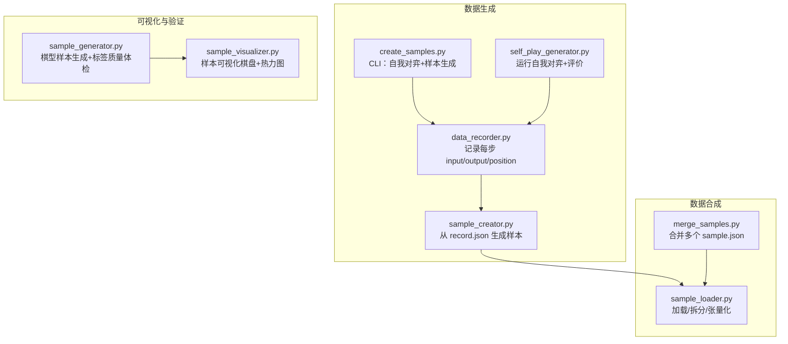
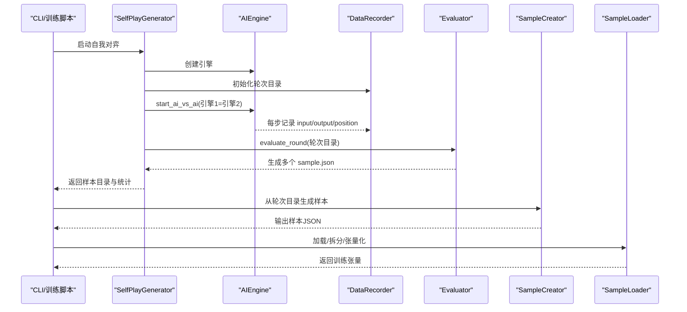
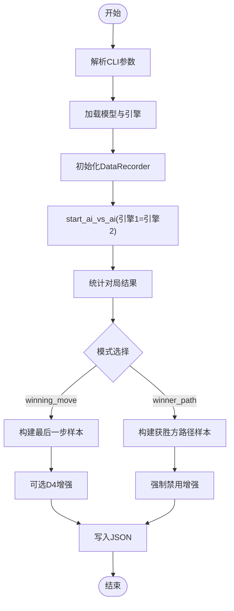
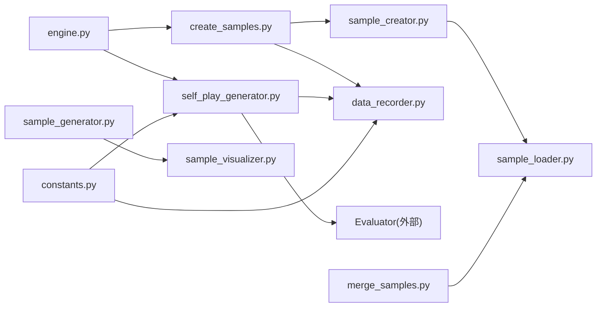

# 数据处理设计

<cite>
**本文引用的文件**
- [ai/create_samples.py](file://ai/create_samples.py)
- [ai/self_play_generator.py](file://ai/self_play_generator.py)
- [ai/data_recorder.py](file://ai/data_recorder.py)
- [ai/sample_creator.py](file://ai/sample_creator.py)
- [ai/merge_samples.py](file://ai/merge_samples.py)
- [ai/sample_generator.py](file://ai/sample_generator.py)
- [ai/sample_visualizer.py](file://ai/sample_visualizer.py)
- [ai/sample_loader.py](file://ai/sample_loader.py)
- [ai/constants.py](file://ai/constants.py)
- [ai/engine.py](file://ai/engine.py)
- [design/merge_samples_design.md](file://design/merge_samples_design.md)
- [design/sample_visualizer_design.md](file://design/sample_visualizer_design.md)
- [README.md](file://README.md)
</cite>

## 目录
1. [简介](#简介)
2. [项目结构](#项目结构)
3. [核心组件](#核心组件)
4. [架构总览](#架构总览)
5. [组件详解](#组件详解)
6. [依赖关系分析](#依赖关系分析)
7. [性能考量](#性能考量)
8. [故障排查指南](#故障排查指南)
9. [结论](#结论)
10. [附录](#附录)

## 简介
本设计文档面向五子棋AI数据处理系统，围绕“样本生成—标注—预处理—合并—可视化—存储—质量控制—流程闭环”的全链路进行系统化梳理。重点涵盖：
- 自我对弈数据的采集、标注与预处理
- 样本格式设计（输入特征向量、目标输出、掩码与元数据）
- 多来源数据的合并、去重与质量筛选
- 样本可视化与统计分析
- 数据存储架构与访问模式
- 数据质量控制与异常检测
- 从原始数据到训练样本的完整转换流程
- 缓存与性能优化策略

## 项目结构
数据处理相关模块主要位于 ai/ 目录，配合设计文档与README中的使用说明，形成“生成—合并—加载—训练”的闭环。

**图表来源**
- [ai/create_samples.py:23-196](file://ai/create_samples.py#L23-L196)
- [ai/self_play_generator.py:21-243](file://ai/self_play_generator.py#L21-L243)
- [ai/data_recorder.py:17-144](file://ai/data_recorder.py#L17-L144)
- [ai/sample_creator.py:32-338](file://ai/sample_creator.py#L32-L338)
- [ai/merge_samples.py:105-154](file://ai/merge_samples.py#L105-L154)
- [ai/sample_loader.py:67-239](file://ai/sample_loader.py#L67-L239)
- [ai/sample_generator.py:261-510](file://ai/sample_generator.py#L261-L510)
- [ai/sample_visualizer.py:296-495](file://ai/sample_visualizer.py#L296-L495)

**章节来源**
- [README.md:76-144](file://README.md#L76-L144)

## 核心组件
- 样本生成器（create_samples.py）：CLI入口，驱动AI引擎自我对弈，记录每步数据，随后用SampleCreator生成训练样本并写入JSON。
- 自我对弈生成器（self_play_generator.py）：封装自我对弈与评价流程，生成多个sample.json目录，供后续合并与训练。
- 数据记录器（data_recorder.py）：按轮次与对局建立目录，记录每步input、output、position，最终保存完整记录文件。
- 样本创建器（sample_creator.py）：支持两种模式（winning_move、winner_path），可选D4增强，生成标准化样本。
- 样本合并器（merge_samples.py）：递归发现sample.json，合并为单个大文件，降低训练I/O开销。
- 棋型样本生成器（sample_generator.py）：按指定棋型合成15×15棋盘，计算奖励并生成软标签，提供标签质量体检。
- 样本可视化器（sample_visualizer.py）：绘制棋盘、棋子、热力图与攻击位标记，支持新旧样本格式。
- 样本加载器（sample_loader.py）：加载多个样本文件、按比例拆分、准备PyTorch张量。
- 常量与引擎（constants.py、engine.py）：提供数据目录常量与棋盘向量转换、落子策略等基础能力。

**章节来源**
- [ai/create_samples.py:23-196](file://ai/create_samples.py#L23-L196)
- [ai/self_play_generator.py:21-243](file://ai/self_play_generator.py#L21-L243)
- [ai/data_recorder.py:17-144](file://ai/data_recorder.py#L17-L144)
- [ai/sample_creator.py:32-338](file://ai/sample_creator.py#L32-L338)
- [ai/merge_samples.py:105-154](file://ai/merge_samples.py#L105-L154)
- [ai/sample_generator.py:261-510](file://ai/sample_generator.py#L261-L510)
- [ai/sample_visualizer.py:296-495](file://ai/sample_visualizer.py#L296-L495)
- [ai/sample_loader.py:67-239](file://ai/sample_loader.py#L67-L239)
- [ai/constants.py:11-22](file://ai/constants.py#L11-L22)
- [ai/engine.py:174-193](file://ai/engine.py#L174-L193)

## 架构总览
整体流程从“自我对弈”开始，经“样本生成与增强”，再到“合并与加载”，最终进入“训练”。可视化贯穿始终，用于质量把控与问题定位。

**图表来源**
- [ai/self_play_generator.py:21-167](file://ai/self_play_generator.py#L21-L167)
- [ai/engine.py:67-142](file://ai/engine.py#L67-L142)
- [ai/data_recorder.py:96-141](file://ai/data_recorder.py#L96-L141)
- [ai/sample_creator.py:60-104](file://ai/sample_creator.py#L60-L104)
- [ai/sample_loader.py:116-165](file://ai/sample_loader.py#L116-L165)

## 组件详解

### 样本生成与标注（create_samples.py）
- 功能：解析CLI参数，加载模型与引擎，执行自我对弈，记录每步数据，生成样本并写入JSON。
- 关键点：
  - 模式选择：winning_move（每局最后一步）与winner_path（获胜方整条路径）。
  - 数据增强：默认启用D4群8变换；winner_path模式强制禁用。
  - 温度采样：可配置温度、移动步数、作用方与随机种子。
  - 输出：统计对局结果、样本数、输出路径。

**图表来源**
- [ai/create_samples.py:23-196](file://ai/create_samples.py#L23-L196)
- [ai/sample_creator.py:38-104](file://ai/sample_creator.py#L38-L104)

**章节来源**
- [ai/create_samples.py:23-196](file://ai/create_samples.py#L23-L196)
- [README.md:78-113](file://README.md#L78-L113)

### 自我对弈与评价（self_play_generator.py）
- 功能：封装自我对弈与评价流程，生成多个sample.json目录，支持中断恢复与映射训练数据目录。
- 关键点：
  - 优雅处理Ctrl+C，返回已生成数据。
  - 将ai_data目录映射到train_data目录，便于后续训练。
  - 返回round_dir、sample_dirs、results等信息。

**章节来源**
- [ai/self_play_generator.py:21-243](file://ai/self_play_generator.py#L21-L243)

### 数据记录（data_recorder.py）
- 功能：按轮次与对局建立目录，记录每步input、output、position，保存完整记录文件。
- 关键点：
  - 轮次目录命名规则：{ai_name}_{递增整数}。
  - 每次落子记录历史，游戏结束保存winner与end_board。
  - 性能优化：紧凑JSON格式减少文件体积。

**章节来源**
- [ai/data_recorder.py:17-144](file://ai/data_recorder.py#L17-L144)

### 样本创建（sample_creator.py）
- 功能：从record.json生成训练样本，支持两种模式与D4增强。
- 关键点：
  - winning_move：取最后一步，硬标签（落子位=1，其余=0）。
  - winner_path：取获胜方每一步，软标签（基于模型softmax输出，将落子位提升为严格top1后归一化）。
  - D4增强：对225维棋盘与225维输出/掩码同时进行8种变换。
  - 元数据：保留_attack_positions与_shape（新格式）。

**章节来源**
- [ai/sample_creator.py:32-338](file://ai/sample_creator.py#L32-L338)

### 样本合并（merge_samples.py）
- 功能：递归发现sample.json，合并为单个大文件，减少训练I/O开销。
- 关键点：
  - 发现规则：递归遍历目录，收集sample.json，忽略以merge_开头的文件。
  - 去重：使用dict.fromkeys去重并保持排序。
  - 输出：紧凑JSON格式，减少文件体积。

**章节来源**
- [ai/merge_samples.py:13-102](file://ai/merge_samples.py#L13-L102)
- [design/merge_samples_design.md:1-247](file://design/merge_samples_design.md#L1-L247)

### 棋型样本生成与标签质量体检（sample_generator.py）
- 功能：按指定棋型合成15×15棋盘，计算奖励并生成软标签，提供标签质量体检。
- 关键点：
  - 支持棋型：chong4、huo4、huo3、huo2、defend_chong4、defend_huo3。
  - 生成阶段记录attack_positions，验证阶段直接消费。
  - 标签质量指标：Hit@N、Hit@N+1、Hit@N+2、attack_prob_sum、prob_gap。
  - 干扰子放置后必须通过detect_shapes二次校验。

**章节来源**
- [ai/sample_generator.py:261-510](file://ai/sample_generator.py#L261-L510)

### 样本可视化（sample_visualizer.py）
- 功能：绘制棋盘、棋子、热力图与攻击位标记，支持新旧样本格式。
- 关键点：
  - 兼容新旧格式：新格式含_attack_positions/_shape/mask，旧格式走argmax兜底。
  - 热力图：基于visualization.heatmap_color，支持log/max/linear归一化。
  - 布局：尽量接近正方形，隐藏多余子图。

**章节来源**
- [ai/sample_visualizer.py:296-495](file://ai/sample_visualizer.py#L296-L495)
- [design/sample_visualizer_design.md:1-115](file://design/sample_visualizer_design.md#L1-L115)

### 样本加载与预处理（sample_loader.py）
- 功能：加载多个样本文件、按比例拆分、准备PyTorch张量。
- 关键点：
  - discover_all_data：递归发现所有.json文件，不限文件名前缀。
  - load_and_split：按val_ratio拆分训练/验证集，使用独立随机源确保可复现。
  - prepare_tensors：将样本转换为模型所需张量，自动移动至GPU。

**章节来源**
- [ai/sample_loader.py:67-239](file://ai/sample_loader.py#L67-L239)

### 引擎与常量（engine.py、constants.py）
- 功能：提供棋盘向量转换、落子策略选择与数据目录常量。
- 关键点：
  - board_to_vector：将15×15棋盘展平为226维向量（末位为当前玩家）。
  - 常量：AI_DATA_DIR、TRAIN_DATA_DIR、LOSS_LOG_DIR等。

**章节来源**
- [ai/engine.py:174-193](file://ai/engine.py#L174-L193)
- [ai/constants.py:11-22](file://ai/constants.py#L11-L22)

## 依赖关系分析

**图表来源**
- [ai/create_samples.py:15-19](file://ai/create_samples.py#L15-L19)
- [ai/self_play_generator.py:11-15](file://ai/self_play_generator.py#L11-L15)
- [ai/data_recorder.py:12-14](file://ai/data_recorder.py#L12-L14)
- [ai/sample_creator.py:15-17](file://ai/sample_creator.py#L15-L17)
- [ai/merge_samples.py:6-10](file://ai/merge_samples.py#L6-L10)
- [ai/sample_generator.py:33-35](file://ai/sample_generator.py#L33-L35)
- [ai/sample_visualizer.py:36-39](file://ai/sample_visualizer.py#L36-L39)
- [ai/engine.py:9-15](file://ai/engine.py#L9-L15)
- [ai/constants.py:9-15](file://ai/constants.py#L9-L15)

## 性能考量
- I/O优化
  - 合并样本：将分散的sample.json合并为单个大文件，减少训练时打开/解析文件的开销。
  - 紧凑JSON：DataRecorder与merge_samples均采用无缩进写入，降低文件体积。
- 计算优化
  - 列表推导与就地操作：SampleLoader.prepare_tensors使用列表推导与就地张量化，减少Python解释器开销。
  - 设备迁移：将张量一次性移动至GPU，避免频繁设备切换。
- 并行与中断
  - 自我对弈阶段支持多进程并行（Evaluator），并在Ctrl+C时优雅退出，返回已生成数据。

**章节来源**
- [ai/merge_samples.py:63-70](file://ai/merge_samples.py#L63-L70)
- [ai/data_recorder.py:137-140](file://ai/data_recorder.py#L137-L140)
- [ai/sample_loader.py:215-239](file://ai/sample_loader.py#L215-L239)
- [ai/self_play_generator.py:138-167](file://ai/self_play_generator.py#L138-L167)

## 故障排查指南
- 样本格式异常
  - 硬标签越界：winning_move模式下，落子坐标需满足行列均在[0,15)范围内，越界则输出保持全0。
  - 软标签异常：winner_path模式下，若落子位已是严格top1或越界，则直接返回原分布。
- 数据合并冲突
  - merge_*.json文件不会被再次收集，避免重复合并。
  - 去重策略：使用dict.fromkeys去重，保证顺序与唯一性。
- 可视化问题
  - 热力图模式：支持log/max/linear，超出范围将抛出参数错误。
  - 字体问题：自动探测CJK字体，缺失时标题中文字可能显示为方框。
- 训练加载问题
  - discover_all_data：递归扫描所有.json文件，确保目录权限与文件完整性。
  - load_and_split：val_ratio必须在[0,1)范围内，否则抛出异常。

**章节来源**
- [ai/sample_creator.py:126-135](file://ai/sample_creator.py#L126-L135)
- [ai/sample_creator.py:171-231](file://ai/sample_creator.py#L171-L231)
- [ai/merge_samples.py:33-35](file://ai/merge_samples.py#L33-L35)
- [ai/merge_samples.py:98-100](file://ai/merge_samples.py#L98-L100)
- [ai/sample_visualizer.py:341-352](file://ai/sample_visualizer.py#L341-L352)
- [ai/sample_loader.py:139-140](file://ai/sample_loader.py#L139-L140)

## 结论
本设计文档系统化梳理了五子棋AI数据处理的全链路：从自我对弈与记录，到样本生成与增强，再到合并与加载，辅以可视化与质量体检，最终进入训练。通过合并大文件、紧凑JSON、列表推导与设备迁移等优化手段，显著降低了I/O与内存开销。配套的设计文档与CLI使用说明，确保流程清晰、可复现、易维护。

## 附录
- 使用建议
  - 生成样本：优先使用create_samples.py或self_play_generator.py，结合温度采样提升开局多样性。
  - 合并数据：在大规模自我对弈后，使用merge_samples.py合并为单个大文件，提升训练效率。
  - 可视化验证：使用sample_visualizer.py对样本进行抽样可视化，快速定位标签异常。
  - 质量控制：利用sample_generator.py的标签质量体检指标，持续监控样本质量。