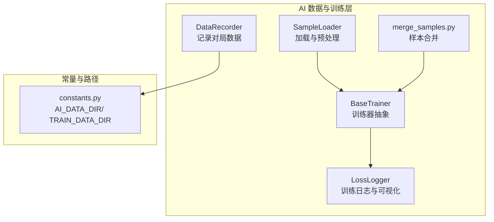
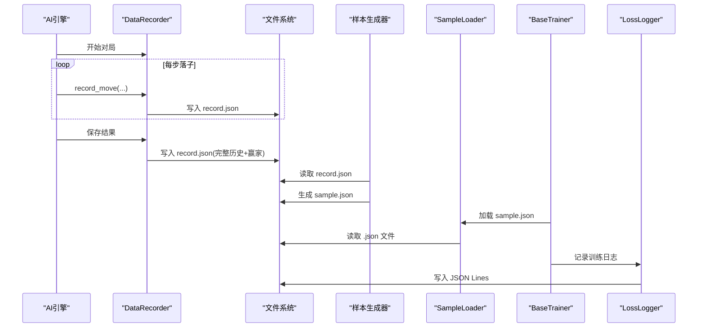
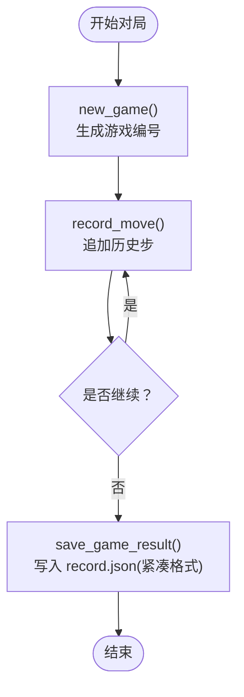
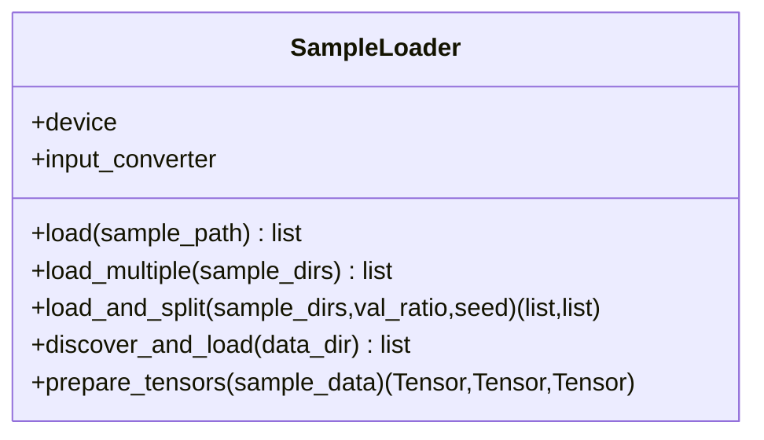
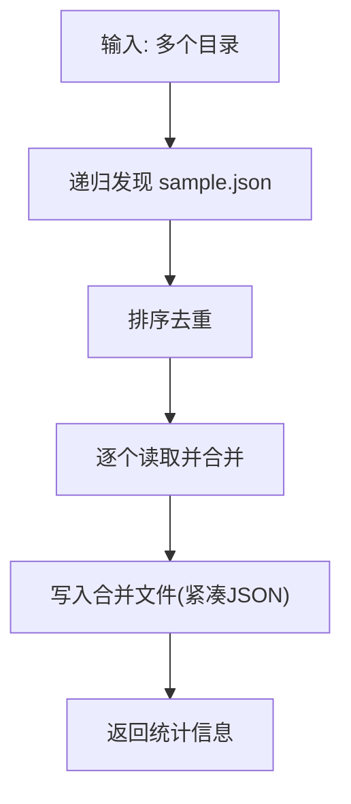
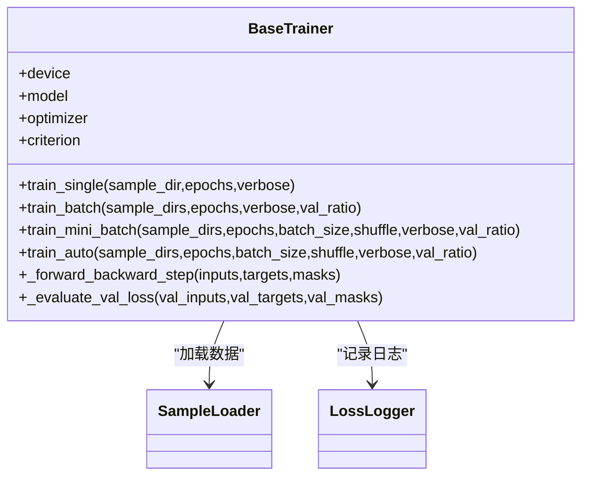
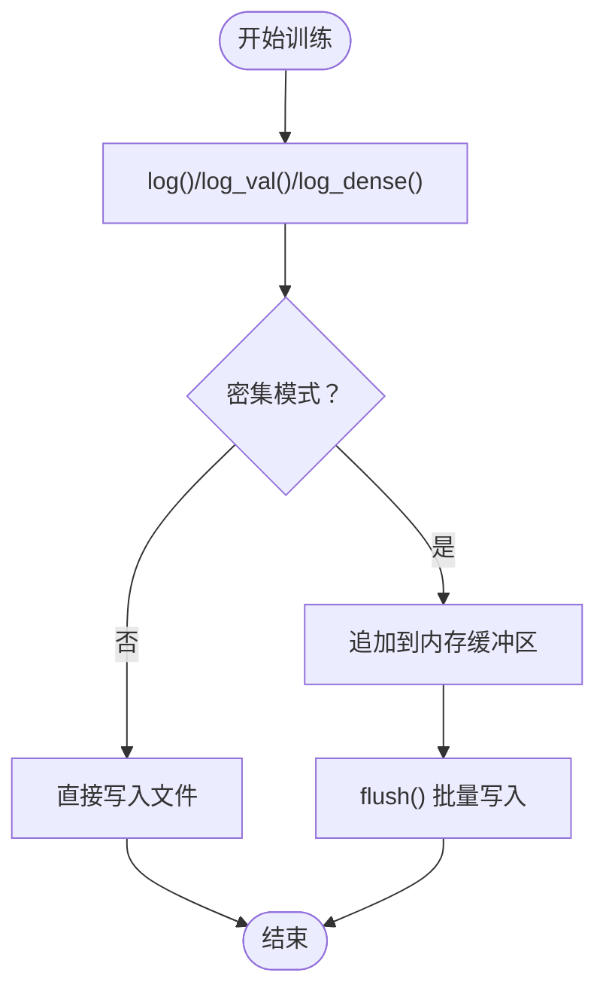
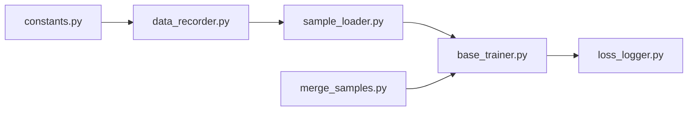
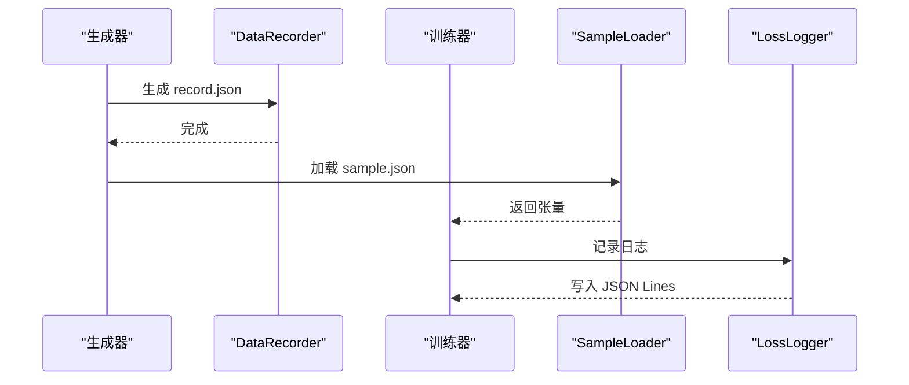

# 数据存储设计

<cite>
**本文引用的文件**
- [ai/data_recorder.py](file://ai/data_recorder.py)
- [ai/constants.py](file://ai/constants.py)
- [ai/sample_loader.py](file://ai/sample_loader.py)
- [ai/merge_samples.py](file://ai/merge_samples.py)
- [ai/create_samples.py](file://ai/create_samples.py)
- [ai/base_trainer.py](file://ai/base_trainer.py)
- [ai/loss_logger.py](file://ai/loss_logger.py)
- [tests/test_write_guard.py](file://tests/test_write_guard.py)
- [tests/ai/test_performance_level1.py](file://tests/ai/test_performance_level1.py)
- [design/loss_curve/loss_curve_design.md](file://design/loss_curve/loss_curve_design.md)
</cite>

## 目录
1. [简介](#简介)
2. [项目结构](#项目结构)
3. [核心组件](#核心组件)
4. [架构总览](#架构总览)
5. [详细组件分析](#详细组件分析)
6. [依赖分析](#依赖分析)
7. [性能考量](#性能考量)
8. [故障排查指南](#故障排查指南)
9. [结论](#结论)
10. [附录](#附录)

## 简介
本设计文档围绕五子棋AI数据存储系统，系统性阐述训练数据的存储理念、文件格式选择、存储结构优化、访问模式设计、架构设计、性能优化、与数据加载的集成、安全性与可靠性保障，以及最佳实践建议。通过对数据记录器、样本加载器、合并脚本、训练器与日志系统的协同分析，给出从“生成-存储-加载-训练”的完整数据流设计与落地方案。

## 项目结构
本项目采用“按功能域分层”的组织方式：
- ai 包：AI训练、数据记录、样本生成与加载、训练器、日志等核心模块
- tests：覆盖数据存储与加载的关键路径，含写入保护、紧凑JSON格式等测试
- design：训练曲线设计文档，体现日志与可视化策略

**图表来源**
- [ai/data_recorder.py:17-145](file://ai/data_recorder.py#L17-L145)
- [ai/sample_loader.py:67-240](file://ai/sample_loader.py#L67-L240)
- [ai/merge_samples.py:13-155](file://ai/merge_samples.py#L13-L155)
- [ai/base_trainer.py:32-699](file://ai/base_trainer.py#L32-L699)
- [ai/loss_logger.py:28-461](file://ai/loss_logger.py#L28-L461)
- [ai/constants.py:6-26](file://ai/constants.py#L6-L26)

**章节来源**
- [ai/constants.py:6-26](file://ai/constants.py#L6-L26)
- [ai/data_recorder.py:17-145](file://ai/data_recorder.py#L17-L145)
- [ai/sample_loader.py:67-240](file://ai/sample_loader.py#L67-L240)
- [ai/merge_samples.py:13-155](file://ai/merge_samples.py#L13-L155)
- [ai/base_trainer.py:32-699](file://ai/base_trainer.py#L32-L699)
- [ai/loss_logger.py:28-461](file://ai/loss_logger.py#L28-L461)

## 核心组件
- 数据记录器 DataRecorder：负责对局数据的逐步记录与落子历史持久化，采用紧凑JSON格式，减少文件体积与I/O开销。
- 样本加载器 SampleLoader：统一从 sample.json 到PyTorch张量的转换，支持多目录合并、训练/验证集拆分与张量准备。
- 样本合并器 merge_samples.py：将分散的 sample.json 合并为单个大文件，降低训练时I/O次数。
- 训练器 BaseTrainer：封装训练流程，支持单轮次、批量与mini-batch训练，结合LossLogger进行日志与可视化。
- 日志记录器 LossLogger：以JSON Lines记录训练日志，支持密集/稀疏模式、验证集日志、降采样与图表生成。

**章节来源**
- [ai/data_recorder.py:17-145](file://ai/data_recorder.py#L17-L145)
- [ai/sample_loader.py:67-240](file://ai/sample_loader.py#L67-L240)
- [ai/merge_samples.py:13-155](file://ai/merge_samples.py#L13-L155)
- [ai/base_trainer.py:32-699](file://ai/base_trainer.py#L32-L699)
- [ai/loss_logger.py:28-461](file://ai/loss_logger.py#L28-L461)

## 架构总览
数据存储与训练的整体架构如下：
- 数据生成：AI对局由 DataRecorder 逐轮记录，生成 record.json；随后通过样本生成流程产出 sample.json。
- 数据组织：ai/ai_data 用于对局记录，ai/train_data 用于训练样本；两者通过相对路径映射实现回溯关联。
- 数据加载：SampleLoader 递归发现 .json 文件，统一加载并转换为张量；支持按比例拆分训练/验证集。
- 训练与日志：BaseTrainer 调用 SampleLoader，配合 LossLogger 记录与可视化训练过程。
- 合并优化：merge_samples.py 将多目录 sample.json 合并为单文件，减少训练I/O。

**图表来源**
- [ai/data_recorder.py:96-141](file://ai/data_recorder.py#L96-L141)
- [ai/sample_loader.py:80-204](file://ai/sample_loader.py#L80-L204)
- [ai/base_trainer.py:324-407](file://ai/base_trainer.py#L324-L407)
- [ai/loss_logger.py:124-177](file://ai/loss_logger.py#L124-L177)

## 详细组件分析

### 数据记录器 DataRecorder
- 目录组织：按轮次(ai_name_递增)创建目录，每局游戏一个子目录，落子历史与结果保存为 record.json。
- 文件格式：采用紧凑JSON（无缩进），显著减少文件体积与I/O成本。
- 数据结构：包含历史步记录、赢家、终局棋盘状态，便于后续样本生成与回溯。
- 一致性保障：自动校正游戏编号，避免跨轮次/跨局数据错配。

**图表来源**
- [ai/data_recorder.py:66-141](file://ai/data_recorder.py#L66-L141)

**章节来源**
- [ai/data_recorder.py:17-145](file://ai/data_recorder.py#L17-L145)
- [tests/ai/test_performance_level1.py:244-272](file://tests/ai/test_performance_level1.py#L244-L272)

### 样本加载器 SampleLoader
- 发现与加载：递归扫描目录，发现所有 .json 文件并加载合并；支持指定目录列表加载。
- 训练/验证拆分：按比例随机拆分，使用独立随机源确保可复现。
- 张量准备：将输入、目标与mask转换为PyTorch张量，并移动到指定设备（CPU/GPU）。
- 错误处理：对缺失文件、非法JSON、参数范围等进行明确异常提示。

**图表来源**
- [ai/sample_loader.py:67-240](file://ai/sample_loader.py#L67-L240)

**章节来源**
- [ai/sample_loader.py:36-240](file://ai/sample_loader.py#L36-L240)

### 样本合并器 merge_samples.py
- 功能：将多目录下的 sample.json 合并为单个文件，减少训练时I/O次数。
- 发现策略：递归遍历目录，收集 sample.json（排除 merge_*.json），排序去重。
- 写入策略：使用紧凑JSON格式，减少文件体积。

**图表来源**
- [ai/merge_samples.py:13-103](file://ai/merge_samples.py#L13-L103)

**章节来源**
- [ai/merge_samples.py:13-155](file://ai/merge_samples.py#L13-L155)

### 训练器 BaseTrainer
- 训练模式：单轮次、批量、mini-batch三种，统一接口，自动选择。
- 设备选择：优先GPU，自动检测CUDA可用性。
- 损失计算：masked L1 loss，结合mask对有效位置求平均。
- 日志与可视化：LossLogger支持稀疏/密集日志、验证集评估、图表生成与降采样。

**图表来源**
- [ai/base_trainer.py:32-699](file://ai/base_trainer.py#L32-L699)
- [ai/sample_loader.py:67-240](file://ai/sample_loader.py#L67-L240)
- [ai/loss_logger.py:28-461](file://ai/loss_logger.py#L28-L461)

**章节来源**
- [ai/base_trainer.py:32-699](file://ai/base_trainer.py#L32-L699)
- [design/loss_curve/loss_curve_design.md:173-224](file://design/loss_curve/loss_curve_design.md#L173-L224)

### 日志记录器 LossLogger
- 文件格式：JSON Lines，支持epoch/step两种x轴键名，可记录val_loss与梯度范数。
- 模式：稀疏（epoch-based）与密集（step-based）两种日志模式，mini-batch默认密集。
- 可视化：matplotlib可选依赖，支持双Y轴图（Loss+Grad Norm）与对比图生成。
- 降采样：超过阈值自动降采样，保证图表可读性。

**图表来源**
- [ai/loss_logger.py:124-177](file://ai/loss_logger.py#L124-L177)

**章节来源**
- [ai/loss_logger.py:28-461](file://ai/loss_logger.py#L28-L461)

## 依赖分析
- 路径与常量：AI_DATA_DIR/ TRAIN_DATA_DIR 由 constants.py 统一定义，贯穿数据记录与训练样本目录。
- 组件耦合：DataRecorder 依赖常量；SampleLoader 依赖 torch；BaseTrainer 依赖 SampleLoader 与 LossLogger；LossLogger 依赖 matplotlib（可选）。
- 外部依赖：torch、json、os、random、argparse、matplotlib（可选）。

**图表来源**
- [ai/constants.py:6-26](file://ai/constants.py#L6-L26)
- [ai/data_recorder.py:12-39](file://ai/data_recorder.py#L12-L39)
- [ai/sample_loader.py:6-12](file://ai/sample_loader.py#L6-L12)
- [ai/base_trainer.py:14-18](file://ai/base_trainer.py#L14-L18)
- [ai/loss_logger.py:25-26](file://ai/loss_logger.py#L25-L26)
- [ai/merge_samples.py:6-11](file://ai/merge_samples.py#L6-L11)

**章节来源**
- [ai/constants.py:6-26](file://ai/constants.py#L6-L26)
- [ai/data_recorder.py:12-39](file://ai/data_recorder.py#L12-L39)
- [ai/sample_loader.py:6-12](file://ai/sample_loader.py#L6-L12)
- [ai/base_trainer.py:14-18](file://ai/base_trainer.py#L14-L18)
- [ai/loss_logger.py:25-26](file://ai/loss_logger.py#L25-L26)
- [ai/merge_samples.py:6-11](file://ai/merge_samples.py#L6-L11)

## 性能考量
- 文件格式优化：record.json 与合并后的样本文件均采用紧凑JSON，减少文件体积与I/O开销。
- I/O合并：merge_samples.py 将多文件合并为单文件，降低训练时文件打开与读取次数。
- 张量预处理：SampleLoader 使用列表推导与直接张量构造，减少Python解释器开销。
- 设备加速：BaseTrainer 自动检测GPU并移动张量，加速训练。
- 日志降采样：LossLogger 对大量日志进行降采样，平衡可视化质量与性能。
- 训练模式选择：mini-batch模式在大批量数据上收敛更快，适合大规模训练。

**章节来源**
- [tests/ai/test_performance_level1.py:244-272](file://tests/ai/test_performance_level1.py#L244-L272)
- [ai/merge_samples.py:42-77](file://ai/merge_samples.py#L42-L77)
- [ai/sample_loader.py:215-239](file://ai/sample_loader.py#L215-L239)
- [ai/base_trainer.py:21-29](file://ai/base_trainer.py#L21-L29)
- [ai/loss_logger.py:328-363](file://ai/loss_logger.py#L328-L363)

## 故障排查指南
- 写入保护：测试期间对受保护目录（如 ai/ai_data、ai/train_data、game/save 等）的写入会被拦截，防止测试污染生产数据。
- JSON格式问题：record.json 与 sample.json 均采用紧凑格式，若出现解析异常，检查文件是否被意外修改为缩进格式。
- 训练数据缺失：SampleLoader 在目录缺少 sample.json 时抛出 FileNotFoundError；确认数据路径与文件存在。
- 验证集比例：train_batch/train_mini_batch 对 val_ratio 进行范围校验，确保 0≤val_ratio<1。
- 日志图表生成：matplotlib不可用时，LossLogger会优雅降级，不影响日志文件写入。

**章节来源**
- [tests/test_write_guard.py:1-176](file://tests/test_write_guard.py#L1-L176)
- [ai/sample_loader.py:139-140](file://ai/sample_loader.py#L139-L140)
- [ai/base_trainer.py:382-383](file://ai/base_trainer.py#L382-L383)
- [ai/loss_logger.py:196-202](file://ai/loss_logger.py#L196-L202)

## 结论
本设计以紧凑JSON为核心存储格式，结合目录组织策略、样本合并与日志降采样，实现了高效、可维护的AI训练数据存储体系。通过 DataRecorder、SampleLoader、merge_samples.py、BaseTrainer 与 LossLogger 的协同，构建了从生成、存储、加载到训练可视化的完整闭环。在保证性能的同时，强化了安全性与可靠性，提供了清晰的错误处理与可复现的训练流程。

## 附录

### 数据存储与加载的完整数据流
- 生成阶段：DataRecorder 记录对局历史与结果，生成 record.json；样本生成器基于 record.json 生成 sample.json。
- 存储阶段：ai/ai_data 保存对局记录，ai/train_data 保存训练样本；两者通过相对路径映射实现回溯。
- 加载阶段：SampleLoader 递归发现 .json 文件，合并并转换为张量；BaseTrainer 选择训练模式并训练。
- 可视化阶段：LossLogger 记录训练日志，生成曲线图并支持对比图。

**图表来源**
- [ai/data_recorder.py:96-141](file://ai/data_recorder.py#L96-L141)
- [ai/sample_loader.py:80-204](file://ai/sample_loader.py#L80-L204)
- [ai/base_trainer.py:324-407](file://ai/base_trainer.py#L324-L407)
- [ai/loss_logger.py:124-177](file://ai/loss_logger.py#L124-L177)

### 安全性与可靠性设计
- 写入保护：测试期间拦截对受保护目录的写入，防止测试污染生产数据。
- 数据完整性：record.json 与 sample.json 采用紧凑JSON，减少格式错误风险；SampleLoader 对JSON解析异常进行捕获与提示。
- 错误恢复：训练器在键盘中断时保存模型与图表，支持安全退出与后续恢复。

**章节来源**
- [tests/test_write_guard.py:1-176](file://tests/test_write_guard.py#L1-L176)
- [ai/sample_loader.py:93-94](file://ai/sample_loader.py#L93-L94)
- [ai/base_trainer.py:314-322](file://ai/base_trainer.py#L314-L322)

### 最佳实践指南
- 文件命名规范：对局记录使用 record.json，训练样本使用 sample.json；合并文件使用 merge_*.json 前缀。
- 目录结构建议：ai/ai_data 用于对局记录，ai/train_data 用于训练样本；两者通过相对路径映射。
- 存储空间管理：定期清理旧轮次数据，使用 merge_samples.py 合并小文件；监控日志文件大小。
- 迁移策略：合并文件时注意去重与排序，确保路径一致性；迁移后验证相对路径映射。

**章节来源**
- [ai/merge_samples.py:13-103](file://ai/merge_samples.py#L13-L103)
- [ai/constants.py:11-15](file://ai/constants.py#L11-L15)