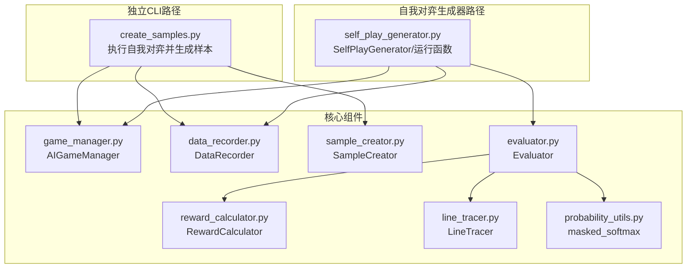
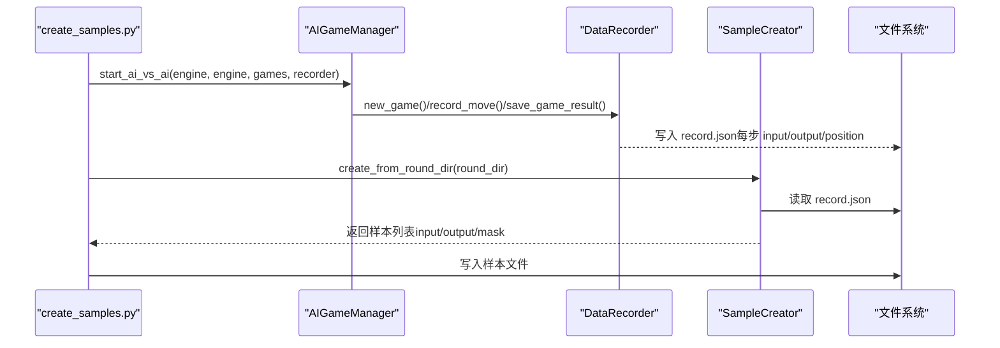
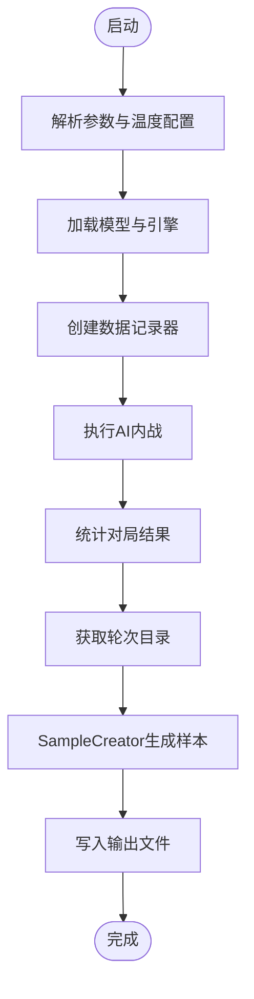
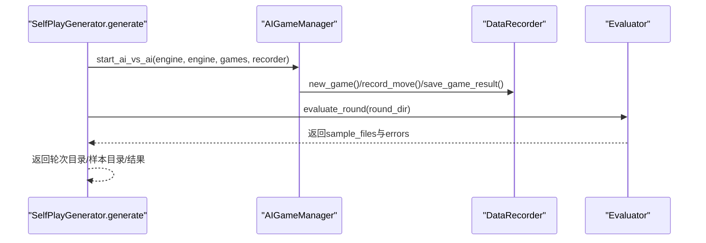
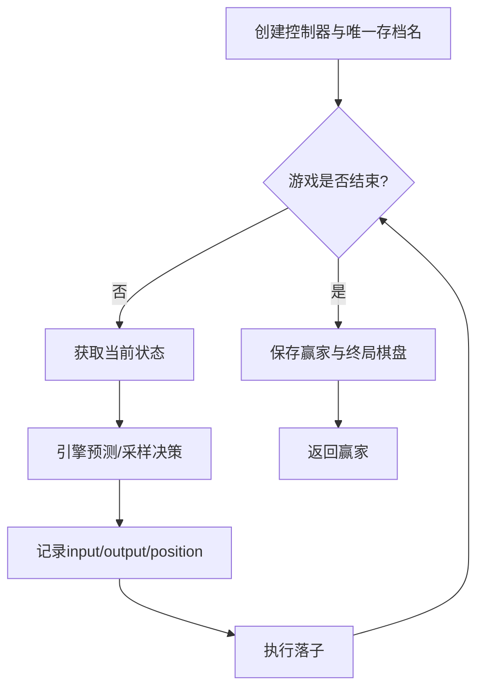
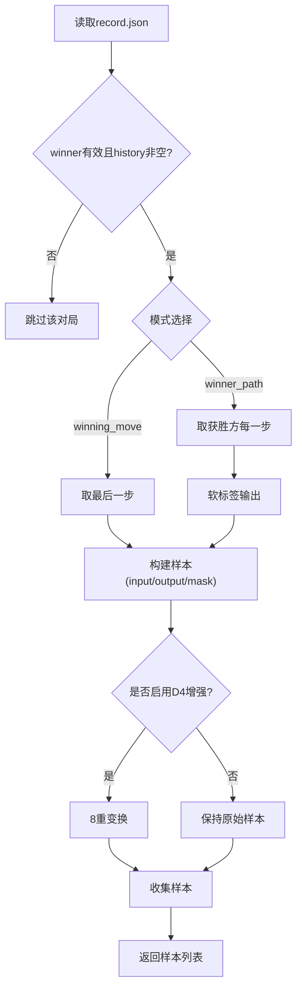
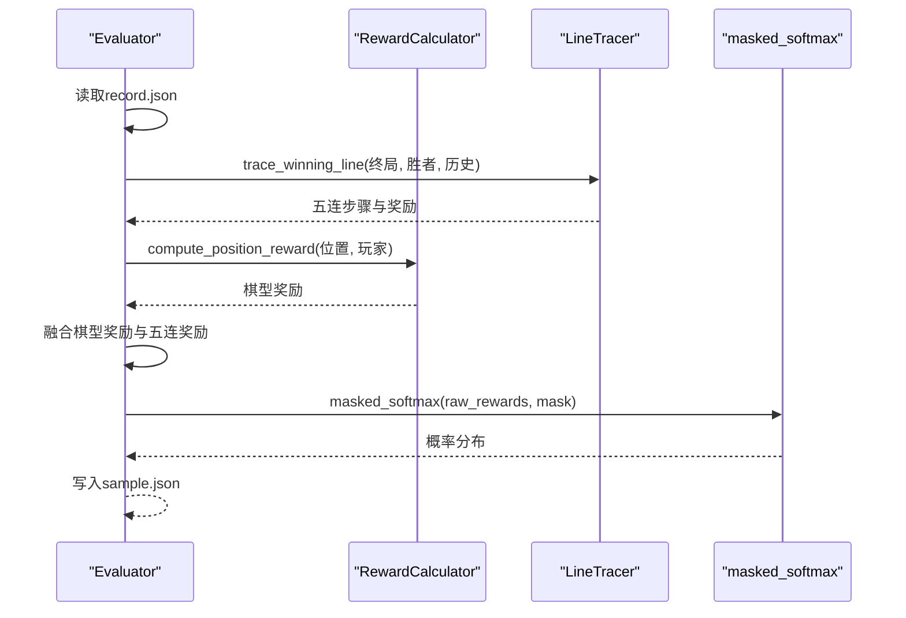
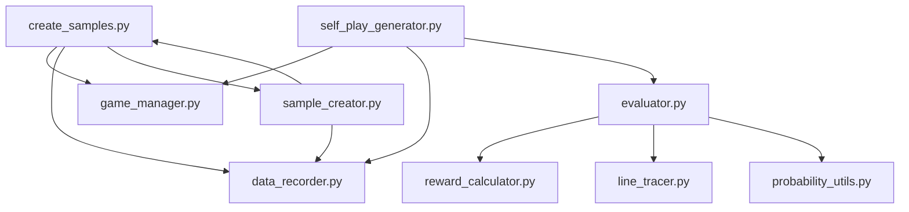

# 样本生成设计

<cite>
**本文引用的文件**
- [ai/create_samples.py](file://ai/create_samples.py)
- [ai/self_play_generator.py](file://ai/self_play_generator.py)
- [ai/game_manager.py](file://ai/game_manager.py)
- [ai/data_recorder.py](file://ai/data_recorder.py)
- [ai/sample_creator.py](file://ai/sample_creator.py)
- [ai/evaluator.py](file://ai/evaluator.py)
- [ai/reward_calculator.py](file://ai/reward_calculator.py)
- [ai/line_tracer.py](file://ai/line_tracer.py)
- [ai/probability_utils.py](file://ai/probability_utils.py)
- [ai/constants.py](file://ai/constants.py)
- [ai/merge_samples.py](file://ai/merge_samples.py)
- [design/sample_creator_design.md](file://design/sample_creator_design.md)
- [design/merge_samples_design.md](file://design/merge_samples_design.md)
</cite>

## 目录
1. [简介](#简介)
2. [项目结构](#项目结构)
3. [核心组件](#核心组件)
4. [架构总览](#架构总览)
5. [详细组件分析](#详细组件分析)
6. [依赖关系分析](#依赖关系分析)
7. [性能考量](#性能考量)
8. [故障排查指南](#故障排查指南)
9. [结论](#结论)
10. [附录](#附录)

## 简介
本设计文档围绕五子棋AI样本生成系统，系统性阐述自我对弈过程中样本生成的设计理念与实现细节。内容涵盖：
- 自我对弈数据采集、标注与格式化流程
- 样本格式规范（输入特征向量、目标输出、标签组织）
- 质量控制机制（合法性检查、重复性处理、异常值过滤）
- 性能优化设计（批量生成、内存管理、并发处理）
- 与训练流程的集成（从对局结束到样本可用的完整转换）
- 配置选项与参数调优建议

## 项目结构
样本生成涉及两大路径：
- 独立CLI路径：通过独立脚本执行自我对弈并生成样本，适合离线批量生成
- 自我对弈生成器路径：封装为可复用模块，支持在训练流程中直接调用

图表来源
- [ai/create_samples.py:23-196](file://ai/create_samples.py#L23-L196)
- [ai/self_play_generator.py:21-244](file://ai/self_play_generator.py#L21-L244)
- [ai/game_manager.py:123-339](file://ai/game_manager.py#L123-L339)
- [ai/data_recorder.py:17-145](file://ai/data_recorder.py#L17-L145)
- [ai/sample_creator.py:32-339](file://ai/sample_creator.py#L32-L339)
- [ai/evaluator.py:51-350](file://ai/evaluator.py#L51-L350)
- [ai/reward_calculator.py:35-239](file://ai/reward_calculator.py#L35-L239)
- [ai/line_tracer.py:10-143](file://ai/line_tracer.py#L10-L143)
- [ai/probability_utils.py:15-59](file://ai/probability_utils.py#L15-L59)

章节来源
- [ai/create_samples.py:23-196](file://ai/create_samples.py#L23-L196)
- [ai/self_play_generator.py:21-244](file://ai/self_play_generator.py#L21-L244)

## 核心组件
- 自我对弈执行器：负责创建引擎、记录器，执行AI内战并对局结果进行统计
- 数据记录器：按轮次与对局粒度持久化record.json，包含每步input、output、position与最终结果
- 样本生成器：从record.json构建训练样本，支持winning_move与winner_path两种模式，内置D4数据增强
- 评估器：将record.json转换为sample.json，融合棋型奖励与五连追溯奖励，使用Softmax生成概率分布
- 奖励计算器：将棋型检测结果映射为数值奖励，支持冲四递归防守模拟
- 五连追溯器：从终局棋盘追溯形成五连的落子步骤，按衰减率反向传播奖励
- 概率工具：带mask的数值稳定Softmax，确保大规模reward缩放下的数值稳定性

章节来源
- [ai/game_manager.py:123-339](file://ai/game_manager.py#L123-L339)
- [ai/data_recorder.py:17-145](file://ai/data_recorder.py#L17-L145)
- [ai/sample_creator.py:32-339](file://ai/sample_creator.py#L32-L339)
- [ai/evaluator.py:51-350](file://ai/evaluator.py#L51-L350)
- [ai/reward_calculator.py:35-239](file://ai/reward_calculator.py#L35-L239)
- [ai/line_tracer.py:10-143](file://ai/line_tracer.py#L10-L143)
- [ai/probability_utils.py:15-59](file://ai/probability_utils.py#L15-L59)

## 架构总览
样本生成从“自我对弈”到“训练样本”的完整链路如下：

图表来源
- [ai/create_samples.py:158-192](file://ai/create_samples.py#L158-L192)
- [ai/game_manager.py:123-231](file://ai/game_manager.py#L123-L231)
- [ai/data_recorder.py:66-141](file://ai/data_recorder.py#L66-L141)
- [ai/sample_creator.py:60-104](file://ai/sample_creator.py#L60-L104)

## 详细组件分析

### 组件A：独立CLI样本生成器（create_samples.py）
- 功能概述
  - 解析命令行参数（模型、模式、对局数、输出、是否启用数据增强、温度采样配置）
  - 加载模型与引擎，创建数据记录器
  - 执行AI内战，统计对局结果
  - 从轮次目录生成样本并写入JSON文件
- 关键流程
  - 温度采样配置解析与校验
  - AIGameManager.start_ai_vs_ai执行对弈
  - SampleCreator.create_from_round_dir生成样本
  - 输出统计与文件写入

图表来源
- [ai/create_samples.py:23-196](file://ai/create_samples.py#L23-L196)

章节来源
- [ai/create_samples.py:23-196](file://ai/create_samples.py#L23-L196)

### 组件B：自我对弈生成器（self_play_generator.py）
- 功能概述
  - 封装自我对弈与评价的公共逻辑，支持并行评价
  - 提供run_self_play_and_evaluate与SelfPlayGenerator两类入口
  - 支持键盘中断优雅退出，返回已生成进度
- 关键流程
  - 创建引擎与记录器
  - 执行AI内战并统计结果
  - 调用Evaluator.evaluate_round生成sample.json
  - 返回轮次目录、样本目录与结果统计

图表来源
- [ai/self_play_generator.py:170-244](file://ai/self_play_generator.py#L170-L244)
- [ai/game_manager.py:233-339](file://ai/game_manager.py#L233-L339)
- [ai/evaluator.py:224-350](file://ai/evaluator.py#L224-L350)

章节来源
- [ai/self_play_generator.py:21-244](file://ai/self_play_generator.py#L21-L244)

### 组件C：AI对弈管理器（AIGameManager）
- 功能概述
  - 管理单局AI内战流程：创建控制器、执行落子循环、记录每步数据、保存结果
  - 支持温度采样策略：按步数与执方动态切换采样/argmax
  - 每步仅调用一次模型预测，兼顾性能与一致性
- 关键流程
  - _play_single_game：创建控制器、记录每步、保存结果
  - start_ai_vs_ai：批量执行多局对弈并统计结果

图表来源
- [ai/game_manager.py:123-231](file://ai/game_manager.py#L123-L231)

章节来源
- [ai/game_manager.py:123-339](file://ai/game_manager.py#L123-L339)

### 组件D：数据记录器（DataRecorder）
- 功能概述
  - 按轮次与对局粒度创建目录结构
  - 每步记录input（226维：225棋盘+1当前玩家）、output（225维概率分布）、position
  - 游戏结束保存完整记录文件，采用紧凑JSON格式减少体积
- 关键点
  - 游戏编号一致性校验与自动纠正
  - 轮次目录自动生成与唯一性保证

章节来源
- [ai/data_recorder.py:17-145](file://ai/data_recorder.py#L17-L145)

### 组件E：样本生成器（SampleCreator）
- 功能概述
  - 支持winning_move与winner_path两种模式
  - winning_move：取每局最后一步作为样本，可选D4增强（8倍）
  - winner_path：取获胜方每一步作为样本，采用软标签（基于模型输出最小增强至严格top1），强制禁用D4增强
- 关键流程
  - create：遍历record.json，按模式构建样本原型，可选D4增强
  - _build_winner_path_output：软标签算法，确保严格top1与sum=1
  - _augment_sample/_transform_index/_apply_transform：D4群8变换

图表来源
- [ai/sample_creator.py:60-170](file://ai/sample_creator.py#L60-L170)
- [ai/sample_creator.py:171-232](file://ai/sample_creator.py#L171-L232)
- [ai/sample_creator.py:292-317](file://ai/sample_creator.py#L292-L317)

章节来源
- [ai/sample_creator.py:32-339](file://ai/sample_creator.py#L32-L339)
- [design/sample_creator_design.md:367-470](file://design/sample_creator_design.md#L367-L470)

### 组件F：评估器（Evaluator）与奖励体系
- 功能概述
  - 从record.json生成sample.json，融合棋型奖励与五连追溯奖励
  - 使用masked_softmax将raw_rewards转换为概率分布
  - 支持多进程并行评价，Windows spawn模式下使用顶层worker函数
- 关键流程
  - evaluate_record：读取record.json，计算每步reward，生成sample.json
  - _compute_all_rewards：计算棋型奖励+五连追溯奖励，必要时融合
  - evaluate_round：批量并行评价，支持串行/并行回退

图表来源
- [ai/evaluator.py:97-211](file://ai/evaluator.py#L97-L211)
- [ai/reward_calculator.py:46-99](file://ai/reward_calculator.py#L46-L99)
- [ai/line_tracer.py:64-117](file://ai/line_tracer.py#L64-L117)
- [ai/probability_utils.py:15-59](file://ai/probability_utils.py#L15-L59)

章节来源
- [ai/evaluator.py:51-350](file://ai/evaluator.py#L51-L350)
- [ai/reward_calculator.py:35-239](file://ai/reward_calculator.py#L35-L239)
- [ai/line_tracer.py:10-143](file://ai/line_tracer.py#L10-L143)
- [ai/probability_utils.py:15-59](file://ai/probability_utils.py#L15-L59)

### 组件G：温度采样与策略（move_sampler.py）
- 功能概述
  - 提供温度采样函数temperature_sample，支持top_k截断
  - 提供TempConfig封装温度策略参数（T、temp_moves、temp_side、top_k、seed）
  - 提供should_sample与resolve_temp_side辅助函数，编排按步/按方/按局的采样策略
- 关键点
  - 温度T越大越随机，趋近0等价argmax
  - temp_side支持black/white/both/random四种取值
  - 支持按局派生随机源，保证可复现

章节来源
- [ai/move_sampler.py:1-258](file://ai/move_sampler.py#L1-L258)

### 组件H：样本合并（merge_samples.py）
- 功能概述
  - 将分散的sample.json合并为单个大文件，减少训练时I/O开销
  - 支持多目录合并，自动去重与排序
  - CLI入口独立运行，也可被训练流程调用
- 关键流程
  - discover_sample_files：递归发现所有sample.json
  - merge_sample_files：合并为单文件并写入
  - merge_directories：多目录合并

章节来源
- [ai/merge_samples.py:1-155](file://ai/merge_samples.py#L1-L155)
- [design/merge_samples_design.md:151-214](file://design/merge_samples_design.md#L151-L214)

## 依赖关系分析

图表来源
- [ai/create_samples.py:15-21](file://ai/create_samples.py#L15-L21)
- [ai/self_play_generator.py:11-18](file://ai/self_play_generator.py#L11-L18)
- [ai/evaluator.py:14-24](file://ai/evaluator.py#L14-L24)

章节来源
- [ai/create_samples.py:15-21](file://ai/create_samples.py#L15-L21)
- [ai/self_play_generator.py:11-18](file://ai/self_play_generator.py#L11-L18)
- [ai/evaluator.py:14-24](file://ai/evaluator.py#L14-L24)

## 性能考量
- 批量生成与并行
  - Evaluator.evaluate_round支持多进程并行，Windows spawn模式下使用顶层worker函数
  - 并行进程数默认min(os.cpu_count(), 4)，可配置；进程池崩溃自动回退到串行
- 内存管理
  - record.json与sample.json均采用紧凑JSON格式，减少文件体积约50%
  - masked_softmax使用数值稳定缩放（DEFAULT_SOFTMAX_SCALE），避免exp溢出
- 训练I/O优化
  - merge_samples将多文件合并为单文件，降低训练时多次打开/解析文件的开销
- 自我对弈效率
  - 每步仅调用一次模型predict，结果同时用于记录与落子，避免重复推理
  - 温度采样支持top_k截断，减少无效位置的softmax计算

章节来源
- [ai/evaluator.py:277-350](file://ai/evaluator.py#L277-L350)
- [ai/probability_utils.py:15-59](file://ai/probability_utils.py#L15-L59)
- [ai/merge_samples.py:42-77](file://ai/merge_samples.py#L42-L77)
- [ai/game_manager.py:188-222](file://ai/game_manager.py#L188-L222)

## 故障排查指南
- 温度采样参数冲突
  - 当显式启用--no-temp-sampling时，温度相关参数将被忽略并发出警告
- 进程池崩溃
  - 多进程并行时若发生BrokenProcessPool（常见于内存不足），自动回退到串行模式
- 样本数量异常
  - winner_path模式强制禁用D4增强，样本数为获胜方步数（不再剔除首步）
  - 若position越界，winning_move模式output全0，winner_path软标签模式返回模型原分布
- 训练数据加载
  - merge_samples设计支持递归加载所有.json文件，避免遗漏

章节来源
- [ai/create_samples.py:114-137](file://ai/create_samples.py#L114-L137)
- [ai/evaluator.py:325-349](file://ai/evaluator.py#L325-L349)
- [ai/sample_creator.py:171-232](file://ai/sample_creator.py#L171-L232)
- [design/merge_samples_design.md:184-193](file://design/merge_samples_design.md#L184-L193)

## 结论
本设计文档系统阐述了五子棋AI样本生成的全流程：从自我对弈到样本构建，再到与训练流程的无缝衔接。通过winning_move与winner_path两种模式、D4增强策略、软标签化winner_path、以及多进程并行与文件合并等优化手段，既保证了样本质量与多样性，又兼顾了生成与训练的性能表现。

## 附录

### 样本格式设计规范
- 输入特征向量（input）
  - 226维：前225维为棋盘状态（0=空，1=黑，2=白），第226维为当前落子方
- 目标输出（output）
  - 225维概率分布，mask=1的位置有效，sum=1
  - winning_move：仅落子位为1，其余为0
  - winner_path：软标签，基于模型自身softmax输出最小增强至严格top1
- 标签信息（mask）
  - 225维：mask=1表示空位，mask=0表示已落子
- 元数据（下划线字段）
  - _attack_positions：棋型样本的进攻/防守位索引（仅棋型生成器）
  - _shape：棋型类别（仅棋型样本）

章节来源
- [ai/sample_creator.py:110-136](file://ai/sample_creator.py#L110-L136)
- [ai/evaluator.py:162-209](file://ai/evaluator.py#L162-L209)
- [ai/sample_generator.py:287-328](file://ai/sample_generator.py#L287-L328)

### 质量控制机制
- 合法性检查
  - 跳过平局（winner=3）与未结束（winner=0）对局
  - 跳过空history对局
  - position越界时的兜底策略（winning_move全0，winner_path返回模型原分布）
- 重复性处理
  - D4增强生成8个变体，避免对称位置重复强化带来的偏差
  - winner_path模式强制禁用D4增强，避免样本量爆炸
- 异常值过滤
  - masked_softmax对reward进行数值稳定缩放与中心化，避免exp溢出
  - soft label算法确保输出非负且sum=1，clip处理防止负值

章节来源
- [ai/sample_creator.py:78-104](file://ai/sample_creator.py#L78-L104)
- [ai/evaluator.py:175-202](file://ai/evaluator.py#L175-L202)
- [ai/probability_utils.py:15-59](file://ai/probability_utils.py#L15-L59)

### 配置选项与参数调优
- 独立CLI（create_samples.py）
  - --model：模型名称（如cnn_v3.1、fc_v1）
  - --mode：样本生成模式（winning_move、winner_path）
  - --games：对局数
  - --output：输出文件路径（.json）
  - --no-augment：禁用D4增强（winner_path模式强制禁用）
  - --no-temp-sampling/--temperature/--temp-moves/--temp-side/--temp-seed：温度采样相关参数
- 自我对弈生成器（self_play_generator.py）
  - games、rate、max_workers、project_root、temp_config等参数
- 评估器（Evaluator）
  - decay_rate：五连追溯奖励衰减率
  - max_workers：并行进程数
- 样本合并（merge_samples.py）
  - 多目录合并，输出单个大文件

章节来源
- [ai/create_samples.py:25-110](file://ai/create_samples.py#L25-L110)
- [ai/self_play_generator.py:187-243](file://ai/self_play_generator.py#L187-L243)
- [ai/evaluator.py:57-96](file://ai/evaluator.py#L57-L96)
- [ai/merge_samples.py:105-151](file://ai/merge_samples.py#L105-L151)