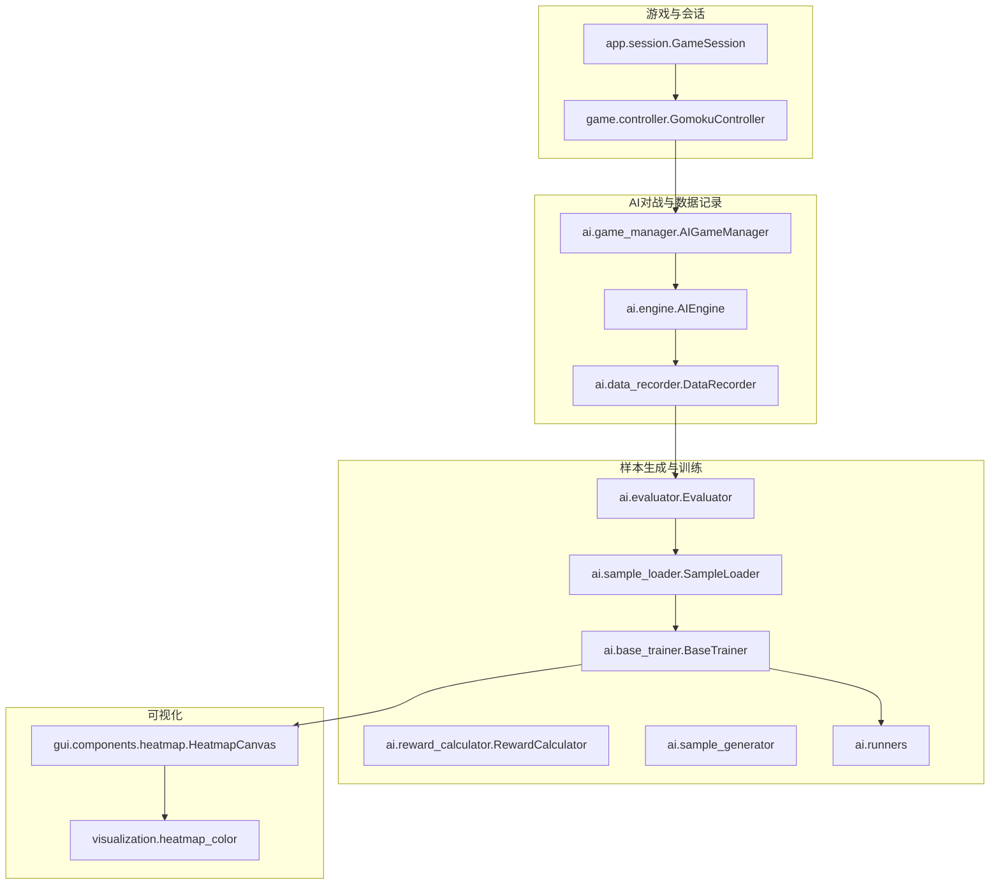
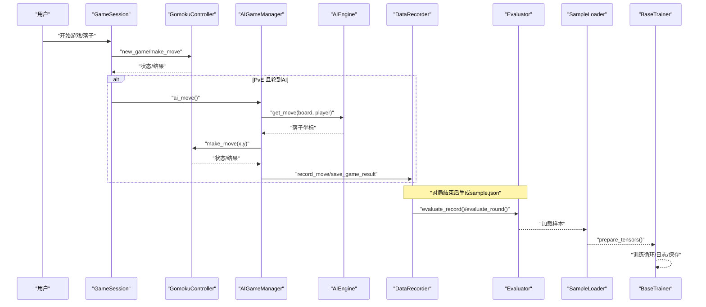
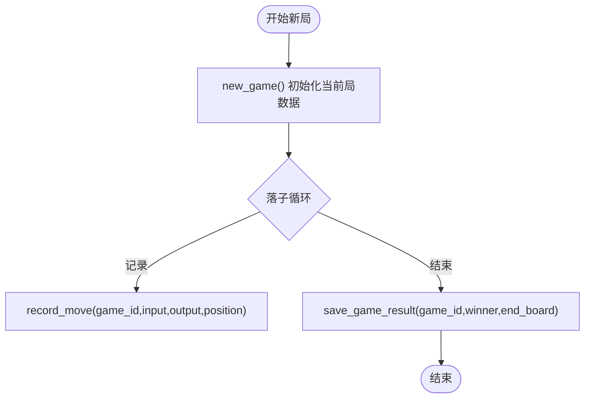
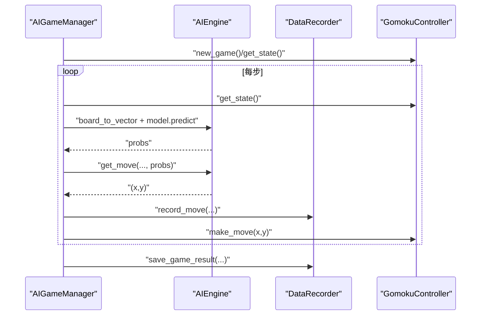
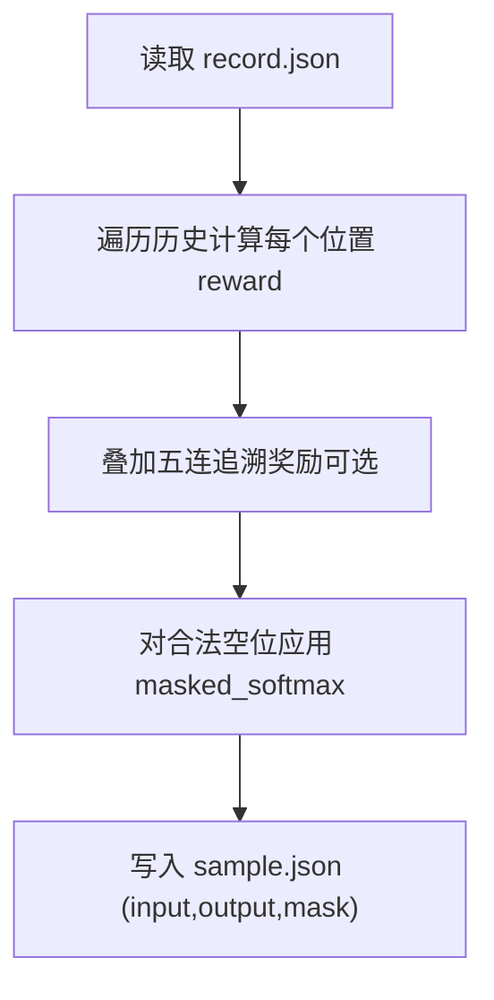
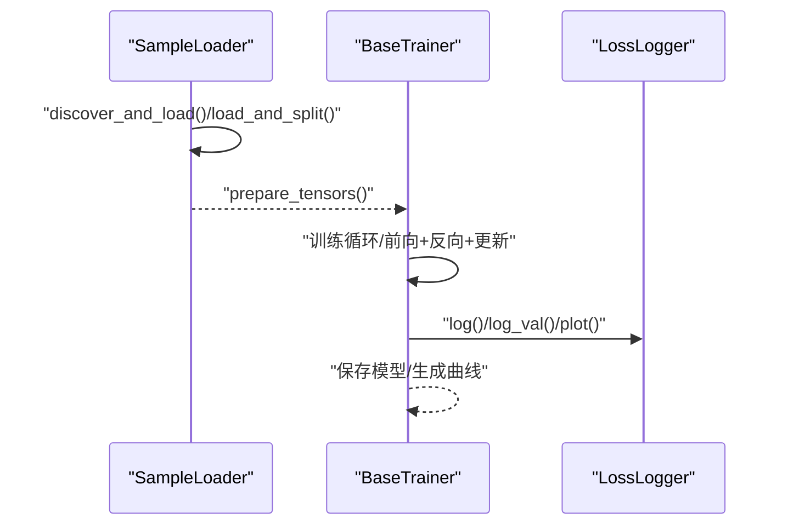
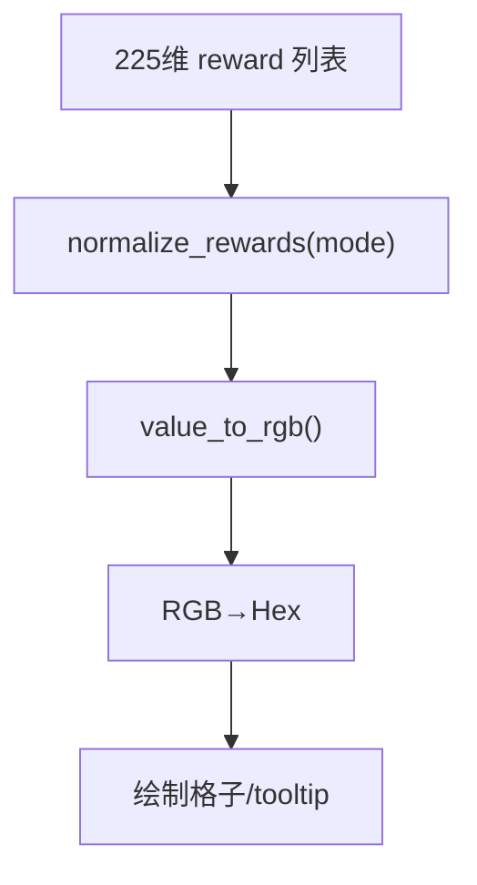
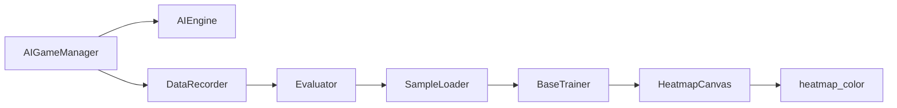

# 数据流设计

<cite>
**本文引用的文件**   
- [ai/data_recorder.py](file://ai/data_recorder.py)
- [ai/game_manager.py](file://ai/game_manager.py)
- [ai/engine.py](file://ai/engine.py)
- [ai/evaluator.py](file://ai/evaluator.py)
- [ai/constants.py](file://ai/constants.py)
- [ai/sample_generator.py](file://ai/sample_generator.py)
- [ai/sample_loader.py](file://ai/sample_loader.py)
- [ai/base_trainer.py](file://ai/base_trainer.py)
- [ai/reward_calculator.py](file://ai/reward_calculator.py)
- [ai/runners.py](file://ai/runners.py)
- [game/controller.py](file://game/controller.py)
- [app/session.py](file://app/session.py)
- [gui/components/heatmap.py](file://gui/components/heatmap.py)
- [visualization/heatmap_color.py](file://visualization/heatmap_color.py)
</cite>

## 目录
1. [简介](#简介)
2. [项目结构](#项目结构)
3. [核心组件](#核心组件)
4. [架构总览](#架构总览)
5. [详细组件分析](#详细组件分析)
6. [依赖分析](#依赖分析)
7. [性能考量](#性能考量)
8. [故障排查指南](#故障排查指南)
9. [结论](#结论)
10. [附录](#附录)

## 简介
本文件面向五子棋AI项目的“数据流设计”，系统梳理从游戏对局到AI训练样本生成、再到模型训练与可视化的完整数据通路。重点覆盖以下方面：
- 数据生命周期：对局数据、AI训练样本、可视化数据
- 数据流转路径：数据产生、传输、处理、存储与消费
- 关键环节：数据格式转换、数据验证、数据缓存与持久化
- 设计原则：一致性、完整性、安全性
- 性能优化：压缩、批量处理、增量更新
- 监控与调试：日志、曲线、错误处理与恢复策略

## 项目结构
围绕数据流的关键模块与文件如下：
- 游戏与会话层：app.session、game.controller
- AI对战与数据记录：ai.engine、ai.game_manager、ai.data_recorder
- 训练样本生成：ai.evaluator、ai.reward_calculator、ai.sample_generator
- 训练与加载：ai.sample_loader、ai.base_trainer、ai.runners
- 可视化：gui.components.heatmap、visualization.heatmap_color
- 常量与路径：ai.constants

**图示来源**
- [app/session.py:12-179](file://app/session.py#L12-L179)
- [game/controller.py:11-194](file://game/controller.py#L11-L194)
- [ai/engine.py:44-194](file://ai/engine.py#L44-L194)
- [ai/game_manager.py:16-339](file://ai/game_manager.py#L16-L339)
- [ai/data_recorder.py:17-145](file://ai/data_recorder.py#L17-L145)
- [ai/evaluator.py:51-350](file://ai/evaluator.py#L51-L350)
- [ai/reward_calculator.py:35-239](file://ai/reward_calculator.py#L35-L239)
- [ai/sample_generator.py:1-511](file://ai/sample_generator.py#L1-L511)
- [ai/sample_loader.py:67-240](file://ai/sample_loader.py#L67-L240)
- [ai/base_trainer.py:32-699](file://ai/base_trainer.py#L32-L699)
- [ai/runners.py:1-255](file://ai/runners.py#L1-L255)
- [gui/components/heatmap.py:68-358](file://gui/components/heatmap.py#L68-L358)
- [visualization/heatmap_color.py:1-204](file://visualization/heatmap_color.py#L1-L204)

**章节来源**
- [ai/constants.py:11-26](file://ai/constants.py#L11-L26)

## 核心组件
- DataRecorder：记录AI对局的每步输入、输出与落子位置，生成轮次目录与局内文件，保存完整对局结果。
- AIGameManager：协调人机/AI对战流程，封装单局与多局对战，调用引擎计算落子并记录数据。
- AIEngine：将棋盘状态向量化，调用模型获取概率分布，按策略选择落子位置。
- Evaluator：读取record.json，计算每个位置的reward并生成sample.json训练样本。
- SampleLoader：发现与加载训练数据，拆分训练/验证集，准备PyTorch张量。
- BaseTrainer：提供训练循环、学习率调度、日志与模型保存，支持批量与mini-batch训练。
- HeatmapCanvas：将225维reward序列映射为热力图颜色，支持悬停tooltip。
- 可视化核心：visualization.heatmap_color提供归一化与颜色映射算法。

**章节来源**
- [ai/data_recorder.py:17-145](file://ai/data_recorder.py#L17-L145)
- [ai/game_manager.py:16-339](file://ai/game_manager.py#L16-L339)
- [ai/engine.py:44-194](file://ai/engine.py#L44-L194)
- [ai/evaluator.py:51-350](file://ai/evaluator.py#L51-L350)
- [ai/sample_loader.py:67-240](file://ai/sample_loader.py#L67-L240)
- [ai/base_trainer.py:32-699](file://ai/base_trainer.py#L32-L699)
- [gui/components/heatmap.py:68-358](file://gui/components/heatmap.py#L68-L358)
- [visualization/heatmap_color.py:63-204](file://visualization/heatmap_color.py#L63-L204)

## 架构总览
数据流贯穿“对局—样本—训练—可视化”四个阶段，采用“紧凑JSON存储 + 批量张量转换”的设计，兼顾易用性与性能。

**图示来源**
- [app/session.py:63-179](file://app/session.py#L63-L179)
- [game/controller.py:65-174](file://game/controller.py#L65-L174)
- [ai/game_manager.py:100-230](file://ai/game_manager.py#L100-L230)
- [ai/engine.py:67-143](file://ai/engine.py#L67-L143)
- [ai/data_recorder.py:96-141](file://ai/data_recorder.py#L96-L141)
- [ai/evaluator.py:97-223](file://ai/evaluator.py#L97-L223)
- [ai/sample_loader.py:206-240](file://ai/sample_loader.py#L206-L240)
- [ai/base_trainer.py:257-323](file://ai/base_trainer.py#L257-L323)

## 详细组件分析

### 数据记录器 DataRecorder
- 职责：创建轮次目录、按局保存历史与结果；记录每步input、output、position；保存winner与终局board。
- 关键点：自动纠正game_id不一致；紧凑JSON格式减少体积；轮次目录命名规则保证唯一性。
- 数据格式：record.json包含history（每步含input、output、position）、winner、end_board。

**图示来源**
- [ai/data_recorder.py:66-141](file://ai/data_recorder.py#L66-L141)

**章节来源**
- [ai/data_recorder.py:17-145](file://ai/data_recorder.py#L17-L145)

### AI对战与数据记录 AIGameManager + AIEngine
- AIGameManager：封装PvE/PvP流程，自动触发AI落子；支持AI内战与随机执方；记录每步数据。
- AIEngine：棋盘向量化（226维）、模型预测（225维概率分布）、策略选择（argmax/sampling）。
- 数据格式：input向量（226维）、output向量（225维）、position坐标。

**图示来源**
- [ai/game_manager.py:124-230](file://ai/game_manager.py#L124-L230)
- [ai/engine.py:67-143](file://ai/engine.py#L67-L143)
- [ai/data_recorder.py:96-141](file://ai/data_recorder.py#L96-L141)

**章节来源**
- [ai/game_manager.py:16-339](file://ai/game_manager.py#L16-L339)
- [ai/engine.py:44-194](file://ai/engine.py#L44-L194)

### 训练样本生成 Evaluator + RewardCalculator
- Evaluator：读取record.json，计算每步reward（双向棋型检测 + 五连追溯），通过Softmax生成概率分布output，生成sample.json。
- RewardCalculator：将棋型映射为reward，支持冲四递归防守模拟与多方向动态奖励。
- 数据格式：input（226维）、output（225维概率分布，mask=1位置和为1）、mask（225维）。

**图示来源**
- [ai/evaluator.py:132-210](file://ai/evaluator.py#L132-L210)
- [ai/reward_calculator.py:46-191](file://ai/reward_calculator.py#L46-L191)

**章节来源**
- [ai/evaluator.py:51-350](file://ai/evaluator.py#L51-L350)
- [ai/reward_calculator.py:35-239](file://ai/reward_calculator.py#L35-L239)

### 训练与数据加载 SampleLoader + BaseTrainer
- SampleLoader：发现与加载.json，按比例拆分训练/验证集，准备PyTorch张量（inputs, targets, masks）。
- BaseTrainer：训练循环、学习率调度、日志记录、模型保存；支持全量与mini-batch两种训练方式。
- 数据格式：inputs(N,226)、targets(N,225)、masks(N,225)；损失函数为masked L1Loss。

**图示来源**
- [ai/sample_loader.py:185-240](file://ai/sample_loader.py#L185-L240)
- [ai/base_trainer.py:257-323](file://ai/base_trainer.py#L257-L323)
- [ai/base_trainer.py:409-574](file://ai/base_trainer.py#L409-L574)

**章节来源**
- [ai/sample_loader.py:67-240](file://ai/sample_loader.py#L67-L240)
- [ai/base_trainer.py:32-699](file://ai/base_trainer.py#L32-L699)

### 可视化 HeatmapCanvas + heatmap_color
- HeatmapCanvas：接收225维reward，归一化后映射颜色，绘制15×15网格，支持悬停tooltip显示原始reward。
- heatmap_color：提供normalize_rewards与value_to_rgb，支持log/max/linear三种归一化模式与自定义色板。

**图示来源**
- [gui/components/heatmap.py:137-221](file://gui/components/heatmap.py#L137-L221)
- [visualization/heatmap_color.py:63-172](file://visualization/heatmap_color.py#L63-L172)

**章节来源**
- [gui/components/heatmap.py:68-358](file://gui/components/heatmap.py#L68-L358)
- [visualization/heatmap_color.py:1-204](file://visualization/heatmap_color.py#L1-L204)

### 棋型样本生成 sample_generator
- 生成指定棋型（chong4/huo4/huo3/huo2/defend_chong4/defend_huo3）的棋盘，标注进攻/防守位，计算reward并归一化为output，提供质量体检与CLI入口。
- 数据格式：input（226维）、output（225维）、mask（225维）、元数据_attack_positions/_shape。

**章节来源**
- [ai/sample_generator.py:261-328](file://ai/sample_generator.py#L261-L328)

## 依赖分析
- 模块耦合
  - AIGameManager依赖AIEngine与DataRecorder，间接依赖GomokuController。
  - Evaluator依赖RewardCalculator与LineTracer（通过Evaluator内部实例化）。
  - BaseTrainer依赖SampleLoader与LossLogger。
  - HeatmapCanvas依赖visualization.heatmap_color。
- 数据依赖
  - record.json → sample.json → 训练张量 → 模型参数更新。
  - 可视化依赖reward序列与颜色映射。

**图示来源**
- [ai/game_manager.py:16-339](file://ai/game_manager.py#L16-L339)
- [ai/engine.py:44-194](file://ai/engine.py#L44-L194)
- [ai/data_recorder.py:17-145](file://ai/data_recorder.py#L17-L145)
- [ai/evaluator.py:51-350](file://ai/evaluator.py#L51-L350)
- [ai/sample_loader.py:67-240](file://ai/sample_loader.py#L67-L240)
- [ai/base_trainer.py:32-699](file://ai/base_trainer.py#L32-L699)
- [gui/components/heatmap.py:68-358](file://gui/components/heatmap.py#L68-L358)
- [visualization/heatmap_color.py:1-204](file://visualization/heatmap_color.py#L1-L204)

**章节来源**
- [ai/game_manager.py:16-339](file://ai/game_manager.py#L16-L339)
- [ai/evaluator.py:51-350](file://ai/evaluator.py#L51-L350)
- [ai/base_trainer.py:32-699](file://ai/base_trainer.py#L32-L699)

## 性能考量
- 数据压缩
  - JSON写入采用紧凑格式（去除indent），减少文件体积约50%。
- 批量处理
  - SampleLoader使用列表推导与张量批处理，减少Python解释器开销。
  - BaseTrainer支持mini-batch与全量更新，mini-batch在大样本场景下收敛更快。
- 增量更新
  - Evaluator支持多进程并行评价，Windows spawn模式下通过顶层worker函数实现。
  - BaseTrainer在密集日志模式下批量写入，降低IO频率。
- 设备加速
  - 自动检测GPU并迁移张量，加速训练。

**章节来源**
- [ai/data_recorder.py:137-140](file://ai/data_recorder.py#L137-L140)
- [ai/sample_loader.py:215-239](file://ai/sample_loader.py#L215-L239)
- [ai/base_trainer.py:257-323](file://ai/base_trainer.py#L257-L323)
- [ai/base_trainer.py:409-574](file://ai/base_trainer.py#L409-L574)
- [ai/evaluator.py:304-349](file://ai/evaluator.py#L304-L349)

## 故障排查指南
- 数据一致性
  - DataRecorder在game_id不一致时自动纠正并记录警告日志，避免跨局数据污染。
- 错误处理
  - Evaluator在record文件无效或未结束时抛出异常；SampleLoader在文件缺失或格式错误时抛出异常；BaseTrainer在训练中断时保存进度并生成图表。
- 恢复策略
  - 进程池崩溃时回退到串行模式继续处理剩余文件。
  - 训练中断时保存模型与损失曲线，支持安全退出与后续恢复。
- 调试建议
  - 使用LossLogger输出epoch/step级别的损失与学习率，结合可视化组件观察reward分布。

**章节来源**
- [ai/data_recorder.py:81-95](file://ai/data_recorder.py#L81-L95)
- [ai/evaluator.py:114-116](file://ai/evaluator.py#L114-L116)
- [ai/sample_loader.py:89-92](file://ai/sample_loader.py#L89-L92)
- [ai/base_trainer.py:314-322](file://ai/base_trainer.py#L314-L322)
- [ai/evaluator.py:335-349](file://ai/evaluator.py#L335-L349)

## 结论
本项目通过清晰的数据流设计实现了从对局到样本、从样本到训练、从训练到可视化的闭环。关键在于：
- 统一的数据格式与严格的生命周期管理
- 高效的批量与并行处理
- 完善的日志与错误恢复机制
- 可扩展的可视化与评估工具

## 附录

### 数据字典
- record.json（对局记录）
  - 字段：history（数组，每项含input、output、position）、winner（1/2/3/0）、end_board（226维或225维）
  - 用途：生成训练样本
- sample.json（训练样本）
  - 字段：input（226维）、output（225维，概率分布，mask=1位置和为1）、mask（225维）
  - 用途：模型训练
- reward序列（可视化输入）
  - 字段：长度225的数值列表
  - 用途：HeatmapCanvas绘制热力图

**章节来源**
- [ai/data_recorder.py:74-78](file://ai/data_recorder.py#L74-L78)
- [ai/evaluator.py:204-208](file://ai/evaluator.py#L204-L208)
- [gui/components/heatmap.py:137-162](file://gui/components/heatmap.py#L137-L162)