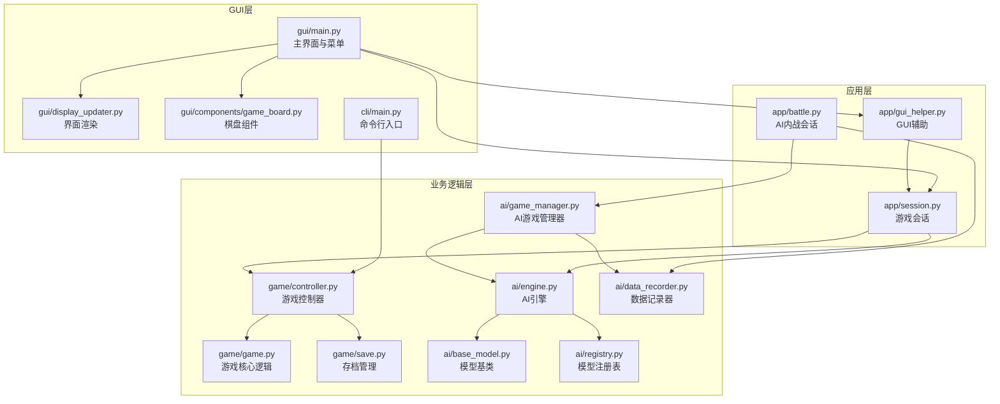
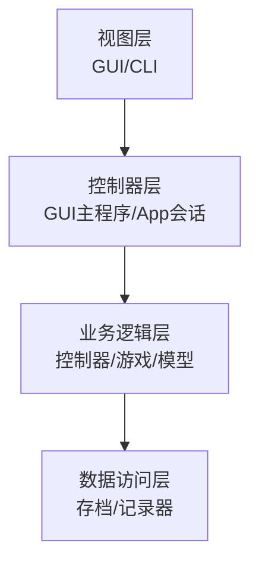
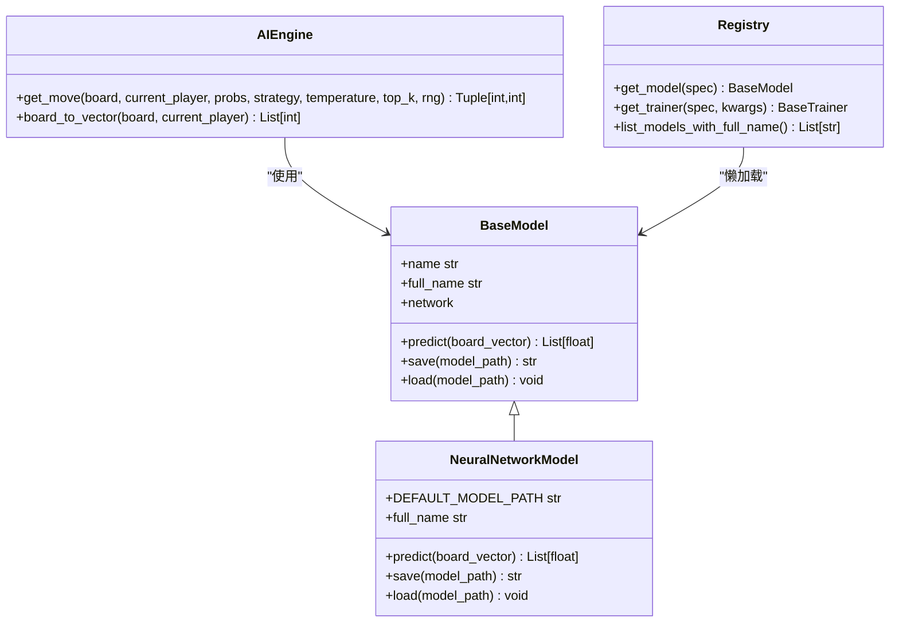
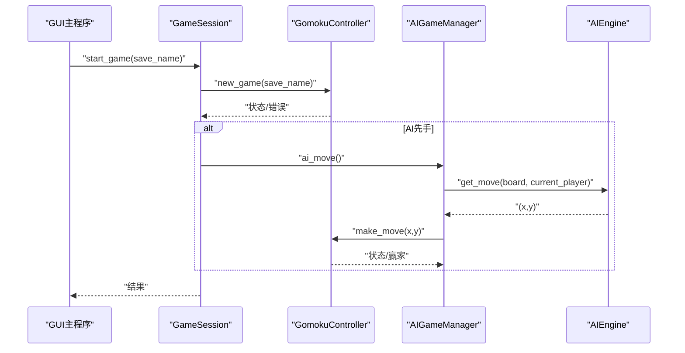
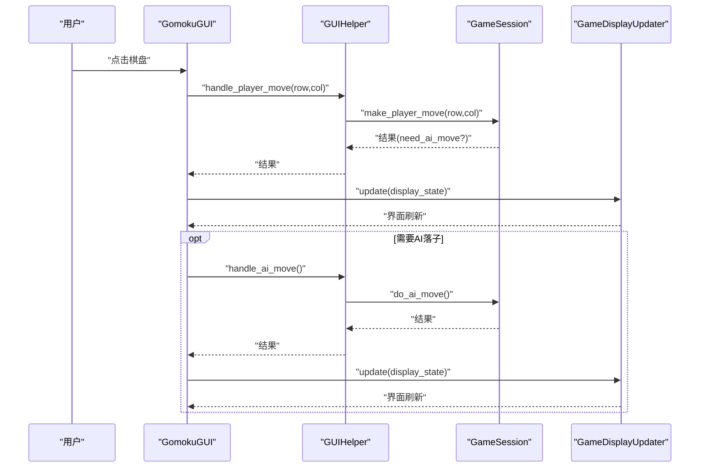
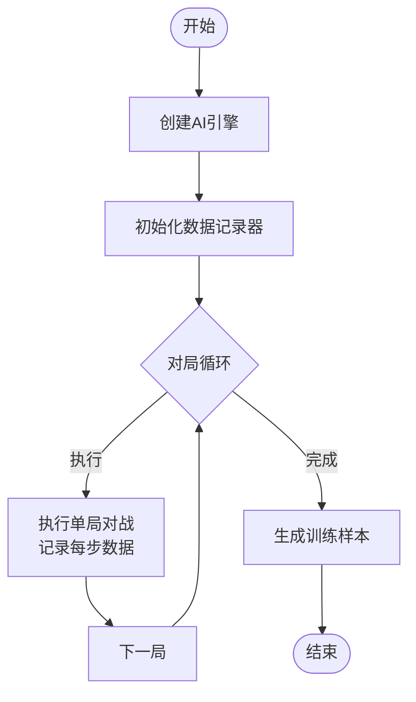
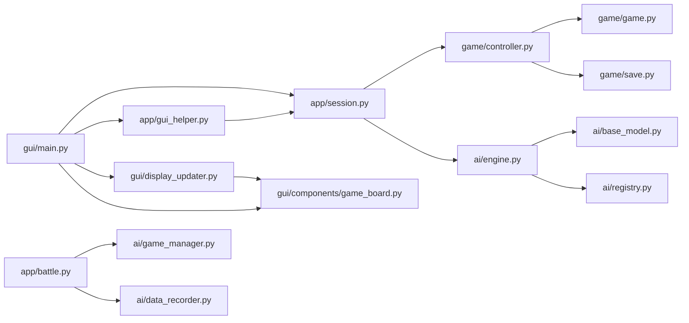

# 整体架构设计

<cite>
**本文引用的文件**
- [ai/engine.py](file://ai/engine.py)
- [ai/game_manager.py](file://ai/game_manager.py)
- [ai/base_model.py](file://ai/base_model.py)
- [ai/registry.py](file://ai/registry.py)
- [ai/data_recorder.py](file://ai/data_recorder.py)
- [game/controller.py](file://game/controller.py)
- [game/game.py](file://game/game.py)
- [game/save.py](file://game/save.py)
- [app/session.py](file://app/session.py)
- [app/gui_helper.py](file://app/gui_helper.py)
- [app/battle.py](file://app/battle.py)
- [gui/main.py](file://gui/main.py)
- [gui/display_updater.py](file://gui/display_updater.py)
- [gui/components/game_board.py](file://gui/components/game_board.py)
- [cli/main.py](file://cli/main.py)
</cite>

## 目录
1. [简介](#简介)
2. [项目结构](#项目结构)
3. [核心组件](#核心组件)
4. [架构总览](#架构总览)
5. [详细组件分析](#详细组件分析)
6. [依赖分析](#依赖分析)
7. [性能考量](#性能考量)
8. [故障排查指南](#故障排查指南)
9. [结论](#结论)
10. [附录](#附录)

## 简介
本项目是一个五子棋AI系统，支持人机对战（PvE）、人人对战（PvP）以及AI内战（AI vs AI）等多种模式。系统采用清晰的分层架构设计，将GUI层、应用层、业务逻辑层与数据访问层解耦，通过统一的控制器与会话管理器协调AI引擎与游戏规则，形成稳定、可扩展、可维护的软件架构。

## 项目结构
系统按职责划分为四个主要层次：
- GUI层：提供图形界面与命令行两种交互入口，负责用户输入与可视化展示。
- 应用层：封装游戏会话与AI内战流程，协调控制器与AI引擎，屏蔽复杂业务细节。
- 业务逻辑层：包含游戏规则、存档管理与AI模型抽象，提供稳定的接口契约。
- 数据访问层：负责AI对战数据的记录与持久化，支撑训练与回放。

**图表来源**
- [gui/main.py:31-90](file://gui/main.py#L31-L90)
- [app/session.py:12-61](file://app/session.py#L12-L61)
- [game/controller.py:11-31](file://game/controller.py#L11-L31)
- [ai/engine.py:44-66](file://ai/engine.py#L44-L66)
- [ai/game_manager.py:16-39](file://ai/game_manager.py#L16-L39)
- [ai/base_model.py:24-52](file://ai/base_model.py#L24-L52)
- [ai/registry.py:58-72](file://ai/registry.py#L58-L72)
- [ai/data_recorder.py:17-42](file://ai/data_recorder.py#L17-L42)

**章节来源**
- [gui/main.py:31-90](file://gui/main.py#L31-L90)
- [app/session.py:12-61](file://app/session.py#L12-L61)
- [game/controller.py:11-31](file://game/controller.py#L11-L31)
- [ai/engine.py:44-66](file://ai/engine.py#L44-L66)
- [ai/game_manager.py:16-39](file://ai/game_manager.py#L16-L39)
- [ai/base_model.py:24-52](file://ai/base_model.py#L24-L52)
- [ai/registry.py:58-72](file://ai/registry.py#L58-L72)
- [ai/data_recorder.py:17-42](file://ai/data_recorder.py#L17-L42)

## 核心组件
- AI引擎（AIEngine）：负责将棋盘状态转换为模型输入，调用AI模型获取概率分布，并根据策略选择落子位置。
- AI游戏管理器（AIGameManager）：管理人机对战与AI内战流程，协调控制器与引擎，支持温度采样与数据记录。
- 游戏控制器（GomokuController）：提供统一的对外接口，封装落子、存档、状态查询等操作。
- 游戏核心逻辑（GomokuGame）：实现五子棋规则、胜负判断与历史记录。
- 模型基类（BaseModel）：定义AI模型的统一接口，支持多种神经网络与随机模型。
- 模型注册表（Registry）：集中管理模型与训练器映射，支持多代模型懒加载。
- 数据记录器（DataRecorder）：记录AI对战的输入输出与结果，生成训练样本。
- GUI主程序（GomokuGUI）：Tkinter主界面，协调会话、控制器与显示更新器。
- GUI辅助（GUIHelper）：处理与界面无关的业务逻辑，简化GUI层职责。
- 命令行入口（CLI）：REPL交互式命令行，便于调试与自动化。

**章节来源**
- [ai/engine.py:44-194](file://ai/engine.py#L44-L194)
- [ai/game_manager.py:16-339](file://ai/game_manager.py#L16-L339)
- [game/controller.py:11-194](file://game/controller.py#L11-L194)
- [game/game.py:4-118](file://game/game.py#L4-L118)
- [ai/base_model.py:24-323](file://ai/base_model.py#L24-L323)
- [ai/registry.py:58-316](file://ai/registry.py#L58-L316)
- [ai/data_recorder.py:17-145](file://ai/data_recorder.py#L17-L145)
- [gui/main.py:31-462](file://gui/main.py#L31-L462)
- [app/gui_helper.py:12-199](file://app/gui_helper.py#L12-L199)
- [cli/main.py:19-258](file://cli/main.py#L19-L258)

## 架构总览
系统采用分层架构与薄应用层设计：
- GUI层：仅负责用户交互与界面渲染，不包含业务逻辑。
- 应用层：封装会话与流程编排，向上提供统一接口，向下委托给业务层。
- 业务逻辑层：包含游戏规则、AI模型与存档管理，提供稳定的接口契约。
- 数据访问层：负责AI对战数据的记录与持久化，支持训练与回放。

系统遵循MVC思想的分层实现：
- 视图（View）：GUI组件与CLI界面。
- 控制器（Controller）：GUI主程序与控制器类。
- 模型（Model）：游戏状态、AI模型与存档数据。

**图表来源**
- [gui/main.py:31-90](file://gui/main.py#L31-L90)
- [app/session.py:12-61](file://app/session.py#L12-L61)
- [game/controller.py:11-31](file://game/controller.py#L11-L31)
- [ai/data_recorder.py:17-42](file://ai/data_recorder.py#L17-L42)

**章节来源**
- [gui/main.py:31-90](file://gui/main.py#L31-L90)
- [app/session.py:12-61](file://app/session.py#L12-L61)
- [game/controller.py:11-31](file://game/controller.py#L11-L31)
- [ai/data_recorder.py:17-42](file://ai/data_recorder.py#L17-L42)

## 详细组件分析

### AI引擎与模型体系
AI引擎负责将棋盘状态转换为模型输入，调用AI模型获取概率分布，并根据策略选择落子位置。模型体系通过基类抽象统一接口，支持多种神经网络与随机模型，注册表实现懒加载与多代模型管理。

**图表来源**
- [ai/base_model.py:24-323](file://ai/base_model.py#L24-L323)
- [ai/engine.py:44-194](file://ai/engine.py#L44-L194)
- [ai/registry.py:58-316](file://ai/registry.py#L58-L316)

**章节来源**
- [ai/engine.py:44-194](file://ai/engine.py#L44-L194)
- [ai/base_model.py:24-323](file://ai/base_model.py#L24-L323)
- [ai/registry.py:58-316](file://ai/registry.py#L58-L316)

### 游戏控制器与会话管理
游戏控制器提供统一的对外接口，封装落子、存档、状态查询等操作。会话管理器协调控制器与AI引擎，处理人机对战流程与AI内战循环，支持温度采样与数据记录。

**图表来源**
- [app/session.py:104-143](file://app/session.py#L104-L143)
- [game/controller.py:32-63](file://game/controller.py#L32-L63)
- [ai/game_manager.py:100-121](file://ai/game_manager.py#L100-L121)
- [ai/engine.py:67-142](file://ai/engine.py#L67-L142)

**章节来源**
- [app/session.py:104-179](file://app/session.py#L104-L179)
- [game/controller.py:32-194](file://game/controller.py#L32-L194)
- [ai/game_manager.py:100-231](file://ai/game_manager.py#L100-L231)
- [ai/engine.py:67-142](file://ai/engine.py#L67-L142)

### GUI层与显示更新
GUI主程序负责菜单、按钮与棋盘组件的创建与事件绑定，GUI辅助处理与界面无关的业务逻辑，显示更新器根据状态字典刷新棋盘、标签与历史记录。

**图表来源**
- [gui/main.py:224-273](file://gui/main.py#L224-L273)
- [app/gui_helper.py:53-106](file://app/gui_helper.py#L53-L106)
- [gui/display_updater.py:40-82](file://gui/display_updater.py#L40-L82)

**章节来源**
- [gui/main.py:224-273](file://gui/main.py#L224-L273)
- [app/gui_helper.py:53-148](file://app/gui_helper.py#L53-L148)
- [gui/display_updater.py:40-110](file://gui/display_updater.py#L40-L110)

### AI内战与数据记录
AI内战会话负责创建两个AI引擎、执行多局对战、记录数据并生成训练样本。数据记录器按轮次与局号组织文件，记录每步输入输出与最终结果。

**图表来源**
- [app/battle.py:52-92](file://app/battle.py#L52-L92)
- [ai/game_manager.py:233-274](file://ai/game_manager.py#L233-L274)
- [ai/data_recorder.py:66-141](file://ai/data_recorder.py#L66-L141)

**章节来源**
- [app/battle.py:52-104](file://app/battle.py#L52-L104)
- [ai/game_manager.py:233-339](file://ai/game_manager.py#L233-L339)
- [ai/data_recorder.py:66-145](file://ai/data_recorder.py#L66-L145)

## 依赖分析
- GUI层依赖应用层与业务层：GUI主程序通过会话与控制器协调业务逻辑，显示更新器依赖GUI组件与控制器状态。
- 应用层依赖业务层：会话与内战会话依赖控制器与AI引擎，AI引擎依赖模型基类与注册表。
- 业务层内部耦合低：控制器与游戏核心逻辑解耦，存档管理独立于游戏逻辑。
- 数据访问层独立：数据记录器与存档管理分别服务于AI对战与游戏存档，职责清晰。

**图表来源**
- [gui/main.py:18-28](file://gui/main.py#L18-L28)
- [app/session.py:7-8](file://app/session.py#L7-L8)
- [game/controller.py:6-8](file://game/controller.py#L6-L8)
- [ai/engine.py](file://ai/engine.py#L9)
- [ai/game_manager.py:10-13](file://ai/game_manager.py#L10-L13)
- [ai/base_model.py:16-22](file://ai/base_model.py#L16-L22)
- [ai/registry.py:22-24](file://ai/registry.py#L22-L24)
- [ai/data_recorder.py:7-12](file://ai/data_recorder.py#L7-L12)

**章节来源**
- [gui/main.py:18-28](file://gui/main.py#L18-L28)
- [app/session.py:7-8](file://app/session.py#L7-L8)
- [game/controller.py:6-8](file://game/controller.py#L6-L8)
- [ai/engine.py](file://ai/engine.py#L9)
- [ai/game_manager.py:10-13](file://ai/game_manager.py#L10-L13)
- [ai/base_model.py:16-22](file://ai/base_model.py#L16-L22)
- [ai/registry.py:22-24](file://ai/registry.py#L22-L24)
- [ai/data_recorder.py:7-12](file://ai/data_recorder.py#L7-L12)

## 性能考量
- 模型推理优化：AI引擎支持传入预计算的概率分布，避免重复调用模型预测，降低推理开销。
- 输入转换优化：AI引擎将棋盘转换为向量时按行优先展开，减少不必要的数据复制。
- 数据记录优化：数据记录器采用紧凑JSON格式，减少文件体积与I/O开销。
- 温度采样与并行：AI内战支持温度采样与按局随机执方，提升训练多样性与稳定性。
- 设备与批处理：神经网络模型在GPU上运行，推理过程禁用梯度计算，提高吞吐量。

[本节为通用性能讨论，无需特定文件引用]

## 故障排查指南
- 模型加载失败：注册表在解析模型指定时进行严格校验，多代模型必须指定代数，非多代模型不可指定代数。异常将转换为模型加载错误并反馈给GUI层。
- 落子异常：控制器在落子前验证坐标范围、位置占用与游戏状态，异常将返回错误信息。
- 存档问题：存档管理器按名称与时间戳生成文件名，加载时选择最新版本；若找不到存档将抛出文件不存在异常。
- AI内战中断：数据记录器在保存前校验游戏编号一致性，若不一致将记录警告并自动纠正，确保数据一致性。

**章节来源**
- [ai/registry.py:150-184](file://ai/registry.py#L150-L184)
- [game/controller.py:22-56](file://game/controller.py#L22-L56)
- [game/save.py:36-57](file://game/save.py#L36-L57)
- [ai/data_recorder.py:81-95](file://ai/data_recorder.py#L81-L95)

## 结论
本项目通过清晰的分层架构与薄应用层设计，实现了GUI层、应用层、业务逻辑层与数据访问层的有效解耦。AI引擎与模型体系支持多代模型懒加载与多样化策略，游戏控制器与会话管理器提供了稳定的对外接口。GUI层与CLI层分别满足图形化与命令行场景的需求，整体架构具备良好的可扩展性、可维护性与可测试性。

## 附录
- 设计模式应用：
  - 策略模式：AI引擎支持“argmax”与“sampling”两种落子策略，策略可替换且易于扩展。
  - 工厂模式：注册表统一管理模型与训练器的创建，按需懒加载，屏蔽实现细节。
  - 观察者模式：GUI显示更新器根据控制器状态变化刷新界面，实现松耦合的数据驱动渲染。
- 架构演进方向：
  - 引入更多AI模型与训练器，扩展注册表与训练管线。
  - 增强CLI与GUI的功能，支持更多对战模式与回放功能。
  - 优化数据记录与训练样本生成流程，提升训练效率与质量。

[本节为概念性总结，无需特定文件引用]