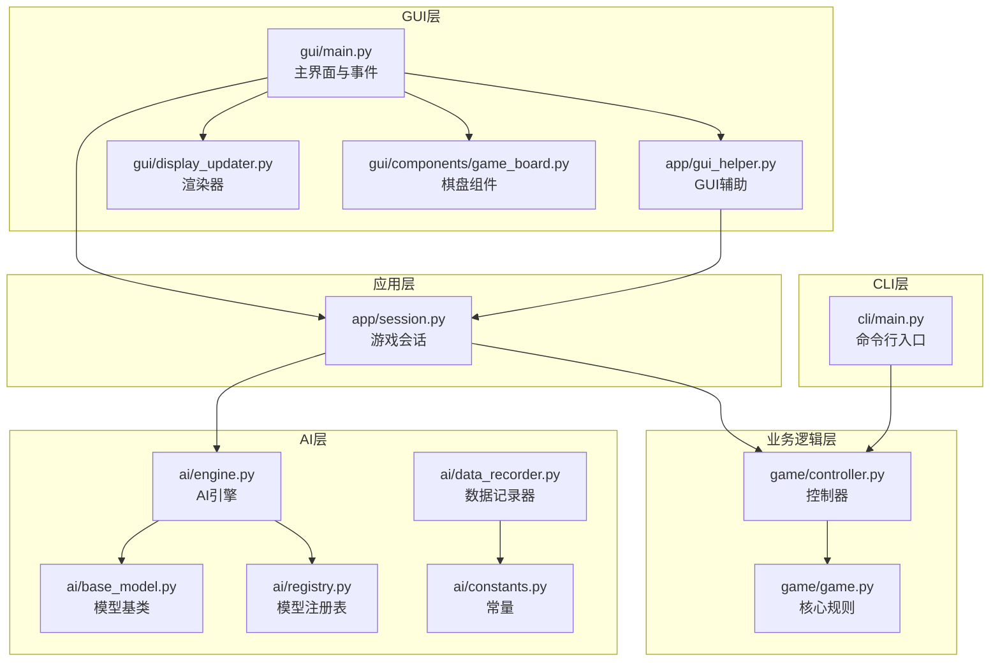
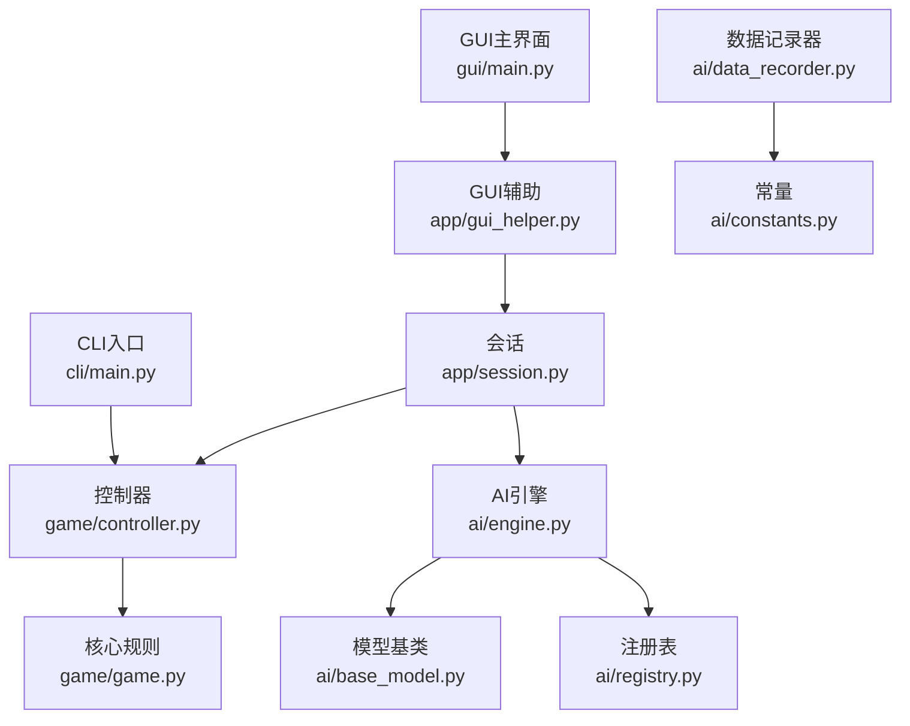
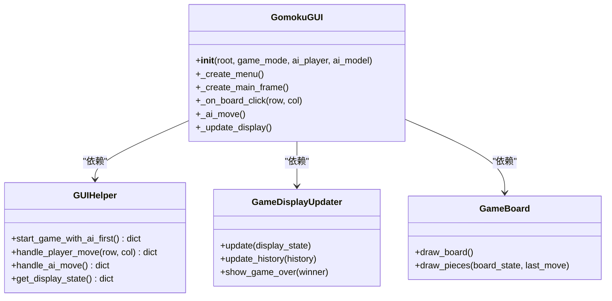
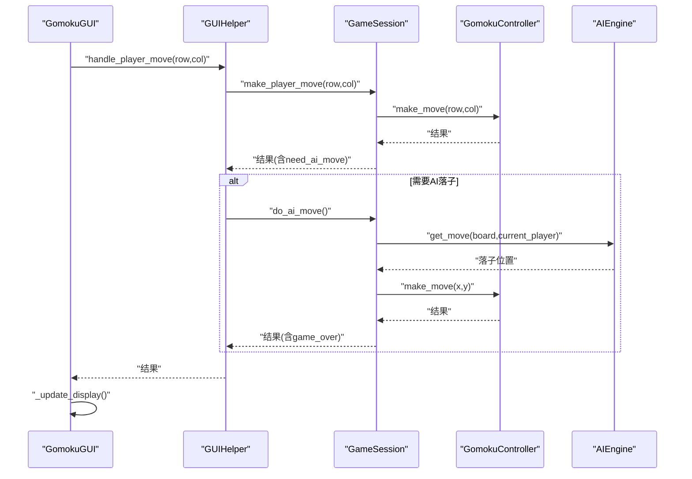
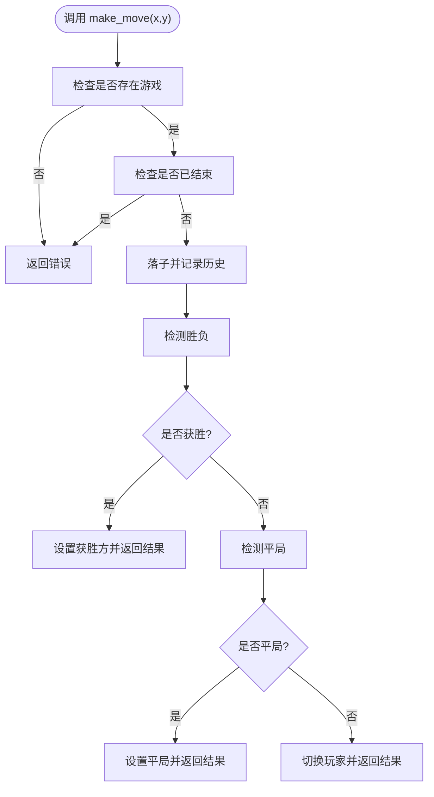
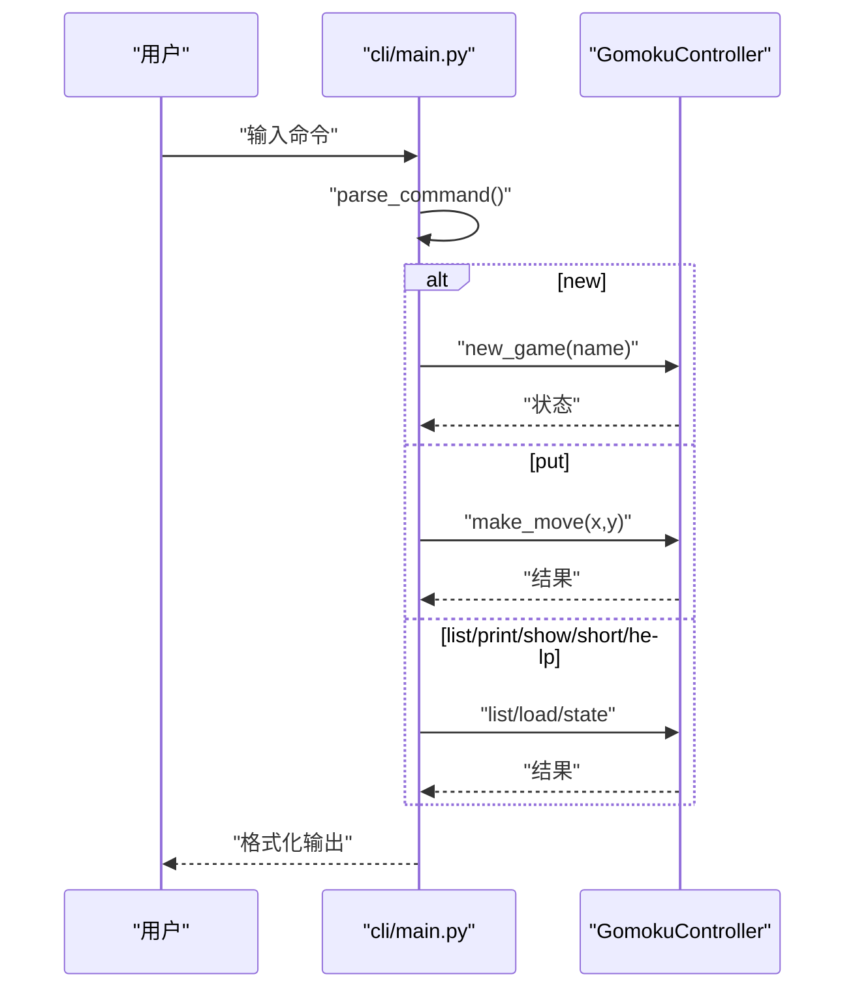
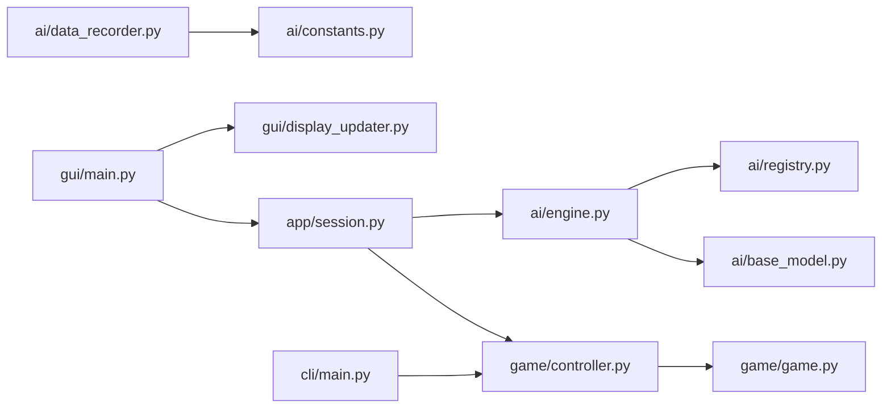

# 架构设计

<cite>
**本文引用的文件**
- [gui/main.py](file://gui/main.py)
- [app/session.py](file://app/session.py)
- [app/gui_helper.py](file://app/gui_helper.py)
- [gui/display_updater.py](file://gui/display_updater.py)
- [gui/components/game_board.py](file://gui/components/game_board.py)
- [game/controller.py](file://game/controller.py)
- [game/game.py](file://game/game.py)
- [ai/engine.py](file://ai/engine.py)
- [ai/base_model.py](file://ai/base_model.py)
- [ai/registry.py](file://ai/registry.py)
- [ai/data_recorder.py](file://ai/data_recorder.py)
- [ai/constants.py](file://ai/constants.py)
- [cli/main.py](file://cli/main.py)
- [design/design_specification.md](file://design/design_specification.md)
- [task_reports/2026-04-04/gui_session_refactor_1.md](file://task_reports/2026-04-04/gui_session_refactor_1.md)
</cite>

## 目录
1. [简介](#简介)
2. [项目结构](#项目结构)
3. [核心组件](#核心组件)
4. [架构总览](#架构总览)
5. [详细组件分析](#详细组件分析)
6. [依赖分析](#依赖分析)
7. [性能考量](#性能考量)
8. [故障排查指南](#故障排查指南)
9. [结论](#结论)
10. [附录](#附录)

## 简介
本项目是一个支持命令行与图形界面的五子棋系统，具备人机对战与AI内战能力。本文档聚焦于系统的分层架构设计，明确GUI层、应用层、业务逻辑层与数据访问层的职责划分与交互关系，梳理模块间依赖、接口设计与数据流，总结设计模式的应用与技术权衡，并给出架构演进与未来发展方向。

## 项目结构
项目采用“分层 + 功能域”混合组织方式：
- GUI层：图形界面入口与组件，负责用户交互与渲染
- 应用层：会话与辅助逻辑，协调业务与UI
- 业务逻辑层：游戏控制器与核心规则
- AI层：模型抽象、引擎、注册表与数据记录
- CLI层：命令行交互入口
- 设计与测试：设计文档与测试报告支撑架构演进



**图表来源**
- [gui/main.py:1-462](file://gui/main.py#L1-L462)
- [app/session.py:1-179](file://app/session.py#L1-L179)
- [app/gui_helper.py:1-199](file://app/gui_helper.py#L1-L199)
- [gui/display_updater.py:1-110](file://gui/display_updater.py#L1-L110)
- [gui/components/game_board.py:1-170](file://gui/components/game_board.py#L1-L170)
- [game/controller.py:1-194](file://game/controller.py#L1-L194)
- [game/game.py:1-118](file://game/game.py#L1-L118)
- [ai/engine.py:1-194](file://ai/engine.py#L1-L194)
- [ai/base_model.py:1-323](file://ai/base_model.py#L1-L323)
- [ai/registry.py:1-316](file://ai/registry.py#L1-L316)
- [ai/data_recorder.py:1-145](file://ai/data_recorder.py#L1-L145)
- [ai/constants.py:1-26](file://ai/constants.py#L1-L26)
- [cli/main.py:1-258](file://cli/main.py#L1-L258)

**章节来源**
- [gui/main.py:1-462](file://gui/main.py#L1-L462)
- [app/session.py:1-179](file://app/session.py#L1-L179)
- [app/gui_helper.py:1-199](file://app/gui_helper.py#L1-L199)
- [gui/display_updater.py:1-110](file://gui/display_updater.py#L1-L110)
- [gui/components/game_board.py:1-170](file://gui/components/game_board.py#L1-L170)
- [game/controller.py:1-194](file://game/controller.py#L1-L194)
- [game/game.py:1-118](file://game/game.py#L1-L118)
- [ai/engine.py:1-194](file://ai/engine.py#L1-L194)
- [ai/base_model.py:1-323](file://ai/base_model.py#L1-L323)
- [ai/registry.py:1-316](file://ai/registry.py#L1-L316)
- [ai/data_recorder.py:1-145](file://ai/data_recorder.py#L1-L145)
- [ai/constants.py:1-26](file://ai/constants.py#L1-L26)
- [cli/main.py:1-258](file://cli/main.py#L1-L258)
- [design/design_specification.md:75-111](file://design/design_specification.md#L75-L111)

## 核心组件
- GUI主界面与事件：负责菜单、按钮、棋盘点击与回放浏览，协调会话与渲染器
- GUI辅助：剥离业务逻辑，统一对外接口，屏蔽GUI细节
- 游戏会话：统一管理PvP/PvE流程，协调控制器与AI引擎
- 游戏控制器：唯一对外接口，协调游戏与存档
- AI引擎：桥接UI与模型，负责落子策略与输入输出
- 模型基类与注册表：统一模型接口与懒加载
- 数据记录器：AI内战数据采集与持久化
- 命令行入口：REPL交互，面向CLI用户

**章节来源**
- [gui/main.py:31-462](file://gui/main.py#L31-L462)
- [app/gui_helper.py:12-199](file://app/gui_helper.py#L12-L199)
- [app/session.py:12-179](file://app/session.py#L12-L179)
- [game/controller.py:11-194](file://game/controller.py#L11-L194)
- [ai/engine.py:44-194](file://ai/engine.py#L44-L194)
- [ai/base_model.py:24-323](file://ai/base_model.py#L24-L323)
- [ai/registry.py:58-316](file://ai/registry.py#L58-L316)
- [ai/data_recorder.py:17-145](file://ai/data_recorder.py#L17-L145)
- [cli/main.py:19-258](file://cli/main.py#L19-L258)

## 架构总览
系统采用分层架构与薄应用层设计：
- GUI层：仅负责界面与事件，不包含业务逻辑
- 应用层（薄代理）：会话与GUI辅助，协调业务与UI
- 业务逻辑层：控制器与核心规则，提供统一接口
- AI层：模型抽象、引擎与注册表，支持多代模型与策略
- CLI层：独立入口，复用业务逻辑



**图表来源**
- [cli/main.py:19-258](file://cli/main.py#L19-L258)
- [gui/main.py:31-462](file://gui/main.py#L31-L462)
- [app/gui_helper.py:12-199](file://app/gui_helper.py#L12-L199)
- [app/session.py:12-179](file://app/session.py#L12-L179)
- [game/controller.py:11-194](file://game/controller.py#L11-L194)
- [game/game.py:4-118](file://game/game.py#L4-L118)
- [ai/engine.py:44-194](file://ai/engine.py#L44-L194)
- [ai/base_model.py:24-323](file://ai/base_model.py#L24-L323)
- [ai/registry.py:58-316](file://ai/registry.py#L58-L316)
- [ai/data_recorder.py:17-145](file://ai/data_recorder.py#L17-L145)
- [ai/constants.py:11-26](file://ai/constants.py#L11-L26)

## 详细组件分析

### GUI层组件
- GomokuGUI：主界面，创建菜单、棋盘与信息面板，协调会话与渲染器
- GUIHelper：剥离业务逻辑，提供统一接口（启动、落子、AI落子、显示状态）
- GameDisplayUpdater：根据状态字典刷新棋盘、标签与历史
- GameBoard：绘制棋盘网格、棋子与最后落子高亮



**图表来源**
- [gui/main.py:31-462](file://gui/main.py#L31-L462)
- [app/gui_helper.py:12-199](file://app/gui_helper.py#L12-L199)
- [gui/display_updater.py:13-110](file://gui/display_updater.py#L13-L110)
- [gui/components/game_board.py:7-170](file://gui/components/game_board.py#L7-L170)

**章节来源**
- [gui/main.py:31-462](file://gui/main.py#L31-L462)
- [app/gui_helper.py:12-199](file://app/gui_helper.py#L12-L199)
- [gui/display_updater.py:13-110](file://gui/display_updater.py#L13-L110)
- [gui/components/game_board.py:7-170](file://gui/components/game_board.py#L7-L170)

### 应用层组件
- GameSession：统一管理PvP/PvE流程，协调控制器与AI引擎，返回标准化结果
- GUIHelper：封装与界面无关的业务逻辑，屏蔽GUI细节



**图表来源**
- [app/session.py:63-179](file://app/session.py#L63-L179)
- [app/gui_helper.py:53-106](file://app/gui_helper.py#L53-L106)
- [game/controller.py:65-98](file://game/controller.py#L65-L98)
- [ai/engine.py:67-143](file://ai/engine.py#L67-L143)

**章节来源**
- [app/session.py:12-179](file://app/session.py#L12-L179)
- [app/gui_helper.py:12-199](file://app/gui_helper.py#L12-L199)
- [game/controller.py:11-194](file://game/controller.py#L11-L194)
- [ai/engine.py:44-194](file://ai/engine.py#L44-L194)

### 业务逻辑层组件
- GomokuController：唯一对外接口，提供新建/落子/加载/状态查询等
- GomokuGame：核心规则实现，落子验证、胜负检测、历史记录



**图表来源**
- [game/controller.py:65-98](file://game/controller.py#L65-L98)
- [game/game.py:22-56](file://game/game.py#L22-L56)

**章节来源**
- [game/controller.py:11-194](file://game/controller.py#L11-L194)
- [game/game.py:4-118](file://game/game.py#L4-L118)

### AI层组件
- AIEngine：桥接UI与模型，负责输入向量转换、模型预测与落子策略
- BaseModel：统一模型接口，支持多代模型与PyTorch集成
- Registry：统一模型注册与懒加载，支持多代模型指定
- DataRecorder：AI内战数据记录与持久化

```mermaid
classDiagram
class AIEngine {
+get_move(board, current_player, probs, strategy, temperature, top_k, rng) (x,y)
+board_to_vector(board, current_player) List[int]
}
class BaseModel {
<<abstract>>
+predict(board_vector) List[float]
+name str
+save(model_path) str
+load(model_path) void
+full_name str
}
class Registry {
+get_model(spec) BaseModel
+get_trainer(spec, kwargs) BaseTrainer
+list_models_with_full_name() List[str]
}
class DataRecorder {
+new_game() int
+record_move(game_id, input_vector, output_vector, position)
+save_game_result(game_id, winner, end_board)
}
AIEngine --> BaseModel : "使用"
AIEngine --> Registry : "创建引擎时解析spec"
DataRecorder --> AIConstants["ai/constants.py"] : "使用常量"
```

**图表来源**
- [ai/engine.py:44-194](file://ai/engine.py#L44-L194)
- [ai/base_model.py:24-323](file://ai/base_model.py#L24-L323)
- [ai/registry.py:150-224](file://ai/registry.py#L150-L224)
- [ai/data_recorder.py:17-145](file://ai/data_recorder.py#L17-L145)
- [ai/constants.py:11-26](file://ai/constants.py#L11-L26)

**章节来源**
- [ai/engine.py:44-194](file://ai/engine.py#L44-L194)
- [ai/base_model.py:24-323](file://ai/base_model.py#L24-L323)
- [ai/registry.py:58-316](file://ai/registry.py#L58-L316)
- [ai/data_recorder.py:17-145](file://ai/data_recorder.py#L17-L145)
- [ai/constants.py:11-26](file://ai/constants.py#L11-L26)

### CLI层组件
- CLI入口：REPL循环，解析命令并调用控制器，格式化输出



**图表来源**
- [cli/main.py:45-258](file://cli/main.py#L45-L258)
- [game/controller.py:32-175](file://game/controller.py#L32-L175)

**章节来源**
- [cli/main.py:19-258](file://cli/main.py#L19-L258)
- [game/controller.py:11-194](file://game/controller.py#L11-L194)

## 依赖分析
- 耦合与内聚
  - GUI层与应用层通过会话与辅助类解耦，降低耦合
  - 应用层薄代理，不包含业务逻辑，内聚良好
  - 业务逻辑层控制器为唯一对外接口，内聚高
  - AI层通过注册表与引擎解耦模型实现，便于扩展
- 直接与间接依赖
  - GUI依赖会话与渲染器；会话依赖控制器与引擎
  - 引擎依赖模型基类与注册表；控制器依赖核心规则
  - 数据记录器依赖常量与AI数据目录
- 设计模式
  - 工厂模式：create_engine与Registry懒加载
  - 策略模式：AIEngine支持argmax与temperature sampling
  - 观察者模式：渲染器根据状态字典更新UI



**图表来源**
- [gui/main.py:18-28](file://gui/main.py#L18-L28)
- [app/session.py:7-8](file://app/session.py#L7-L8)
- [ai/engine.py:38-41](file://ai/engine.py#L38-L41)
- [ai/registry.py:150-184](file://ai/registry.py#L150-L184)
- [ai/data_recorder.py:12-14](file://ai/data_recorder.py#L12-L14)
- [ai/constants.py:11-26](file://ai/constants.py#L11-L26)
- [cli/main.py:9-11](file://cli/main.py#L9-L11)

**章节来源**
- [gui/main.py:18-28](file://gui/main.py#L18-L28)
- [app/session.py:7-8](file://app/session.py#L7-L8)
- [ai/engine.py:38-41](file://ai/engine.py#L38-L41)
- [ai/registry.py:150-184](file://ai/registry.py#L150-L184)
- [ai/data_recorder.py:12-14](file://ai/data_recorder.py#L12-L14)
- [ai/constants.py:11-26](file://ai/constants.py#L11-L26)
- [cli/main.py:9-11](file://cli/main.py#L9-L11)

## 性能考量
- 模型推理
  - AIEngine支持传入预计算概率，避免重复model.predict调用
  - board_to_vector为线性转换，O(n)开销可控
- 渲染与事件
  - GUI组件按需重绘，棋盘与历史列表更新最小化
- 存档与数据
  - JSON紧凑格式减少文件体积，提升IO效率
  - 数据记录器按局目录组织，便于批量处理与清理

[本节为通用性能讨论，无需特定文件分析]

## 故障排查指南
- 模型加载失败
  - 现象：GUI弹出“模型加载失败”
  - 原因：注册表解析spec失败或多代模型未指定代数
  - 处理：检查模型名称与代数，确保权重文件存在
- 游戏未创建调用AI落子
  - 现象：返回错误“游戏尚未创建”
  - 原因：PvE模式下直接调用do_ai_move
  - 处理：先通过会话启动游戏
- 落子非法
  - 现象：返回坐标越界、位置被占、游戏已结束等错误
  - 原因：控制器落子验证失败
  - 处理：检查坐标范围与棋盘状态

**章节来源**
- [app/session.py:161-162](file://app/session.py#L161-L162)
- [ai/registry.py:168-179](file://ai/registry.py#L168-L179)
- [game/controller.py:67-97](file://game/controller.py#L67-L97)

## 结论
本项目采用清晰的分层架构与薄应用层设计，GUI层专注于界面，应用层负责流程协调，业务逻辑层提供统一接口，AI层通过注册表与引擎实现可插拔扩展。设计模式的应用提升了灵活性与可维护性，性能优化体现在模型推理与IO层面。未来可在AI训练流水线、可视化与回放工具方面进一步增强。

[本节为总结性内容，无需特定文件分析]

## 附录
- 架构演进
  - GUI与Session职责分离重构，消除越界处理业务逻辑，提升可维护性
  - 设计文档与测试报告支撑架构演进与质量保障

**章节来源**
- [task_reports/2026-04-04/gui_session_refactor_1.md:1-56](file://task_reports/2026-04-04/gui_session_refactor_1.md#L1-L56)
- [design/design_specification.md:75-111](file://design/design_specification.md#L75-L111)