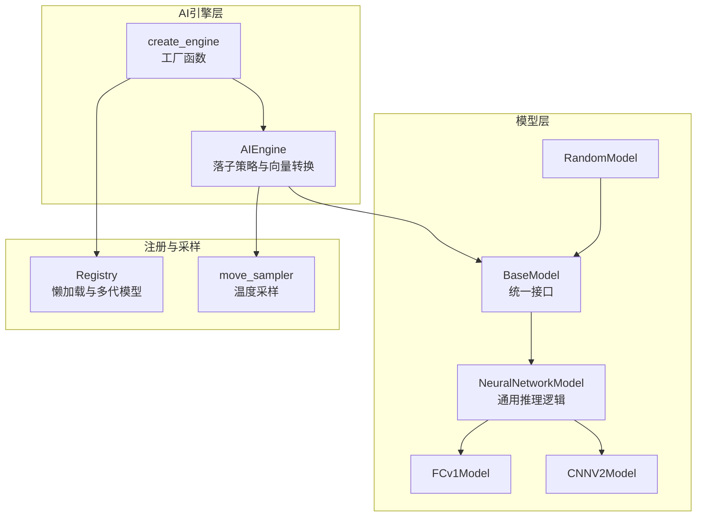
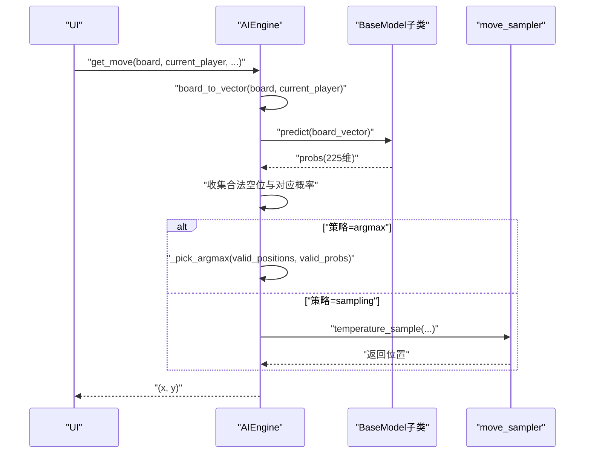
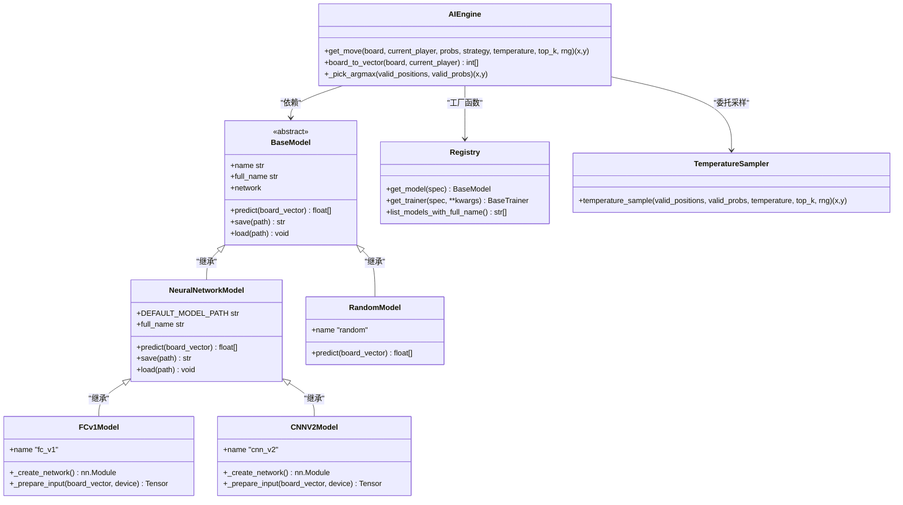
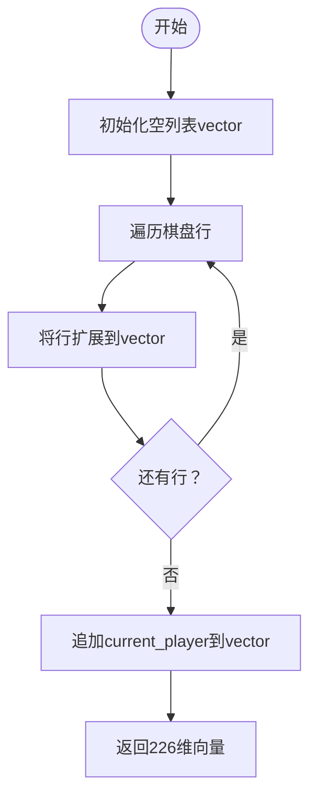
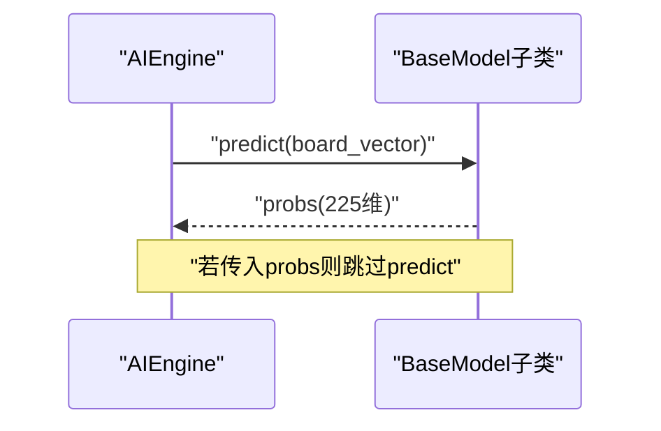
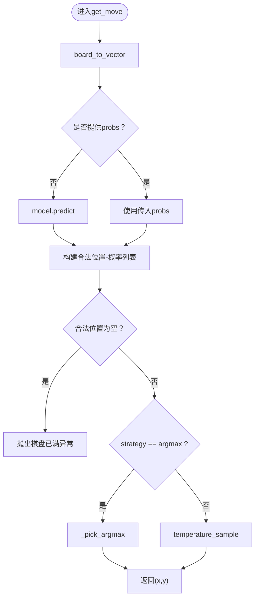
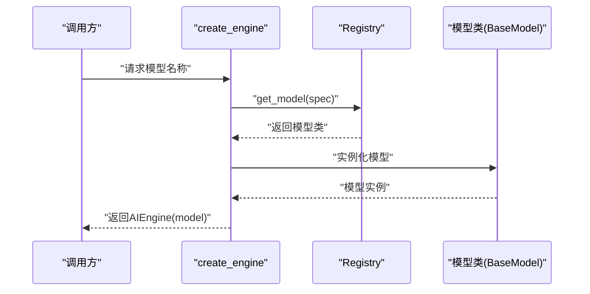
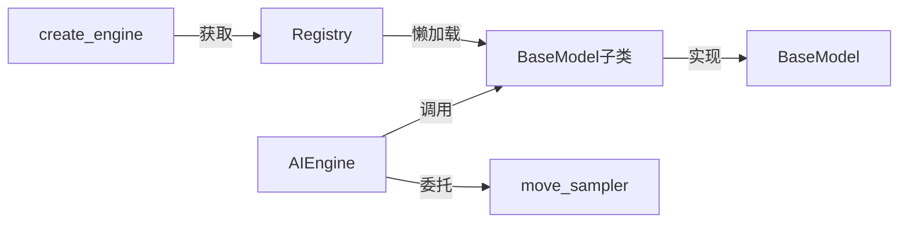

# AI引擎模块

<cite>
**本文引用的文件**
- [ai/engine.py](file://ai/engine.py)
- [ai/base_model.py](file://ai/base_model.py)
- [ai/registry.py](file://ai/registry.py)
- [ai/move_sampler.py](file://ai/move_sampler.py)
- [ai/models/random/model.py](file://ai/models/random/model.py)
- [ai/models/fc_v1/model.py](file://ai/models/fc_v1/model.py)
- [ai/models/cnn_v2/model.py](file://ai/models/cnn_v2/model.py)
- [tests/ai/test_engine.py](file://tests/ai/test_engine.py)
- [design/engine_move_strategy_design.md](file://design/engine_move_strategy_design.md)
- [design/move_sampler_design.md](file://design/move_sampler_design.md)
</cite>

## 目录
1. [简介](#简介)
2. [项目结构](#项目结构)
3. [核心组件](#核心组件)
4. [架构总览](#架构总览)
5. [详细组件分析](#详细组件分析)
6. [依赖关系分析](#依赖关系分析)
7. [性能考量](#性能考量)
8. [故障排查指南](#故障排查指南)
9. [结论](#结论)
10. [附录](#附录)

## 简介
本文件为AI引擎模块的详细设计文档，聚焦AIEngine类的设计理念与实现细节，阐述其作为UI与AI模型之间桥梁的关键职责：将棋盘状态转换为模型输入向量、调用模型获取概率分布、在合法位置上按策略选择落子。文档还深入解析argmax与sampling两种策略的工作原理与适用场景，详解board_to_vector方法的226维向量构造规则，并提供基于测试用例的使用示例与错误处理说明。同时，文档说明AIEngine与BaseModel、Registry模块的协作关系，以及模块的扩展性与定制化能力。

## 项目结构
AI引擎模块位于ai目录下，主要文件与职责如下：
- ai/engine.py：AIEngine类与create_engine工厂函数，负责落子策略选择与向量转换。
- ai/base_model.py：BaseModel与NeuralNetworkModel抽象基类，定义模型统一接口与通用推理逻辑。
- ai/registry.py：模型注册表与懒加载机制，支持多代模型指定与训练器映射。
- ai/move_sampler.py：温度采样策略实现，为sampling策略提供温度加权采样能力。
- ai/models/random/model.py：RandomModel示例，演示BaseModel接口实现与空位均匀分布输出。
- ai/models/fc_v1/model.py：FCv1Model示例，演示全连接神经网络模型实现。
- ai/models/cnn_v2/model.py：CNNV2Model示例，演示卷积神经网络模型实现与输入转换。
- tests/ai/test_engine.py：AIEngine相关单元测试，覆盖board_to_vector、策略选择、异常处理等。
- design/engine_move_strategy_design.md：引擎落子策略设计文档，说明默认argmax与sampling预留。
- design/move_sampler_design.md：温度采样设计文档，说明温度、top-k、side等参数与行为。

**图表来源**
- [ai/engine.py:18-42](file://ai/engine.py#L18-L42)
- [ai/base_model.py:24-105](file://ai/base_model.py#L24-L105)
- [ai/registry.py:58-80](file://ai/registry.py#L58-L80)
- [ai/move_sampler.py:117-186](file://ai/move_sampler.py#L117-L186)
- [ai/models/random/model.py:10-64](file://ai/models/random/model.py#L10-L64)
- [ai/models/fc_v1/model.py:91-132](file://ai/models/fc_v1/model.py#L91-L132)
- [ai/models/cnn_v2/model.py:117-160](file://ai/models/cnn_v2/model.py#L117-L160)

**章节来源**
- [ai/engine.py:1-194](file://ai/engine.py#L1-L194)
- [ai/base_model.py:1-323](file://ai/base_model.py#L1-L323)
- [ai/registry.py:1-316](file://ai/registry.py#L1-L316)
- [ai/move_sampler.py:1-258](file://ai/move_sampler.py#L1-L258)
- [ai/models/random/model.py:1-64](file://ai/models/random/model.py#L1-L64)
- [ai/models/fc_v1/model.py:1-132](file://ai/models/fc_v1/model.py#L1-L132)
- [ai/models/cnn_v2/model.py:1-160](file://ai/models/cnn_v2/model.py#L1-L160)

## 核心组件
- AIEngine：负责将棋盘状态转换为226维向量，调用模型predict获取225维概率分布，再在合法空位上按策略选择落子。支持默认argmax策略与sampling策略（委托move_sampler实现）。
- create_engine：根据模型名称从注册表获取模型类并实例化AIEngine，异常直接上抛，避免静默降级。
- board_to_vector：将15x15棋盘按行优先展开为前225位，末位填入current_player，形成226维输入向量。
- _pick_argmax：在合法位置中选择最大概率位置，若存在并列最大值则随机打破平局。
- move_sampler.temperature_sample：在sampling策略下执行温度加权采样，支持top_k截断与随机源控制。

**章节来源**
- [ai/engine.py:44-194](file://ai/engine.py#L44-L194)
- [ai/move_sampler.py:117-186](file://ai/move_sampler.py#L117-L186)

## 架构总览
AIEngine作为桥梁，连接UI与多种AI模型。其工作流如下：
1) 输入：15x15棋盘与当前玩家。
2) 向量转换：board_to_vector生成226维向量。
3) 模型预测：调用model.predict获取225维概率分布。
4) 合法位置筛选：遍历225个位置，仅保留空位。
5) 策略选择：argmax或temperature采样，返回(x,y)坐标。

**图表来源**
- [ai/engine.py:67-142](file://ai/engine.py#L67-L142)
- [ai/move_sampler.py:117-186](file://ai/move_sampler.py#L117-L186)

**章节来源**
- [ai/engine.py:67-142](file://ai/engine.py#L67-L142)

## 详细组件分析

### AIEngine类与工厂函数
- 职责
  - 将棋盘状态转换为226维向量。
  - 调用模型predict获取225维概率分布。
  - 在合法空位上按策略选择落子。
- 关键方法
  - get_move：主入口，支持strategy、temperature、top_k、rng等参数。
  - board_to_vector：构造226维输入向量。
  - _pick_argmax：argmax策略选择。
  - create_engine：通过注册表获取模型并实例化AIEngine。
- 错误处理
  - 棋盘已满：抛出ValueError。
  - 未知策略：抛出ValueError。
  - sampling策略且temperature<=0：抛出ValueError。
  - 预计算probs时跳过model.predict调用。

**图表来源**
- [ai/engine.py:44-194](file://ai/engine.py#L44-L194)
- [ai/base_model.py:24-276](file://ai/base_model.py#L24-L276)
- [ai/registry.py:150-184](file://ai/registry.py#L150-L184)
- [ai/move_sampler.py:117-186](file://ai/move_sampler.py#L117-L186)
- [ai/models/random/model.py:10-64](file://ai/models/random/model.py#L10-L64)
- [ai/models/fc_v1/model.py:91-132](file://ai/models/fc_v1/model.py#L91-L132)
- [ai/models/cnn_v2/model.py:117-160](file://ai/models/cnn_v2/model.py#L117-L160)

**章节来源**
- [ai/engine.py:44-194](file://ai/engine.py#L44-L194)
- [ai/registry.py:150-184](file://ai/registry.py#L150-L184)

### 棋盘状态到向量的转换（board_to_vector）
- 输入：15x15棋盘（0=空，1=黑，2=白），current_player（1=黑，2=白）。
- 输出：226维向量，前225位按行优先展开棋盘，第226位为current_player。
- 索引映射：索引i对应位置(i//15, i%15)，与模型输出索引一致。

**图表来源**
- [ai/engine.py:173-193](file://ai/engine.py#L173-L193)

**章节来源**
- [ai/engine.py:173-193](file://ai/engine.py#L173-L193)

### 模型预测调用机制
- AIEngine在获取probs时支持两种模式：
  - 未提供probs：调用model.predict(board_vector)获取225维概率分布。
  - 提供probs：直接使用传入的225维向量，跳过model.predict调用。
- 模型统一输出：225维概率列表，索引i对应位置(i//15, i%15)，所有概率和为1。

**图表来源**
- [ai/engine.py:111-112](file://ai/engine.py#L111-L112)
- [ai/base_model.py:38-52](file://ai/base_model.py#L38-L52)

**章节来源**
- [ai/engine.py:111-112](file://ai/engine.py#L111-L112)
- [ai/base_model.py:38-52](file://ai/base_model.py#L38-L52)

### 落子策略选择逻辑
- argmax（默认）
  - 从合法空位中找出最大概率位置，若存在并列最大值则随机打破平局。
  - 当max_prob==0（模型将概率集中在已落子位置）时，退化为在全部空位中均匀随机挑选。
- sampling
  - 委托move_sampler.temperature_sample执行温度加权采样。
  - 支持temperature、top_k、rng参数；temperature<=0时抛出ValueError。
- 未知策略：抛出ValueError。

**图表来源**
- [ai/engine.py:67-142](file://ai/engine.py#L67-L142)
- [ai/move_sampler.py:117-186](file://ai/move_sampler.py#L117-L186)

**章节来源**
- [ai/engine.py:128-142](file://ai/engine.py#L128-L142)
- [ai/move_sampler.py:117-186](file://ai/move_sampler.py#L117-L186)

### argmax与sampling策略对比
- argmax
  - 适用：PvE、评估、自对弈默认路径，追求稳定、可复现的落子。
  - 特点：消除过度随机性，若并列最大值则随机打破，避免固定路径退化。
- sampling
  - 适用：探索性自对弈、样本生成，希望增加开局多样性与路径变化。
  - 特点：温度T控制随机性强度，T→0趋近argmax，T→∞趋近均匀；支持top_k截断与可复现随机种子。

**章节来源**
- [design/engine_move_strategy_design.md:20-27](file://design/engine_move_strategy_design.md#L20-L27)
- [design/move_sampler_design.md:320-519](file://design/move_sampler_design.md#L320-L519)

### 与BaseModel和Registry的协作
- BaseModel
  - 统一接口：predict、name、save、load、network。
  - NeuralNetworkModel提供通用推理逻辑（设备、输入转换、前向传播、保存加载）。
- Registry
  - 统一管理模型与训练器映射，支持多代模型指定（如cnn_v3.1）。
  - get_model按spec解析名称与代数，懒加载对应模型类并实例化。
- create_engine
  - 通过Registry获取模型实例，直接上抛异常，避免静默降级。

**图表来源**
- [ai/engine.py:18-42](file://ai/engine.py#L18-L42)
- [ai/registry.py:150-184](file://ai/registry.py#L150-L184)
- [ai/base_model.py:24-105](file://ai/base_model.py#L24-L105)

**章节来源**
- [ai/engine.py:18-42](file://ai/engine.py#L18-L42)
- [ai/registry.py:150-184](file://ai/registry.py#L150-L184)
- [ai/base_model.py:24-105](file://ai/base_model.py#L24-L105)

### 扩展性与定制化能力
- 策略扩展：AIEngine保留strategy参数，便于未来引入更多策略（如更精细的sampling变体）。
- 模型扩展：通过Registry注册新模型类，BaseModel统一接口保证兼容性。
- 输入定制：NeuralNetworkModel的_input转换逻辑可针对不同网络结构定制（如CNN的3通道编码）。
- 多代模型：Registry支持多代模型指定，结合文件系统扫描与有效性校验，确保加载正确性。

**章节来源**
- [ai/engine.py:58-66](file://ai/engine.py#L58-L66)
- [ai/registry.py:237-296](file://ai/registry.py#L237-L296)
- [ai/base_model.py:178-193](file://ai/base_model.py#L178-L193)

## 依赖关系分析
- AIEngine依赖BaseModel接口，确保所有模型输出格式一致。
- AIEngine通过Registry间接依赖具体模型类，实现懒加载与多代模型支持。
- AIEngine在sampling策略下依赖move_sampler模块，解耦策略实现。
- 具体模型（RandomModel、FCv1Model、CNNV2Model）实现BaseModel接口，遵循统一契约。

**图表来源**
- [ai/engine.py:44-194](file://ai/engine.py#L44-L194)
- [ai/registry.py:150-184](file://ai/registry.py#L150-L184)
- [ai/move_sampler.py:117-186](file://ai/move_sampler.py#L117-L186)
- [ai/base_model.py:24-105](file://ai/base_model.py#L24-L105)

**章节来源**
- [ai/engine.py:44-194](file://ai/engine.py#L44-L194)
- [ai/registry.py:150-184](file://ai/registry.py#L150-L184)
- [ai/move_sampler.py:117-186](file://ai/move_sampler.py#L117-L186)
- [ai/base_model.py:24-105](file://ai/base_model.py#L24-L105)

## 性能考量
- 预计算probs：当调用方已持有225维概率向量时，可直接传入probs以跳过model.predict调用，降低推理开销。
- 合法位置筛选：在225个位置上遍历并筛选空位，时间复杂度O(225)，对15x15棋盘足够高效。
- 温度采样：sampling策略在合法位置上进行权重归一化与choices采样，复杂度与合法位置数量相关。
- 模型推理：NeuralNetworkModel统一处理设备移动、前向传播与结果转换，避免重复实现。

**章节来源**
- [ai/engine.py:111-122](file://ai/engine.py#L111-L122)
- [ai/base_model.py:195-230](file://ai/base_model.py#L195-L230)

## 故障排查指南
- 棋盘已满：调用get_move时若无空位，抛出ValueError。检查棋盘状态与策略参数。
- 未知策略：传入strategy不在支持列表时抛出ValueError。确认strategy参数拼写与取值。
- sampling参数错误：temperature<=0或valid_positions为空时抛出ValueError。检查温度值与合法位置集合。
- 模型加载失败：create_engine在Registry解析或导入阶段抛出异常。检查模型名称与多代模型spec格式。
- 预计算probs未生效：确认传入probs非None且长度为225，且未被model.predict覆盖。

**章节来源**
- [ai/engine.py:124-142](file://ai/engine.py#L124-L142)
- [ai/move_sampler.py:147-157](file://ai/move_sampler.py#L147-L157)
- [ai/registry.py:168-178](file://ai/registry.py#L168-L178)
- [tests/ai/test_engine.py:118-126](file://tests/ai/test_engine.py#L118-L126)

## 结论
AIEngine通过清晰的职责划分与统一接口，有效连接UI与多样化的AI模型。其默认argmax策略消除了过度随机性，提升稳定性；sampling策略为探索性训练提供灵活工具。board_to_vector与NeuralNetworkModel的输入转换逻辑保证了模型间的一致性与可移植性。Registry的懒加载与多代模型支持增强了系统的扩展性与可维护性。整体设计兼顾易用性、可扩展性与性能，适合在五子棋AI场景中持续演进。

## 附录

### 使用示例（基于测试用例路径）
- 使用AIEngine进行落子决策（默认argmax）
  - 示例路径：[tests/ai/test_engine.py:315-325](file://tests/ai/test_engine.py#L315-L325)
- 使用AIEngine进行落子决策（sampling策略）
  - 示例路径：[tests/ai/test_engine.py:440-447](file://tests/ai/test_engine.py#L440-L447)
- 传入预计算probs跳过model.predict
  - 示例路径：[tests/ai/test_engine.py:407-420](file://tests/ai/test_engine.py#L407-L420)
- 棋盘已满异常处理
  - 示例路径：[tests/ai/test_engine.py:118-126](file://tests/ai/test_engine.py#L118-L126)

### 参数配置与策略说明
- 策略参数
  - strategy：取值"argmax"或"sampling"。
  - temperature：仅在sampling下生效，控制随机性强度。
  - top_k：仅在sampling下生效，截断阈值。
  - rng：仅在sampling下生效，可选随机源。
- 设计文档参考
  - 引擎落子策略设计：[design/engine_move_strategy_design.md:20-27](file://design/engine_move_strategy_design.md#L20-L27)
  - 温度采样设计：[design/move_sampler_design.md:320-519](file://design/move_sampler_design.md#L320-L519)