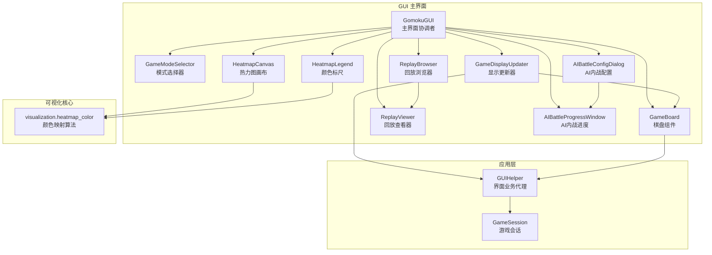
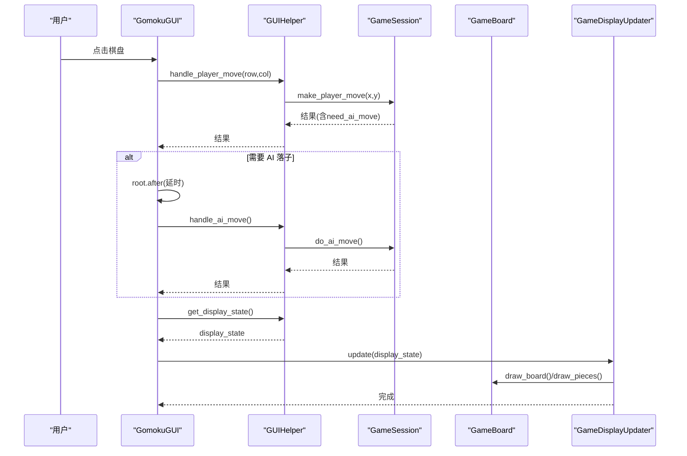
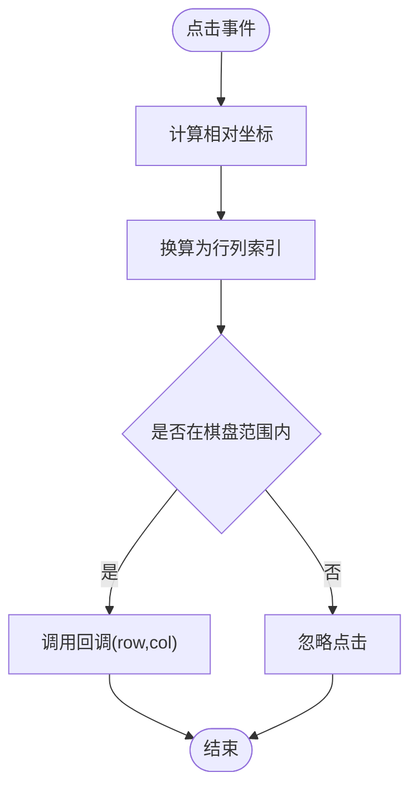
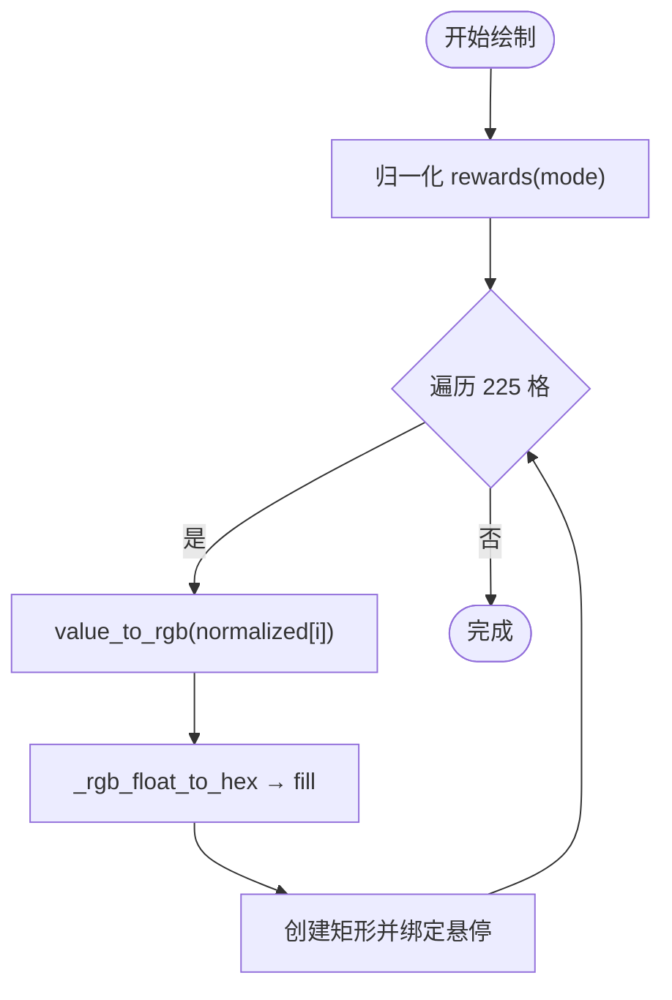
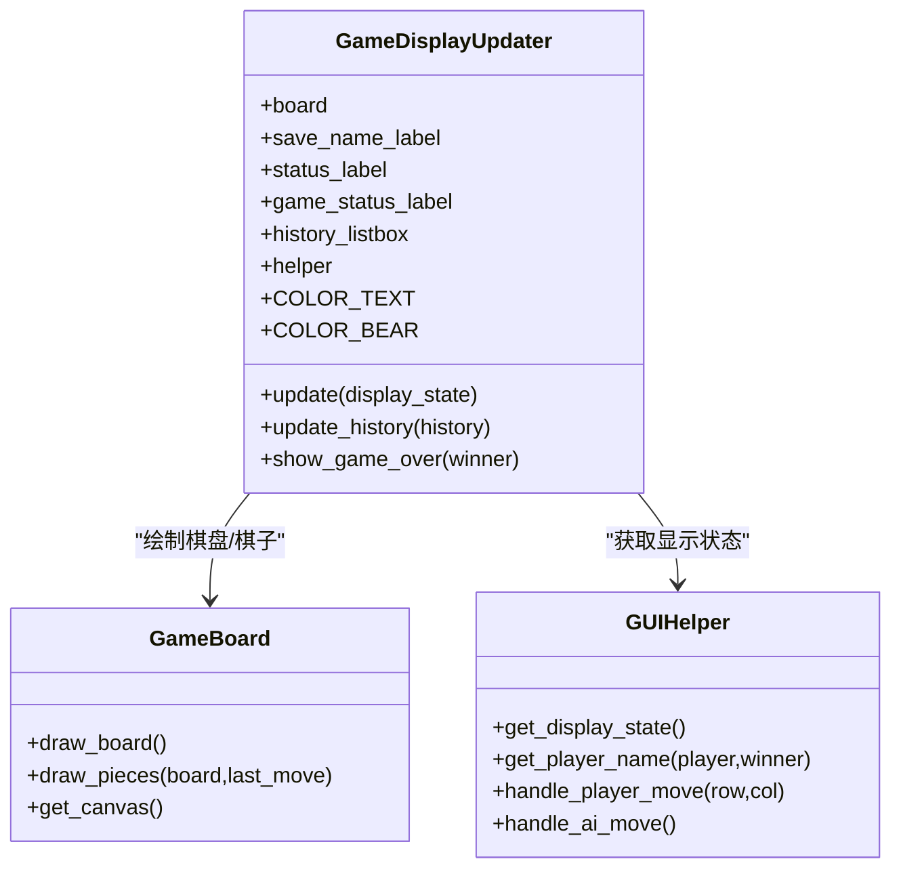
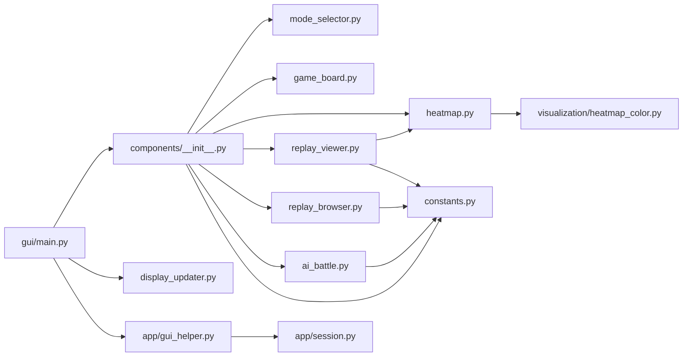

# GUI组件模块

<cite>
**本文引用的文件**
- [gui/components/__init__.py](file://gui/components/__init__.py)
- [gui/main.py](file://gui/main.py)
- [gui/display_updater.py](file://gui/display_updater.py)
- [gui/components/constants.py](file://gui/components/constants.py)
- [gui/components/game_board.py](file://gui/components/game_board.py)
- [gui/components/heatmap.py](file://gui/components/heatmap.py)
- [gui/components/mode_selector.py](file://gui/components/mode_selector.py)
- [gui/components/replay_viewer.py](file://gui/components/replay_viewer.py)
- [gui/components/replay_browser.py](file://gui/components/replay_browser.py)
- [gui/components/ai_battle.py](file://gui/components/ai_battle.py)
- [visualization/heatmap_color.py](file://visualization/heatmap_color.py)
- [app/gui_helper.py](file://app/gui_helper.py)
- [app/session.py](file://app/session.py)
- [tests/gui/test_game_board.py](file://tests/gui/test_game_board.py)
- [tests/gui/test_heatmap.py](file://tests/gui/test_heatmap.py)
- [tests/gui/test_display_updater.py](file://tests/gui/test_display_updater.py)
</cite>

## 目录
1. [简介](#简介)
2. [项目结构](#项目结构)
3. [核心组件](#核心组件)
4. [架构总览](#架构总览)
5. [详细组件分析](#详细组件分析)
6. [依赖分析](#依赖分析)
7. [性能考量](#性能考量)
8. [故障排查指南](#故障排查指南)
9. [结论](#结论)
10. [附录](#附录)

## 简介
本文件为 GUI 组件模块的系统化设计文档，聚焦于五子棋 GUI 的核心 UI 组件与状态更新机制，涵盖棋盘组件、热力图组件、模式选择器、回放浏览器/查看器、AI 内战组件等。文档从架构、数据流、事件处理、状态管理、组件间通信、性能优化与可访问性等方面进行深入剖析，并提供可操作的使用与扩展建议。

## 项目结构
GUI 模块采用“组件化 + 渲染器”的分层组织：
- 组件层：独立的 UI 组件（棋盘、热力图、模式选择、回放、AI 内战等）
- 渲染层：display_updater 负责将 display_state 渲染到界面
- 控制层：main.py 作为主界面协调者，连接组件与业务层
- 常量与样式：constants.py 提供配色、字体、尺寸等主题常量
- 可视化核心：visualization/heatmap_color.py 提供热力图颜色映射算法

图表来源
- [gui/main.py:31-462](file://gui/main.py#L31-L462)
- [gui/display_updater.py:13-110](file://gui/display_updater.py#L13-L110)
- [gui/components/__init__.py:13-41](file://gui/components/__init__.py#L13-L41)
- [visualization/heatmap_color.py:32-204](file://visualization/heatmap_color.py#L32-L204)

章节来源
- [gui/components/__init__.py:1-42](file://gui/components/__init__.py#L1-L42)
- [gui/main.py:31-462](file://gui/main.py#L31-L462)

## 核心组件
- 模式选择器：提供 PvP/PvE/AI 内战/回放四种入口，支持 AI 模型选择与参数配置
- 棋盘组件：绘制 15×15 标准棋盘，支持点击回调、棋子绘制、最后落子高亮
- 热力图组件：基于 visualization.heatmap_color 的 225 格热力图画布与颜色标尺，支持悬停 tooltip
- 回放浏览器/查看器：浏览 AI 内战对局，支持步骤控制、棋盘与热力图联动显示
- AI 内战组件：配置对局数量与双方 AI，异步执行并在完成后询问回放
- 显示更新器：根据 display_state 刷新棋盘、标签、历史记录与弹窗

章节来源
- [gui/components/mode_selector.py:12-411](file://gui/components/mode_selector.py#L12-L411)
- [gui/components/game_board.py:7-170](file://gui/components/game_board.py#L7-L170)
- [gui/components/heatmap.py:68-358](file://gui/components/heatmap.py#L68-L358)
- [gui/components/replay_browser.py:12-383](file://gui/components/replay_browser.py#L12-L383)
- [gui/components/replay_viewer.py:13-426](file://gui/components/replay_viewer.py#L13-L426)
- [gui/components/ai_battle.py:22-346](file://gui/components/ai_battle.py#L22-L346)
- [gui/display_updater.py:13-110](file://gui/display_updater.py#L13-L110)

## 架构总览
GUI 采用“组件 + 渲染器 + 会话”的分层设计：
- 组件层：各自职责明确，独立渲染与交互
- 渲染器：集中处理 display_state 到界面的映射
- 会话层：封装游戏流程与 AI 协调，向 GUI 提供统一接口
- 常量层：统一主题风格，保证一致性

图表来源
- [gui/main.py:224-284](file://gui/main.py#L224-L284)
- [app/gui_helper.py:53-106](file://app/gui_helper.py#L53-L106)
- [app/session.py:63-102](file://app/session.py#L63-L102)
- [gui/display_updater.py:40-82](file://gui/display_updater.py#L40-L82)

## 详细组件分析

### 棋盘组件（GameBoard）
- 设计要点
  - 使用 Canvas 绘制网格线与星位，支持点击事件映射到 15×15 格子
  - 支持绘制黑/白棋子与最后落子高亮
  - 通过回调函数与上层解耦，便于测试与扩展
- 渲染机制
  - draw_board：绘制空棋盘网格与星位
  - draw_pieces：遍历 board_state，按类型绘制棋子与高亮
- 事件处理
  - 将 Canvas 坐标转换为行列索引，边界外点击不触发
- 性能与复杂度
  - 绘制复杂度 O(N^2)，N=15；每次重绘先清空棋子与高亮，再按需重绘，避免累积图形对象

图表来源
- [gui/components/game_board.py:151-166](file://gui/components/game_board.py#L151-L166)

章节来源
- [gui/components/game_board.py:7-170](file://gui/components/game_board.py#L7-L170)
- [tests/gui/test_game_board.py:32-212](file://tests/gui/test_game_board.py#L32-L212)

### 热力图组件（HeatmapCanvas 与 HeatmapLegend）
- 设计要点
  - HeatmapCanvas：15×15 方格热力图，支持悬停 tooltip 显示原始 reward 值
  - HeatmapLegend：颜色标尺，支持自定义色节点与档数
  - 复用 visualization.heatmap_color 的归一化与颜色映射，支持 log/max/linear 三种模式
- 渲染机制
  - 归一化：normalize_rewards(rewards, mode)
  - 颜色映射：value_to_rgb(v, color_stops) → hex
  - 绘制：逐格创建矩形并绑定悬停事件
- 性能与复杂度
  - 单次绘制 O(K)（K=225），批量归一化一次完成，避免重复计算
  - tooltip 复用窗口，减少频繁创建销毁开销

图表来源
- [gui/components/heatmap.py:137-195](file://gui/components/heatmap.py#L137-L195)
- [visualization/heatmap_color.py:63-122](file://visualization/heatmap_color.py#L63-L122)

章节来源
- [gui/components/heatmap.py:68-358](file://gui/components/heatmap.py#L68-L358)
- [visualization/heatmap_color.py:32-204](file://visualization/heatmap_color.py#L32-L204)
- [tests/gui/test_heatmap.py:39-341](file://tests/gui/test_heatmap.py#L39-L341)

### 模式选择器（GameModeSelector）
- 设计要点
  - 提供 PvP/PvE/AI 内战/回放入口
  - PvE：弹出颜色与 AI 选择对话框
  - AI 内战：弹出局数与双方 AI 配置
- 交互与数据绑定
  - 通过 result 字典向主程序传递选择结果
  - 使用 Toplevel 窗口与 grab_set 管理焦点

章节来源
- [gui/components/mode_selector.py:12-411](file://gui/components/mode_selector.py#L12-L411)

### 回放浏览器与查看器（ReplayBrowser/ReplayViewer）
- 设计要点
  - ReplayBrowser：两阶段选择（轮次 → 对局），返回 record.json 与 sample.json 路径
  - ReplayViewer：步骤控制、棋盘绘制、热力图绘制、信息文本与历史列表
- 数据绑定
  - 通过 JSON 加载历史与样本数据，按步骤更新显示
  - 支持 AI 热力图与 Sample 热力图对比

章节来源
- [gui/components/replay_browser.py:12-383](file://gui/components/replay_browser.py#L12-L383)
- [gui/components/replay_viewer.py:13-426](file://gui/components/replay_viewer.py#L13-L426)

### AI 内战组件（AIBattleConfigDialog/AIBattleProgressWindow/AIBattleManager）
- 设计要点
  - 配置对话框：选择双方 AI 与对局数
  - 进度窗口：异步执行对战，主线程安全更新 UI，异常捕获 ModelLoadError
  - 管理器：简化调用，返回录制器与是否回放的决策
- 错误处理
  - 模型加载失败时弹窗提示并回退

章节来源
- [gui/components/ai_battle.py:22-346](file://gui/components/ai_battle.py#L22-L346)

### 显示更新器（GameDisplayUpdater）
- 设计要点
  - 根据 display_state 更新棋盘、标签、历史记录与弹窗
  - 未开始游戏时清空界面；有游戏时绘制棋子并高亮最后落子
  - 动物主题名称与状态文案，支持平局与胜负不同显示
- 数据绑定
  - 依赖 GUIHelper.get_display_state() 与 GUIHelper.get_player_name()

图表来源
- [gui/display_updater.py:13-110](file://gui/display_updater.py#L13-L110)
- [app/gui_helper.py:12-199](file://app/gui_helper.py#L12-L199)
- [gui/components/game_board.py:7-170](file://gui/components/game_board.py#L7-L170)

章节来源
- [gui/display_updater.py:13-110](file://gui/display_updater.py#L13-L110)
- [tests/gui/test_display_updater.py:30-359](file://tests/gui/test_display_updater.py#L30-L359)

## 依赖分析
- 组件导出与聚合
  - components/__init__.py 聚合导出所有组件与常量，形成统一入口
- 组件间依赖
  - GomokuGUI 依赖 GameBoard、GameDisplayUpdater、ReplayBrowser、AIBattleConfigDialog 等
  - ReplayViewer 依赖 HeatmapCanvas/HeatmapLegend 与 constants
  - HeatmapCanvas/HeatmapLegend 依赖 visualization.heatmap_color
- 会话与业务
  - GUIHelper 与 GameSession 解耦业务逻辑，向上层提供统一接口
- 常量与主题
  - constants 提供 COLORS/DIMENSIONS/FONTS/ANIMALS，统一风格

图表来源
- [gui/components/__init__.py:13-41](file://gui/components/__init__.py#L13-L41)
- [gui/components/heatmap.py:30-34](file://gui/components/heatmap.py#L30-L34)
- [gui/components/replay_viewer.py:9-10](file://gui/components/replay_viewer.py#L9-L10)
- [gui/main.py:22-28](file://gui/main.py#L22-L28)
- [app/gui_helper.py:8-9](file://app/gui_helper.py#L8-L9)

章节来源
- [gui/components/__init__.py:13-41](file://gui/components/__init__.py#L13-L41)
- [gui/main.py:22-28](file://gui/main.py#L22-L28)

## 性能考量
- 热力图绘制
  - 归一化与颜色映射在 draw_heatmap 中一次性完成，避免重复计算
  - tooltip 窗口复用，减少频繁创建销毁
- 棋盘绘制
  - 每次重绘先清空棋子与高亮，再按需重绘，避免累积图形对象
- 异步与延迟
  - AI 落子使用 root.after 延迟，避免阻塞 UI
  - AI 内战在后台线程执行，主线程仅做 UI 更新与异常处理
- 内存与资源
  - 回放查看器在步骤 0 时清空热力图与信息文本，释放资源

章节来源
- [gui/components/heatmap.py:137-195](file://gui/components/heatmap.py#L137-L195)
- [gui/components/game_board.py:97-119](file://gui/components/game_board.py#L97-L119)
- [gui/main.py:244-268](file://gui/main.py#L244-L268)
- [gui/components/ai_battle.py:251-282](file://gui/components/ai_battle.py#L251-L282)
- [gui/components/replay_viewer.py:362-371](file://gui/components/replay_viewer.py#L362-L371)

## 故障排查指南
- 模型加载失败（PvE/AI 内战）
  - 现象：弹窗提示“模型加载失败”
  - 处理：检查 AI 模型名称与路径，确认 registry 中可用模型列表
- 回放数据缺失
  - 现象：提示“暂无回放数据”或无法打开回放
  - 处理：确认 ai_data 目录存在且包含 record.json 与 sample.json（可选）
- 点击无效
  - 现象：点击棋盘无响应
  - 处理：确认已新建游戏；检查点击坐标是否在棋盘范围内
- 界面未更新
  - 现象：落子后界面未刷新
  - 处理：确认调用 _update_display()；检查 display_state 字段完整性

章节来源
- [gui/main.py:418-420](file://gui/main.py#L418-L420)
- [gui/components/replay_browser.py:382-383](file://gui/components/replay_browser.py#L382-L383)
- [gui/main.py:224-243](file://gui/main.py#L224-L243)
- [gui/display_updater.py:40-82](file://gui/display_updater.py#L40-L82)

## 结论
本 GUI 组件模块通过清晰的分层与组件化设计，实现了高内聚、低耦合的界面体系。display_updater 将业务状态统一渲染，组件间通过回调与事件解耦，配合可视化核心算法与会话层抽象，既保证了良好的用户体验，也为扩展与维护提供了坚实基础。

## 附录

### 组件使用与扩展示例（路径指引）
- 棋盘组件
  - 初始化与点击回调：[gui/components/game_board.py:22-51](file://gui/components/game_board.py#L22-L51)
  - 绘制棋子与高亮：[gui/components/game_board.py:97-119](file://gui/components/game_board.py#L97-L119)
  - 点击事件映射：[gui/components/game_board.py:151-166](file://gui/components/game_board.py#L151-L166)
- 热力图组件
  - 绘制热力图与悬停：[gui/components/heatmap.py:137-195](file://gui/components/heatmap.py#L137-L195)
  - 颜色标尺：[gui/components/heatmap.py:257-358](file://gui/components/heatmap.py#L257-L358)
  - 可视化核心算法：[visualization/heatmap_color.py:63-122](file://visualization/heatmap_color.py#L63-L122)
- 模式选择器
  - 配置与结果返回：[gui/components/mode_selector.py:176-277](file://gui/components/mode_selector.py#L176-L277)
- 回放组件
  - 浏览器选择流程：[gui/components/replay_browser.py:347-383](file://gui/components/replay_browser.py#L347-L383)
  - 查看器步骤更新：[gui/components/replay_viewer.py:230-260](file://gui/components/replay_viewer.py#L230-L260)
- AI 内战
  - 配置与进度窗口：[gui/components/ai_battle.py:171-317](file://gui/components/ai_battle.py#L171-L317)
- 显示更新器
  - 更新界面与历史：[gui/display_updater.py:40-101](file://gui/display_updater.py#L40-L101)

### 样式与主题定制
- 主题常量与尺寸：[gui/components/constants.py:3-66](file://gui/components/constants.py#L3-L66)
- 使用建议
  - 修改 COLORS/FONTS/DIMENSIONS 以适配不同平台或主题
  - 保持 ANIMALS 与文本语义一致，确保可访问性友好

章节来源
- [gui/components/constants.py:3-66](file://gui/components/constants.py#L3-L66)
- [gui/main.py:31-90](file://gui/main.py#L31-L90)