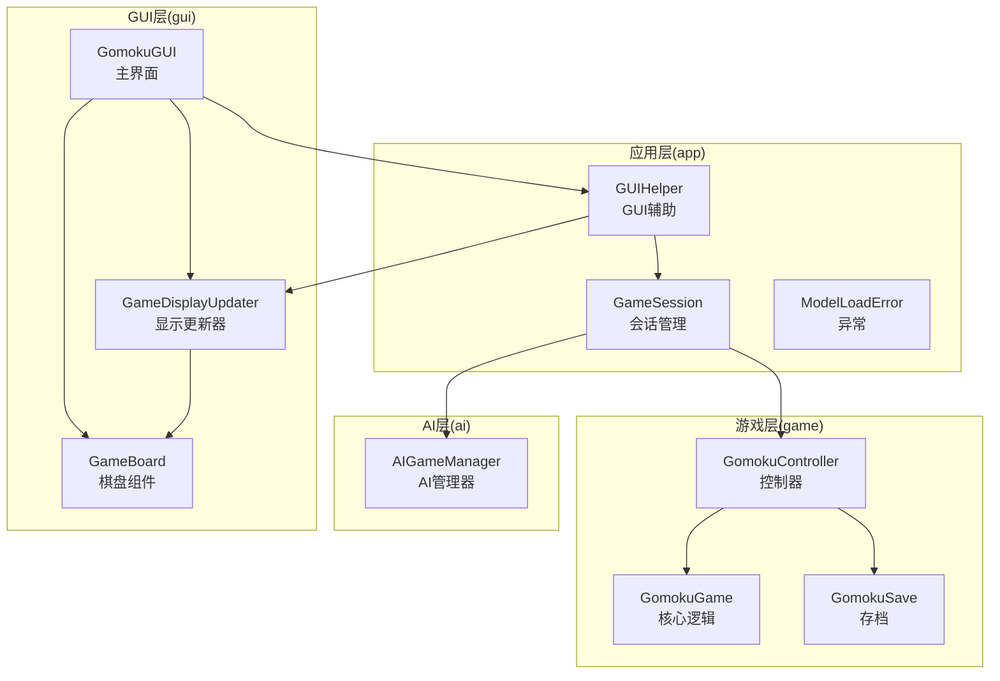
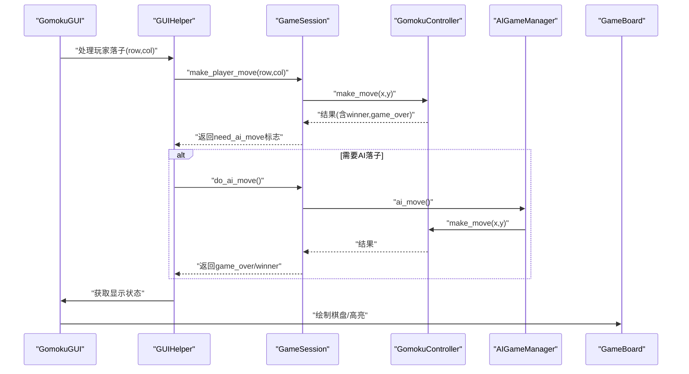
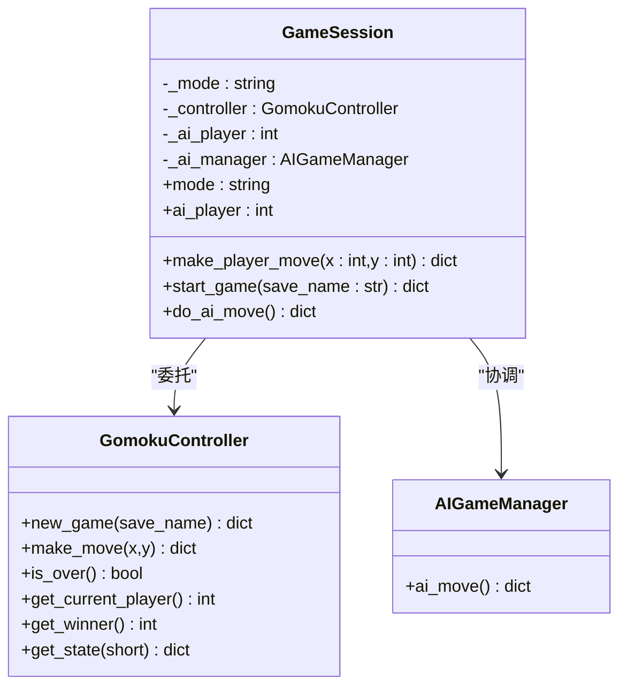
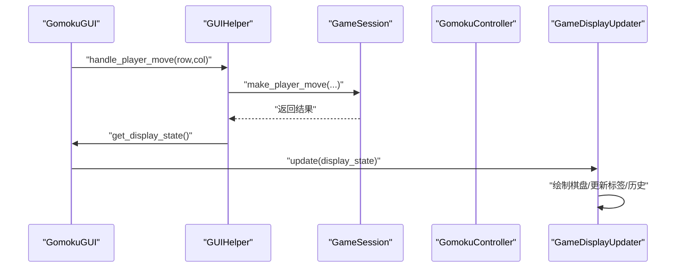
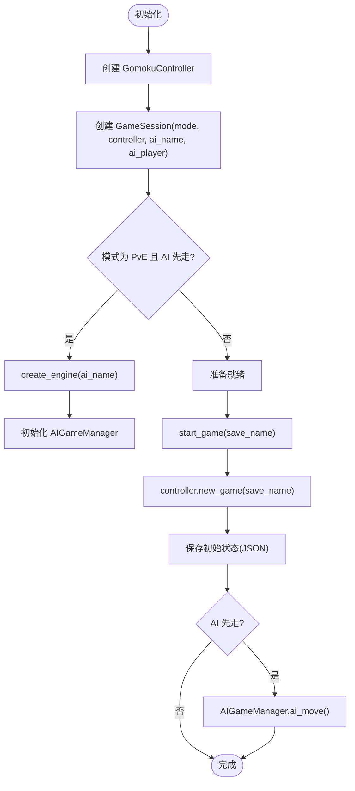
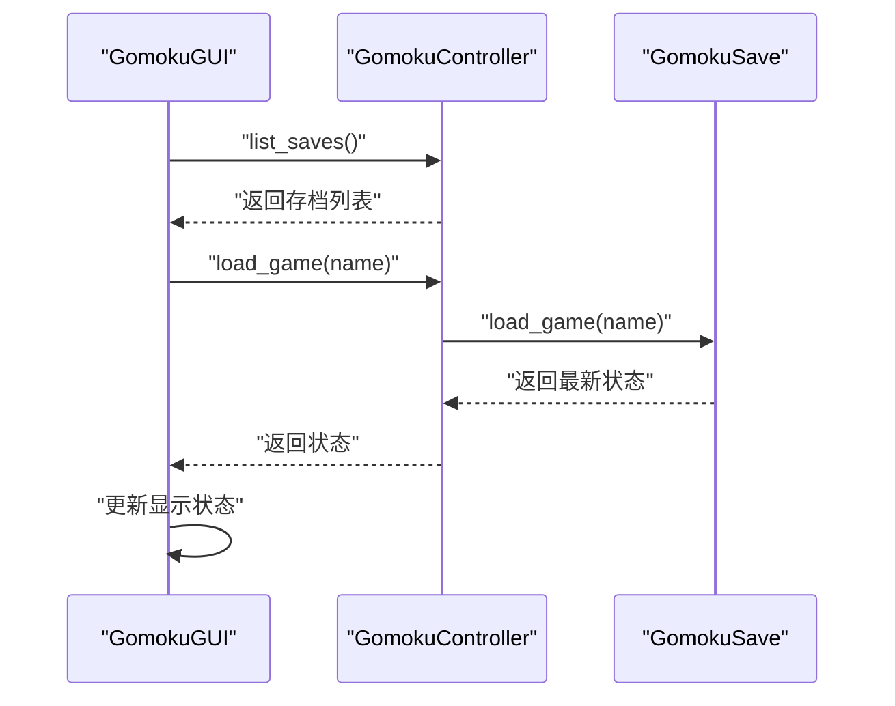
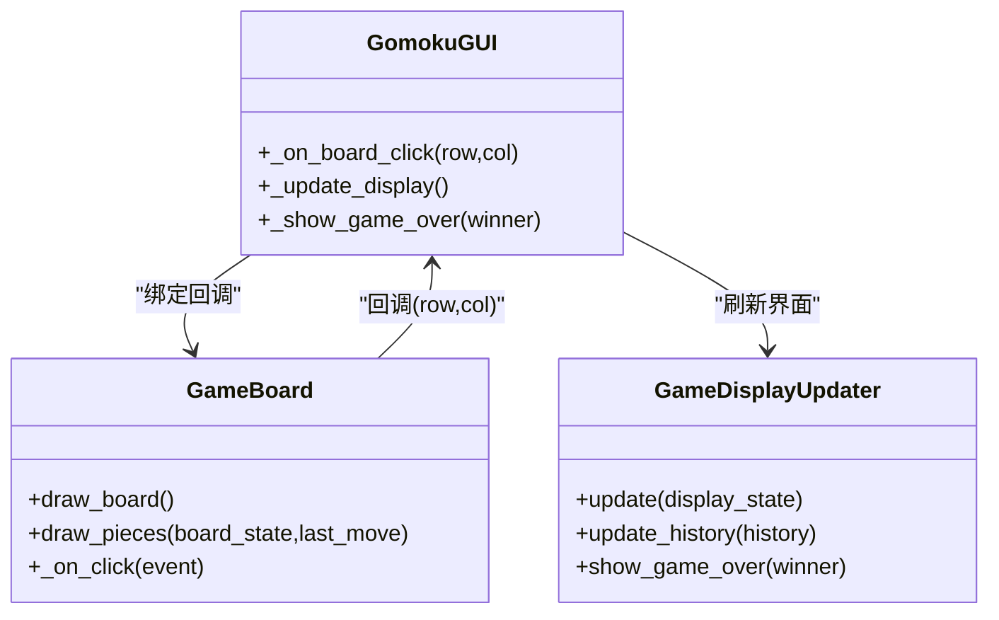
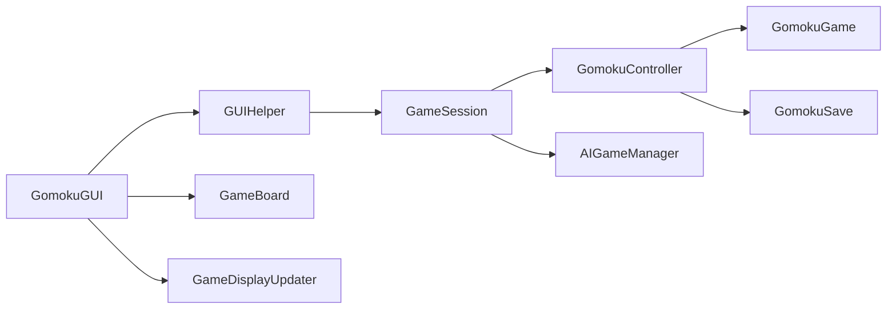

# 会话管理模块

<cite>
**本文引用的文件**
- [app/session.py](file://app/session.py)
- [app/gui_helper.py](file://app/gui_helper.py)
- [app/exceptions.py](file://app/exceptions.py)
- [gui/main.py](file://gui/main.py)
- [gui/display_updater.py](file://gui/display_updater.py)
- [gui/components/game_board.py](file://gui/components/game_board.py)
- [gui/components/constants.py](file://gui/components/constants.py)
- [game/controller.py](file://game/controller.py)
- [game/game.py](file://game/game.py)
- [game/save.py](file://game/save.py)
- [ai/game_manager.py](file://ai/game_manager.py)
- [tests/app/primary/test_session.py](file://tests/app/primary/test_session.py)
</cite>

## 目录
1. [简介](#简介)
2. [项目结构](#项目结构)
3. [核心组件](#核心组件)
4. [架构总览](#架构总览)
5. [详细组件分析](#详细组件分析)
6. [依赖关系分析](#依赖关系分析)
7. [性能考量](#性能考量)
8. [故障排查指南](#故障排查指南)
9. [结论](#结论)
10. [附录](#附录)

## 简介
本设计文档聚焦于会话管理模块，系统阐述 GameSession 类的设计理念、实现细节与使用模式，涵盖：
- 游戏会话生命周期管理（初始化、启动、落子、AI 落子、结束）
- 状态同步与持久化（控制器与存档）
- 用户交互处理（GUI 事件传递、状态更新、输入校验）
- 与 GUI 组件的协作模式（事件链路、状态渲染）
- 错误处理与异常恢复策略
- 性能优化建议与最佳实践

## 项目结构
会话管理模块位于 app 包，围绕 GameSession 协调游戏控制器与 AI 管理器，GUI 层通过 GUIHelper 与 GameSession 解耦，实现清晰的职责分离。

图表来源
- [app/session.py:12-179](file://app/session.py#L12-L179)
- [app/gui_helper.py:12-199](file://app/gui_helper.py#L12-L199)
- [gui/main.py:31-462](file://gui/main.py#L31-L462)
- [gui/display_updater.py:13-110](file://gui/display_updater.py#L13-L110)
- [gui/components/game_board.py:7-170](file://gui/components/game_board.py#L7-L170)
- [game/controller.py:11-194](file://game/controller.py#L11-L194)
- [game/game.py:4-118](file://game/game.py#L4-L118)
- [game/save.py:9-93](file://game/save.py#L9-L93)
- [ai/game_manager.py:16-339](file://ai/game_manager.py#L16-L339)

章节来源
- [app/session.py:12-179](file://app/session.py#L12-L179)
- [gui/main.py:31-462](file://gui/main.py#L31-L462)

## 核心组件
- GameSession：封装一局游戏的会话流程，协调控制器与 AI 管理器，提供统一的落子接口与 AI 调度能力。
- GUIHelper：将 GUI 与业务逻辑解耦，提供统一的状态查询与动作入口。
- GomokuController：对外唯一接口，负责游戏创建、落子、状态查询、存档读写。
- AIGameManager：在不修改 game 包的前提下，实现 PvE 流程与 AI 内战。
- GUI 组件：GameBoard、GameDisplayUpdater、GomokuGUI，负责事件处理、状态渲染与用户交互。

章节来源
- [app/session.py:12-179](file://app/session.py#L12-L179)
- [app/gui_helper.py:12-199](file://app/gui_helper.py#L12-L199)
- [game/controller.py:11-194](file://game/controller.py#L11-L194)
- [ai/game_manager.py:16-339](file://ai/game_manager.py#L16-L339)

## 架构总览
会话管理采用“薄代理层”设计：app 包不包含业务逻辑，所有逻辑委托给 game 与 ai 包。GUI 层通过 GUIHelper 与 GameSession 交互，实现事件驱动的状态流转与渲染。

图表来源
- [gui/main.py:224-243](file://gui/main.py#L224-L243)
- [app/gui_helper.py:53-82](file://app/gui_helper.py#L53-L82)
- [app/session.py:63-102](file://app/session.py#L63-L102)
- [app/session.py:145-178](file://app/session.py#L145-L178)
- [ai/game_manager.py:100-121](file://ai/game_manager.py#L100-L121)
- [gui/display_updater.py:40-82](file://gui/display_updater.py#L40-L82)

## 详细组件分析

### GameSession 设计与实现
- 职责边界
  - 持有游戏模式（pvp/pve）
  - 在 pve 模式下协调 AIGameManager
  - 向 GUI 提供统一的落子接口，并返回 need_ai_move 标志
- 关键方法
  - 初始化：根据模式与 AI 配置创建 AI 引擎与管理器，捕获模型加载异常并转换为 ModelLoadError
  - make_player_move：委托控制器执行落子，判断是否需要 GUI 调度 AI 落子
  - start_game：创建游戏；若 AI 执黑则自动执行 AI 落子
  - do_ai_move：委托 AI 管理器执行 AI 落子，返回游戏结束状态与赢家
- 状态同步
  - 通过控制器查询当前玩家、胜负状态与最终赢家
- 错误处理
  - pvp 模式下调用 do_ai_move 抛出运行时错误
  - 未创建游戏时调用 do_ai_move 返回错误信息

图表来源
- [app/session.py:12-179](file://app/session.py#L12-L179)
- [game/controller.py:11-194](file://game/controller.py#L11-L194)
- [ai/game_manager.py:16-339](file://ai/game_manager.py#L16-L339)

章节来源
- [app/session.py:23-51](file://app/session.py#L23-L51)
- [app/session.py:63-102](file://app/session.py#L63-L102)
- [app/session.py:104-143](file://app/session.py#L104-L143)
- [app/session.py:145-178](file://app/session.py#L145-L178)

### GUIHelper 与 GUI 交互模式
- 职责
  - 将 GUI 与业务逻辑解耦，提供统一的动作入口与状态查询
  - 处理 AI 先走、玩家落子、AI 落子、显示状态获取等流程
- 交互流程
  - GUI 事件触发 -> GUIHelper 处理 -> GameSession 执行 -> 更新显示状态 -> GameDisplayUpdater 渲染
- 状态更新
  - 通过控制器获取完整状态，构造显示状态字典，交由显示更新器刷新界面

图表来源
- [gui/main.py:224-243](file://gui/main.py#L224-L243)
- [app/gui_helper.py:53-82](file://app/gui_helper.py#L53-L82)
- [gui/display_updater.py:40-82](file://gui/display_updater.py#L40-L82)

章节来源
- [app/gui_helper.py:25-51](file://app/gui_helper.py#L25-L51)
- [app/gui_helper.py:53-82](file://app/gui_helper.py#L53-L82)
- [app/gui_helper.py:84-106](file://app/gui_helper.py#L84-L106)
- [app/gui_helper.py:108-148](file://app/gui_helper.py#L108-L148)

### 会话初始化流程与状态持久化
- 初始化
  - GUI 创建 GomokuController 与 GameSession
  - 若为 pve 模式，GameSession 在构造时尝试创建 AI 引擎，捕获 ValueError 并抛出 ModelLoadError
- 启动游戏
  - GameSession 调用控制器创建游戏并保存初始状态
  - 若 AI 执黑，立即执行 AI 落子
- 状态持久化
  - 控制器保存初始状态到 JSON 文件，包含存档名称、起始时间、棋盘、历史等
  - 加载时保留原始起始时间，确保统计一致性

图表来源
- [gui/main.py:57-69](file://gui/main.py#L57-L69)
- [app/session.py:23-51](file://app/session.py#L23-L51)
- [app/session.py:104-143](file://app/session.py#L104-L143)
- [game/controller.py:32-63](file://game/controller.py#L32-L63)
- [game/save.py:17-35](file://game/save.py#L17-L35)

章节来源
- [app/session.py:23-51](file://app/session.py#L23-L51)
- [app/session.py:104-143](file://app/session.py#L104-L143)
- [game/controller.py:32-63](file://game/controller.py#L32-L63)
- [game/save.py:17-35](file://game/save.py#L17-L35)

### 会话恢复逻辑
- 加载存档
  - 控制器列出存档，选择最新版本（按文件名日期排序）
  - 读取 JSON 状态，重建游戏实例，保留原始起始时间
- 状态一致性
  - 显示状态包含当前玩家、赢家、棋盘、历史与最后落子位置
  - GUI 通过显示更新器刷新界面，确保与控制器状态一致

图表来源
- [gui/main.py:354-376](file://gui/main.py#L354-L376)
- [game/controller.py:99-121](file://game/controller.py#L99-L121)
- [game/save.py:36-57](file://game/save.py#L36-L57)

章节来源
- [game/controller.py:99-121](file://game/controller.py#L99-L121)
- [game/save.py:36-57](file://game/save.py#L36-L57)

### 与 GUI 组件的交互模式
- 事件传递
  - GameBoard 捕获点击事件，回调到 GomokuGUI
  - GUIHelper 统一处理动作，返回标准化结果
- 状态更新
  - GUIHelper.get_display_state() 从控制器获取状态
  - GameDisplayUpdater 根据状态更新棋盘、标签与历史
- 用户输入处理
  - 棋盘点击坐标转换为棋盘索引，进行边界检查与落子验证
  - GUI 层弹窗提示错误与结果

图表来源
- [gui/main.py:224-243](file://gui/main.py#L224-L243)
- [gui/components/game_board.py:151-169](file://gui/components/game_board.py#L151-L169)
- [gui/display_updater.py:40-82](file://gui/display_updater.py#L40-L82)

章节来源
- [gui/main.py:224-243](file://gui/main.py#L224-L243)
- [gui/components/game_board.py:151-169](file://gui/components/game_board.py#L151-L169)
- [gui/display_updater.py:40-82](file://gui/display_updater.py#L40-L82)

### 会话管理的使用模式（代码示例路径）
- 会话创建
  - [gui/main.py:60-66](file://gui/main.py#L60-L66)
- 会话配置（pve）
  - [gui/main.py:442-447](file://gui/main.py#L442-L447)
  - [app/gui_helper.py:175-198](file://app/gui_helper.py#L175-L198)
- 会话启动
  - [gui/main.py:335-342](file://gui/main.py#L335-L342)
  - [app/session.py:104-143](file://app/session.py#L104-L143)
- 用户落子
  - [gui/main.py:230-242](file://gui/main.py#L230-L242)
  - [app/gui_helper.py:53-82](file://app/gui_helper.py#L53-L82)
  - [app/session.py:63-102](file://app/session.py#L63-L102)
- AI 落子
  - [gui/main.py:259-267](file://gui/main.py#L259-L267)
  - [app/gui_helper.py:84-106](file://app/gui_helper.py#L84-L106)
  - [app/session.py:145-178](file://app/session.py#L145-L178)
- 会话销毁（自动保存）
  - [game/controller.py:52-58](file://game/controller.py#L52-L58)
  - [game/save.py:17-35](file://game/save.py#L17-L35)

章节来源
- [gui/main.py:60-66](file://gui/main.py#L60-L66)
- [gui/main.py:335-342](file://gui/main.py#L335-L342)
- [gui/main.py:230-242](file://gui/main.py#L230-L242)
- [gui/main.py:259-267](file://gui/main.py#L259-L267)
- [app/gui_helper.py:53-82](file://app/gui_helper.py#L53-L82)
- [app/gui_helper.py:84-106](file://app/gui_helper.py#L84-L106)
- [app/session.py:63-102](file://app/session.py#L63-L102)
- [app/session.py:145-178](file://app/session.py#L145-L178)
- [game/controller.py:52-58](file://game/controller.py#L52-L58)
- [game/save.py:17-35](file://game/save.py#L17-L35)

## 依赖关系分析
- 组件耦合
  - GameSession 依赖 GomokuController 与 AIGameManager，保持低耦合
  - GUIHelper 作为薄代理，进一步降低 GUI 与业务逻辑耦合
- 外部依赖
  - GUI 层依赖 tkinter 与自定义组件
  - 存档依赖 JSON 文件系统
- 循环依赖
  - 未发现循环依赖，职责边界清晰

图表来源
- [gui/main.py:31-462](file://gui/main.py#L31-L462)
- [app/session.py:12-179](file://app/session.py#L12-L179)
- [game/controller.py:11-194](file://game/controller.py#L11-L194)
- [ai/game_manager.py:16-339](file://ai/game_manager.py#L16-L339)
- [gui/display_updater.py:13-110](file://gui/display_updater.py#L13-L110)
- [gui/components/game_board.py:7-170](file://gui/components/game_board.py#L7-L170)

章节来源
- [gui/main.py:31-462](file://gui/main.py#L31-L462)
- [app/session.py:12-179](file://app/session.py#L12-L179)
- [game/controller.py:11-194](file://game/controller.py#L11-L194)

## 性能考量
- 调用链开销
  - GUIHelper 与 GameSession 的轻量封装带来极小额外开销，主要成本在控制器与 AI 引擎
- 渲染优化
  - GameBoard 仅重绘棋子与高亮标记，避免全屏重绘
  - GameDisplayUpdater 批量更新历史列表，滚动到最后
- 存档 I/O
  - JSON 读写为顺序访问，文件数量增长时建议定期清理旧存档
- AI 落子
  - AIGameManager 在单步内复用模型预测结果，减少重复计算

[本节为通用性能讨论，无需具体文件引用]

## 故障排查指南
- 模型加载失败
  - 现象：pve 模式初始化时抛出 ModelLoadError
  - 排查：确认 AI 名称是否存在、多代模型是否指定代数
  - 处理：GUI 捕获异常并弹窗提示，回退到模式选择界面
- pvp 模式调用 AI 落子
  - 现象：RuntimeError，提示“pvp 模式没有 AI”
  - 排查：确认会话模式为 pve
  - 处理：仅在 pve 模式调用 do_ai_move
- 未创建游戏即调用 AI 落子
  - 现象：返回错误信息“游戏尚未创建”
  - 排查：先调用 start_game 创建游戏
- 落子无效或越界
  - 现象：控制器返回错误
  - 排查：检查坐标范围与位置是否为空
- 存档冲突
  - 现象：创建同名存档失败
  - 排查：使用默认名称或修改存档名

章节来源
- [app/exceptions.py:8-25](file://app/exceptions.py#L8-L25)
- [app/session.py:161-162](file://app/session.py#L161-L162)
- [app/session.py:165-166](file://app/session.py#L165-L166)
- [game/controller.py:67-72](file://game/controller.py#L67-L72)
- [game/controller.py:42-47](file://game/controller.py#L42-L47)

## 结论
会话管理模块通过清晰的职责划分与薄代理设计，实现了：
- 会话生命周期的完整管理（创建、启动、落子、AI 调度、结束）
- 与 GUI 的松耦合交互，便于扩展与维护
- 稳健的错误处理与异常恢复策略
- 可靠的状态同步与持久化机制
在实际使用中，遵循会话管理的使用模式与最佳实践，可获得稳定、可维护的用户体验。

[本节为总结性内容，无需具体文件引用]

## 附录
- 测试覆盖
  - 主流程测试覆盖 pvp/pve 场景、AI 调度、游戏结束与存档命名
  - 边界测试覆盖错误返回、运行时异常与未知模型加载
- 常用常量与主题
  - GUI 颜色、字体、尺寸与动物主题常量集中管理

章节来源
- [tests/app/primary/test_session.py:142-304](file://tests/app/primary/test_session.py#L142-L304)
- [gui/components/constants.py:3-66](file://gui/components/constants.py#L3-L66)