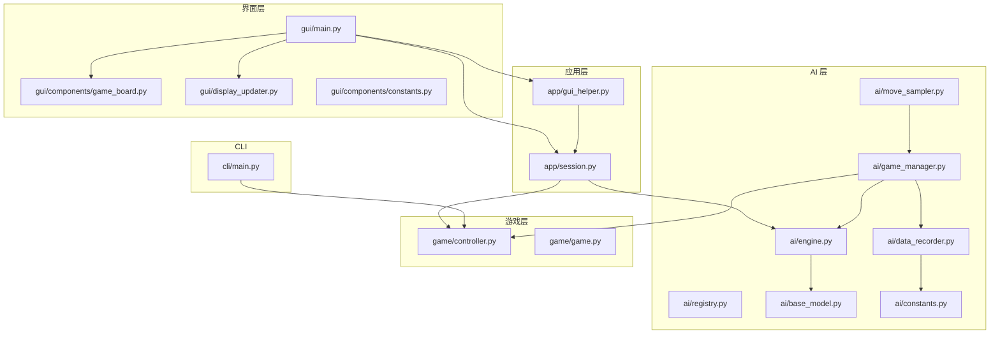
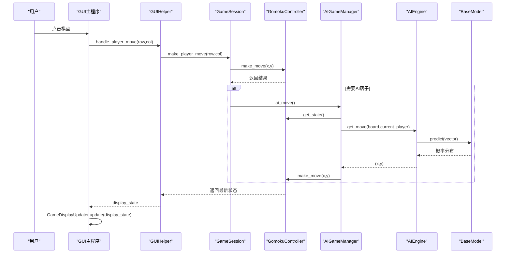
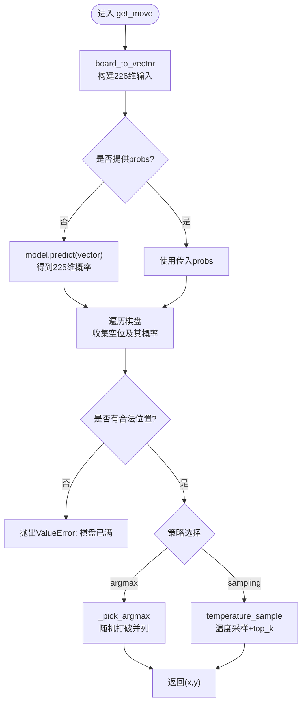
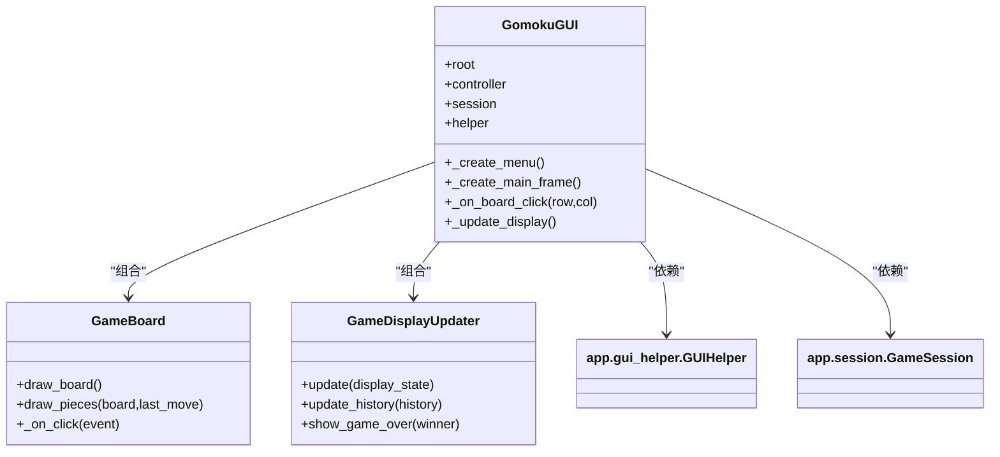
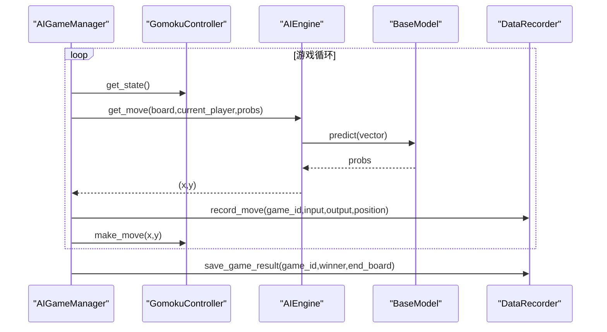
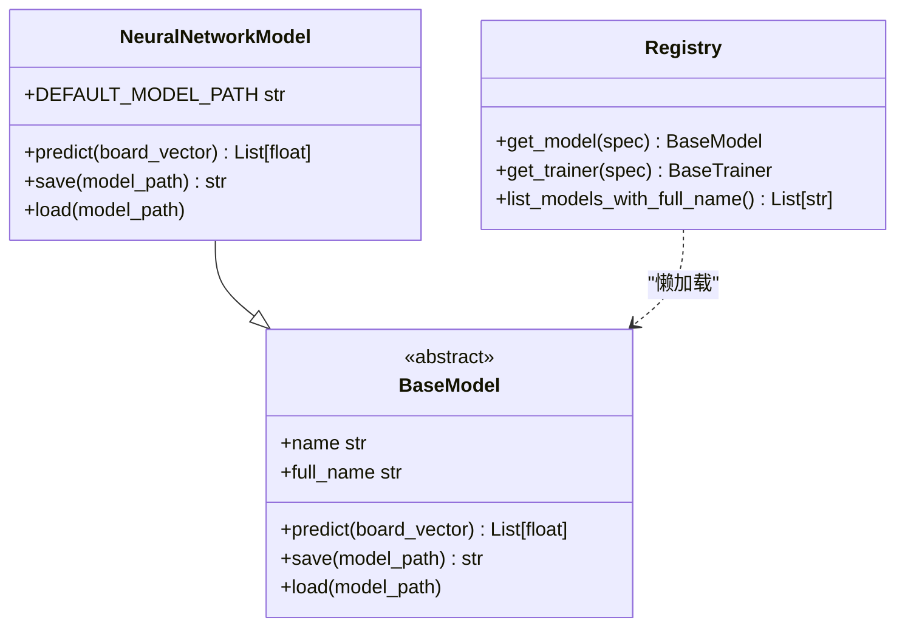
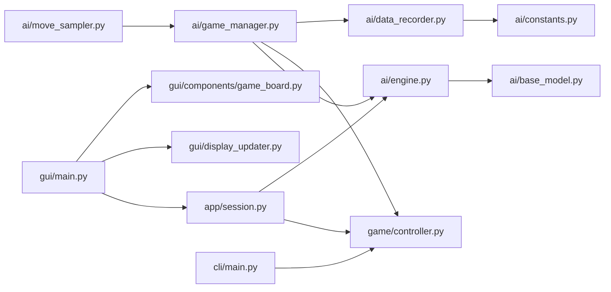

# 模块设计

<cite>
**本文引用的文件**
- [ai/engine.py](file://ai/engine.py)
- [ai/game_manager.py](file://ai/game_manager.py)
- [ai/base_model.py](file://ai/base_model.py)
- [ai/registry.py](file://ai/registry.py)
- [ai/data_recorder.py](file://ai/data_recorder.py)
- [ai/move_sampler.py](file://ai/move_sampler.py)
- [ai/constants.py](file://ai/constants.py)
- [game/controller.py](file://game/controller.py)
- [game/game.py](file://game/game.py)
- [app/session.py](file://app/session.py)
- [app/gui_helper.py](file://app/gui_helper.py)
- [gui/main.py](file://gui/main.py)
- [gui/components/game_board.py](file://gui/components/game_board.py)
- [gui/display_updater.py](file://gui/display_updater.py)
- [gui/components/constants.py](file://gui/components/constants.py)
- [cli/main.py](file://cli/main.py)
- [requirements/key_points.md](file://requirements/key_points.md)
</cite>

## 目录
1. [简介](#简介)
2. [项目结构](#项目结构)
3. [核心组件](#核心组件)
4. [架构总览](#架构总览)
5. [详细组件分析](#详细组件分析)
6. [依赖分析](#依赖分析)
7. [性能考虑](#性能考虑)
8. [故障排查指南](#故障排查指南)
9. [结论](#结论)
10. [附录](#附录)

## 简介
本项目是一个五子棋AI系统，包含AI引擎、游戏控制器、会话管理、GUI组件与CLI等多个模块。本文档聚焦于模块设计，阐述各模块的职责边界、接口设计、内部结构与交互方式，给出模块间的依赖关系图与数据流图，并总结技术决策、性能优化策略、错误处理机制、扩展点与定制化能力。

## 项目结构
项目采用分层与功能域划分相结合的组织方式：
- ai：AI引擎、模型基类、注册表、数据记录、自对弈采样、常量等
- game：游戏核心逻辑与存档
- app：会话管理与GUI辅助
- gui：GUI主程序与组件
- cli：命令行交互入口
- requirements：需求与设计要点文档

**图表来源**
- [gui/main.py:1-462](file://gui/main.py#L1-L462)
- [app/session.py:1-179](file://app/session.py#L1-L179)
- [game/controller.py:1-194](file://game/controller.py#L1-L194)
- [ai/engine.py:1-194](file://ai/engine.py#L1-L194)
- [ai/base_model.py:1-323](file://ai/base_model.py#L1-L323)
- [ai/game_manager.py:1-339](file://ai/game_manager.py#L1-L339)
- [ai/data_recorder.py:1-145](file://ai/data_recorder.py#L1-L145)
- [ai/move_sampler.py:1-258](file://ai/move_sampler.py#L1-L258)
- [ai/constants.py:1-26](file://ai/constants.py#L1-L26)
- [gui/components/game_board.py:1-170](file://gui/components/game_board.py#L1-L170)
- [gui/display_updater.py:1-110](file://gui/display_updater.py#L1-L110)
- [gui/components/constants.py:1-66](file://gui/components/constants.py#L1-L66)
- [cli/main.py:1-258](file://cli/main.py#L1-L258)

**章节来源**
- [requirements/key_points.md:1-653](file://requirements/key_points.md#L1-L653)

## 核心组件
- AI引擎模块：负责将棋盘状态转换为模型输入，调用模型获取概率分布，并按策略选择落子位置。
- 游戏控制器模块：提供统一的对外接口，管理游戏状态、落子、胜负判定与存档。
- 会话管理模块：协调PvP/PvE流程，封装AI对战编排与落子调度。
- GUI组件模块：包含主界面、棋盘组件、显示更新器与常量配置，负责渲染与交互。
- CLI模块：提供REPL式命令行交互，便于调试与快速验证。

**章节来源**
- [ai/engine.py:1-194](file://ai/engine.py#L1-L194)
- [game/controller.py:1-194](file://game/controller.py#L1-L194)
- [app/session.py:1-179](file://app/session.py#L1-L179)
- [gui/main.py:1-462](file://gui/main.py#L1-L462)
- [cli/main.py:1-258](file://cli/main.py#L1-L258)

## 架构总览
系统采用“界面层-应用层-业务层-AI层”的分层架构：
- 界面层（GUI/CLI）接收用户输入，调用应用层
- 应用层（会话管理、GUI辅助）编排流程，协调游戏与AI
- 业务层（游戏控制器、游戏核心）维护状态与规则
- AI层（引擎、模型、注册表、数据记录）提供智能落子与数据生成

**图表来源**
- [gui/main.py:224-268](file://gui/main.py#L224-L268)
- [app/gui_helper.py:53-106](file://app/gui_helper.py#L53-L106)
- [app/session.py:63-102](file://app/session.py#L63-L102)
- [game/controller.py:65-97](file://game/controller.py#L65-L97)
- [ai/game_manager.py:100-121](file://ai/game_manager.py#L100-L121)
- [ai/engine.py:67-142](file://ai/engine.py#L67-L142)
- [ai/base_model.py:38-52](file://ai/base_model.py#L38-L52)

## 详细组件分析

### AI引擎模块（ai/engine.py）
- 职责边界
  - 将15×15棋盘与当前玩家编码为226维向量
  - 调用模型预测225维概率分布
  - 根据策略（argmax或温度采样）选择合法位置
- 接口设计
  - create_engine(ai_name): 工厂函数，通过注册表获取模型实例
  - AIEngine.get_move(...): 主入口，支持预计算概率、温度采样、top-k截断
- 内部结构
  - 支持两种落子策略：ARGMAX（默认）、SAMPLING（温度采样）
  - 提供board_to_vector静态方法，将棋盘与当前玩家拼接为输入向量
  - _pick_argmax在并列最大值时随机打破平局，避免路径退化
- 错误处理
  - 棋盘已满、策略非法、采样温度非正等场景抛出ValueError
- 性能优化
  - 支持传入预计算的概率probs，避免重复model.predict调用
  - 仅遍历空位构建合法位置列表，过滤已落子位置

**图表来源**
- [ai/engine.py:67-142](file://ai/engine.py#L67-L142)
- [ai/engine.py:144-171](file://ai/engine.py#L144-L171)
- [ai/engine.py:173-193](file://ai/engine.py#L173-L193)

**章节来源**
- [ai/engine.py:1-194](file://ai/engine.py#L1-L194)

### 游戏控制器模块（game/controller.py）
- 职责边界
  - 对外唯一接口，封装游戏状态、落子、胜负判定与存档
- 接口设计
  - new_game/save_name: 新建游戏并保存
  - make_move(x,y): 执行落子，返回赢家与当前玩家
  - list_saves/load_game: 存档管理
  - get_state/get_state_json: 状态查询与JSON导出
- 内部结构
  - 委托给GomokuGame执行规则校验与胜负判定
  - 通过GomokuSave读写JSON存档
- 错误处理
  - 越界、占位、游戏已结束等异常统一捕获并返回错误信息
- 性能与扩展
  - 状态深拷贝避免外部修改影响内部状态
  - 支持短/完整状态返回，便于不同场景使用

**章节来源**
- [game/controller.py:1-194](file://game/controller.py#L1-L194)
- [game/game.py:1-118](file://game/game.py#L1-L118)

### 会话管理模块（app/session.py）
- 职责边界
  - 管理一局游戏流程（PvP/PvE），向GUI提供统一落子接口
- 接口设计
  - make_player_move(x,y): 玩家落子，返回need_ai_move标志
  - start_game(save_name): 启动游戏，必要时首步由AI执行
  - do_ai_move(): 执行AI落子（PvE专用）
- 内部结构
  - 通过GameSession协调GomokuController与AIGameManager
  - 模式选择与AI配置解耦，便于扩展
- 错误处理
  - 模型加载失败转换为ModelLoadError，交由GUI层处理

**章节来源**
- [app/session.py:1-179](file://app/session.py#L1-L179)

### GUI组件模块（gui/main.py 与相关组件）
- GUI主程序（gui/main.py）
  - 负责菜单、主框架、按钮与事件绑定
  - 与GameSession、GUIHelper协作，驱动显示更新
- 棋盘组件（gui/components/game_board.py）
  - 绘制棋盘网格、星位与棋子
  - 响应回调，将点击坐标转换为棋盘行列
- 显示更新器（gui/display_updater.py）
  - 根据display_state刷新棋盘、标签与历史记录
  - 支持游戏结束弹窗
- 常量配置（gui/components/constants.py）
  - 颜色、字体、尺寸与动物主题图标

**图表来源**
- [gui/main.py:31-462](file://gui/main.py#L31-L462)
- [gui/components/game_board.py:7-170](file://gui/components/game_board.py#L7-L170)
- [gui/display_updater.py:13-110](file://gui/display_updater.py#L13-L110)

**章节来源**
- [gui/main.py:1-462](file://gui/main.py#L1-L462)
- [gui/components/game_board.py:1-170](file://gui/components/game_board.py#L1-L170)
- [gui/display_updater.py:1-110](file://gui/display_updater.py#L1-L110)
- [gui/components/constants.py:1-66](file://gui/components/constants.py#L1-L66)

### AI游戏管理器（ai/game_manager.py）
- 职责边界
  - 管理PvE与AI内战流程，不改动game包
- 接口设计
  - start_pve_game/save_name: 启动PvE，必要时首步由AI执行
  - player_move(x,y): 玩家落子，自动触发AI
  - ai_move(): AI执行落子
  - start_ai_vs_ai / start_ai_vs_ai_random: AI内战编排
- 内部结构
  - 通过DataRecorder记录每步输入、输出与落子位置
  - 支持温度采样配置（TempConfig），按步/按方/按局切换
- 性能优化
  - 单局内复用model.predict结果，避免重复计算
  - 通过should_sample/resolve_temp_side编排采样策略

**图表来源**
- [ai/game_manager.py:100-230](file://ai/game_manager.py#L100-L230)
- [ai/engine.py:67-142](file://ai/engine.py#L67-L142)
- [ai/data_recorder.py:96-141](file://ai/data_recorder.py#L96-L141)

**章节来源**
- [ai/game_manager.py:1-339](file://ai/game_manager.py#L1-L339)

### 模型与注册表（ai/base_model.py, ai/registry.py）
- 模型基类（BaseModel）
  - 统一接口：predict、name、save、load、network
  - 支持多代模型full_name扩展
- 神经网络模型抽象（NeuralNetworkModel）
  - 统一前向推理、保存/加载、输入张量转换
  - 支持多代模型gen目录结构
- 注册表（registry）
  - 统一管理模型与训练器映射，支持多代模型spec解析
  - 懒加载，首次使用时导入模块

**图表来源**
- [ai/base_model.py:24-323](file://ai/base_model.py#L24-L323)
- [ai/registry.py:150-224](file://ai/registry.py#L150-L224)

**章节来源**
- [ai/base_model.py:1-323](file://ai/base_model.py#L1-L323)
- [ai/registry.py:1-316](file://ai/registry.py#L1-L316)

### 数据记录与可视化（ai/data_recorder.py, 可视化相关）
- 数据记录器（DataRecorder）
  - 按轮次与局数组织数据目录
  - 记录每步input、output、position，保存完整记录
- 常量（ai/constants.py）
  - 定义AI数据与训练数据目录，支持环境变量覆盖

**章节来源**
- [ai/data_recorder.py:1-145](file://ai/data_recorder.py#L1-L145)
- [ai/constants.py:1-26](file://ai/constants.py#L1-L26)

### 命令行入口（cli/main.py）
- 提供REPL交互，支持new、put、list、print、show、short、help、quit等命令
- 与game.controller交互，便于离线调试与自动化

**章节来源**
- [cli/main.py:1-258](file://cli/main.py#L1-L258)

## 依赖分析
- 模块耦合与内聚
  - GUI层仅依赖会话与GUI辅助，不直接访问游戏与AI细节，内聚良好
  - 会话层协调控制器与AI，避免GUI与AI直接耦合
  - AI层通过注册表与工厂函数解耦模型实现
- 外部依赖
  - AI层依赖torch（神经网络模型）
  - GUI层依赖tkinter
  - CLI层依赖标准库
- 循环依赖规避
  - AIEngine在策略采样分支延迟导入move_sampler，避免循环依赖

**图表来源**
- [gui/main.py:18-28](file://gui/main.py#L18-L28)
- [app/session.py:7-8](file://app/session.py#L7-L8)
- [ai/engine.py:9](file://ai/engine.py#L9)
- [ai/game_manager.py:10-13](file://ai/game_manager.py#L10-L13)
- [ai/data_recorder.py:12](file://ai/data_recorder.py#L12)
- [ai/move_sampler.py:17-21](file://ai/move_sampler.py#L17-L21)
- [cli/main.py:9](file://cli/main.py#L9)

**章节来源**
- [gui/main.py:1-462](file://gui/main.py#L1-L462)
- [app/session.py:1-179](file://app/session.py#L1-L179)
- [ai/engine.py:1-194](file://ai/engine.py#L1-L194)
- [ai/game_manager.py:1-339](file://ai/game_manager.py#L1-L339)
- [ai/data_recorder.py:1-145](file://ai/data_recorder.py#L1-L145)
- [ai/move_sampler.py:1-258](file://ai/move_sampler.py#L1-L258)
- [cli/main.py:1-258](file://cli/main.py#L1-L258)

## 性能考虑
- 预计算与缓存
  - AIEngine支持传入probs，避免重复model.predict调用
  - AIGameManager单局复用预测结果，减少计算开销
- 输入转换优化
  - NeuralNetworkModel统一输入张量转换逻辑，避免重复实现
- I/O优化
  - DataRecorder记录每步数据，文件写入采用紧凑JSON格式
- 随机性与探索
  - move_sampler提供温度采样与top_k截断，平衡探索与利用
- 设备与批处理
  - 模型推理在eval模式下禁用梯度，减少内存与计算开销

[本节为通用性能讨论，不直接分析具体文件]

## 故障排查指南
- 模型加载失败
  - 现象：PvE启动时报ModelLoadError
  - 原因：未知模型名、多代模型未指定代数、权重文件缺失
  - 处理：检查ai/registry.py与ai/models目录结构，确认gen子目录与.pth文件
- 落子异常
  - 现象：提示坐标越界、位置被占用、游戏已结束
  - 处理：检查game/controller.py与game/game.py的校验逻辑
- AI落子无响应
  - 现象：GUI等待AI落子但未触发
  - 处理：确认GameSession.mode与ai_player配置，检查AIGameManager.ai_move调用链
- 数据记录异常
  - 现象：record.json缺失或损坏
  - 处理：检查ai/constants.py中的AI数据目录，确认DataRecorder.write权限

**章节来源**
- [app/session.py:44-51](file://app/session.py#L44-L51)
- [game/controller.py:24-35](file://game/controller.py#L24-L35)
- [ai/game_manager.py:100-121](file://ai/game_manager.py#L100-L121)
- [ai/data_recorder.py:118-141](file://ai/data_recorder.py#L118-L141)
- [ai/constants.py:11-22](file://ai/constants.py#L11-L22)

## 结论
本项目通过清晰的分层与职责分离，实现了从GUI到AI的完整落子闭环。AI引擎与模型基类提供了统一的接口与扩展点，注册表支持多代模型与懒加载，数据记录器保障了训练数据的可追溯性。GUI与CLI分别满足交互与离线调试需求。整体设计具备良好的可维护性、可扩展性与可测试性。

[本节为总结性内容，不直接分析具体文件]

## 附录
- 使用模式与示例
  - 人机对战：通过GUI选择模式与AI配置，GameSession自动调度AI落子
  - AI内战：AIGameManager编排多局对战，DataRecorder记录数据
  - 命令行：CLI提供REPL交互，适合快速验证与自动化脚本
- 扩展点与定制化
  - 新增AI模型：实现BaseModel接口，注册到ai/registry.py
  - 新增落子策略：在ai/move_sampler中扩展采样逻辑
  - 新增GUI组件：遵循现有组件模式，注入到gui/main.py
  - 新增训练流程：基于ai/data_recorder与训练脚本扩展

**章节来源**
- [ai/registry.py:58-72](file://ai/registry.py#L58-L72)
- [ai/move_sampler.py:50-111](file://ai/move_sampler.py#L50-L111)
- [gui/main.py:105-113](file://gui/main.py#L105-L113)
- [cli/main.py:76-126](file://cli/main.py#L76-L126)