# 游戏控制器模块

<cite>
**本文引用的文件**
- [game/controller.py](file://game/controller.py)
- [game/game.py](file://game/game.py)
- [game/save.py](file://game/save.py)
- [game/__init__.py](file://game/__init__.py)
- [tests/test_controller.py](file://tests/test_controller.py)
- [tests/test_game.py](file://tests/test_game.py)
- [gui/components/game_board.py](file://gui/components/game_board.py)
- [app/session.py](file://app/session.py)
</cite>

## 目录
1. [简介](#简介)
2. [项目结构](#项目结构)
3. [核心组件](#核心组件)
4. [架构概览](#架构概览)
5. [详细组件分析](#详细组件分析)
6. [依赖关系分析](#依赖关系分析)
7. [性能考虑](#性能考虑)
8. [故障排除指南](#故障排除指南)
9. [结论](#结论)
10. [附录](#附录)

## 简介

游戏控制器模块是五子棋游戏的核心协调者，负责管理游戏状态、执行规则验证、处理回合控制以及提供存档恢复功能。该模块采用分层架构设计，将业务逻辑与用户界面分离，提供了清晰的接口和良好的可扩展性。

本模块主要包含以下核心功能：
- 游戏初始化和状态管理
- 落子验证和规则执行
- 胜负判定算法
- 存档和恢复机制
- 与AI引擎的集成
- 错误处理和异常恢复

## 项目结构

游戏控制器模块位于`game/`目录下，采用模块化设计，每个功能模块职责明确：

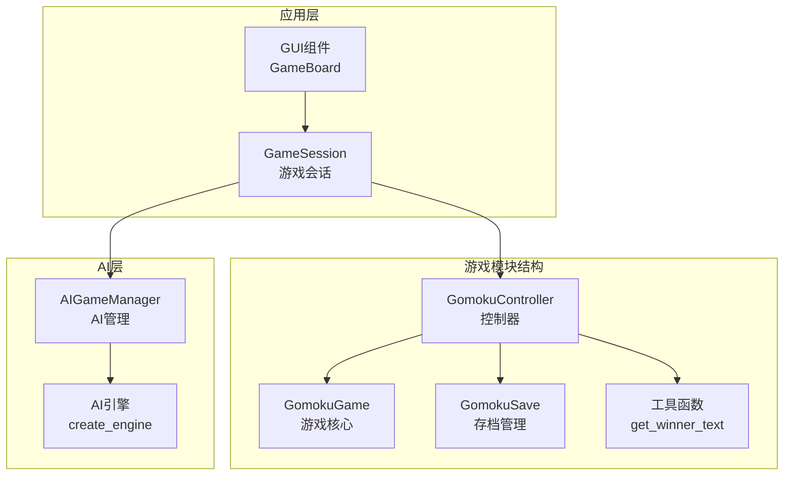

**图表来源**
- [game/controller.py:11-194](file://game/controller.py#L11-L194)
- [game/game.py:4-118](file://game/game.py#L4-L118)
- [game/save.py:9-93](file://game/save.py#L9-L93)

**章节来源**
- [game/controller.py:1-194](file://game/controller.py#L1-L194)
- [game/game.py:1-118](file://game/game.py#L1-L118)
- [game/save.py:1-93](file://game/save.py#L1-L93)

## 核心组件

### GomokuController 控制器

GomokuController是游戏的唯一对外接口，负责协调各个子系统的交互。它提供了完整的API来管理游戏生命周期：

**主要职责**：
- 游戏创建和初始化
- 落子操作执行
- 游戏状态查询
- 存档管理和恢复
- 错误处理和异常管理

**核心方法**：
- `new_game()`: 创建新游戏并保存初始状态
- `make_move()`: 执行落子操作并返回结果
- `load_game()`: 从存档恢复游戏
- `get_state()`: 获取当前游戏状态
- `list_saves()`: 列出所有可用存档

### GomokuGame 游戏核心

GomokuGame实现了五子棋的核心规则逻辑，包括棋盘管理、玩家回合控制和胜负判定：

**数据结构**：
- `board`: 15×15的二维数组表示棋盘状态
- `current_player`: 当前回合玩家（1=黑方，2=白方）
- `winner`: 游戏结果（0=未结束，1=黑胜，2=白胜，3=平局）
- `history`: 游戏历史记录列表

**规则实现**：
- 落子位置验证
- 连五判定算法
- 平局检测机制
- 回合切换逻辑

### GomokuSave 存档管理

GomokuSave负责游戏状态的持久化存储，支持多版本存档和自动命名：

**功能特性**：
- JSON格式存档
- 时间戳自动命名
- 多版本存档管理
- 存档列表查询

**存档格式**：
- 文件名：`存档名称_YYYY-MM-DD_HHMMSS.json`
- 内容：完整的游戏状态字典

**章节来源**
- [game/controller.py:11-194](file://game/controller.py#L11-L194)
- [game/game.py:4-118](file://game/game.py#L4-L118)
- [game/save.py:9-93](file://game/save.py#L9-L93)

## 架构概览

游戏控制器模块采用分层架构，各层职责清晰分离：

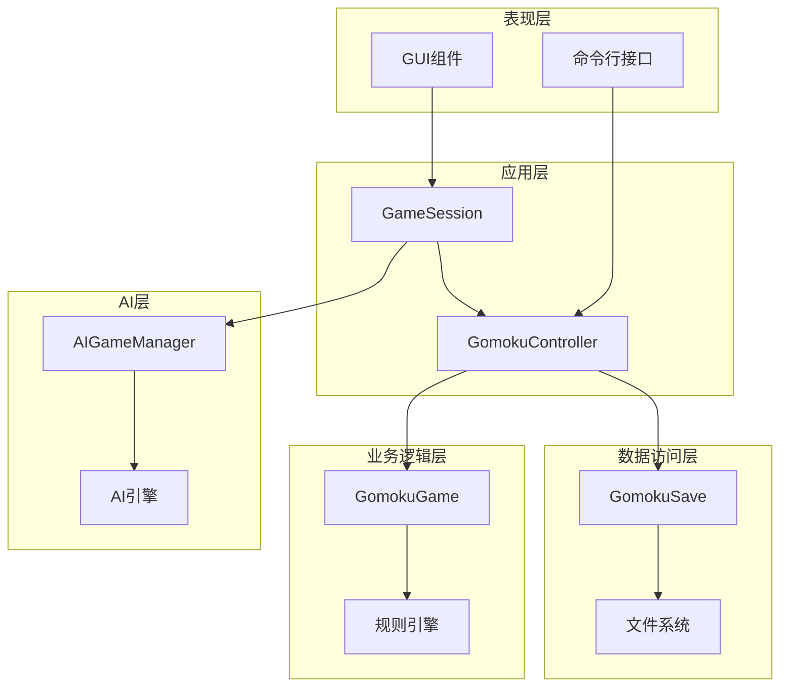

**图表来源**
- [app/session.py:12-179](file://app/session.py#L12-L179)
- [game/controller.py:11-194](file://game/controller.py#L11-L194)
- [game/game.py:4-118](file://game/game.py#L4-L118)
- [game/save.py:9-93](file://game/save.py#L9-L93)

### 数据流图

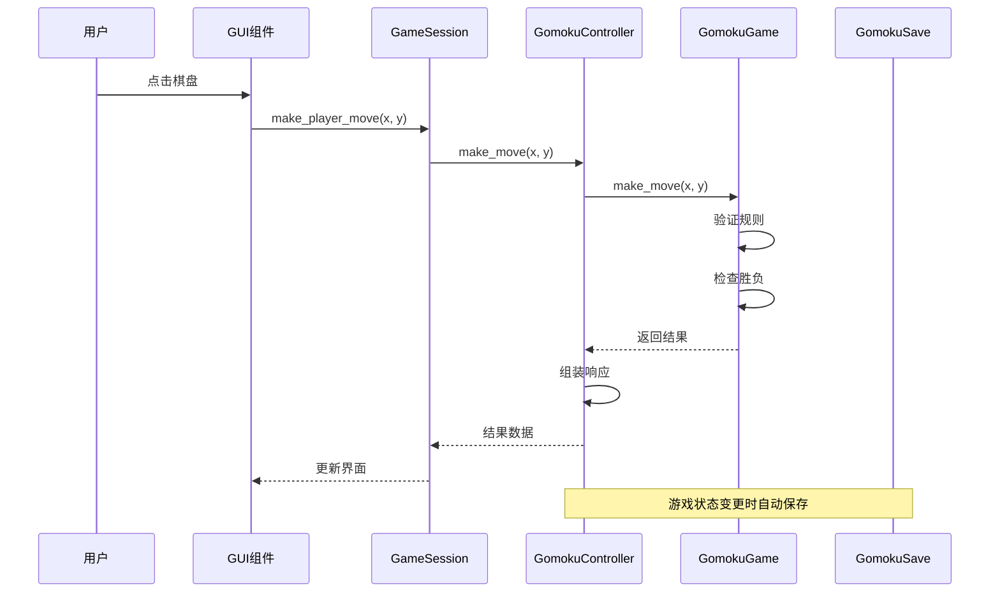

**图表来源**
- [app/session.py:63-102](file://app/session.py#L63-L102)
- [game/controller.py:65-98](file://game/controller.py#L65-L98)
- [game/game.py:22-56](file://game/game.py#L22-L56)

## 详细组件分析

### GomokuController 设计分析

#### 类结构设计

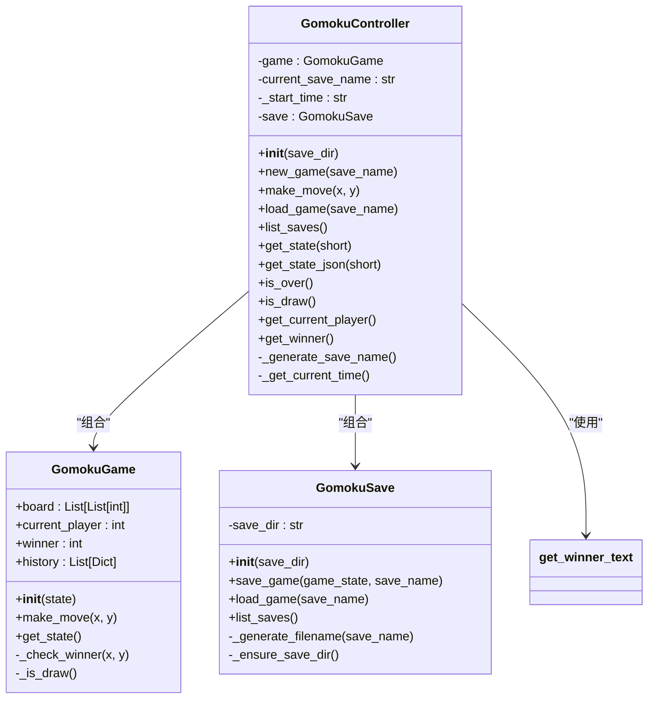

**图表来源**
- [game/controller.py:11-194](file://game/controller.py#L11-L194)
- [game/game.py:4-118](file://game/game.py#L4-L118)
- [game/save.py:9-93](file://game/save.py#L9-L93)
- [game/__init__.py:6-27](file://game/__init__.py#L6-L27)

#### 游戏初始化流程

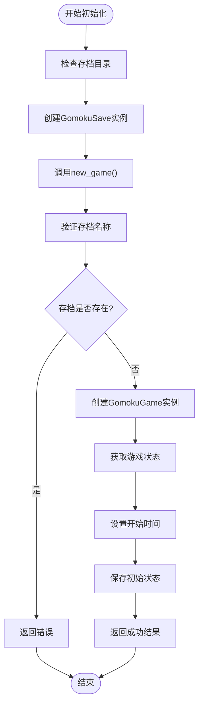

**图表来源**
- [game/controller.py:32-63](file://game/controller.py#L32-L63)
- [game/save.py:17-34](file://game/save.py#L17-L34)

#### 落子验证机制

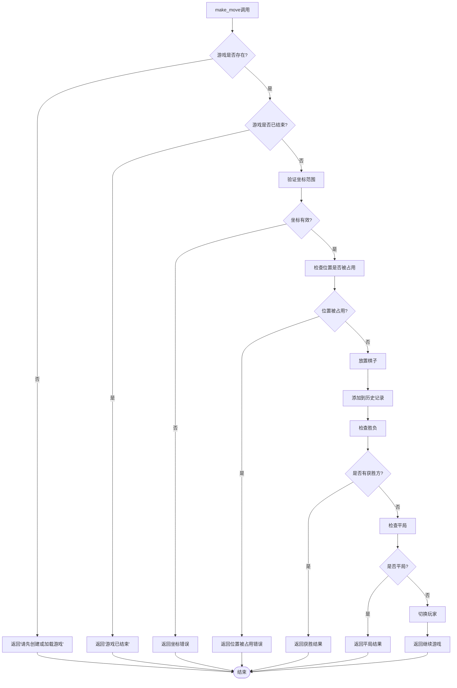

**图表来源**
- [game/controller.py:65-98](file://game/controller.py#L65-L98)
- [game/game.py:22-56](file://game/game.py#L22-L56)

#### 胜负判定算法

胜负判定采用四方向检测算法：

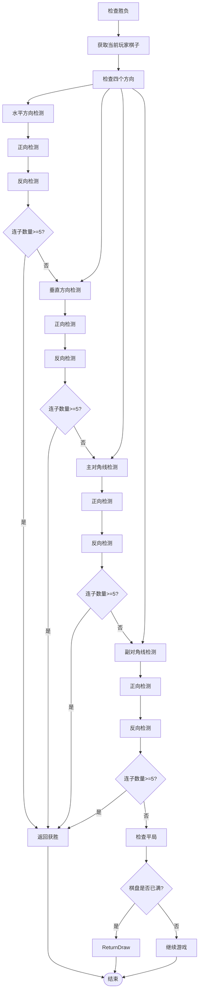

**图表来源**
- [game/game.py:67-102](file://game/game.py#L67-L102)
- [game/game.py:104-116](file://game/game.py#L104-L116)

### 存档恢复功能

#### 存档数据结构

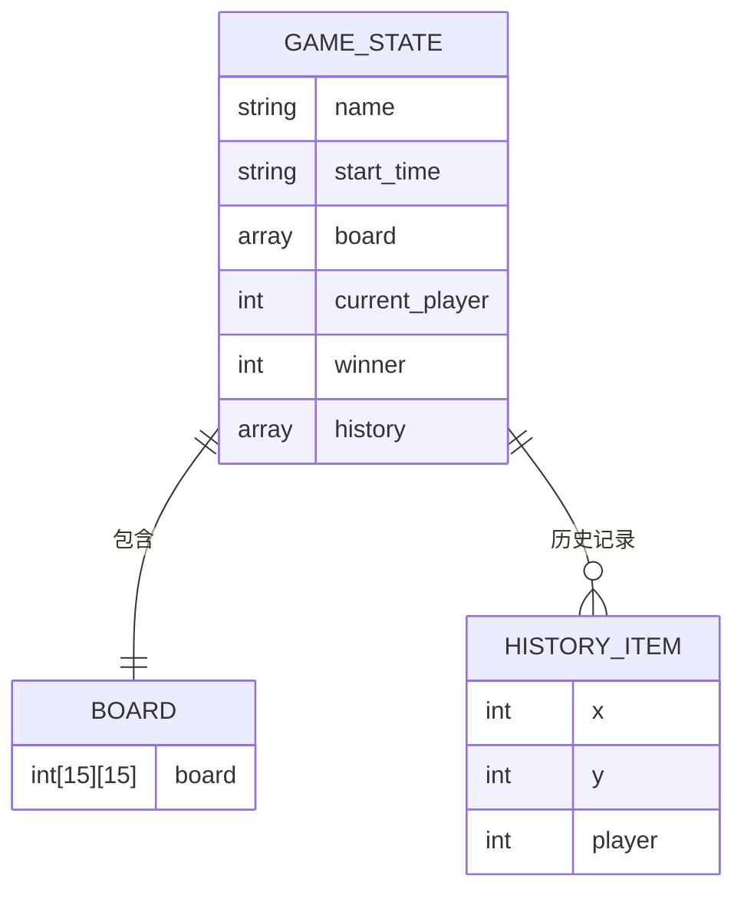

**图表来源**
- [game/game.py:58-65](file://game/game.py#L58-L65)
- [game/save.py:17-27](file://game/save.py#L17-L27)

#### 存档管理流程

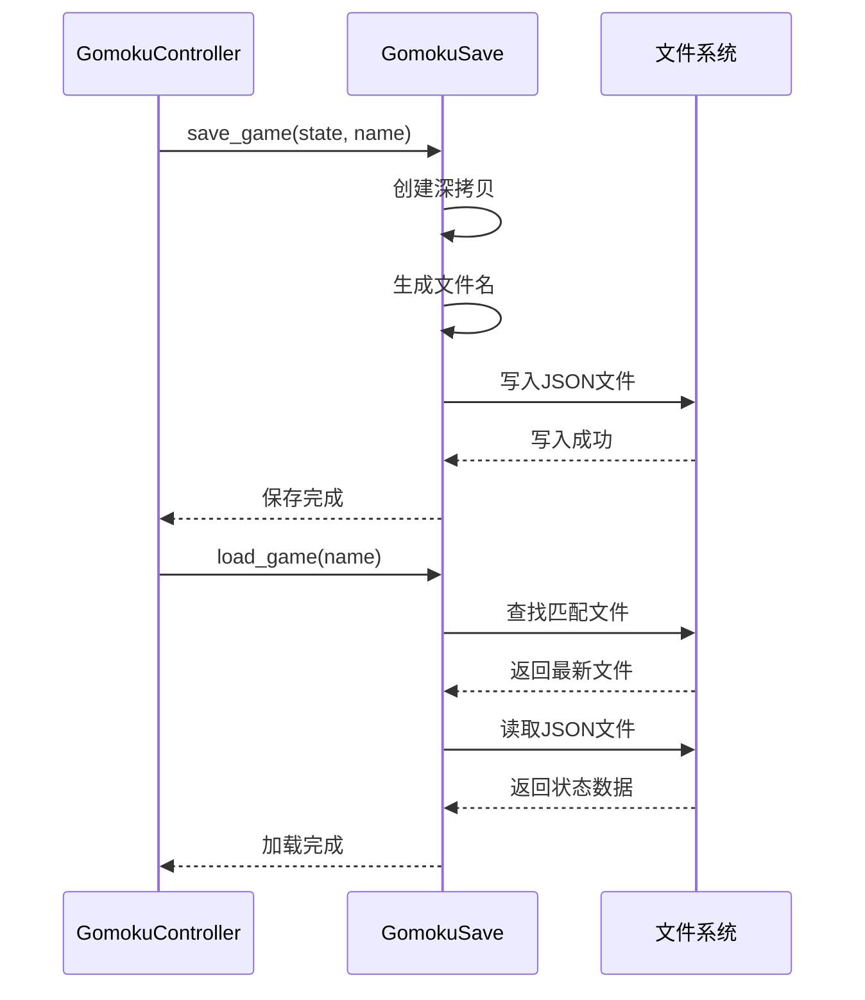

**图表来源**
- [game/save.py:17-57](file://game/save.py#L17-L57)

**章节来源**
- [game/controller.py:11-194](file://game/controller.py#L11-L194)
- [game/game.py:4-118](file://game/game.py#L4-L118)
- [game/save.py:9-93](file://game/save.py#L9-L93)

## 依赖关系分析

### 模块间依赖

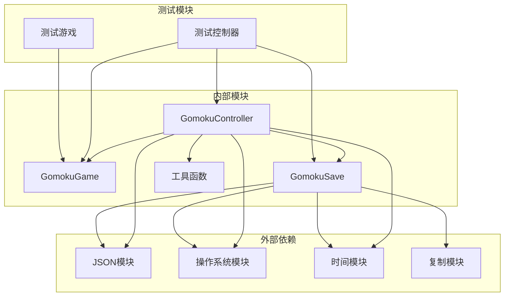

**图表来源**
- [game/controller.py:1-10](file://game/controller.py#L1-L10)
- [game/save.py:1-7](file://game/save.py#L1-L7)
- [tests/test_controller.py:12-14](file://tests/test_controller.py#L12-L14)

### 接口契约

#### 控制器接口设计

| 方法 | 参数 | 返回值 | 描述 |
|------|------|--------|------|
| `new_game(save_name)` | `save_name: str` | `dict` | 创建新游戏并保存 |
| `make_move(x, y)` | `x: int, y: int` | `dict` | 执行落子操作 |
| `load_game(save_name)` | `save_name: str` | `dict` | 加载指定存档 |
| `list_saves()` | 无 | `list` | 列出所有存档 |
| `get_state(short)` | `short: bool` | `dict` | 获取游戏状态 |

#### 游戏接口设计

| 方法 | 参数 | 返回值 | 描述 |
|------|------|--------|------|
| `__init__(state)` | `state: dict` | 无 | 初始化游戏或从状态恢复 |
| `make_move(x, y)` | `x: int, y: int` | `int` | 执行落子并返回结果 |
| `get_state()` | 无 | `dict` | 获取当前状态的深拷贝 |

**章节来源**
- [game/controller.py:32-194](file://game/controller.py#L32-L194)
- [game/game.py:7-65](file://game/game.py#L7-L65)

## 性能考虑

### 时间复杂度分析

- **落子验证**: O(1) - 坐标范围检查和占用检查
- **胜负判定**: O(n) - n为连子数量，最坏情况下检查4个方向的8个邻域
- **平局检测**: O(1) - 检查棋盘是否已满
- **存档操作**: O(m) - m为棋盘大小，主要是深拷贝操作

### 空间复杂度分析

- **棋盘存储**: O(1) - 固定15×15的棋盘
- **历史记录**: O(h) - h为历史步数
- **状态复制**: O(1) - 深拷贝固定大小的棋盘

### 优化建议

1. **内存优化**: 考虑使用位运算来压缩棋盘状态
2. **缓存机制**: 缓存最近的胜负判定结果
3. **异步存档**: 将存档操作异步化，避免阻塞UI
4. **增量更新**: 只保存变化的状态部分

## 故障排除指南

### 常见错误类型

#### 游戏状态错误
- **错误**: "请先创建或加载游戏"
- **原因**: 在没有游戏实例的情况下调用方法
- **解决方案**: 确保先调用`new_game()`或`load_game()`

#### 落子错误
- **错误**: "坐标超出范围"
- **原因**: 落子坐标不在15×15范围内
- **解决方案**: 验证坐标范围(0-14)

- **错误**: "位置已被占用"
- **原因**: 目标位置已有棋子
- **解决方案**: 选择空位置落子

- **错误**: "游戏已结束"
- **原因**: 游戏已经结束，不能再落子
- **解决方案**: 开始新游戏或加载存档

#### 存档错误
- **错误**: "存档不存在"
- **原因**: 指定的存档名称不存在
- **解决方案**: 检查存档名称或使用`list_saves()`查看可用存档

### 异常处理策略

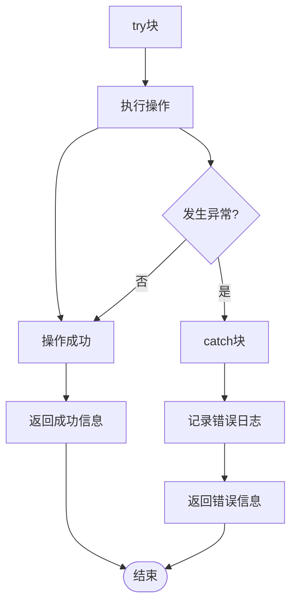

**图表来源**
- [game/controller.py:96-97](file://game/controller.py#L96-L97)
- [game/save.py:46-47](file://game/save.py#L46-L47)

**章节来源**
- [game/controller.py:65-121](file://game/controller.py#L65-L121)
- [game/save.py:36-57](file://game/save.py#L36-L57)

## 结论

游戏控制器模块展现了良好的软件工程实践，具有以下特点：

### 设计优势
- **清晰的分层架构**: 各层职责明确，便于维护和扩展
- **完善的错误处理**: 全面的异常处理和错误恢复机制
- **模块化设计**: 功能模块独立，耦合度低
- **可测试性**: 提供完整的单元测试覆盖

### 技术亮点
- **状态管理**: 采用深拷贝确保状态隔离
- **存档机制**: 支持多版本存档和自动命名
- **规则实现**: 完整的五子棋规则逻辑
- **接口设计**: 统一的API设计，易于使用

### 改进建议
1. **性能优化**: 考虑位运算优化棋盘存储
2. **并发支持**: 添加线程安全机制
3. **配置管理**: 支持可配置的游戏参数
4. **日志系统**: 完善的日志记录机制

该模块为五子棋游戏提供了稳定可靠的核心控制能力，为未来的功能扩展奠定了良好的基础。

## 附录

### API使用示例

#### 基本游戏流程
```python
# 创建控制器
controller = GomokuController()

# 新建游戏
result = controller.new_game("我的游戏1")
if result["status"] == "success":
    print("游戏创建成功")

# 执行落子
result = controller.make_move(7, 7)
if result["status"] == "success":
    print(f"当前玩家: {controller.get_current_player()}")
    print(f"获胜方: {result['winner']}")

# 保存游戏
state = controller.get_state()
```

#### 存档管理示例
```python
# 列出存档
saves = controller.list_saves()
print("可用存档:", saves)

# 加载存档
result = controller.load_game("我的游戏1")
if result["status"] == "success":
    print("游戏加载成功")
    print("当前状态:", result["state"])
```

### 扩展指导

#### 添加新功能的步骤
1. **分析需求**: 明确新功能的业务需求
2. **设计接口**: 定义新的API接口
3. **实现逻辑**: 编写核心实现代码
4. **编写测试**: 添加单元测试和集成测试
5. **文档更新**: 更新相关文档和注释

#### 可扩展性设计原则
- **开闭原则**: 对扩展开放，对修改封闭
- **单一职责**: 每个模块职责单一明确
- **依赖倒置**: 依赖抽象而非具体实现
- **接口隔离**: 接口设计简洁明确