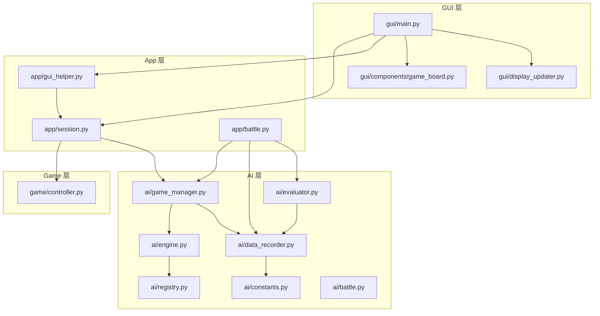
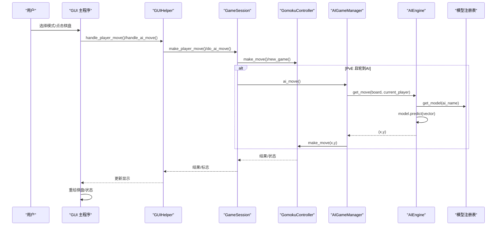
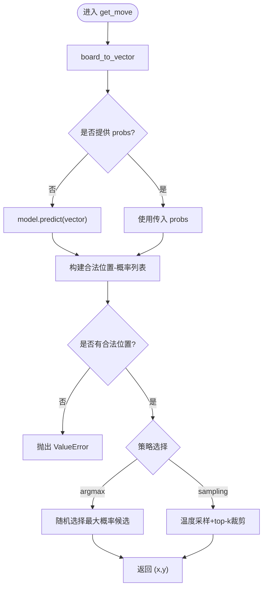
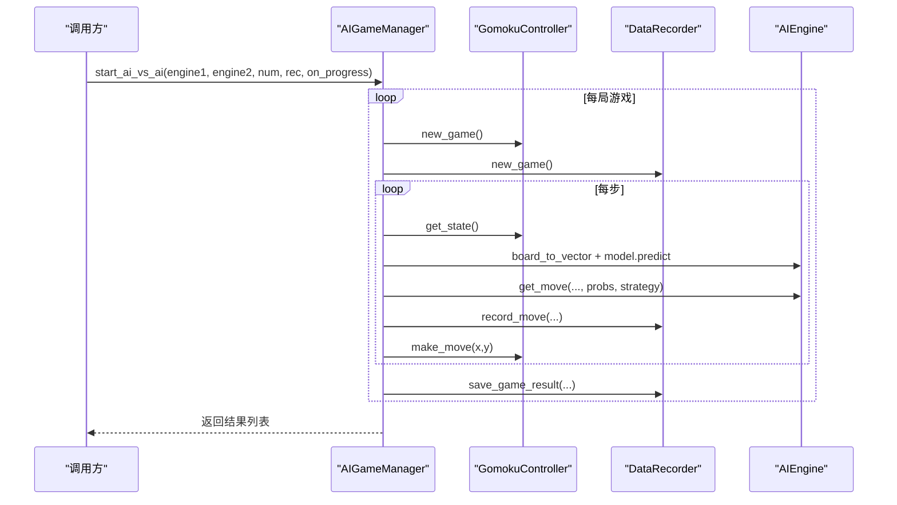
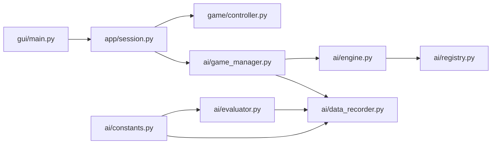

# 组件交互设计

<cite>
**本文引用的文件**
- [ai/engine.py](file://ai/engine.py)
- [ai/game_manager.py](file://ai/game_manager.py)
- [ai/battle.py](file://ai/battle.py)
- [app/battle.py](file://app/battle.py)
- [gui/main.py](file://gui/main.py)
- [ai/data_recorder.py](file://ai/data_recorder.py)
- [ai/evaluator.py](file://ai/evaluator.py)
- [app/session.py](file://app/session.py)
- [game/controller.py](file://game/controller.py)
- [gui/components/game_board.py](file://gui/components/game_board.py)
- [ai/constants.py](file://ai/constants.py)
- [ai/registry.py](file://ai/registry.py)
- [app/gui_helper.py](file://app/gui_helper.py)
- [gui/display_updater.py](file://gui/display_updater.py)
</cite>

## 目录
1. [引言](#引言)
2. [项目结构](#项目结构)
3. [核心组件](#核心组件)
4. [架构总览](#架构总览)
5. [详细组件分析](#详细组件分析)
6. [依赖分析](#依赖分析)
7. [性能考量](#性能考量)
8. [故障排查指南](#故障排查指南)
9. [结论](#结论)
10. [附录](#附录)

## 引言
本设计文档聚焦于五子棋AI项目的组件交互设计，系统阐述各模块之间的交互模式与通信机制，包括事件驱动、消息传递、回调机制等。文档深入分析组件间的耦合关系、解耦策略与接口契约，梳理数据在组件间的流转过程（输入处理、状态传递、结果返回），并提供典型场景的时序图与流程图。同时总结设计模式的应用（如观察者/发布-订阅思想在回调中的体现）、性能优化手段（异步处理、缓存策略、批处理）以及最佳实践与常见问题的解决方案。

## 项目结构
项目采用分层清晰的组织方式：
- gui 层：负责用户界面与交互，包含模式选择、棋盘绘制、回放浏览等。
- app 层：薄代理层，封装业务流程，协调 game 与 ai 模块。
- ai 层：AI 引擎、对战管理、数据记录、评价器、模型注册表等。
- game 层：核心游戏规则与存档管理。

图表来源
- [gui/main.py:1-462](file://gui/main.py#L1-L462)
- [app/session.py:1-179](file://app/session.py#L1-L179)
- [ai/engine.py:1-194](file://ai/engine.py#L1-L194)
- [ai/game_manager.py:1-339](file://ai/game_manager.py#L1-L339)
- [ai/data_recorder.py:1-145](file://ai/data_recorder.py#L1-L145)
- [ai/evaluator.py:1-350](file://ai/evaluator.py#L1-L350)
- [ai/constants.py:1-26](file://ai/constants.py#L1-L26)
- [ai/registry.py:1-316](file://ai/registry.py#L1-L316)
- [game/controller.py:1-194](file://game/controller.py#L1-L194)

章节来源
- [gui/main.py:1-462](file://gui/main.py#L1-L462)
- [app/session.py:1-179](file://app/session.py#L1-L179)
- [ai/engine.py:1-194](file://ai/engine.py#L1-L194)
- [ai/game_manager.py:1-339](file://ai/game_manager.py#L1-L339)
- [ai/data_recorder.py:1-145](file://ai/data_recorder.py#L1-L145)
- [ai/evaluator.py:1-350](file://ai/evaluator.py#L1-L350)
- [ai/constants.py:1-26](file://ai/constants.py#L1-L26)
- [ai/registry.py:1-316](file://ai/registry.py#L1-L316)
- [game/controller.py:1-194](file://game/controller.py#L1-L194)

## 核心组件
- AI 引擎（AIEngine）：将棋盘状态转换为模型输入，调用模型预测，按策略选择落子位置。
- AI 游戏管理器（AIGameManager）：协调人机对战与AI内战流程，封装落子循环与数据记录。
- 数据记录器（DataRecorder）：按轮次与对局组织记录，持久化每步输入、输出与落子位置。
- 评价器（Evaluator）：基于记录生成训练样本，支持多进程并行评价。
- 游戏控制器（GomokuController）：统一对外接口，封装游戏状态、落子与存档。
- GUI 主程序与组件：模式选择、棋盘绘制、回放浏览、显示更新。
- App 会话与 GUI 辅助：薄代理层，协调 GUI 与游戏/AI流程。
- 模型注册表（Registry）：统一管理模型与训练器映射，支持多代模型懒加载。

章节来源
- [ai/engine.py:44-194](file://ai/engine.py#L44-L194)
- [ai/game_manager.py:16-339](file://ai/game_manager.py#L16-L339)
- [ai/data_recorder.py:17-145](file://ai/data_recorder.py#L17-L145)
- [ai/evaluator.py:51-350](file://ai/evaluator.py#L51-L350)
- [game/controller.py:11-194](file://game/controller.py#L11-L194)
- [gui/main.py:31-462](file://gui/main.py#L31-L462)
- [app/session.py:12-179](file://app/session.py#L12-L179)
- [ai/registry.py:58-184](file://ai/registry.py#L58-L184)

## 架构总览
系统遵循“GUI薄层 + App薄层 + AI层 + Game层”的分层架构。GUI层通过App层与AI层交互，AI层通过控制器与Game层交互。数据流贯穿：GUI事件 -> App会话 -> AI引擎/管理器 -> Game控制器 -> 持久化/回放。

图表来源
- [gui/main.py:224-268](file://gui/main.py#L224-L268)
- [app/gui_helper.py:53-106](file://app/gui_helper.py#L53-L106)
- [app/session.py:63-179](file://app/session.py#L63-L179)
- [game/controller.py:65-97](file://game/controller.py#L65-L97)
- [ai/game_manager.py:100-122](file://ai/game_manager.py#L100-L122)
- [ai/engine.py:67-142](file://ai/engine.py#L67-L142)
- [ai/registry.py:150-184](file://ai/registry.py#L150-L184)

## 详细组件分析

### AI 引擎（AIEngine）
- 职责：将棋盘状态转换为输入向量，调用模型预测，按策略（argmax/sampling）选择落子。
- 接口契约：输入为15×15棋盘与当前玩家；输出为(x,y)坐标；支持传入预计算的概率向量以避免重复预测。
- 策略实现：argmax随机破平局；sampling通过温度采样与top-k裁剪。
- 错误处理：棋盘已满、策略非法、温度参数非法等抛出异常。

图表来源
- [ai/engine.py:106-142](file://ai/engine.py#L106-L142)
- [ai/engine.py:173-171](file://ai/engine.py#L173-L171)

章节来源
- [ai/engine.py:44-194](file://ai/engine.py#L44-L194)

### AI 游戏管理器（AIGameManager）
- 职责：人机对战与AI内战的编排，封装落子循环、数据记录与结果保存。
- 回调机制：支持on_progress回调，跨局通知进度。
- 温度采样编排：按步数与执方动态决定是否启用采样策略。
- 内战流程：独立创建控制器，轮流执黑/白，记录每步数据，保存结果。

图表来源
- [ai/game_manager.py:232-274](file://ai/game_manager.py#L232-L274)
- [ai/game_manager.py:123-230](file://ai/game_manager.py#L123-L230)
- [ai/engine.py:173-194](file://ai/engine.py#L173-L194)

章节来源
- [ai/game_manager.py:16-339](file://ai/game_manager.py#L16-L339)

### 数据记录器（DataRecorder）
- 职责：按轮次与对局组织记录，每步记录输入向量、输出概率与落子位置，结束时保存完整记录。
- 目录结构：轮次目录（ai_data/{ai_name}_{序号}），每局子目录（1,2,3...），record.json。
- 一致性保障：校验并纠正game_id，避免跨局混用。

章节来源
- [ai/data_recorder.py:17-145](file://ai/data_recorder.py#L17-L145)

### 评价器（Evaluator）
- 职责：从record.json生成训练样本sample.json，融合棋型评估与五连追溯奖励，经掩码softmax转为概率分布。
- 并行策略：支持多进程并行评价，Windows spawn模式下使用顶层worker函数；进程池崩溃时回退串行。
- 输出：train_data目录下对应路径的sample.json。

章节来源
- [ai/evaluator.py:51-350](file://ai/evaluator.py#L51-L350)

### 游戏控制器（GomokuController）
- 职责：统一对外接口，封装落子、状态查询、存档读写。
- 状态返回：short/long两种格式；支持查询当前玩家、获胜方、是否结束等。
- 错误处理：未创建游戏、游戏已结束、落子异常等返回error键。

章节来源
- [game/controller.py:11-194](file://game/controller.py#L11-L194)

### GUI 主程序与组件
- GUI 主程序：模式选择、主界面、菜单、按钮、回放浏览；捕获模型加载异常并提示。
- 棋盘组件：绘制网格、星位、棋子与最后落子高亮；将点击事件转换为(row,col)回调。
- 显示更新器：根据display_state刷新棋盘、标签与历史记录列表。

章节来源
- [gui/main.py:31-462](file://gui/main.py#L31-L462)
- [gui/components/game_board.py:7-170](file://gui/components/game_board.py#L7-L170)
- [gui/display_updater.py:13-110](file://gui/display_updater.py#L13-L110)

### App 会话与 GUI 辅助
- GameSession：薄代理，pve模式下协调AIGameManager；提供统一落子接口，返回need_ai_move标志。
- GUIHelper：封装与界面无关的业务逻辑，提供display_state、玩家名称、PvE配置等。

章节来源
- [app/session.py:12-179](file://app/session.py#L12-L179)
- [app/gui_helper.py:12-199](file://app/gui_helper.py#L12-L199)

### 模型注册表（Registry）
- 职责：统一维护模型与训练器映射，支持多代模型懒加载；解析模型指定字符串（如 cnn_v3.1）。
- 错误处理：未知模型、非多代模型指定代数、多代模型未指定代数等抛出异常。

章节来源
- [ai/registry.py:58-184](file://ai/registry.py#L58-L184)

## 依赖分析
- 组件耦合与内聚
  - GUI层与App层：通过会话接口松耦合，GUI仅接收状态与回调。
  - App层与AI层：通过工厂函数与薄代理协调，避免直接依赖具体AI实现。
  - AI层内部：AIEngine依赖模型注册表；AIGameManager依赖AIEngine与DataRecorder；Evaluator依赖记录器与奖励计算组件。
  - Game层：GomokuController为唯一对外接口，向上屏蔽内部实现细节。
- 外部依赖
  - 文件系统：AI数据与训练数据目录由常量定义，便于隔离与覆盖。
  - 多进程：Evaluator使用ProcessPoolExecutor，注意Windows spawn模式限制。

图表来源
- [gui/main.py:19-28](file://gui/main.py#L19-L28)
- [app/session.py:7-9](file://app/session.py#L7-L9)
- [ai/game_manager.py:10-13](file://ai/game_manager.py#L10-L13)
- [ai/engine.py:9](file://ai/engine.py#L9)
- [ai/registry.py:58](file://ai/registry.py#L58)
- [ai/data_recorder.py:12](file://ai/data_recorder.py#L12)
- [ai/evaluator.py:20](file://ai/evaluator.py#L20)
- [ai/constants.py:11-15](file://ai/constants.py#L11-L15)

章节来源
- [gui/main.py:19-28](file://gui/main.py#L19-L28)
- [app/session.py:7-9](file://app/session.py#L7-L9)
- [ai/game_manager.py:10-13](file://ai/game_manager.py#L10-L13)
- [ai/engine.py:9](file://ai/engine.py#L9)
- [ai/registry.py:58](file://ai/registry.py#L58)
- [ai/data_recorder.py:12](file://ai/data_recorder.py#L12)
- [ai/evaluator.py:20](file://ai/evaluator.py#L20)
- [ai/constants.py:11-15](file://ai/constants.py#L11-L15)

## 性能考量
- 异步处理
  - GUI层使用after延迟触发AI落子，避免阻塞主线程。
  - AI内战支持on_progress回调，实现跨局进度反馈。
- 缓存策略
  - AIEngine支持传入预计算probs，避免重复model.predict调用。
  - DataRecorder每步记录而非仅结束时记录，降低内存压力。
- 批处理与并行
  - Evaluator支持多进程并行评价，Windows下使用顶层worker函数；进程池崩溃回退串行。
  - JSON输出采用紧凑格式，减少文件体积与IO开销。
- I/O与目录组织
  - AI数据与训练数据目录分离，便于管理与清理。
  - 轮次与对局目录结构清晰，利于批量处理与回放。

章节来源
- [gui/main.py:240-267](file://gui/main.py#L240-L267)
- [ai/game_manager.py:188-220](file://ai/game_manager.py#L188-L220)
- [ai/engine.py:111-112](file://ai/engine.py#L111-L112)
- [ai/evaluator.py:305-349](file://ai/evaluator.py#L305-L349)
- [ai/data_recorder.py:137-140](file://ai/data_recorder.py#L137-L140)
- [ai/constants.py:11-22](file://ai/constants.py#L11-L22)

## 故障排查指南
- 模型加载失败
  - 现象：选择未知模型或多代模型未指定代数。
  - 处理：app层捕获ValueError并抛出ModelLoadError，GUI层弹窗提示并回退。
- 游戏状态异常
  - 现象：未创建游戏即落子、游戏已结束仍落子。
  - 处理：GomokuController返回error键，GUI层提示用户。
- AI内战进程崩溃
  - 现象：多进程评价时进程池崩溃（可能因内存不足）。
  - 处理：Evaluator回退到串行模式，继续处理剩余文件。
- 数据记录不一致
  - 现象：跨局game_id不一致。
  - 处理：DataRecorder自动纠正并记录警告日志。

章节来源
- [app/battle.py:68-74](file://app/battle.py#L68-L74)
- [app/session.py:161-162](file://app/session.py#L161-L162)
- [game/controller.py:67-97](file://game/controller.py#L67-L97)
- [ai/evaluator.py:325-347](file://ai/evaluator.py#L325-L347)
- [ai/data_recorder.py:81-94](file://ai/data_recorder.py#L81-L94)

## 结论
本项目通过清晰的分层与薄代理设计，实现了GUI、App、AI与Game层的解耦。AIEngine与AIGameManager承担核心决策与流程编排职责，DataRecorder与Evaluator形成闭环的数据与样本生成链路。GUI层通过回调与延迟机制实现流畅的用户体验。整体设计在可维护性、可扩展性与性能之间取得平衡，适合进一步引入更多AI模型与训练策略。

## 附录
- 典型场景：人机对战（PvE）与AI内战（AI vs AI）的交互时序已在前述章节给出。
- 设计模式应用
  - 回调模式：on_progress回调用于进度通知；点击回调用于事件驱动。
  - 工厂/注册表模式：通过模型注册表统一管理模型与训练器实例。
  - 职责链/编排模式：AIGameManager编排落子循环与数据记录。
- 最佳实践
  - 严格区分UI与业务逻辑，UI层仅处理事件与渲染。
  - 使用回调与延迟避免阻塞，提升响应性。
  - 通过预计算probs与并行处理提升吞吐。
  - 采用轮次/对局目录结构，便于批量处理与回放。