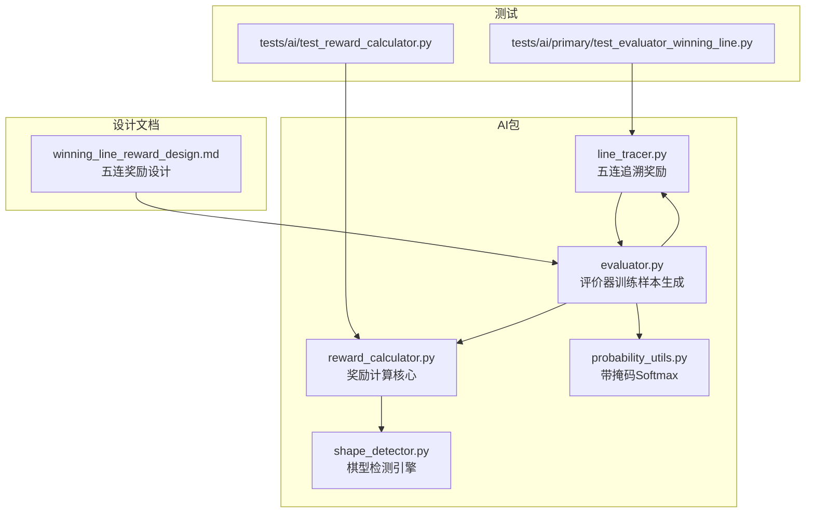
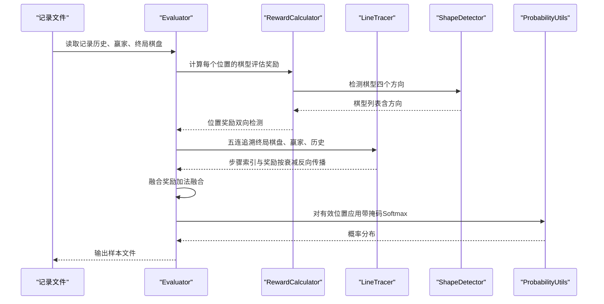
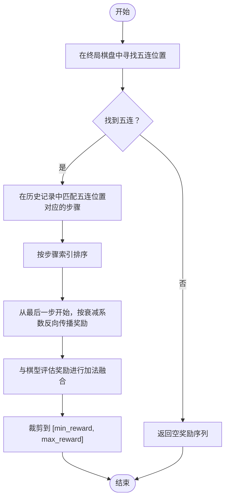
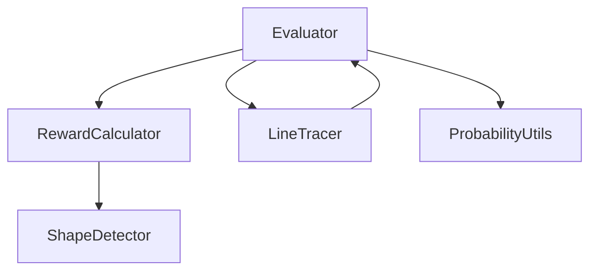

# 奖励机制设计

<cite>
**本文引用的文件**
- [ai/reward_calculator.py](file://ai/reward_calculator.py)
- [ai/line_tracer.py](file://ai/line_tracer.py)
- [ai/evaluator.py](file://ai/evaluator.py)
- [ai/shape_detector.py](file://ai/shape_detector.py)
- [ai/probability_utils.py](file://ai/probability_utils.py)
- [design/winning_line_reward_design.md](file://design/winning_line_reward_design.md)
- [tests/ai/test_reward_calculator.py](file://tests/ai/test_reward_calculator.py)
- [tests/ai/primary/test_evaluator_winning_line.py](file://tests/ai/primary/test_evaluator_winning_line.py)
</cite>

## 目录
1. [简介](#简介)
2. [项目结构](#项目结构)
3. [核心组件](#核心组件)
4. [架构总览](#架构总览)
5. [详细组件分析](#详细组件分析)
6. [依赖关系分析](#依赖关系分析)
7. [性能考量](#性能考量)
8. [故障排查指南](#故障排查指南)
9. [结论](#结论)
10. [附录](#附录)

## 简介
本设计文档围绕五子棋AI的奖励机制展开，重点阐述“胜利线奖励”（五连追溯）的设计理念与实现细节，并解释其与“棋型评估奖励”的融合策略。文档涵盖以下要点：
- 胜利线奖励的五连追溯算法与衰减系数应用
- 棋型评估奖励与胜利线奖励的融合策略（加法融合优于取最大值）
- 不同奖励类型的计算方法：连子数奖励、位置价值奖励、胜利线奖励
- 奖励权重的设计原则与调优策略
- 完整的算法流程图与代码示例路径

## 项目结构
本仓库中与奖励机制直接相关的模块主要分布在 ai 包内，配合设计文档与测试用例共同构成完整的实现与验证体系。

图表来源
- [ai/evaluator.py:1-350](file://ai/evaluator.py#L1-L350)
- [ai/reward_calculator.py:1-239](file://ai/reward_calculator.py#L1-L239)
- [ai/line_tracer.py:1-143](file://ai/line_tracer.py#L1-L143)
- [ai/shape_detector.py:1-314](file://ai/shape_detector.py#L1-L314)
- [ai/probability_utils.py:1-59](file://ai/probability_utils.py#L1-L59)
- [design/winning_line_reward_design.md:1-177](file://design/winning_line_reward_design.md#L1-L177)
- [tests/ai/test_reward_calculator.py:1-270](file://tests/ai/test_reward_calculator.py#L1-L270)
- [tests/ai/primary/test_evaluator_winning_line.py:1-374](file://tests/ai/primary/test_evaluator_winning_line.py#L1-L374)

章节来源
- [ai/evaluator.py:1-350](file://ai/evaluator.py#L1-L350)
- [design/winning_line_reward_design.md:1-177](file://design/winning_line_reward_design.md#L1-L177)

## 核心组件
- 奖励配置与棋型映射：RewardConfig 与 RewardCalculator 负责将棋型映射为数值奖励，并处理冲四递归防守模拟。
- 五连追溯奖励：LineTracer 负责从终局棋盘找到五连位置，追溯历史步骤并按衰减系数反向传播奖励。
- 评价器：Evaluator 负责生成训练样本，将棋型评估奖励与五连追溯奖励进行融合，并通过 Softmax 转换为概率分布。
- 棋型检测：shape_detector 提供高性能的棋型检测，支持 Numba JIT 加速。
- 概率工具：probability_utils 提供带掩码的数值稳定 Softmax 转换。

章节来源
- [ai/reward_calculator.py:1-239](file://ai/reward_calculator.py#L1-L239)
- [ai/line_tracer.py:1-143](file://ai/line_tracer.py#L1-L143)
- [ai/evaluator.py:1-350](file://ai/evaluator.py#L1-L350)
- [ai/shape_detector.py:1-314](file://ai/shape_detector.py#L1-L314)
- [ai/probability_utils.py:1-59](file://ai/probability_utils.py#L1-L59)

## 架构总览
奖励机制的整体流程由“棋型评估 + 胜利线奖励 + 融合 + Softmax”构成。Evaluator 作为入口协调各模块，先计算每个位置的棋型评估奖励，再叠加五连追溯奖励，最后通过 Softmax 输出概率分布。

图表来源
- [ai/evaluator.py:97-210](file://ai/evaluator.py#L97-L210)
- [ai/reward_calculator.py:46-99](file://ai/reward_calculator.py#L46-L99)
- [ai/line_tracer.py:64-117](file://ai/line_tracer.py#L64-L117)
- [ai/shape_detector.py:197-279](file://ai/shape_detector.py#L197-L279)
- [ai/probability_utils.py:15-58](file://ai/probability_utils.py#L15-L58)

## 详细组件分析

### 胜利线奖励（五连追溯）设计理念
- 衰减系数：复用 Evaluator.DECAY_RATE = 0.9，使五连中的早期步骤获得递减的额外奖励，突出关键决策点。
- 融合策略：采用加法融合，避免取最大值导致早期步骤弱信号被丢弃；同时限制融合后的奖励在 [min_reward, max_reward] 范围内，确保 Softmax 缩放一致性。
- 失败方处理：仅对获胜方的五连步骤叠加奖励，失败方不给予负奖励，仅保留棋型评估。

章节来源
- [design/winning_line_reward_design.md:10-16](file://design/winning_line_reward_design.md#L10-L16)
- [ai/evaluator.py:55-96](file://ai/evaluator.py#L55-L96)
- [ai/line_tracer.py:119-142](file://ai/line_tracer.py#L119-L142)

### 五连追溯算法实现原理
- 五连定位：遍历终局棋盘的四个方向，找到连续相同颜色的五个位置集合。
- 步骤追溯：在历史记录中匹配这五个位置，确认落子方与步序，得到五连涉及的步骤索引。
- 反向传播：从最后一步开始，按衰减系数逐步降低奖励，形成一个奖励序列。
- 裁剪与融合：将融合后的奖励裁剪至 [min_reward, max_reward]，避免越界。

图表来源
- [ai/line_tracer.py:28-117](file://ai/line_tracer.py#L28-L117)
- [design/winning_line_reward_design.md:36-75](file://design/winning_line_reward_design.md#L36-L75)

章节来源
- [ai/line_tracer.py:28-117](file://ai/line_tracer.py#L28-L117)
- [design/winning_line_reward_design.md:36-116](file://design/winning_line_reward_design.md#L36-L116)

### 棋型评估奖励与五连奖励的融合策略
- 设计决策：采用加法融合而非取最大值，确保两种信号都能贡献到最终奖励，避免早期步骤弱信号被丢弃。
- 权重控制：BLEND_ALPHA 默认为 1.0，可通过自定义 alpha 控制五连追溯奖励的权重，实现灵活调优。
- 裁剪保护：融合后的奖励在 [min_reward, max_reward] 范围内，保证 Softmax 缩放的一致性与数值稳定性。

章节来源
- [design/winning_line_reward_design.md:118-147](file://design/winning_line_reward_design.md#L118-L147)
- [ai/line_tracer.py:119-142](file://ai/line_tracer.py#L119-L142)
- [ai/evaluator.py:154-200](file://ai/evaluator.py#L154-L200)

### 不同奖励类型的计算方法
- 连子数奖励（棋型评估）：基于棋型检测结果，将棋型映射为相对 max_reward 的比例系数，结合方向数量与敌方系数进行计算。
- 位置价值奖励：对每个空位计算其在当前局面下的棋型评估奖励，采用双向检测（我方与敌方）取较大值。
- 胜利线奖励：对五连涉及的步骤按衰减系数反向传播奖励，叠加到对应步骤的实际落子位置。

章节来源
- [ai/reward_calculator.py:76-99](file://ai/reward_calculator.py#L76-L99)
- [ai/reward_calculator.py:118-190](file://ai/reward_calculator.py#L118-L190)
- [ai/evaluator.py:175-200](file://ai/evaluator.py#L175-L200)

### 奖励权重的设计原则与调优策略
- 设计原则
  - 保持奖励尺度统一：max_reward 与 min_reward 作为全局上限，确保不同来源奖励在同一尺度下融合。
  - 平衡信号强度：棋型评估奖励反映即时局面价值，五连奖励强调关键决策链路，二者需协同作用。
  - 数值稳定性：通过 Softmax 缩放因子与裁剪机制，避免极端值导致的数值不稳定。
- 调优策略
  - alpha 权重：通过 BLEND_ALPHA 或自定义 alpha 调整五连奖励对最终奖励的贡献度。
  - 衰减系数：DECAY_RATE 控制五连早期步骤的信号强度，过小会削弱早期步骤的重要性，过大则可能导致后期步骤过度主导。
  - 棋型权重：RewardConfig 中的 values 映射直接影响棋型评估奖励的相对重要性，建议通过实验对比不同映射对训练效果的影响。

章节来源
- [ai/evaluator.py:55-96](file://ai/evaluator.py#L55-L96)
- [ai/reward_calculator.py:14-32](file://ai/reward_calculator.py#L14-L32)
- [ai/probability_utils.py:10-12](file://ai/probability_utils.py#L10-L12)

### 代码示例路径
- 五连追溯与融合
  - [trace_winning_line:64-117](file://ai/line_tracer.py#L64-L117)
  - [blend_rewards:119-142](file://ai/line_tracer.py#L119-L142)
- 棋型评估与冲四递归
  - [shape_to_reward:76-99](file://ai/reward_calculator.py#L76-L99)
  - [_compute_four_reward:118-190](file://ai/reward_calculator.py#L118-L190)
- 训练样本生成与Softmax
  - [evaluate_record:97-130](file://ai/evaluator.py#L97-L130)
  - [_compute_all_rewards:132-210](file://ai/evaluator.py#L132-L210)
  - [masked_softmax:15-58](file://ai/probability_utils.py#L15-L58)

章节来源
- [ai/line_tracer.py:64-142](file://ai/line_tracer.py#L64-L142)
- [ai/reward_calculator.py:76-190](file://ai/reward_calculator.py#L76-L190)
- [ai/evaluator.py:97-210](file://ai/evaluator.py#L97-L210)
- [ai/probability_utils.py:15-58](file://ai/probability_utils.py#L15-L58)

## 依赖关系分析
- 模块耦合
  - Evaluator 依赖 RewardCalculator 与 LineTracer，二者共享 RewardConfig 以确保奖励尺度一致。
  - RewardCalculator 依赖 ShapeDetector 进行棋型检测，支持 Numba JIT 加速。
  - Evaluator 依赖 ProbabilityUtils 进行数值稳定的 Softmax 转换。
- 外部依赖
  - Numba（可选）：提升棋型检测性能，不可用时自动回退到纯 Python 实现。
  - 多进程：Evaluator 支持多进程并行评价，Windows spawn 模式下通过顶层函数工作。

图表来源
- [ai/evaluator.py:26-96](file://ai/evaluator.py#L26-L96)
- [ai/reward_calculator.py:10-11](file://ai/reward_calculator.py#L10-L11)
- [ai/line_tracer.py:1-5](file://ai/line_tracer.py#L1-L5)

章节来源
- [ai/evaluator.py:26-96](file://ai/evaluator.py#L26-L96)
- [ai/shape_detector.py:12-17](file://ai/shape_detector.py#L12-L17)

## 性能考量
- 棋型检测加速：通过 Numba JIT 对单方向检测进行编译，显著提升检测速度；不可用时自动回退到纯 Python。
- 数值稳定性：Softmax 缩放因子将奖励值缩放到合理范围，避免指数运算导致的下溢或上溢。
- 并行化：多进程并行评价支持，Windows spawn 模式下通过顶层函数 worker 执行，提高大规模样本生成效率。

章节来源
- [ai/shape_detector.py:12-17](file://ai/shape_detector.py#L12-L17)
- [ai/probability_utils.py:10-12](file://ai/probability_utils.py#L10-L12)
- [ai/evaluator.py:26-48](file://ai/evaluator.py#L26-L48)

## 故障排查指南
- 无胜者或平局：五连追溯不会产生额外奖励，检查记录文件的 winner 字段与终局棋盘状态。
- 五连追溯失败：确认历史记录中位置匹配逻辑与落子方判断是否正确，必要时检查输入向量长度与索引。
- 融合后奖励越界：检查裁剪逻辑是否生效，确保 max_reward 与 min_reward 设置合理。
- 冲四递归异常：确认防守位置查找逻辑与后续棋型检测是否正确，避免无限递归。

章节来源
- [ai/line_tracer.py:76-117](file://ai/line_tracer.py#L76-L117)
- [ai/evaluator.py:154-200](file://ai/evaluator.py#L154-L200)
- [tests/ai/primary/test_evaluator_winning_line.py:267-358](file://tests/ai/primary/test_evaluator_winning_line.py#L267-L358)

## 结论
本设计通过“棋型评估奖励 + 胜利线奖励”的双信号融合，既关注即时局面价值，又强调关键决策链路的重要性。加法融合策略确保早期步骤的弱信号不被丢弃，配合合理的衰减系数与权重调优，能够有效提升模型训练质量与决策稳定性。通过模块化的实现与完善的测试覆盖，奖励机制具备良好的可维护性与可扩展性。

## 附录
- 测试用例参考
  - [test_reward_calculator.py:1-270](file://tests/ai/test_reward_calculator.py#L1-L270)
  - [test_evaluator_winning_line.py:244-374](file://tests/ai/primary/test_evaluator_winning_line.py#L244-L374)