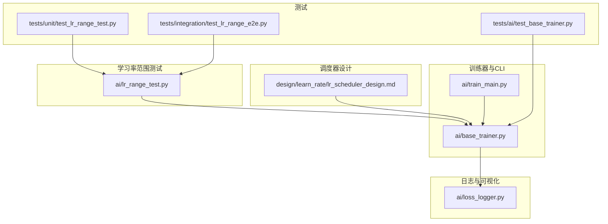
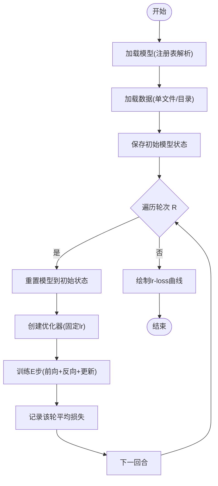
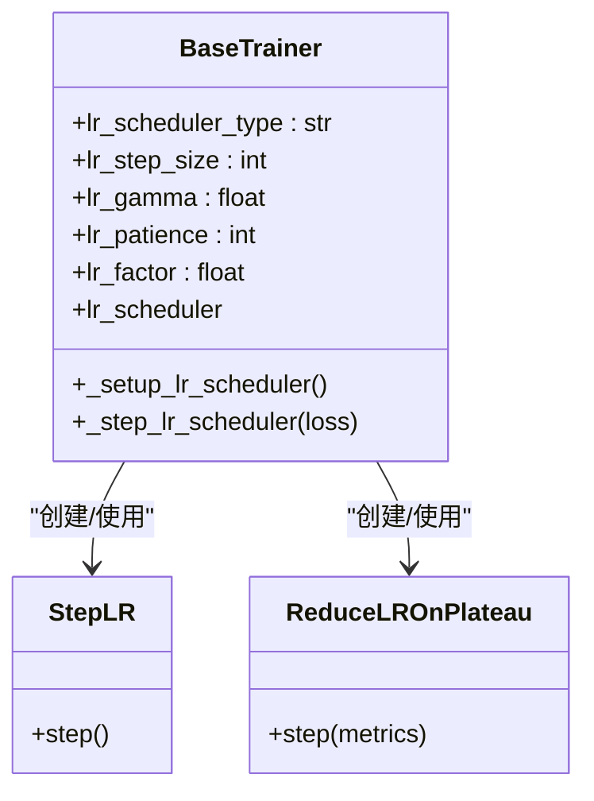
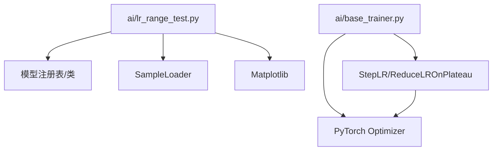

# 学习率调度设计

<cite>
**本文引用的文件**
- [ai/lr_range_test.py](file://ai/lr_range_test.py)
- [design/learn_rate/lr_scheduler_design.md](file://design/learn_rate/lr_scheduler_design.md)
- [ai/base_trainer.py](file://ai/base_trainer.py)
- [ai/train_main.py](file://ai/train_main.py)
- [tests/unit/test_lr_range_test.py](file://tests/unit/test_lr_range_test.py)
- [tests/integration/test_lr_range_e2e.py](file://tests/integration/test_lr_range_e2e.py)
- [tests/ai/test_base_trainer.py](file://tests/ai/test_base_trainer.py)
- [ai/loss_logger.py](file://ai/loss_logger.py)
</cite>

## 目录
1. [引言](#引言)
2. [项目结构](#项目结构)
3. [核心组件](#核心组件)
4. [架构概览](#架构概览)
5. [详细组件分析](#详细组件分析)
6. [依赖分析](#依赖分析)
7. [性能考虑](#性能考虑)
8. [故障排除指南](#故障排除指南)
9. [结论](#结论)
10. [附录](#附录)

## 引言
本设计文档围绕五子棋AI的学习率调度系统展开，重点涵盖以下方面：
- 学习率范围测试（LR Range Test）的设计理念与实现方法，帮助快速定位合适的初始学习率区间
- 自适应学习率调度策略：基于固定间隔衰减（StepLR）与基于验证损失平台期的衰减（ReduceLROnPlateau）
- 不同调度策略的适用场景与参数设置建议
- 学习率调度的监控指标与评估方法
- 学习率对模型收敛性能的影响与实践建议

## 项目结构
学习率相关能力分布在如下模块：
- LR范围测试：ai/lr_range_test.py
- 调度器设计文档：design/learn_rate/lr_scheduler_design.md
- 训练器与调度器集成：ai/base_trainer.py、ai/train_main.py
- 测试：tests/unit/test_lr_range_test.py、tests/integration/test_lr_range_e2e.py、tests/ai/test_base_trainer.py
- 损失日志与可视化：ai/loss_logger.py



**图表来源**
- [ai/lr_range_test.py:1-289](file://ai/lr_range_test.py#L1-L289)
- [design/learn_rate/lr_scheduler_design.md:1-184](file://design/learn_rate/lr_scheduler_design.md#L1-L184)
- [ai/base_trainer.py:1-200](file://ai/base_trainer.py#L1-L200)
- [ai/train_main.py:1-234](file://ai/train_main.py#L1-L234)
- [tests/unit/test_lr_range_test.py:1-271](file://tests/unit/test_lr_range_test.py#L1-L271)
- [tests/integration/test_lr_range_e2e.py:1-133](file://tests/integration/test_lr_range_e2e.py#L1-L133)
- [tests/ai/test_base_trainer.py:198-276](file://tests/ai/test_base_trainer.py#L198-L276)
- [ai/loss_logger.py:1-200](file://ai/loss_logger.py#L1-L200)

**章节来源**
- [ai/lr_range_test.py:1-289](file://ai/lr_range_test.py#L1-L289)
- [design/learn_rate/lr_scheduler_design.md:1-184](file://design/learn_rate/lr_scheduler_design.md#L1-L184)
- [ai/base_trainer.py:1-200](file://ai/base_trainer.py#L1-L200)
- [ai/train_main.py:1-234](file://ai/train_main.py#L1-L234)
- [tests/unit/test_lr_range_test.py:1-271](file://tests/unit/test_lr_range_test.py#L1-L271)
- [tests/integration/test_lr_range_e2e.py:1-133](file://tests/integration/test_lr_range_e2e.py#L1-L133)
- [tests/ai/test_base_trainer.py:198-276](file://tests/ai/test_base_trainer.py#L198-L276)
- [ai/loss_logger.py:1-200](file://ai/loss_logger.py#L1-L200)

## 核心组件
- LR范围测试模块：提供模型加载、数据准备、训练循环、曲线绘制与命令行入口
- 调度器设计：定义StepLR与ReduceLROnPlateau两种策略的参数与调用时机
- 训练器集成：在BaseTrainer中初始化优化器与调度器，并在训练循环中按epoch调用
- CLI参数：train_main.py暴露学习率调度相关参数，供用户控制
- 日志与可视化：LossLogger记录训练过程中的损失与梯度范数，支持生成曲线图

**章节来源**
- [ai/lr_range_test.py:131-210](file://ai/lr_range_test.py#L131-L210)
- [design/learn_rate/lr_scheduler_design.md:35-85](file://design/learn_rate/lr_scheduler_design.md#L35-L85)
- [ai/base_trainer.py:52-144](file://ai/base_trainer.py#L52-L144)
- [ai/train_main.py:119-152](file://ai/train_main.py#L119-L152)
- [ai/loss_logger.py:124-200](file://ai/loss_logger.py#L124-L200)

## 架构概览
学习率调度系统采用“范围测试 + 自适应调度”的组合策略：
- 使用LR范围测试确定合适的初始学习率区间
- 在训练器中集成StepLR与ReduceLROnPlateau，按epoch动态调整学习率
- 通过LossLogger记录损失与梯度范数，辅助评估收敛稳定性

```mermaid
sequenceDiagram
participant User as "用户"
participant CLI as "train_main.py"
participant Trainer as "BaseTrainer"
participant Opt as "优化器"
participant Sched as "学习率调度器"
participant Logger as "LossLogger"
User->>CLI : 传入 --lr-scheduler 等参数
CLI->>Trainer : 初始化训练器(含调度器参数)
Trainer->>Opt : 创建优化器(默认学习率与权重衰减)
Trainer->>Sched : 初始化调度器(StepLR/Plateau)
loop 每个epoch
Trainer->>Trainer : 前向+反向+参数更新
Trainer->>Logger : 记录loss与梯度范数
Trainer->>Sched : step()调用(传入avg_loss或无参)
Sched-->>Opt : 更新学习率
end
Trainer->>Logger : 生成loss曲线图
```

**图表来源**
- [ai/train_main.py:209-220](file://ai/train_main.py#L209-L220)
- [ai/base_trainer.py:127-144](file://ai/base_trainer.py#L127-L144)
- [ai/base_trainer.py:290-322](file://ai/base_trainer.py#L290-L322)
- [ai/loss_logger.py:124-200](file://ai/loss_logger.py#L124-L200)

## 详细组件分析

### LR范围测试组件分析
LR范围测试通过在固定轮次内线性递增学习率，记录每轮的平均损失，绘制lr-loss曲线，从而帮助确定合适的初始学习率区间。

- 关键流程
  - 模型加载：支持从注册表解析模型规格，构造fresh模型实例
  - 数据加载：支持单文件与目录扫描，统一转换为张量
  - 训练循环：每轮固定学习率，训练固定步数，记录平均损失
  - 曲线绘制：对数坐标显示学习率，便于观察拐点

- 算法复杂度
  - 时间复杂度：O(R×E×N×D)，R为轮次，E为每轮步数，N为样本数，D为模型参数量
  - 空间复杂度：主要受模型参数与中间激活影响，近似O(D)



**图表来源**
- [ai/lr_range_test.py:131-210](file://ai/lr_range_test.py#L131-L210)

**章节来源**
- [ai/lr_range_test.py:35-72](file://ai/lr_range_test.py#L35-L72)
- [ai/lr_range_test.py:102-128](file://ai/lr_range_test.py#L102-L128)
- [ai/lr_range_test.py:131-210](file://ai/lr_range_test.py#L131-L210)
- [ai/lr_range_test.py:213-240](file://ai/lr_range_test.py#L213-L240)
- [tests/unit/test_lr_range_test.py:124-271](file://tests/unit/test_lr_range_test.py#L124-L271)
- [tests/integration/test_lr_range_e2e.py:44-102](file://tests/integration/test_lr_range_e2e.py#L44-L102)

### 自适应学习率调度策略
系统支持两种PyTorch标准调度器，均可通过CLI参数启用与配置：

- StepLR（固定间隔衰减）
  - 参数：step_size（衰减间隔）、gamma（衰减系数）
  - 触发：每个epoch结束后无参step()

- ReduceLROnPlateau（基于平台期的衰减）
  - 参数：patience（耐心值）、factor（衰减系数）
  - 触发：每个epoch结束后传入当前epoch平均损失



**图表来源**
- [ai/base_trainer.py:127-144](file://ai/base_trainer.py#L127-L144)
- [design/learn_rate/lr_scheduler_design.md:67-85](file://design/learn_rate/lr_scheduler_design.md#L67-L85)

**章节来源**
- [design/learn_rate/lr_scheduler_design.md:11-31](file://design/learn_rate/lr_scheduler_design.md#L11-L31)
- [ai/base_trainer.py:127-144](file://ai/base_trainer.py#L127-L144)
- [ai/train_main.py:119-152](file://ai/train_main.py#L119-L152)
- [tests/ai/test_base_trainer.py:202-272](file://tests/ai/test_base_trainer.py#L202-L272)

### 不同调度策略的适用场景与参数设置
- 固定学习率
  - 适用：快速实验、简单任务、对稳定性要求不高
  - 注意：后期易出现震荡，收敛速度较慢

- 指数衰减（StepLR）
  - 适用：训练初期需要稳定收敛，后期逐步精细化
  - 推荐：step_size较大（如500），gamma较小（如0.9~0.95）

- ReduceLROnPlateau
  - 适用：损失曲线波动大，需要根据验证损失动态调整
  - 推荐：patience适中（如100），factor较小（如0.5）

**章节来源**
- [design/learn_rate/lr_scheduler_design.md:15-31](file://design/learn_rate/lr_scheduler_design.md#L15-L31)
- [ai/train_main.py:119-152](file://ai/train_main.py#L119-L152)

### 学习率调度的监控指标与评估方法
- 损失收敛速度
  - 通过LossLogger记录epoch级别的avg_loss，结合曲线图观察下降趋势
  - 关注训练早期的快速下降与后期的平滑收敛

- 训练稳定性
  - 梯度范数（grad_norm）：LossLogger可记录，用于评估梯度爆炸/消失风险
  - 验证集损失（val_loss）：在train_batch等支持验证集的模式下，叠加绘制

- 学习率跟踪
  - 训练日志中打印当前学习率，便于直观监控

**章节来源**
- [ai/loss_logger.py:124-200](file://ai/loss_logger.py#L124-L200)
- [ai/base_trainer.py:305-310](file://ai/base_trainer.py#L305-L310)

### 学习率对模型收敛性能的影响
- 学习率过大：训练不稳定，损失震荡甚至发散
- 学习率过小：收敛缓慢，训练时间长
- 合适的学习率区间：通过LR范围测试确定，再结合自适应调度在后期精细化

**章节来源**
- [design/learn_rate/lr_scheduler_design.md:3-9](file://design/learn_rate/lr_scheduler_design.md#L3-L9)
- [ai/lr_range_test.py:131-210](file://ai/lr_range_test.py#L131-L210)

## 依赖分析
- LR范围测试依赖
  - 模型注册表与模型类：用于解析模型规格并构造fresh模型
  - 样本加载器：统一数据格式与设备迁移
  - Matplotlib：用于绘制lr-loss曲线

- 调度器依赖
  - PyTorch优化器：StepLR与ReduceLROnPlateau作用于优化器
  - 训练器：在每个epoch结束时调用step()



**图表来源**
- [ai/lr_range_test.py:29-32](file://ai/lr_range_test.py#L29-L32)
- [ai/base_trainer.py:127-144](file://ai/base_trainer.py#L127-L144)

**章节来源**
- [ai/lr_range_test.py:29-32](file://ai/lr_range_test.py#L29-L32)
- [ai/base_trainer.py:127-144](file://ai/base_trainer.py#L127-L144)

## 性能考虑
- LR范围测试的开销
  - R×E次前向+反向+参数更新，建议合理设置R与E，平衡精度与耗时
  - 使用GPU可显著加速，注意显存占用

- 调度器调用成本
  - 每个epoch一次调度器调用，开销极低
  - ReduceLROnPlateau需传入avg_loss，注意计算avg_loss的时间成本

- 日志与可视化
  - LossLogger采用增量写入与缓冲flush，避免频繁IO
  - matplotlib在无GUI环境使用Agg后端，保证稳定性

**章节来源**
- [ai/lr_range_test.py:175-210](file://ai/lr_range_test.py#L175-L210)
- [ai/base_trainer.py:290-322](file://ai/base_trainer.py#L290-L322)
- [ai/loss_logger.py:167-177](file://ai/loss_logger.py#L167-L177)

## 故障排除指南
- 模型名称不支持
  - 现象：ValueError提示不支持的模型
  - 处理：检查模型注册表与规格字符串

- 数据路径不存在
  - 现象：FileNotFoundError
  - 处理：确认数据文件或目录存在且可读

- 调度器未创建
  - 现象：默认行为与之前一致
  - 处理：确认CLI参数lr_scheduler_type是否传入

- 损失曲线图未生成
  - 现象：matplotlib不可用或日志为空
  - 处理：安装matplotlib或检查日志文件是否存在

**章节来源**
- [ai/lr_range_test.py:55-59](file://ai/lr_range_test.py#L55-L59)
- [ai/lr_range_test.py:115-116](file://ai/lr_range_test.py#L115-L116)
- [tests/ai/test_base_trainer.py:198-201](file://tests/ai/test_base_trainer.py#L198-L201)
- [ai/loss_logger.py:196-200](file://ai/loss_logger.py#L196-L200)

## 结论
本设计通过LR范围测试与自适应学习率调度相结合，提供了从“确定合适初始学习率”到“后期精细化收敛”的完整闭环。StepLR与ReduceLROnPlateau分别适用于不同的训练场景，配合LossLogger的损失与梯度范数记录，能够有效评估收敛速度与稳定性，从而提升训练效率与模型性能。

## 附录

### 学习率测试与调度的命令行示例
- 运行LR范围测试
  - 示例：python -m ai.lr_range_test --model cnn_v2 --data data.json --rounds 50 --epochs 100 --min-lr 1e-7 --max-lr 1e-1 --output temp/lr_range_test.png

- 启用学习率调度器
  - 示例：python ai/train_main.py --model cnn_v2 --cycle --lr-scheduler step --lr-step-size 500 --lr-gamma 0.9
  - 示例：python ai/train_main.py --model cnn_v2 --cycle --lr-scheduler plateau --lr-patience 100 --lr-factor 0.5

**章节来源**
- [ai/lr_range_test.py:242-289](file://ai/lr_range_test.py#L242-L289)
- [ai/train_main.py:119-152](file://ai/train_main.py#L119-L152)