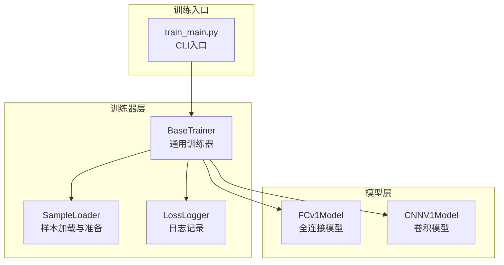
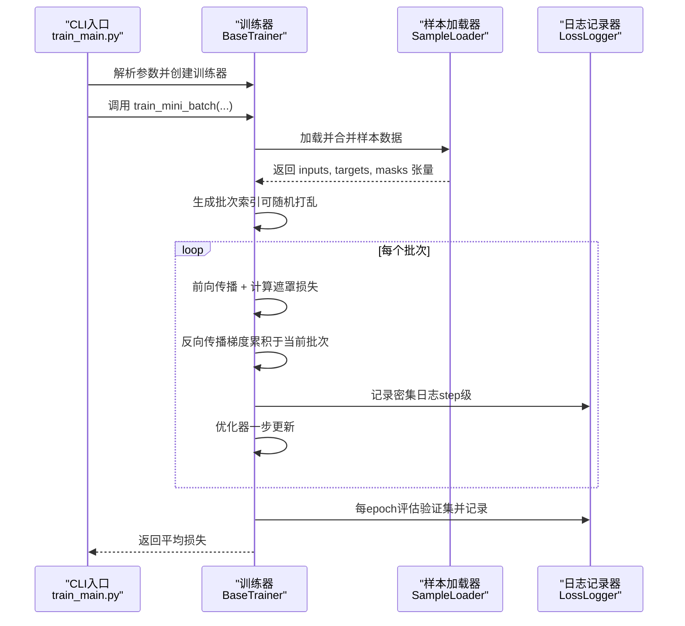
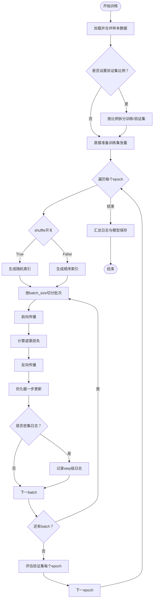
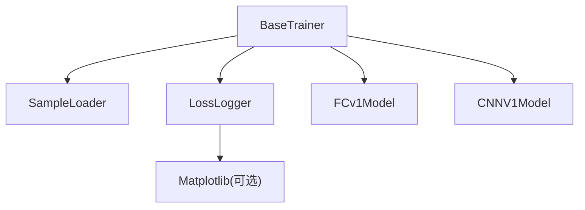

# 批量训练设计

<cite>
**本文引用的文件**
- [mini_batch_training_design.md](file://design/mini_batch_training_design.md)
- [base_trainer.py](file://ai/base_trainer.py)
- [sample_loader.py](file://ai/sample_loader.py)
- [loss_logger.py](file://ai/loss_logger.py)
- [train_main.py](file://ai/train_main.py)
- [test_mini_batch_training_edge.py](file://tests/ai/edge/test_mini_batch_training_edge.py)
- [fc_v1/model.py](file://ai/models/fc_v1/model.py)
- [cnn_v1/model.py](file://ai/models/cnn_v1/model.py)
- [keep_gpu_alive.py](file://ai/keep_gpu_alive.py)
</cite>

## 目录
1. [简介](#简介)
2. [项目结构](#项目结构)
3. [核心组件](#核心组件)
4. [架构总览](#架构总览)
5. [详细组件分析](#详细组件分析)
6. [依赖分析](#依赖分析)
7. [性能考量](#性能考量)
8. [故障排查指南](#故障排查指南)
9. [结论](#结论)
10. [附录](#附录)

## 简介
本设计文档围绕五子棋AI的批量训练系统展开，重点阐述小批量训练（mini-batch）的设计理念、实现细节与工程实践。文档将从训练稳定性与收敛速度的关系出发，系统解析数据组织、批次划分与随机化策略、梯度累积与梯度裁剪的实现方法，以及内存管理与GPU优化策略（含批大小动态调整）。同时，对比全量训练与批量训练的差异，并给出在不同硬件条件下的适配建议与具体实现参考。

## 项目结构
批量训练能力主要由基础训练器与配套模块协同实现：
- 基础训练器：提供通用训练流程、设备选择、优化器与损失函数、学习率调度、日志记录与验证集评估等能力
- 样本加载器：负责从多个样本目录加载与合并数据，支持训练/验证集拆分与张量准备
- 日志记录器：支持稀疏与密集日志模式，便于批量训练过程可视化与分析
- 模型适配：FC/CNN等模型通过输入转换器适配不同张量维度
- CLI入口：提供命令行参数以启用批量训练、设置批大小与验证集比例

**图表来源**
- [train_main.py:1-234](file://ai/train_main.py#L1-L234)
- [base_trainer.py:1-699](file://ai/base_trainer.py#L1-L699)
- [sample_loader.py:1-240](file://ai/sample_loader.py#L1-L240)
- [loss_logger.py:1-461](file://ai/loss_logger.py#L1-L461)
- [fc_v1/model.py:1-132](file://ai/models/fc_v1/model.py#L1-L132)
- [cnn_v1/model.py:1-148](file://ai/models/cnn_v1/model.py#L1-L148)

**章节来源**
- [train_main.py:1-234](file://ai/train_main.py#L1-L234)
- [base_trainer.py:1-699](file://ai/base_trainer.py#L1-L699)
- [sample_loader.py:1-240](file://ai/sample_loader.py#L1-L240)
- [loss_logger.py:1-461](file://ai/loss_logger.py#L1-L461)

## 核心组件
- 基础训练器 BaseTrainer
  - 提供 train_batch（全量更新）与 train_mini_batch（小批量更新）两大训练模式
  - 自动检测GPU并进行设备迁移，支持AdamW优化器与可插拔学习率调度
  - 内置遮罩损失函数（masked L1 loss），支持验证集评估与日志记录
- 样本加载器 SampleLoader
  - 支持从多个目录加载样本，合并为统一训练集
  - 支持按比例拆分训练/验证集，保证可复现性
  - 将样本数据转换为PyTorch张量并迁移到目标设备
- 日志记录器 LossLogger
  - 支持稀疏（epoch级）与密集（step级）日志模式
  - 提供双Y轴曲线图绘制，支持降采样与对比图生成
- CLI入口 train_main.py
  - 提供 --batch-size、--shuffle、--val-ratio 等关键参数
  - 支持训练周期与从目录直接训练两种模式

**章节来源**
- [base_trainer.py:324-699](file://ai/base_trainer.py#L324-L699)
- [sample_loader.py:67-240](file://ai/sample_loader.py#L67-L240)
- [loss_logger.py:28-461](file://ai/loss_logger.py#L28-L461)
- [train_main.py:27-234](file://ai/train_main.py#L27-L234)

## 架构总览
批量训练在整体架构中的位置如下：

**图表来源**
- [train_main.py:105-116](file://ai/train_main.py#L105-L116)
- [base_trainer.py:409-573](file://ai/base_trainer.py#L409-L573)
- [sample_loader.py:96-165](file://ai/sample_loader.py#L96-L165)
- [loss_logger.py:154-177](file://ai/loss_logger.py#L154-L177)

## 详细组件分析

### 小批量训练设计理念与实现
- 设计目标
  - 提升GPU利用率与显存占用控制，适合大规模样本数据
  - 通过频繁的小步更新提升训练稳定性与收敛速度
- 关键实现点
  - 每个epoch内按批进行前向、反向与参数更新
  - 支持shuffle打乱样本顺序，增强泛化
  - 验证集在每个epoch结束后评估，便于早停与超参调优
- 与全量训练的差异
  - 更新频率：mini-batch为N/batch_size次/epoch，batch为1次/epoch
  - 显存占用：mini-batch显著降低峰值显存
  - 随机性：mini-batch引入批次级噪声，有助于跳出局部最优

**图表来源**
- [base_trainer.py:409-573](file://ai/base_trainer.py#L409-L573)
- [sample_loader.py:116-165](file://ai/sample_loader.py#L116-L165)
- [loss_logger.py:154-177](file://ai/loss_logger.py#L154-L177)

**章节来源**
- [mini_batch_training_design.md:1-167](file://design/mini_batch_training_design.md#L1-L167)
- [base_trainer.py:409-573](file://ai/base_trainer.py#L409-L573)

### 数据组织与批次划分
- 数据来源与合并
  - 支持从多个样本目录加载并合并为统一训练集
  - 样本数据包含输入向量、目标概率分布与遮罩掩码
- 张量准备与设备迁移
  - SampleLoader将样本转换为inputs、targets、masks三类张量
  - 自动迁移到训练器所选设备（优先GPU）
- 批次划分与随机化
  - 使用torch.randperm生成随机索引序列，支持shuffle开关
  - 按batch_size切分批次，最后一个batch可能小于batch_size
- 验证集策略
  - 支持val_ratio拆分训练/验证集，保证可复现性（固定随机种子）

**章节来源**
- [sample_loader.py:96-240](file://ai/sample_loader.py#L96-L240)
- [base_trainer.py:443-451](file://ai/base_trainer.py#L443-L451)
- [base_trainer.py:472-476](file://ai/base_trainer.py#L472-L476)

### 梯度累积与梯度裁剪
- 梯度累积
  - mini-batch模式下，每个batch执行一次前向+反向+优化器更新，属于“无累积”的标准小批量更新
  - 若需模拟更大batch效果，可在外部循环中累计梯度后再统一更新（需自行扩展）
- 梯度裁剪
  - 当前实现未内置梯度裁剪逻辑
  - 建议在训练器中增加梯度裁剪步骤（如torch.nn.utils.clip_grad_norm_或clip_grad_value_），以防止梯度爆炸
  - 可结合LossLogger记录梯度范数，辅助判断是否需要裁剪

**章节来源**
- [base_trainer.py:496-516](file://ai/base_trainer.py#L496-L516)
- [loss_logger.py:154-177](file://ai/loss_logger.py#L154-L177)

### 内存管理与GPU优化
- 显存占用控制
  - mini-batch显著降低峰值显存，适合大规模数据训练
  - 每个epoch内仅保留当前batch的中间变量，及时释放
- 张量缓冲与批量写日志
  - 密集日志模式下，GPU侧收集batch级别的loss与梯度范数，epoch末批量同步到CPU并写入磁盘
  - 通过内存缓冲区减少磁盘IO次数，提升吞吐
- 批大小动态调整
  - 可根据GPU显存剩余情况动态调整batch_size
  - 建议在训练器中加入显存监控与自适应批大小策略（例如：OOM时指数回退）

**章节来源**
- [base_trainer.py:478-534](file://ai/base_trainer.py#L478-L534)
- [loss_logger.py:167-177](file://ai/loss_logger.py#L167-L177)

### 全量训练与批量训练的对比
- 更新频率
  - 全量：每个epoch一次参数更新
  - 小批量：每个epoch N/batch_size次参数更新
- 稳定性与收敛
  - 小批量引入噪声，通常收敛更快但波动较大
  - 全量更新更稳定，但显存占用高，不适合大规模数据
- 随机性
  - 小批量具有更强的随机性，有助于跳出局部最优
- 适用场景
  - 小批量：大规模样本、显存受限、追求更快收敛
  - 全量：小规模样本、追求稳定收敛、显存充足

**章节来源**
- [mini_batch_training_design.md:94-103](file://design/mini_batch_training_design.md#L94-L103)
- [base_trainer.py:360-407](file://ai/base_trainer.py#L360-L407)

### 模型适配与输入转换
- FC模型
  - 输入为(226,)向量，转换为(1, 226)张量
  - 适合全连接网络，参数量大但易于训练
- CNN模型
  - 输入为(3, 15, 15)张量，通道包含黑棋、白棋与当前方
  - 通过board_vector_to_cnn_tensor完成向量到张量的转换
- 训练器输入转换器
  - FC/CNN训练器各自实现输入转换逻辑，确保与模型输入维度匹配

**章节来源**
- [fc_v1/model.py:119-132](file://ai/models/fc_v1/model.py#L119-L132)
- [cnn_v1/model.py:134-148](file://ai/models/cnn_v1/model.py#L134-L148)
- [base_trainer.py:662-676](file://ai/base_trainer.py#L662-L676)

### 训练流程与日志记录
- 稀疏日志（epoch级）
  - 每LOSS_LOG_INTERVAL个epoch记录一次平均loss
- 密集日志（step级）
  - 每个batch记录loss与梯度范数，epoch末批量写入
  - 支持双Y轴曲线图（Loss与Grad Norm），便于诊断梯度问题
- 验证集评估
  - 每个epoch结束后评估val_loss，支持早停与超参搜索

**章节来源**
- [base_trainer.py:257-322](file://ai/base_trainer.py#L257-L322)
- [base_trainer.py:536-558](file://ai/base_trainer.py#L536-L558)
- [loss_logger.py:124-177](file://ai/loss_logger.py#L124-L177)

### CLI参数与使用示例
- 关键参数
  - --batch-size：启用小批量训练，设置每批样本数
  - --shuffle：每个epoch打乱数据顺序
  - --val-ratio：设置验证集比例
- 使用方式
  - 训练周期：--cycle，配合--rounds与--games
  - 直接训练：--train-from-dir，指定样本目录或文件

**章节来源**
- [train_main.py:105-159](file://ai/train_main.py#L105-L159)

## 依赖分析
- 组件耦合
  - BaseTrainer依赖SampleLoader进行数据准备，依赖LossLogger进行日志记录
  - 模型层通过输入转换器与训练器解耦，支持多模型并行
- 外部依赖
  - PyTorch用于深度学习计算与设备管理
  - Matplotlib用于日志曲线图绘制（可选）
- 潜在风险
  - 密集日志模式下，内存缓冲区过大可能导致内存压力
  - OOM时需具备批大小自适应与梯度裁剪机制

**图表来源**
- [base_trainer.py:14-18](file://ai/base_trainer.py#L14-L18)
- [loss_logger.py:17-23](file://ai/loss_logger.py#L17-L23)

**章节来源**
- [base_trainer.py:14-18](file://ai/base_trainer.py#L14-L18)
- [loss_logger.py:17-23](file://ai/loss_logger.py#L17-L23)

## 性能考量
- 批大小选择
  - 从较小batch_size起步，逐步增大，观察loss曲线与显存占用
  - 若出现梯度爆炸或不稳定，考虑梯度裁剪或降低学习率
- 显存优化
  - 使用小批量训练降低峰值显存
  - 合理设置日志密度，避免过多磁盘IO
- 训练稳定性
  - 密集日志可帮助识别梯度异常（如梯度爆炸/消失）
  - 适当shuffle与验证集评估有助于泛化与早停

[本节为通用指导，无需特定文件来源]

## 故障排查指南
- 常见问题与定位
  - 样本目录缺失：检查sample.json是否存在
  - 验证集比例非法：val_ratio需在[0,1)
  - OOM（显存不足）：减小batch_size或关闭密集日志
  - 梯度异常：通过LossLogger记录的梯度范数判断是否需要梯度裁剪
- 边缘测试要点
  - 空目录列表、单样本、batch_size大于样本数、epochs=0等边界场景
  - shuffle=False时的确定性行为验证

**章节来源**
- [test_mini_batch_training_edge.py:73-164](file://tests/ai/edge/test_mini_batch_training_edge.py#L73-L164)
- [test_mini_batch_training_edge.py:165-201](file://tests/ai/edge/test_mini_batch_training_edge.py#L165-L201)

## 结论
小批量训练在五子棋AI训练中提供了更高的GPU利用率与更好的收敛速度，尤其适合大规模样本与资源受限的场景。通过合理的数据组织、批次划分与随机化策略，结合密集日志与验证集评估，能够有效提升训练稳定性与可观测性。建议在后续版本中集成梯度裁剪与批大小自适应机制，进一步增强鲁棒性与工程化水平。

[本节为总结性内容，无需特定文件来源]

## 附录

### 批量训练实现参考路径
- 小批量训练主流程：[base_trainer.py:409-573](file://ai/base_trainer.py#L409-L573)
- 样本加载与拆分：[sample_loader.py:96-165](file://ai/sample_loader.py#L96-L165)
- 日志记录与绘图：[loss_logger.py:124-285](file://ai/loss_logger.py#L124-L285)
- CLI参数与入口：[train_main.py:105-159](file://ai/train_main.py#L105-L159)

### 批大小与训练稳定性的经验建议
- 从batch_size=16~64起步，逐步扩大
- 若loss剧烈震荡，考虑降低学习率或引入梯度裁剪
- 使用验证集与早停策略，避免过拟合

[本节为通用指导，无需特定文件来源]