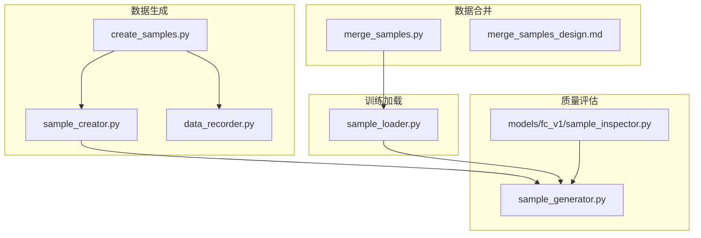
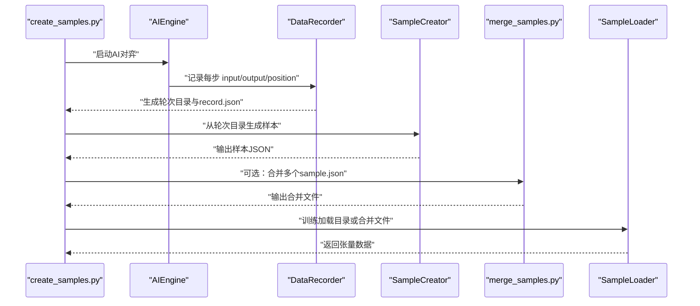
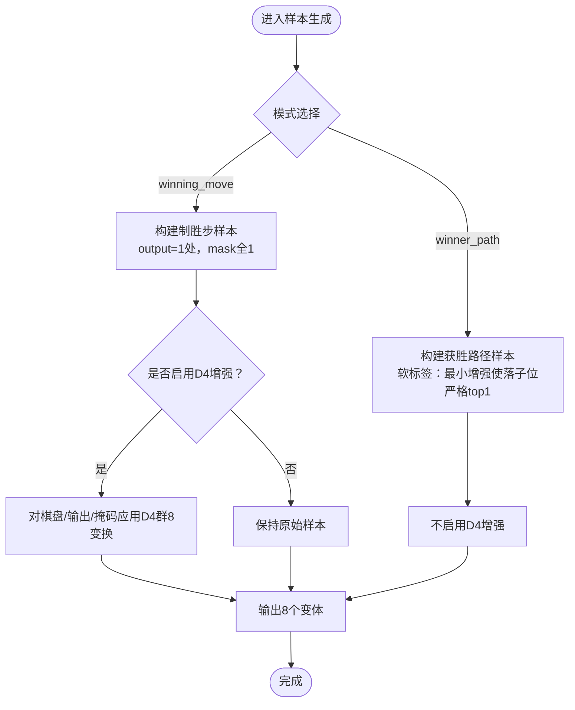
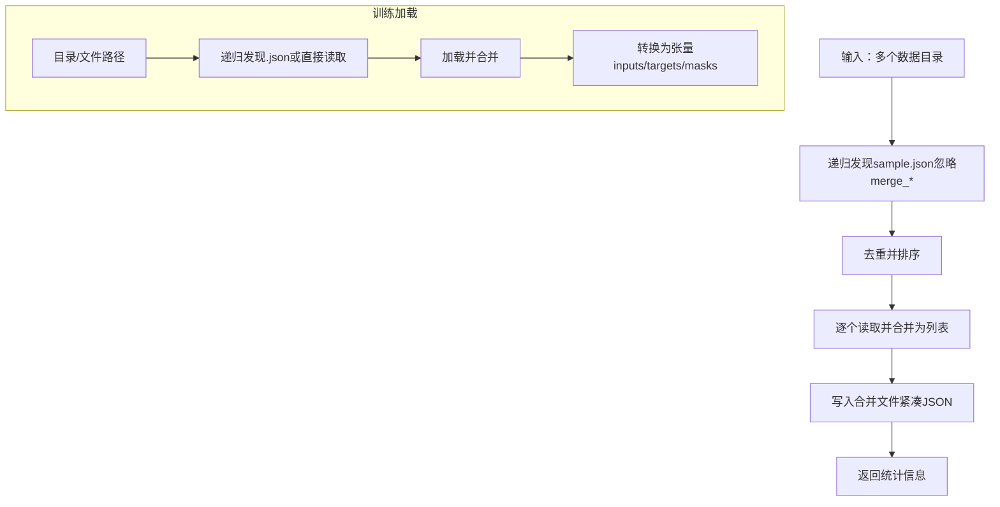
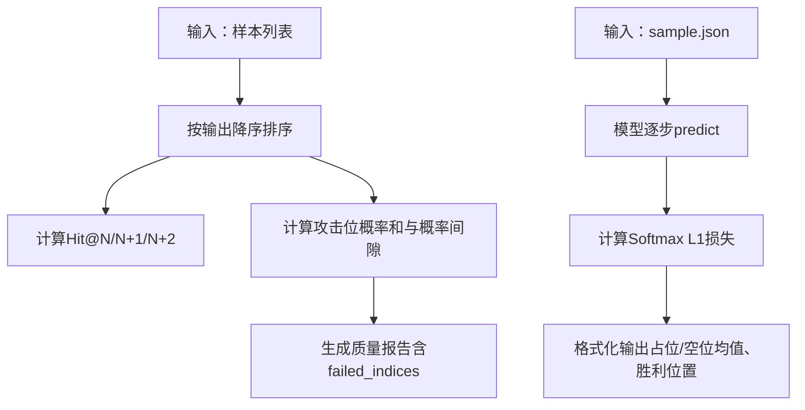
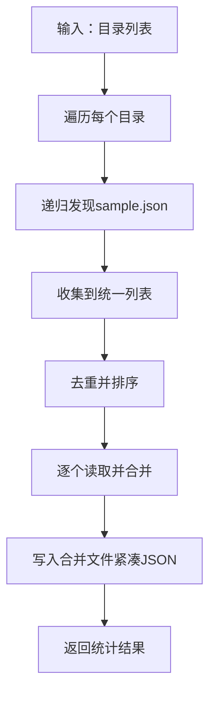
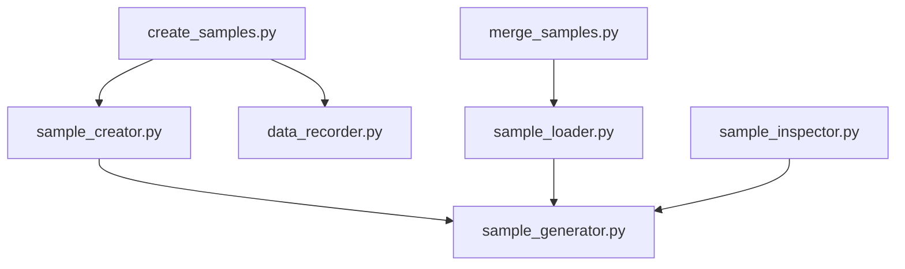

# 数据增强策略

<cite>
**本文引用的文件**
- [ai/merge_samples.py](file://ai/merge_samples.py)
- [design/merge_samples_design.md](file://design/merge_samples_design.md)
- [ai/create_samples.py](file://ai/create_samples.py)
- [ai/sample_creator.py](file://ai/sample_creator.py)
- [design/sample_creator_design.md](file://design/sample_creator_design.md)
- [ai/data_recorder.py](file://ai/data_recorder.py)
- [ai/sample_generator.py](file://ai/sample_generator.py)
- [ai/sample_loader.py](file://ai/sample_loader.py)
- [ai/models/fc_v1/sample_inspector.py](file://ai/models/fc_v1/sample_inspector.py)
- [tests/ai/test_sample_creator.py](file://tests/ai/test_sample_creator.py)
- [tests/ai/test_sample_generator.py](file://tests/ai/test_sample_generator.py)
</cite>

## 目录
1. [简介](#简介)
2. [项目结构](#项目结构)
3. [核心组件](#核心组件)
4. [架构总览](#架构总览)
5. [详细组件分析](#详细组件分析)
6. [依赖分析](#依赖分析)
7. [性能考量](#性能考量)
8. [故障排查指南](#故障排查指南)
9. [结论](#结论)
10. [附录](#附录)

## 简介
本设计文档围绕五子棋AI的数据增强策略展开，重点解决以下问题：
- 如何通过样本合并减少训练时I/O开销；
- 如何利用D4群（正方形对称群）几何变换提升训练数据规模与多样性；
- 如何在保持棋盘状态一致性的同时进行旋转、翻转等变换；
- 如何评估样本质量（重复样本检测、异常样本处理）；
- 如何配置数据增强参数（增强比例、变换组合策略）；
- 如何避免过拟合并提升模型泛化能力。

## 项目结构
与数据增强直接相关的模块主要分布在以下文件：
- 样本生成与增强：ai/create_samples.py、ai/sample_creator.py
- 样本合并：ai/merge_samples.py、design/merge_samples_design.md
- 训练数据加载：ai/sample_loader.py
- 样本质量评估：ai/sample_generator.py（验证指标）、ai/models/fc_v1/sample_inspector.py（模型对比）
- 数据记录：ai/data_recorder.py

**图表来源**
- [ai/create_samples.py](file://ai/create_samples.py)
- [ai/sample_creator.py](file://ai/sample_creator.py)
- [ai/data_recorder.py](file://ai/data_recorder.py)
- [ai/merge_samples.py](file://ai/merge_samples.py)
- [design/merge_samples_design.md](file://design/merge_samples_design.md)
- [ai/sample_loader.py](file://ai/sample_loader.py)
- [ai/sample_generator.py](file://ai/sample_generator.py)
- [ai/models/fc_v1/sample_inspector.py](file://ai/models/fc_v1/sample_inspector.py)

**章节来源**
- [ai/create_samples.py](file://ai/create_samples.py)
- [ai/sample_creator.py](file://ai/sample_creator.py)
- [ai/data_recorder.py](file://ai/data_recorder.py)
- [ai/merge_samples.py](file://ai/merge_samples.py)
- [design/merge_samples_design.md](file://design/merge_samples_design.md)
- [ai/sample_loader.py](file://ai/sample_loader.py)
- [ai/sample_generator.py](file://ai/sample_generator.py)
- [ai/models/fc_v1/sample_inspector.py](file://ai/models/fc_v1/sample_inspector.py)

## 核心组件
- 样本生成器（SampleCreator）：支持“制胜步”和“获胜路径”两种模式，内置D4群8倍数据增强（winner_path模式强制禁用）。
- 独立CLI（create_samples.py）：执行AI对弈、记录数据、生成样本、输出JSON。
- 数据记录器（DataRecorder）：按轮次与对局组织record.json，便于后续样本生成。
- 样本合并器（merge_samples.py）：将分散的sample.json合并为单一大文件，减少训练I/O。
- 样本加载器（sample_loader.py）：统一加载与预处理，支持递归发现与合并文件加载。
- 样本质量评估（sample_generator.py + sample_inspector.py）：提供验证指标与模型对比。

**章节来源**
- [ai/sample_creator.py](file://ai/sample_creator.py)
- [ai/create_samples.py](file://ai/create_samples.py)
- [ai/data_recorder.py](file://ai/data_recorder.py)
- [ai/merge_samples.py](file://ai/merge_samples.py)
- [ai/sample_loader.py](file://ai/sample_loader.py)
- [ai/sample_generator.py](file://ai/sample_generator.py)
- [ai/models/fc_v1/sample_inspector.py](file://ai/models/fc_v1/sample_inspector.py)

## 架构总览
下图展示从AI对弈到样本生成、合并与加载的关键流程：

**图表来源**
- [ai/create_samples.py](file://ai/create_samples.py)
- [ai/data_recorder.py](file://ai/data_recorder.py)
- [ai/sample_creator.py](file://ai/sample_creator.py)
- [ai/merge_samples.py](file://ai/merge_samples.py)
- [ai/sample_loader.py](file://ai/sample_loader.py)

## 详细组件分析

### 样本生成与D4群数据增强
- 模式支持：
  - 制胜步（winning_move）：每局仅取最后一步，可选D4增强（8倍）。
  - 获胜路径（winner_path）：取获胜方每一步，强制禁用D4增强，采用软标签（基于模型softmax输出的最小增强）。
- D4群变换：
  - 8种变换（恒等、90°、180°、270°旋转；左右/上下镜像；主/副对角线翻转）。
  - 对棋盘、输出、mask分别应用相同映射，保持落子位置与概率分布的对应关系。
- 软标签（winner_path）：
  - 若落子位已是严格top1，则直接使用模型softmax输出；
  - 否则将最大值与落子位概率的差值按224等分转移，clip到0后归一化，确保落子位严格top1且sum=1。

**图表来源**
- [ai/sample_creator.py](file://ai/sample_creator.py)
- [design/sample_creator_design.md](file://design/sample_creator_design.md)

**章节来源**
- [ai/sample_creator.py](file://ai/sample_creator.py)
- [design/sample_creator_design.md](file://design/sample_creator_design.md)
- [tests/ai/test_sample_creator.py](file://tests/ai/test_sample_creator.py)

### 样本合并与加载
- 合并策略：
  - 递归发现目录下所有sample.json，去重后合并为单个文件，使用紧凑JSON格式减少体积。
  - 支持多目录合并，输出统计（文件数、样本数、输出路径）。
- 加载策略：
  - 支持目录递归加载所有.json文件，或直接加载合并文件；
  - 将样本转换为PyTorch张量，自动移动到GPU（若可用）。

**图表来源**
- [ai/merge_samples.py](file://ai/merge_samples.py)
- [design/merge_samples_design.md](file://design/merge_samples_design.md)
- [ai/sample_loader.py](file://ai/sample_loader.py)

**章节来源**
- [ai/merge_samples.py](file://ai/merge_samples.py)
- [design/merge_samples_design.md](file://design/merge_samples_design.md)
- [ai/sample_loader.py](file://ai/sample_loader.py)

### 样本质量评估
- 样本生成器验证指标：
  - Hit@N、Hit@N+1、Hit@N+2：衡量落子位是否在top-N概率中；
  - 攻击位概率和（attack_prob_sum）与概率间隙（prob_gap）：反映标签集中度与区分度；
  - failed_indices：记录未命中的样本索引，便于定位异常。
- 模型对比检视器：
  - 读取sample.json，对每步调用模型predict，计算L1损失（Softmax概率格式），统计已占位/空位均值与胜利位置概率，辅助诊断标签与模型输出的偏差。

**图表来源**
- [ai/sample_generator.py](file://ai/sample_generator.py)
- [ai/models/fc_v1/sample_inspector.py](file://ai/models/fc_v1/sample_inspector.py)

**章节来源**
- [ai/sample_generator.py](file://ai/sample_generator.py)
- [ai/models/fc_v1/sample_inspector.py](file://ai/models/fc_v1/sample_inspector.py)
- [tests/ai/test_sample_generator.py](file://tests/ai/test_sample_generator.py)

### 数据增强参数配置指南
- CLI参数（create_samples.py）：
  - --mode：winning_move（默认）或winner_path；
  - --games：对局数；
  - --output：输出样本文件路径；
  - --no-augment：禁用D4增强（仅对winning_move有效）。
- SampleCreator初始化：
  - mode：winning_move或winner_path；
  - augment：是否启用D4增强（winner_path强制禁用）。
- 增强比例与组合策略：
  - winning_move：启用时样本数×8（D4群8变换）；
  - winner_path：强制禁用D4增强，样本数为获胜方步数（含开局）。

**章节来源**
- [ai/create_samples.py](file://ai/create_samples.py)
- [ai/sample_creator.py](file://ai/sample_creator.py)
- [design/sample_creator_design.md](file://design/sample_creator_design.md)

### 样本合并算法实现
- 发现与合并：
  - 递归遍历目录，收集sample.json（忽略以merge_开头的文件）；
  - 去重并按路径排序，逐个读取并extend到总列表；
  - 确保输出目录存在，写入紧凑JSON。
- 目录合并：
  - 对每个输入目录先发现文件，再统一去重合并。

**图表来源**
- [ai/merge_samples.py](file://ai/merge_samples.py)

**章节来源**
- [ai/merge_samples.py](file://ai/merge_samples.py)

## 依赖分析
- 组件耦合关系：
  - create_samples.py依赖AI引擎、数据记录器与样本生成器；
  - sample_creator.py依赖D4群变换与软标签算法；
  - merge_samples.py与sample_loader.py在数据加载阶段解耦，前者专注合并，后者专注加载与预处理；
  - sample_generator.py与sample_inspector.py分别承担标签质量评估与模型对比。
- 外部依赖：
  - PyTorch张量转换与设备迁移；
  - JSON序列化与文件系统操作。

**图表来源**
- [ai/create_samples.py](file://ai/create_samples.py)
- [ai/sample_creator.py](file://ai/sample_creator.py)
- [ai/data_recorder.py](file://ai/data_recorder.py)
- [ai/merge_samples.py](file://ai/merge_samples.py)
- [ai/sample_loader.py](file://ai/sample_loader.py)
- [ai/sample_generator.py](file://ai/sample_generator.py)
- [ai/models/fc_v1/sample_inspector.py](file://ai/models/fc_v1/sample_inspector.py)

**章节来源**
- [ai/create_samples.py](file://ai/create_samples.py)
- [ai/sample_creator.py](file://ai/sample_creator.py)
- [ai/data_recorder.py](file://ai/data_recorder.py)
- [ai/merge_samples.py](file://ai/merge_samples.py)
- [ai/sample_loader.py](file://ai/sample_loader.py)
- [ai/sample_generator.py](file://ai/sample_generator.py)
- [ai/models/fc_v1/sample_inspector.py](file://ai/models/fc_v1/sample_inspector.py)

## 性能考量
- I/O优化：合并sample.json减少文件打开/解析次数，提升训练启动速度；
- 内存与设备：样本加载后统一转换为张量并迁移到GPU（若可用），减少CPU-GPU传输开销；
- 数据增强成本：D4增强将样本数扩大8倍，需平衡内存占用与训练吞吐；
- 验证指标：通过Hit@N与概率间隙快速筛选低质量样本，避免无效训练。

[本节为通用指导，无需具体文件分析]

## 故障排查指南
- 合并脚本常见问题：
  - 目录不存在或非目录：合并脚本会报错并退出；
  - 输出目录不存在：自动创建；
  - 无数据：检查输入目录是否包含sample.json。
- 样本生成问题：
  - 模式不支持：SampleCreator初始化会抛出异常；
  - 获胜路径未增强：确认mode为winner_path；
  - 软标签异常：检查record.json中history[i]["output"]是否存在。
- 质量评估问题：
  - 样本未命中：查看failed_indices，定位异常样本；
  - L1损失异常：检查模型输出与target是否为Softmax概率分布。

**章节来源**
- [ai/merge_samples.py](file://ai/merge_samples.py)
- [ai/sample_creator.py](file://ai/sample_creator.py)
- [ai/sample_generator.py](file://ai/sample_generator.py)
- [ai/models/fc_v1/sample_inspector.py](file://ai/models/fc_v1/sample_inspector.py)

## 结论
通过将样本生成、数据增强与合并加载解耦，本方案实现了：
- 显著降低训练I/O开销；
- 以D4群8倍增强提升数据多样性；
- 以软标签与质量指标保障样本质量；
- 以递归加载与合并文件支持灵活的数据组织方式。

建议在实际训练中结合验证指标与模型对比持续迭代增强策略，避免过拟合并提升泛化能力。

[本节为总结性内容，无需具体文件分析]

## 附录
- 相关测试用例参考：
  - 数据增强：测试覆盖8倍增强、恒等变换一致性、旋转与镜像映射、组合变换等；
  - 样本质量：测试Hit@N与辅助指标、失败样本索引、软标签归一化与严格top1性质。

**章节来源**
- [tests/ai/test_sample_creator.py](file://tests/ai/test_sample_creator.py)
- [tests/ai/test_sample_generator.py](file://tests/ai/test_sample_generator.py)