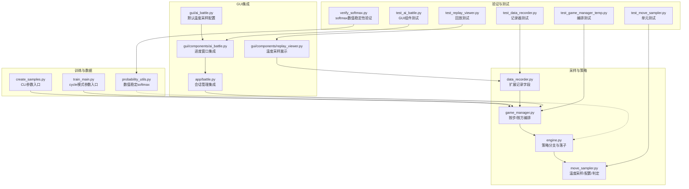
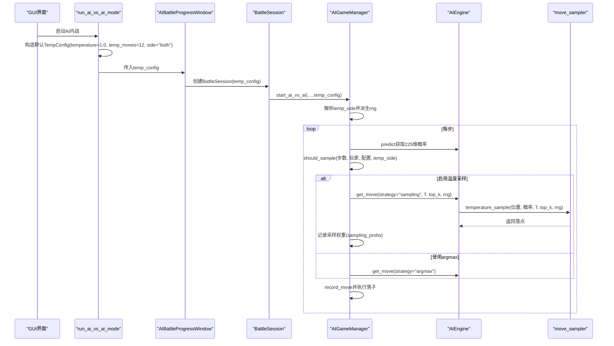
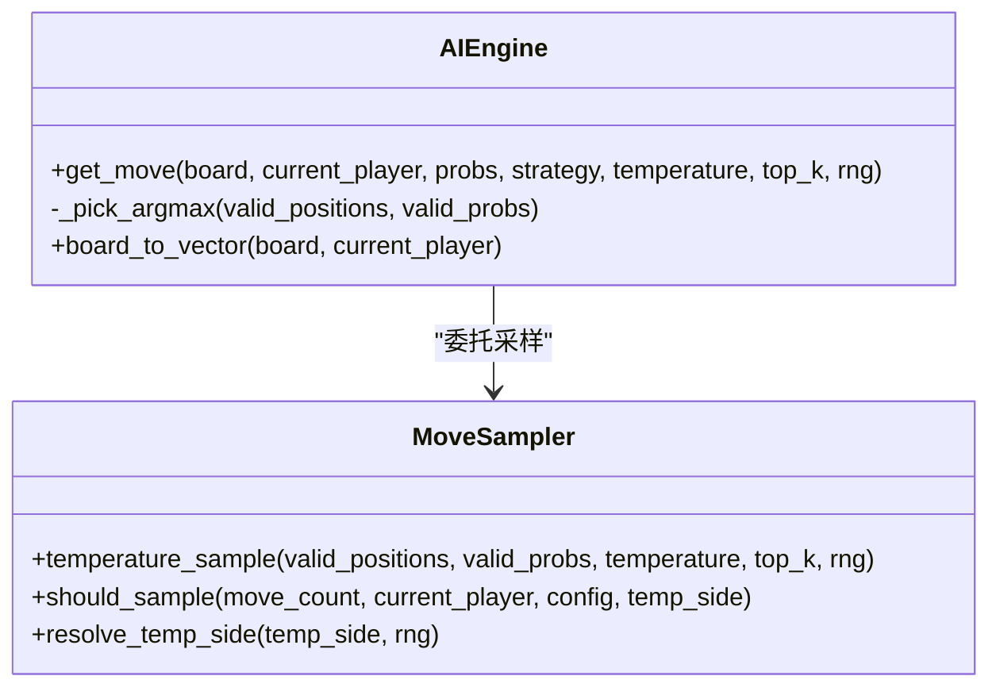
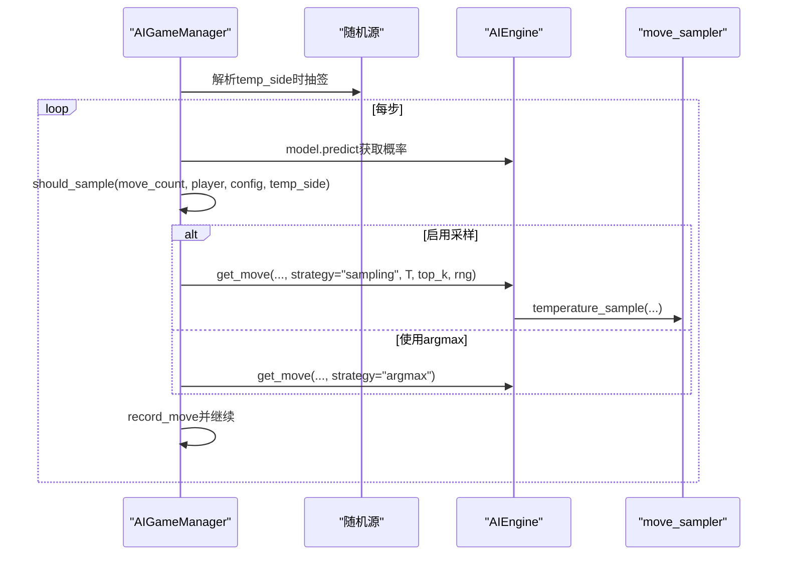
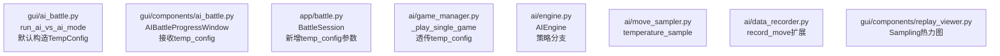
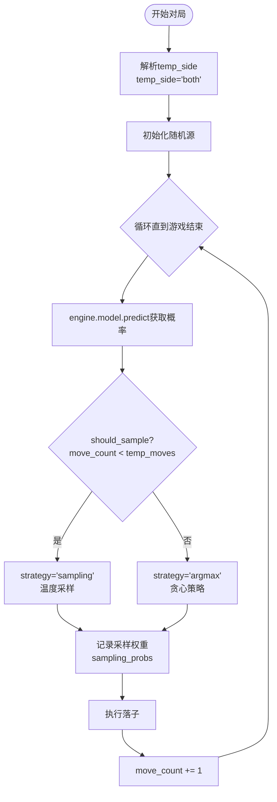
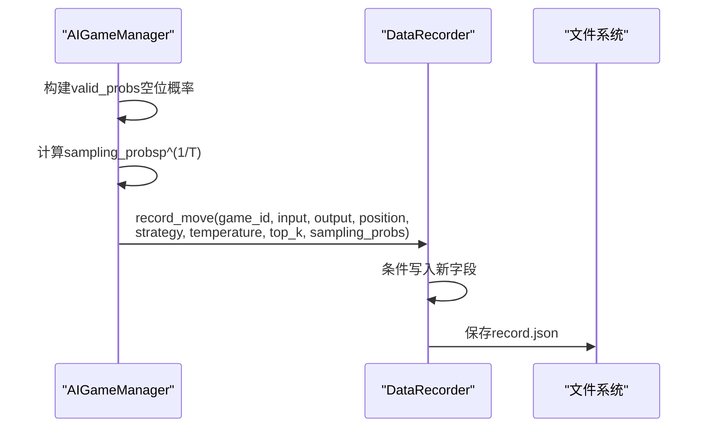
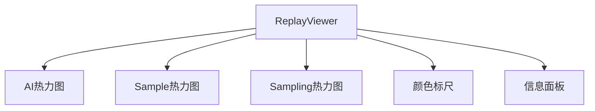
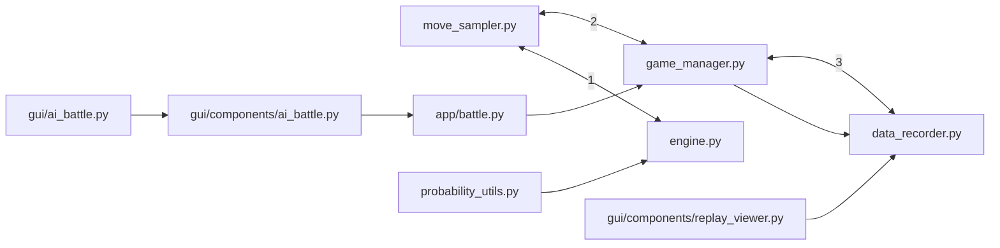

# 移动采样策略

<cite>
**本文引用的文件**
- [move_sampler.py](file://ai/move_sampler.py)
- [move_sampler_design.md](file://design/move_sampler_design.md)
- [engine.py](file://ai/engine.py)
- [game_manager.py](file://ai/game_manager.py)
- [create_samples.py](file://ai/create_samples.py)
- [train_main.py](file://ai/train_main.py)
- [probability_utils.py](file://ai/probability_utils.py)
- [data_recorder.py](file://ai/data_recorder.py)
- [battle.py](file://app/battle.py)
- [ai_battle.py](file://gui/ai_battle.py)
- [ai_battle.py](file://gui/components/ai_battle.py)
- [replay_viewer.py](file://gui/components/replay_viewer.py)
- [gui_temp_sampling_replay_design.md](file://design/gui_temp_sampling_replay_design.md)
- [test_move_sampler.py](file://tests/ai/test_move_sampler.py)
- [test_game_manager_temp.py](file://tests/ai/test_game_manager_temp.py)
- [test_data_recorder.py](file://tests/ai/test_data_recorder.py)
- [test_ai_battle.py](file://tests/gui/test_ai_battle.py)
- [test_replay_viewer.py](file://tests/gui/test_replay_viewer.py)
- [verify_softmax.py](file://temp/verify_softmax.py)
</cite>

## 更新摘要
**所做更改**
- 新增GUI AI对战中温度采样的集成实现章节
- 更新数据记录器扩展，支持温度采样字段记录
- 新增ReplayViewer温度采样展示功能
- 更新GUI组件的温度采样配置和策略切换逻辑
- 新增向后兼容性设计说明
- **新增** 采样概率计算逻辑改进：确保数组长度一致性，增强系统稳定性

## 目录
1. [引言](#引言)
2. [项目结构](#项目结构)
3. [核心组件](#核心组件)
4. [架构总览](#架构总览)
5. [详细组件分析](#详细组件分析)
6. [GUI AI对战集成实现](#gui-ai对战集成实现)
7. [数据记录器扩展](#数据记录器扩展)
8. [ReplayViewer温度采样展示](#replayviewer温度采样展示)
9. [依赖分析](#依赖分析)
10. [性能考量](#性能考量)
11. [故障排查指南](#故障排查指南)
12. [结论](#结论)
13. [附录](#附录)

## 引言
本设计文档围绕五子棋AI的"自对弈开局温度采样"策略展开，系统阐述温度采样在探索与利用之间的平衡机制、softmax概率分布的计算与归一化处理、不同采样策略的适用场景与对比、参数调优指南，以及采样策略对训练效果与模型泛化能力的影响。文档以代码为依据，结合设计文档与测试用例，提供可操作的实现与配置建议。

**更新** 本次更新重点反映了温度采样在GUI AI对战中的完整集成实现，包括默认启用策略、数据记录扩展和回放展示功能。**新增** 采样概率计算逻辑的重大改进：确保数组长度一致性，增强系统稳定性，解决了Sampling热力图渲染问题。

## 项目结构
与移动采样策略直接相关的模块与文件如下：
- 采样核心：ai/move_sampler.py（温度采样、配置与判定）
- 引擎集成：ai/engine.py（策略分支与落子选择）
- 对局编排：ai/game_manager.py（按步/按方切换温度采样）
- CLI 参数：ai/create_samples.py、ai/train_main.py（温度采样参数入口）
- 数据记录：ai/data_recorder.py（扩展记录温度采样字段）
- GUI 集成：gui/ai_battle.py、gui/components/ai_battle.py（GUI对战默认启用温度采样）
- 回放展示：gui/components/replay_viewer.py（新增Sampling热力图）
- 会话管理：app/battle.py（BattleSession透传温度配置）
- 概率工具：ai/probability_utils.py（数值稳定的softmax）
- 测试与验证：tests/ai/test_move_sampler.py、tests/ai/test_game_manager_temp.py、tests/ai/test_data_recorder.py、tests/gui/test_ai_battle.py、tests/gui/test_replay_viewer.py、temp/verify_softmax.py

**图表来源**
- [move_sampler.py:1-258](file://ai/move_sampler.py#L1-L258)
- [engine.py:67-142](file://ai/engine.py#L67-L142)
- [game_manager.py:124-230](file://ai/game_manager.py#L124-L230)
- [data_recorder.py:96-139](file://ai/data_recorder.py#L96-L139)
- [gui/ai_battle.py:12-44](file://gui/ai_battle.py#L12-L44)
- [gui/components/ai_battle.py:171-350](file://gui/components/ai_battle.py#L171-L350)
- [gui/components/replay_viewer.py:13-464](file://gui/components/replay_viewer.py#L13-L464)
- [app/battle.py:27-99](file://app/battle.py#L27-L99)
- [create_samples.py:78-136](file://ai/create_samples.py#L78-L136)
- [train_main.py:161-192](file://ai/train_main.py#L161-L192)
- [probability_utils.py:15-58](file://ai/probability_utils.py#L15-L58)
- [test_move_sampler.py:1-259](file://tests/ai/test_move_sampler.py#L1-L259)
- [test_game_manager_temp.py:133-153](file://tests/ai/test_game_manager_temp.py#L133-L153)
- [test_data_recorder.py:278-319](file://tests/ai/test_data_recorder.py#L278-L319)
- [test_ai_battle.py:353-379](file://tests/gui/test_ai_battle.py#L353-L379)
- [test_replay_viewer.py:294-400](file://tests/gui/test_replay_viewer.py#L294-L400)
- [verify_softmax.py:1-36](file://temp/verify_softmax.py#L1-L36)

## 核心组件
- 温度采样器：提供温度加权采样、top-k截断、数值稳定归一化与均匀回退机制。
- 温度配置：封装温度值、前N步阈值、启用方、top-k与随机种子等参数。
- 策略判定：按步数与当前玩家判定是否启用温度采样。
- 引擎策略分支：在sampling分支委托给采样器，在argmax分支保持原有行为。
- 对局编排：在每局开始解析temp_side并在全局步数阈值前后切换策略。
- CLI入口：create_samples.py与train_main.py（cycle模式）暴露温度采样参数。
- **新增** 数据记录器扩展：支持记录策略类型、温度值、Top-K和采样概率分布。
- **新增** GUI集成：默认启用温度采样，参数与CLI一致。
- **新增** ReplayViewer：新增Sampling热力图和策略信息展示。
- **新增** 采样概率计算逻辑改进：确保sampling_probs始终为225维数组，增强系统稳定性。

**章节来源**
- [move_sampler.py:50-186](file://ai/move_sampler.py#L50-L186)
- [engine.py:67-142](file://ai/engine.py#L67-L142)
- [game_manager.py:124-230](file://ai/game_manager.py#L124-L230)
- [data_recorder.py:96-139](file://ai/data_recorder.py#L96-L139)
- [gui/ai_battle.py:12-44](file://gui/ai_battle.py#L12-L44)
- [gui/components/replay_viewer.py:13-464](file://gui/components/replay_viewer.py#L13-L464)

## 架构总览
温度采样策略贯穿"对局编排—引擎落子—采样执行"的链路，确保自对弈在开局阶段具备探索性，随后回归确定性策略，提升训练数据的多样性与稳定性。GUI AI对战默认启用温度采样，参数与CLI保持一致。

**图表来源**
- [gui/ai_battle.py:12-44](file://gui/ai_battle.py#L12-L44)
- [gui/components/ai_battle.py:254-286](file://gui/components/ai_battle.py#L254-L286)
- [app/battle.py:85-89](file://app/battle.py#L85-L89)
- [game_manager.py:200-253](file://ai/game_manager.py#L200-L253)
- [engine.py:67-142](file://ai/engine.py#L67-L142)
- [move_sampler.py:117-186](file://ai/move_sampler.py#L117-L186)

## 详细组件分析

### 温度采样器与配置
- 温度采样核心流程
  - 可选top-k截断：仅保留前K个最高概率位置，其余置零。
  - 温度变换：对每个合法位置概率p取p^(1/T)。
  - 归一化：计算权重总和并归一；若全非正（模型将概率集中在已落子或top-k=0），退化为均匀采样。
  - 加权抽样：使用随机源choices按权重抽取索引并返回对应坐标。
- 温度配置
  - temperature > 0；temp_moves ≥ 0；temp_side ∈ {"black","white","both","random"}；top_k为None或正整数；seed为None或整数。
  - 构造时进行字段合法性校验，非法值抛出异常。
- 策略判定
  - 当temp_moves=0时视为关闭；move_count≥temp_moves时切换为argmax；按局解析temp_side后按当前玩家筛选启用方。

**图表来源**
- [move_sampler.py:117-186](file://ai/move_sampler.py#L117-L186)

**章节来源**
- [move_sampler.py:50-186](file://ai/move_sampler.py#L50-L186)

### 引擎策略分支与落子
- 引擎在get_move中根据strategy选择：
  - "argmax"：从合法位置中按概率最大者随机打破平局。
  - "sampling"：委托move_sampler.temperature_sample执行温度采样。
- 对于sampling分支，温度、top_k、rng参数仅在该分支生效；argmax分支完全不使用这些参数。

**图表来源**
- [engine.py:67-142](file://ai/engine.py#L67-L142)
- [move_sampler.py:117-186](file://ai/move_sampler.py#L117-L186)

**章节来源**
- [engine.py:67-142](file://ai/engine.py#L67-L142)

### 对局编排与按步/按方切换
- 每局开始解析temp_side：
  - 若为"random"，使用按局独立的随机源抽签决定black或white。
  - 局内temp_side恒定，不随步数变化。
- 每步判定should_sample：
  - temp_moves=0关闭；move_count≥temp_moves切换argmax；否则按当前玩家与temp_side判定。
- 编排逻辑在AIGameManager._play_single_game中实现，确保engine不感知move_count。

**图表来源**
- [game_manager.py:166-230](file://ai/game_manager.py#L166-L230)
- [move_sampler.py:192-227](file://ai/move_sampler.py#L192-L227)

**章节来源**
- [game_manager.py:124-230](file://ai/game_manager.py#L124-L230)
- [move_sampler.py:192-258](file://ai/move_sampler.py#L192-L258)

### CLI参数与默认行为
- create_samples.py与train_main.py（cycle模式）暴露以下参数：
  - --no-temp-sampling：禁用温度采样（等价temp_config=None）。
  - --temperature：温度T（>0），默认1.0。
  - --temp-moves：前N步启用温度采样，之后argmax，默认12。
  - --temp-side：启用采样的一方，取值{"black","white","both","random"}，默认"both"。
  - --temp-seed：随机种子（用于复现）。
- 当--no-temp-sampling启用时，若用户还显式传入其他温度参数，将打印警告并忽略之。
- cycle模式下，参数解析后构造TempConfig并透传至训练流程。

**章节来源**
- [create_samples.py:78-136](file://ai/create_samples.py#L78-L136)
- [train_main.py:161-192](file://ai/train_main.py#L161-L192)

### softmax概率分布与数值稳定性
- 概率工具模块提供带mask的数值稳定softmax：
  - 对有效位置（mask=1）提取reward并缩放到合理范围，避免exp(x)下溢。
  - 减去最大值后计算指数和归一化，确保概率和为1且数值稳定。
- 该工具用于reward到概率的转换，与move_sampler的温度采样互补：前者解决模型输出概率的数值稳定性，后者在采样阶段引入探索。

**章节来源**
- [probability_utils.py:15-58](file://ai/probability_utils.py#L15-L58)
- [verify_softmax.py:1-36](file://temp/verify_softmax.py#L1-L36)

### 不同采样策略对比与适用场景
- 贪心策略（argmax）
  - 优点：确定性强，训练数据路径稳定；便于调试与复现。
  - 缺点：自对弈轨迹高度同质化，开局多样性不足，易陷入局部最优。
- softmax采样（本设计）
  - 优点：开局探索性强，提升样本多样性；温度T控制探索强度；top-k限制候选范围。
  - 缺点：引入随机性，需谨慎调参；训练初期可能波动较大。
- epsilon-greedy（概念性说明）
  - 适用：在已有模型基础上增加少量随机探索，适合在线部署或人类对弈。
  - 与本设计的关系：本项目未实现epsilon-greedy，但其思想与温度采样一致，均在探索与利用之间平衡。

**章节来源**
- [move_sampler_design.md:3-12](file://design/move_sampler_design.md#L3-L12)
- [engine.py:128-142](file://ai/engine.py#L128-L142)

### 采样参数调优指南
- 温度T的选择
  - T=1：保持原分布；T→0趋近argmax；T→∞趋近均匀。建议从1.0起步，逐步调整。
  - 大T带来均匀探索，但可能降低训练稳定性；小T接近贪心，但可能缺乏多样性。
- 前N步阈值temp_moves
  - 控制探索持续时间。建议从12起步，若开局多样性不足可上调至18；若训练不稳定可下调。
- 启用方temp_side
  - "both"：默认，双方均探索；"black"/"white"：仅一方探索；"random"：每局随机决定。
  - 建议在对抗训练中使用"random"以避免先手优势固化。
- top-k截断
  - 限制采样候选数量，减少无效位置干扰；本设计在采样器中实现，CLI暂不暴露。
- 随机种子seed
  - 用于复现实验；建议固定seed以便对比不同T或temp_moves的效果。

**章节来源**
- [move_sampler.py:50-111](file://ai/move_sampler.py#L50-L111)
- [move_sampler_design.md:44-64](file://design/move_sampler_design.md#L44-L64)

### 采样策略对训练效果与泛化的影响
- 开局多样性提升：温度采样使模型在开局阶段尝试更多分支，有助于发现更优路径。
- 训练稳定性：过度探索可能导致损失震荡；建议在训练早期采用较小T与较短探索步数。
- 泛化能力：多样化的开局轨迹有助于模型在不同局面下学习，提升对未知对手的适应性。
- 对照实验建议：以argmax为基线，对比不同T与temp_moves下的唯一开局序列数、胜负分布、平均步数与棋盘位置熵等指标。

**章节来源**
- [move_sampler_design.md:484-524](file://design/move_sampler_design.md#L484-L524)

## GUI AI对战集成实现

### 默认温度采样配置
GUI AI内战模式默认启用温度采样，参数与CLI保持一致：
- temperature=1.0：标准温度值
- temp_moves=12：前12步启用采样
- temp_side="both"：双方均启用采样
- 该配置不可在GUI界面配置，仅通过代码默认启用

**章节来源**
- [gui/ai_battle.py:12-44](file://gui/ai_battle.py#L12-L44)
- [gui_temp_sampling_replay_design.md:11-17](file://design/gui_temp_sampling_replay_design.md#L11-L17)

### GUI组件集成架构
GUI AI对战通过以下组件链路实现温度采样集成：

**图表来源**
- [gui/ai_battle.py:12-44](file://gui/ai_battle.py#L12-L44)
- [gui/components/ai_battle.py:171-350](file://gui/components/ai_battle.py#L171-L350)
- [app/battle.py:27-99](file://app/battle.py#L27-L99)
- [game_manager.py:200-253](file://ai/game_manager.py#L200-L253)
- [data_recorder.py:96-139](file://ai/data_recorder.py#L96-L139)
- [gui/components/replay_viewer.py:13-464](file://gui/components/replay_viewer.py#L13-L464)

**章节来源**
- [gui/ai_battle.py:12-44](file://gui/ai_battle.py#L12-L44)
- [gui/components/ai_battle.py:171-350](file://gui/components/ai_battle.py#L171-L350)
- [app/battle.py:27-99](file://app/battle.py#L27-L99)
- [game_manager.py:200-253](file://ai/game_manager.py#L200-L253)

### 温度采样策略切换逻辑
GUI对战中的策略切换逻辑与CLI保持一致：

**图表来源**
- [game_manager.py:200-253](file://ai/game_manager.py#L200-L253)
- [move_sampler.py:117-186](file://ai/move_sampler.py#L117-L186)

**章节来源**
- [game_manager.py:200-253](file://ai/game_manager.py#L200-L253)

## 数据记录器扩展

### 扩展的record_move方法
DataRecorder的record_move方法已扩展支持温度采样相关信息：

**图表来源**
- [game_manager.py:217-240](file://ai/game_manager.py#L217-L240)
- [data_recorder.py:96-139](file://ai/data_recorder.py#L96-L139)

### 新增字段说明
- strategy：落子策略类型，"argmax"或"sampling"
- temperature：温度值（仅sampling时有效）
- top_k：Top-K截断阈值（仅sampling时有效）
- sampling_probs：温度变换后的225维采样权重

**章节来源**
- [data_recorder.py:96-139](file://ai/data_recorder.py#L96-L139)
- [game_manager.py:217-240](file://ai/game_manager.py#L217-L240)

### 向后兼容性设计
- 新增字段均为可选，旧record.json无需修改
- ReplayViewer读取时使用.get("strategy", "argmax")缺省兜底
- DataRecorder.record_move新增参数均有默认值，旧调用方无需修改

**章节来源**
- [data_recorder.py:126-139](file://ai/data_recorder.py#L126-L139)
- [gui_temp_sampling_replay_design.md:356-361](file://design/gui_temp_sampling_replay_design.md#L356-L361)

### 采样概率计算逻辑改进
**新增** 采样概率计算逻辑的重大改进，确保数组长度一致性：

- **问题背景**：此前sampling_probs仅包含空位的概率值，长度等于空位数，导致在非满棋盘情况下长度小于225，ReplayViewer的Sampling热力图无法正确渲染。
- **解决方案**：在AIGameManager._play_single_game中，创建225维的sampling_probs数组，其中：
  - 空位：p^(1/T)（若p>0，否则为0）
  - 已落子位：0.0
- **稳定性增强**：确保所有sampling_probs始终为225维数组，与棋盘位置一一对应，提升系统稳定性。

**章节来源**
- [game_manager.py:217-240](file://ai/game_manager.py#L217-L240)
- [test_game_manager_temp.py:454-484](file://tests/ai/test_game_manager_temp.py#L454-L484)

## ReplayViewer温度采样展示

### 新增Sampling热力图
ReplayViewer新增Sampling热力图用于展示温度采样概率分布：

**图表来源**
- [gui/components/replay_viewer.py:13-464](file://gui/components/replay_viewer.py#L13-L464)

### 策略信息展示
信息面板新增温度采样相关信息：
- 策略：显示"sampling"或"argmax"
- 温度：显示温度值（仅sampling时显示）
- Top-K：显示Top-K截断值（仅sampling时显示）

**章节来源**
- [gui/components/replay_viewer.py:171-185](file://gui/components/replay_viewer.py#L171-L185)
- [gui/components/replay_viewer.py:390-397](file://gui/components/replay_viewer.py#L390-L397)

### 回放展示逻辑
回放展示时根据策略类型动态显示相应内容：
- sampling步：显示AI热力图、Sample热力图和Sampling热力图
- argmax步：仅显示AI热力图和Sample热力图，Sampling热力图清空

**章节来源**
- [gui/components/replay_viewer.py:317-326](file://gui/components/replay_viewer.py#L317-L326)

### 采样概率渲染改进
**新增** 采样概率渲染的稳定性改进：

- **问题**：之前由于sampling_probs长度不一致，可能导致ReplayViewer在某些步数出现渲染异常。
- **改进**：现在所有sampling_probs都是225维数组，确保：
  - 行优先索引与棋盘位置完全对应
  - Sampling热力图能够稳定渲染
  - 回放时不会出现索引越界错误

**章节来源**
- [gui/components/replay_viewer.py:317-326](file://gui/components/replay_viewer.py#L317-L326)
- [test_replay_viewer.py:393-400](file://tests/gui/test_replay_viewer.py#L393-L400)

## 依赖分析
- move_sampler.py
  - 依赖：标准库random、dataclasses、typing。
  - 被engine.py与game_manager.py依赖。
- engine.py
  - 依赖：move_sampler（本地导入避免循环依赖）。
  - 依赖：board向量化与模型预测。
- game_manager.py
  - 依赖：move_sampler（TempConfig、resolve_temp_side、should_sample）。
  - 依赖：AIEngine与DataRecorder。
- data_recorder.py
  - 依赖：标准库os、json、logging。
  - 被game_manager.py依赖。
- gui/ai_battle.py
  - 依赖：ai.move_sampler.TempConfig。
  - 被gui/components/ai_battle.py依赖。
- gui/components/ai_battle.py
  - 依赖：app.BattleSession。
  - 依赖：gui.components.AIBattleProgressWindow。
- app/battle.py
  - 依赖：ai.AIGameManager、ai.DataRecorder。
  - 依赖：ai.create_engine。
- gui/components/replay_viewer.py
  - 依赖：gui.components.HeatmapCanvas、HeatmapLegend。
  - 依赖：标准库json、os。

**图表来源**
- [move_sampler.py:17-21](file://ai/move_sampler.py#L17-L21)
- [engine.py:131-139](file://ai/engine.py#L131-L139)
- [game_manager.py:13-13](file://ai/game_manager.py#L13-L13)
- [data_recorder.py:10-11](file://ai/data_recorder.py#L10-L11)
- [gui/ai_battle.py:9](file://gui/ai_battle.py#L9)
- [gui/components/ai_battle.py:16](file://gui/components/ai_battle.py#L16)
- [app/battle.py:10](file://app/battle.py#L10)
- [gui/components/replay_viewer.py:9](file://gui/components/replay_viewer.py#L9)
- [probability_utils.py:6-7](file://ai/probability_utils.py#L6-L7)

**章节来源**
- [move_sampler.py:17-21](file://ai/move_sampler.py#L17-L21)
- [engine.py:131-139](file://ai/engine.py#L131-L139)
- [game_manager.py:13-13](file://ai/game_manager.py#L13-L13)
- [data_recorder.py:10-11](file://ai/data_recorder.py#L10-L11)
- [gui/ai_battle.py:9](file://gui/ai_battle.py#L9)
- [gui/components/ai_battle.py:16](file://gui/components/ai_battle.py#L16)
- [app/battle.py:10](file://app/battle.py#L10)
- [gui/components/replay_viewer.py:9](file://gui/components/replay_viewer.py#L9)
- [probability_utils.py:6-7](file://ai/probability_utils.py#L6-L7)

## 性能考量
- 温度采样复杂度
  - top-k过滤：O(n log n)（排序）；权重计算与归一化：O(n)；加权抽样：O(n)。
  - n≤225，整体开销可忽略不计。
- 归一化与回退
  - 全零权重时退化为均匀采样，避免异常并保持稳定性。
- 数值稳定性
  - softmax缩放因子与减最大值策略避免exp下溢，保证概率和为1。
- **新增** GUI渲染性能
  - 新增Sampling热力图仅在sampling步绘制，argmax步清空，避免额外渲染开销。
  - 采样概率计算在记录阶段完成，回放时直接使用已计算的sampling_probs。
- **新增** 数组长度一致性优化
  - 225维固定长度的sampling_probs数组，避免动态长度检查开销
  - 稳定的内存布局，提升缓存命中率

**章节来源**
- [move_sampler.py:161-185](file://ai/move_sampler.py#L161-L185)
- [probability_utils.py:15-58](file://ai/probability_utils.py#L15-L58)
- [gui/components/replay_viewer.py:317-326](file://gui/components/replay_viewer.py#L317-L326)

## 故障排查指南
- 温度参数非法
  - 现象：ValueError（温度≤0、位置列表为空、长度不一致）。
  - 排查：检查CLI参数与配置对象字段合法性。
- 配置对象校验失败
  - 现象：构造TempConfig时抛出ValueError。
  - 排查：确认temperature>0、temp_moves≥0、temp_side合法、top_k为None或正整数。
- 策略判定异常
  - 现象：should_sample返回不符合预期。
  - 排查：确认temp_moves、move_count、current_player与temp_side_this_game一致。
- 对局编排问题
  - 现象：temp_side="random"未生效或跨局不一致。
  - 排查：确认按局随机源是否正确派生（seed+game_num）。
- softmax数值问题
  - 现象：概率接近0或总和不为1。
  - 排查：使用数值稳定softmax工具，确保reward缩放与减最大值步骤正确。
- **新增** GUI温度采样问题
  - 现象：GUI对战未启用温度采样。
  - 排查：确认run_ai_vs_ai_mode是否正确构造默认TempConfig。
- **新增** 数据记录问题
  - 现象：record.json缺少温度字段。
  - 排查：确认AIGameManager._play_single_game是否正确调用record_move并传入strategy和sampling_probs。
- **新增** 回放展示问题
  - 现象：Sampling热力图不显示或信息面板无温度信息。
  - 排查：确认record.json是否包含strategy和sampling_probs字段，ReplayViewer是否正确读取。
- **新增** 采样概率渲染问题
  - 现象：ReplayViewer在某些步数出现渲染异常或索引错误。
  - 排查：确认sampling_probs是否为225维数组，确保所有步数都有完整的225维概率分布。

**章节来源**
- [move_sampler.py:77-111](file://ai/move_sampler.py#L77-L111)
- [move_sampler.py:147-157](file://ai/move_sampler.py#L147-L157)
- [test_move_sampler.py:77-96](file://tests/ai/test_move_sampler.py#L77-L96)
- [test_move_sampler.py:152-179](file://tests/ai/test_move_sampler.py#L152-L179)
- [test_game_manager_temp.py:133-153](file://tests/ai/test_game_manager_temp.py#L133-L153)
- [verify_softmax.py:1-36](file://temp/verify_softmax.py#L1-L36)
- [test_ai_battle.py:353-379](file://tests/gui/test_ai_battle.py#L353-L379)
- [test_data_recorder.py:278-319](file://tests/ai/test_data_recorder.py#L278-L319)
- [test_replay_viewer.py:294-400](file://tests/gui/test_replay_viewer.py#L294-L400)

## 结论
本设计通过"开局温度采样+后续argmax"的阶梯式策略，在自对弈中引入可控的探索性，显著提升样本多样性与训练稳定性。温度参数、前N步阈值、启用方与top-k截断共同构成灵活的调优空间。配合数值稳定的softmax与严格的参数校验，采样策略既满足工程可用性，又为模型泛化能力提供支撑。

**更新** 本次更新完整实现了GUI AI对战中的温度采样集成，包括默认启用策略、数据记录扩展和回放展示功能，实现了CLI与GUI链路的一致性。新增的Sampling热力图和策略信息展示为用户提供更丰富的可视化反馈，有助于理解AI的决策过程。**新增** 采样概率计算逻辑的重大改进确保了数组长度一致性，增强了系统的稳定性，解决了Sampling热力图渲染问题，提升了用户体验。

## 附录
- 参数配置示例（命令行）
  - 开启温度采样（默认）：python -m ai.create_samples --model cnn_v3.1 --games 50
  - 禁用温度采样：python -m ai.create_samples --model cnn_v3.1 --games 50 --no-temp-sampling
  - 自定义温度与探索步数：python -m ai.create_samples --model cnn_v3.1 --games 50 --temperature 1.2 --temp-moves 18
  - 按局随机启用：python -m ai.create_samples --model cnn_v3.1 --games 50 --temp-side random --temp-seed 42
- **新增** GUI对战配置示例
  - 默认GUI对战（启用温度采样）：run_ai_vs_ai_mode(10, "cnn_v3.1", "fc_v1")
  - 自定义GUI对战配置：AIBattleProgressWindow(10, "random", "random", TempConfig(temperature=2.0, temp_moves=5))
- 对照实验建议
  - 命令行示例：argmax基线与温度采样对比，观察唯一开局序列数、胜负分布、平均步数与棋盘位置熵等指标。
  - **新增** GUI回放分析：对比不同温度值下的采样概率分布差异，分析策略切换时机对对局质量的影响。
  - **新增** 系统稳定性评估：验证225维采样概率数组在不同步数下的渲染稳定性，确保Sampling热力图正确显示。

**章节来源**
- [create_samples.py:78-136](file://ai/create_samples.py#L78-L136)
- [gui/ai_battle.py:12-44](file://gui/ai_battle.py#L12-L44)
- [move_sampler_design.md:490-524](file://design/move_sampler_design.md#L490-L524)
- [gui_temp_sampling_replay_design.md:201-216](file://design/gui_temp_sampling_replay_design.md#L201-L216)