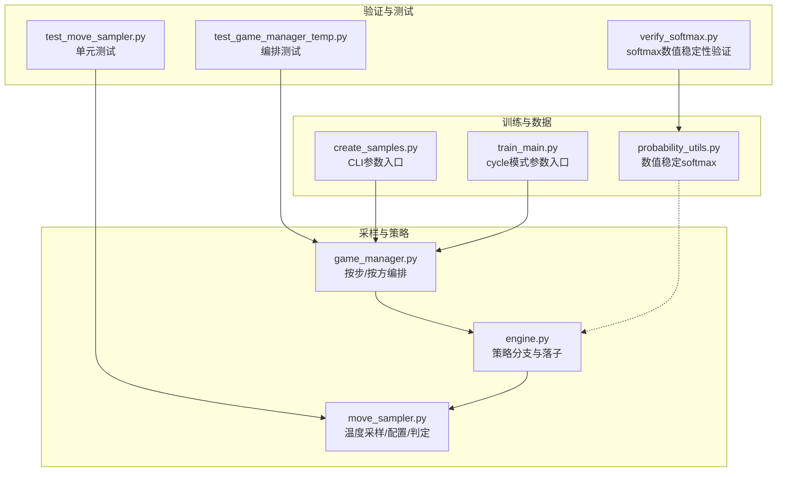
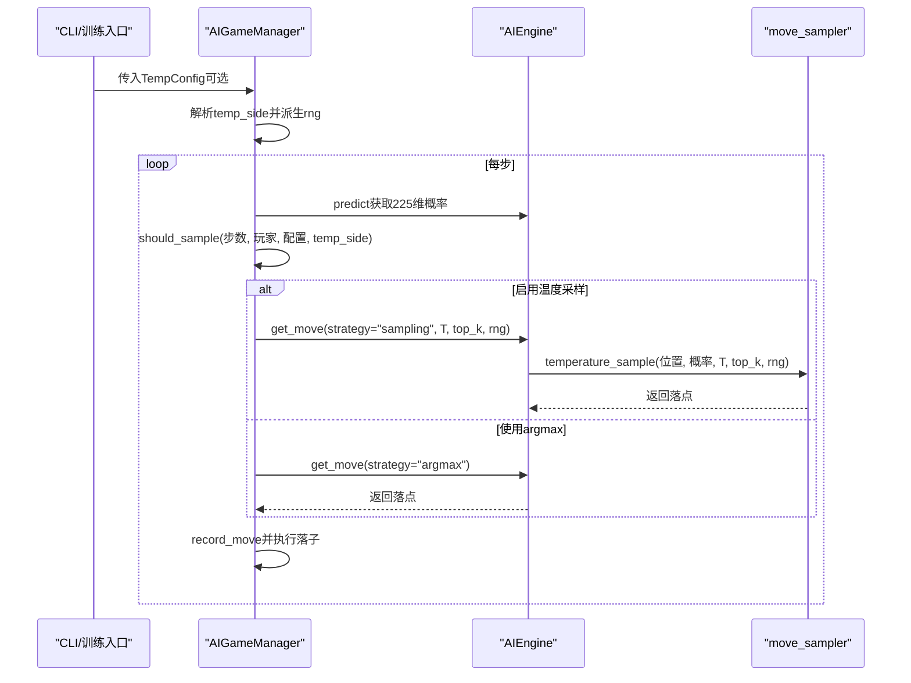
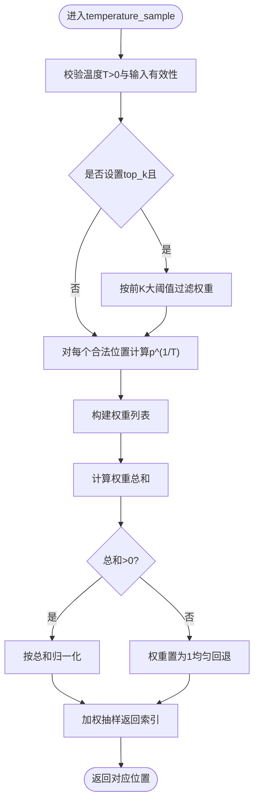
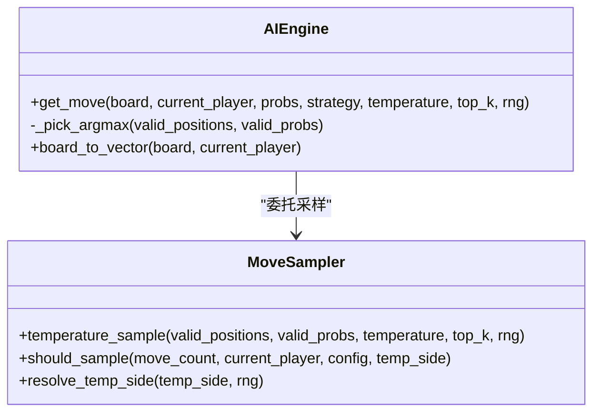
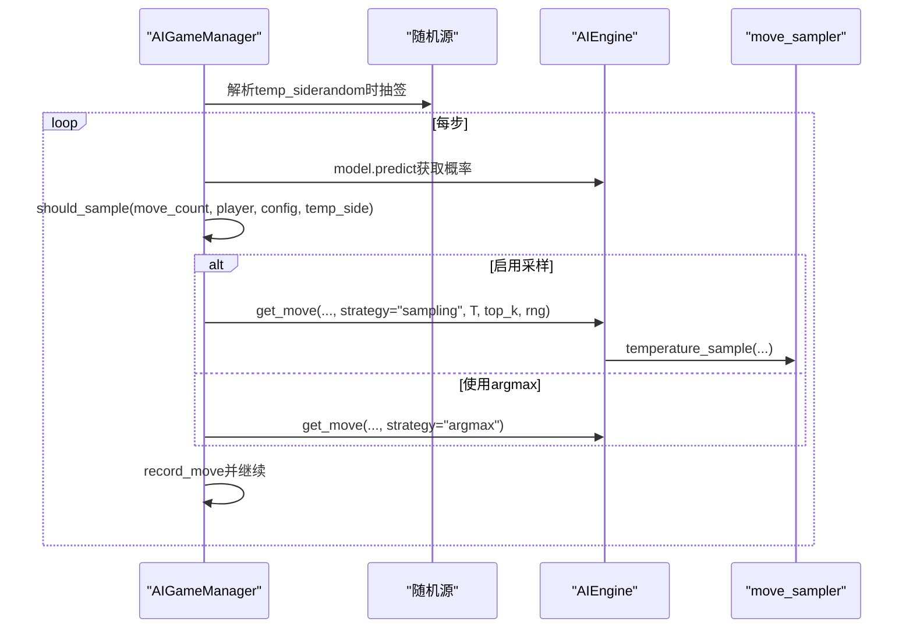
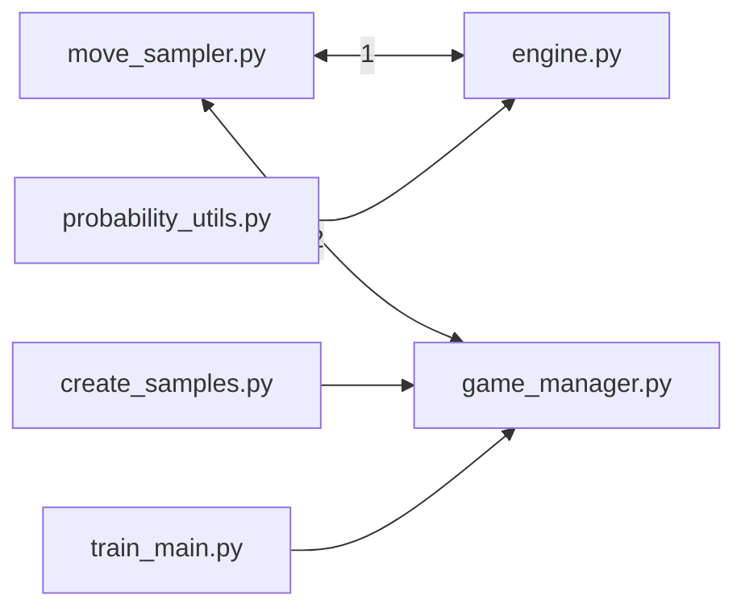

# 移动采样策略

<cite>
**本文引用的文件**
- [move_sampler.py](file://ai/move_sampler.py)
- [move_sampler_design.md](file://design/move_sampler_design.md)
- [engine.py](file://ai/engine.py)
- [game_manager.py](file://ai/game_manager.py)
- [create_samples.py](file://ai/create_samples.py)
- [train_main.py](file://ai/train_main.py)
- [probability_utils.py](file://ai/probability_utils.py)
- [test_move_sampler.py](file://tests/ai/test_move_sampler.py)
- [test_game_manager_temp.py](file://tests/ai/test_game_manager_temp.py)
- [verify_softmax.py](file://temp/verify_softmax.py)
</cite>

## 目录
1. [引言](#引言)
2. [项目结构](#项目结构)
3. [核心组件](#核心组件)
4. [架构总览](#架构总览)
5. [详细组件分析](#详细组件分析)
6. [依赖分析](#依赖分析)
7. [性能考量](#性能考量)
8. [故障排查指南](#故障排查指南)
9. [结论](#结论)
10. [附录](#附录)

## 引言
本设计文档围绕五子棋AI的“自对弈开局温度采样”策略展开，系统阐述温度采样在探索与利用之间的平衡机制、softmax概率分布的计算与归一化处理、不同采样策略的适用场景与对比、参数调优指南，以及采样策略对训练效果与模型泛化能力的影响。文档以代码为依据，结合设计文档与测试用例，提供可操作的实现与配置建议。

## 项目结构
与移动采样策略直接相关的模块与文件如下：
- 采样核心：ai/move_sampler.py（温度采样、配置与判定）
- 引擎集成：ai/engine.py（策略分支与落子选择）
- 对局编排：ai/game_manager.py（按步/按方切换温度采样）
- CLI 参数：ai/create_samples.py、ai/train_main.py（温度采样参数入口）
- 概率工具：ai/probability_utils.py（数值稳定的softmax）
- 测试与验证：tests/ai/test_move_sampler.py、tests/ai/test_game_manager_temp.py、temp/verify_softmax.py

**图表来源**
- [move_sampler.py:1-258](file://ai/move_sampler.py#L1-L258)
- [engine.py:67-142](file://ai/engine.py#L67-L142)
- [game_manager.py:124-230](file://ai/game_manager.py#L124-L230)
- [create_samples.py:78-136](file://ai/create_samples.py#L78-L136)
- [train_main.py:161-192](file://ai/train_main.py#L161-L192)
- [probability_utils.py:15-58](file://ai/probability_utils.py#L15-L58)
- [test_move_sampler.py:1-259](file://tests/ai/test_move_sampler.py#L1-L259)
- [test_game_manager_temp.py:133-153](file://tests/ai/test_game_manager_temp.py#L133-L153)
- [verify_softmax.py:1-36](file://temp/verify_softmax.py#L1-L36)

**章节来源**
- [move_sampler.py:1-258](file://ai/move_sampler.py#L1-L258)
- [engine.py:67-142](file://ai/engine.py#L67-L142)
- [game_manager.py:124-230](file://ai/game_manager.py#L124-L230)
- [create_samples.py:78-136](file://ai/create_samples.py#L78-L136)
- [train_main.py:161-192](file://ai/train_main.py#L161-L192)
- [probability_utils.py:15-58](file://ai/probability_utils.py#L15-L58)
- [test_move_sampler.py:1-259](file://tests/ai/test_move_sampler.py#L1-L259)
- [test_game_manager_temp.py:133-153](file://tests/ai/test_game_manager_temp.py#L133-L153)
- [verify_softmax.py:1-36](file://temp/verify_softmax.py#L1-L36)

## 核心组件
- 温度采样器：提供温度加权采样、top-k截断、数值稳定归一化与均匀回退机制。
- 温度配置：封装温度值、前N步阈值、启用方、top-k与随机种子等参数。
- 策略判定：按步数与当前玩家判定是否启用温度采样。
- 引擎策略分支：在sampling分支委托给采样器，在argmax分支保持原有行为。
- 对局编排：在每局开始解析temp_side并在全局步数阈值前后切换策略。
- CLI入口：create_samples.py与train_main.py（cycle模式）暴露温度采样参数。

**章节来源**
- [move_sampler.py:50-186](file://ai/move_sampler.py#L50-L186)
- [engine.py:67-142](file://ai/engine.py#L67-L142)
- [game_manager.py:124-230](file://ai/game_manager.py#L124-L230)
- [create_samples.py:78-136](file://ai/create_samples.py#L78-L136)
- [train_main.py:161-192](file://ai/train_main.py#L161-L192)

## 架构总览
温度采样策略贯穿“对局编排—引擎落子—采样执行”的链路，确保自对弈在开局阶段具备探索性，随后回归确定性策略，提升训练数据的多样性与稳定性。

**图表来源**
- [game_manager.py:166-230](file://ai/game_manager.py#L166-L230)
- [engine.py:67-142](file://ai/engine.py#L67-L142)
- [move_sampler.py:117-186](file://ai/move_sampler.py#L117-L186)
- [create_samples.py:113-136](file://ai/create_samples.py#L113-L136)
- [train_main.py:161-192](file://ai/train_main.py#L161-L192)

## 详细组件分析

### 温度采样器与配置
- 温度采样核心流程
  - 可选top-k截断：仅保留前K个最高概率位置，其余置零。
  - 温度变换：对每个合法位置概率p取p^(1/T)。
  - 归一化：计算权重总和并归一；若全非正（模型将概率集中在已落子或top-k=0），退化为均匀采样。
  - 加权抽样：使用随机源choices按权重抽取索引并返回对应坐标。
- 温度配置
  - temperature > 0；temp_moves ≥ 0；temp_side ∈ {"black","white","both","random"}；top_k为None或正整数；seed为None或整数。
  - 构造时进行字段合法性校验，非法值抛出异常。
- 策略判定
  - 当temp_moves=0时视为关闭；move_count≥temp_moves时切换为argmax；按局解析temp_side后按当前玩家筛选启用方。

**图表来源**
- [move_sampler.py:117-186](file://ai/move_sampler.py#L117-L186)

**章节来源**
- [move_sampler.py:50-186](file://ai/move_sampler.py#L50-L186)

### 引擎策略分支与落子
- 引擎在get_move中根据strategy选择：
  - "argmax"：从合法位置中按概率最大者随机打破平局。
  - "sampling"：委托move_sampler.temperature_sample执行温度采样。
- 对于sampling分支，温度、top_k、rng参数仅在该分支生效；argmax分支完全不使用这些参数。

**图表来源**
- [engine.py:67-142](file://ai/engine.py#L67-L142)
- [move_sampler.py:117-186](file://ai/move_sampler.py#L117-L186)

**章节来源**
- [engine.py:67-142](file://ai/engine.py#L67-L142)

### 对局编排与按步/按方切换
- 每局开始解析temp_side：
  - 若为"random"，使用按局独立的随机源抽签决定black或white。
  - 局内temp_side恒定，不随步数变化。
- 每步判定should_sample：
  - temp_moves=0关闭；move_count≥temp_moves切换argmax；否则按当前玩家与temp_side判定。
- 编排逻辑在AIGameManager._play_single_game中实现，确保engine不感知move_count。

**图表来源**
- [game_manager.py:166-230](file://ai/game_manager.py#L166-L230)
- [move_sampler.py:192-227](file://ai/move_sampler.py#L192-L227)

**章节来源**
- [game_manager.py:124-230](file://ai/game_manager.py#L124-L230)
- [move_sampler.py:192-258](file://ai/move_sampler.py#L192-L258)

### CLI参数与默认行为
- create_samples.py与train_main.py（cycle模式）暴露以下参数：
  - --no-temp-sampling：禁用温度采样（等价temp_config=None）。
  - --temperature：温度T（>0），默认1.0。
  - --temp-moves：前N步启用温度采样，之后argmax，默认12。
  - --temp-side：启用采样的一方，取值{"black","white","both","random"}，默认"both"。
  - --temp-seed：随机种子（用于复现）。
- 当--no-temp-sampling启用时，若用户还显式传入其他温度参数，将打印警告并忽略之。
- cycle模式下，参数解析后构造TempConfig并透传至训练流程。

**章节来源**
- [create_samples.py:78-136](file://ai/create_samples.py#L78-L136)
- [train_main.py:161-192](file://ai/train_main.py#L161-L192)

### softmax概率分布与数值稳定性
- 概率工具模块提供带mask的数值稳定softmax：
  - 对有效位置（mask=1）提取reward并缩放到合理范围，避免exp(x)下溢。
  - 减去最大值后计算指数和归一化，确保概率和为1且数值稳定。
- 该工具用于reward到概率的转换，与move_sampler的温度采样互补：前者解决模型输出概率的数值稳定性，后者在采样阶段引入探索。

**章节来源**
- [probability_utils.py:15-58](file://ai/probability_utils.py#L15-L58)
- [verify_softmax.py:1-36](file://temp/verify_softmax.py#L1-L36)

### 不同采样策略对比与适用场景
- 贪心策略（argmax）
  - 优点：确定性强，训练数据路径稳定；便于调试与复现。
  - 缺点：自对弈轨迹高度同质化，开局多样性不足，易陷入局部最优。
- softmax采样（本设计）
  - 优点：开局探索性强，提升样本多样性；温度T控制探索强度；top-k限制候选范围。
  - 缺点：引入随机性，需谨慎调参；训练初期可能波动较大。
- epsilon-greedy（概念性说明）
  - 适用：在已有模型基础上增加少量随机探索，适合在线部署或人类对弈。
  - 与本设计的关系：本项目未实现epsilon-greedy，但其思想与温度采样一致，均在探索与利用之间平衡。

**章节来源**
- [move_sampler_design.md:3-12](file://design/move_sampler_design.md#L3-L12)
- [engine.py:128-142](file://ai/engine.py#L128-L142)

### 采样参数调优指南
- 温度T的选择
  - T=1：保持原分布；T→0趋近argmax；T→∞趋近均匀。建议从1.0起步，逐步调整。
  - 大T带来均匀探索，但可能降低训练稳定性；小T接近贪心，但可能缺乏多样性。
- 前N步阈值temp_moves
  - 控制探索持续时间。建议从12起步，若开局多样性不足可上调至18；若训练不稳定可下调。
- 启用方temp_side
  - "both"：默认，双方均探索；"black"/"white"：仅一方探索；"random"：每局随机决定。
  - 建议在对抗训练中使用"random"以避免先手优势固化。
- top-k截断
  - 限制采样候选数量，减少无效位置干扰；本设计在采样器中实现，CLI暂不暴露。
- 随机种子seed
  - 用于复现实验；建议固定seed以便对比不同T或temp_moves的效果。

**章节来源**
- [move_sampler.py:50-111](file://ai/move_sampler.py#L50-L111)
- [move_sampler_design.md:44-64](file://design/move_sampler_design.md#L44-L64)

### 采样策略对训练效果与泛化的影响
- 开局多样性提升：温度采样使模型在开局阶段尝试更多分支，有助于发现更优路径。
- 训练稳定性：过度探索可能导致损失震荡；建议在训练早期采用较小T与较短探索步数。
- 泛化能力：多样化的开局轨迹有助于模型在不同局面下学习，提升对未知对手的适应性。
- 对照实验建议：以argmax为基线，对比不同T与temp_moves下的唯一开局序列数、胜负分布、平均步数与棋盘位置熵等指标。

**章节来源**
- [move_sampler_design.md:484-524](file://design/move_sampler_design.md#L484-L524)

## 依赖分析
- move_sampler.py
  - 依赖：标准库random、dataclasses、typing。
  - 被engine.py与game_manager.py依赖。
- engine.py
  - 依赖：move_sampler（本地导入避免循环依赖）。
  - 依赖：board向量化与模型预测。
- game_manager.py
  - 依赖：move_sampler（TempConfig、resolve_temp_side、should_sample）。
  - 依赖：AIEngine与DataRecorder。
- create_samples.py / train_main.py
  - 依赖：move_sampler.TempConfig。
  - 依赖：AIGameManager与训练流程。

**图表来源**
- [move_sampler.py:17-21](file://ai/move_sampler.py#L17-L21)
- [engine.py:131-139](file://ai/engine.py#L131-L139)
- [game_manager.py:13-13](file://ai/game_manager.py#L13-L13)
- [create_samples.py:20-20](file://ai/create_samples.py#L20-L20)
- [train_main.py:161-192](file://ai/train_main.py#L161-L192)
- [probability_utils.py:6-7](file://ai/probability_utils.py#L6-L7)

**章节来源**
- [move_sampler.py:17-21](file://ai/move_sampler.py#L17-L21)
- [engine.py:131-139](file://ai/engine.py#L131-L139)
- [game_manager.py:13-13](file://ai/game_manager.py#L13-L13)
- [create_samples.py:20-20](file://ai/create_samples.py#L20-L20)
- [train_main.py:161-192](file://ai/train_main.py#L161-L192)
- [probability_utils.py:6-7](file://ai/probability_utils.py#L6-L7)

## 性能考量
- 温度采样复杂度
  - top-k过滤：O(n log n)（排序）；权重计算与归一化：O(n)；加权抽样：O(n)。
  - n≤225，整体开销可忽略不计。
- 归一化与回退
  - 全零权重时退化为均匀采样，避免异常并保持稳定性。
- 数值稳定性
  - softmax缩放因子与减最大值策略避免exp下溢，保证概率和为1。

**章节来源**
- [move_sampler.py:161-185](file://ai/move_sampler.py#L161-L185)
- [probability_utils.py:15-58](file://ai/probability_utils.py#L15-L58)

## 故障排查指南
- 温度参数非法
  - 现象：ValueError（温度≤0、位置列表为空、长度不一致）。
  - 排查：检查CLI参数与配置对象字段合法性。
- 配置对象校验失败
  - 现象：构造TempConfig时抛出ValueError。
  - 排查：确认temperature>0、temp_moves≥0、temp_side合法、top_k为None或正整数。
- 策略判定异常
  - 现象：should_sample返回不符合预期。
  - 排查：确认temp_moves、move_count、current_player与temp_side_this_game一致。
- 对局编排问题
  - 现象：temp_side="random"未生效或跨局不一致。
  - 排查：确认按局随机源是否正确派生（seed+game_num）。
- softmax数值问题
  - 现象：概率接近0或总和不为1。
  - 排查：使用数值稳定softmax工具，确保reward缩放与减最大值步骤正确。

**章节来源**
- [move_sampler.py:77-111](file://ai/move_sampler.py#L77-L111)
- [move_sampler.py:147-157](file://ai/move_sampler.py#L147-L157)
- [test_move_sampler.py:77-96](file://tests/ai/test_move_sampler.py#L77-L96)
- [test_move_sampler.py:152-179](file://tests/ai/test_move_sampler.py#L152-L179)
- [test_game_manager_temp.py:133-153](file://tests/ai/test_game_manager_temp.py#L133-L153)
- [verify_softmax.py:1-36](file://temp/verify_softmax.py#L1-L36)

## 结论
本设计通过“开局温度采样+后续argmax”的阶梯式策略，在自对弈中引入可控的探索性，显著提升样本多样性与训练稳定性。温度参数、前N步阈值、启用方与top-k截断共同构成灵活的调优空间。配合数值稳定的softmax与严格的参数校验，采样策略既满足工程可用性，又为模型泛化能力提供支撑。

## 附录
- 参数配置示例（命令行）
  - 开启温度采样（默认）：python -m ai.create_samples --model cnn_v3.1 --games 50
  - 禁用温度采样：python -m ai.create_samples --model cnn_v3.1 --games 50 --no-temp-sampling
  - 自定义温度与探索步数：python -m ai.create_samples --model cnn_v3.1 --games 50 --temperature 1.2 --temp-moves 18
  - 按局随机启用：python -m ai.create_samples --model cnn_v3.1 --games 50 --temp-side random --temp-seed 42
- 对照实验建议
  - 命令行示例：argmax基线与温度采样对比，观察唯一开局序列数、胜负分布、平均步数与棋盘位置熵等指标。

**章节来源**
- [create_samples.py:78-136](file://ai/create_samples.py#L78-L136)
- [move_sampler_design.md:490-524](file://design/move_sampler_design.md#L490-L524)