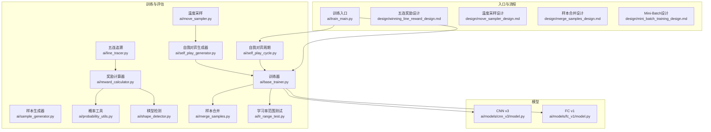
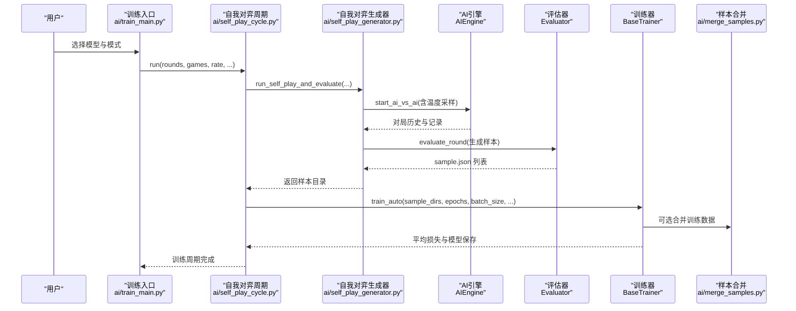
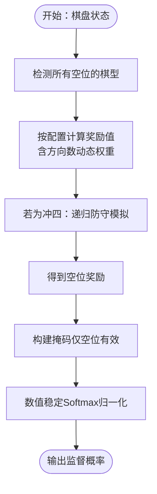
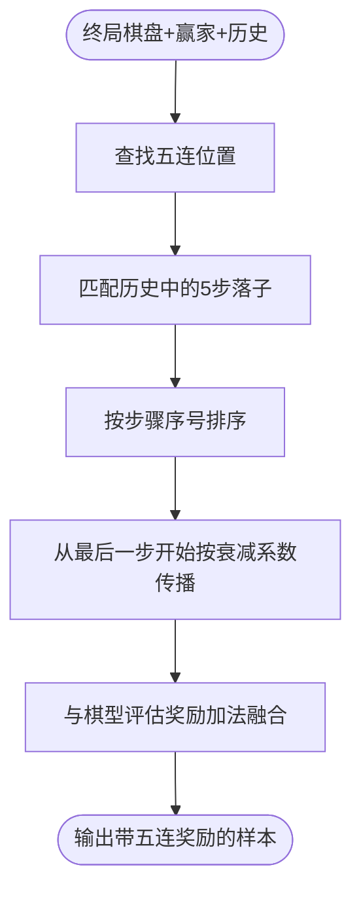
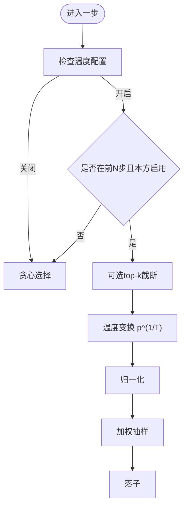
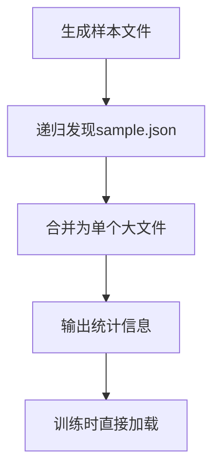
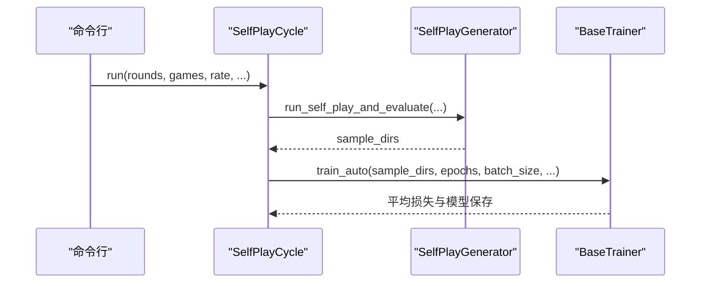
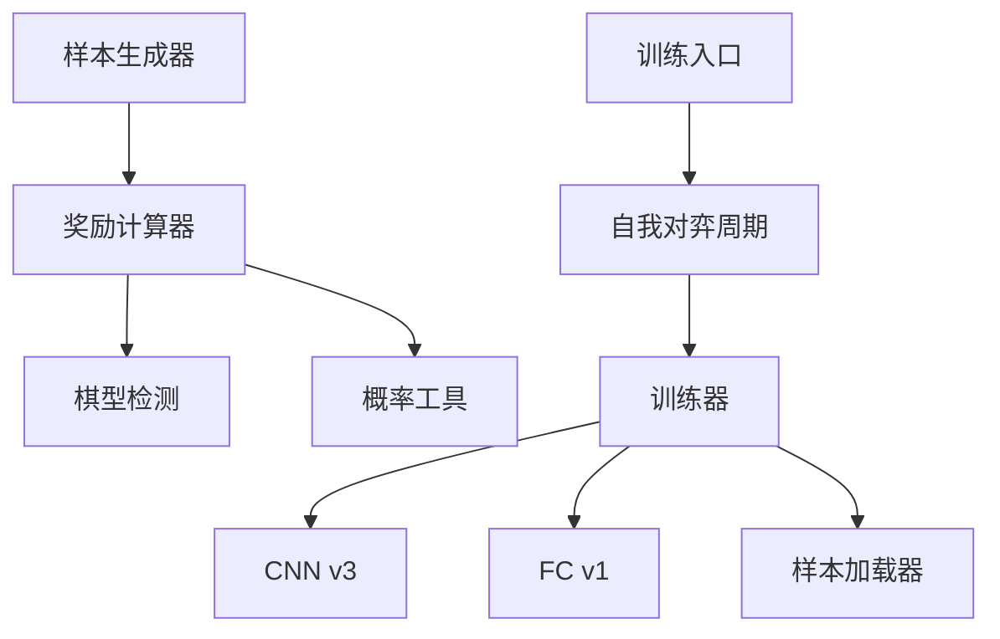

# 训练算法设计

<cite>
**本文引用的文件**
- [ai/reward_calculator.py](file://ai/reward_calculator.py)
- [ai/line_tracer.py](file://ai/line_tracer.py)
- [ai/move_sampler.py](file://ai/move_sampler.py)
- [ai/lr_range_test.py](file://ai/lr_range_test.py)
- [ai/merge_samples.py](file://ai/merge_samples.py)
- [ai/self_play_cycle.py](file://ai/self_play_cycle.py)
- [ai/sample_generator.py](file://ai/sample_generator.py)
- [ai/base_trainer.py](file://ai/base_trainer.py)
- [ai/probability_utils.py](file://ai/probability_utils.py)
- [ai/shape_detector.py](file://ai/shape_detector.py)
- [ai/self_play_generator.py](file://ai/self_play_generator.py)
- [ai/train_main.py](file://ai/train_main.py)
- [ai/models/cnn_v3/model.py](file://ai/models/cnn_v3/model.py)
- [ai/models/fc_v1/model.py](file://ai/models/fc_v1/model.py)
- [design/winning_line_reward_design.md](file://design/winning_line_reward_design.md)
- [design/move_sampler_design.md](file://design/move_sampler_design.md)
- [design/merge_samples_design.md](file://design/merge_samples_design.md)
- [design/mini_batch_training_design.md](file://design/mini_batch_training_design.md)
</cite>

## 目录
1. [简介](#简介)
2. [项目结构](#项目结构)
3. [核心组件](#核心组件)
4. [架构总览](#架构总览)
5. [详细组件分析](#详细组件分析)
6. [依赖分析](#依赖分析)
7. [性能考量](#性能考量)
8. [故障排查指南](#故障排查指南)
9. [结论](#结论)
10. [附录](#附录)

## 简介
本设计文档围绕五子棋AI训练算法，系统阐述奖励机制、五连追溯算法、温度采样策略、学习率调度、数据增强与样本合并、训练流程闭环以及训练优化技术。文档以仓库现有实现为基础，结合设计文档与测试用例，提供从理论到实践的完整说明，帮助读者快速理解并高效迭代训练系统。

## 项目结构
本项目采用“模块化+分层”的组织方式：
- ai/：训练与推理核心模块（奖励、采样、训练器、评估、对弈、数据加载等）
- ai/models/：具体模型实现（CNN v3、FC v1等）
- design/：训练相关设计文档（奖励融合、温度采样、样本合并、mini-batch等）
- tests/：单元/集成测试，覆盖训练流程与关键模块
- temp/：临时分析脚本与可视化工具



**图表来源**
- [ai/reward_calculator.py:1-239](file://ai/reward_calculator.py#L1-L239)
- [ai/line_tracer.py:1-143](file://ai/line_tracer.py#L1-L143)
- [ai/move_sampler.py:1-258](file://ai/move_sampler.py#L1-L258)
- [ai/base_trainer.py:1-699](file://ai/base_trainer.py#L1-L699)
- [ai/sample_generator.py:1-511](file://ai/sample_generator.py#L1-L511)
- [ai/self_play_generator.py:1-244](file://ai/self_play_generator.py#L1-L244)
- [ai/self_play_cycle.py:1-195](file://ai/self_play_cycle.py#L1-L195)
- [ai/probability_utils.py:1-59](file://ai/probability_utils.py#L1-L59)
- [ai/shape_detector.py:1-314](file://ai/shape_detector.py#L1-L314)
- [ai/merge_samples.py:1-155](file://ai/merge_samples.py#L1-L155)
- [ai/lr_range_test.py:1-289](file://ai/lr_range_test.py#L1-L289)
- [ai/models/cnn_v3/model.py:1-139](file://ai/models/cnn_v3/model.py#L1-L139)
- [ai/models/fc_v1/model.py:1-132](file://ai/models/fc_v1/model.py#L1-L132)
- [design/winning_line_reward_design.md:1-177](file://design/winning_line_reward_design.md#L1-L177)
- [design/move_sampler_design.md:1-551](file://design/move_sampler_design.md#L1-L551)
- [design/merge_samples_design.md:1-247](file://design/merge_samples_design.md#L1-L247)
- [design/mini_batch_training_design.md:1-167](file://design/mini_batch_training_design.md#L1-L167)

**章节来源**
- [ai/reward_calculator.py:1-239](file://ai/reward_calculator.py#L1-L239)
- [ai/line_tracer.py:1-143](file://ai/line_tracer.py#L1-L143)
- [ai/move_sampler.py:1-258](file://ai/move_sampler.py#L1-L258)
- [ai/base_trainer.py:1-699](file://ai/base_trainer.py#L1-L699)
- [ai/sample_generator.py:1-511](file://ai/sample_generator.py#L1-L511)
- [ai/self_play_generator.py:1-244](file://ai/self_play_generator.py#L1-L244)
- [ai/self_play_cycle.py:1-195](file://ai/self_play_cycle.py#L1-L195)
- [ai/probability_utils.py:1-59](file://ai/probability_utils.py#L1-L59)
- [ai/shape_detector.py:1-314](file://ai/shape_detector.py#L1-L314)
- [ai/merge_samples.py:1-155](file://ai/merge_samples.py#L1-L155)
- [ai/lr_range_test.py:1-289](file://ai/lr_range_test.py#L1-L289)
- [ai/models/cnn_v3/model.py:1-139](file://ai/models/cnn_v3/model.py#L1-L139)
- [ai/models/fc_v1/model.py:1-132](file://ai/models/fc_v1/model.py#L1-L132)
- [design/winning_line_reward_design.md:1-177](file://design/winning_line_reward_design.md#L1-L177)
- [design/move_sampler_design.md:1-551](file://design/move_sampler_design.md#L1-L551)
- [design/merge_samples_design.md:1-247](file://design/merge_samples_design.md#L1-L247)
- [design/mini_batch_training_design.md:1-167](file://design/mini_batch_training_design.md#L1-L167)

## 核心组件
- 奖励机制与棋型评估：基于棋型检测与奖励配置，计算每个空位的奖励值，支持“冲四递归”与“眠三/活二”方向数动态加权。
- 五连追溯奖励：从终局棋盘定位五连，按衰减系数反向传播奖励，与棋型评估奖励加法融合。
- 温度采样策略：在自我对弈开局阶段引入温度采样，提升开局多样性，随后切换为贪心策略。
- 学习率调度：支持StepLR与ReduceLROnPlateau，提供LR范围测试脚本辅助选择合适的学习率区间。
- 数据增强与样本合并：样本生成器对棋型进行软标签化，样本合并脚本将多文件合并为单一大文件，降低I/O开销。
- 训练流程闭环：自我对弈→评价→样本生成→训练→模型保存→下一轮，形成持续迭代。
- 训练优化：支持mini-batch训练、梯度范数记录、学习率调度、GPU加速与并行评估。

**章节来源**
- [ai/reward_calculator.py:13-116](file://ai/reward_calculator.py#L13-L116)
- [ai/line_tracer.py:10-26](file://ai/line_tracer.py#L10-L26)
- [ai/move_sampler.py:50-111](file://ai/move_sampler.py#L50-L111)
- [ai/lr_range_test.py:131-210](file://ai/lr_range_test.py#L131-L210)
- [ai/merge_samples.py:13-76](file://ai/merge_samples.py#L13-L76)
- [ai/self_play_cycle.py:20-66](file://ai/self_play_cycle.py#L20-L66)
- [ai/base_trainer.py:32-120](file://ai/base_trainer.py#L32-L120)

## 架构总览
训练系统以“自我对弈→样本生成→训练→评估→保存模型”的闭环为核心，训练器统一管理模型、优化器、损失函数与学习率调度，支持全量与mini-batch训练；奖励模块与棋型检测模块提供高质量监督信号；温度采样与样本合并提升数据质量与I/O效率。



**图表来源**
- [ai/train_main.py:27-234](file://ai/train_main.py#L27-L234)
- [ai/self_play_cycle.py:38-156](file://ai/self_play_cycle.py#L38-L156)
- [ai/self_play_generator.py:21-136](file://ai/self_play_generator.py#L21-L136)
- [ai/base_trainer.py:575-603](file://ai/base_trainer.py#L575-L603)
- [ai/merge_samples.py:79-102](file://ai/merge_samples.py#L79-L102)

## 详细组件分析

### 奖励机制设计
- 奖励配置：集中管理各类棋型的相对权重，支持最大/最小奖励值与动态权重（如眠三、活二随方向数增加）。
- 棋型评估：对每个空位计算“我方”与“敌方”双方的棋型，取最大值；冲四采用递归防守模拟，避免高估。
- 概率归一化：使用带掩码的数值稳定Softmax，将奖励映射为概率分布，作为监督信号。



**图表来源**
- [ai/reward_calculator.py:46-99](file://ai/reward_calculator.py#L46-L99)
- [ai/reward_calculator.py:118-190](file://ai/reward_calculator.py#L118-L190)
- [ai/probability_utils.py:15-58](file://ai/probability_utils.py#L15-L58)
- [ai/shape_detector.py:197-279](file://ai/shape_detector.py#L197-L279)

**章节来源**
- [ai/reward_calculator.py:13-116](file://ai/reward_calculator.py#L13-L116)
- [ai/probability_utils.py:15-58](file://ai/probability_utils.py#L15-L58)
- [ai/shape_detector.py:197-279](file://ai/shape_detector.py#L197-L279)

### 五连追溯算法
- 从终局棋盘定位五连位置，匹配历史记录中的落子步骤，按衰减系数反向传播奖励。
- 奖励融合：采用加法融合，避免早期步骤弱信号被丢弃，确保两种信号共同贡献。



**图表来源**
- [ai/line_tracer.py:28-117](file://ai/line_tracer.py#L28-L117)
- [design/winning_line_reward_design.md:34-75](file://design/winning_line_reward_design.md#L34-L75)

**章节来源**
- [ai/line_tracer.py:10-26](file://ai/line_tracer.py#L10-L26)
- [ai/line_tracer.py:64-117](file://ai/line_tracer.py#L64-L117)
- [design/winning_line_reward_design.md:10-17](file://design/winning_line_reward_design.md#L10-L17)

### 温度采样策略
- 阶梯式温度采样：前N步按温度采样，之后切换为贪心策略；支持按方启用（黑/白/双方/随机）。
- 采样公式：对合法位置的概率向量进行温度变换后归一化，再按权重抽样。
- 参数设计：温度T、前N步阈值、启用方、可选top-k截断、随机种子。



**图表来源**
- [ai/move_sampler.py:117-185](file://ai/move_sampler.py#L117-L185)
- [ai/move_sampler.py:192-226](file://ai/move_sampler.py#L192-L226)
- [design/move_sampler_design.md:28-55](file://design/move_sampler_design.md#L28-L55)

**章节来源**
- [ai/move_sampler.py:50-111](file://ai/move_sampler.py#L50-L111)
- [ai/move_sampler.py:117-185](file://ai/move_sampler.py#L117-L185)
- [design/move_sampler_design.md:14-27](file://design/move_sampler_design.md#L14-L27)

### 学习率调度与范围测试
- 调度策略：StepLR（固定间隔衰减）与ReduceLROnPlateau（按平台衰减）。
- 范围测试：LR Range Test脚本在线性递增学习率下训练多个round，记录平均loss，绘制曲线辅助选择合适学习率区间。

```mermaid
sequenceDiagram
participant Script as "LR范围测试脚本"
participant Model as "模型"
participant Loader as "数据加载器"
participant Opt as "优化器"
Script->>Model : 加载fresh模型
Script->>Loader : 加载训练数据
loop 多个round
Script->>Opt : 设置当前round学习率
Script->>Model : 训练若干step并累计loss
Script->>Script : 记录平均loss
end
Script->>Script : 绘制LR-loss曲线
```

**图表来源**
- [ai/lr_range_test.py:131-210](file://ai/lr_range_test.py#L131-L210)

**章节来源**
- [ai/base_trainer.py:127-144](file://ai/base_trainer.py#L127-L144)
- [ai/lr_range_test.py:131-210](file://ai/lr_range_test.py#L131-L210)

### 数据增强与样本合并
- 样本生成：针对chong4/huo4/huo3/huo2/defend_chong4/defend_huo3六类棋型，合成棋盘并标注进攻位，计算奖励概率作为软标签。
- 样本合并：将分散的sample.json合并为单个大文件，减少训练时I/O与解析开销；支持目录递归扫描与输出目录自动创建。



**图表来源**
- [ai/sample_generator.py:261-327](file://ai/sample_generator.py#L261-L327)
- [ai/merge_samples.py:13-76](file://ai/merge_samples.py#L13-L76)

**章节来源**
- [ai/sample_generator.py:1-511](file://ai/sample_generator.py#L1-L511)
- [ai/merge_samples.py:1-155](file://ai/merge_samples.py#L1-L155)
- [design/merge_samples_design.md:1-247](file://design/merge_samples_design.md#L1-L247)

### 训练流程设计
- 自我对弈周期：每轮N局自我对弈，生成样本后合并训练；支持mini-batch与全量训练，自动记录损失与生成图表。
- 训练器：统一管理模型、优化器、损失函数、学习率调度；提供train_batch、train_mini_batch、train_auto等接口。
- 入口脚本：train_main.py支持cycle模式与从目录训练，参数透传至训练器与温度采样配置。



**图表来源**
- [ai/self_play_cycle.py:38-156](file://ai/self_play_cycle.py#L38-L156)
- [ai/self_play_generator.py:21-136](file://ai/self_play_generator.py#L21-L136)
- [ai/base_trainer.py:575-603](file://ai/base_trainer.py#L575-L603)
- [ai/train_main.py:27-234](file://ai/train_main.py#L27-L234)

**章节来源**
- [ai/self_play_cycle.py:20-98](file://ai/self_play_cycle.py#L20-L98)
- [ai/self_play_generator.py:21-136](file://ai/self_play_generator.py#L21-L136)
- [ai/base_trainer.py:324-603](file://ai/base_trainer.py#L324-L603)
- [ai/train_main.py:27-234](file://ai/train_main.py#L27-L234)

### 训练优化技术
- 梯度裁剪与范数监控：记录梯度范数，便于诊断梯度爆炸/消失。
- 批量训练：支持mini-batch与全量训练，mini-batch模式下每epoch多次参数更新，提升GPU利用率。
- 并行评估：自我对弈生成器支持并行进程数配置，加速样本生成。
- GPU加速：自动检测CUDA设备，模型与张量迁移至GPU。

**章节来源**
- [ai/base_trainer.py:240-255](file://ai/base_trainer.py#L240-L255)
- [ai/base_trainer.py:409-573](file://ai/base_trainer.py#L409-L573)
- [ai/self_play_generator.py:27-44](file://ai/self_play_generator.py#L27-L44)

## 依赖分析
- 模块内聚与耦合：奖励与棋型检测模块内聚，通过共享的棋盘状态与方向枚举协作；训练器与模型解耦，通过统一接口适配不同模型。
- 外部依赖：PyTorch（神经网络）、NumPy（棋型检测加速）、Matplotlib（LR范围测试绘图）。
- 关键依赖链：样本生成器→奖励计算器→棋型检测→概率工具；训练器→模型→数据加载器；入口脚本→周期/训练器。



**图表来源**
- [ai/sample_generator.py:33-35](file://ai/sample_generator.py#L33-L35)
- [ai/reward_calculator.py](file://ai/reward_calculator.py#L10)
- [ai/probability_utils.py:6-7](file://ai/probability_utils.py#L6-L7)
- [ai/base_trainer.py:14-18](file://ai/base_trainer.py#L14-L18)
- [ai/models/cnn_v3/model.py](file://ai/models/cnn_v3/model.py#L28)
- [ai/models/fc_v1/model.py](file://ai/models/fc_v1/model.py#L15)
- [ai/train_main.py:23-24](file://ai/train_main.py#L23-L24)

**章节来源**
- [ai/sample_generator.py:33-35](file://ai/sample_generator.py#L33-L35)
- [ai/reward_calculator.py](file://ai/reward_calculator.py#L10)
- [ai/probability_utils.py:6-7](file://ai/probability_utils.py#L6-L7)
- [ai/base_trainer.py:14-18](file://ai/base_trainer.py#L14-L18)
- [ai/models/cnn_v3/model.py](file://ai/models/cnn_v3/model.py#L28)
- [ai/models/fc_v1/model.py](file://ai/models/fc_v1/model.py#L15)
- [ai/train_main.py:23-24](file://ai/train_main.py#L23-L24)

## 性能考量
- 棋型检测加速：优先使用Numba JIT编译，无法使用时回退纯Python实现，确保在无GPU环境下仍可运行。
- 概率归一化稳定性：通过缩放与中心化避免数值下溢，提升softmax稳定性。
- I/O优化：样本合并减少文件数量与解析开销；训练时支持合并文件与递归加载。
- 训练效率：mini-batch模式降低显存占用，提升GPU利用率；并行评估加速样本生成。

**章节来源**
- [ai/shape_detector.py:12-17](file://ai/shape_detector.py#L12-L17)
- [ai/shape_detector.py:56-127](file://ai/shape_detector.py#L56-L127)
- [ai/probability_utils.py:10-12](file://ai/probability_utils.py#L10-L12)
- [ai/merge_samples.py:13-39](file://ai/merge_samples.py#L13-L39)
- [ai/base_trainer.py:409-573](file://ai/base_trainer.py#L409-L573)

## 故障排查指南
- 温度采样异常：检查温度参数是否大于0、位置列表是否非空、top-k阈值是否合理；确认temp_moves阈值与启用方配置。
- 棋型检测失败：确认棋盘索引与方向枚举一致，必要时回退到纯Python路径；检查Numba安装状态。
- 样本生成质量：通过样本生成器的验证报告（Hit@N、攻击位概率和、gap等）评估标签质量，必要时调整干扰子数量与棋型参数。
- 训练不稳定：关注梯度范数与学习率调度；使用LR范围测试脚本选择合适学习率区间；检查batch_size与shuffle设置。
- 数据加载问题：确认样本文件路径与格式，合并文件输出目录存在性；训练入口支持目录与单文件两种模式。

**章节来源**
- [ai/move_sampler.py:147-157](file://ai/move_sampler.py#L147-L157)
- [ai/shape_detector.py:124-127](file://ai/shape_detector.py#L124-L127)
- [ai/sample_generator.py:334-401](file://ai/sample_generator.py#L334-L401)
- [ai/base_trainer.py:605-619](file://ai/base_trainer.py#L605-L619)
- [ai/lr_range_test.py:213-239](file://ai/lr_range_test.py#L213-L239)
- [ai/merge_samples.py:134-142](file://ai/merge_samples.py#L134-L142)
- [ai/train_main.py:196-207](file://ai/train_main.py#L196-L207)

## 结论
本设计文档系统梳理了五子棋AI训练算法的关键模块与实现细节，涵盖奖励机制、五连追溯、温度采样、学习率调度、数据增强与合并、训练流程与优化技术。通过模块化设计与清晰的接口契约，训练系统具备良好的可扩展性与可维护性，能够支撑从样本生成到模型训练的完整闭环，并为后续迭代提供坚实基础。

## 附录
- 模型实现概览：CNN v3采用纯卷积结构，FC v1采用全连接结构，两者均继承NeuralNetworkModel，统一输入转换与保存/加载逻辑。
- 设计文档参考：五连奖励融合、温度采样策略、样本合并与mini-batch训练均有配套设计文档与测试用例，便于理解与回归验证。

**章节来源**
- [ai/models/cnn_v3/model.py:31-94](file://ai/models/cnn_v3/model.py#L31-L94)
- [ai/models/fc_v1/model.py:18-88](file://ai/models/fc_v1/model.py#L18-L88)
- [design/winning_line_reward_design.md:1-177](file://design/winning_line_reward_design.md#L1-L177)
- [design/move_sampler_design.md:1-551](file://design/move_sampler_design.md#L1-L551)
- [design/merge_samples_design.md:1-247](file://design/merge_samples_design.md#L1-L247)
- [design/mini_batch_training_design.md:1-167](file://design/mini_batch_training_design.md#L1-L167)