# 设计文档

<cite>
**本文引用的文件**
- [ai/__init__.py](file://ai/__init__.py)
- [ai/engine.py](file://ai/engine.py)
- [ai/game_manager.py](file://ai/game_manager.py)
- [ai/base_trainer.py](file://ai/base_trainer.py)
- [ai/registry.py](file://ai/registry.py)
- [ai/models/fc_v1/model.py](file://ai/models/fc_v1/model.py)
- [ai/models/cnn_v3/model.py](file://ai/models/cnn_v3/model.py)
- [ai/reward_calculator.py](file://ai/reward_calculator.py)
- [ai/sample_generator.py](file://ai/sample_generator.py)
- [ai/data_recorder.py](file://ai/data_recorder.py)
- [ai/constants.py](file://ai/constants.py)
- [gui/components/heatmap.py](file://gui/components/heatmap.py)
- [visualization/heatmap_color.py](file://visualization/heatmap_color.py)
- [design/design_specification.md](file://design/design_specification.md)
- [design/cnn_design.md](file://design/cnn_design.md)
</cite>

## 目录
1. [简介](#简介)
2. [项目结构](#项目结构)
3. [核心组件](#核心组件)
4. [架构总览](#架构总览)
5. [详细组件分析](#详细组件分析)
6. [依赖关系分析](#依赖关系分析)
7. [性能考虑](#性能考虑)
8. [故障排查指南](#故障排查指南)
9. [结论](#结论)
10. [附录](#附录)

## 简介
本设计文档面向五子棋AI项目，系统化阐述整体架构、模块关系、数据流与扩展点设计；深入分析AI模型（FC v1、CNN v3等）的架构选择、技术权衡与性能考量；提供训练算法（样本生成、奖励机制、学习策略）的设计说明；记录数据处理（样本格式、数据流、存储策略）的设计思路；介绍可视化系统（热力图算法、颜色映射、用户体验）的设计理念；总结性能优化（内存管理、计算优化、并发处理）方案；并给出设计决策的技术背景、实现考虑与未来扩展方向，以指导系统的演进与维护。

## 项目结构
项目采用清晰的分层与模块化组织：
- ai 包：AI引擎、模型、训练器、数据记录、评估器、注册表等核心AI能力
- gui 包：图形界面组件（热力图等）
- visualization 包：独立的颜色映射与可视化算法
- design 目录：设计文档与规范
- tests 目录：测试用例与集成验证
- 其他包：game、app、cli 等支撑模块

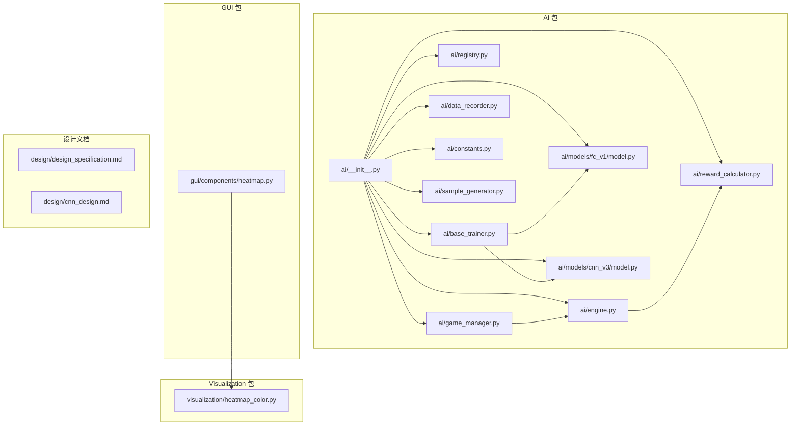

**图表来源**
- [ai/__init__.py:1-21](file://ai/__init__.py#L1-L21)
- [ai/engine.py:1-194](file://ai/engine.py#L1-L194)
- [ai/game_manager.py:1-339](file://ai/game_manager.py#L1-L339)
- [ai/registry.py:1-316](file://ai/registry.py#L1-L316)
- [ai/base_trainer.py:1-699](file://ai/base_trainer.py#L1-L699)
- [ai/data_recorder.py:1-145](file://ai/data_recorder.py#L1-L145)
- [ai/constants.py:1-26](file://ai/constants.py#L1-L26)
- [ai/models/fc_v1/model.py:1-132](file://ai/models/fc_v1/model.py#L1-L132)
- [ai/models/cnn_v3/model.py:1-139](file://ai/models/cnn_v3/model.py#L1-L139)
- [ai/reward_calculator.py:1-239](file://ai/reward_calculator.py#L1-L239)
- [ai/sample_generator.py:1-511](file://ai/sample_generator.py#L1-L511)
- [gui/components/heatmap.py:1-358](file://gui/components/heatmap.py#L1-L358)
- [visualization/heatmap_color.py:1-204](file://visualization/heatmap_color.py#L1-L204)
- [design/design_specification.md:1-966](file://design/design_specification.md#L1-L966)
- [design/cnn_design.md:1-285](file://design/cnn_design.md#L1-L285)

**章节来源**
- [ai/__init__.py:1-21](file://ai/__init__.py#L1-L21)
- [design/design_specification.md:75-111](file://design/design_specification.md#L75-L111)

## 核心组件
- AI引擎（AIEngine）：桥接UI与AI模型，负责棋盘向量转换、模型预测、落子策略选择（argmax/sampling）
- 游戏管理器（AIGameManager）：封装人机对战与AI内战流程，协调控制器与数据记录器
- 训练器（BaseTrainer）：提供统一训练接口，支持GPU加速、多种学习率调度、掩码损失、mini-batch与全量训练
- 模型族：FC v1（全连接）、CNN v3（极简卷积），均继承自NeuralNetworkModel
- 注册表（Registry）：统一管理模型与训练器映射，支持多代模型（cnn_v3.*）
- 奖励计算器（RewardCalculator）：将棋型映射为数值reward，支持冲四递归防守模拟
- 样本生成器（SampleGenerator）：按棋型合成样本，计算reward并生成训练标签
- 数据记录器（DataRecorder）：记录对局历史、落子位置与结果，按轮次与游戏编号组织
- 可视化（Heatmap）：GUI热力图组件，复用颜色映射算法，支持悬停tooltip

**章节来源**
- [ai/engine.py:44-194](file://ai/engine.py#L44-L194)
- [ai/game_manager.py:16-339](file://ai/game_manager.py#L16-L339)
- [ai/base_trainer.py:32-699](file://ai/base_trainer.py#L32-L699)
- [ai/models/fc_v1/model.py:91-132](file://ai/models/fc_v1/model.py#L91-L132)
- [ai/models/cnn_v3/model.py:96-139](file://ai/models/cnn_v3/model.py#L96-L139)
- [ai/registry.py:58-184](file://ai/registry.py#L58-L184)
- [ai/reward_calculator.py:35-239](file://ai/reward_calculator.py#L35-L239)
- [ai/sample_generator.py:1-511](file://ai/sample_generator.py#L1-L511)
- [ai/data_recorder.py:17-145](file://ai/data_recorder.py#L17-L145)
- [gui/components/heatmap.py:68-358](file://gui/components/heatmap.py#L68-L358)
- [visualization/heatmap_color.py:63-204](file://visualization/heatmap_color.py#L63-L204)

## 架构总览
系统采用分层架构：
- 表现层：GUI组件（热力图）与CLI（游戏包）
- 控制层：AI引擎与游戏管理器
- 模型层：模型与训练器
- 数据层：样本生成、数据记录与存储

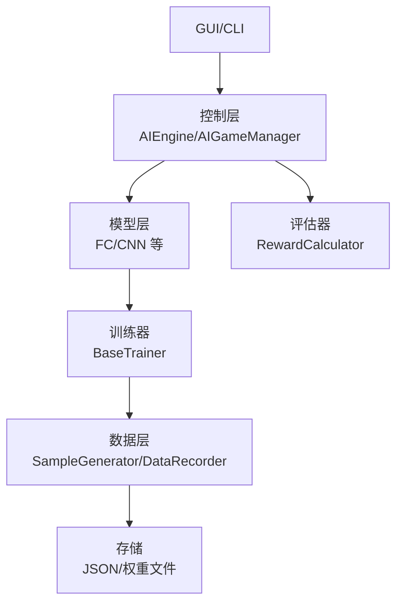

**图表来源**
- [ai/engine.py:44-194](file://ai/engine.py#L44-L194)
- [ai/game_manager.py:16-339](file://ai/game_manager.py#L16-L339)
- [ai/base_trainer.py:32-699](file://ai/base_trainer.py#L32-L699)
- [ai/reward_calculator.py:35-239](file://ai/reward_calculator.py#L35-L239)
- [ai/sample_generator.py:1-511](file://ai/sample_generator.py#L1-L511)
- [ai/data_recorder.py:17-145](file://ai/data_recorder.py#L17-L145)

## 详细组件分析

### AI引擎（AIEngine）
- 职责：将15×15棋盘转换为226维向量，调用模型预测225维概率分布，按策略选择合法位置
- 策略：argmax（默认，随机打破并列）与sampling（温度加权采样）
- 性能优化：支持传入预计算probs，避免重复model.predict

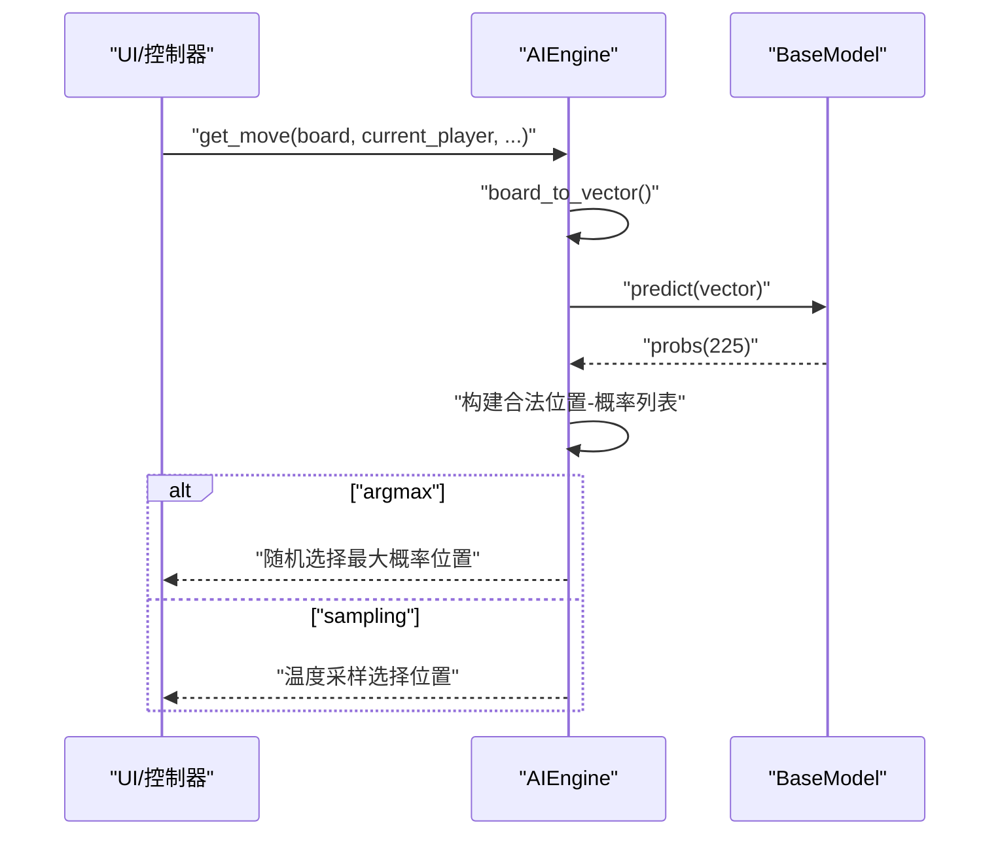

**图表来源**
- [ai/engine.py:67-142](file://ai/engine.py#L67-L142)

**章节来源**
- [ai/engine.py:44-194](file://ai/engine.py#L44-L194)

### 游戏管理器（AIGameManager）
- 职责：封装人机对战与AI内战流程，协调控制器、引擎与数据记录器
- 支持：固定执棋（黑先）与随机执棋（每局随机），温度采样编排
- 数据记录：每步记录input、output、position，结束保存winner与终局board

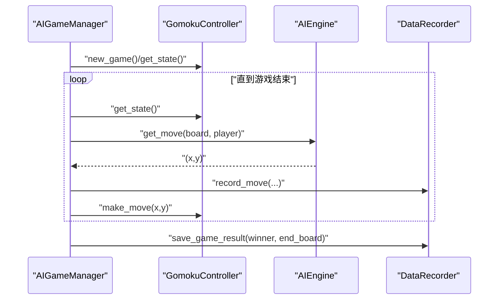

**图表来源**
- [ai/game_manager.py:100-230](file://ai/game_manager.py#L100-L230)
- [ai/data_recorder.py:96-141](file://ai/data_recorder.py#L96-L141)

**章节来源**
- [ai/game_manager.py:16-339](file://ai/game_manager.py#L16-L339)
- [ai/data_recorder.py:17-145](file://ai/data_recorder.py#L17-L145)

### 训练器（BaseTrainer）
- 职责：统一训练接口，自动检测GPU，支持AdamW优化、L1Loss掩码损失、StepLR/ReduceLROnPlateau
- 方法：train_single、train_batch、train_mini_batch、train_auto、train_cycle
- 输入转换：默认FC输入(226)；CNN覆盖为(3,15,15)张量
- 验证集：可选，按LOSS_LOG_INTERVAL评估并记录val_loss

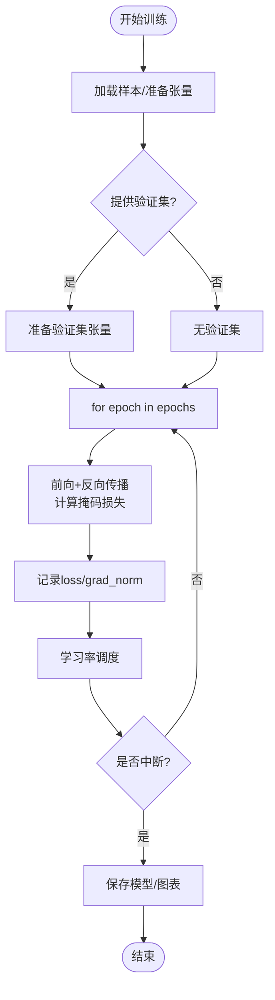

**图表来源**
- [ai/base_trainer.py:257-322](file://ai/base_trainer.py#L257-L322)
- [ai/base_trainer.py:409-573](file://ai/base_trainer.py#L409-L573)

**章节来源**
- [ai/base_trainer.py:32-699](file://ai/base_trainer.py#L32-L699)

### 模型家族（FC v1 与 CNN v3）
- FC v1：5层隐藏层（每层1000），输出Softmax概率分布；输入226维向量
- CNN v3：纯卷积（3×3卷积+1×1卷积），输入(3,15,15)，输出225维Softmax；追求极简与轻量化
- 共同点：均继承NeuralNetworkModel，提供predict、save、load等通用能力

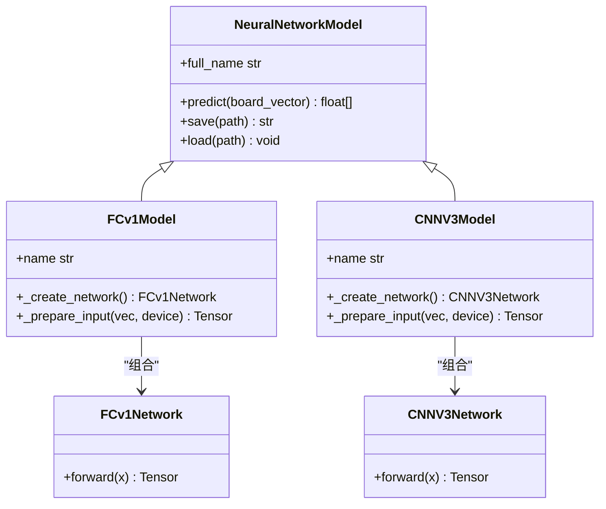

**图表来源**
- [ai/models/fc_v1/model.py:91-132](file://ai/models/fc_v1/model.py#L91-L132)
- [ai/models/cnn_v3/model.py:96-139](file://ai/models/cnn_v3/model.py#L96-L139)

**章节来源**
- [ai/models/fc_v1/model.py:1-132](file://ai/models/fc_v1/model.py#L1-L132)
- [ai/models/cnn_v3/model.py:1-139](file://ai/models/cnn_v3/model.py#L1-L139)

### 注册表（Registry）
- 职责：集中管理模型与训练器映射，支持多代模型（如cnn_v3.1、cnn_v3.2）
- 特性：懒加载（importlib），解析模型指定字符串（name.gen），校验与列举可用模型

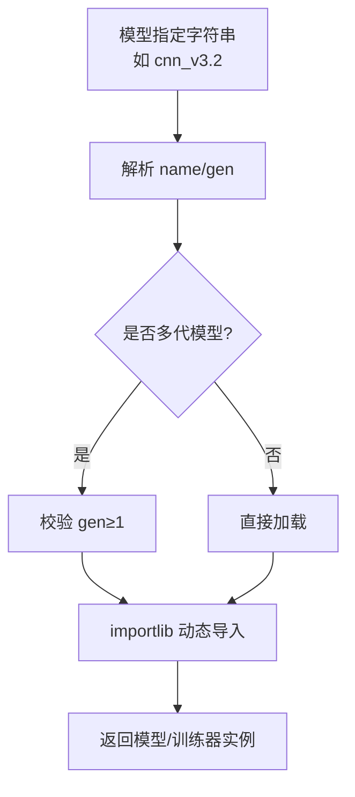

**图表来源**
- [ai/registry.py:103-184](file://ai/registry.py#L103-L184)

**章节来源**
- [ai/registry.py:1-316](file://ai/registry.py#L1-L316)

### 奖励计算器（RewardCalculator）
- 职责：将棋型映射为数值reward，支持双向检测（当前方/对手方），冲四递归防守模拟
- 配置：RewardConfig集中管理各类棋型的比例系数与上下界

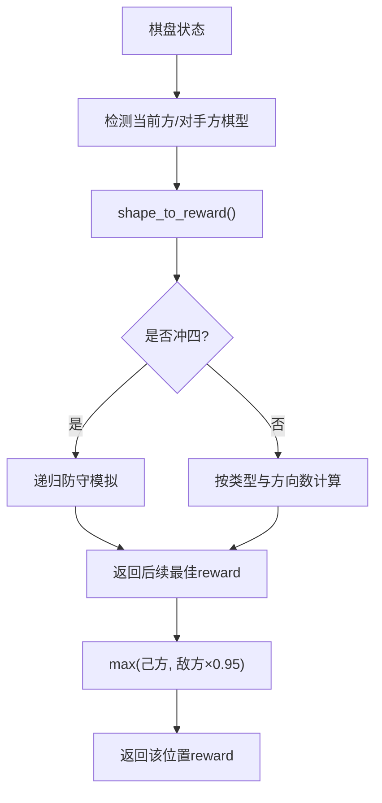

**图表来源**
- [ai/reward_calculator.py:46-190](file://ai/reward_calculator.py#L46-L190)

**章节来源**
- [ai/reward_calculator.py:1-239](file://ai/reward_calculator.py#L1-L239)

### 样本生成器（SampleGenerator）
- 职责：按棋型（chong4/huo4/huo3/huo2/defend_chong4/defend_huo3）合成棋盘，计算reward并生成训练样本
- 质量评估：Hit@N、Hit@N+1、Hit@N+2、攻击位概率和、区分度gap等指标
- CLI：支持种子、干扰子数量、输出路径等参数

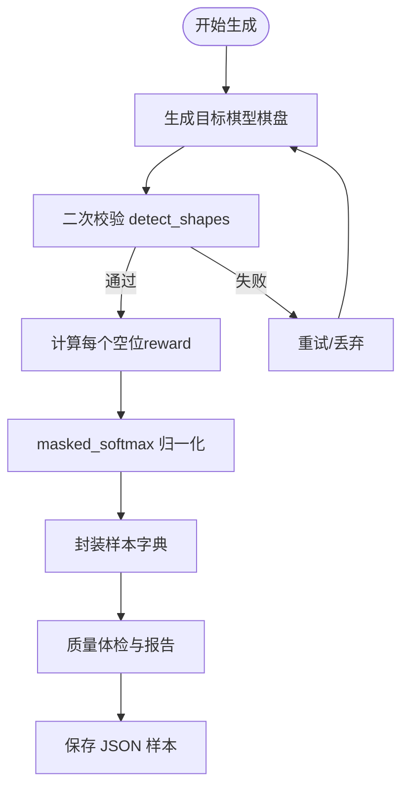

**图表来源**
- [ai/sample_generator.py:101-228](file://ai/sample_generator.py#L101-L228)
- [ai/sample_generator.py:287-327](file://ai/sample_generator.py#L287-L327)
- [ai/sample_generator.py:334-401](file://ai/sample_generator.py#L334-L401)

**章节来源**
- [ai/sample_generator.py:1-511](file://ai/sample_generator.py#L1-L511)

### 数据记录器（DataRecorder）
- 职责：按轮次与游戏编号组织数据，记录每步input、output、position，保存winner与终局board
- 存储：ai/ai_data/{ai_name}_{round}/game_id/record.json

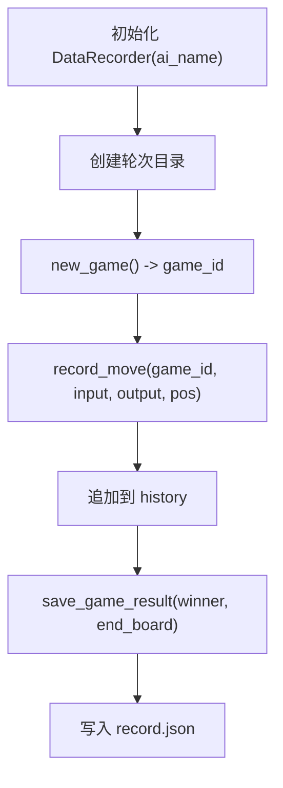

**图表来源**
- [ai/data_recorder.py:66-141](file://ai/data_recorder.py#L66-L141)

**章节来源**
- [ai/data_recorder.py:1-145](file://ai/data_recorder.py#L1-L145)

### 可视化系统（热力图）
- 算法：复用visualization.heatmap_color，支持log/max/linear三种归一化模式，白→黄→橙→红色阶
- 组件：HeatmapCanvas（15×15网格+tooltip）、HeatmapLegend（颜色标尺）
- 用户体验：悬停显示原始reward值，避免归一化误导；支持自定义色板与档数

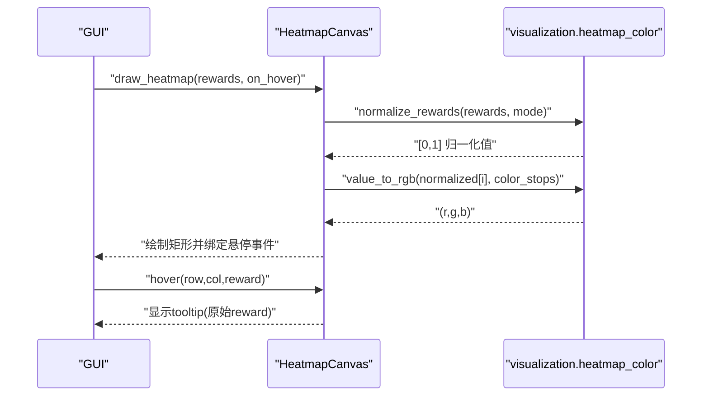

**图表来源**
- [gui/components/heatmap.py:137-214](file://gui/components/heatmap.py#L137-L214)
- [visualization/heatmap_color.py:63-122](file://visualization/heatmap_color.py#L63-L122)
- [visualization/heatmap_color.py:128-171](file://visualization/heatmap_color.py#L128-L171)

**章节来源**
- [gui/components/heatmap.py:1-358](file://gui/components/heatmap.py#L1-L358)
- [visualization/heatmap_color.py:1-204](file://visualization/heatmap_color.py#L1-L204)

## 依赖关系分析
- 模块内聚与耦合
  - AIEngine与BaseModel强依赖，策略选择与模型解耦
  - AIGameManager依赖控制器、引擎与数据记录器，流程清晰
  - BaseTrainer依赖模型、样本加载器、学习率调度器，具备高内聚
  - Registry提供跨模块的懒加载与多代模型支持
  - 可视化模块与GUI组件解耦，算法可复用
- 外部依赖
  - PyTorch（训练与推理）、NumPy（数值计算）、标准库（json/os/sys/random）

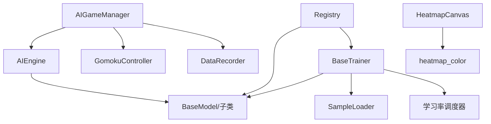

**图表来源**
- [ai/engine.py:9-11](file://ai/engine.py#L9-L11)
- [ai/game_manager.py:10-13](file://ai/game_manager.py#L10-L13)
- [ai/base_trainer.py:14-18](file://ai/base_trainer.py#L14-L18)
- [ai/registry.py:58-72](file://ai/registry.py#L58-L72)
- [gui/components/heatmap.py:30-34](file://gui/components/heatmap.py#L30-L34)

**章节来源**
- [ai/engine.py:1-194](file://ai/engine.py#L1-L194)
- [ai/game_manager.py:1-339](file://ai/game_manager.py#L1-L339)
- [ai/base_trainer.py:1-699](file://ai/base_trainer.py#L1-L699)
- [ai/registry.py:1-316](file://ai/registry.py#L1-L316)
- [gui/components/heatmap.py:1-358](file://gui/components/heatmap.py#L1-L358)

## 性能考虑
- 计算优化
  - AIEngine支持传入预计算probs，避免重复model.predict
  - BaseTrainer使用掩码损失（masked L1 loss），仅对合法空位计算
  - CNN v3采用极简卷积结构，参数量低，推理快
- 内存管理
  - DataRecorder使用紧凑JSON格式（无indent），减少文件体积
  - BaseTrainer在验证阶段使用torch.no_grad()与eval模式，降低显存占用
- 并发处理
  - 样本生成器与训练器采用批处理与mini-batch，提高吞吐
  - GUI热力图组件异步绘制，tooltip惰性创建与复用
- 学习率调度
  - 支持StepLR与ReduceLROnPlateau，自适应收敛

[本节为通用性能讨论，不直接分析具体文件]

## 故障排查指南
- 模型加载失败
  - 现象：Unknown model或多代模型未指定代数
  - 处理：检查模型名称与代数格式，确保在注册表中声明
  - 参考：[ai/registry.py:168-179](file://ai/registry.py#L168-L179)
- 训练中断
  - 现象：Ctrl+C中断后自动保存模型与图表
  - 处理：重新启动训练器，继续训练
  - 参考：[ai/base_trainer.py:314-321](file://ai/base_trainer.py#L314-L321)
- 样本质量差
  - 现象：Hit@N低、攻击位概率和不足
  - 处理：增加样本数、调整max_extra、检查reward配置
  - 参考：[ai/sample_generator.py:334-401](file://ai/sample_generator.py#L334-L401)
- 可视化异常
  - 现象：颜色映射错误或tooltip不显示
  - 处理：检查归一化模式与色板配置，确认事件绑定
  - 参考：[visualization/heatmap_color.py:86-89](file://visualization/heatmap_color.py#L86-L89), [gui/components/heatmap.py:185-194](file://gui/components/heatmap.py#L185-L194)

**章节来源**
- [ai/registry.py:168-179](file://ai/registry.py#L168-L179)
- [ai/base_trainer.py:314-321](file://ai/base_trainer.py#L314-L321)
- [ai/sample_generator.py:334-401](file://ai/sample_generator.py#L334-L401)
- [visualization/heatmap_color.py:86-89](file://visualization/heatmap_color.py#L86-L89)
- [gui/components/heatmap.py:185-194](file://gui/components/heatmap.py#L185-L194)

## 结论
本设计文档系统化梳理了五子棋AI项目的架构与实现，明确了AI引擎、模型族、训练器、奖励机制、样本生成与可视化等关键模块的职责与交互。通过分层架构、模块解耦与统一接口，系统具备良好的扩展性与可维护性。未来可在以下方向演进：引入更复杂的模型（如Transformer）、增强样本多样性与质量评估、优化训练效率与收敛速度、完善GUI交互与热力图的实时反馈。

[本节为总结性内容，不直接分析具体文件]

## 附录
- 设计规范参考
  - [design/design_specification.md:1-966](file://design/design_specification.md#L1-L966)
  - [design/cnn_design.md:1-285](file://design/cnn_design.md#L1-L285)
- 常量与路径
  - [ai/constants.py:1-26](file://ai/constants.py#L1-L26)

**章节来源**
- [design/design_specification.md:1-966](file://design/design_specification.md#L1-L966)
- [design/cnn_design.md:1-285](file://design/cnn_design.md#L1-L285)
- [ai/constants.py:1-26](file://ai/constants.py#L1-L26)