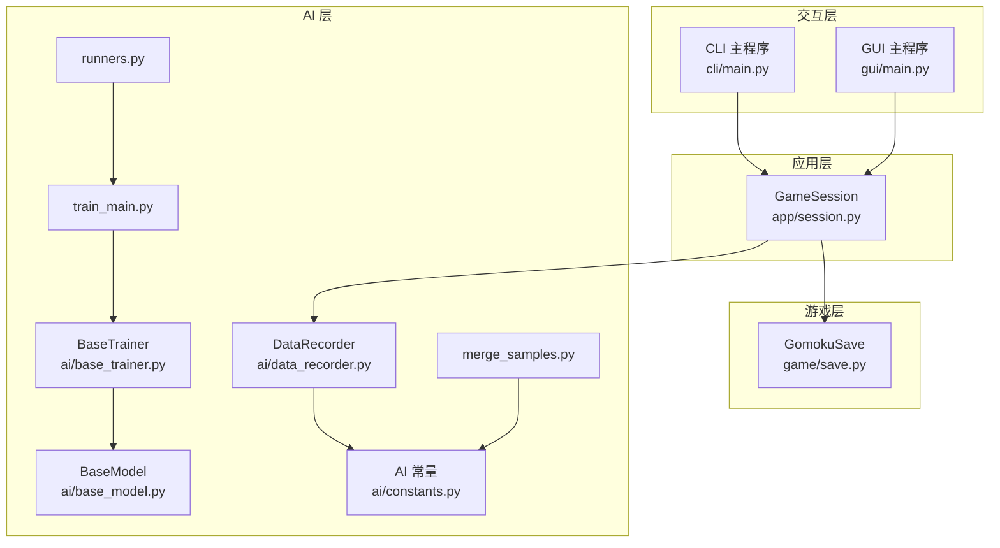
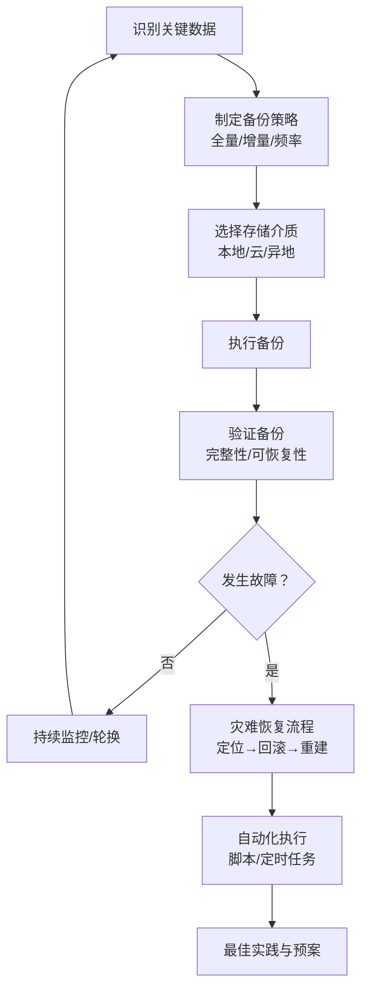
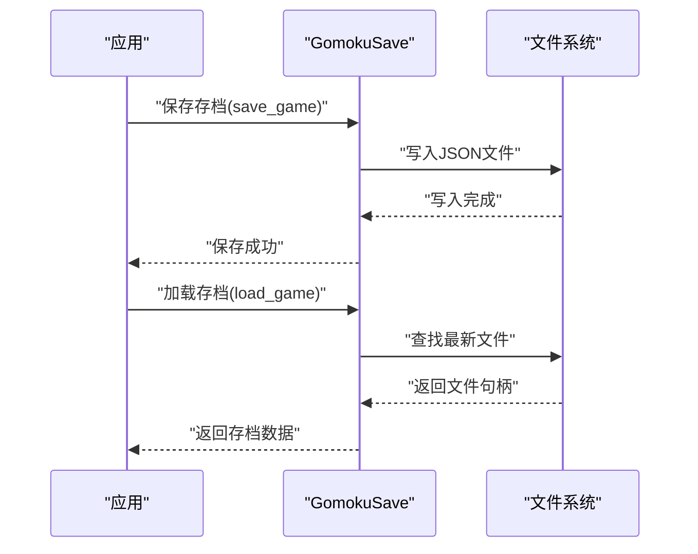
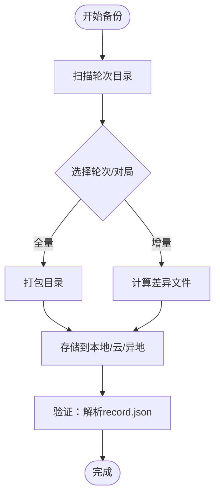
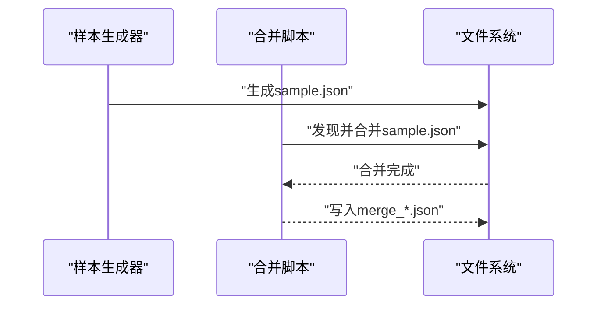
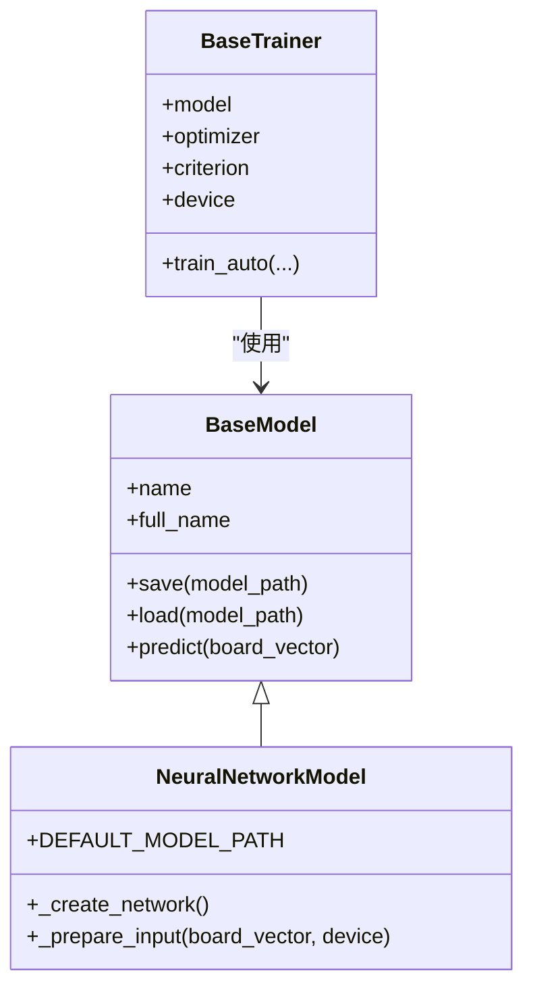
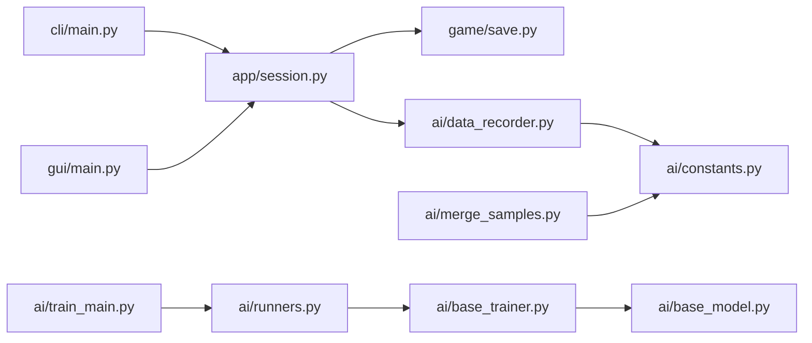

# 备份恢复

<cite>
**本文引用的文件**
- [README.md](file://README.md)
- [game/save.py](file://game/save.py)
- [app/session.py](file://app/session.py)
- [ai/constants.py](file://ai/constants.py)
- [ai/data_recorder.py](file://ai/data_recorder.py)
- [ai/train_main.py](file://ai/train_main.py)
- [ai/base_trainer.py](file://ai/base_trainer.py)
- [ai/base_model.py](file://ai/base_model.py)
- [ai/merge_samples.py](file://ai/merge_samples.py)
- [ai/runners.py](file://ai/runners.py)
- [cli/main.py](file://cli/main.py)
- [design/design_specification.md](file://design/design_specification.md)
</cite>

## 目录
1. [简介](#简介)
2. [项目结构](#项目结构)
3. [核心组件](#核心组件)
4. [架构总览](#架构总览)
5. [详细组件分析](#详细组件分析)
6. [依赖分析](#依赖分析)
7. [性能考量](#性能考量)
8. [故障排查指南](#故障排查指南)
9. [结论](#结论)
10. [附录](#附录)

## 简介
本指南面向五子棋AI项目，围绕“备份与恢复”主题，系统阐述数据备份的重要性、备份策略、存储管理、验证方法、灾难恢复流程、自动化实现与最佳实践。项目涉及的关键数据包括：
- 游戏存档：人类对局与回放数据
- AI对战记录：每轮对局的输入输出、落子位置与结果
- 训练样本：棋型样本与合并后的训练集
- 模型权重：AI模型参数文件
- 训练日志：损失曲线与中间产物

## 项目结构
项目采用分层架构，核心模块与数据目录如下：
- 交互层：CLI/GUI（GUI入口位于 gui/main.py）
- 控制层：app.session（封装会话流程）
- 游戏层：game.save（存档读写）
- AI层：ai.*（数据记录、训练、样本生成与合并、模型与训练器）

图表来源
- [cli/main.py:1-258](file://cli/main.py#L1-L258)
- [app/session.py:1-179](file://app/session.py#L1-L179)
- [game/save.py:1-93](file://game/save.py#L1-L93)
- [ai/data_recorder.py:1-145](file://ai/data_recorder.py#L1-L145)
- [ai/constants.py:1-26](file://ai/constants.py#L1-L26)
- [ai/train_main.py:1-234](file://ai/train_main.py#L1-L234)
- [ai/base_trainer.py:1-200](file://ai/base_trainer.py#L1-L200)
- [ai/base_model.py:1-200](file://ai/base_model.py#L1-L200)
- [ai/merge_samples.py:1-155](file://ai/merge_samples.py#L1-L155)
- [ai/runners.py:1-200](file://ai/runners.py#L1-L200)

章节来源
- [README.md:1-422](file://README.md#L1-L422)
- [design/design_specification.md:1-800](file://design/design_specification.md#L1-L800)

## 核心组件
- 游戏存档：通过 GomokuSave 提供保存、加载、列举功能，文件以 JSON 格式存储，按名称+时间戳命名，便于版本化与回溯。
- AI 对战记录：DataRecorder 按轮次与对局组织数据，每轮创建目录，每局一个子目录，保存完整记录文件，利于离线分析与回放。
- 训练样本：样本生成与合并工具负责样本质量评估与合并，减少训练时 I/O。
- 模型与训练：BaseModel/Trainer 提供模型生命周期管理与训练流程，支持多代模型权重分代存储。

章节来源
- [game/save.py:1-93](file://game/save.py#L1-L93)
- [ai/data_recorder.py:1-145](file://ai/data_recorder.py#L1-L145)
- [ai/constants.py:1-26](file://ai/constants.py#L1-L26)
- [ai/train_main.py:1-234](file://ai/train_main.py#L1-L234)
- [ai/base_trainer.py:1-200](file://ai/base_trainer.py#L1-L200)
- [ai/base_model.py:1-200](file://ai/base_model.py#L1-L200)
- [ai/merge_samples.py:1-155](file://ai/merge_samples.py#L1-L155)
- [ai/runners.py:1-200](file://ai/runners.py#L1-L200)

## 架构总览
备份恢复体系围绕“数据识别—策略制定—存储—验证—恢复—自动化—应急”闭环构建，确保在系统故障、数据损坏等情况下快速恢复。

## 详细组件分析

### 游戏存档备份（GomokuSave）
- 数据特征：JSON 文件，按名称+时间戳命名，便于版本化与回溯。
- 备份建议：
  - 全量备份：定期将 game/save/ 目录打包归档。
  - 增量备份：基于文件变更时间，仅同步新增/更新文件。
  - 频率：每日全量+每小时增量，或每周全量+每日增量。
- 存储：本地磁盘、云存储、异地存储三地保存。
- 验证：读取最新存档文件，解析并校验关键字段完整性。
- 恢复：将目标版本文件复制回原目录，重启应用后验证加载成功。

图表来源
- [game/save.py:17-57](file://game/save.py#L17-L57)

章节来源
- [game/save.py:1-93](file://game/save.py#L1-L93)
- [design/design_specification.md:190-242](file://design/design_specification.md#L190-L242)

### AI 对战记录备份（DataRecorder）
- 数据特征：按轮次目录组织，每轮含若干对局子目录，每局一个 record.json。
- 备份建议：
  - 全量备份：定期打包 ai/ai_data/ 目录。
  - 增量备份：仅同步最近轮次目录或新增对局文件。
  - 频率：每日全量+按轮次增量。
- 存储：本地+云+异地。
- 验证：随机抽样轮次与对局，解析 record.json，校验历史、胜负、终局状态一致性。
- 恢复：将轮次目录恢复至 ai/ai_data/，确保目录命名与层级正确。

图表来源
- [ai/data_recorder.py:43-145](file://ai/data_recorder.py#L43-L145)
- [ai/constants.py:11-15](file://ai/constants.py#L11-L15)

章节来源
- [ai/data_recorder.py:1-145](file://ai/data_recorder.py#L1-L145)
- [ai/constants.py:1-26](file://ai/constants.py#L1-L26)

### 训练样本与合并备份
- 数据特征：样本文件（sample.json）与合并文件（merge_*.json），目录结构清晰。
- 备份建议：
  - 全量：ai/train_data/ 与 ai/merge_samples/ 目录定期打包。
  - 增量：仅同步新增样本或合并文件。
  - 频率：每日全量+按样本生成周期增量。
- 存储：本地+云+异地。
- 验证：统计样本总数、随机抽样检查标签质量与格式。
- 恢复：将样本目录恢复至原路径，确保文件名与层级一致。

图表来源
- [ai/merge_samples.py:13-102](file://ai/merge_samples.py#L13-L102)

章节来源
- [ai/merge_samples.py:1-155](file://ai/merge_samples.py#L1-L155)

### 模型权重与训练日志备份
- 数据特征：模型权重文件（如 ai/models/*/xxx.pth），训练日志目录（ai/ai_data/loss_logs）。
- 备份建议：
  - 全量：模型目录与日志目录定期打包。
  - 增量：仅同步最近权重文件与新增日志。
  - 频率：每日全量+按训练周期增量。
- 存储：本地+云+异地。
- 验证：加载权重文件，执行一次推理或训练小步，验证权重可用。
- 恢复：将权重文件与日志目录恢复至原路径，确保多代模型的 genX 子目录结构正确。

图表来源
- [ai/base_model.py:24-200](file://ai/base_model.py#L24-L200)
- [ai/base_trainer.py:32-200](file://ai/base_trainer.py#L32-L200)

章节来源
- [ai/base_model.py:1-200](file://ai/base_model.py#L1-L200)
- [ai/base_trainer.py:1-200](file://ai/base_trainer.py#L1-L200)
- [ai/constants.py:17-22](file://ai/constants.py#L17-L22)

### 训练入口与参数驱动的备份触发
- 训练入口：ai/train_main.py 提供多种训练模式与参数，可作为备份触发的时机参考（如训练周期结束、模型保存后）。
- 备份触发：在训练完成或模型保存后自动触发备份流程，确保权重与日志的最新状态。

章节来源
- [ai/train_main.py:1-234](file://ai/train_main.py#L1-L234)
- [ai/runners.py:81-171](file://ai/runners.py#L81-L171)

## 依赖分析
- 存档依赖：CLI/GUI 通过 app.session 调用 GomokuController，后者委托 game.save 进行存档读写。
- AI 数据依赖：DataRecorder 依赖 ai.constants 中的目录常量，训练流程依赖 runners 与 train_main。
- 模型依赖：BaseTrainer 依赖 BaseModel，BaseModel 的多代模型通过 genX 子目录隔离权重。

图表来源
- [cli/main.py:1-258](file://cli/main.py#L1-L258)
- [app/session.py:1-179](file://app/session.py#L1-L179)
- [game/save.py:1-93](file://game/save.py#L1-L93)
- [ai/data_recorder.py:1-145](file://ai/data_recorder.py#L1-L145)
- [ai/constants.py:1-26](file://ai/constants.py#L1-L26)
- [ai/train_main.py:1-234](file://ai/train_main.py#L1-L234)
- [ai/runners.py:1-200](file://ai/runners.py#L1-L200)
- [ai/base_trainer.py:1-200](file://ai/base_trainer.py#L1-L200)
- [ai/base_model.py:1-200](file://ai/base_model.py#L1-L200)
- [ai/merge_samples.py:1-155](file://ai/merge_samples.py#L1-L155)

章节来源
- [README.md:1-422](file://README.md#L1-L422)

## 性能考量
- 备份性能：压缩与并行传输可显著提升速度；对大文件采用分块传输与断点续传。
- 存储成本：本地+云+异地三层存储，按数据重要性与访问频度分配容量。
- 验证效率：对样本与记录采用抽样校验，避免全量解析带来的性能开销。
- 恢复速度：将常用数据置于本地高速存储，冷数据置于云/异地，缩短恢复时间。

## 故障排查指南
- 存档损坏：
  - 现象：无法加载或解析 JSON。
  - 排查：检查文件编码、完整性与命名规范；查看最近一次备份。
  - 处理：从最近可用备份恢复，必要时回滚到上一个稳定版本。
- AI 记录缺失：
  - 现象：某轮次或对局记录丢失。
  - 排查：确认轮次目录与对局子目录结构；检查 DataRecorder 的日志与异常。
  - 处理：从备份恢复对应轮次目录；若无法恢复，重新生成样本或回放。
- 训练样本不一致：
  - 现象：样本总数与预期不符。
  - 排查：核对合并脚本输出统计；检查样本文件格式。
  - 处理：重新执行合并；必要时重新生成样本。
- 模型权重损坏：
  - 现象：加载权重失败或推理异常。
  - 排查：验证权重文件存在与可读；检查多代模型的 genX 目录。
  - 处理：从备份恢复权重；若无备份，考虑重新训练。

章节来源
- [game/save.py:36-57](file://game/save.py#L36-L57)
- [ai/data_recorder.py:118-141](file://ai/data_recorder.py#L118-L141)
- [ai/merge_samples.py:42-76](file://ai/merge_samples.py#L42-L76)
- [ai/base_model.py:126-165](file://ai/base_model.py#L126-L165)

## 结论
通过明确关键数据范围、制定全量/增量备份策略、合理配置本地/云/异地存储、建立严格的验证与恢复流程，并结合自动化脚本与应急预案，可显著降低数据风险，保障五子棋AI项目的可持续演进与业务连续性。

## 附录

### 备份计划模板（示例）
- 全量备份：每周日凌晨 2:00 执行，保留最近 4 份。
- 增量备份：每日 1:00、5:00、9:00、13:00、17:00、21:00 执行，保留最近 10 次。
- 存储策略：本地盘 1 份，云对象存储 1 份，异地磁带库 1 份。
- 验证：每次备份后执行抽样校验，记录校验结果。
- 恢复演练：每季度进行一次恢复演练，验证恢复时间与数据一致性。

### 自动化备份实现建议
- 脚本化：编写备份脚本，统一调用压缩、传输与校验流程。
- 定时任务：使用系统计划任务或容器编排的 CronJob 触发备份。
- 监控告警：对备份失败、存储空间不足、传输中断等事件进行告警。
- 版本化：对备份文件添加时间戳与版本号，便于回溯。

### 灾难恢复流程（DR）
- 启动：确认故障类型与影响范围，启动应急预案。
- 定位：根据备份清单定位最近可用备份。
- 回滚：将备份恢复到目标环境，验证服务可用性。
- 重建：对缺失或损坏的数据进行重建（如重新生成样本、重新训练模型）。
- 验证：执行端到端测试，确保业务功能正常。
- 总结：记录故障原因、恢复过程与改进建议，更新预案。