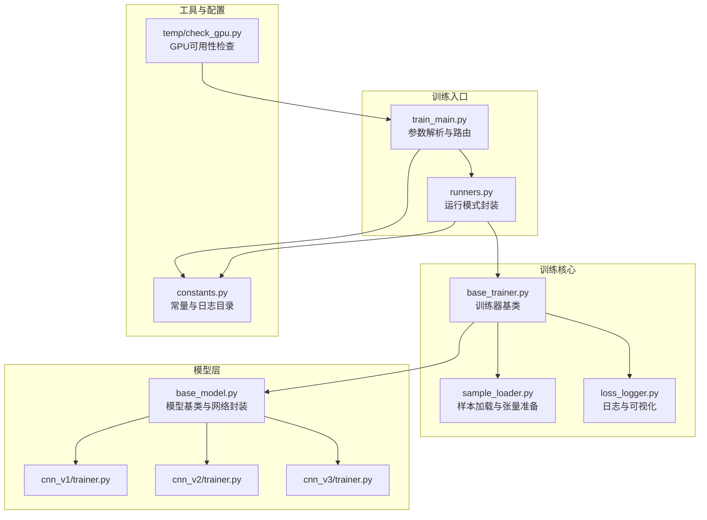
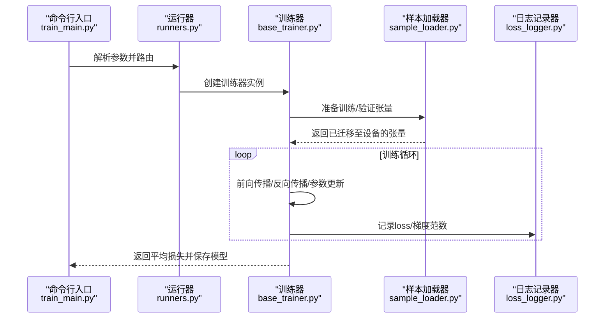
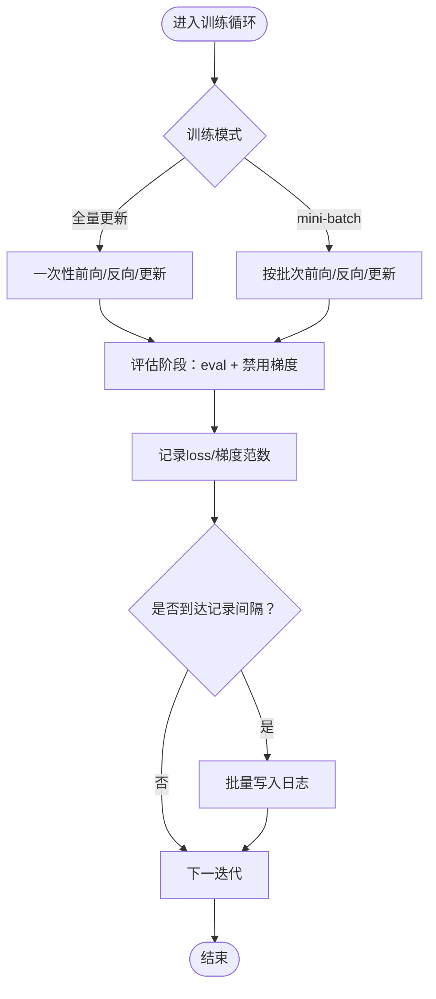
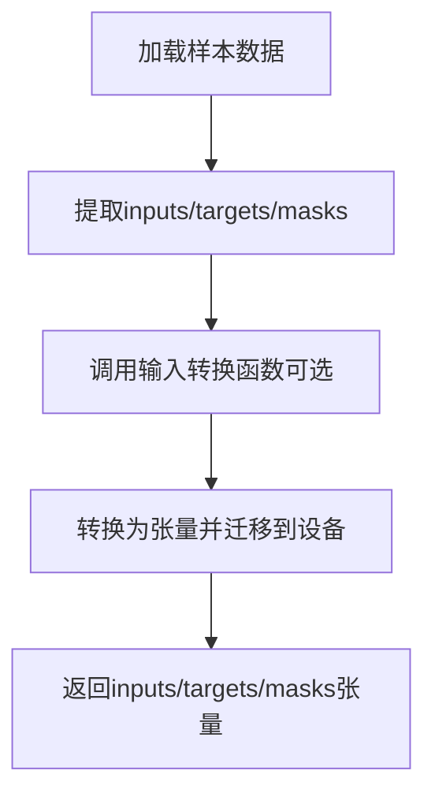
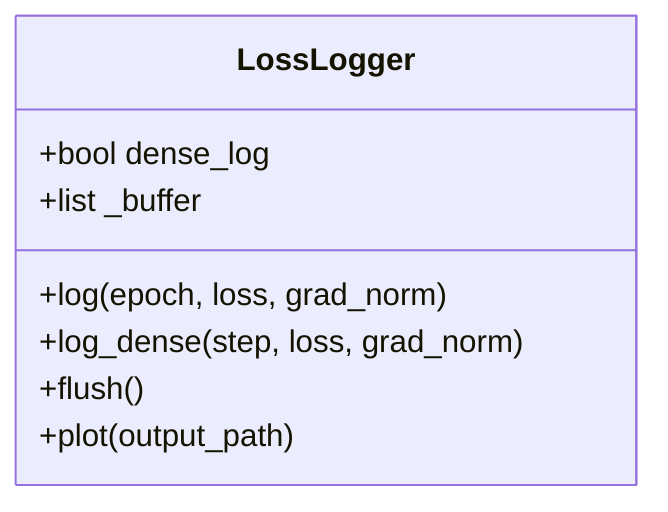
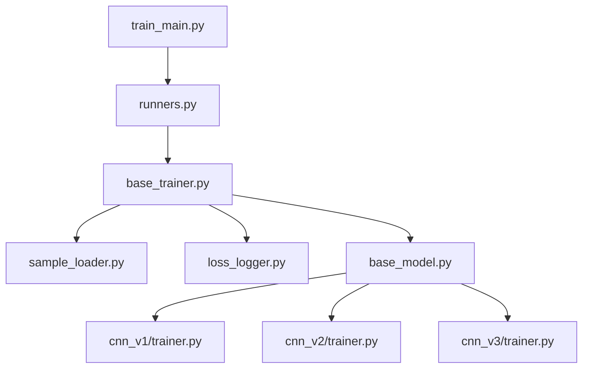

# GPU内存监控

<cite>
**本文引用的文件**
- [ai/base_trainer.py](file://ai/base_trainer.py)
- [ai/sample_loader.py](file://ai/sample_loader.py)
- [ai/loss_logger.py](file://ai/loss_logger.py)
- [ai/runners.py](file://ai/runners.py)
- [ai/train_main.py](file://ai/train_main.py)
- [ai/constants.py](file://ai/constants.py)
- [ai/models/cnn_v1/trainer.py](file://ai/models/cnn_v1/trainer.py)
- [ai/models/cnn_v2/trainer.py](file://ai/models/cnn_v2/trainer.py)
- [ai/models/cnn_v3/trainer.py](file://ai/models/cnn_v3/trainer.py)
- [ai/base_model.py](file://ai/base_model.py)
- [temp/check_gpu.py](file://temp/check_gpu.py)
</cite>

## 目录
1. [简介](#简介)
2. [项目结构](#项目结构)
3. [核心组件](#核心组件)
4. [架构总览](#架构总览)
5. [详细组件分析](#详细组件分析)
6. [依赖分析](#依赖分析)
7. [性能考量](#性能考量)
8. [故障排查指南](#故障排查指南)
9. [结论](#结论)
10. [附录](#附录)

## 简介
本指南面向五子棋AI项目的GPU内存监控与管理，结合仓库现有实现，系统讲解如何在训练流程中观测显存占用、识别内存峰值与碎片化风险，以及如何通过PyTorch的CUDA内存管理工具进行监控与优化。文档同时提供内存泄漏检测与预防方法、模型清理与张量释放最佳实践、批大小与梯度累积对显存的影响、混合精度训练建议，以及多GPU训练时的资源分配与负载均衡策略。

## 项目结构
围绕GPU内存管理的关键模块与职责如下：
- 训练器基类：统一设备选择、模型迁移至GPU、训练循环与日志记录，便于在训练关键节点插入显存监控。
- 样本加载器：负责将JSON样本转换为张量并迁移到设备，是显存占用的主要来源之一。
- 日志记录器：支持密集日志模式，减少频繁落盘带来的I/O压力，同时提供双Y轴可视化辅助定位异常。
- 运行器与入口：封装训练模式与参数路由，便于在不同训练阶段控制显存使用策略。
- 常量与工具：提供日志目录、记录间隔等配置项，辅助统一管理。

**图表来源**
- [ai/train_main.py:27-234](file://ai/train_main.py#L27-L234)
- [ai/runners.py:81-255](file://ai/runners.py#L81-L255)
- [ai/base_trainer.py:32-120](file://ai/base_trainer.py#L32-L120)
- [ai/sample_loader.py:206-240](file://ai/sample_loader.py#L206-L240)
- [ai/loss_logger.py:28-103](file://ai/loss_logger.py#L28-L103)
- [ai/base_model.py:107-160](file://ai/base_model.py#L107-L160)
- [ai/models/cnn_v1/trainer.py:13-72](file://ai/models/cnn_v1/trainer.py#L13-L72)
- [ai/models/cnn_v2/trainer.py:13-72](file://ai/models/cnn_v2/trainer.py#L13-L72)
- [ai/models/cnn_v3/trainer.py:13-73](file://ai/models/cnn_v3/trainer.py#L13-L73)
- [ai/constants.py:17-26](file://ai/constants.py#L17-L26)
- [temp/check_gpu.py:1-12](file://temp/check_gpu.py#L1-L12)

**章节来源**
- [ai/train_main.py:27-234](file://ai/train_main.py#L27-L234)
- [ai/runners.py:81-255](file://ai/runners.py#L81-L255)
- [ai/base_trainer.py:21-120](file://ai/base_trainer.py#L21-L120)
- [ai/sample_loader.py:206-240](file://ai/sample_loader.py#L206-L240)
- [ai/loss_logger.py:28-103](file://ai/loss_logger.py#L28-L103)
- [ai/base_model.py:107-160](file://ai/base_model.py#L107-L160)
- [ai/models/cnn_v1/trainer.py:13-72](file://ai/models/cnn_v1/trainer.py#L13-L72)
- [ai/models/cnn_v2/trainer.py:13-72](file://ai/models/cnn_v2/trainer.py#L13-L72)
- [ai/models/cnn_v3/trainer.py:13-73](file://ai/models/cnn_v3/trainer.py#L13-L73)
- [ai/constants.py:17-26](file://ai/constants.py#L17-L26)
- [temp/check_gpu.py:1-12](file://temp/check_gpu.py#L1-L12)

## 核心组件
- 设备选择与模型迁移
  - 自动检测CUDA可用性并选择设备，模型网络在训练器初始化时迁移到所选设备。
  - 训练器在前向传播与评估时使用eval模式与禁用梯度，有助于降低显存占用。
- 样本加载与张量准备
  - 将样本数据转换为张量并统一迁移到设备，是显存占用的主要来源。
  - 支持全量更新与mini-batch两种训练方式，后者通过批内反向传播与参数更新减少峰值显存。
- 日志与可视化
  - 支持密集日志模式，将每步的loss与梯度范数缓存于内存，定期批量写入，降低I/O频率。
  - 可视化支持双Y轴（Loss与梯度范数），便于观察训练过程中的数值稳定性与潜在异常。
- 训练入口与运行模式
  - 提供从目录训练与训练周期两种模式，支持参数化控制批大小、打乱、学习率调度与验证集比例，间接影响显存使用。

**章节来源**
- [ai/base_trainer.py:21-120](file://ai/base_trainer.py#L21-L120)
- [ai/base_trainer.py:233-238](file://ai/base_trainer.py#L233-L238)
- [ai/sample_loader.py:206-240](file://ai/sample_loader.py#L206-L240)
- [ai/loss_logger.py:154-177](file://ai/loss_logger.py#L154-L177)
- [ai/loss_logger.py:220-260](file://ai/loss_logger.py#L220-L260)
- [ai/runners.py:149-171](file://ai/runners.py#L149-L171)

## 架构总览
训练流程在GPU上的关键路径如下：入口解析参数 → 创建训练器 → 样本加载与张量准备 → 前向传播与反向传播 → 参数更新与日志记录 → 模型保存。在这些节点插入显存监控，可有效识别峰值与碎片化风险。

**图表来源**
- [ai/train_main.py:226-230](file://ai/train_main.py#L226-L230)
- [ai/runners.py:149-171](file://ai/runners.py#L149-L171)
- [ai/base_trainer.py:257-322](file://ai/base_trainer.py#L257-L322)
- [ai/sample_loader.py:206-240](file://ai/sample_loader.py#L206-L240)
- [ai/loss_logger.py:124-177](file://ai/loss_logger.py#L124-L177)

## 详细组件分析

### 训练器基类与显存管理
- 设备选择与迁移
  - 自动检测CUDA并选择设备，模型网络在训练器初始化时迁移到设备。
  - 评估阶段使用eval模式与禁用梯度，避免额外的梯度存储与计算图构建。
- 训练循环与显存峰值
  - 全量更新与mini-batch两种模式在反向传播与参数更新之间存在不同的显存占用曲线。
  - mini-batch模式通过批内更新减少单次反向传播的激活存储，有助于降低峰值显存。
- 日志与可视化
  - 密集日志模式将每步的loss与梯度范数缓存于内存，epoch结束批量写入，减少I/O频率。
  - 可视化双Y轴图有助于识别梯度爆炸/消失等异常，间接提示显存与数值稳定性问题。

**图表来源**
- [ai/base_trainer.py:257-322](file://ai/base_trainer.py#L257-L322)
- [ai/base_trainer.py:470-573](file://ai/base_trainer.py#L470-L573)
- [ai/loss_logger.py:154-177](file://ai/loss_logger.py#L154-L177)

**章节来源**
- [ai/base_trainer.py:21-120](file://ai/base_trainer.py#L21-L120)
- [ai/base_trainer.py:233-238](file://ai/base_trainer.py#L233-L238)
- [ai/base_trainer.py:470-573](file://ai/base_trainer.py#L470-L573)
- [ai/loss_logger.py:154-177](file://ai/loss_logger.py#L154-L177)

### 样本加载器与显存占用
- 张量准备
  - 将输入、目标与mask转换为张量并统一迁移到设备，是显存占用的主要来源。
  - 支持自定义输入转换函数，CNN模型通过工具函数将向量转换为4D张量。
- 数据分割与验证集
  - 支持按比例分割训练/验证集，验证集张量同样迁移到设备，需关注其对峰值显存的影响。

**图表来源**
- [ai/sample_loader.py:206-240](file://ai/sample_loader.py#L206-L240)
- [ai/models/cnn_v1/trainer.py:45-72](file://ai/models/cnn_v1/trainer.py#L45-L72)
- [ai/models/cnn_v2/trainer.py:45-72](file://ai/models/cnn_v2/trainer.py#L45-L72)
- [ai/models/cnn_v3/trainer.py:46-73](file://ai/models/cnn_v3/trainer.py#L46-L73)
- [ai/base_model.py:278-323](file://ai/base_model.py#L278-L323)

**章节来源**
- [ai/sample_loader.py:206-240](file://ai/sample_loader.py#L206-L240)
- [ai/models/cnn_v1/trainer.py:45-72](file://ai/models/cnn_v1/trainer.py#L45-L72)
- [ai/models/cnn_v2/trainer.py:45-72](file://ai/models/cnn_v2/trainer.py#L45-L72)
- [ai/models/cnn_v3/trainer.py:46-73](file://ai/models/cnn_v3/trainer.py#L46-L73)
- [ai/base_model.py:278-323](file://ai/base_model.py#L278-L323)

### 日志记录器与密集日志
- 密集日志模式
  - 将每步的loss与梯度范数缓存于内存，epoch结束批量写入，减少I/O频率。
  - 支持双Y轴图（Loss与梯度范数），便于观察训练过程中的数值稳定性。
- 可视化与降采样
  - 自动降采样，防止图表点过多导致内存与渲染压力。

**图表来源**
- [ai/loss_logger.py:28-103](file://ai/loss_logger.py#L28-L103)
- [ai/loss_logger.py:154-177](file://ai/loss_logger.py#L154-L177)
- [ai/loss_logger.py:220-260](file://ai/loss_logger.py#L220-L260)

**章节来源**
- [ai/loss_logger.py:154-177](file://ai/loss_logger.py#L154-L177)
- [ai/loss_logger.py:220-260](file://ai/loss_logger.py#L220-L260)

### 训练入口与运行模式
- 从目录训练
  - 自动发现数据、加载样本并创建临时目录，支持批大小、打乱、验证集比例等参数控制。
- 训练周期
  - 自动选择训练方法（mini-batch或全量更新），支持温度采样与学习率调度等高级配置。

**章节来源**
- [ai/runners.py:81-171](file://ai/runners.py#L81-L171)
- [ai/runners.py:173-255](file://ai/runners.py#L173-L255)
- [ai/train_main.py:226-230](file://ai/train_main.py#L226-L230)

## 依赖分析
- 训练器依赖
  - 训练器依赖样本加载器进行张量准备，依赖日志记录器进行训练过程记录。
  - 模型层通过训练器基类统一管理设备与训练流程。
- 运行器与入口
  - 入口脚本解析参数并路由到运行器，运行器再创建训练器并执行相应模式。

**图表来源**
- [ai/base_trainer.py:14-18](file://ai/base_trainer.py#L14-L18)
- [ai/sample_loader.py:67-80](file://ai/sample_loader.py#L67-L80)
- [ai/loss_logger.py:28-36](file://ai/loss_logger.py#L28-L36)
- [ai/base_model.py:107-113](file://ai/base_model.py#L107-L113)
- [ai/models/cnn_v1/trainer.py:8-10](file://ai/models/cnn_v1/trainer.py#L8-L10)
- [ai/models/cnn_v2/trainer.py:8-10](file://ai/models/cnn_v2/trainer.py#L8-L10)
- [ai/models/cnn_v3/trainer.py:8-10](file://ai/models/cnn_v3/trainer.py#L8-L10)
- [ai/runners.py:18-25](file://ai/runners.py#L18-L25)
- [ai/train_main.py:23-24](file://ai/train_main.py#L23-L24)

**章节来源**
- [ai/base_trainer.py:14-18](file://ai/base_trainer.py#L14-L18)
- [ai/sample_loader.py:67-80](file://ai/sample_loader.py#L67-L80)
- [ai/loss_logger.py:28-36](file://ai/loss_logger.py#L28-L36)
- [ai/base_model.py:107-113](file://ai/base_model.py#L107-L113)
- [ai/models/cnn_v1/trainer.py:8-10](file://ai/models/cnn_v1/trainer.py#L8-L10)
- [ai/models/cnn_v2/trainer.py:8-10](file://ai/models/cnn_v2/trainer.py#L8-L10)
- [ai/models/cnn_v3/trainer.py:8-10](file://ai/models/cnn_v3/trainer.py#L8-L10)
- [ai/runners.py:18-25](file://ai/runners.py#L18-L25)
- [ai/train_main.py:23-24](file://ai/train_main.py#L23-L24)

## 性能考量
- 显存监控与峰值识别
  - 在训练器的关键节点（如前向传播前后、反向传播前后、参数更新前后）插入显存监控，记录峰值与当前占用，有助于定位峰值来源。
  - 关注mini-batch与全量更新的显存曲线差异，选择适合的训练方式。
- 内存碎片化
  - 长时间训练可能产生碎片化，可通过周期性重启训练进程或在合适节点触发垃圾回收与缓存清理，降低碎片化影响。
- 批大小与梯度累积
  - 批大小直接影响显存占用，增大批大小可提升吞吐但增加峰值显存；梯度累积可在有限显存下模拟更大批大小。
- 混合精度训练
  - 在支持的硬件上启用混合精度可显著降低显存占用并提升吞吐，但需注意数值稳定性与精度损失。
- 多GPU训练
  - 在多GPU环境下，合理分配数据与模型副本，避免单卡过载；使用分布式策略时关注通信与同步开销。

[本节为通用指导，无需特定文件分析]

## 故障排查指南
- 显存不足
  - 检查批大小与训练模式，尝试减小批大小或启用梯度累积。
  - 确认评估阶段使用eval模式与禁用梯度，避免额外显存占用。
  - 关注样本加载器是否将所有数据一次性迁移到设备，必要时采用分批处理。
- 内存泄漏
  - 确保在训练循环中及时释放不需要的中间张量，避免长时间持有大张量。
  - 在日志记录器中使用密集日志模式时，注意epoch结束后的flush，避免缓冲区长期占用。
- 数值不稳定
  - 通过日志记录器的双Y轴图观察梯度范数变化，识别梯度爆炸/消失等问题。
  - 调整学习率、使用梯度裁剪或混合精度训练以改善数值稳定性。
- GPU可用性检查
  - 使用工具脚本检查CUDA可用性与GPU数量，确保训练环境符合预期。

**章节来源**
- [ai/base_trainer.py:233-238](file://ai/base_trainer.py#L233-L238)
- [ai/loss_logger.py:154-177](file://ai/loss_logger.py#L154-L177)
- [temp/check_gpu.py:1-12](file://temp/check_gpu.py#L1-L12)

## 结论
本指南基于仓库现有实现，总结了在五子棋AI训练中进行GPU内存监控与管理的关键路径与最佳实践。通过在训练器基类、样本加载器与日志记录器中合理插入显存监控点，结合批大小与梯度累积策略，可以在有限显存条件下稳定训练；同时利用密集日志与可视化工具，能够及时发现并解决数值不稳定与内存碎片化问题。对于多GPU与混合精度等高级主题，建议在满足基础显存管理需求后再逐步引入，以确保系统的稳定性与可维护性。

[本节为总结性内容，无需特定文件分析]

## 附录
- 常量与日志目录
  - 日志目录可通过环境变量覆盖，便于测试与隔离。
- GPU可用性检查
  - 提供简单脚本快速检查CUDA可用性与GPU数量，辅助环境诊断。

**章节来源**
- [ai/constants.py:17-26](file://ai/constants.py#L17-L26)
- [temp/check_gpu.py:1-12](file://temp/check_gpu.py#L1-L12)