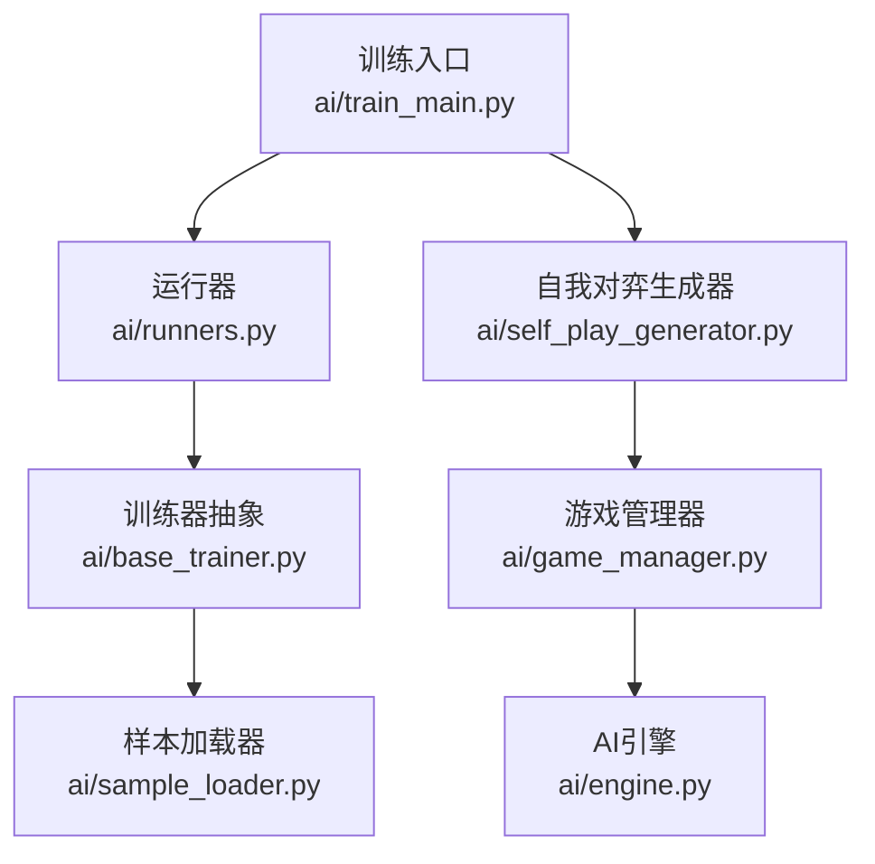
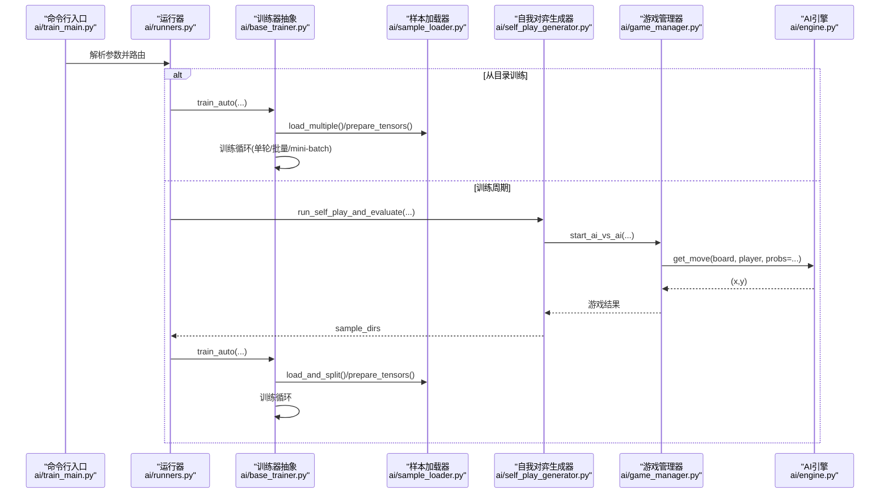
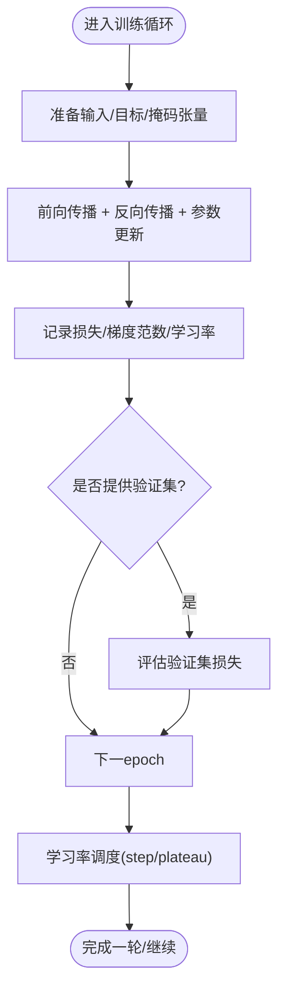
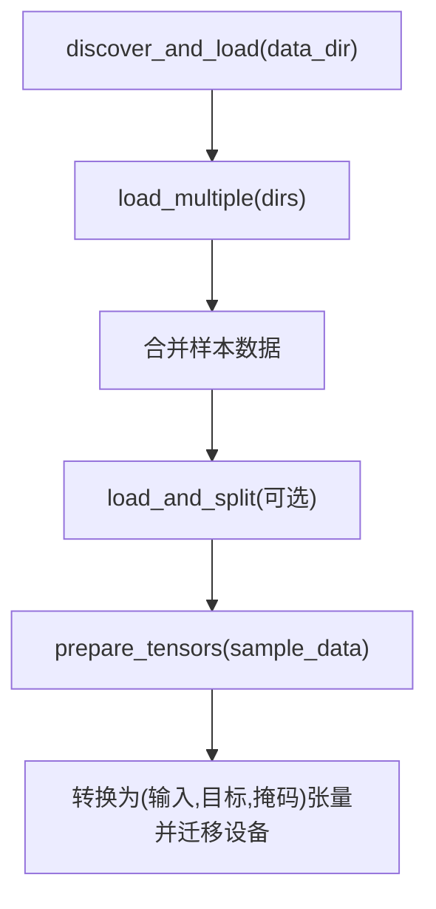
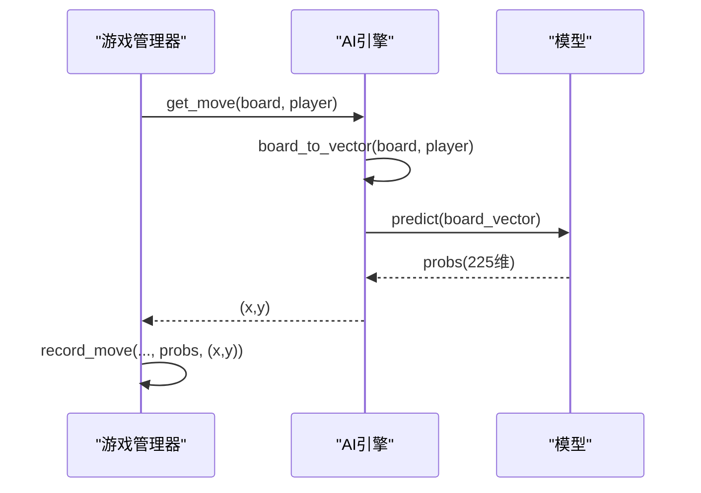
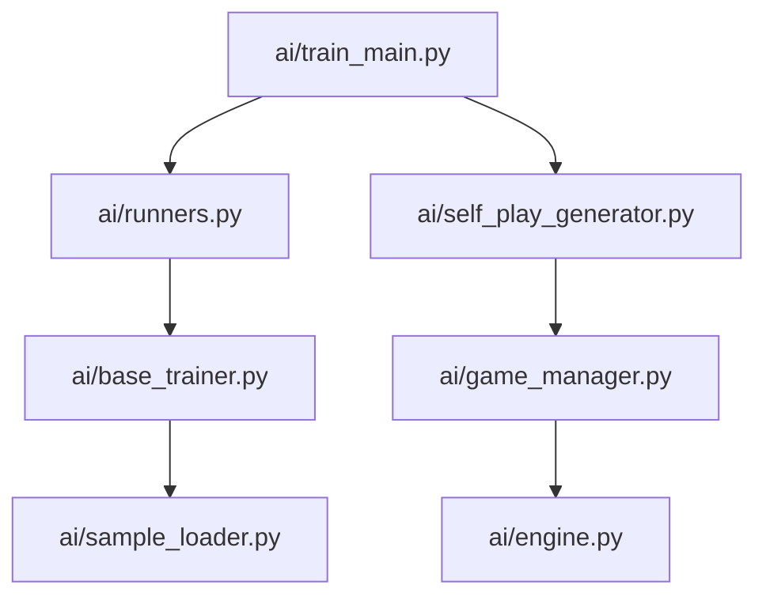

# 性能瓶颈分析

<cite>
**本文引用的文件**
- [ai/train_main.py](file://ai/train_main.py)
- [ai/base_trainer.py](file://ai/base_trainer.py)
- [ai/sample_loader.py](file://ai/sample_loader.py)
- [ai/self_play_generator.py](file://ai/self_play_generator.py)
- [ai/runners.py](file://ai/runners.py)
- [ai/engine.py](file://ai/engine.py)
- [ai/game_manager.py](file://ai/game_manager.py)
- [design/performance/level1_optimization_design.md](file://design/performance/level1_optimization_design.md)
- [tests/ai/test_performance_level1.py](file://tests/ai/test_performance_level1.py)
- [tests/ai/test_performance_level2_parallel.py](file://tests/ai/test_performance_level2_parallel.py)
- [tests/ai/test_performance_level2_numba.py](file://tests/ai/test_performance_level2_numba.py)
</cite>

## 目录
1. [简介](#简介)
2. [项目结构](#项目结构)
3. [核心组件](#核心组件)
4. [架构总览](#架构总览)
5. [关键组件深度分析](#关键组件深度分析)
6. [依赖关系分析](#依赖关系分析)
7. [性能考量与优化建议](#性能考量与优化建议)
8. [故障排查指南](#故障排查指南)
9. [结论](#结论)
10. [附录](#附录)

## 简介
本指南面向五子棋AI系统的性能瓶颈分析与优化实践，聚焦训练与自我对弈流程中的数据加载瓶颈、模型计算瓶颈与I/O瓶颈的识别与治理。结合仓库内的训练入口、训练器抽象、数据加载器、自我对弈生成器、运行器以及性能设计与测试文件，系统阐述如何使用Python cProfile、PyTorch Profiler与NVIDIA Nsight Systems等工具定位热点函数与慢操作，如何通过剖析结果驱动数据预处理优化、批处理策略调整与内存访问模式优化，并给出性能基准测试的设计与实施方法。

## 项目结构
围绕性能分析的关键模块与文件如下：
- 训练入口与运行器：ai/train_main.py、ai/runners.py
- 训练器抽象与训练循环：ai/base_trainer.py
- 数据加载与张量准备：ai/sample_loader.py
- 自我对弈与评价：ai/self_play_generator.py、ai/game_manager.py、ai/engine.py
- 性能设计与测试：design/performance/level1_optimization_design.md、tests/ai/test_performance_level1.py、tests/ai/test_performance_level2_parallel.py、tests/ai/test_performance_level2_numba.py

**图表来源**
- [ai/train_main.py:1-234](file://ai/train_main.py#L1-L234)
- [ai/runners.py:1-255](file://ai/runners.py#L1-L255)
- [ai/base_trainer.py:1-699](file://ai/base_trainer.py#L1-L699)
- [ai/sample_loader.py:1-240](file://ai/sample_loader.py#L1-L240)
- [ai/self_play_generator.py:1-244](file://ai/self_play_generator.py#L1-L244)
- [ai/game_manager.py:1-339](file://ai/game_manager.py#L1-L339)
- [ai/engine.py:1-194](file://ai/engine.py#L1-L194)

**章节来源**
- [ai/train_main.py:1-234](file://ai/train_main.py#L1-L234)
- [ai/runners.py:1-255](file://ai/runners.py#L1-L255)
- [ai/base_trainer.py:1-699](file://ai/base_trainer.py#L1-L699)
- [ai/sample_loader.py:1-240](file://ai/sample_loader.py#L1-L240)
- [ai/self_play_generator.py:1-244](file://ai/self_play_generator.py#L1-L244)
- [ai/game_manager.py:1-339](file://ai/game_manager.py#L1-L339)
- [ai/engine.py:1-194](file://ai/engine.py#L1-L194)

## 核心组件
- 训练入口与参数路由：解析CLI参数、校验互斥模式、创建训练器并路由到运行器。
- 训练器抽象：统一设备选择（GPU/CPU）、优化器与学习率调度、损失计算与日志、训练循环封装（单轮、批量、mini-batch、周期）。
- 样本加载器：递归发现数据、加载与合并、按比例切分、张量转换与设备迁移。
- 自我对弈生成器：封装AI内战与评价流程，生成训练样本。
- 运行器：从目录训练与训练周期的具体执行逻辑，参数打印与临时数据目录管理。

**章节来源**
- [ai/train_main.py:27-234](file://ai/train_main.py#L27-L234)
- [ai/runners.py:81-255](file://ai/runners.py#L81-L255)
- [ai/base_trainer.py:32-699](file://ai/base_trainer.py#L32-L699)
- [ai/sample_loader.py:67-240](file://ai/sample_loader.py#L67-L240)
- [ai/self_play_generator.py:21-244](file://ai/self_play_generator.py#L21-L244)

## 架构总览
训练与自我对弈的整体流程如下：

**图表来源**
- [ai/train_main.py:27-234](file://ai/train_main.py#L27-L234)
- [ai/runners.py:81-255](file://ai/runners.py#L81-L255)
- [ai/base_trainer.py:324-699](file://ai/base_trainer.py#L324-L699)
- [ai/sample_loader.py:96-240](file://ai/sample_loader.py#L96-L240)
- [ai/self_play_generator.py:21-168](file://ai/self_play_generator.py#L21-L168)
- [ai/game_manager.py:233-339](file://ai/game_manager.py#L233-L339)
- [ai/engine.py:67-194](file://ai/engine.py#L67-L194)

## 关键组件深度分析

### 训练器抽象与训练循环
- 设备选择与模型迁移：自动检测CUDA并移动网络至GPU，减少显存与带宽浪费。
- 损失与掩码：使用带掩码的L1Loss，仅对有效位置求平均，避免无效位置干扰。
- 训练循环封装：统一单轮、批量与mini-batch训练，支持验证集评估与学习率调度。
- 日志与中断：支持密集日志与稀疏日志，键盘中断优雅保存进度。

**图表来源**
- [ai/base_trainer.py:257-322](file://ai/base_trainer.py#L257-L322)
- [ai/base_trainer.py:409-573](file://ai/base_trainer.py#L409-L573)

**章节来源**
- [ai/base_trainer.py:21-120](file://ai/base_trainer.py#L21-L120)
- [ai/base_trainer.py:678-699](file://ai/base_trainer.py#L678-L699)
- [ai/base_trainer.py:257-322](file://ai/base_trainer.py#L257-L322)
- [ai/base_trainer.py:409-573](file://ai/base_trainer.py#L409-L573)

### 样本加载器与张量准备
- 递归发现与加载：遍历目录发现所有.json文件，合并为统一数据集。
- 数据切分：按比例随机切分为训练/验证集，保证可复现。
- 张量准备：列表推导+批量转换，随后一次性迁移到设备，减少CPU-GPU往返。

**图表来源**
- [ai/sample_loader.py:185-240](file://ai/sample_loader.py#L185-L240)
- [ai/sample_loader.py:116-165](file://ai/sample_loader.py#L116-L165)
- [ai/sample_loader.py:206-239](file://ai/sample_loader.py#L206-L239)

**章节来源**
- [ai/sample_loader.py:36-64](file://ai/sample_loader.py#L36-L64)
- [ai/sample_loader.py:96-165](file://ai/sample_loader.py#L96-L165)
- [ai/sample_loader.py:206-239](file://ai/sample_loader.py#L206-L239)

### 自我对弈与AI引擎
- AI引擎：将棋盘向量化，调用模型获取225维概率分布，按策略选择落子；支持传入预计算probs避免重复predict。
- 游戏管理器：在每步棋仅调用一次predict，结果同时用于记录与落子，避免冗余计算。
- 自我对弈生成器：封装单轮对弈与评价，生成训练样本目录。

**图表来源**
- [ai/game_manager.py:178-220](file://ai/game_manager.py#L178-L220)
- [ai/engine.py:67-142](file://ai/engine.py#L67-L142)

**章节来源**
- [ai/engine.py:67-142](file://ai/engine.py#L67-L142)
- [ai/game_manager.py:178-220](file://ai/game_manager.py#L178-L220)
- [ai/self_play_generator.py:21-168](file://ai/self_play_generator.py#L21-L168)

## 依赖关系分析
- 训练入口依赖运行器与注册表创建训练器。
- 训练器依赖样本加载器与损失日志器，内部持有模型与优化器。
- 自我对弈生成器依赖引擎、游戏管理器、数据记录器与评价器。
- 游戏管理器依赖引擎与控制器，AI引擎依赖模型。

**图表来源**
- [ai/train_main.py:23-24](file://ai/train_main.py#L23-L24)
- [ai/runners.py:18](file://ai/runners.py#L18)
- [ai/base_trainer.py:14-18](file://ai/base_trainer.py#L14-L18)
- [ai/self_play_generator.py:11-15](file://ai/self_play_generator.py#L11-L15)
- [ai/game_manager.py:9-13](file://ai/game_manager.py#L9-L13)
- [ai/engine.py:8-9](file://ai/engine.py#L8-L9)

**章节来源**
- [ai/train_main.py:23-24](file://ai/train_main.py#L23-L24)
- [ai/runners.py:18](file://ai/runners.py#L18)
- [ai/base_trainer.py:14-18](file://ai/base_trainer.py#L14-L18)
- [ai/self_play_generator.py:11-15](file://ai/self_play_generator.py#L11-L15)
- [ai/game_manager.py:9-13](file://ai/game_manager.py#L9-L13)
- [ai/engine.py:8-9](file://ai/engine.py#L8-L9)

## 性能考量与优化建议

### 1. 数据加载瓶颈检测与优化
- 瓶颈特征
  - 大量小文件JSON读取与解析
  - 递归遍历目录的IO开销
  - CPU侧张量转换与设备迁移频繁
- 检测方法
  - 使用cProfile统计load/prepare_tensors耗时占比
  - 使用PyTorch Profiler观察CPU-GPU传输热点
  - 使用Nsight Systems查看磁盘IO与进程上下文切换
- 优化策略
  - 合并样本文件，减少文件数量与打开/关闭开销
  - 列表推导+批量张量转换，减少Python解释器开销
  - 一次性迁移至设备，避免多次小张量搬运
  - 采用紧凑JSON格式，降低I/O体积与解析时间
- 仓库内证据
  - 列表推导优化已在prepare_tensors中落地
  - 递归发现与加载在SampleLoader中实现
  - JSON紧凑化在测试中验证

**章节来源**
- [ai/sample_loader.py:206-239](file://ai/sample_loader.py#L206-L239)
- [ai/sample_loader.py:36-64](file://ai/sample_loader.py#L36-L64)
- [tests/ai/test_performance_level1.py:287-334](file://tests/ai/test_performance_level1.py#L287-L334)

### 2. 模型计算瓶颈检测与优化
- 瓶颈特征
  - 自我对弈中重复predict调用
  - 棋型检测中的棋盘拷贝与原地修改
  - 棋型检测的纯Python路径性能不足
- 检测方法
  - 使用PyTorch Profiler追踪模型前向与backward
  - 使用cProfile统计engine.get_move与detect_shapes耗时
  - 使用NVIDIA Nsight Systems观测CPU/GPU核心热点
- 优化策略
  - 传入预计算probs，避免重复predict
  - detect_shapes采用“修改-检测-恢复”模式，消除list拷贝
  - 引入Numba JIT加速棋型检测的单方向判定
- 仓库内证据
  - AI引擎支持probs参数，避免重复predict
  - 设计文档提出原地修改与Numba JIT方案
  - 测试验证JIT版本正确性与回退机制

**章节来源**
- [ai/engine.py:110-113](file://ai/engine.py#L110-L113)
- [design/performance/level1_optimization_design.md:5-36](file://design/performance/level1_optimization_design.md#L5-L36)
- [design/performance/level1_optimization_design.md:95-124](file://design/performance/level1_optimization_design.md#L95-L124)
- [tests/ai/test_performance_level2_numba.py:30-108](file://tests/ai/test_performance_level2_numba.py#L30-L108)
- [tests/ai/test_performance_level2_numba.py:351-382](file://tests/ai/test_performance_level2_numba.py#L351-L382)

### 3. I/O瓶颈检测与优化
- 瓶颈特征
  - record.json/sample.json写入频繁且使用缩进格式
  - 多进程并行评价时的进程间通信与错误聚合
- 检测方法
  - 使用cProfile统计json.dump与文件写入
  - 使用Nsight Systems观察进程池与磁盘写入
- 优化策略
  - 移除indent参数，使用紧凑JSON
  - 并行评价时使用ProcessPoolExecutor，错误独立处理
- 仓库内证据
  - 测试验证紧凑JSON格式与正确性
  - 并行测试验证worker函数可pickle与错误隔离

**章节来源**
- [tests/ai/test_performance_level1.py:213-285](file://tests/ai/test_performance_level1.py#L213-L285)
- [tests/ai/test_performance_level2_parallel.py:85-149](file://tests/ai/test_performance_level2_parallel.py#L85-L149)
- [tests/ai/test_performance_level2_parallel.py:225-280](file://tests/ai/test_performance_level2_parallel.py#L225-L280)

### 4. 性能剖析工具使用指南
- Python cProfile
  - 训练入口：在ai/train_main.py中添加cProfile.run或使用kernprof
  - 自我对弈：在ai/self_play_generator.py中对run_self_play_and_evaluate进行剖析
  - 关注热点：engine.get_move、sample_loader.prepare_tensors、Evaluator.evaluate_round
- PyTorch Profiler
  - 在训练器的前向/反向阶段包裹profile上下文
  - 关注：模型前向、backward、optimizer.step、掩码损失计算
- NVIDIA Nsight Systems
  - 记录训练/自我对弈全过程，定位CPU/GPU核心与I/O瓶颈
  - 关注：进程上下文切换、磁盘IO、CUDA内核执行时间

### 5. 热点函数与慢操作定位
- 自我对弈阶段
  - engine.get_move：占比较高的predict调用与策略采样
  - detect_shapes：原地修改与恢复，避免list拷贝
- 训练阶段
  - prepare_tensors：列表推导+批量张量转换
  - _forward_backward_step：前向、backward、梯度范数计算
  - _run_training_loop：epoch级日志与学习率调度

**章节来源**
- [ai/engine.py:67-142](file://ai/engine.py#L67-L142)
- [ai/sample_loader.py:206-239](file://ai/sample_loader.py#L206-L239)
- [ai/base_trainer.py:240-322](file://ai/base_trainer.py#L240-L322)
- [ai/base_trainer.py:409-573](file://ai/base_trainer.py#L409-L573)

### 6. 常见性能问题与解决方案
- 数据预处理优化
  - 使用列表推导替代逐条append
  - 一次性迁移张量至设备
  - 采用紧凑JSON格式
- 批处理策略调整
  - 合理设置batch_size，平衡内存占用与吞吐
  - 在mini-batch模式下启用shuffle与验证集评估
- 内存访问模式优化
  - 避免重复predict，传入预计算probs
  - detect_shapes原地修改-恢复，减少拷贝
  - Numba JIT加速棋型检测

**章节来源**
- [design/performance/level1_optimization_design.md:95-124](file://design/performance/level1_optimization_design.md#L95-L124)
- [tests/ai/test_performance_level1.py:287-334](file://tests/ai/test_performance_level1.py#L287-L334)
- [tests/ai/test_performance_level2_numba.py:30-108](file://tests/ai/test_performance_level2_numba.py#L30-L108)

### 7. 性能基准测试设计与实施
- 设计要点
  - 定义指标：训练速度（samples/sec）、推理延迟（ms/步）、峰值显存占用
  - 对照组：优化前后对比，不同batch_size对比
  - 数据集：固定规模与分布，避免偏差
- 实施步骤
  - 使用cProfile/PyTorch Profiler/Nsight Systems收集数据
  - 在相同硬件与驱动条件下重复实验
  - 统计显著性检验，避免偶然波动
- 仓库内参考
  - 测试用例验证JIT版本性能优于纯Python
  - 并行测试验证多进程评价的正确性与错误隔离

**章节来源**
- [tests/ai/test_performance_level2_numba.py:351-382](file://tests/ai/test_performance_level2_numba.py#L351-L382)
- [tests/ai/test_performance_level2_parallel.py:225-280](file://tests/ai/test_performance_level2_parallel.py#L225-L280)

## 故障排查指南
- 训练中断与进度保存
  - 训练器在KeyboardInterrupt时保存模型与图表，避免数据丢失
- 验证集评估异常
  - 确认验证集比例与数据切分逻辑
- 自我对弈生成异常
  - 检查AI引擎策略与温度采样配置
  - 确认record.json与sample.json生成路径与权限

**章节来源**
- [ai/base_trainer.py:314-322](file://ai/base_trainer.py#L314-L322)
- [ai/runners.py:168-171](file://ai/runners.py#L168-L171)
- [ai/self_play_generator.py:138-167](file://ai/self_play_generator.py#L138-L167)

## 结论
通过对训练入口、训练器抽象、样本加载器、自我对弈与AI引擎的系统分析，结合性能设计与测试文件，本指南提供了从工具使用到优化落地的完整路径。建议在持续集成中引入性能回归测试，配合cProfile、PyTorch Profiler与Nsight Systems，建立可复现、可观测、可改进的性能评估体系。

## 附录
- 关键流程图与序列图已在前述章节中给出，便于对照源码定位问题与优化点。
- 性能测试用例可作为基准回归的参考模板，建议在每次重大改动后运行。