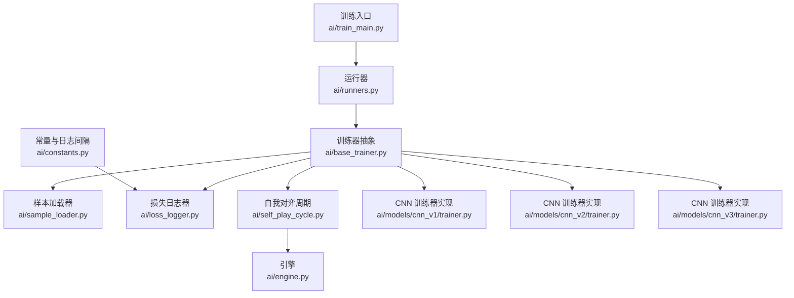
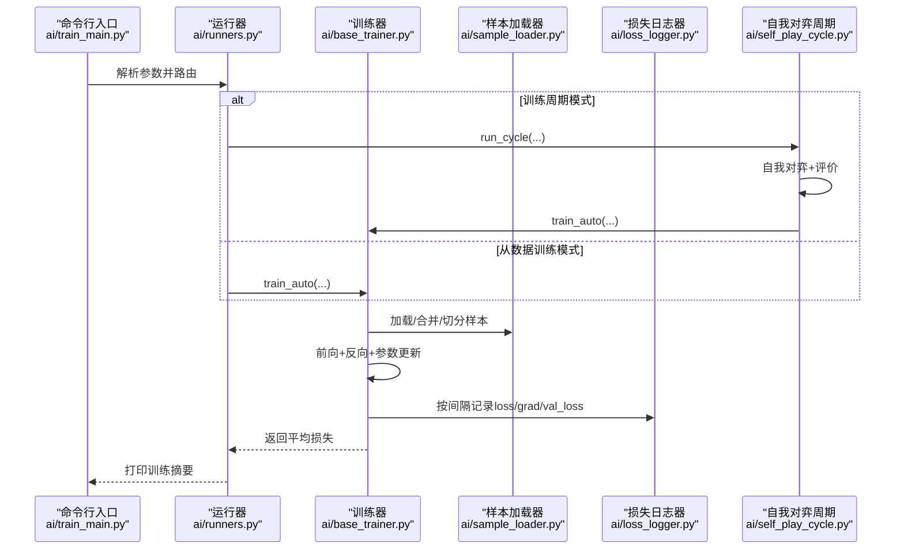
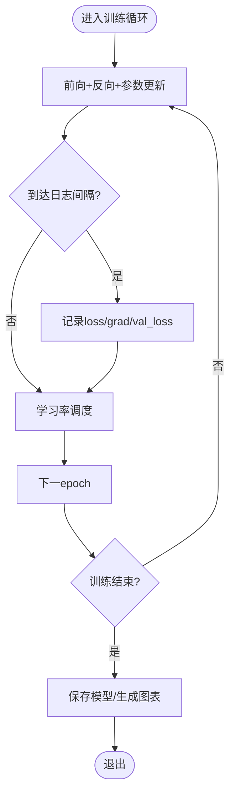
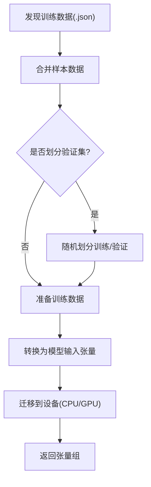
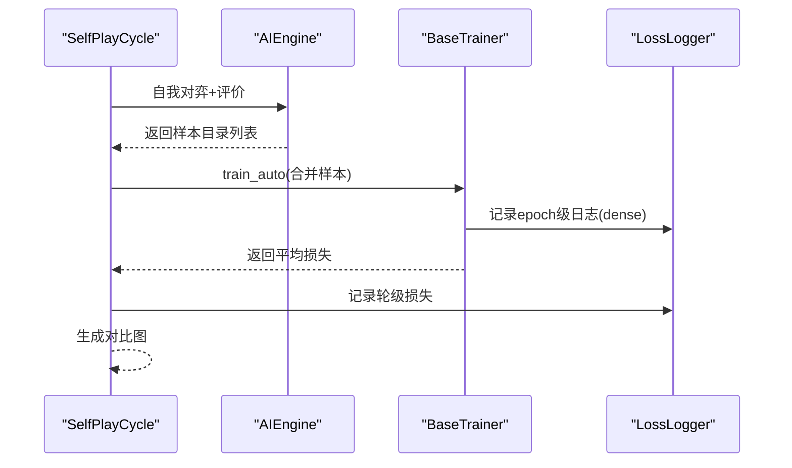
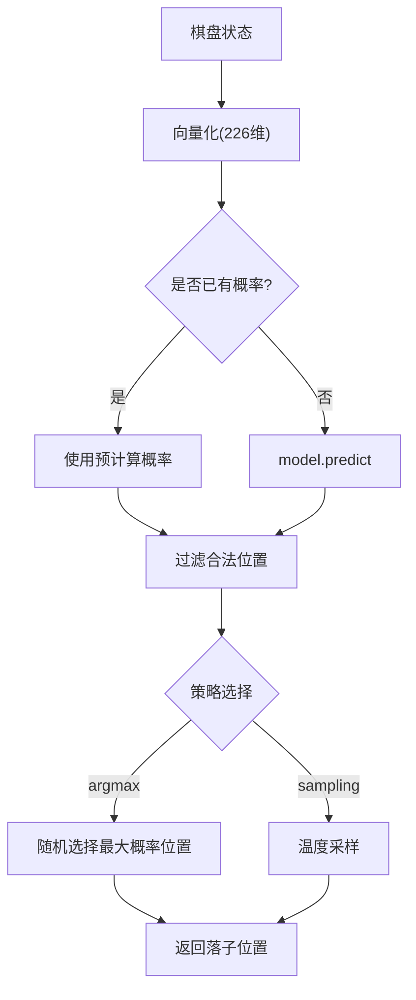
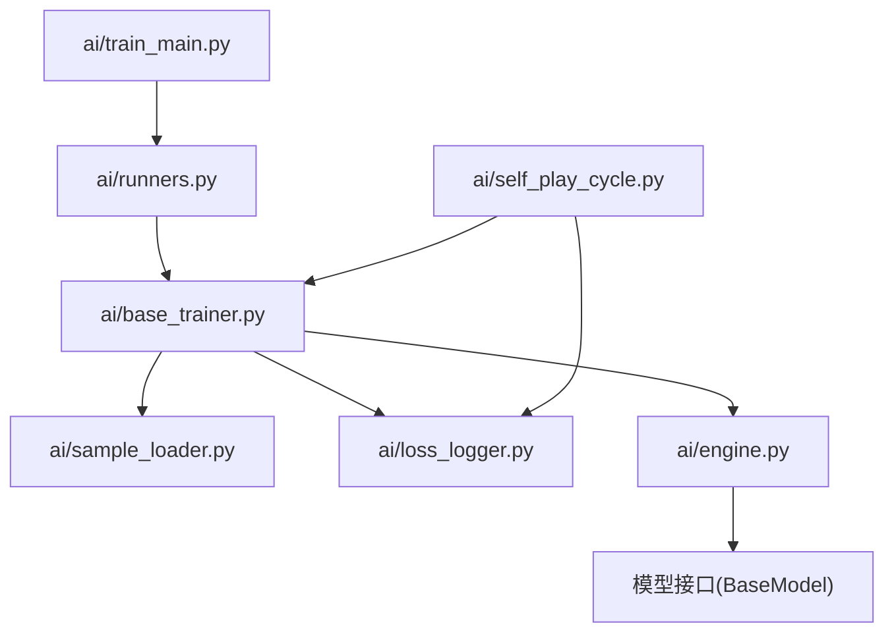

# 性能监控

<cite>
**本文引用的文件**
- [ai/train_main.py](file://ai/train_main.py)
- [ai/base_trainer.py](file://ai/base_trainer.py)
- [ai/loss_logger.py](file://ai/loss_logger.py)
- [ai/sample_loader.py](file://ai/sample_loader.py)
- [ai/runners.py](file://ai/runners.py)
- [ai/constants.py](file://ai/constants.py)
- [ai/self_play_cycle.py](file://ai/self_play_cycle.py)
- [ai/engine.py](file://ai/engine.py)
- [ai/models/cnn_v1/trainer.py](file://ai/models/cnn_v1/trainer.py)
- [ai/models/cnn_v2/trainer.py](file://ai/models/cnn_v2/trainer.py)
- [ai/models/cnn_v3/trainer.py](file://ai/models/cnn_v3/trainer.py)
- [design/performance/level1_optimization_design.md](file://design/performance/level1_optimization_design.md)
</cite>

## 目录
1. [简介](#简介)
2. [项目结构](#项目结构)
3. [核心组件](#核心组件)
4. [架构总览](#架构总览)
5. [详细组件分析](#详细组件分析)
6. [依赖分析](#依赖分析)
7. [性能考量](#性能考量)
8. [故障排查指南](#故障排查指南)
9. [结论](#结论)
10. [附录](#附录)

## 简介
本指南面向五子棋AI项目的性能监控与优化，聚焦训练过程中的关键指标采集与可视化，涵盖GPU利用率、显存占用、训练速度与损失曲线变化；同时提供基于PyTorch内置工具与第三方监控手段的实时观测方法，指导识别数据加载、模型计算与内存三类瓶颈，并给出推理性能（预测速度与准确性权衡）的监控策略、基准测试方法与最佳实践。

## 项目结构
围绕训练与监控的关键模块如下：
- 训练入口与参数解析：ai/train_main.py
- 训练器抽象与通用训练流程：ai/base_trainer.py
- 损失日志与曲线生成：ai/loss_logger.py
- 样本加载与张量准备：ai/sample_loader.py
- 运行器（周期训练/从数据训练）：ai/runners.py
- 常量与日志间隔：ai/constants.py
- 自我对弈训练周期编排：ai/self_play_cycle.py
- 引擎与落子策略：ai/engine.py
- 模型训练器实现（CNN系列）：ai/models/cnn_v1/trainer.py、ai/models/cnn_v2/trainer.py、ai/models/cnn_v3/trainer.py

**图示来源**
- [ai/train_main.py:1-234](file://ai/train_main.py#L1-L234)
- [ai/runners.py:1-255](file://ai/runners.py#L1-L255)
- [ai/base_trainer.py:1-699](file://ai/base_trainer.py#L1-L699)
- [ai/sample_loader.py:1-240](file://ai/sample_loader.py#L1-L240)
- [ai/loss_logger.py:1-461](file://ai/loss_logger.py#L1-L461)
- [ai/self_play_cycle.py:1-195](file://ai/self_play_cycle.py#L1-L195)
- [ai/engine.py:1-194](file://ai/engine.py#L1-L194)
- [ai/models/cnn_v1/trainer.py:1-72](file://ai/models/cnn_v1/trainer.py#L1-L72)
- [ai/models/cnn_v2/trainer.py:1-72](file://ai/models/cnn_v2/trainer.py#L1-L72)
- [ai/models/cnn_v3/trainer.py:1-73](file://ai/models/cnn_v3/trainer.py#L1-L73)
- [ai/constants.py:1-26](file://ai/constants.py#L1-L26)

**章节来源**
- [ai/train_main.py:1-234](file://ai/train_main.py#L1-L234)
- [ai/runners.py:1-255](file://ai/runners.py#L1-L255)
- [ai/base_trainer.py:1-699](file://ai/base_trainer.py#L1-L699)
- [ai/loss_logger.py:1-461](file://ai/loss_logger.py#L1-L461)
- [ai/sample_loader.py:1-240](file://ai/sample_loader.py#L1-L240)
- [ai/self_play_cycle.py:1-195](file://ai/self_play_cycle.py#L1-L195)
- [ai/engine.py:1-194](file://ai/engine.py#L1-L194)
- [ai/models/cnn_v1/trainer.py:1-72](file://ai/models/cnn_v1/trainer.py#L1-L72)
- [ai/models/cnn_v2/trainer.py:1-72](file://ai/models/cnn_v2/trainer.py#L1-L72)
- [ai/models/cnn_v3/trainer.py:1-73](file://ai/models/cnn_v3/trainer.py#L1-L73)
- [ai/constants.py:1-26](file://ai/constants.py#L1-L26)

## 核心组件
- 训练器抽象与通用流程
  - 自动检测GPU并迁移模型与张量至设备
  - 统一的前向+反向+参数更新流程
  - 支持全量更新与mini-batch两种训练方式
  - 支持学习率调度（StepLR/ReduceLROnPlateau）
  - 训练循环中按固定间隔记录损失、梯度范数与学习率
- 损失日志器
  - JSON Lines记录训练损失、梯度范数与验证损失
  - 支持稀疏（按epoch）与密集（按step）两种日志粒度
  - 可生成损失曲线图（matplotlib），支持对比图
- 样本加载器
  - 递归发现与加载训练数据
  - 将样本数据转换为PyTorch张量并迁移至设备
  - 支持训练/验证集划分
- 自我对弈训练周期
  - 编排“自我对弈→评价→训练”的循环
  - 多轮次下生成轮级与epoch级日志，支持对比图
- 引擎与落子策略
  - 将棋盘状态向量化并调用模型获取概率分布
  - 支持argmax与温度采样策略
  - 提供预计算概率的优化接口，避免重复predict调用

**章节来源**
- [ai/base_trainer.py:21-120](file://ai/base_trainer.py#L21-L120)
- [ai/base_trainer.py:257-322](file://ai/base_trainer.py#L257-L322)
- [ai/base_trainer.py:324-573](file://ai/base_trainer.py#L324-L573)
- [ai/loss_logger.py:28-177](file://ai/loss_logger.py#L28-L177)
- [ai/loss_logger.py:178-294](file://ai/loss_logger.py#L178-L294)
- [ai/sample_loader.py:67-240](file://ai/sample_loader.py#L67-L240)
- [ai/self_play_cycle.py:20-195](file://ai/self_play_cycle.py#L20-L195)
- [ai/engine.py:44-194](file://ai/engine.py#L44-L194)

## 架构总览
训练与监控的整体流程如下：

**图示来源**
- [ai/train_main.py:27-234](file://ai/train_main.py#L27-L234)
- [ai/runners.py:81-255](file://ai/runners.py#L81-L255)
- [ai/base_trainer.py:324-573](file://ai/base_trainer.py#L324-L573)
- [ai/sample_loader.py:80-240](file://ai/sample_loader.py#L80-L240)
- [ai/loss_logger.py:124-177](file://ai/loss_logger.py#L124-L177)
- [ai/self_play_cycle.py:106-156](file://ai/self_play_cycle.py#L106-L156)

## 详细组件分析

### 训练器与损失监控
- 关键指标采集
  - 训练损失：每epoch记录一次（稀疏模式）或每个batch（密集模式）
  - 梯度范数：用于观察梯度爆炸/消失趋势
  - 验证损失：在提供验证集时定期评估
  - 学习率：随训练动态调整
- 日志粒度与性能权衡
  - 稀疏日志：按epoch记录，IO压力小，适合长周期训练
  - 密集日志：按step记录，便于细粒度分析，但IO与绘图成本更高
- 训练循环控制流

**图示来源**
- [ai/base_trainer.py:257-322](file://ai/base_trainer.py#L257-L322)
- [ai/base_trainer.py:409-573](file://ai/base_trainer.py#L409-L573)
- [ai/loss_logger.py:124-177](file://ai/loss_logger.py#L124-L177)

**章节来源**
- [ai/base_trainer.py:257-322](file://ai/base_trainer.py#L257-L322)
- [ai/base_trainer.py:409-573](file://ai/base_trainer.py#L409-L573)
- [ai/loss_logger.py:124-177](file://ai/loss_logger.py#L124-L177)

### 样本加载与数据传输
- 数据发现与合并
  - 递归扫描目录，收集所有.json文件
  - 合并为统一样本列表，支持训练/验证集划分
- 张量转换与设备迁移
  - 将输入、目标与mask转换为张量并迁移到设备
  - CNN模型通过专用转换函数将向量转为(3,15,15)张量
- 性能优化点
  - 列表推导替代逐条append，降低Python解释器开销
  - 仅在必要时进行设备迁移，避免不必要的CPU/GPU拷贝

**图示来源**
- [ai/sample_loader.py:36-64](file://ai/sample_loader.py#L36-L64)
- [ai/sample_loader.py:96-165](file://ai/sample_loader.py#L96-L165)
- [ai/sample_loader.py:206-240](file://ai/sample_loader.py#L206-L240)
- [ai/models/cnn_v1/trainer.py:45-72](file://ai/models/cnn_v1/trainer.py#L45-L72)
- [ai/models/cnn_v2/trainer.py:45-72](file://ai/models/cnn_v2/trainer.py#L45-L72)
- [ai/models/cnn_v3/trainer.py:46-72](file://ai/models/cnn_v3/trainer.py#L46-L72)

**章节来源**
- [ai/sample_loader.py:36-64](file://ai/sample_loader.py#L36-L64)
- [ai/sample_loader.py:96-165](file://ai/sample_loader.py#L96-L165)
- [ai/sample_loader.py:206-240](file://ai/sample_loader.py#L206-L240)
- [ai/models/cnn_v1/trainer.py:45-72](file://ai/models/cnn_v1/trainer.py#L45-L72)
- [ai/models/cnn_v2/trainer.py:45-72](file://ai/models/cnn_v2/trainer.py#L45-L72)
- [ai/models/cnn_v3/trainer.py:46-72](file://ai/models/cnn_v3/trainer.py#L46-L72)

### 自我对弈训练周期
- 多轮次编排
  - 每轮进行自我对弈与评价，生成样本目录
  - 每轮结束后合并样本并训练，记录轮级与epoch级日志
- 会话隔离与对比图
  - 使用时间戳+UUID生成会话目录，避免日志冲突
  - 支持生成轮间对比图，直观展示训练稳定性

**图示来源**
- [ai/self_play_cycle.py:106-156](file://ai/self_play_cycle.py#L106-L156)
- [ai/engine.py:67-142](file://ai/engine.py#L67-L142)
- [ai/base_trainer.py:575-603](file://ai/base_trainer.py#L575-L603)
- [ai/loss_logger.py:365-461](file://ai/loss_logger.py#L365-L461)

**章节来源**
- [ai/self_play_cycle.py:106-156](file://ai/self_play_cycle.py#L106-L156)
- [ai/engine.py:67-142](file://ai/engine.py#L67-L142)
- [ai/base_trainer.py:575-603](file://ai/base_trainer.py#L575-L603)
- [ai/loss_logger.py:365-461](file://ai/loss_logger.py#L365-L461)

### 引擎与落子策略
- 输入向量化与策略选择
  - 将棋盘状态转换为226维向量
  - 支持argmax与温度采样两种策略
- 性能优化
  - 支持传入预计算概率，避免重复model.predict调用
  - 合法位置过滤与并列最大值随机选择，提升多样性

**图示来源**
- [ai/engine.py:106-142](file://ai/engine.py#L106-L142)
- [ai/engine.py:174-193](file://ai/engine.py#L174-L193)

**章节来源**
- [ai/engine.py:67-142](file://ai/engine.py#L67-L142)
- [ai/engine.py:174-193](file://ai/engine.py#L174-L193)

## 依赖分析
- 训练入口依赖运行器与注册中心，运行器再依赖训练器与样本加载器
- 训练器依赖损失日志器、样本加载器与学习率调度器
- 自我对弈周期依赖训练器与损失日志器
- 引擎依赖模型接口，支持预计算概率优化

**图示来源**
- [ai/train_main.py:23-24](file://ai/train_main.py#L23-L24)
- [ai/runners.py:18-19](file://ai/runners.py#L18-L19)
- [ai/base_trainer.py:14-18](file://ai/base_trainer.py#L14-L18)
- [ai/self_play_cycle.py:12-14](file://ai/self_play_cycle.py#L12-L14)
- [ai/engine.py:38-41](file://ai/engine.py#L38-L41)

**章节来源**
- [ai/train_main.py:23-24](file://ai/train_main.py#L23-L24)
- [ai/runners.py:18-19](file://ai/runners.py#L18-L19)
- [ai/base_trainer.py:14-18](file://ai/base_trainer.py#L14-L18)
- [ai/self_play_cycle.py:12-14](file://ai/self_play_cycle.py#L12-L14)
- [ai/engine.py:38-41](file://ai/engine.py#L38-L41)

## 性能考量
- GPU利用率与显存
  - 自动检测CUDA设备并在可用时迁移模型与张量
  - 建议结合nvidia-smi、NVML或第三方工具（如gpustat、htop）监控GPU利用率与显存占用
- 训练速度
  - 稀疏日志（按epoch）适合长周期，密集日志（按step）适合快速迭代
  - mini-batch相比全量更新通常更快收敛，但需关注显存上限
- 损失曲线与学习率
  - 通过LossLogger记录loss、grad_norm与val_loss，结合学习率调度观察收敛趋势
- 数据加载瓶颈
  - 样本发现与合并、JSON读取与张量转换是潜在瓶颈
  - 优化建议：使用列表推导、减少CPU/GPU拷贝、合理设置batch_size
- 模型计算瓶颈
  - CNN模型输入转换与前向计算是主要开销
  - 优化建议：避免重复predict调用、使用合适的batch_size与dtype
- 内存瓶颈
  - 大batch_size与密集日志会增加显存与内存压力
  - 优化建议：适当降低batch_size、关闭密集日志、及时flush与释放中间张量

**章节来源**
- [ai/base_trainer.py:21-120](file://ai/base_trainer.py#L21-L120)
- [ai/base_trainer.py:409-573](file://ai/base_trainer.py#L409-L573)
- [ai/loss_logger.py:124-177](file://ai/loss_logger.py#L124-L177)
- [ai/sample_loader.py:206-240](file://ai/sample_loader.py#L206-L240)
- [design/performance/level1_optimization_design.md:1-124](file://design/performance/level1_optimization_design.md#L1-L124)

## 故障排查指南
- 训练中断与保存
  - 捕获键盘中断，自动保存模型与图表，避免数据丢失
- 日志与绘图
  - matplotlib不可用时优雅降级，不影响训练流程
  - 密集日志需在epoch结束或训练结束时flush，确保数据落盘
- 数据路径与权限
  - 确认训练数据目录存在且可读
  - 使用会话目录隔离，避免日志覆盖

**章节来源**
- [ai/base_trainer.py:314-322](file://ai/base_trainer.py#L314-L322)
- [ai/loss_logger.py:196-202](file://ai/loss_logger.py#L196-L202)
- [ai/loss_logger.py:167-177](file://ai/loss_logger.py#L167-L177)
- [ai/runners.py:94-128](file://ai/runners.py#L94-L128)

## 结论
本项目通过训练器抽象、统一的日志与样本加载机制，提供了完善的训练监控基础。结合LossLogger的损失与梯度范数记录、验证损失评估以及稀疏/密集日志策略，能够有效支撑训练过程的性能观测与优化。针对数据加载、模型计算与内存三类瓶颈，建议采用列表推导、避免重复predict、合理设置batch_size与dtype等措施，并辅以第三方工具进行GPU与系统资源监控，持续提升训练效率与稳定性。

## 附录
- 常用监控命令与工具
  - nvidia-smi：查看GPU利用率与显存
  - htop/top：查看CPU与内存使用
  - gpustat：轻量级GPU状态监控
- 基准测试建议
  - 固定batch_size与数据规模，记录训练耗时与损失收敛曲线
  - 对比稀疏与密集日志对IO与绘图的影响
  - 对比不同学习率调度策略对收敛速度与稳定性的影响