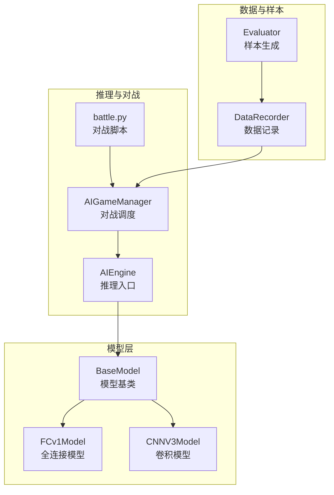
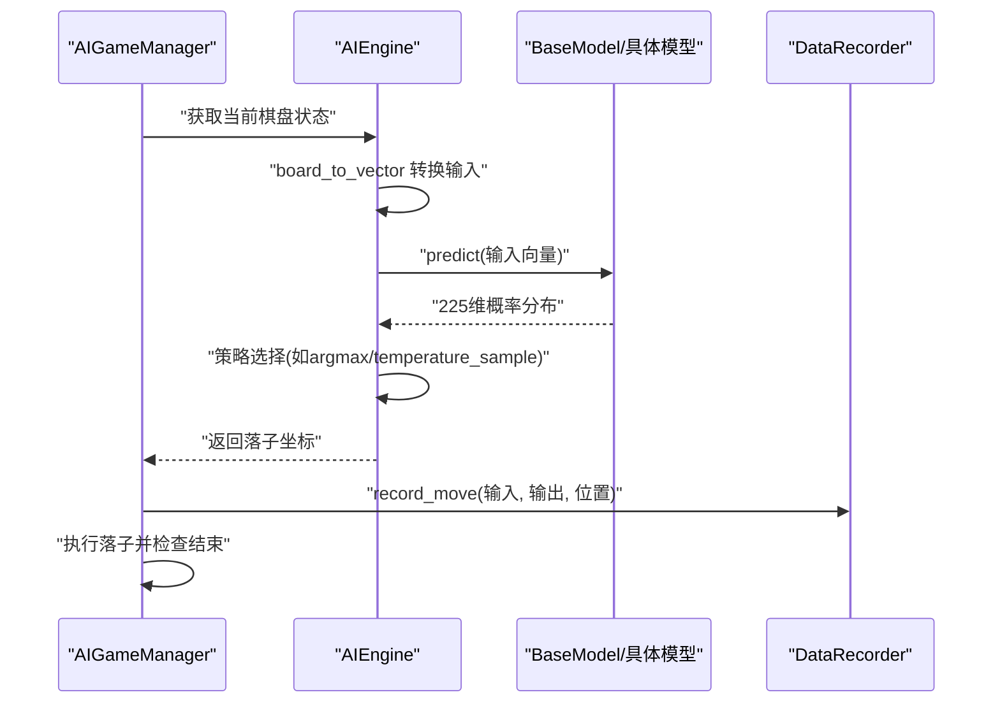
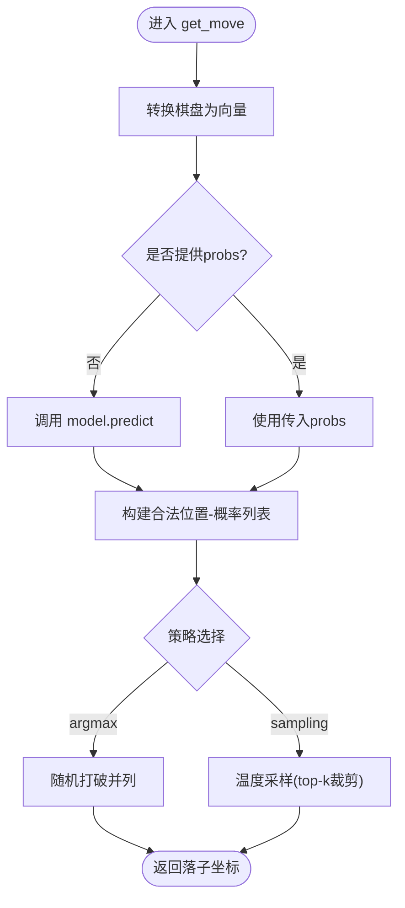
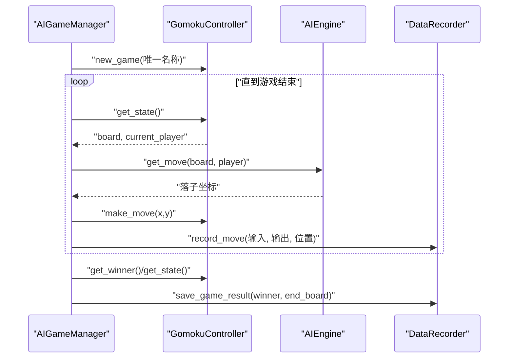
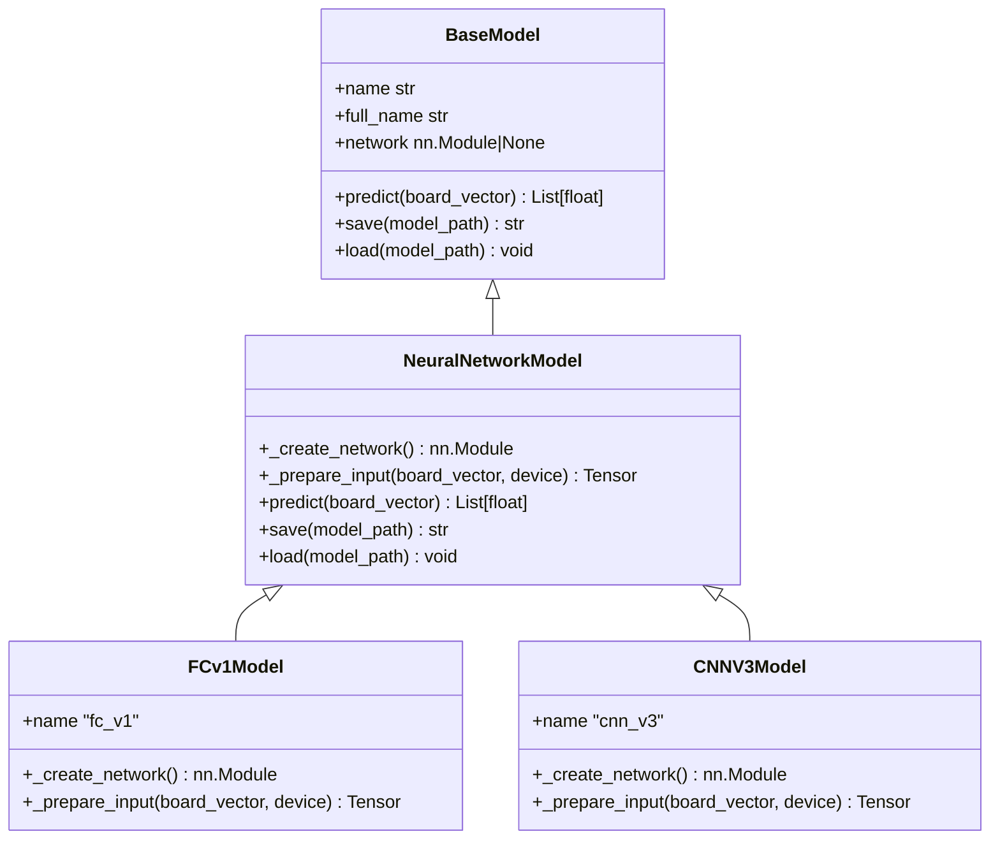
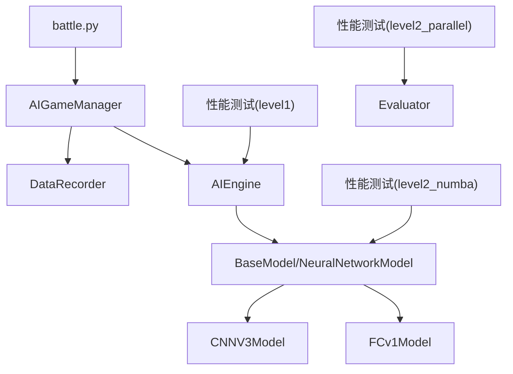

# 推理性能监控

<cite>
**本文档引用的文件**
- [ai/engine.py](file://ai/engine.py)
- [ai/game_manager.py](file://ai/game_manager.py)
- [ai/data_recorder.py](file://ai/data_recorder.py)
- [ai/base_model.py](file://ai/base_model.py)
- [ai/models/fc_v1/model.py](file://ai/models/fc_v1/model.py)
- [ai/models/cnn_v3/model.py](file://ai/models/cnn_v3/model.py)
- [ai/battle.py](file://ai/battle.py)
- [tests/ai/test_performance_level1.py](file://tests/ai/test_performance_level1.py)
- [tests/ai/test_performance_level2_numba.py](file://tests/ai/test_performance_level2_numba.py)
- [tests/ai/test_performance_level2_parallel.py](file://tests/ai/test_performance_level2_parallel.py)
- [design/performance/level1_optimization_design.md](file://design/performance/level1_optimization_design.md)
</cite>

## 目录
1. [简介](#简介)
2. [项目结构](#项目结构)
3. [核心组件](#核心组件)
4. [架构概览](#架构概览)
5. [详细组件分析](#详细组件分析)
6. [依赖分析](#依赖分析)
7. [性能考量](#性能考量)
8. [故障排查指南](#故障排查指南)
9. [结论](#结论)
10. [附录](#附录)

## 简介
本指南面向五子棋AI推理性能监控与优化，聚焦于如何系统性地测量与提升AI模型的推理效率。内容涵盖：
- 单次预测耗时与批量吞吐量测量
- 内存占用与CPU/GPU利用率监控
- 不同棋盘状态下的响应时间统计
- 推理加速技术应用（量化、混合精度、缓存策略）
- 实时对战过程中的思考时间与决策延迟统计
- 基准测试脚本使用与性能对比分析

## 项目结构
围绕推理性能监控，项目中与AI推理直接相关的模块主要分布在以下位置：
- AI引擎与推理入口：ai/engine.py
- 游戏对战与推理调度：ai/game_manager.py、ai/battle.py
- 数据记录与样本生成：ai/data_recorder.py、ai/evaluator.py
- 模型基类与具体模型：ai/base_model.py、ai/models/fc_v1/model.py、ai/models/cnn_v3/model.py
- 性能优化设计与测试：design/performance/level1_optimization_design.md、tests/ai/test_performance_level1.py、tests/ai/test_performance_level2_numba.py、tests/ai/test_performance_level2_parallel.py

**图表来源**
- [ai/engine.py:44-194](file://ai/engine.py#L44-L194)
- [ai/game_manager.py:16-339](file://ai/game_manager.py#L16-L339)
- [ai/battle.py:94-133](file://ai/battle.py#L94-L133)
- [ai/data_recorder.py:17-145](file://ai/data_recorder.py#L17-L145)
- [ai/base_model.py:24-323](file://ai/base_model.py#L24-L323)
- [ai/models/fc_v1/model.py:91-132](file://ai/models/fc_v1/model.py#L91-L132)
- [ai/models/cnn_v3/model.py:96-139](file://ai/models/cnn_v3/model.py#L96-L139)

**章节来源**
- [ai/engine.py:1-194](file://ai/engine.py#L1-L194)
- [ai/game_manager.py:1-339](file://ai/game_manager.py#L1-L339)
- [ai/battle.py:1-199](file://ai/battle.py#L1-L199)
- [ai/data_recorder.py:1-145](file://ai/data_recorder.py#L1-L145)
- [ai/base_model.py:1-323](file://ai/base_model.py#L1-L323)
- [ai/models/fc_v1/model.py:1-132](file://ai/models/fc_v1/model.py#L1-L132)
- [ai/models/cnn_v3/model.py:1-139](file://ai/models/cnn_v3/model.py#L1-L139)

## 核心组件
- AIEngine：负责将棋盘状态转换为模型输入，调用模型获取概率分布，并基于策略选择落子位置。支持传入预计算的概率分布以避免重复推理。
- AIGameManager：管理对战流程，封装单局对战循环，记录每步输入输出与落子位置，支持温度采样与随机性控制。
- DataRecorder：记录对局历史、落子位置与最终结果，生成record.json，便于后续样本生成与性能分析。
- BaseModel与具体模型：统一的模型接口与实现，提供predict、save、load等能力；FCv1与CNNV3分别代表全连接与卷积两种典型结构。
- battle.py：独立对战脚本，支持指定双方AI与对局数，输出胜负统计。

**章节来源**
- [ai/engine.py:44-194](file://ai/engine.py#L44-L194)
- [ai/game_manager.py:16-339](file://ai/game_manager.py#L16-L339)
- [ai/data_recorder.py:17-145](file://ai/data_recorder.py#L17-L145)
- [ai/base_model.py:24-323](file://ai/base_model.py#L24-L323)
- [ai/models/fc_v1/model.py:91-132](file://ai/models/fc_v1/model.py#L91-L132)
- [ai/models/cnn_v3/model.py:96-139](file://ai/models/cnn_v3/model.py#L96-L139)
- [ai/battle.py:94-133](file://ai/battle.py#L94-L133)

## 架构概览
推理性能监控贯穿“输入转换→模型推理→策略选择→落子执行”的完整链路。关键监控点包括：
- 单次推理耗时：从模型输入准备到概率分布输出
- 批量推理吞吐：单位时间内完成的推理次数
- 内存占用：模型参数、中间张量与缓存
- CPU/GPU利用率：设备资源使用情况
- 思考时间与决策延迟：对战过程中的响应统计

**图表来源**
- [ai/game_manager.py:124-230](file://ai/game_manager.py#L124-L230)
- [ai/engine.py:67-142](file://ai/engine.py#L67-L142)
- [ai/base_model.py:195-230](file://ai/base_model.py#L195-L230)
- [ai/data_recorder.py:96-116](file://ai/data_recorder.py#L96-L116)

## 详细组件分析

### AIEngine推理流程与性能优化
- 输入转换：将15×15棋盘与当前玩家编码为226维向量，避免重复计算。
- 模型推理：调用model.predict获取225维概率分布；支持传入预计算的probs以避免重复推理。
- 策略选择：argmax策略随机打破并列；temperature采样策略支持温度与top-k裁剪。
- 性能优化点：
  - 预计算概率复用：在对战调度中先调用model.predict，再将结果传入get_move，消除冗余调用。
  - 棋盘拷贝消除：检测棋型时采用“修改-检测-恢复”模式，避免list拷贝。
  - JSON去缩进与向量化：记录文件与样本生成采用紧凑格式与列表推导，降低I/O与CPU开销。

**图表来源**
- [ai/engine.py:67-142](file://ai/engine.py#L67-L142)
- [tests/ai/test_performance_level1.py:32-110](file://tests/ai/test_performance_level1.py#L32-L110)

**章节来源**
- [ai/engine.py:67-142](file://ai/engine.py#L67-L142)
- [tests/ai/test_performance_level1.py:32-110](file://tests/ai/test_performance_level1.py#L32-L110)
- [design/performance/level1_optimization_design.md:5-36](file://design/performance/level1_optimization_design.md#L5-L36)

### AIGameManager对战调度与数据记录
- 单局流程：创建控制器、新游戏、循环落子、记录数据、保存结果。
- 思考时间统计：在对战循环中记录每步推理与落子耗时，用于后续统计分析。
- 数据记录：record.json包含history、winner与end_board，便于样本生成与性能回溯。

**图表来源**
- [ai/game_manager.py:124-230](file://ai/game_manager.py#L124-L230)
- [ai/data_recorder.py:96-140](file://ai/data_recorder.py#L96-L140)

**章节来源**
- [ai/game_manager.py:124-230](file://ai/game_manager.py#L124-L230)
- [ai/data_recorder.py:96-140](file://ai/data_recorder.py#L96-L140)

### BaseModel与具体模型的推理实现
- 统一接口：predict负责将226维输入转换为模型张量，前向传播后返回225维概率分布。
- 设备与精度：模型参数与输入张量位于同一设备；支持GPU加速与混合精度（需在训练侧配置）。
- FCv1与CNNV3：FCv1为全连接网络，CNNV3为极简卷积网络，两者均遵循统一的predict接口。

**图表来源**
- [ai/base_model.py:24-323](file://ai/base_model.py#L24-L323)
- [ai/models/fc_v1/model.py:91-132](file://ai/models/fc_v1/model.py#L91-L132)
- [ai/models/cnn_v3/model.py:96-139](file://ai/models/cnn_v3/model.py#L96-L139)

**章节来源**
- [ai/base_model.py:195-230](file://ai/base_model.py#L195-L230)
- [ai/models/fc_v1/model.py:91-132](file://ai/models/fc_v1/model.py#L91-L132)
- [ai/models/cnn_v3/model.py:96-139](file://ai/models/cnn_v3/model.py#L96-L139)

### battle.py对战脚本与性能统计
- 功能：启动两个AI的内战，支持指定对局数与AI名称，输出胜负统计。
- 性能：通过记录每局结果与对战配置，便于后续对比不同模型的推理表现。

**章节来源**
- [ai/battle.py:94-133](file://ai/battle.py#L94-L133)

## 依赖分析
- AIEngine依赖BaseModel接口，具体模型（FCv1/CNNV3）通过NeuralNetworkModel实现predict。
- AIGameManager依赖AIEngine与DataRecorder，负责对战调度与数据记录。
- battle.py依赖AIGameManager与registry，用于加载模型并启动对战。
- 性能优化测试覆盖冗余predict消除、棋盘拷贝消除、JSON去缩进与prepare_tensors向量化。

**图表来源**
- [ai/engine.py:44-194](file://ai/engine.py#L44-L194)
- [ai/base_model.py:107-194](file://ai/base_model.py#L107-L194)
- [ai/models/fc_v1/model.py:91-132](file://ai/models/fc_v1/model.py#L91-L132)
- [ai/models/cnn_v3/model.py:96-139](file://ai/models/cnn_v3/model.py#L96-L139)
- [ai/game_manager.py:16-339](file://ai/game_manager.py#L16-L339)
- [ai/data_recorder.py:17-145](file://ai/data_recorder.py#L17-L145)
- [ai/battle.py:94-133](file://ai/battle.py#L94-L133)
- [tests/ai/test_performance_level1.py:32-110](file://tests/ai/test_performance_level1.py#L32-L110)
- [tests/ai/test_performance_level2_numba.py:30-117](file://tests/ai/test_performance_level2_numba.py#L30-L117)
- [tests/ai/test_performance_level2_parallel.py:85-149](file://tests/ai/test_performance_level2_parallel.py#L85-L149)

**章节来源**
- [tests/ai/test_performance_level1.py:32-110](file://tests/ai/test_performance_level1.py#L32-L110)
- [tests/ai/test_performance_level2_numba.py:30-117](file://tests/ai/test_performance_level2_numba.py#L30-L117)
- [tests/ai/test_performance_level2_parallel.py:85-149](file://tests/ai/test_performance_level2_parallel.py#L85-L149)

## 性能考量
- 单次预测耗时
  - 测量点：AIEngine.get_move内部的model.predict调用前后。
  - 优化手段：复用probs、消除冗余predict、减少输入转换与张量搬运。
  - 参考实现：[ai/engine.py:111-112](file://ai/engine.py#L111-L112)、[ai/game_manager.py:189-190](file://ai/game_manager.py#L189-L190)、[design/performance/level1_optimization_design.md:16-36](file://design/performance/level1_optimization_design.md#L16-L36)

- 批量推理吞吐量
  - 测量点：单位时间内完成的推理次数（如每秒推理数）。
  - 优化手段：向量化输入、批处理、GPU并行、减少Python层循环。
  - 参考实现：[ai/base_model.py:662-676](file://ai/base_model.py#L662-L676)、[tests/ai/test_performance_level1.py:288-333](file://tests/ai/test_performance_level1.py#L288-L333)

- 内存占用
  - 关注点：模型参数、中间张量、缓存与I/O缓冲。
  - 优化手段：紧凑JSON格式、避免list拷贝、及时释放中间变量。
  - 参考实现：[ai/data_recorder.py:137-140](file://ai/data_recorder.py#L137-L140)、[design/performance/level1_optimization_design.md:74-92](file://design/performance/level1_optimization_design.md#L74-L92)

- CPU/GPU利用率
  - 关注点：设备负载与核利用率，避免CPU/GPU成为瓶颈。
  - 优化手段：GPU加速、批处理、减少主机-设备传输、混合精度（训练侧）。
  - 参考实现：[ai/base_trainer.py:21-29](file://ai/base_trainer.py#L21-L29)、[ai/base_model.py:213-230](file://ai/base_model.py#L213-L230)

- 不同棋盘状态下的响应时间
  - 测量方法：对不同开局、中盘、残局场景分别记录推理耗时，统计均值与分位数。
  - 优化建议：针对高复杂度局面引入缓存策略或提前终止条件。

- 推理加速技术
  - 模型量化：降低权重精度，减少内存与带宽占用。
  - 混合精度：在训练侧使用半精度提升吞吐，推理侧可结合量化进一步优化。
  - 缓存策略：复用上一步推理结果（在状态未变化时），减少重复计算。
  - 参考实现：[ai/base_model.py:213-230](file://ai/base_model.py#L213-L230)、[ai/game_manager.py:188-210](file://ai/game_manager.py#L188-L210)

- 实时对战中的思考时间与决策延迟
  - 统计维度：单步推理耗时、落子执行耗时、整体思考时间分布。
  - 方法：在AIGameManager对战循环中埋点，记录每步开始与结束时间，输出统计报表。
  - 参考实现：[ai/game_manager.py:177-223](file://ai/game_manager.py#L177-L223)

**章节来源**
- [ai/engine.py:111-112](file://ai/engine.py#L111-L112)
- [ai/game_manager.py:188-210](file://ai/game_manager.py#L188-L210)
- [ai/data_recorder.py:137-140](file://ai/data_recorder.py#L137-L140)
- [ai/base_model.py:213-230](file://ai/base_model.py#L213-L230)
- [ai/base_trainer.py:21-29](file://ai/base_trainer.py#L21-L29)
- [design/performance/level1_optimization_design.md:16-36](file://design/performance/level1_optimization_design.md#L16-L36)

## 故障排查指南
- 冗余predict导致性能下降
  - 症状：对战中出现重复推理调用，耗时增加。
  - 处理：确保在对战调度中先获取probs，再传入get_move；参考测试用例验证。
  - 参考测试：[tests/ai/test_performance_level1.py:70-92](file://tests/ai/test_performance_level1.py#L70-L92)

- 棋盘拷贝开销过大
  - 症状：检测棋型时CPU占用高，I/O频繁。
  - 处理：确认detect_shapes采用原地修改-恢复模式；避免list拷贝。
  - 参考测试：[tests/ai/test_performance_level1.py:120-178](file://tests/ai/test_performance_level1.py#L120-L178)

- JSON文件过大影响I/O
  - 症状：磁盘写入慢、文件体积大。
  - 处理：确认记录与样本生成使用紧凑格式；验证文件大小与可解析性。
  - 参考测试：[tests/ai/test_performance_level1.py:229-284](file://tests/ai/test_performance_level1.py#L229-L284)

- Numba不可用导致回退
  - 症状：JIT编译失败或性能不如预期。
  - 处理：检查_NUMBA_AVAILABLE标志，确保回退逻辑正常工作。
  - 参考测试：[tests/ai/test_performance_level2_numba.py:325-349](file://tests/ai/test_performance_level2_numba.py#L325-L349)

- 多进程并行评价异常
  - 症状：进程池崩溃、错误隔离不生效。
  - 处理：验证_worker函数可pickle、错误处理与回退逻辑；确保串行与并行结果一致。
  - 参考测试：[tests/ai/test_performance_level2_parallel.py:85-149](file://tests/ai/test_performance_level2_parallel.py#L85-L149)

**章节来源**
- [tests/ai/test_performance_level1.py:70-92](file://tests/ai/test_performance_level1.py#L70-L92)
- [tests/ai/test_performance_level1.py:120-178](file://tests/ai/test_performance_level1.py#L120-L178)
- [tests/ai/test_performance_level1.py:229-284](file://tests/ai/test_performance_level1.py#L229-L284)
- [tests/ai/test_performance_level2_numba.py:325-349](file://tests/ai/test_performance_level2_numba.py#L325-L349)
- [tests/ai/test_performance_level2_parallel.py:85-149](file://tests/ai/test_performance_level2_parallel.py#L85-L149)

## 结论
通过在AIEngine、AIGameManager与DataRecorder等关键环节埋点与优化，可系统性提升五子棋AI的推理性能。建议优先实施冗余predict消除、棋盘拷贝消除与JSON去缩进等低成本优化，配合批处理与GPU加速，进一步引入量化与缓存策略以获得更优的吞吐与延迟表现。同时，利用battle.py与测试用例建立稳定的性能基线，持续监控推理质量与速度的平衡。

## 附录
- 基准测试脚本使用
  - 对战脚本：python ai/battle.py --ai1 fc_v1 --ai2 cnn_v3 --games 50
  - 性能测试：pytest tests/ai/test_performance_level1.py -v
  - 并行测试：pytest tests/ai/test_performance_level2_parallel.py -v
  - JIT测试：pytest tests/ai/test_performance_level2_numba.py -v

- 性能对比分析
  - 使用DataRecorder记录的record.json与Evaluator生成的sample.json作为对比样本。
  - 对比指标：单步推理耗时、整体对局耗时、样本生成耗时、内存占用与CPU/GPU利用率。