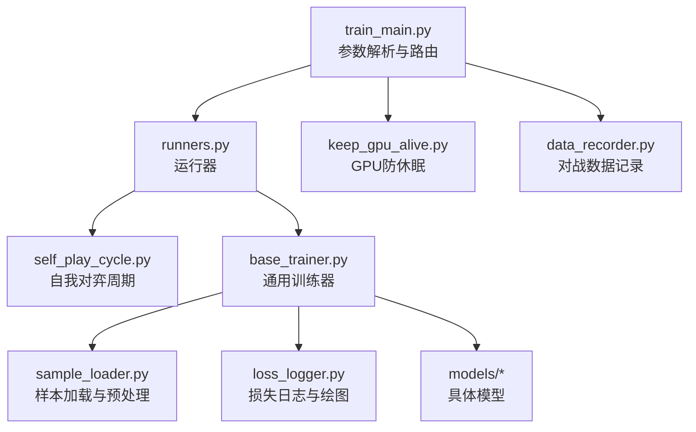
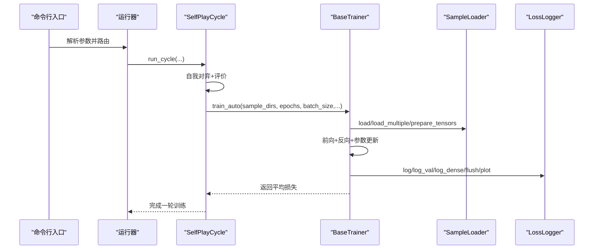
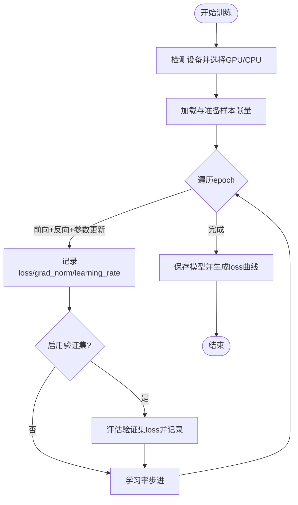
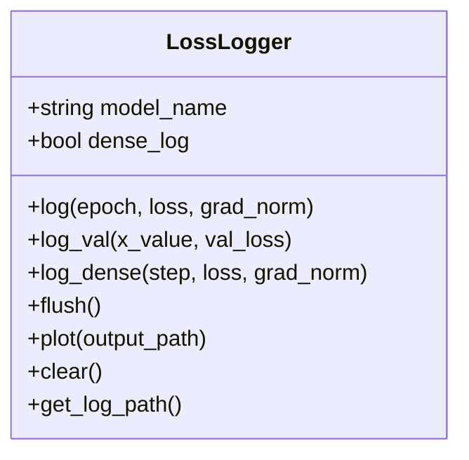
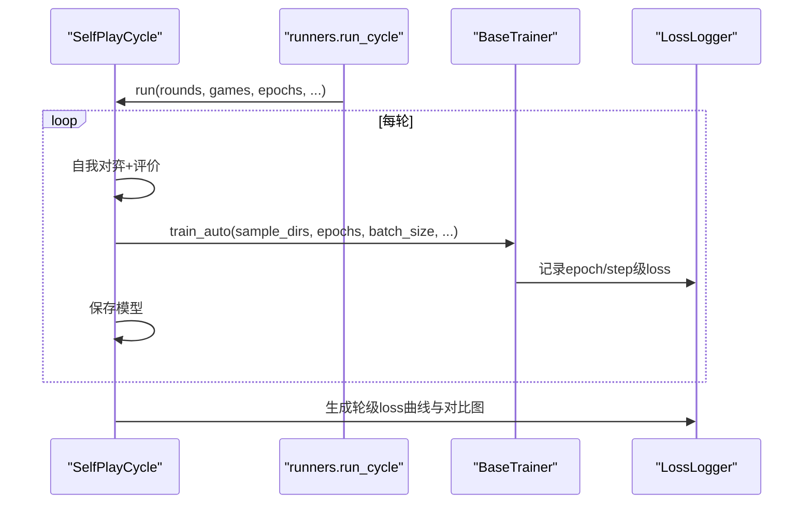
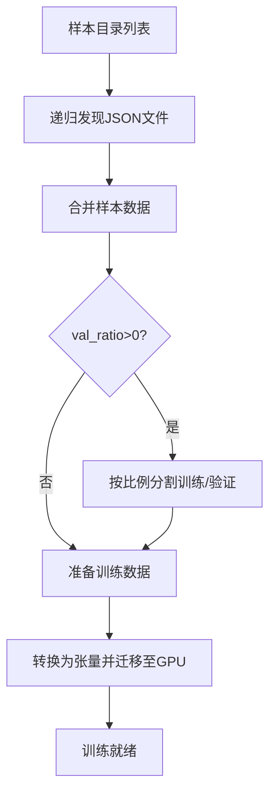
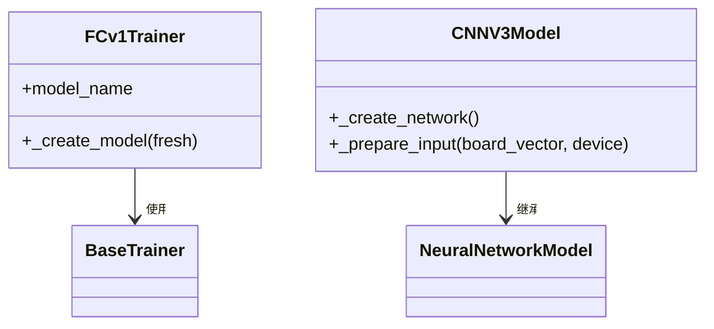
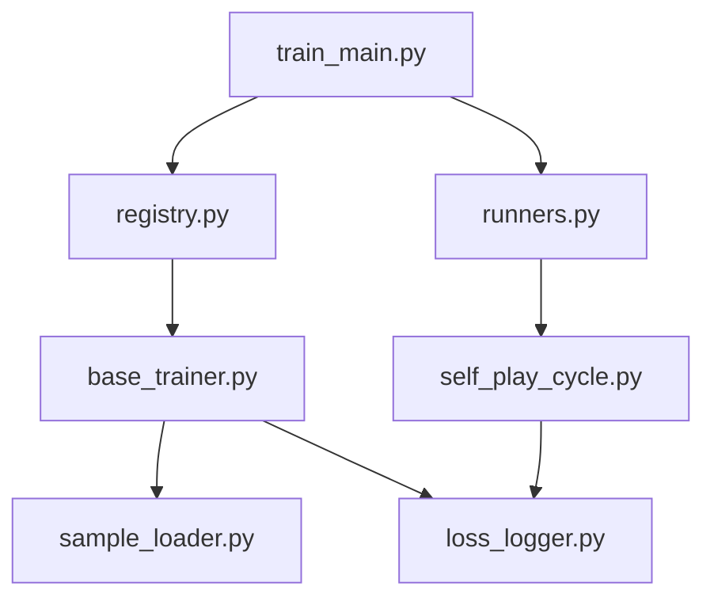

# 训练性能监控

<cite>
**本文引用的文件**
- [ai/train_main.py](file://ai/train_main.py)
- [ai/runners.py](file://ai/runners.py)
- [ai/base_trainer.py](file://ai/base_trainer.py)
- [ai/self_play_cycle.py](file://ai/self_play_cycle.py)
- [ai/loss_logger.py](file://ai/loss_logger.py)
- [ai/constants.py](file://ai/constants.py)
- [ai/sample_loader.py](file://ai/sample_loader.py)
- [ai/data_recorder.py](file://ai/data_recorder.py)
- [ai/keep_gpu_alive.py](file://ai/keep_gpu_alive.py)
- [ai/models/cnn_v3/model.py](file://ai/models/cnn_v3/model.py)
- [ai/models/fc_v1/trainer.py](file://ai/models/fc_v1/trainer.py)
</cite>

## 目录
1. [简介](#简介)
2. [项目结构](#项目结构)
3. [核心组件](#核心组件)
4. [架构总览](#架构总览)
5. [详细组件分析](#详细组件分析)
6. [依赖分析](#依赖分析)
7. [性能考量](#性能考量)
8. [故障排查指南](#故障排查指南)
9. [结论](#结论)
10. [附录](#附录)

## 简介
本指南面向五子棋AI训练过程的性能监控，聚焦于训练速度（每秒处理样本数）、GPU利用率、内存使用、损失收敛与训练时间统计。文档结合命令行参数（如--rounds、--games、--epochs等）说明它们对性能的影响，并提供识别数据加载瓶颈、模型计算瓶颈与内存瓶颈的方法。同时，给出通过日志与数据记录跟踪性能的实践建议，以及合理的监控频率与采样间隔设置。

## 项目结构
训练系统采用“入口脚本 + 运行器 + 训练器 + 日志/数据组件”的分层组织方式：
- 入口脚本负责参数解析与模式路由
- 运行器封装具体训练模式（周期模式、从数据训练）
- 训练器实现通用训练流程（单轮/批量/小批量训练、学习率调度、损失记录）
- 日志与数据组件负责损失曲线生成、训练数据加载与记录

**图示来源**
- [ai/train_main.py:1-234](file://ai/train_main.py#L1-L234)
- [ai/runners.py:1-255](file://ai/runners.py#L1-L255)
- [ai/base_trainer.py:1-699](file://ai/base_trainer.py#L1-L699)
- [ai/self_play_cycle.py:1-195](file://ai/self_play_cycle.py#L1-L195)
- [ai/loss_logger.py:1-461](file://ai/loss_logger.py#L1-L461)
- [ai/sample_loader.py:1-240](file://ai/sample_loader.py#L1-L240)
- [ai/data_recorder.py:1-145](file://ai/data_recorder.py#L1-L145)
- [ai/keep_gpu_alive.py:1-246](file://ai/keep_gpu_alive.py#L1-L246)

**章节来源**
- [ai/train_main.py:1-234](file://ai/train_main.py#L1-L234)
- [ai/runners.py:1-255](file://ai/runners.py#L1-L255)

## 核心组件
- 命令行入口与参数解析：提供--rounds、--games、--epochs、--batch-size、--shuffle、--val-ratio、--lr-scheduler等参数，控制训练模式与性能相关策略
- 训练器基类：统一实现单轮/批量/小批量训练、学习率调度、损失记录与验证集评估
- 自我对弈周期：封装轮次循环、对弈与评价、合并样本与训练的完整流程
- 损失日志记录器：记录训练损失、梯度范数、验证损失，支持生成曲线图
- 样本加载器：从JSON样本到PyTorch张量的转换与GPU加速
- 数据记录器：记录对战历史、落子位置与结果，便于离线分析
- GPU防休眠：防止独显因空闲休眠导致训练中断

**章节来源**
- [ai/base_trainer.py:1-699](file://ai/base_trainer.py#L1-L699)
- [ai/self_play_cycle.py:1-195](file://ai/self_play_cycle.py#L1-L195)
- [ai/loss_logger.py:1-461](file://ai/loss_logger.py#L1-L461)
- [ai/sample_loader.py:1-240](file://ai/sample_loader.py#L1-L240)
- [ai/data_recorder.py:1-145](file://ai/data_recorder.py#L1-L145)
- [ai/keep_gpu_alive.py:1-246](file://ai/keep_gpu_alive.py#L1-L246)

## 架构总览
训练流程从入口脚本解析参数，选择运行器模式（周期模式或从数据训练），随后由训练器执行具体训练步骤。训练器内部通过样本加载器准备数据，使用损失日志记录器记录指标，并在必要时进行验证集评估与学习率调度。

**图示来源**
- [ai/train_main.py:27-234](file://ai/train_main.py#L27-L234)
- [ai/runners.py:173-255](file://ai/runners.py#L173-L255)
- [ai/self_play_cycle.py:38-195](file://ai/self_play_cycle.py#L38-L195)
- [ai/base_trainer.py:575-699](file://ai/base_trainer.py#L575-L699)
- [ai/loss_logger.py:124-177](file://ai/loss_logger.py#L124-L177)

## 详细组件分析

### 命令行参数与性能影响
- --rounds：轮次数，直接影响对弈阶段的总样本量与训练阶段的合并规模
- --games：每轮对局数，决定每轮生成样本数量，影响数据加载与训练时间
- --epochs：每轮训练迭代数，决定训练循环次数，直接影响损失日志密度与验证评估频率
- --batch-size：小批量训练时的批次大小，影响显存占用与吞吐；None时使用全量更新
- --shuffle：小批量模式下是否打乱数据顺序，影响收敛稳定性与吞吐
- --val-ratio：验证集比例，启用验证损失记录，增加一次前向评估
- --lr-scheduler/--lr-step-size/--lr-gamma/--lr-patience/--lr-factor：学习率调度策略，影响收敛速度与稳定性

这些参数通过入口脚本解析后传递至运行器与训练器，进而影响数据加载、训练循环与日志记录策略。

**章节来源**
- [ai/train_main.py:58-192](file://ai/train_main.py#L58-L192)
- [ai/runners.py:173-255](file://ai/runners.py#L173-L255)

### 训练器与性能监控要点
- 设备选择：自动检测CUDA，优先使用GPU
- 损失记录：每LOSS_LOG_INTERVAL记录一次（默认200），支持验证集loss与梯度范数
- 小批量训练：支持密集日志（每batch记录），并批量写入磁盘
- 验证评估：在训练循环中定期评估验证集loss，辅助收敛监控
- 学习率调度：StepLR或ReduceLROnPlateau，影响收敛速度与稳定性

**图示来源**
- [ai/base_trainer.py:21-29](file://ai/base_trainer.py#L21-L29)
- [ai/base_trainer.py:257-322](file://ai/base_trainer.py#L257-L322)
- [ai/base_trainer.py:409-573](file://ai/base_trainer.py#L409-L573)
- [ai/constants.py:24-26](file://ai/constants.py#L24-L26)

**章节来源**
- [ai/base_trainer.py:115-120](file://ai/base_trainer.py#L115-L120)
- [ai/base_trainer.py:298-310](file://ai/base_trainer.py#L298-L310)
- [ai/base_trainer.py:536-558](file://ai/base_trainer.py#L536-L558)
- [ai/constants.py:24-26](file://ai/constants.py#L24-L26)

### 损失日志记录与可视化
- 日志文件：JSON Lines格式，支持epoch级与step级（小批量）记录
- 双Y轴图：Loss与梯度范数，可叠加验证集loss
- 降采样：超过阈值自动降采样，保证图表可读性
- 合并对比图：将多轮epoch级日志合并绘制，便于横向比较

**图示来源**
- [ai/loss_logger.py:28-177](file://ai/loss_logger.py#L28-L177)

**章节来源**
- [ai/loss_logger.py:124-177](file://ai/loss_logger.py#L124-L177)
- [ai/loss_logger.py:178-294](file://ai/loss_logger.py#L178-L294)
- [ai/loss_logger.py:365-461](file://ai/loss_logger.py#L365-L461)

### 自我对弈周期与训练编排
- 轮次循环：每轮进行自我对弈与评价，生成样本目录
- 训练选择：根据batch_size自动选择小批量或全量训练
- 日志隔离：按轮次与会话目录隔离，支持生成合并对比图

**图示来源**
- [ai/self_play_cycle.py:38-195](file://ai/self_play_cycle.py#L38-L195)
- [ai/runners.py:173-255](file://ai/runners.py#L173-L255)
- [ai/base_trainer.py:575-603](file://ai/base_trainer.py#L575-L603)

**章节来源**
- [ai/self_play_cycle.py:98-195](file://ai/self_play_cycle.py#L98-L195)
- [ai/runners.py:173-255](file://ai/runners.py#L173-L255)

### 样本加载与数据预处理
- 递归发现JSON数据文件，支持合并与分割
- 将样本转换为PyTorch张量并自动迁移至GPU
- 支持掩码损失，仅对有效位置计算损失

**图示来源**
- [ai/sample_loader.py:36-64](file://ai/sample_loader.py#L36-L64)
- [ai/sample_loader.py:116-165](file://ai/sample_loader.py#L116-L165)
- [ai/sample_loader.py:206-240](file://ai/sample_loader.py#L206-L240)

**章节来源**
- [ai/sample_loader.py:80-114](file://ai/sample_loader.py#L80-L114)
- [ai/sample_loader.py:185-204](file://ai/sample_loader.py#L185-L204)
- [ai/sample_loader.py:206-240](file://ai/sample_loader.py#L206-L240)

### 模型与输入适配
- FC模型：默认输入为(226,)，输出为225维概率分布
- CNN模型：输入为(3,15,15)的CNN张量，通过1×1卷积输出225维概率分布

**图示来源**
- [ai/models/fc_v1/trainer.py:11-44](file://ai/models/fc_v1/trainer.py#L11-L44)
- [ai/models/cnn_v3/model.py:96-139](file://ai/models/cnn_v3/model.py#L96-L139)

**章节来源**
- [ai/models/fc_v1/trainer.py:23-41](file://ai/models/fc_v1/trainer.py#L23-L41)
- [ai/models/cnn_v3/model.py:125-139](file://ai/models/cnn_v3/model.py#L125-L139)

## 依赖分析
- 入口脚本依赖注册表获取训练器，再由运行器分派到具体训练模式
- 训练器依赖样本加载器、损失日志记录器与模型
- 自我对弈周期依赖训练器与损失日志记录器
- 损失日志记录器依赖matplotlib（可选）进行绘图

**图示来源**
- [ai/train_main.py:23-24](file://ai/train_main.py#L23-L24)
- [ai/registry.py:187-223](file://ai/registry.py#L187-L223)
- [ai/runners.py:173-255](file://ai/runners.py#L173-L255)
- [ai/self_play_cycle.py:38-195](file://ai/self_play_cycle.py#L38-L195)
- [ai/base_trainer.py:122-125](file://ai/base_trainer.py#L122-L125)

**章节来源**
- [ai/registry.py:58-72](file://ai/registry.py#L58-L72)
- [ai/base_trainer.py:122-125](file://ai/base_trainer.py#L122-L125)

## 性能考量
- 训练速度（每秒处理样本数）
  - 小批量训练通常提升吞吐，但需平衡batch_size与显存
  - 启用--shuffle可能略微降低吞吐，但有利于收敛
  - 数据预处理在GPU上完成，减少CPU-GPU传输
- GPU利用率
  - 自动检测CUDA设备，优先使用GPU
  - 使用GPU防休眠工具避免独显休眠导致的训练中断
- 内存使用
  - 样本加载器将张量迁移到GPU，注意显存上限
  - 验证集评估使用no_grad，减少显存占用
- 损失收敛与训练时间
  - 每LOSS_LOG_INTERVAL记录一次，便于观察收敛趋势
  - 验证集loss有助于判断过拟合与学习率设置是否合适
- 监控频率与采样间隔
  - 默认200个epoch记录一次（稀疏日志）
  - 小批量模式下可启用密集日志，按batch记录并批量写入

**章节来源**
- [ai/base_trainer.py:115-120](file://ai/base_trainer.py#L115-L120)
- [ai/keep_gpu_alive.py:187-246](file://ai/keep_gpu_alive.py#L187-L246)
- [ai/constants.py:24-26](file://ai/constants.py#L24-L26)
- [ai/base_trainer.py:233-238](file://ai/base_trainer.py#L233-L238)

## 故障排查指南
- 训练中断
  - 训练器捕获Ctrl+C，自动保存模型与图表
  - 自我对弈周期同样支持中断保存与图表生成
- 损失日志异常
  - matplotlib不可用时，日志记录不受影响，绘图功能降级
  - 日志文件损坏时，读取器会忽略格式错误行
- GPU相关问题
  - 独显休眠导致训练卡住：使用GPU防休眠工具
  - 显存不足：减小batch_size或关闭验证集评估
- 数据加载问题
  - 样本文件缺失或格式错误：检查样本目录与JSON格式
  - 验证集比例非法：确保val_ratio在[0,1)范围内

**章节来源**
- [ai/base_trainer.py:314-322](file://ai/base_trainer.py#L314-L322)
- [ai/self_play_cycle.py:157-177](file://ai/self_play_cycle.py#L157-L177)
- [ai/loss_logger.py:196-202](file://ai/loss_logger.py#L196-L202)
- [ai/loss_logger.py:316-324](file://ai/loss_logger.py#L316-L324)
- [ai/keep_gpu_alive.py:187-246](file://ai/keep_gpu_alive.py#L187-L246)
- [ai/sample_loader.py:139-140](file://ai/sample_loader.py#L139-L140)

## 结论
通过命令行参数与训练器的协同，五子棋AI训练具备完善的性能监控能力：损失曲线、梯度范数、验证集loss与学习率均可记录与可视化。结合GPU防休眠与合理的batch_size、shuffle与验证集策略，可在保证收敛质量的同时提升训练效率。建议在生产环境中启用小批量训练与密集日志，配合定期的loss曲线与对比图分析，及时发现并解决性能瓶颈。

## 附录
- 关键参数速查
  - --rounds：轮次数
  - --games：每轮对局数
  - --epochs：每轮训练迭代数
  - --batch-size：小批量训练批次大小
  - --shuffle：小批量模式下是否打乱
  - --val-ratio：验证集比例
  - --lr-scheduler/--lr-step-size/--lr-gamma/--lr-patience/--lr-factor：学习率调度
- 监控建议
  - 每LOSS_LOG_INTERVAL（默认200）记录一次稀疏日志
  - 小批量训练启用密集日志，按epoch批量写入
  - 定期生成合并对比图，跨轮次对比收敛趋势
  - 使用GPU防休眠工具保障长时间训练稳定性