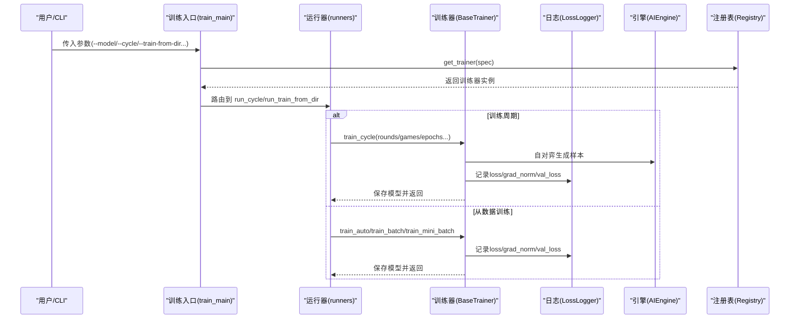
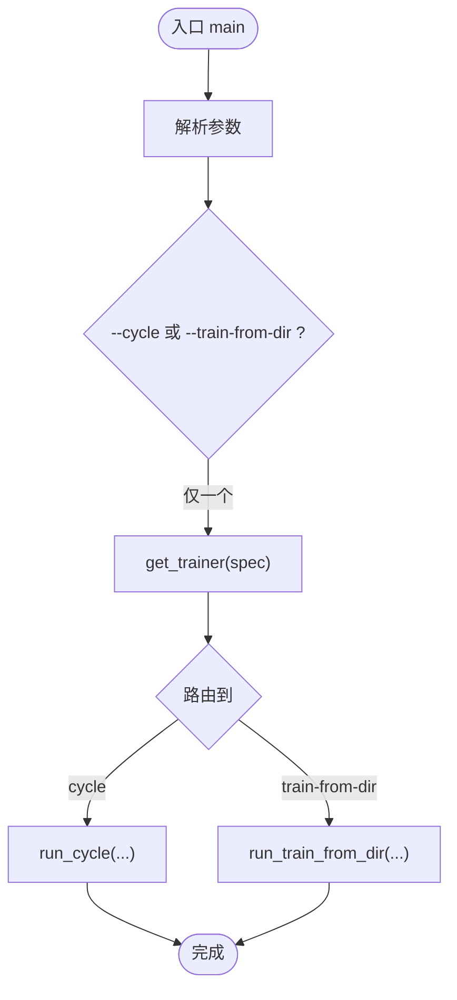
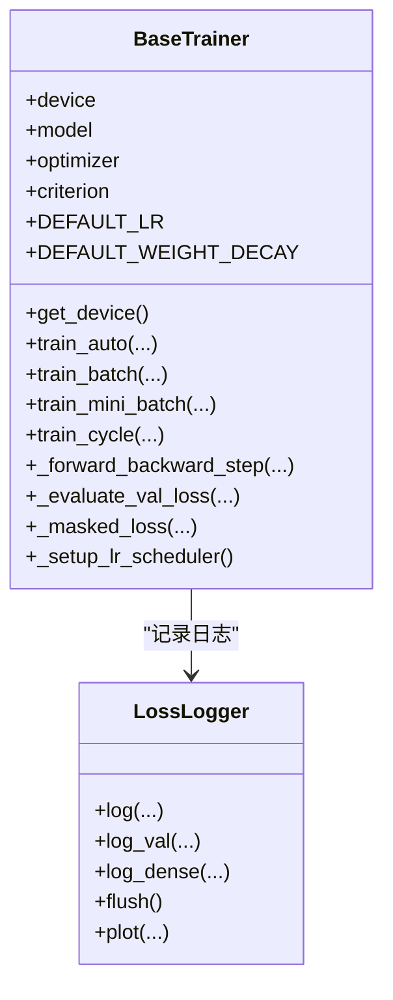
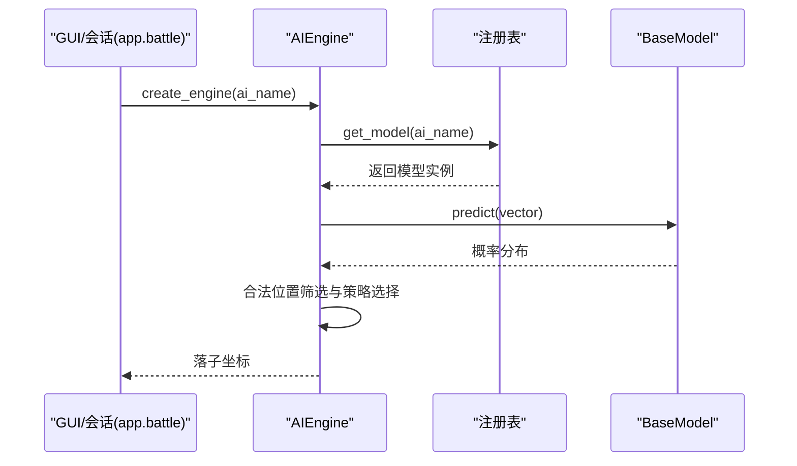
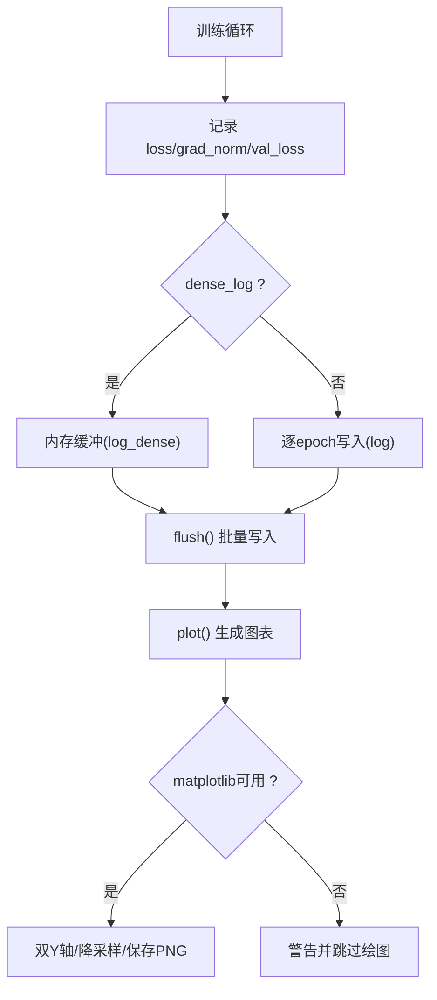
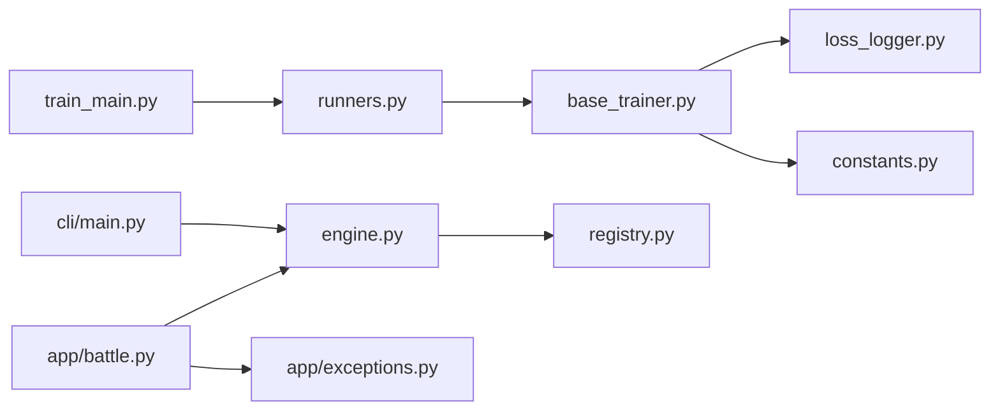

# 故障排查

<cite>
**本文引用的文件**
- [ai/train_main.py](file://ai/train_main.py)
- [ai/base_trainer.py](file://ai/base_trainer.py)
- [ai/engine.py](file://ai/engine.py)
- [app/battle.py](file://app/battle.py)
- [app/exceptions.py](file://app/exceptions.py)
- [ai/constants.py](file://ai/constants.py)
- [ai/loss_logger.py](file://ai/loss_logger.py)
- [ai/runners.py](file://ai/runners.py)
- [ai/registry.py](file://ai/registry.py)
- [cli/main.py](file://cli/main.py)
- [requirements/key_points.md](file://requirements/key_points.md)
- [design/base_trainer_design.md](file://design/base_trainer_design.md)
- [design/dense_loss_log_design.md](file://design/dense_loss_log_design.md)
</cite>

## 目录
1. [简介](#简介)
2. [项目结构](#项目结构)
3. [核心组件](#核心组件)
4. [架构总览](#架构总览)
5. [详细组件分析](#详细组件分析)
6. [依赖分析](#依赖分析)
7. [性能考虑](#性能考虑)
8. [故障排查指南](#故障排查指南)
9. [结论](#结论)
10. [附录](#附录)

## 简介
本指南面向五子棋AI项目的运维与开发人员，聚焦于系统化故障排查。内容涵盖环境配置、依赖冲突、GPU驱动问题、性能瓶颈（训练速度慢、显存不足、GPU利用率低）、AI模型相关问题（模型加载失败、推理异常、训练不收敛）、日志分析方法、调试工具使用、系统监控与告警配置，以及故障预防的最佳实践。文档基于仓库中的训练入口、训练器抽象、引擎、异常与日志等关键模块进行深入分析，并提供可视化图示辅助定位问题。

## 项目结构
项目采用分层清晰的组织方式：
- ai 包：训练入口、训练器抽象、引擎、日志、注册表、常量等核心训练与推理能力
- app 包：应用层会话与异常包装，向上游GUI提供统一错误类型
- cli 包：命令行交互入口
- tests 与 design：测试与设计文档，支撑可观测性与可维护性
- requirements：需求与约束说明

```mermaid
graph TB
subgraph "训练入口"
TM["ai/train_main.py"]
RN["ai/runners.py"]
end
subgraph "训练器与引擎"
BT["ai/base_trainer.py"]
ENG["ai/engine.py"]
REG["ai/registry.py"]
CONS["ai/constants.py"]
end
subgraph "日志与异常"
LL["ai/loss_logger.py"]
EX["app/exceptions.py"]
APPB["app/battle.py"]
end
subgraph "CLI"
CLI["cli/main.py"]
end
TM --> RN
RN --> BT
BT --> LL
BT --> CONS
ENG --> REG
APPB --> ENG
APPB --> EX
CLI --> ENG
```

**图示来源**
- [ai/train_main.py](file://ai/train_main.py)
- [ai/runners.py](file://ai/runners.py)
- [ai/base_trainer.py](file://ai/base_trainer.py)
- [ai/engine.py](file://ai/engine.py)
- [ai/registry.py](file://ai/registry.py)
- [ai/constants.py](file://ai/constants.py)
- [ai/loss_logger.py](file://ai/loss_logger.py)
- [app/battle.py](file://app/battle.py)
- [app/exceptions.py](file://app/exceptions.py)
- [cli/main.py](file://cli/main.py)

**章节来源**
- [ai/train_main.py](file://ai/train_main.py)
- [ai/runners.py](file://ai/runners.py)
- [ai/base_trainer.py](file://ai/base_trainer.py)
- [ai/engine.py](file://ai/engine.py)
- [ai/registry.py](file://ai/registry.py)
- [ai/constants.py](file://ai/constants.py)
- [ai/loss_logger.py](file://ai/loss_logger.py)
- [app/battle.py](file://app/battle.py)
- [app/exceptions.py](file://app/exceptions.py)
- [cli/main.py](file://cli/main.py)

## 核心组件
- 训练入口与运行器：解析参数、路由到训练模式（从数据训练/训练周期），并负责数据发现与临时目录清理
- 训练器抽象：统一设备选择（GPU/CPU）、损失计算、学习率调度、训练循环、日志与保存
- 引擎：将棋盘状态转换为模型输入，调用模型获取输出，按策略选择落子位置
- 注册表：统一模型与训练器映射，支持多代模型懒加载与校验
- 日志：Loss日志记录、图表生成、降采样与双Y轴可视化
- 异常与会话：将底层异常转换为GUI友好的ModelLoadError

**章节来源**
- [ai/train_main.py](file://ai/train_main.py)
- [ai/runners.py](file://ai/runners.py)
- [ai/base_trainer.py](file://ai/base_trainer.py)
- [ai/engine.py](file://ai/engine.py)
- [ai/registry.py](file://ai/registry.py)
- [ai/loss_logger.py](file://ai/loss_logger.py)
- [app/battle.py](file://app/battle.py)
- [app/exceptions.py](file://app/exceptions.py)

## 架构总览
训练与推理的关键交互如下：



**图示来源**
- [ai/train_main.py](file://ai/train_main.py)
- [ai/runners.py](file://ai/runners.py)
- [ai/base_trainer.py](file://ai/base_trainer.py)
- [ai/loss_logger.py](file://ai/loss_logger.py)
- [ai/engine.py](file://ai/engine.py)
- [ai/registry.py](file://ai/registry.py)

## 详细组件分析

### 训练入口与参数校验
- 参数互斥校验：--cycle 与 --train-from-dir 二选一，避免歧义
- 模型解析：通过注册表按需懒加载训练器，支持多代模型规格（如 cnn_v3.1）
- 模式路由：将控制流分派至 run_cycle 或 run_train_from_dir



**图示来源**
- [ai/train_main.py](file://ai/train_main.py)
- [ai/runners.py](file://ai/runners.py)
- [ai/registry.py](file://ai/registry.py)

**章节来源**
- [ai/train_main.py](file://ai/train_main.py)
- [ai/runners.py](file://ai/runners.py)
- [ai/registry.py](file://ai/registry.py)

### 训练器抽象与设备选择
- 设备优先级：CUDA可用时使用GPU，否则回退CPU
- 损失与掩码：L1Loss结合mask，支持验证集评估
- 学习率调度：StepLR与ReduceLROnPlateau两种策略
- 训练循环：统一的epoch循环、日志记录、键盘中断处理与模型保存



**图示来源**
- [ai/base_trainer.py](file://ai/base_trainer.py)
- [ai/loss_logger.py](file://ai/loss_logger.py)

**章节来源**
- [ai/base_trainer.py](file://ai/base_trainer.py)
- [ai/loss_logger.py](file://ai/loss_logger.py)

### 引擎与模型加载
- 引擎职责：输入向量转换、模型预测、合法位置筛选、策略选择（argmax/sampling）
- 模型加载：通过注册表统一解析模型规格，支持多代模型；加载失败抛出异常由上层捕获



**图示来源**
- [ai/engine.py](file://ai/engine.py)
- [ai/registry.py](file://ai/registry.py)
- [app/battle.py](file://app/battle.py)

**章节来源**
- [ai/engine.py](file://ai/engine.py)
- [ai/registry.py](file://ai/registry.py)
- [app/battle.py](file://app/battle.py)

### 日志与可视化
- 日志格式：JSON Lines，支持epoch/step、loss、grad_norm、val_loss
- 可视化：matplotlib生成Loss曲线图，双Y轴叠加验证集Loss；自动降采样避免点过多
- 降级策略：matplotlib不可用时仅记录日志，不中断训练



**图示来源**
- [ai/loss_logger.py](file://ai/loss_logger.py)
- [design/dense_loss_log_design.md](file://design/dense_loss_log_design.md)

**章节来源**
- [ai/loss_logger.py](file://ai/loss_logger.py)
- [design/dense_loss_log_design.md](file://design/dense_loss_log_design.md)

### 异常与会话
- ModelLoadError：将底层模型加载异常转换为GUI可读提示
- 会话层：BattleSession在创建引擎时捕获异常并抛出ModelLoadError

**章节来源**
- [app/exceptions.py](file://app/exceptions.py)
- [app/battle.py](file://app/battle.py)

## 依赖分析
- 训练入口依赖注册表与运行器；运行器依赖训练器与样本加载；训练器依赖日志与常量
- 引擎依赖注册表与模型；会话依赖引擎与异常
- CLI依赖控制器（通过GUI间接依赖引擎）



**图示来源**
- [ai/train_main.py](file://ai/train_main.py)
- [ai/runners.py](file://ai/runners.py)
- [ai/base_trainer.py](file://ai/base_trainer.py)
- [ai/loss_logger.py](file://ai/loss_logger.py)
- [ai/constants.py](file://ai/constants.py)
- [ai/engine.py](file://ai/engine.py)
- [ai/registry.py](file://ai/registry.py)
- [app/battle.py](file://app/battle.py)
- [app/exceptions.py](file://app/exceptions.py)
- [cli/main.py](file://cli/main.py)

**章节来源**
- [ai/train_main.py](file://ai/train_main.py)
- [ai/runners.py](file://ai/runners.py)
- [ai/base_trainer.py](file://ai/base_trainer.py)
- [ai/loss_logger.py](file://ai/loss_logger.py)
- [ai/constants.py](file://ai/constants.py)
- [ai/engine.py](file://ai/engine.py)
- [ai/registry.py](file://ai/registry.py)
- [app/battle.py](file://app/battle.py)
- [app/exceptions.py](file://app/exceptions.py)
- [cli/main.py](file://cli/main.py)

## 性能考虑
- 设备选择：优先GPU，显存不足时回退CPU；注意批大小与验证集比例对显存占用的影响
- 训练方法：mini-batch相比全量更新收敛更快、更高效，但需关注梯度范数与损失波动
- 日志开销：密集日志采用内存缓冲+批量写入，epoch末尾flush确保落盘
- 可视化降采样：超过阈值自动降采样，避免图表渲染卡顿
- 学习率调度：根据验证集损失动态衰减，有助于稳定收敛

[本节为通用指导，无需列出具体文件来源]

## 故障排查指南

### 环境配置与依赖冲突
- 症状
  - 导入模块报错或找不到包
  - 训练入口无法解析参数或报“未知模型”
- 诊断步骤
  - 确认项目根目录已加入Python路径（训练入口与CLI均在入口处插入项目根目录）
  - 检查requirements与依赖版本，确保torch与matplotlib可用
  - 若使用虚拟环境，确认激活状态与包安装一致性
- 解决方案
  - 重新安装依赖，确保torch与matplotlib版本兼容
  - 使用注册表列出可用模型，确认模型名称正确（多代模型需带代数）

**章节来源**
- [ai/train_main.py](file://ai/train_main.py)
- [cli/main.py](file://cli/main.py)
- [ai/registry.py](file://ai/registry.py)

### GPU驱动与显存问题
- 症状
  - 训练启动即报CUDA相关错误
  - 显存不足导致OOM，或GPU利用率低
- 诊断步骤
  - 检查设备选择逻辑：训练器自动检测CUDA可用性，若不可用回退CPU
  - 观察日志图表与梯度范数，判断是否存在梯度爆炸/消失
  - 降低批大小、关闭验证集或减少epoch，缓解显存压力
- 解决方案
  - 降低batch_size或val_ratio
  - 切换到全量更新（不提供batch_size）以减少碎片化
  - 确保GPU驱动与CUDA版本匹配

**章节来源**
- [ai/base_trainer.py](file://ai/base_trainer.py)
- [ai/loss_logger.py](file://ai/loss_logger.py)

### 训练速度慢与收敛异常
- 症状
  - 训练耗时过长、loss下降缓慢或震荡
  - 梯度范数异常增大或为0
- 诊断步骤
  - 使用密集日志观察每个batch的loss与grad_norm变化
  - 检查学习率调度配置（StepLR/Plateau）与衰减参数
  - 对比稀疏与密集日志，确认是否因I/O导致瓶颈
- 解决方案
  - 启用mini-batch并合理设置batch_size与shuffle
  - 调整学习率衰减策略与参数（步长、系数、耐心值）
  - 使用验证集监控val_loss，避免过拟合

**章节来源**
- [ai/base_trainer.py](file://ai/base_trainer.py)
- [ai/loss_logger.py](file://ai/loss_logger.py)
- [design/dense_loss_log_design.md](file://design/dense_loss_log_design.md)

### 模型加载失败与推理异常
- 症状
  - GUI提示“模型加载失败”，或训练入口抛出ValueError
  - 引擎选择落子时报错（如棋盘已满、策略非法）
- 诊断步骤
  - 检查模型名称与多代规格（如 cnn_v3.1），确保已在注册表中声明
  - 捕获底层异常并转换为ModelLoadError，便于GUI提示
  - 校验引擎输入向量长度与策略参数（温度、top_k等）
- 解决方案
  - 使用注册表列出可用模型，确认拼写与代数正确
  - 在会话层捕获异常并抛出ModelLoadError，避免静默降级

**章节来源**
- [ai/registry.py](file://ai/registry.py)
- [app/battle.py](file://app/battle.py)
- [app/exceptions.py](file://app/exceptions.py)
- [ai/engine.py](file://ai/engine.py)

### 训练不收敛与样本问题
- 症状
  - loss不降或震荡，val_loss上升
  - 样本mask全为0或目标值异常
- 诊断步骤
  - 检查样本目录发现逻辑与合并流程
  - 确认mask与target的对应关系，验证已落子位置的屏蔽
  - 对比不同轮次的loss曲线，观察是否存在数据偏差
- 解决方案
  - 确保样本目录包含合法的sample.json
  - 调整mask逻辑，确保已落子位置不参与损失计算
  - 增加验证集比例，监控val_loss趋势

**章节来源**
- [ai/runners.py](file://ai/runners.py)
- [ai/base_trainer.py](file://ai/base_trainer.py)

### 日志分析方法
- JSON Lines格式：逐条记录epoch/step、loss、grad_norm、val_loss
- 可视化：matplotlib生成双Y轴图，叠加val_loss；自动降采样
- 降级策略：matplotlib不可用时仅记录日志，不影响训练
- 建议
  - 关注grad_norm与loss的联动关系，定位梯度问题
  - 使用对比图比较多轮次loss曲线，识别异常波动

**章节来源**
- [ai/loss_logger.py](file://ai/loss_logger.py)
- [design/dense_loss_log_design.md](file://design/dense_loss_log_design.md)

### 调试工具使用
- Python调试器
  - 在训练入口或训练器关键节点设置断点，逐步检查张量形状与损失计算
- PyTorch调试
  - 使用torch.no_grad()与eval模式验证验证集评估逻辑
  - 检查梯度范数聚合逻辑，定位梯度爆炸/消失
- 可观测性
  - 启用密集日志，观察batch级loss与grad_norm
  - 使用验证集监控val_loss，避免过拟合

**章节来源**
- [ai/base_trainer.py](file://ai/base_trainer.py)
- [ai/loss_logger.py](file://ai/loss_logger.py)

### 系统监控与告警
- 建议
  - 监控GPU显存使用率与利用率，设置阈值告警
  - 监控训练日志文件增长速率与绘图生成成功率
  - 对loss与val_loss异常波动设置阈值告警
- 工具
  - nvidia-smi（GPU监控）
  - 文件系统监控（日志目录空间与inode）
  - 日志分析脚本（统计loss均值/方差）

[本节为通用指导，无需列出具体文件来源]

### 故障预防与最佳实践
- 模型管理
  - 使用注册表统一管理模型与训练器，避免硬编码路径
  - 多代模型严格区分基础名称与代数，避免混淆
- 训练流程
  - 合理设置batch_size与val_ratio，避免显存溢出
  - 使用验证集与学习率调度，提升收敛稳定性
- 日志与可视化
  - 启用密集日志与降采样，兼顾可观测性与性能
  - 在训练结束时统一flush，确保数据落盘
- 异常处理
  - 将底层异常转换为GUI友好的ModelLoadError
  - 在会话层捕获并上报，避免静默失败

**章节来源**
- [ai/registry.py](file://ai/registry.py)
- [ai/runners.py](file://ai/runners.py)
- [ai/base_trainer.py](file://ai/base_trainer.py)
- [ai/loss_logger.py](file://ai/loss_logger.py)
- [app/battle.py](file://app/battle.py)
- [app/exceptions.py](file://app/exceptions.py)

## 结论
本指南围绕训练入口、训练器抽象、引擎、日志与异常等核心模块，提供了系统化的故障排查流程与解决方案。通过参数校验、设备选择、日志可视化与学习率调度等手段，可有效定位并解决环境、性能与模型相关问题。建议在生产环境中配合GPU监控、日志分析与告警机制，持续提升系统的稳定性与可观测性。

## 附录
- 关键常量与路径
  - AI数据目录、训练数据目录、日志目录可通过常量模块统一管理，必要时可通过环境变量覆盖
- 设计参考
  - BaseTrainer设计文档与密集日志设计文档为训练器实现与日志策略提供了权威参考

**章节来源**
- [ai/constants.py](file://ai/constants.py)
- [design/base_trainer_design.md](file://design/base_trainer_design.md)
- [design/dense_loss_log_design.md](file://design/dense_loss_log_design.md)
- [requirements/key_points.md](file://requirements/key_points.md)