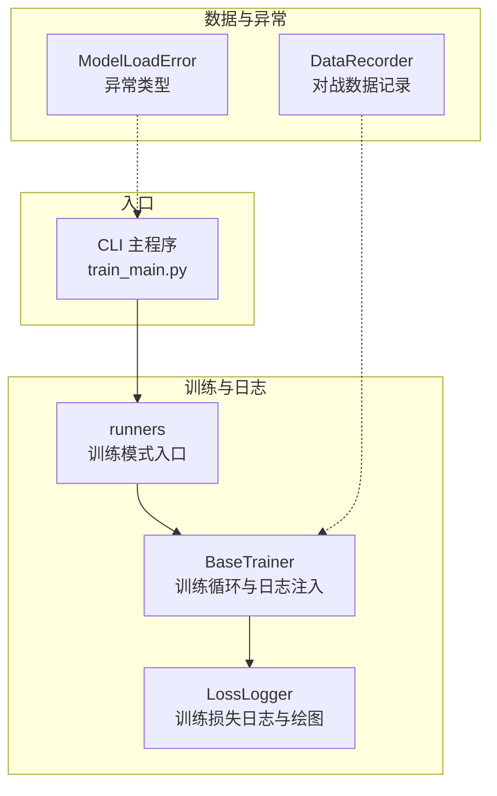
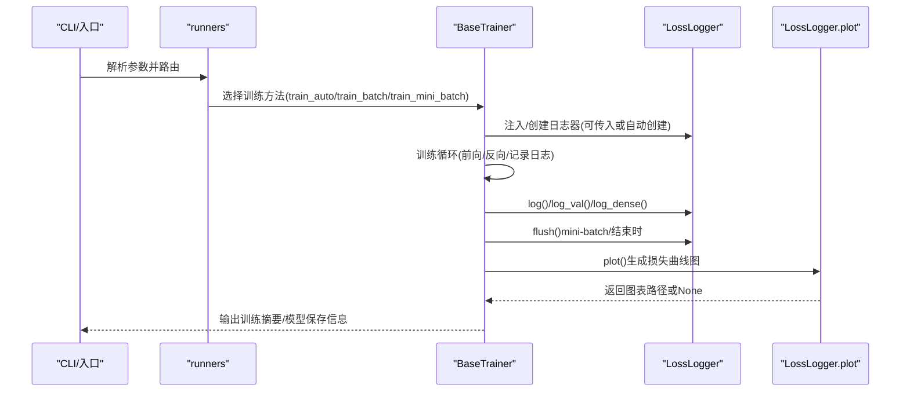
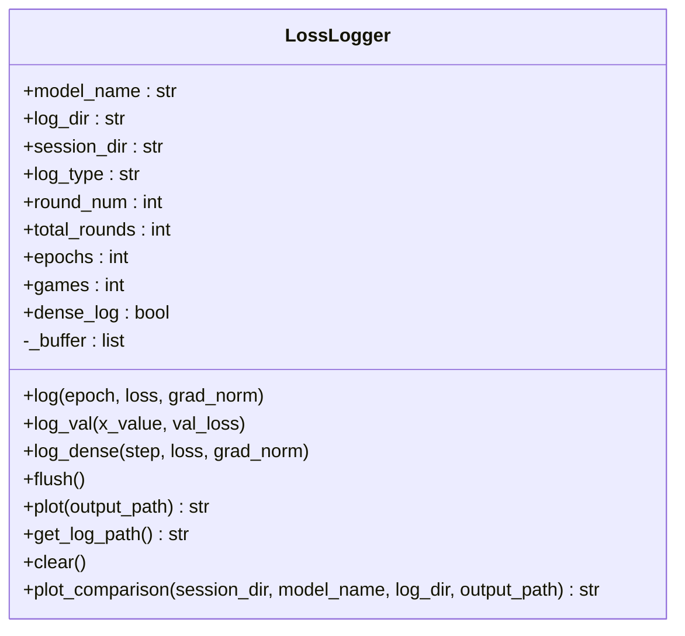
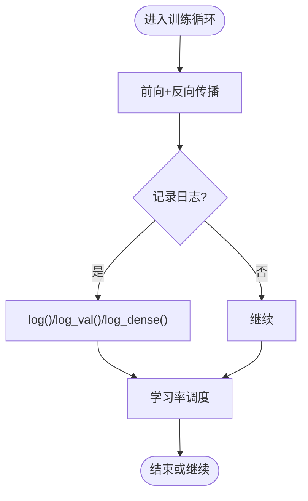
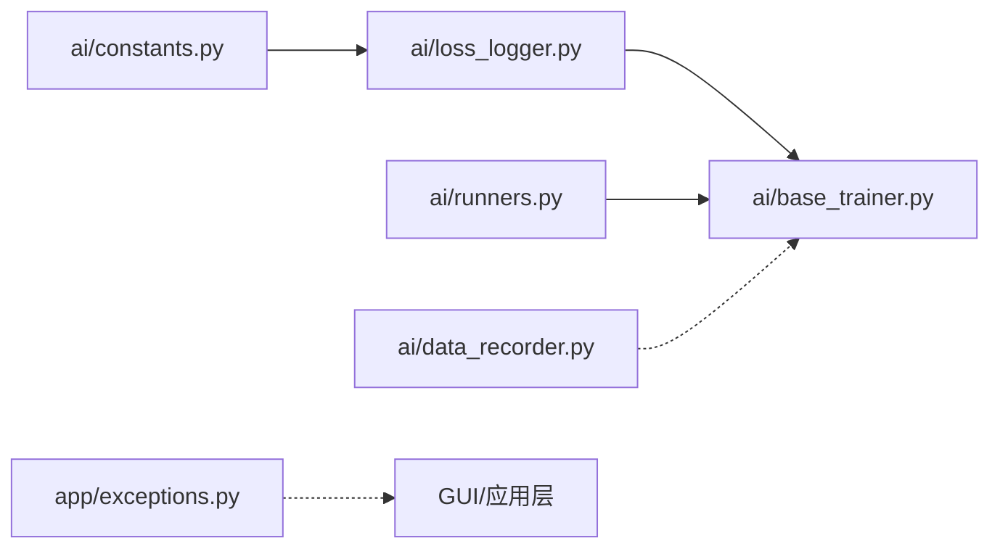

# 日志管理

<cite>
**本文引用的文件**
- [ai/loss_logger.py](file://ai/loss_logger.py)
- [ai/base_trainer.py](file://ai/base_trainer.py)
- [ai/constants.py](file://ai/constants.py)
- [ai/runners.py](file://ai/runners.py)
- [ai/data_recorder.py](file://ai/data_recorder.py)
- [app/exceptions.py](file://app/exceptions.py)
- [cli/main.py](file://cli/main.py)
- [tests/ai/test_loss_logger.py](file://tests/ai/test_loss_logger.py)
- [tests/ai/test_fc_v1_trainer.py](file://tests/ai/test_fc_v1_trainer.py)
- [design/loss_curve/loss_curve_design.md](file://design/loss_curve/loss_curve_design.md)
- [design/multi_gen_model_design.md](file://design/multi_gen_model_design.md)
</cite>

## 目录
1. [简介](#简介)
2. [项目结构](#项目结构)
3. [核心组件](#核心组件)
4. [架构总览](#架构总览)
5. [组件详解](#组件详解)
6. [依赖关系分析](#依赖关系分析)
7. [性能考量](#性能考量)
8. [故障排查指南](#故障排查指南)
9. [结论](#结论)
10. [附录](#附录)

## 简介
本指南围绕五子棋AI项目的日志管理，系统阐述日志级别、日志文件组织、日志轮转策略、训练过程关键指标记录、日志分析与工具、以及日志安全与隐私保护。结合现有代码实现，给出可操作的配置与最佳实践，帮助开发者在训练与运行过程中高效定位问题、分析系统行为。

## 项目结构
本项目日志相关能力主要分布在以下模块：
- 训练日志与可视化：LossLogger、BaseTrainer、runners
- 数据记录：DataRecorder（对战数据）
- 异常与错误：ModelLoadError（用于错误传播与日志化）
- CLI入口：命令行参数驱动训练流程，间接影响日志输出

**图表来源**
- [ai/loss_logger.py](file://ai/loss_logger.py)
- [ai/base_trainer.py](file://ai/base_trainer.py)
- [ai/runners.py](file://ai/runners.py)
- [ai/data_recorder.py](file://ai/data_recorder.py)
- [app/exceptions.py](file://app/exceptions.py)
- [cli/main.py](file://cli/main.py)

**章节来源**
- [ai/loss_logger.py](file://ai/loss_logger.py)
- [ai/base_trainer.py](file://ai/base_trainer.py)
- [ai/runners.py](file://ai/runners.py)
- [ai/data_recorder.py](file://ai/data_recorder.py)
- [app/exceptions.py](file://app/exceptions.py)
- [cli/main.py](file://cli/main.py)

## 核心组件
- LossLogger：负责将训练损失、梯度范数、验证损失等指标以JSON Lines格式持久化，并在可用时生成损失曲线图。支持密集日志（按step）与稀疏日志（按epoch）两种模式，具备缓冲写入与降采样能力。
- BaseTrainer：训练器抽象基类，提供统一的训练循环、学习率调度、训练/验证损失记录、模型保存与图表生成等能力。通过依赖注入方式接入LossLogger，支持自动创建或外部传入。
- runners：训练模式入口，封装“从目录训练”和“训练周期”两类模式，负责参数解析与模式路由，并在合适时机触发LossLogger的flush与绘图。
- DataRecorder：对战数据记录器，将每轮对局的输入、输出、落子位置与结果写入文件，属于数据层面的记录，与LossLogger的训练日志互补。
- ModelLoadError：应用层异常类型，用于将底层错误转化为面向用户的提示，便于在GUI层进行错误展示与日志化。

**章节来源**
- [ai/loss_logger.py](file://ai/loss_logger.py)
- [ai/base_trainer.py](file://ai/base_trainer.py)
- [ai/runners.py](file://ai/runners.py)
- [ai/data_recorder.py](file://ai/data_recorder.py)
- [app/exceptions.py](file://app/exceptions.py)

## 架构总览
训练日志从LossLogger流向LossLogger.plot，再由BaseTrainer在训练结束时触发flush与绘图；runners在训练模式中控制dense_log开关与参数传递；DataRecorder独立记录对战数据；异常通过ModelLoadError在GUI层展示。

**图表来源**
- [ai/runners.py](file://ai/runners.py)
- [ai/base_trainer.py](file://ai/base_trainer.py)
- [ai/loss_logger.py](file://ai/loss_logger.py)

**章节来源**
- [ai/runners.py](file://ai/runners.py)
- [ai/base_trainer.py](file://ai/base_trainer.py)
- [ai/loss_logger.py](file://ai/loss_logger.py)

## 组件详解

### LossLogger：日志记录与可视化
- 文件格式：JSON Lines，每行一条记录，字段包含epoch/loss或step/loss/grad_norm，以及可选的val_loss。
- 日志类型：
  - 稀疏日志：按epoch记录，适合全量更新训练。
  - 密集日志：按step记录，适合mini-batch训练，支持梯度范数记录。
- 缓冲与落盘：提供内存缓冲区，通过flush批量写入，降低频繁I/O开销。
- 可视化：支持单Y轴（Loss）与双Y轴（Loss + Grad Norm），可叠加Val Loss；当数据点过多时自动降采样。
- 文件命名与目录：支持语义化文件名（轮次/层级）与session_dir子目录隔离；默认目录可通过环境变量覆盖。

**图表来源**
- [ai/loss_logger.py](file://ai/loss_logger.py)

**章节来源**
- [ai/loss_logger.py](file://ai/loss_logger.py)
- [tests/ai/test_loss_logger.py](file://tests/ai/test_loss_logger.py)

### BaseTrainer：训练循环与日志集成
- 训练方法：
  - train_batch：全量更新，按epoch记录稀疏日志。
  - train_mini_batch：mini-batch更新，按epoch评估val_loss，支持dense_log。
  - train_auto：根据batch_size自动选择训练方法。
- 日志注入：支持通过构造函数注入LossLogger，或在训练前自动创建；训练结束统一flush并生成图表。
- 学习率调度：支持StepLR与ReduceLROnPlateau，训练中动态记录学习率。
- 键指标记录：每步/每epoch记录loss、grad_norm、val_loss，配合verbose输出训练进度。

**图表来源**
- [ai/base_trainer.py](file://ai/base_trainer.py)

**章节来源**
- [ai/base_trainer.py](file://ai/base_trainer.py)
- [tests/ai/test_fc_v1_trainer.py](file://tests/ai/test_fc_v1_trainer.py)

### runners：训练模式与日志参数传递
- run_train_from_dir：从目录或文件加载样本，自动选择训练方法，开启dense_log，输出训练摘要与模型保存路径。
- run_cycle：训练周期模式，打印详细参数与温度采样配置，调用BaseTrainer.train_cycle。

**章节来源**
- [ai/runners.py](file://ai/runners.py)

### DataRecorder：对战数据记录
- 按轮次创建目录，按局数子目录保存record.json，记录历史、赢家、终局棋盘等。
- 与LossLogger互补，前者关注训练过程指标，后者关注对局数据。

**章节来源**
- [ai/data_recorder.py](file://ai/data_recorder.py)

### 异常与错误传播：ModelLoadError
- 应用层异常，用于将底层错误转换为面向用户的提示，GUI层捕获后弹窗提示并回退。
- 与日志结合：可在异常捕获处记录上下文信息，便于定位问题。

**章节来源**
- [app/exceptions.py](file://app/exceptions.py)
- [design/multi_gen_model_design.md](file://design/multi_gen_model_design.md)

## 依赖关系分析
- LossLogger依赖ai/constants中的日志目录常量，可通过环境变量覆盖。
- BaseTrainer依赖LossLogger进行日志记录与可视化，同时依赖runners提供的训练模式入口。
- runners依赖BaseTrainer的训练方法，控制dense_log与参数传递。
- DataRecorder与LossLogger分别承担数据记录与训练日志职责，彼此独立。
- ModelLoadError在GUI层用于错误展示，与日志记录形成互补。

**图表来源**
- [ai/constants.py](file://ai/constants.py)
- [ai/loss_logger.py](file://ai/loss_logger.py)
- [ai/base_trainer.py](file://ai/base_trainer.py)
- [ai/runners.py](file://ai/runners.py)
- [ai/data_recorder.py](file://ai/data_recorder.py)
- [app/exceptions.py](file://app/exceptions.py)

**章节来源**
- [ai/constants.py](file://ai/constants.py)
- [ai/loss_logger.py](file://ai/loss_logger.py)
- [ai/base_trainer.py](file://ai/base_trainer.py)
- [ai/runners.py](file://ai/runners.py)
- [ai/data_recorder.py](file://ai/data_recorder.py)
- [app/exceptions.py](file://app/exceptions.py)

## 性能考量
- I/O优化：LossLogger提供内存缓冲区与flush机制，减少频繁open/close带来的I/O开销。
- 可视化降采样：当数据点超过阈值时自动降采样，兼顾图表质量与性能。
- 绘图降级：matplotlib缺失或运行时异常时优雅降级，不影响训练流程与日志文件。
- 训练模式选择：mini-batch模式更适合大规模数据，能更快收敛并记录更细粒度指标。

**章节来源**
- [ai/loss_logger.py](file://ai/loss_logger.py)
- [ai/base_trainer.py](file://ai/base_trainer.py)

## 故障排查指南
- matplotlib不可用或绘图失败
  - 现象：生成图表失败或跳过绘图。
  - 处理：确认matplotlib安装；LossLogger会发出警告并继续工作。
- 日志文件为空或未落盘
  - 现象：flush前日志未写入。
  - 处理：确保在epoch结束或训练结束调用flush；或在mini-batch模式下按epoch同步。
- 验证集指标未记录
  - 现象：val_loss未出现在图表或文件。
  - 处理：确认传入了val_inputs/val_targets；在train_mini_batch中每epoch评估val_loss。
- 训练中断
  - 现象：Ctrl+C中断后未保存图表。
  - 处理：BaseTrainer在中断时会保存当前进度并生成图表；确保loss_logger.flush被调用。
- 环境变量覆盖日志目录
  - 现象：日志目录不在默认位置。
  - 处理：通过环境变量覆盖日志根目录，便于测试隔离。

**章节来源**
- [ai/loss_logger.py](file://ai/loss_logger.py)
- [ai/base_trainer.py](file://ai/base_trainer.py)
- [tests/ai/test_loss_logger.py](file://tests/ai/test_loss_logger.py)
- [tests/ai/test_fc_v1_trainer.py](file://tests/ai/test_fc_v1_trainer.py)

## 结论
本项目通过LossLogger实现了训练过程的结构化日志记录与可视化，结合BaseTrainer与runners提供了灵活的训练模式与参数传递。DataRecorder补充了对战数据记录，ModelLoadError提升了错误传播与用户体验。建议在生产环境中启用dense_log以获得更细粒度指标，并在CI中使用环境变量隔离日志目录，确保日志文件可控、可分析、可审计。

## 附录

### 日志级别与使用场景
- DEBUG：调试阶段的详细中间状态（如梯度范数、学习率变化细节）。当前实现未显式使用DEBUG级别，建议在应用层通过verbose或额外日志开关控制。
- INFO：常规训练进度与摘要（如每若干epoch的平均loss、模型保存路径）。BaseTrainer的verbose输出即为INFO级信息。
- WARNING：潜在问题（如matplotlib不可用、数据点降采样、日志文件异常行）。LossLogger在绘图失败时发出警告。
- ERROR：严重错误（如模型加载失败、训练异常）。ModelLoadError用于GUI层展示与日志化。

**章节来源**
- [ai/base_trainer.py](file://ai/base_trainer.py)
- [ai/loss_logger.py](file://ai/loss_logger.py)
- [app/exceptions.py](file://app/exceptions.py)

### 日志文件组织与分类
- 训练日志（LossLogger）
  - 目录：ai/ai_data/loss_logs（可通过环境变量覆盖）
  - 文件命名：支持语义化命名（轮次/层级）或UUID命名
  - 内容：epoch/loss、step/loss/grad_norm、val_loss
- 对战数据（DataRecorder）
  - 目录：ai/ai_data/{ai_name}_{轮次}/
  - 文件：每局一个record.json，包含历史、赢家、终局棋盘
- 异常与错误
  - 通过ModelLoadError在GUI层展示，便于用户理解错误原因

**章节来源**
- [ai/loss_logger.py](file://ai/loss_logger.py)
- [ai/data_recorder.py](file://ai/data_recorder.py)
- [ai/constants.py](file://ai/constants.py)

### 日志轮转配置
- 当前实现未内置日志轮转机制，建议通过外部工具（如logrotate、容器日志驱动）或在CI中定期清理策略来控制日志文件大小，避免无限增长影响系统性能。

**章节来源**
- [design/loss_curve/loss_curve_design.md](file://design/loss_curve/loss_curve_design.md)

### 训练过程关键指标记录
- 指标项：loss、grad_norm、val_loss、学习率、epoch/step
- 记录频率：稀疏日志按LOSS_LOG_INTERVAL（默认200）记录；密集日志按batch记录
- 输出形式：JSON Lines文件与损失曲线图（可选）

**章节来源**
- [ai/base_trainer.py](file://ai/base_trainer.py)
- [ai/loss_logger.py](file://ai/loss_logger.py)
- [ai/constants.py](file://ai/constants.py)

### 日志分析方法与工具
- 文本分析：使用grep/awk/sed筛选epoch/loss/val_loss，统计收敛趋势。
- 可视化：matplotlib生成损失曲线图；LossLogger.plot_comparison支持多轮对比。
- 测试验证：通过单元测试断言日志格式、flush行为、降级处理等。

**章节来源**
- [tests/ai/test_loss_logger.py](file://tests/ai/test_loss_logger.py)
- [tests/ai/test_fc_v1_trainer.py](file://tests/ai/test_fc_v1_trainer.py)
- [ai/loss_logger.py](file://ai/loss_logger.py)

### 日志安全与隐私保护
- 敏感信息：当前日志未包含用户隐私或敏感数据；仍建议在CI与生产中：
  - 限制日志目录权限
  - 使用环境变量隔离日志目录
  - 定期清理与归档，避免长期保留
  - 在GUI层展示错误时避免泄露底层异常细节（ModelLoadError已提供友好提示）

**章节来源**
- [ai/constants.py](file://ai/constants.py)
- [app/exceptions.py](file://app/exceptions.py)