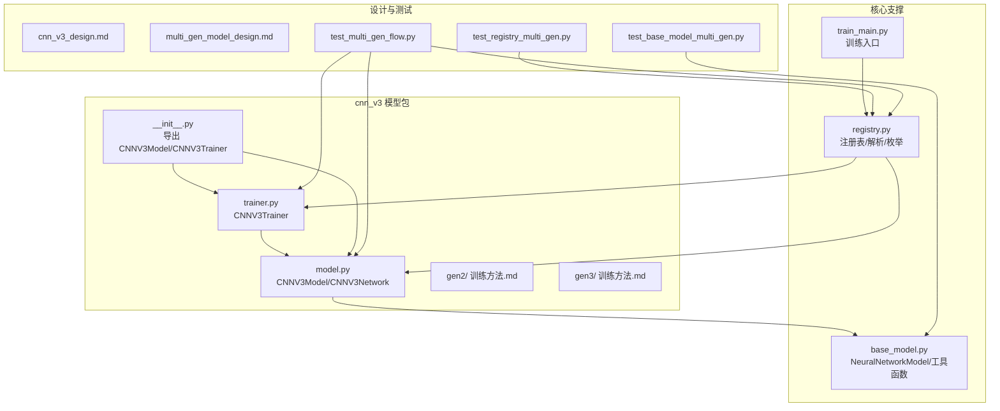
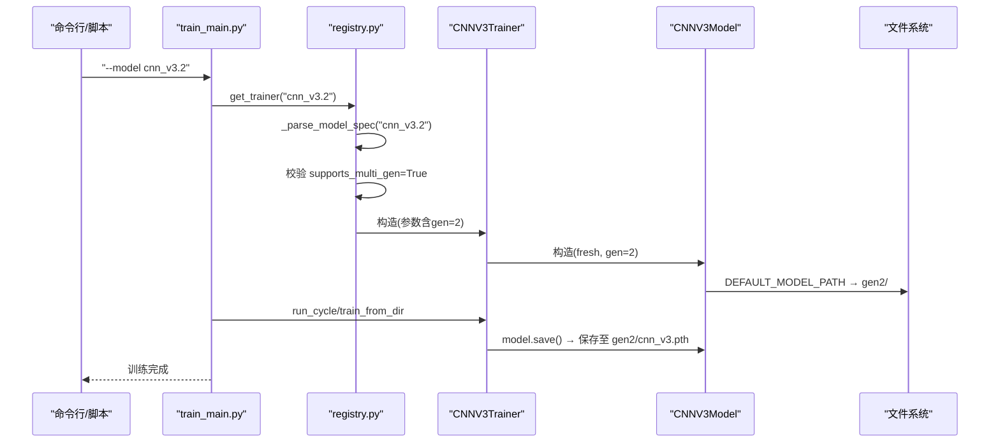
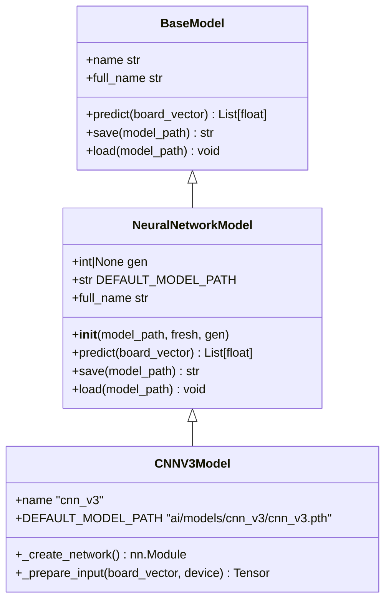
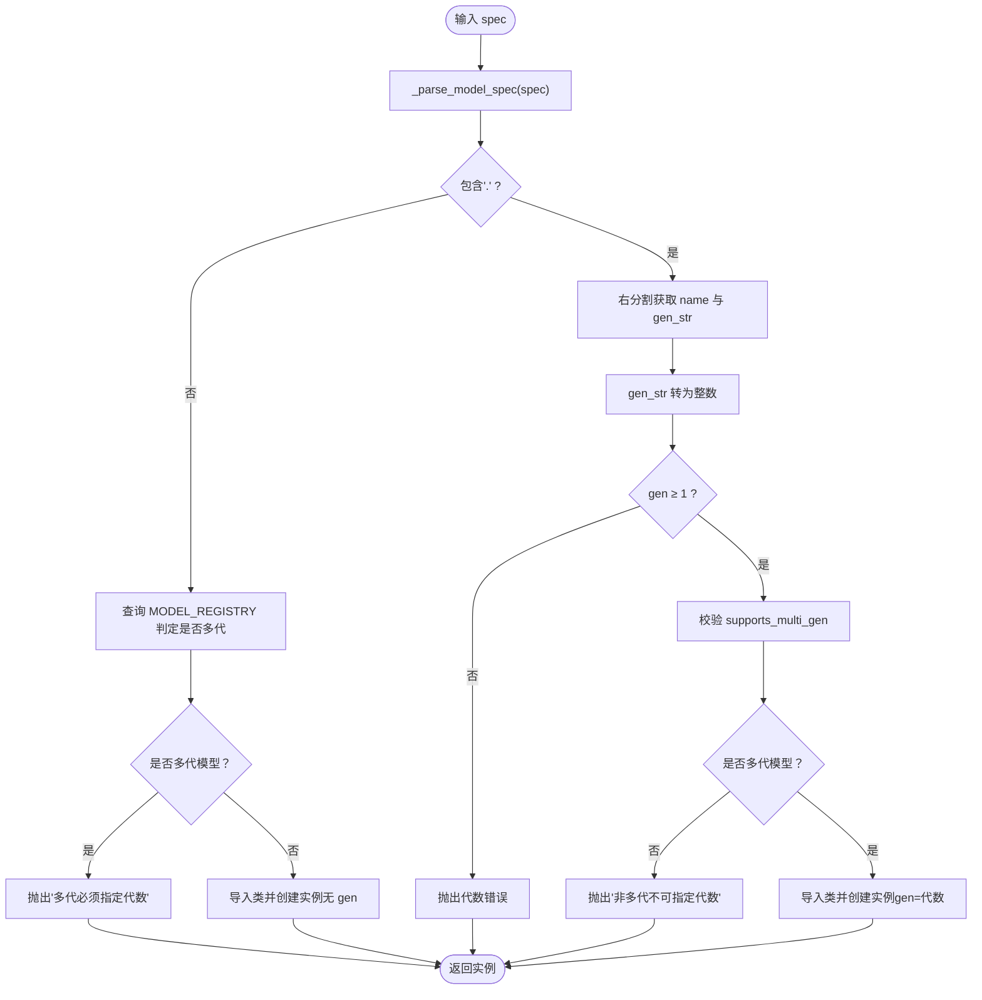
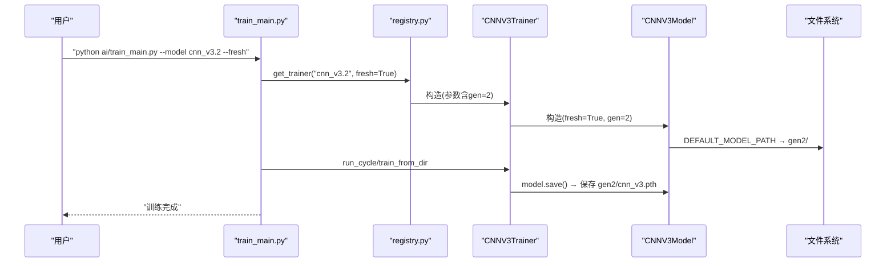
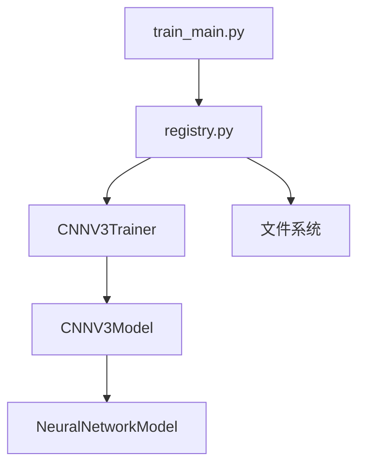

# 版本管理

<cite>
**本文引用的文件**
- [ai/models/cnn_v3/__init__.py](file://ai/models/cnn_v3/__init__.py)
- [ai/models/cnn_v3/model.py](file://ai/models/cnn_v3/model.py)
- [ai/models/cnn_v3/trainer.py](file://ai/models/cnn_v3/trainer.py)
- [ai/models/cnn_v3/gen2/训练方法.md](file://ai/models/cnn_v3/gen2/训练方法.md)
- [ai/models/cnn_v3/gen3/训练方法.md](file://ai/models/cnn_v3/gen3/训练方法.md)
- [ai/base_model.py](file://ai/base_model.py)
- [ai/registry.py](file://ai/registry.py)
- [ai/train_main.py](file://ai/train_main.py)
- [design/cnn_v3_design.md](file://design/cnn_v3_design.md)
- [design/multi_gen_model_design.md](file://design/multi_gen_model_design.md)
- [tests/ai/test_registry_multi_gen.py](file://tests/ai/test_registry_multi_gen.py)
- [tests/ai/test_base_model_multi_gen.py](file://tests/ai/test_base_model_multi_gen.py)
- [tests/integration/test_multi_gen_flow.py](file://tests/integration/test_multi_gen_flow.py)
</cite>

## 目录
1. [简介](#简介)
2. [项目结构](#项目结构)
3. [核心组件](#核心组件)
4. [架构总览](#架构总览)
5. [详细组件分析](#详细组件分析)
6. [依赖分析](#依赖分析)
7. [性能考虑](#性能考虑)
8. [故障排查指南](#故障排查指南)
9. [结论](#结论)
10. [附录](#附录)

## 简介
本指南面向五子棋AI项目中的cnn_v3多代模型版本管理，系统阐述版本控制策略、命名规范、存储结构、版本发布流程、兼容性与回滚、迁移与最佳实践。文档基于仓库中已实现的多代模型支持（gen1、gen2、gen3等）与配套测试，确保读者可以安全地创建、测试、验证、部署与回滚模型版本。

## 项目结构
cnn_v3多代模型的核心文件组织如下：
- 模型与训练器：ai/models/cnn_v3/model.py、ai/models/cnn_v3/trainer.py
- 包导出：ai/models/cnn_v3/__init__.py
- 多代训练参考：ai/models/cnn_v3/gen2/训练方法.md、ai/models/cnn_v3/gen3/训练方法.md
- 基类与注册表：ai/base_model.py、ai/registry.py
- 训练入口：ai/train_main.py
- 设计文档：design/cnn_v3_design.md、design/multi_gen_model_design.md
- 测试：tests/ai/test_registry_multi_gen.py、tests/ai/test_base_model_multi_gen.py、tests/integration/test_multi_gen_flow.py

**图表来源**
- [ai/models/cnn_v3/model.py:1-139](file://ai/models/cnn_v3/model.py#L1-L139)
- [ai/models/cnn_v3/trainer.py:1-73](file://ai/models/cnn_v3/trainer.py#L1-L73)
- [ai/models/cnn_v3/__init__.py:1-10](file://ai/models/cnn_v3/__init__.py#L1-L10)
- [ai/base_model.py:107-276](file://ai/base_model.py#L107-L276)
- [ai/registry.py:58-72](file://ai/registry.py#L58-L72)
- [ai/train_main.py:23-24](file://ai/train_main.py#L23-L24)
- [design/cnn_v3_design.md:50-76](file://design/cnn_v3_design.md#L50-L76)
- [design/multi_gen_model_design.md:325-342](file://design/multi_gen_model_design.md#L325-L342)

**章节来源**
- [ai/models/cnn_v3/__init__.py:1-10](file://ai/models/cnn_v3/__init__.py#L1-L10)
- [ai/models/cnn_v3/model.py:1-139](file://ai/models/cnn_v3/model.py#L1-L139)
- [ai/models/cnn_v3/trainer.py:1-73](file://ai/models/cnn_v3/trainer.py#L1-L73)
- [ai/models/cnn_v3/gen2/训练方法.md:1-16](file://ai/models/cnn_v3/gen2/训练方法.md#L1-L16)
- [ai/models/cnn_v3/gen3/训练方法.md:1-19](file://ai/models/cnn_v3/gen3/训练方法.md#L1-L19)
- [ai/base_model.py:107-276](file://ai/base_model.py#L107-L276)
- [ai/registry.py:58-72](file://ai/registry.py#L58-L72)
- [ai/train_main.py:23-24](file://ai/train_main.py#L23-L24)
- [design/cnn_v3_design.md:50-76](file://design/cnn_v3_design.md#L50-L76)
- [design/multi_gen_model_design.md:325-342](file://design/multi_gen_model_design.md#L325-L342)

## 核心组件
- 多代模型基类：NeuralNetworkModel在构造时支持gen参数，动态覆盖默认保存路径至gen{i}/子目录，并提供full_name属性用于区分代数。
- 注册表：registry.py统一管理模型与训练器映射，支持“模型名.代数”格式解析，严格校验多代模型必须指定代数，非多代模型不可指定代数。
- 训练入口：train_main.py通过registry获取训练器，支持--model cnn_v3.2等多代指定，训练完成后按gen路径保存。
- 设计约束：多代模型目录结构为gen{i}/，代数为正整数序列（gen1、gen2、...），注册表声明supports_multi_gen决定是否允许多代。

**章节来源**
- [ai/base_model.py:126-166](file://ai/base_model.py#L126-L166)
- [ai/base_model.py:254-266](file://ai/base_model.py#L254-L266)
- [ai/registry.py:103-129](file://ai/registry.py#L103-L129)
- [ai/registry.py:150-184](file://ai/registry.py#L150-L184)
- [ai/registry.py:187-223](file://ai/registry.py#L187-L223)
- [ai/train_main.py:220-229](file://ai/train_main.py#L220-L229)
- [design/multi_gen_model_design.md:12-22](file://design/multi_gen_model_design.md#L12-L22)

## 架构总览
多代模型版本管理的关键流程：解析“模型名.代数”→注册表判定→创建模型/训练器→按gen路径保存/加载→GUI/引擎使用full_name进行隔离。

**图表来源**
- [ai/train_main.py:220-229](file://ai/train_main.py#L220-L229)
- [ai/registry.py:103-129](file://ai/registry.py#L103-L129)
- [ai/registry.py:187-223](file://ai/registry.py#L187-L223)
- [ai/models/cnn_v3/trainer.py:25-35](file://ai/models/cnn_v3/trainer.py#L25-L35)
- [ai/base_model.py:139-143](file://ai/base_model.py#L139-L143)

## 详细组件分析

### 组件A：多代模型基类（NeuralNetworkModel）
- 功能要点
  - 支持gen参数：当gen不为None时，动态将DEFAULT_MODEL_PATH重定向到gen{i}/子目录。
  - full_name属性：多代模型返回“模型名.代数”，非多代模型返回模型名本身。
  - 保存自动创建目录：save()在目录不存在时自动创建gen子目录。
  - 加载严格校验：多代模型显式指定gen时，若对应权重文件不存在则抛错，避免静默回退。
- 关键实现位置
  - gen路径覆盖与保存：[ai/base_model.py:139-143](file://ai/base_model.py#L139-L143)、[ai/base_model.py:232-252](file://ai/base_model.py#L232-L252)
  - full_name属性：[ai/base_model.py:254-266](file://ai/base_model.py#L254-L266)
  - 严格加载校验（多代显式gen）：[ai/base_model.py:162-164](file://ai/base_model.py#L162-L164)

**图表来源**
- [ai/base_model.py:24-105](file://ai/base_model.py#L24-L105)
- [ai/base_model.py:107-276](file://ai/base_model.py#L107-L276)
- [ai/models/cnn_v3/model.py:96-138](file://ai/models/cnn_v3/model.py#L96-L138)

**章节来源**
- [ai/base_model.py:126-166](file://ai/base_model.py#L126-L166)
- [ai/base_model.py:232-266](file://ai/base_model.py#L232-L266)
- [ai/models/cnn_v3/model.py:96-138](file://ai/models/cnn_v3/model.py#L96-L138)

### 组件B：注册表与多代解析（registry.py）
- 功能要点
  - MODEL_REGISTRY新增supports_multi_gen字段，声明某模型是否支持多代。
  - _parse_model_spec：右分割首个“.”，将右侧解析为代数（正整数≥1）。
  - get_model/get_trainer：严格校验“多代必须指定代数，非多代不可指定代数”。
  - list_models_with_full_name：扫描gen{i}目录，仅当目录内存在至少一个.pth时才视为有效代数。
- 关键实现位置
  - 注册表与校验：[ai/registry.py:58-78](file://ai/registry.py#L58-L78)
  - 解析与校验：[ai/registry.py:103-129](file://ai/registry.py#L103-L129)
  - get_model/get_trainer校验与创建：[ai/registry.py:150-184](file://ai/registry.py#L150-L184)、[ai/registry.py:187-223](file://ai/registry.py#L187-L223)
  - 有效代数枚举：[ai/registry.py:237-296](file://ai/registry.py#L237-L296)

**图表来源**
- [ai/registry.py:103-129](file://ai/registry.py#L103-L129)
- [ai/registry.py:150-184](file://ai/registry.py#L150-L184)
- [ai/registry.py:187-223](file://ai/registry.py#L187-L223)
- [ai/registry.py:237-296](file://ai/registry.py#L237-L296)

**章节来源**
- [ai/registry.py:58-78](file://ai/registry.py#L58-L78)
- [ai/registry.py:103-129](file://ai/registry.py#L103-L129)
- [ai/registry.py:150-184](file://ai/registry.py#L150-L184)
- [ai/registry.py:187-223](file://ai/registry.py#L187-L223)
- [ai/registry.py:237-296](file://ai/registry.py#L237-L296)

### 组件C：训练入口与多代保存（train_main.py + trainer.py）
- 功能要点
  - 训练入口接收--model cnn_v3.2，通过registry创建训练器。
  - 训练器在构造时将模型的DEFAULT_MODEL_PATH指向gen{i}/，训练完成后保存到对应目录。
  - 支持fresh参数强制从新模型开始训练，不加载已保存权重。
- 关键实现位置
  - 训练入口参数解析与路由：[ai/train_main.py:220-229](file://ai/train_main.py#L220-L229)
  - 训练器创建与gen传递：[ai/models/cnn_v3/trainer.py:25-35](file://ai/models/cnn_v3/trainer.py#L25-L35)
  - 模型保存路径gen覆盖：[ai/base_model.py:139-143](file://ai/base_model.py#L139-L143)

**图表来源**
- [ai/train_main.py:220-229](file://ai/train_main.py#L220-L229)
- [ai/models/cnn_v3/trainer.py:25-35](file://ai/models/cnn_v3/trainer.py#L25-L35)
- [ai/base_model.py:139-143](file://ai/base_model.py#L139-L143)

**章节来源**
- [ai/train_main.py:220-229](file://ai/train_main.py#L220-L229)
- [ai/models/cnn_v3/trainer.py:25-35](file://ai/models/cnn_v3/trainer.py#L25-L35)
- [ai/base_model.py:139-143](file://ai/base_model.py#L139-L143)

### 组件D：多代训练参考（gen2、gen3）
- gen2与gen3的训练方法文档提供了样本生成与训练命令示例，便于对照执行与验证。
- 建议每次训练后在对应gen{i}/目录下保留.pth文件，以便list_models_with_full_name正确识别有效代数。

**章节来源**
- [ai/models/cnn_v3/gen2/训练方法.md:1-16](file://ai/models/cnn_v3/gen2/训练方法.md#L1-L16)
- [ai/models/cnn_v3/gen3/训练方法.md:1-19](file://ai/models/cnn_v3/gen3/训练方法.md#L1-L19)

## 依赖分析
- cnn_v3模型与训练器依赖NeuralNetworkModel的通用逻辑（输入转换、前向推理、保存/加载）。
- 训练入口依赖registry解析模型规格并创建训练器。
- 注册表依赖MODEL_REGISTRY声明与文件系统扫描（list_models_with_full_name）。

**图表来源**
- [ai/train_main.py:23-24](file://ai/train_main.py#L23-L24)
- [ai/registry.py:58-72](file://ai/registry.py#L58-L72)
- [ai/models/cnn_v3/trainer.py:13-44](file://ai/models/cnn_v3/trainer.py#L13-L44)
- [ai/models/cnn_v3/model.py:96-138](file://ai/models/cnn_v3/model.py#L96-L138)
- [ai/base_model.py:107-166](file://ai/base_model.py#L107-L166)

**章节来源**
- [ai/train_main.py:23-24](file://ai/train_main.py#L23-L24)
- [ai/registry.py:58-72](file://ai/registry.py#L58-L72)
- [ai/models/cnn_v3/trainer.py:13-44](file://ai/models/cnn_v3/trainer.py#L13-L44)
- [ai/models/cnn_v3/model.py:96-138](file://ai/models/cnn_v3/model.py#L96-L138)
- [ai/base_model.py:107-166](file://ai/base_model.py#L107-L166)

## 性能考虑
- 目录扫描无缓存：list_models_with_full_name每次调用都会扫描文件系统，当前模型数量较少时开销可忽略；若未来模型数量显著增长，建议引入惰性缓存。
- 保存非原子：torch.save在进程被中断时可能产生损坏的.pth文件，建议采用“写入临时文件→原子重命名”的策略提升可靠性。
- 并发访问假设：当前设计假设单进程串行访问模型目录；若引入多进程并行训练不同代数，需增加文件锁或原子保存机制。

**章节来源**
- [design/multi_gen_model_design.md:381-386](file://design/multi_gen_model_design.md#L381-L386)

## 故障排查指南
- “多代模型必须指定代数”
  - 现象：调用create_engine或get_model时提示“多代模型必须指定代数，如 cnn_v3.1”。
  - 原因：MODEL_REGISTRY声明supports_multi_gen=True的模型必须显式指定代数。
  - 处理：使用“cnn_v3.1”、“cnn_v3.2”等完整规格。
  - 参考：[ai/registry.py:177-178](file://ai/registry.py#L177-L178)
- “非多代模型不能指定代数”
  - 现象：对random、fc_v1、cnn_v1、cnn_v2等指定“.1”时报错。
  - 原因：这些模型的supports_multi_gen=False。
  - 处理：直接使用模型名，不要加“.代数”。
  - 参考：[ai/registry.py:173-174](file://ai/registry.py#L173-L174)
- “模型权重文件不存在”
  - 现象：指定gen=i但对应gen{i}/cnn_v3.pth不存在。
  - 原因：多代模型显式指定gen时，必须命中权重文件，不允许静默回退。
  - 处理：确认gen{i}目录下存在.pth文件，或先训练生成后再加载。
  - 参考：[ai/base_model.py:162-164](file://ai/base_model.py#L162-L164)
- “未知的模型名称”
  - 现象：registry中未注册的模型名。
  - 处理：检查MODEL_REGISTRY或拼写。
  - 参考：[ai/registry.py:168-169](file://ai/registry.py#L168-L169)
- GUI/引擎加载失败
  - 现象：GameSession/BattleSession抛出ModelLoadError。
  - 原因：engine.py取消回退逻辑，直接上抛ValueError，app层转换为ModelLoadError。
  - 处理：捕获ModelLoadError并提示用户，引导选择有效模型规格。
  - 参考：[tests/integration/test_multi_gen_flow.py:223-247](file://tests/integration/test_multi_gen_flow.py#L223-L247)

**章节来源**
- [ai/registry.py:168-178](file://ai/registry.py#L168-L178)
- [ai/registry.py:173-174](file://ai/registry.py#L173-L174)
- [ai/base_model.py:162-164](file://ai/base_model.py#L162-L164)
- [tests/integration/test_multi_gen_flow.py:223-247](file://tests/integration/test_multi_gen_flow.py#L223-L247)

## 结论
cnn_v3多代模型版本管理通过“模型名.代数”规范、注册表严格校验、基类路径覆盖与保存自动创建、文件系统扫描枚举等机制，实现了清晰、可追溯、可回滚的版本体系。遵循本文的命名与流程规范，可在保证向后兼容的前提下安全地推进模型演进。

## 附录

### A. 版本命名规范与存储结构
- 命名规范
  - 非多代模型：使用模型名（如“cnn_v3”）。
  - 多代模型：使用“模型名.代数”，代数为正整数（如“cnn_v3.1”、“cnn_v3.2”）。
- 存储结构
  - 非多代：ai/models/{模型名}/{模型名}.pth
  - 多代：ai/models/{模型名}/gen{i}/{模型名}.pth
- 设计约束
  - 模型名称禁止包含“.”，由注册表硬校验。
  - 仅当gen{i}目录下存在至少一个.pth时，list_models_with_full_name才识别为有效代数。

**章节来源**
- [design/multi_gen_model_design.md:12-22](file://design/multi_gen_model_design.md#L12-L22)
- [ai/registry.py:74-77](file://ai/registry.py#L74-L77)
- [ai/registry.py:260-296](file://ai/registry.py#L260-L296)
- [ai/base_model.py:139-143](file://ai/base_model.py#L139-L143)

### B. 版本发布流程（新版本创建→测试→验证→部署）
- 创建新版本
  - 在ai/models/cnn_v3/gen{i}/下创建cnn_v3.pth（或通过训练入口--model cnn_v3.{i} --fresh生成）。
  - 确认list_models_with_full_name能正确枚举到“cnn_v3.{i}”。
- 测试
  - 单元测试：验证解析、校验、保存路径、full_name等。
  - 集成测试：验证从spec到引擎的端到端流程。
- 验证
  - 预测一致性：相同board_vector的输出应稳定。
  - GUI/引擎加载：确保能通过“cnn_v3.{i}”加载并运行。
- 部署
  - 将gen{i}/cnn_v3.pth随应用分发；确保文件系统权限与路径正确。

**章节来源**
- [tests/ai/test_registry_multi_gen.py:39-85](file://tests/ai/test_registry_multi_gen.py#L39-L85)
- [tests/ai/test_base_model_multi_gen.py:114-176](file://tests/ai/test_base_model_multi_gen.py#L114-L176)
- [tests/integration/test_multi_gen_flow.py:74-110](file://tests/integration/test_multi_gen_flow.py#L74-L110)

### C. 版本兼容性管理
- 接口兼容：cnn_v3各代共享predict/save/load接口，保证调用方代码无需改动。
- 数据与配置兼容：通过full_name隔离不同代数的训练数据与日志，避免混用。
- 向后兼容：非多代模型名称保持不变；多代模型通过“模型名.代数”显式区分。

**章节来源**
- [design/cnn_v3_design.md:43-49](file://design/cnn_v3_design.md#L43-L49)
- [ai/base_model.py:254-266](file://ai/base_model.py#L254-L266)

### D. 版本回滚策略
- 快速恢复
  - 若发现新版本不稳定，直接切换到上一代“cnn_v3.{i-1}”，无需重新训练。
  - 确保gen{i-1}/cnn_v3.pth存在且可加载。
- 风险控制
  - 多代模型显式指定gen时，若权重文件不存在将报错，避免静默回退。
- 验证
  - 通过集成测试验证回滚后的引擎与预测一致性。

**章节来源**
- [ai/base_model.py:162-164](file://ai/base_model.py#L162-L164)
- [tests/integration/test_multi_gen_flow.py:192-202](file://tests/integration/test_multi_gen_flow.py#L192-L202)

### E. 版本迁移指导（从旧版到新版）
- 单代迁移到多代
  - 将ai/models/cnn_v3/cnn_v3.pth移动到ai/models/cnn_v3/gen1/cnn_v3.pth。
  - 在ai/registry.py中将cnn_v3的supports_multi_gen改为True。
  - 更新调用点为“cnn_v3.1”。
- 注意事项
  - 迁移后get_model("cnn_v3")将报错“多代模型必须指定代数”，需统一使用“cnn_v3.1”。

**章节来源**
- [design/multi_gen_model_design.md:371-379](file://design/multi_gen_model_design.md#L371-L379)

### F. 最佳实践与常见问题
- 最佳实践
  - 每次训练后保留gen{i}/cnn_v3.pth，确保list_models_with_full_name正确识别。
  - 使用--fresh从新模型开始训练，避免历史权重干扰。
  - 在GUI/引擎层统一使用“模型名.代数”格式，避免歧义。
- 常见问题
  - 未指定代数：对多代模型必须指定代数。
  - 代数无效：代数必须为正整数且≥1。
  - 权重缺失：显式指定gen时必须存在对应.pth文件。
  - pth与gen共存：同一模型目录下不可同时存在.pth与gen{i}目录。

**章节来源**
- [ai/registry.py:117-129](file://ai/registry.py#L117-L129)
- [ai/registry.py:284-287](file://ai/registry.py#L284-L287)
- [ai/base_model.py:162-164](file://ai/base_model.py#L162-L164)