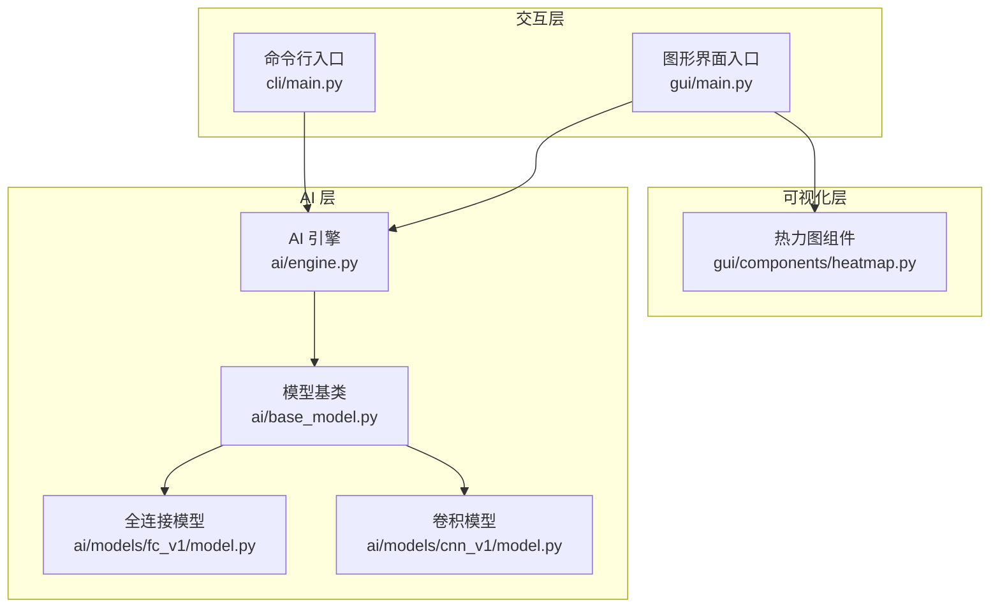
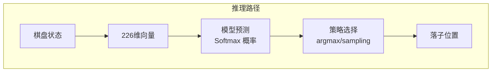
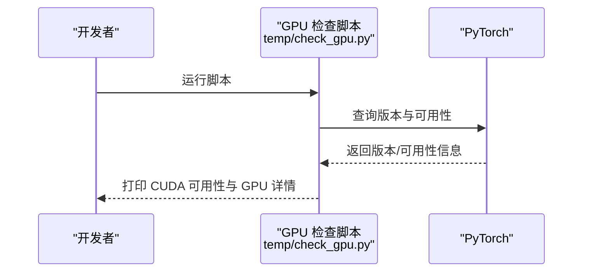
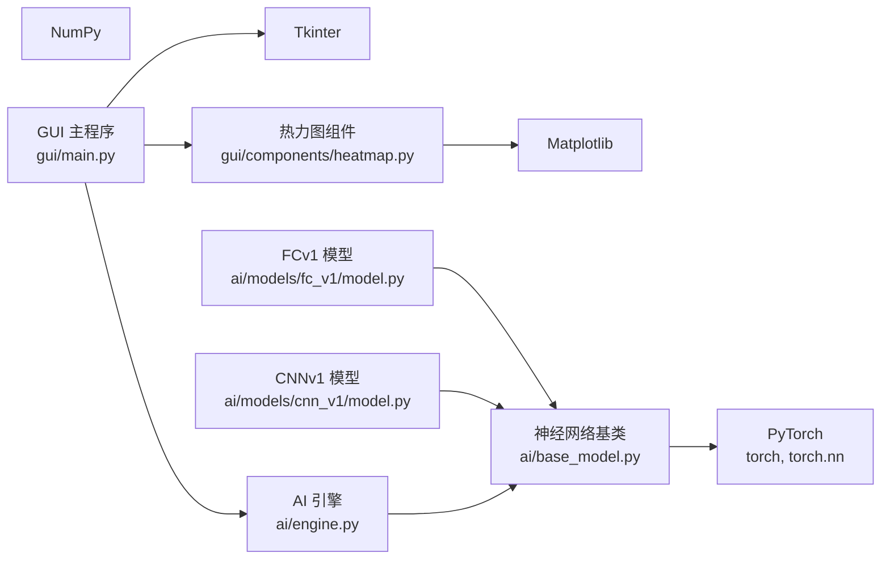

# 环境配置

<cite>
**本文引用的文件**
- [requirements/key_points.md](file://requirements/key_points.md)
- [ai/base_model.py](file://ai/base_model.py)
- [ai/models/fc_v1/model.py](file://ai/models/fc_v1/model.py)
- [ai/models/cnn_v1/model.py](file://ai/models/cnn_v1/model.py)
- [ai/engine.py](file://ai/engine.py)
- [gui/main.py](file://gui/main.py)
- [gui/components/heatmap.py](file://gui/components/heatmap.py)
- [temp/check_gpu.py](file://temp/check_gpu.py)
- [design/design_specification.md](file://design/design_specification.md)
</cite>

## 目录
1. [简介](#简介)
2. [项目结构](#项目结构)
3. [核心组件](#核心组件)
4. [架构总览](#架构总览)
5. [详细组件分析](#详细组件分析)
6. [依赖分析](#依赖分析)
7. [性能考虑](#性能考虑)
8. [故障排查指南](#故障排查指南)
9. [结论](#结论)
10. [附录](#附录)

## 简介
本指南面向五子棋AI项目的生产环境部署，提供从硬件到软件的完整配置说明，涵盖：
- 硬件要求（CPU、内存、GPU）与推荐配置
- Python 3.8+ 环境搭建与虚拟环境管理
- 核心依赖安装（PyTorch、tkinter、matplotlib、numpy 等）
- GPU 加速配置（CUDA 版本与驱动）
- 环境验证方法与常见问题排查

## 项目结构
该项目围绕“命令行交互 + 图形界面 + AI 模型推理/训练”的多层架构组织，AI 模型通过统一接口与引擎对接，GUI 通过组件化方式渲染热力图与棋盘。

**图表来源**
- [gui/main.py:398-462](file://gui/main.py#L398-L462)
- [ai/engine.py:18-42](file://ai/engine.py#L18-L42)
- [ai/base_model.py:107-121](file://ai/base_model.py#L107-L121)
- [ai/models/fc_v1/model.py:91-132](file://ai/models/fc_v1/model.py#L91-L132)
- [ai/models/cnn_v1/model.py:106-148](file://ai/models/cnn_v1/model.py#L106-L148)
- [gui/components/heatmap.py:68-100](file://gui/components/heatmap.py#L68-L100)

**章节来源**
- [requirements/key_points.md:92-102](file://requirements/key_points.md#L92-L102)
- [design/design_specification.md:494-520](file://design/design_specification.md#L494-L520)

## 核心组件
- AI 引擎：负责将棋盘状态转换为模型输入，调用模型预测并按策略选择落子位置。
- 模型基类：统一 AI 模型接口，提供通用的 PyTorch 模型生命周期管理（创建、保存、加载、推理）。
- 全连接模型与卷积模型：分别实现不同网络结构，均继承自神经网络模型基类。
- 图形界面与热力图：基于 tkinter 的 GUI 组件，支持显示 AI 输出概率的热力图。

**章节来源**
- [ai/engine.py:44-194](file://ai/engine.py#L44-L194)
- [ai/base_model.py:24-323](file://ai/base_model.py#L24-L323)
- [ai/models/fc_v1/model.py:18-132](file://ai/models/fc_v1/model.py#L18-L132)
- [ai/models/cnn_v1/model.py:26-148](file://ai/models/cnn_v1/model.py#L26-L148)
- [gui/components/heatmap.py:1-72](file://gui/components/heatmap.py#L1-L72)

## 架构总览
AI 推理与训练通过统一的模型接口与引擎解耦，GUI 通过组件化渲染热力图，CLI 提供命令行交互入口。

**图表来源**
- [ai/engine.py:106-142](file://ai/engine.py#L106-L142)
- [ai/base_model.py:195-231](file://ai/base_model.py#L195-L231)

## 详细组件分析

### 环境与依赖总览
- Python：3.8+（项目设计文档明确要求）
- PyTorch：AI 模型推理/训练的核心深度学习框架
- tkinter：GUI 界面基础
- matplotlib/numpy：可视化与数值计算（GUI 热力图与回放功能）
- 其他：json/os/sys/datetime 等标准库用于存档与控制台交互

**章节来源**
- [design/design_specification.md:623-627](file://design/design_specification.md#L623-L627)
- [ai/base_model.py:20-22](file://ai/base_model.py#L20-L22)
- [gui/main.py:15-28](file://gui/main.py#L15-L28)
- [gui/components/heatmap.py:25-34](file://gui/components/heatmap.py#L25-L34)

### 硬件要求与推荐配置
- CPU：多核 64 位处理器，建议 4 核以上以满足训练与回放渲染
- 内存：至少 8 GB，建议 16 GB+ 以支持较大批量训练与多代模型并行
- GPU：NVIDIA CUDA 兼容 GPU，建议 RTX 3060/4060 或以上，显存 8 GB+
- 存储：SSD 至少 50 GB 可用空间（训练数据、模型权重、回放记录）

说明
- 项目包含 CNN 与 FC 模型，训练与推理均受益于 GPU 加速
- GUI 热力图渲染与回放浏览对 CPU/内存有一定压力，建议更高配置

[本节为通用建议，不直接分析具体文件]

### Python 环境与虚拟环境
- 安装 Python 3.8+（建议 3.10/3.11）
- 创建虚拟环境（推荐 venv 或 conda）
- 激活虚拟环境后安装依赖

[本节为通用流程，不直接分析具体文件]

### 依赖安装与版本要求
- PyTorch：CPU 版本或 CUDA 版本（见下一节 GPU 加速）
- tkinter：通常随 Python 标准库安装；Windows 可能需要额外安装 tcl/tk
- matplotlib：用于热力图与回放可视化
- numpy：数值计算基础
- 其他：json/os/sys/datetime 等标准库

安装建议
- 优先使用 pip 安装 PyTorch（官方安装页面选择 CPU/CUDA 版本）
- 若使用 Conda，可参考 PyTorch 官方渠道
- GUI 与热力图功能依赖 tkinter 与 matplotlib

**章节来源**
- [ai/base_model.py:20-22](file://ai/base_model.py#L20-L22)
- [gui/main.py:15-28](file://gui/main.py#L15-L28)
- [gui/components/heatmap.py:25-34](file://gui/components/heatmap.py#L25-L34)

### GPU 加速配置（CUDA 与驱动）
- CUDA 版本：PyTorch 官方安装页面会给出匹配的 CUDA 版本
- 驱动：确保 NVIDIA 显卡驱动与 CUDA 版本兼容
- 验证：运行项目提供的 GPU 检查脚本

验证脚本
- 路径：temp/check_gpu.py
- 功能：打印 PyTorch 版本、CUDA 可用性、CUDA 版本、GPU 数量与 GPU 名称

**图表来源**
- [temp/check_gpu.py:1-12](file://temp/check_gpu.py#L1-L12)

**章节来源**
- [temp/check_gpu.py:1-12](file://temp/check_gpu.py#L1-L12)

### 环境验证清单
- Python 版本：python --version
- 依赖安装：pip list | grep -E "(torch|numpy|matplotlib|tk)"
- GUI 启动：python gui/main.py（确保 tkinter 可用）
- GPU 可用：python temp/check_gpu.py
- CLI 启动：python cli/main.py（验证命令行交互）

[本节为通用验证流程，不直接分析具体文件]

### 常见问题与排查
- 依赖冲突
  - 现象：pip 安装时报错或运行时报模块导入错误
  - 处理：清理虚拟环境重新安装；锁定 PyTorch 与 CUDA 版本；使用 requirements 文件（若存在）
- 版本不兼容
  - 现象：PyTorch 与 CUDA 版本不匹配导致无法加载 GPU
  - 处理：根据 PyTorch 官方安装页面选择匹配的 CUDA 版本
- GUI 无法启动（tkinter 缺失）
  - 现象：ImportError: No module named tkinter
  - 处理：安装 tcl/tk；或使用系统自带的 Python 发行版
- GPU 未被使用
  - 现象：temp/check_gpu.py 显示 CUDA 不可用
  - 处理：确认驱动与 CUDA 版本匹配；重启系统后重试；检查防火墙/杀软拦截

**章节来源**
- [gui/main.py:15-28](file://gui/main.py#L15-L28)
- [temp/check_gpu.py:1-12](file://temp/check_gpu.py#L1-L12)

## 依赖分析
AI 模型与推理链路的关键依赖关系如下：

**图表来源**
- [ai/base_model.py:20-22](file://ai/base_model.py#L20-L22)
- [ai/models/fc_v1/model.py:13-15](file://ai/models/fc_v1/model.py#L13-L15)
- [ai/models/cnn_v1/model.py:21-23](file://ai/models/cnn_v1/model.py#L21-L23)
- [ai/engine.py:9](file://ai/engine.py#L9)
- [gui/main.py:15-28](file://gui/main.py#L15-L28)
- [gui/components/heatmap.py:25-34](file://gui/components/heatmap.py#L25-L34)

**章节来源**
- [ai/base_model.py:20-22](file://ai/base_model.py#L20-L22)
- [ai/models/fc_v1/model.py:13-15](file://ai/models/fc_v1/model.py#L13-L15)
- [ai/models/cnn_v1/model.py:21-23](file://ai/models/cnn_v1/model.py#L21-L23)
- [ai/engine.py:9](file://ai/engine.py#L9)
- [gui/main.py:15-28](file://gui/main.py#L15-L28)
- [gui/components/heatmap.py:25-34](file://gui/components/heatmap.py#L25-L34)

## 性能考虑
- 推理加速
  - 使用 GPU 推理（CUDA），确保模型与输入张量在相同设备上
  - 在推理前设置 eval 模式并禁用梯度计算
- 训练加速
  - 合理设置批大小与学习率；使用合适的优化器
  - 利用多代模型与数据增强提升样本多样性
- GUI 与热力图
  - 热力图渲染与回放浏览对 CPU/内存有压力，建议在较高配置机器上运行

**章节来源**
- [ai/base_model.py:214-222](file://ai/base_model.py#L214-L222)
- [ai/models/fc_v1/model.py:53-88](file://ai/models/fc_v1/model.py#L53-L88)
- [ai/models/cnn_v1/model.py:68-103](file://ai/models/cnn_v1/model.py#L68-L103)

## 故障排查指南
- 模型加载失败
  - 现象：GUI 抛出模型加载异常
  - 处理：确认模型权重文件存在；多代模型需指定代数；检查路径拼接
- 推理报错
  - 现象：输入维度不匹配或设备不一致
  - 处理：确保输入向量长度为 226；模型与输入在同一设备上
- GUI 热力图异常
  - 现象：颜色映射错误或渲染失败
  - 处理：检查归一化模式与色板配置；确认 matplotlib 可用

**章节来源**
- [ai/engine.py:106-142](file://ai/engine.py#L106-L142)
- [gui/components/heatmap.py:68-100](file://gui/components/heatmap.py#L68-L100)

## 结论
本指南提供了五子棋AI项目从硬件到软件的完整环境配置路径。建议优先满足推荐配置，确保 PyTorch 与 CUDA 版本匹配，完成依赖安装与 GPU 验证后，即可稳定运行 CLI 与 GUI，并开展模型训练与回放分析。

[本节为总结性内容，不直接分析具体文件]

## 附录
- 术语
  - CUDA：NVIDIA 提供的并行计算平台与编程模型
  - Softmax：将向量归一化为概率分布的激活函数
- 参考
  - PyTorch 官方安装页面（选择 CPU/CUDA 版本）
  - 项目设计文档与模型实现文件

[本节为补充信息，不直接分析具体文件]