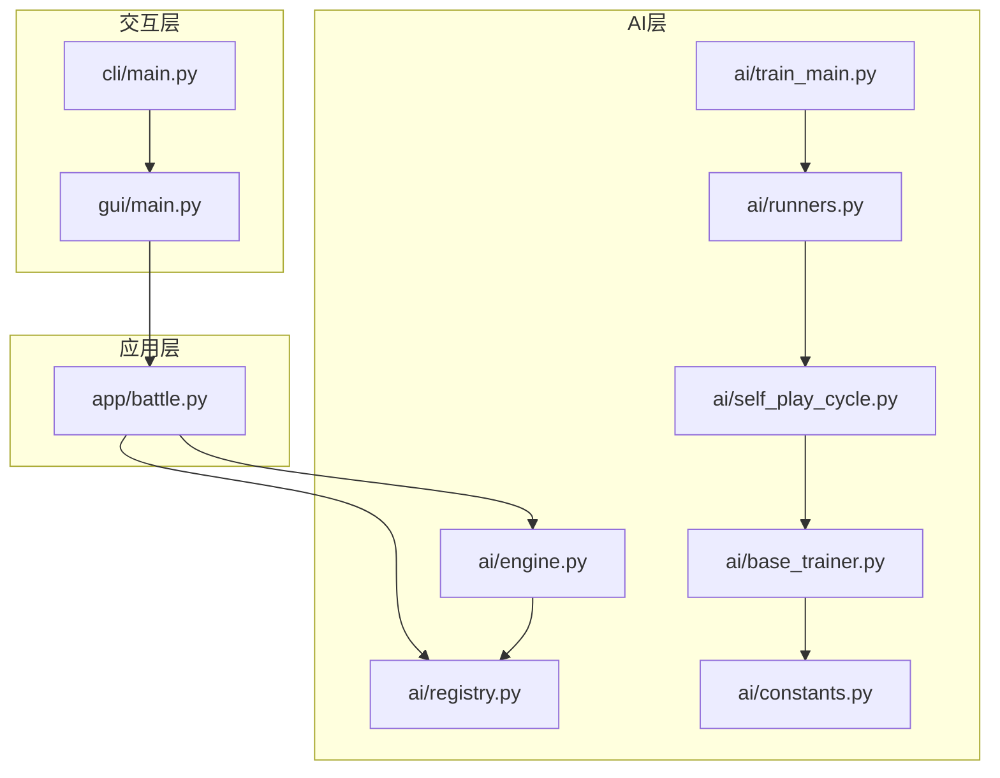
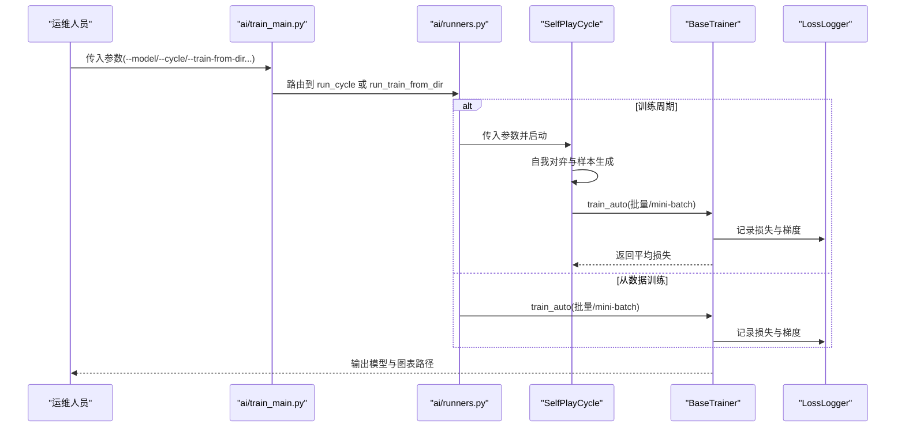
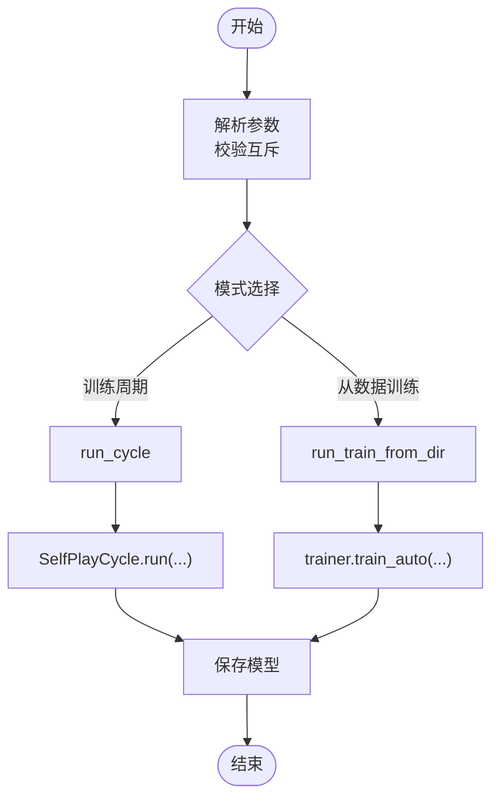
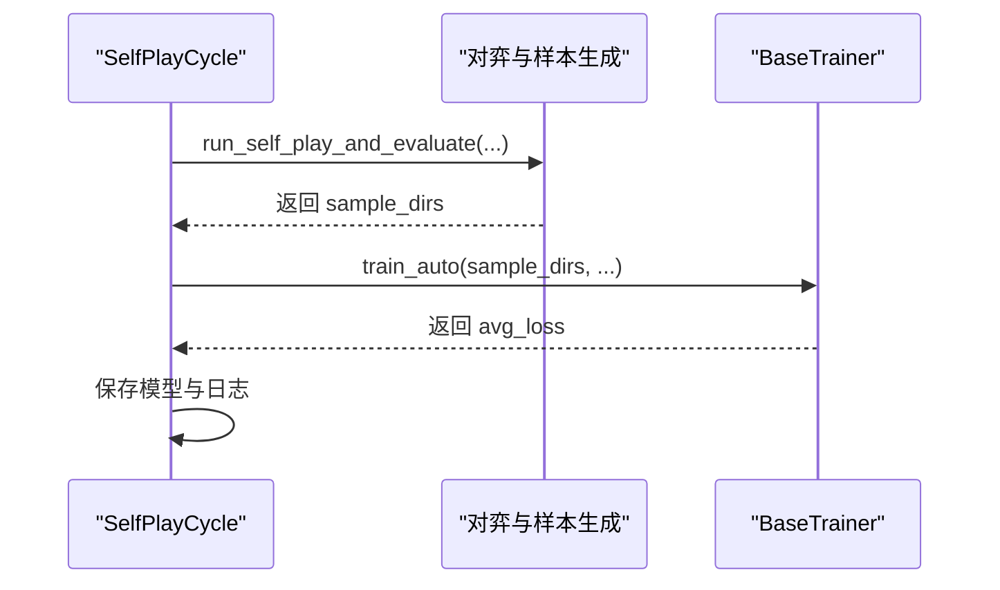
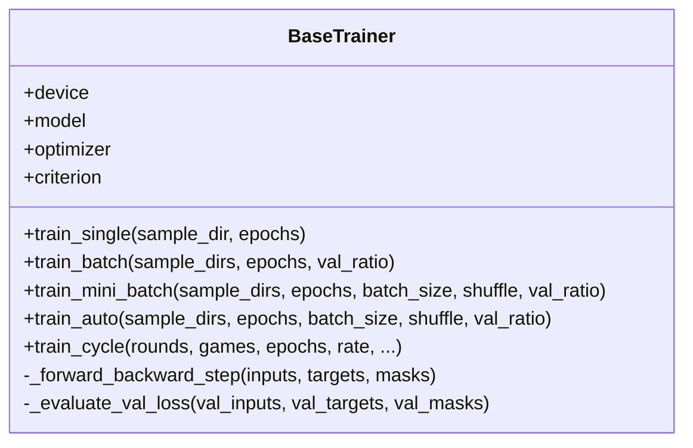
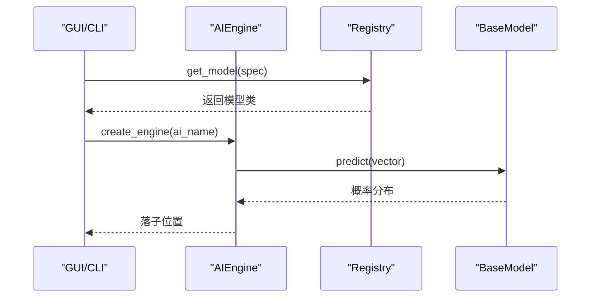
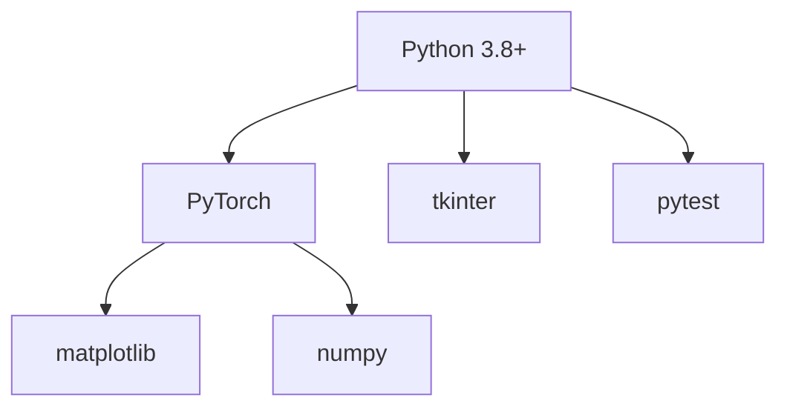

# 部署运维

<cite>
**本文引用的文件**
- [README.md](file://README.md)
- [requirements/key_points.md](file://requirements/key_points.md)
- [ai/constants.py](file://ai/constants.py)
- [ai/registry.py](file://ai/registry.py)
- [ai/base_trainer.py](file://ai/base_trainer.py)
- [ai/engine.py](file://ai/engine.py)
- [ai/self_play_cycle.py](file://ai/self_play_cycle.py)
- [ai/runners.py](file://ai/runners.py)
- [ai/train_main.py](file://ai/train_main.py)
- [gui/main.py](file://gui/main.py)
- [app/battle.py](file://app/battle.py)
- [cli/main.py](file://cli/main.py)
</cite>

## 目录
1. [简介](#简介)
2. [项目结构](#项目结构)
3. [核心组件](#核心组件)
4. [架构总览](#架构总览)
5. [详细组件分析](#详细组件分析)
6. [依赖分析](#依赖分析)
7. [性能考虑](#性能考虑)
8. [故障排查指南](#故障排查指南)
9. [结论](#结论)
10. [附录](#附录)

## 简介
本指南面向生产环境的五子棋AI系统运维团队，目标是帮助团队稳定地部署、监控、维护与升级该AI系统。内容涵盖硬件与软件依赖、部署流程、性能监控、日志管理、故障排查、版本与备份策略等，确保系统在训练与推理场景下均可可靠运行。

## 项目结构
项目采用模块化分层设计，核心分为三层：
- 交互层：GUI与CLI，负责用户交互与命令入口
- 应用层：会话与辅助模块，协调游戏与AI对战流程
- AI层：模型、训练器、数据与评估管线，支撑训练与推理

**图示来源**
- [gui/main.py:1-462](file://gui/main.py#L1-L462)
- [cli/main.py:1-258](file://cli/main.py#L1-L258)
- [app/battle.py:1-104](file://app/battle.py#L1-L104)
- [ai/registry.py:1-316](file://ai/registry.py#L1-L316)
- [ai/constants.py:1-26](file://ai/constants.py#L1-L26)
- [ai/base_trainer.py:1-699](file://ai/base_trainer.py#L1-L699)
- [ai/engine.py:1-194](file://ai/engine.py#L1-L194)
- [ai/self_play_cycle.py:1-195](file://ai/self_play_cycle.py#L1-L195)
- [ai/runners.py:1-255](file://ai/runners.py#L1-L255)
- [ai/train_main.py:1-234](file://ai/train_main.py#L1-L234)

**章节来源**
- [README.md:1-422](file://README.md#L1-L422)

## 核心组件
- 模型注册与加载：通过统一注册表按需懒加载模型与训练器，支持多代模型指定。
- 训练器抽象：提供通用训练流程（单轮次、批量、mini-batch、训练周期），自动检测GPU并使用CUDA加速。
- AI引擎：将棋盘状态转换为模型输入，调用模型预测并按策略选择落子位置。
- 自我对弈周期：编排“自我对弈→样本生成→训练”的闭环，支持温度采样与验证集。
- 常量与路径：统一管理AI数据与训练数据目录、损失日志目录与日志间隔。

**章节来源**
- [ai/registry.py:1-316](file://ai/registry.py#L1-L316)
- [ai/base_trainer.py:1-699](file://ai/base_trainer.py#L1-L699)
- [ai/engine.py:1-194](file://ai/engine.py#L1-L194)
- [ai/self_play_cycle.py:1-195](file://ai/self_play_cycle.py#L1-L195)
- [ai/constants.py:1-26](file://ai/constants.py#L1-L26)

## 架构总览
系统在生产环境中通常以两种形态运行：
- 训练形态：通过训练入口脚本启动训练周期或从已有数据训练，自动记录损失日志并生成曲线图。
- 推理形态：GUI或CLI提供人机对战与AI内战，AI引擎加载模型进行落子决策。

**图示来源**
- [ai/train_main.py:1-234](file://ai/train_main.py#L1-L234)
- [ai/runners.py:1-255](file://ai/runners.py#L1-L255)
- [ai/self_play_cycle.py:1-195](file://ai/self_play_cycle.py#L1-L195)
- [ai/base_trainer.py:1-699](file://ai/base_trainer.py#L1-L699)

## 详细组件分析

### 训练入口与运行器
- 训练入口脚本解析参数，校验互斥模式（训练周期与从数据训练），并路由到运行器。
- 运行器负责发现数据、创建临时目录、打印训练参数、调用训练器并保存模型。

**图示来源**
- [ai/train_main.py:1-234](file://ai/train_main.py#L1-L234)
- [ai/runners.py:1-255](file://ai/runners.py#L1-L255)

**章节来源**
- [ai/train_main.py:1-234](file://ai/train_main.py#L1-L234)
- [ai/runners.py:1-255](file://ai/runners.py#L1-L255)

### 自我对弈周期
- 编排多轮自我对弈，每轮结束后合并样本并训练，支持温度采样与验证集。
- 自动创建会话目录，记录轮次级损失并在中断时安全保存。

**图示来源**
- [ai/self_play_cycle.py:1-195](file://ai/self_play_cycle.py#L1-L195)
- [ai/base_trainer.py:1-699](file://ai/base_trainer.py#L1-L699)

**章节来源**
- [ai/self_play_cycle.py:1-195](file://ai/self_play_cycle.py#L1-L195)

### 训练器抽象与设备选择
- 自动检测GPU并优先使用CUDA设备；支持AdamW优化器、L1损失与掩码损失。
- 提供单轮次、批量、mini-batch与训练周期多种训练方式，支持学习率调度与验证集评估。

**图示来源**
- [ai/base_trainer.py:1-699](file://ai/base_trainer.py#L1-L699)

**章节来源**
- [ai/base_trainer.py:1-699](file://ai/base_trainer.py#L1-L699)

### AI引擎与模型加载
- 通过注册表按需加载模型与训练器，支持多代模型指定（如 cnn_v3.1）。
- 引擎将棋盘转换为输入向量，调用模型预测并按策略选择落子位置。

**图示来源**
- [ai/engine.py:1-194](file://ai/engine.py#L1-L194)
- [ai/registry.py:1-316](file://ai/registry.py#L1-L316)

**章节来源**
- [ai/engine.py:1-194](file://ai/engine.py#L1-L194)
- [ai/registry.py:1-316](file://ai/registry.py#L1-L316)

### 数据与日志常量
- 统一管理AI数据目录、训练数据目录与损失日志目录，支持通过环境变量覆盖。
- 损失日志记录间隔默认每200轮记录一次，支持密集日志与轮次级日志。

**章节来源**
- [ai/constants.py:1-26](file://ai/constants.py#L1-L26)

## 依赖分析
- Python 3.8+：满足现代库与语法需求。
- PyTorch：训练与推理的核心深度学习框架。
- matplotlib/numpy：训练损失曲线绘制与数值计算。
- tkinter：GUI依赖，提供图形界面。
- pytest：测试框架，支持自动化测试。

**图示来源**
- [README.md:24-34](file://README.md#L24-L34)

**章节来源**
- [README.md:24-34](file://README.md#L24-L34)

## 性能考虑
- 设备选择：训练器自动检测GPU并优先使用CUDA，显著提升训练速度。
- 训练方式：mini-batch适合大规模数据，全量更新适合中小规模；两者均支持验证集与学习率调度。
- 温度采样：训练周期默认启用温度采样以增加开局多样性，可按需关闭。
- 日志密度：mini-batch模式下生成密集日志（批级），轮次模式下生成轮次级日志，便于观测收敛趋势。

**章节来源**
- [ai/base_trainer.py:1-699](file://ai/base_trainer.py#L1-L699)
- [ai/self_play_cycle.py:1-195](file://ai/self_play_cycle.py#L1-L195)
- [ai/runners.py:1-255](file://ai/runners.py#L1-L255)

## 故障排查指南
- 模型加载失败
  - 现象：GUI或会话层抛出模型加载错误。
  - 排查：确认模型名称与代数格式正确（多代模型必须指定代数），检查注册表与模型文件是否存在。
  - 参考：[ai/registry.py:150-224](file://ai/registry.py#L150-L224)
- 训练中断与保存
  - 现象：Ctrl+C中断训练。
  - 处理：训练器与周期模块在中断时自动保存模型与图表，可安全重启。
  - 参考：[ai/base_trainer.py:314-322](file://ai/base_trainer.py#L314-L322)、[ai/self_play_cycle.py:157-177](file://ai/self_play_cycle.py#L157-L177)
- 数据路径与权限
  - 现象：训练或回放无法读取数据。
  - 处理：确认数据目录存在且可读写，必要时通过环境变量覆盖日志目录。
  - 参考：[ai/constants.py:17-22](file://ai/constants.py#L17-L22)
- GUI启动异常
  - 现象：GUI无法启动或弹窗报错。
  - 处理：检查tkinter依赖与模型加载错误，必要时回退到CLI模式。
  - 参考：[gui/main.py:400-462](file://gui/main.py#L400-L462)、[app/battle.py:68-94](file://app/battle.py#L68-L94)

**章节来源**
- [ai/registry.py:150-224](file://ai/registry.py#L150-L224)
- [ai/base_trainer.py:314-322](file://ai/base_trainer.py#L314-L322)
- [ai/self_play_cycle.py:157-177](file://ai/self_play_cycle.py#L157-L177)
- [ai/constants.py:17-22](file://ai/constants.py#L17-L22)
- [gui/main.py:400-462](file://gui/main.py#L400-L462)
- [app/battle.py:68-94](file://app/battle.py#L68-L94)

## 结论
通过统一的注册表、抽象训练器与清晰的训练周期编排，系统在生产环境中具备良好的可维护性与可扩展性。配合GPU加速、验证集与学习率调度，可在保证稳定性的同时提升训练效率。建议在生产部署中结合本文的监控、日志与备份策略，确保长期稳定运行。

## 附录

### 生产环境配置要求
- 硬件资源
  - 推荐：GPU（如NVIDIA RTX系列）+ 大容量内存（≥16GB），以支持mini-batch与大规模数据训练。
  - CPU：多核处理器，满足GUI与CLI交互。
- 软件依赖
  - Python 3.8+
  - PyTorch（含CUDA驱动与工具链）
  - matplotlib、numpy
  - tkinter（GUI）
  - pytest（测试）
- 系统要求
  - 文件系统：具备读写AI数据与训练数据目录权限。
  - 环境变量：可通过覆盖日志目录变量隔离测试与生产日志。

**章节来源**
- [README.md:24-34](file://README.md#L24-L34)
- [ai/constants.py:17-22](file://ai/constants.py#L17-L22)

### 部署流程
- 环境搭建
  - 安装Python 3.8+与PyTorch（含CUDA）。
  - 安装matplotlib、numpy与tkinter。
- 依赖安装
  - 使用pip安装依赖库。
- 配置优化
  - 如需隔离日志，设置日志目录环境变量。
  - 根据硬件选择合适的mini-batch大小与学习率调度策略。
- 启动验证
  - GUI：启动图形界面，验证模型加载与对局。
  - CLI：启动命令行，验证存档与落子功能。
  - 训练：执行一次短轮次训练，确认损失日志与模型保存。

**章节来源**
- [README.md:30-34](file://README.md#L30-L34)
- [gui/main.py:398-462](file://gui/main.py#L398-L462)
- [cli/main.py:1-258](file://cli/main.py#L1-L258)
- [ai/train_main.py:1-234](file://ai/train_main.py#L1-L234)

### 性能监控
- 资源使用监控
  - GPU利用率与显存：使用nvidia-smi或厂商工具监控训练期间GPU占用。
  - CPU与内存：监控系统整体负载，避免I/O瓶颈。
- 性能指标收集
  - 损失曲线：训练器自动生成，轮次级与批级日志可叠加展示。
  - 验证集指标：启用验证集比例以观测泛化性能。
- 异常检测
  - 损失异常波动：关注NaN或爆炸性增长，及时调整学习率或批大小。
  - 训练中断：利用中断保存机制恢复进度。

**章节来源**
- [ai/base_trainer.py:298-322](file://ai/base_trainer.py#L298-L322)
- [ai/self_play_cycle.py:178-195](file://ai/self_play_cycle.py#L178-L195)

### 日志管理策略
- 日志级别与分类
  - 训练日志：轮次级与批级两类，轮次级用于整体趋势，批级用于细粒度观测。
  - 损失日志：默认每200轮记录一次，mini-batch模式下为密集日志。
- 日志轮转
  - 通过会话目录隔离不同训练会话，避免日志覆盖。
  - 可通过环境变量覆盖日志目录，便于测试与生产分离。
- 日志分析
  - 使用生成的曲线图定位收敛问题。
  - 结合验证集日志评估过拟合风险。

**章节来源**
- [ai/constants.py:17-26](file://ai/constants.py#L17-L26)
- [ai/base_trainer.py:199-213](file://ai/base_trainer.py#L199-L213)

### 版本管理最佳实践
- 版本发布流程
  - 使用多代模型命名（如cnn_v3.1、cnn_v3.2），确保权重按代数隔离存储。
  - 发布前进行回归测试，确保模型加载与训练可用。
- 兼容性管理
  - 通过注册表集中管理模型与训练器映射，避免硬编码。
  - 保持输入输出格式稳定，减少下游依赖变更。
- 升级策略
  - 逐步迁移至新模型，保留旧模型权重目录，直至完全替换。
  - 训练周期中对比新旧模型表现，确保升级收益。

**章节来源**
- [ai/registry.py:58-72](file://ai/registry.py#L58-L72)
- [ai/registry.py:237-296](file://ai/registry.py#L237-L296)

### 备份与恢复
- 数据备份
  - AI对战记录与训练样本：定期备份AI数据与训练数据目录。
  - 模型权重：按代数备份，确保可回滚。
- 配置备份
  - 训练参数与环境变量：记录关键配置，便于恢复。
- 灾难恢复
  - 通过会话目录快速定位最近一次训练状态，结合中断保存机制恢复。
  - GUI与CLI模式相互补充，确保在图形界面不可用时仍可使用命令行。

**章节来源**
- [ai/self_play_cycle.py:157-177](file://ai/self_play_cycle.py#L157-L177)
- [gui/main.py:398-462](file://gui/main.py#L398-L462)
- [cli/main.py:1-258](file://cli/main.py#L1-L258)