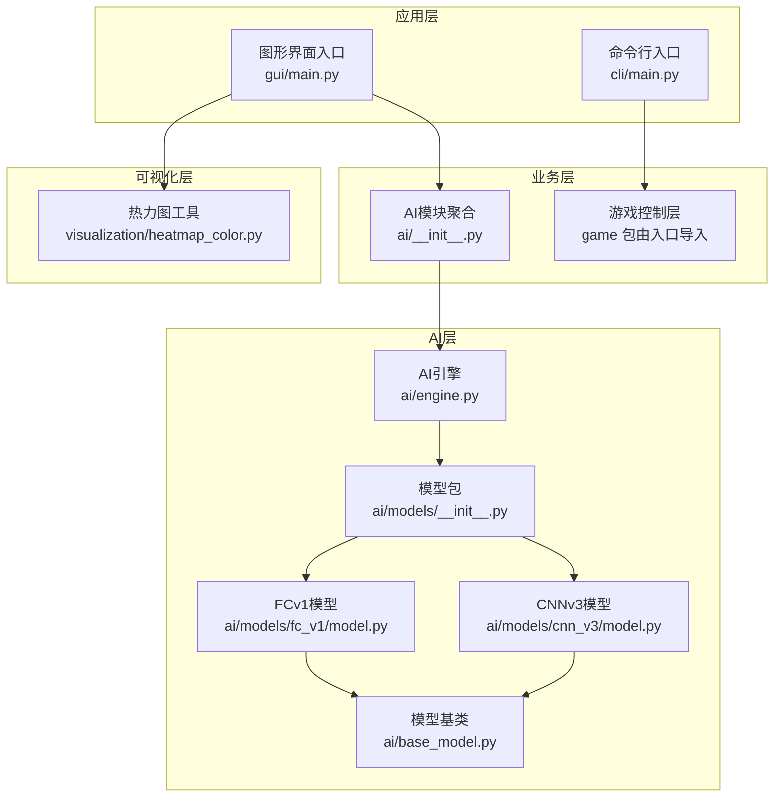
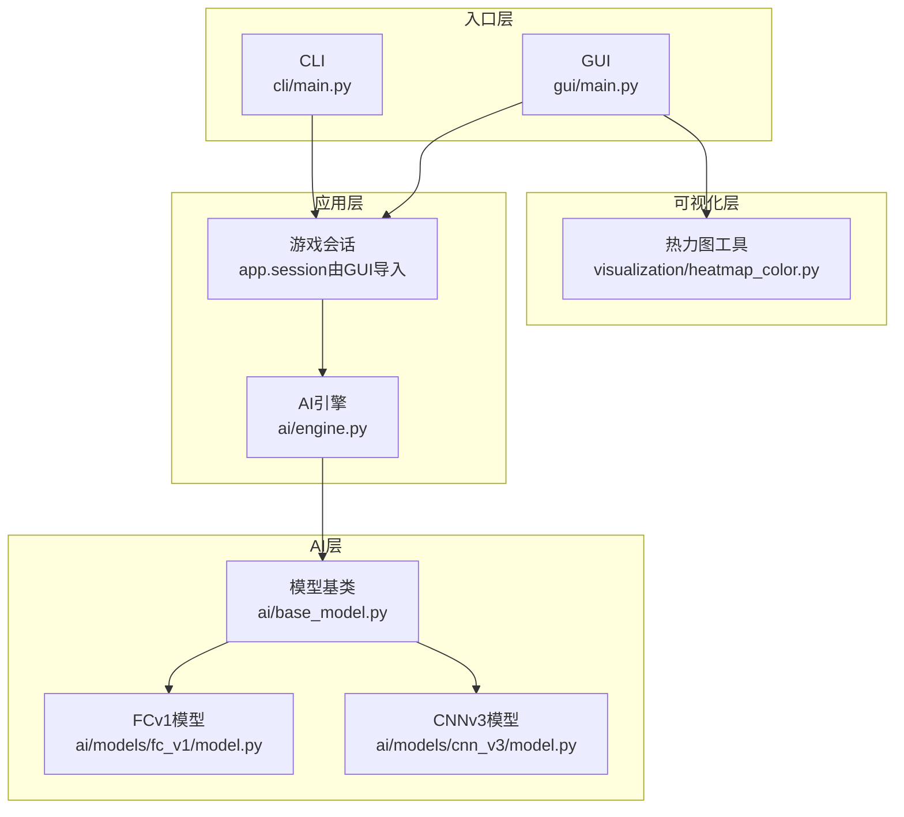
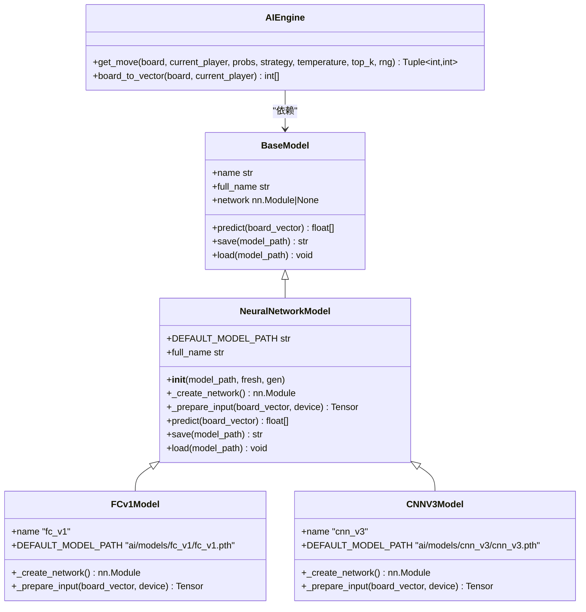
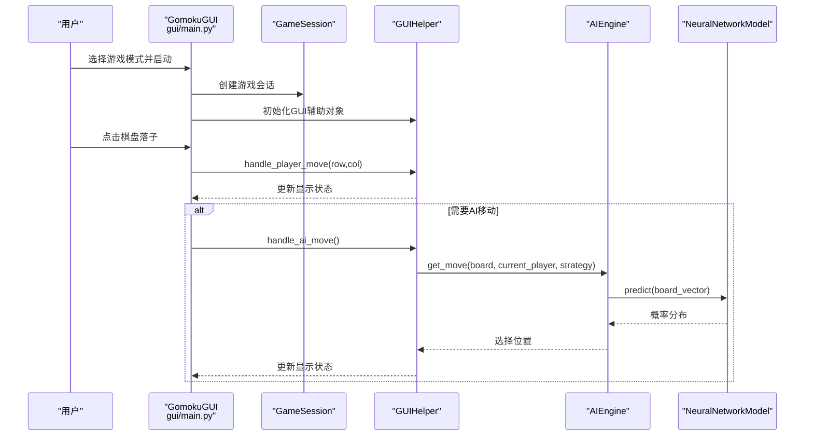
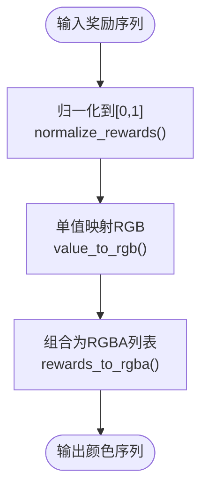
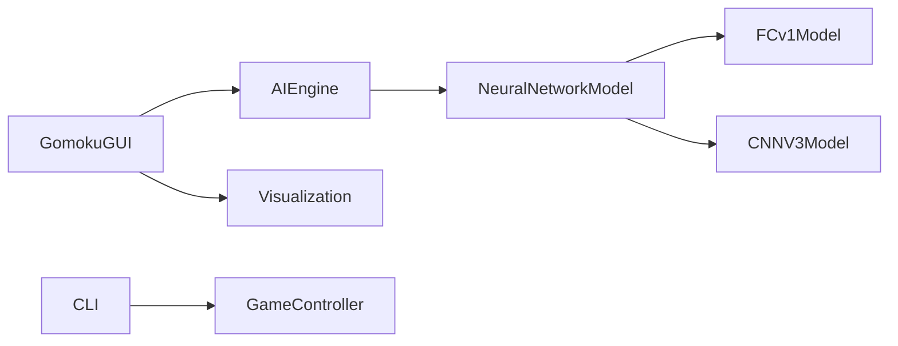

# 技术栈

<cite>
**本文引用的文件**
- [requirements/key_points.md](file://requirements/key_points.md)
- [ai/__init__.py](file://ai/__init__.py)
- [ai/base_model.py](file://ai/base_model.py)
- [ai/engine.py](file://ai/engine.py)
- [ai/models/__init__.py](file://ai/models/__init__.py)
- [ai/models/fc_v1/model.py](file://ai/models/fc_v1/model.py)
- [ai/models/cnn_v3/model.py](file://ai/models/cnn_v3/model.py)
- [gui/main.py](file://gui/main.py)
- [cli/main.py](file://cli/main.py)
- [visualization/heatmap_color.py](file://visualization/heatmap_color.py)
- [visualization/__init__.py](file://visualization/__init__.py)
</cite>

## 目录
1. [简介](#简介)
2. [项目结构](#项目结构)
3. [核心组件](#核心组件)
4. [架构总览](#架构总览)
5. [详细组件分析](#详细组件分析)
6. [依赖关系分析](#依赖关系分析)
7. [性能考量](#性能考量)
8. [故障排查指南](#故障排查指南)
9. [结论](#结论)
10. [附录](#附录)

## 简介
本项目围绕五子棋AI构建，采用Python 3.8+作为开发语言，结合深度学习框架PyTorch、GUI开发工具Tkinter、以及数据处理与可视化工具NumPy和Matplotlib，形成完整的AI训练与交互体验闭环。技术栈的选择兼顾工程落地性与可扩展性：PyTorch用于构建与训练神经网络模型；Tkinter用于构建图形界面；NumPy与Matplotlib用于数据处理与可视化。

## 项目结构
项目采用分层清晰的组织方式：
- ai：AI引擎、模型、训练器与评估器等AI相关逻辑
- gui：基于Tkinter的图形界面
- cli：命令行交互入口
- visualization：与可视化相关的通用工具（热力图颜色映射）
- requirements：项目关键点与设计文档

**图表来源**
- [gui/main.py:18-28](file://gui/main.py#L18-L28)
- [cli/main.py:9-11](file://cli/main.py#L9-L11)
- [ai/__init__.py:7-20](file://ai/__init__.py#L7-L20)
- [ai/engine.py:18-42](file://ai/engine.py#L18-L42)
- [ai/models/__init__.py:11-27](file://ai/models/__init__.py#L11-L27)
- [ai/models/fc_v1/model.py:91-132](file://ai/models/fc_v1/model.py#L91-L132)
- [ai/models/cnn_v3/model.py:96-139](file://ai/models/cnn_v3/model.py#L96-L139)
- [ai/base_model.py:107-276](file://ai/base_model.py#L107-L276)
- [visualization/heatmap_color.py:1-31](file://visualization/heatmap_color.py#L1-L31)

**章节来源**
- [requirements/key_points.md:1-120](file://requirements/key_points.md#L1-L120)
- [gui/main.py:1-60](file://gui/main.py#L1-L60)
- [cli/main.py:1-30](file://cli/main.py#L1-L30)
- [ai/__init__.py:1-21](file://ai/__init__.py#L1-L21)
- [ai/models/__init__.py:1-28](file://ai/models/__init__.py#L1-L28)

## 核心组件
- Python 3.8+：项目开发与运行的基础语言环境，保证与现代第三方库兼容。
- PyTorch：深度学习框架，用于构建与训练神经网络模型（全连接与卷积两种结构），提供张量操作、自动微分与GPU加速能力。
- Tkinter：GUI开发工具，用于构建图形界面，支持菜单、按钮、对话框与事件驱动的交互。
- NumPy：数值计算库，用于数组与矩阵运算，支撑AI模型输入转换与数据处理。
- Matplotlib：可视化工具，用于绘制训练曲线、热力图等，辅助模型训练与结果展示。

这些技术组件在项目中的作用与优势：
- PyTorch：提供灵活的模型构建与训练能力，便于快速迭代不同网络结构（如FCv1与CNNv3）。
- Tkinter：简洁易用，适合快速搭建图形界面，满足人机对战与回放浏览等交互需求。
- NumPy：高效处理棋盘状态向量与张量转换，保证数据处理性能。
- Matplotlib：配合可视化模块，将AI输出与样本奖励映射为直观的颜色热力图，便于调试与分析。

**章节来源**
- [ai/base_model.py:107-276](file://ai/base_model.py#L107-L276)
- [ai/models/fc_v1/model.py:1-132](file://ai/models/fc_v1/model.py#L1-L132)
- [ai/models/cnn_v3/model.py:1-139](file://ai/models/cnn_v3/model.py#L1-L139)
- [gui/main.py:15-28](file://gui/main.py#L15-L28)
- [visualization/heatmap_color.py:1-31](file://visualization/heatmap_color.py#L1-L31)

## 架构总览
系统采用“入口层-应用层-AI层-可视化层”的分层架构：
- 入口层：CLI与GUI分别面向命令行与图形界面用户。
- 应用层：封装游戏会话与AI引擎，协调UI与AI模型。
- AI层：提供AI引擎、模型基类与多种模型实现，统一预测与保存接口。
- 可视化层：提供热力图颜色映射与归一化工具，支持训练与回放展示。

**图表来源**
- [cli/main.py:9-11](file://cli/main.py#L9-L11)
- [gui/main.py:18-28](file://gui/main.py#L18-L28)
- [ai/engine.py:44-66](file://ai/engine.py#L44-L66)
- [ai/base_model.py:107-276](file://ai/base_model.py#L107-L276)
- [ai/models/fc_v1/model.py:91-132](file://ai/models/fc_v1/model.py#L91-L132)
- [ai/models/cnn_v3/model.py:96-139](file://ai/models/cnn_v3/model.py#L96-L139)
- [visualization/heatmap_color.py:1-31](file://visualization/heatmap_color.py#L1-L31)

## 详细组件分析

### AI引擎与模型基类
AI引擎负责将棋盘状态转换为模型输入向量，并根据策略选择落子位置；模型基类提供统一的接口与通用逻辑（如预测、保存、加载），子类仅需实现网络结构与输入转换细节。

**图表来源**
- [ai/base_model.py:24-105](file://ai/base_model.py#L24-L105)
- [ai/base_model.py:107-276](file://ai/base_model.py#L107-L276)
- [ai/models/fc_v1/model.py:91-132](file://ai/models/fc_v1/model.py#L91-L132)
- [ai/models/cnn_v3/model.py:96-139](file://ai/models/cnn_v3/model.py#L96-L139)
- [ai/engine.py:44-194](file://ai/engine.py#L44-L194)

**章节来源**
- [ai/engine.py:44-194](file://ai/engine.py#L44-L194)
- [ai/base_model.py:107-276](file://ai/base_model.py#L107-L276)
- [ai/models/fc_v1/model.py:1-132](file://ai/models/fc_v1/model.py#L1-L132)
- [ai/models/cnn_v3/model.py:1-139](file://ai/models/cnn_v3/model.py#L1-L139)

### GUI与交互流程
GUI主程序通过组件化方式构建界面，协调游戏会话与AI引擎，支持人机对战与AI内战回放等功能。

**图表来源**
- [gui/main.py:224-268](file://gui/main.py#L224-L268)
- [gui/main.py:448-457](file://gui/main.py#L448-L457)
- [ai/engine.py:67-143](file://ai/engine.py#L67-L143)
- [ai/base_model.py:195-231](file://ai/base_model.py#L195-L231)

**章节来源**
- [gui/main.py:1-462](file://gui/main.py#L1-L462)
- [ai/engine.py:1-194](file://ai/engine.py#L1-L194)

### 热力图颜色映射与可视化
可视化模块提供热力图颜色映射与归一化工具，支持将奖励值序列映射为RGB颜色，便于在GUI中展示AI输出与样本奖励。

**图表来源**
- [visualization/heatmap_color.py:63-122](file://visualization/heatmap_color.py#L63-L122)
- [visualization/heatmap_color.py:128-134](file://visualization/heatmap_color.py#L128-L134)
- [visualization/__init__.py:10-22](file://visualization/__init__.py#L10-L22)

**章节来源**
- [visualization/heatmap_color.py:1-134](file://visualization/heatmap_color.py#L1-L134)
- [visualization/__init__.py:1-22](file://visualization/__init__.py#L1-L22)

## 依赖关系分析
- AI引擎依赖模型基类，模型基类统一管理网络结构与输入转换。
- FCv1与CNNv3均继承自神经网络模型基类，遵循统一接口。
- GUI通过应用层与AI引擎交互，可视化模块独立于UI，便于复用。
- CLI与GUI共享游戏控制层，保证一致性。

**图表来源**
- [ai/engine.py:44-66](file://ai/engine.py#L44-L66)
- [ai/base_model.py:107-125](file://ai/base_model.py#L107-L125)
- [ai/models/fc_v1/model.py:91-110](file://ai/models/fc_v1/model.py#L91-L110)
- [ai/models/cnn_v3/model.py:96-115](file://ai/models/cnn_v3/model.py#L96-L115)
- [gui/main.py:18-28](file://gui/main.py#L18-L28)
- [visualization/heatmap_color.py:1-31](file://visualization/heatmap_color.py#L1-L31)
- [cli/main.py:9-11](file://cli/main.py#L9-L11)

**章节来源**
- [ai/engine.py:1-194](file://ai/engine.py#L1-L194)
- [ai/base_model.py:1-323](file://ai/base_model.py#L1-L323)
- [ai/models/fc_v1/model.py:1-132](file://ai/models/fc_v1/model.py#L1-L132)
- [ai/models/cnn_v3/model.py:1-139](file://ai/models/cnn_v3/model.py#L1-L139)
- [gui/main.py:1-462](file://gui/main.py#L1-L462)
- [cli/main.py:1-258](file://cli/main.py#L1-L258)
- [visualization/heatmap_color.py:1-134](file://visualization/heatmap_color.py#L1-L134)

## 性能考量
- 模型结构选择：FCv1采用多层全连接网络，CNNv3采用纯卷积结构，参数量更少，推理更快，适合资源受限场景。
- 推理优化：模型基类统一在推理时使用eval模式与禁用梯度，减少内存与计算开销。
- 输入转换：CNN模型通过专用函数将226维向量转换为(1,3,15,15)张量，避免重复逻辑，提升效率。
- 可视化：热力图颜色映射采用纯函数与数学运算，不依赖UI，便于在脚本与GUI中复用。

**章节来源**
- [ai/base_model.py:195-231](file://ai/base_model.py#L195-L231)
- [ai/base_model.py:278-323](file://ai/base_model.py#L278-L323)
- [ai/models/fc_v1/model.py:53-88](file://ai/models/fc_v1/model.py#L53-L88)
- [ai/models/cnn_v3/model.py:70-93](file://ai/models/cnn_v3/model.py#L70-L93)
- [visualization/heatmap_color.py:1-31](file://visualization/heatmap_color.py#L1-L31)

## 故障排查指南
- 模型加载失败：当指定多代模型但权重文件不存在时，会抛出异常。请确认模型路径与代数配置正确。
- 推理异常：若棋盘已满无空位可落子，引擎会抛出异常。请检查游戏状态与策略参数。
- GUI模型加载错误：GUI捕获模型加载异常并提示用户。请检查模型名称与路径。
- 可视化颜色异常：热力图颜色映射依赖归一化与色阶配置。请确认输入值范围与归一化模式。

**章节来源**
- [ai/base_model.py:162-165](file://ai/base_model.py#L162-L165)
- [ai/engine.py:124-126](file://ai/engine.py#L124-L126)
- [gui/main.py:451-457](file://gui/main.py#L451-L457)
- [visualization/heatmap_color.py:63-122](file://visualization/heatmap_color.py#L63-L122)

## 结论
本项目以清晰的分层架构与模块化设计，将Python生态中的PyTorch、Tkinter、NumPy与Matplotlib有机结合，既满足AI模型训练与推理的工程需求，又提供了良好的交互体验与可视化能力。技术选型兼顾性能与可维护性，适合进一步扩展与迭代。

## 附录
- 版本与兼容性：项目明确使用Python 3.8+，PyTorch用于神经网络训练与推理，Tkinter用于GUI开发，NumPy与Matplotlib用于数据处理与可视化。
- 依赖包版本：仓库未包含pip依赖清单文件，建议在开发环境中安装与项目兼容的PyTorch、NumPy与Matplotlib版本，确保模型训练与可视化功能正常运行。

**章节来源**
- [requirements/key_points.md:1-20](file://requirements/key_points.md#L1-L20)
- [ai/base_model.py:10-22](file://ai/base_model.py#L10-L22)
- [gui/main.py:15-28](file://gui/main.py#L15-L28)
- [visualization/heatmap_color.py:22-26](file://visualization/heatmap_color.py#L22-L26)