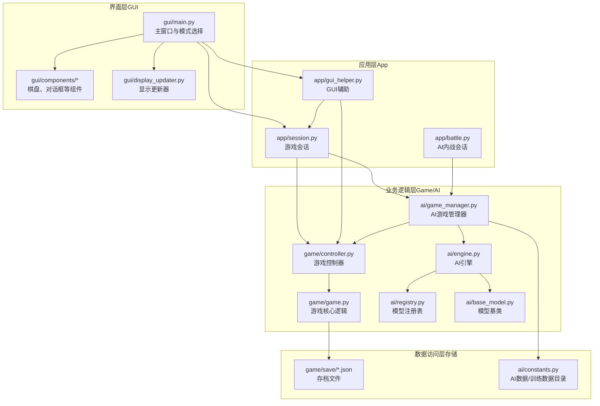
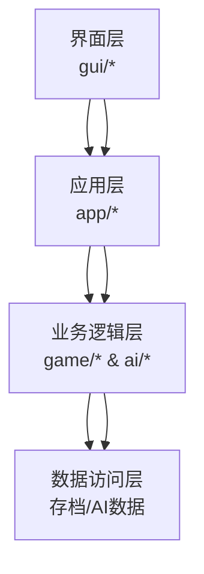
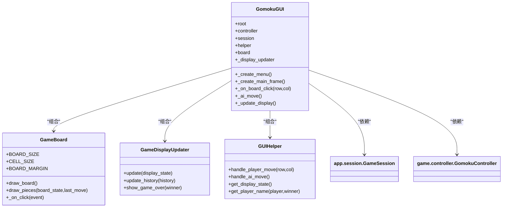
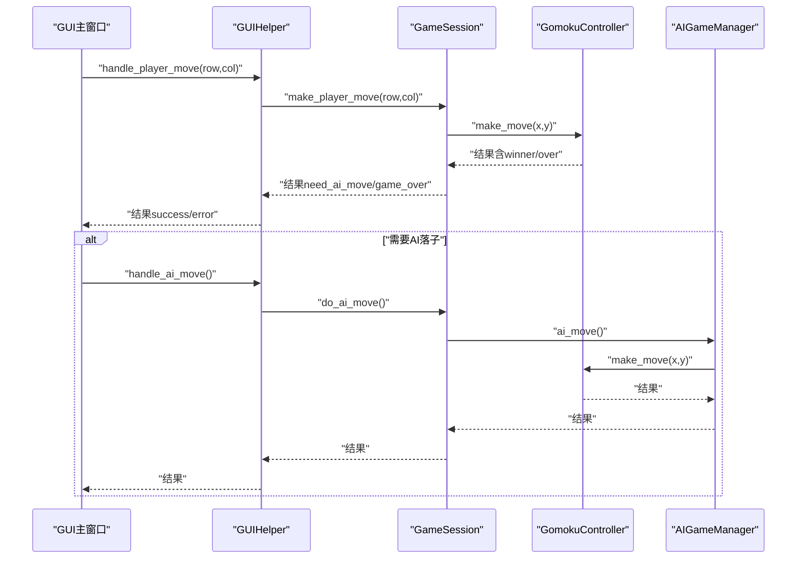
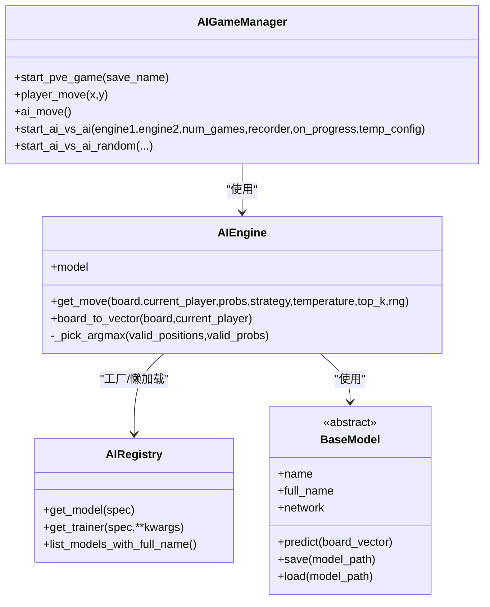
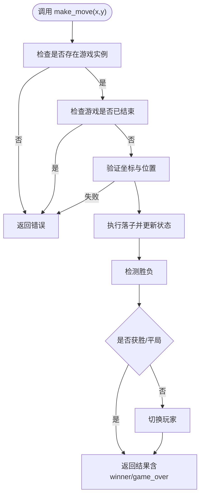
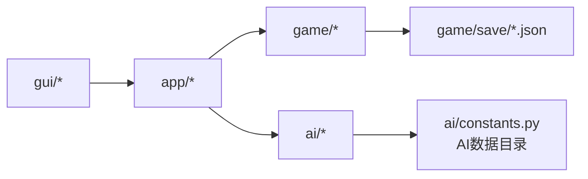

# 架构概览

<cite>
**本文档引用的文件**
- [gui/main.py](file://gui/main.py)
- [app/session.py](file://app/session.py)
- [ai/engine.py](file://ai/engine.py)
- [game/controller.py](file://game/controller.py)
- [ai/game_manager.py](file://ai/game_manager.py)
- [app/gui_helper.py](file://app/gui_helper.py)
- [gui/display_updater.py](file://gui/display_updater.py)
- [ai/registry.py](file://ai/registry.py)
- [game/game.py](file://game/game.py)
- [app/battle.py](file://app/battle.py)
- [gui/components/game_board.py](file://gui/components/game_board.py)
- [gui/components/constants.py](file://gui/components/constants.py)
- [ai/base_model.py](file://ai/base_model.py)
- [cli/main.py](file://cli/main.py)
- [ai/constants.py](file://ai/constants.py)
</cite>

## 目录
1. [简介](#简介)
2. [项目结构](#项目结构)
3. [核心组件](#核心组件)
4. [架构总览](#架构总览)
5. [详细组件分析](#详细组件分析)
6. [依赖关系分析](#依赖关系分析)
7. [性能考虑](#性能考虑)
8. [故障排查指南](#故障排查指南)
9. [结论](#结论)
10. [附录](#附录)

## 简介
本项目是一个五子棋AI系统，采用分层架构与模块化设计，清晰分离GUI界面层、应用层、业务逻辑层与数据访问层。系统支持三种模式：人人对战（PvP）、人机对战（PvE）、AI内战（AI vs AI）。核心模块包括AI引擎、游戏控制器、会话管理、显示更新器以及模型注册表等。设计强调可扩展性与可维护性，通过策略模式、工厂模式与薄应用层代理模式实现松耦合与高内聚。

## 项目结构
项目采用“包”级模块化组织，按功能域划分为：
- gui：图形界面层，包含主窗口、组件与显示更新器
- app：应用层薄代理，协调GUI与业务逻辑
- ai：AI引擎与模型体系，包含注册表、训练与评估工具
- game：游戏核心逻辑与存档管理
- cli：命令行交互入口
- design：设计文档与规范
- tests：测试套件
- visualization：可视化辅助

图表来源
- [gui/main.py:1-462](file://gui/main.py#L1-L462)
- [app/session.py:1-179](file://app/session.py#L1-L179)
- [ai/engine.py:1-194](file://ai/engine.py#L1-L194)
- [game/controller.py:1-194](file://game/controller.py#L1-L194)
- [ai/game_manager.py:1-339](file://ai/game_manager.py#L1-L339)
- [app/gui_helper.py:1-199](file://app/gui_helper.py#L1-L199)
- [gui/display_updater.py:1-110](file://gui/display_updater.py#L1-L110)
- [ai/registry.py:1-316](file://ai/registry.py#L1-L316)
- [game/game.py:1-118](file://game/game.py#L1-L118)
- [app/battle.py:1-104](file://app/battle.py#L1-L104)
- [ai/constants.py:1-26](file://ai/constants.py#L1-L26)

章节来源
- [gui/main.py:1-462](file://gui/main.py#L1-L462)
- [app/session.py:1-179](file://app/session.py#L1-L179)
- [ai/engine.py:1-194](file://ai/engine.py#L1-L194)
- [game/controller.py:1-194](file://game/controller.py#L1-L194)
- [ai/game_manager.py:1-339](file://ai/game_manager.py#L1-L339)
- [app/gui_helper.py:1-199](file://app/gui_helper.py#L1-L199)
- [gui/display_updater.py:1-110](file://gui/display_updater.py#L1-L110)
- [ai/registry.py:1-316](file://ai/registry.py#L1-L316)
- [game/game.py:1-118](file://game/game.py#L1-L118)
- [app/battle.py:1-104](file://app/battle.py#L1-L104)
- [ai/constants.py:1-26](file://ai/constants.py#L1-L26)

## 核心组件
- GUI主窗口与模式选择：负责用户交互、菜单与按钮、回放浏览等
- 应用层会话与辅助：封装游戏流程、协调控制器与AI管理器、提供统一落子接口
- 游戏控制器：唯一对外接口，协调游戏与存档
- AI引擎与注册表：模型工厂与懒加载，策略选择（argmax/sampling）
- AI游戏管理器：人机对战与AI内战流程编排
- 显示更新器：根据状态刷新棋盘、标签与历史记录
- 模型基类与多代模型支持：统一接口与多代权重加载

章节来源
- [gui/main.py:31-462](file://gui/main.py#L31-L462)
- [app/session.py:12-179](file://app/session.py#L12-L179)
- [game/controller.py:11-194](file://game/controller.py#L11-L194)
- [ai/engine.py:44-194](file://ai/engine.py#L44-L194)
- [ai/game_manager.py:16-339](file://ai/game_manager.py#L16-L339)
- [app/gui_helper.py:12-199](file://app/gui_helper.py#L12-L199)
- [gui/display_updater.py:13-110](file://gui/display_updater.py#L13-L110)
- [ai/base_model.py:24-323](file://ai/base_model.py#L24-L323)
- [ai/registry.py:58-316](file://ai/registry.py#L58-L316)

## 架构总览
系统采用典型的四层架构：
- 界面层（GUI）：Tkinter组件与主窗口，负责用户交互与显示
- 应用层（App）：薄代理层，协调控制器与AI管理器，屏蔽上层复杂性
- 业务逻辑层（Game/AI）：游戏核心逻辑与AI引擎，包含控制器、模型与管理器
- 数据访问层（Storage）：存档文件与AI数据目录，提供持久化能力

图表来源
- [gui/main.py:1-462](file://gui/main.py#L1-L462)
- [app/session.py:1-179](file://app/session.py#L1-L179)
- [game/controller.py:1-194](file://game/controller.py#L1-L194)
- [ai/engine.py:1-194](file://ai/engine.py#L1-L194)
- [ai/game_manager.py:1-339](file://ai/game_manager.py#L1-L339)
- [ai/constants.py:1-26](file://ai/constants.py#L1-L26)

## 详细组件分析

### GUI主窗口与组件
- GomokuGUI：主窗口，创建菜单、棋盘、信息面板与控制按钮；协调会话与显示更新器
- GameBoard：棋盘组件，绘制网格、星位与棋子，响应点击事件
- GameDisplayUpdater：根据display_state刷新棋盘、标签与历史记录
- GUIHelper：处理与界面无关的业务逻辑，提供统一的落子与显示状态接口

图表来源
- [gui/main.py:31-462](file://gui/main.py#L31-L462)
- [gui/components/game_board.py:7-170](file://gui/components/game_board.py#L7-L170)
- [gui/display_updater.py:13-110](file://gui/display_updater.py#L13-L110)
- [app/gui_helper.py:12-199](file://app/gui_helper.py#L12-L199)

章节来源
- [gui/main.py:31-462](file://gui/main.py#L31-L462)
- [gui/components/game_board.py:7-170](file://gui/components/game_board.py#L7-L170)
- [gui/display_updater.py:13-110](file://gui/display_updater.py#L13-L110)
- [app/gui_helper.py:12-199](file://app/gui_helper.py#L12-L199)

### 应用层会话与辅助
- GameSession：封装一局游戏流程，协调控制器与AI管理器，提供统一落子接口
- GUIHelper：处理与界面无关的业务逻辑，屏蔽控制器与会话细节
- BattleSession：封装AI内战流程，创建引擎、执行对战并生成训练样本

图表来源
- [app/gui_helper.py:53-106](file://app/gui_helper.py#L53-L106)
- [app/session.py:63-179](file://app/session.py#L63-L179)
- [game/controller.py:65-98](file://game/controller.py#L65-L98)
- [ai/game_manager.py:100-122](file://ai/game_manager.py#L100-L122)

章节来源
- [app/session.py:12-179](file://app/session.py#L12-L179)
- [app/gui_helper.py:12-199](file://app/gui_helper.py#L12-L199)
- [app/battle.py:15-104](file://app/battle.py#L15-L104)

### AI引擎与模型体系
- AIEngine：将棋盘状态转换为向量，调用模型获取概率分布，按策略选择落子位置
- AIRegistry：统一模型注册表，支持多代模型与懒加载
- BaseModel：模型基类，定义统一接口与多代模型支持
- AIGameManager：AI内战与人机对战流程编排，记录数据与生成样本

图表来源
- [ai/engine.py:44-194](file://ai/engine.py#L44-L194)
- [ai/registry.py:150-316](file://ai/registry.py#L150-L316)
- [ai/base_model.py:24-323](file://ai/base_model.py#L24-L323)
- [ai/game_manager.py:16-339](file://ai/game_manager.py#L16-L339)

章节来源
- [ai/engine.py:18-194](file://ai/engine.py#L18-L194)
- [ai/registry.py:58-316](file://ai/registry.py#L58-L316)
- [ai/base_model.py:24-323](file://ai/base_model.py#L24-L323)
- [ai/game_manager.py:16-339](file://ai/game_manager.py#L16-L339)

### 游戏控制器与核心逻辑
- GomokuController：唯一对外接口，协调游戏与存档，返回统一格式结果
- GomokuGame：维护棋盘状态、落子逻辑与胜负检测

图表来源
- [game/controller.py:65-98](file://game/controller.py#L65-L98)
- [game/game.py:22-56](file://game/game.py#L22-L56)

章节来源
- [game/controller.py:11-194](file://game/controller.py#L11-L194)
- [game/game.py:4-118](file://game/game.py#L4-L118)

## 依赖关系分析
- GUI层依赖应用层（会话与辅助），应用层依赖业务逻辑层（控制器与AI管理器），业务逻辑层依赖数据访问层（存档与AI数据目录）
- AI引擎通过注册表工厂模式创建模型，避免直接依赖具体模型类
- 显示更新器依赖控制器状态与GUI辅助，实现解耦

图表来源
- [gui/main.py:1-462](file://gui/main.py#L1-L462)
- [app/session.py:1-179](file://app/session.py#L1-L179)
- [ai/engine.py:1-194](file://ai/engine.py#L1-L194)
- [ai/constants.py:1-26](file://ai/constants.py#L1-L26)
- [game/controller.py:1-194](file://game/controller.py#L1-L194)

章节来源
- [gui/main.py:1-462](file://gui/main.py#L1-L462)
- [app/session.py:1-179](file://app/session.py#L1-L179)
- [ai/engine.py:1-194](file://ai/engine.py#L1-L194)
- [ai/constants.py:1-26](file://ai/constants.py#L1-L26)
- [game/controller.py:1-194](file://game/controller.py#L1-L194)

## 性能考虑
- AI引擎支持预计算概率向量，避免重复模型推理，提升自对弈效率
- 多代模型懒加载与按需导入，减少启动开销
- 显示更新器按需刷新，避免全量重绘
- 游戏核心逻辑采用O(1)方向检测与O(n²)平局检测，兼顾效率与正确性

## 故障排查指南
- 模型加载失败：注册表与工厂模式在创建引擎时抛出异常，应用层转换为ModelLoadError并反馈GUI
- 落子失败：控制器返回错误信息，GUI弹窗提示
- 存档不存在：控制器返回错误，GUI提示或引导用户重新选择

章节来源
- [ai/engine.py:18-42](file://ai/engine.py#L18-L42)
- [app/session.py:44-51](file://app/session.py#L44-L51)
- [game/controller.py:65-98](file://game/controller.py#L65-L98)

## 结论
本项目通过清晰的分层架构与模块化设计，实现了GUI、应用、业务与数据层的有效解耦。AI引擎与注册表采用工厂与策略模式，提升了可扩展性；应用层薄代理屏蔽复杂性，便于维护与测试。系统边界明确，扩展点清晰，适合进一步引入更多AI模型与训练流程。

## 附录
- 设计文档与规范参考：[design/design_specification.md](file://design/design_specification.md)
- 命令行入口：[cli/main.py](file://cli/main.py)
- GUI常量与主题：[gui/components/constants.py](file://gui/components/constants.py)