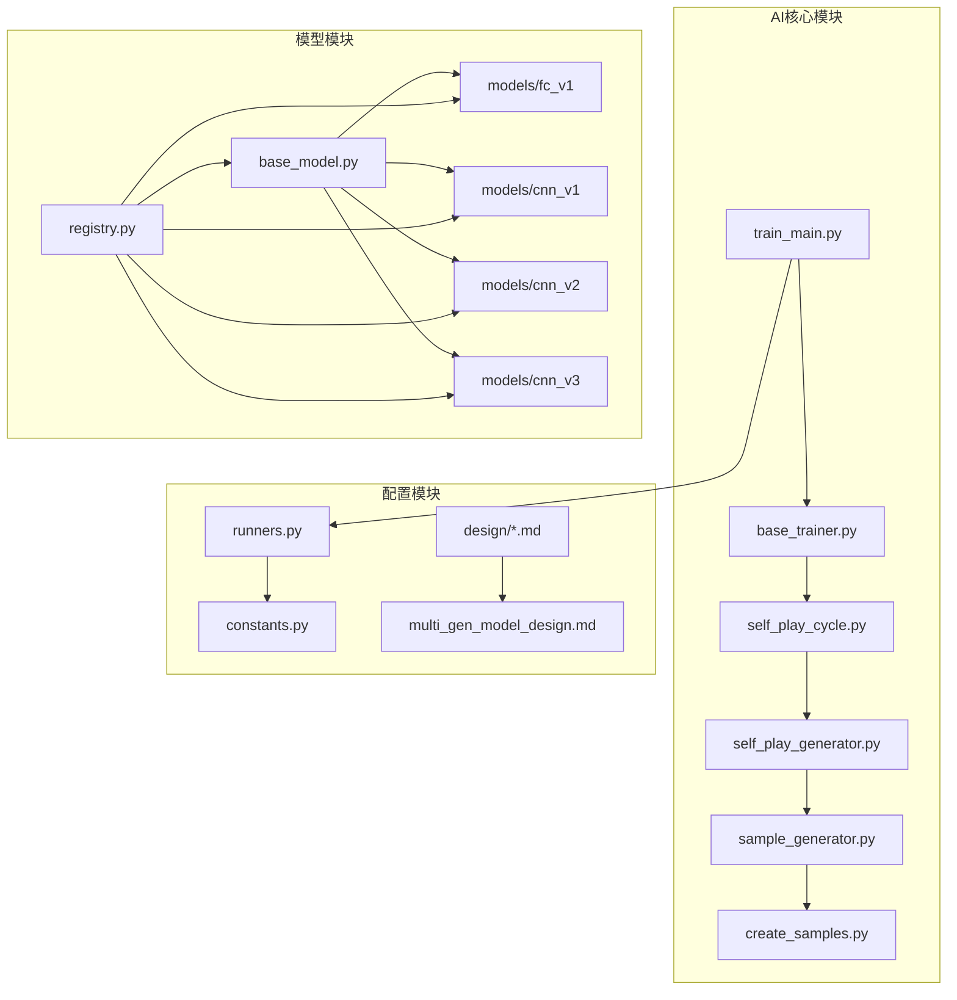
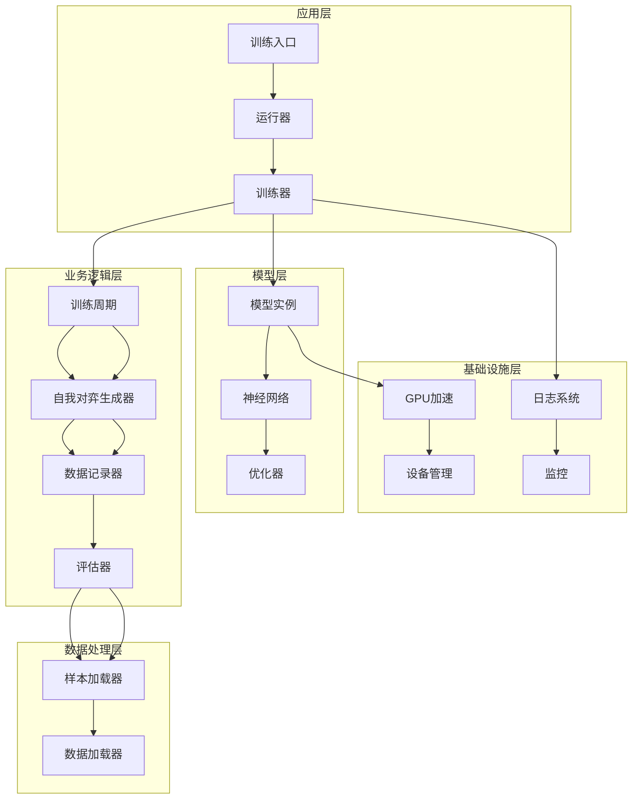
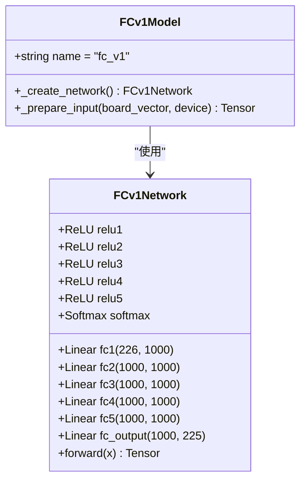
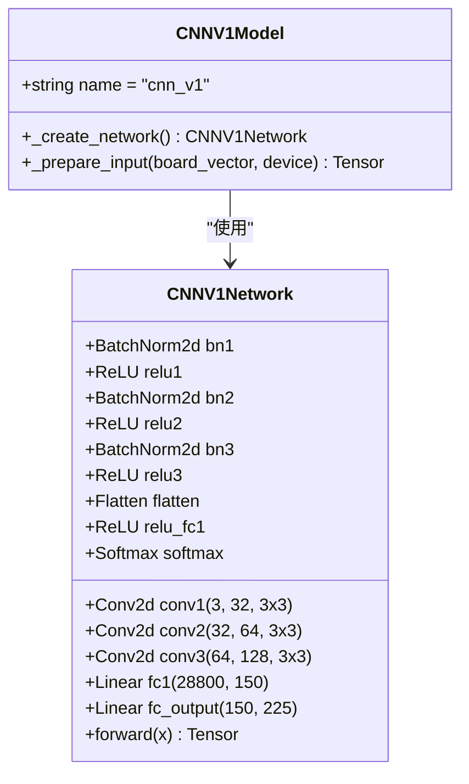
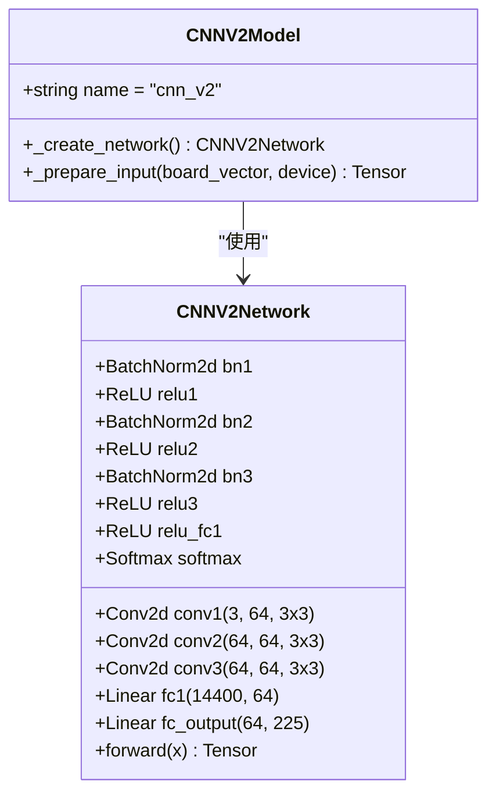
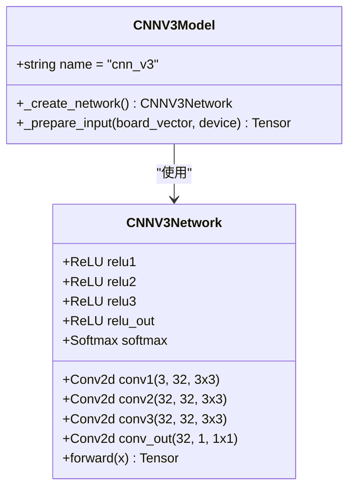
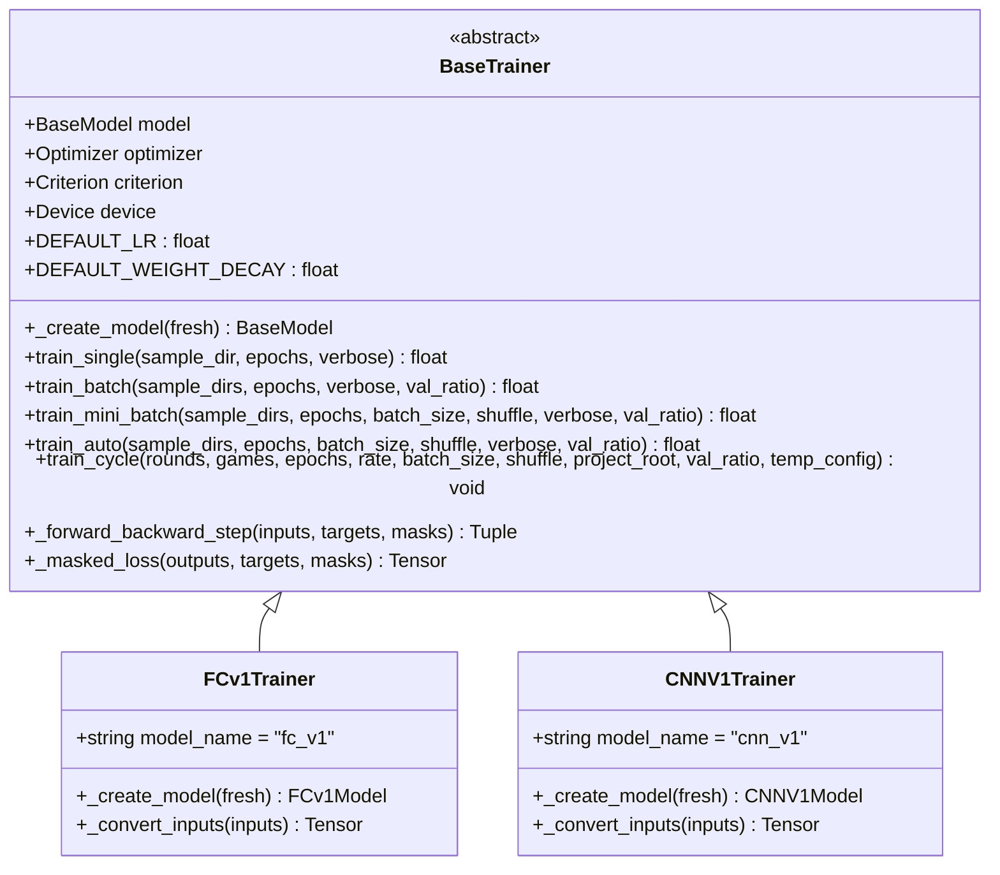
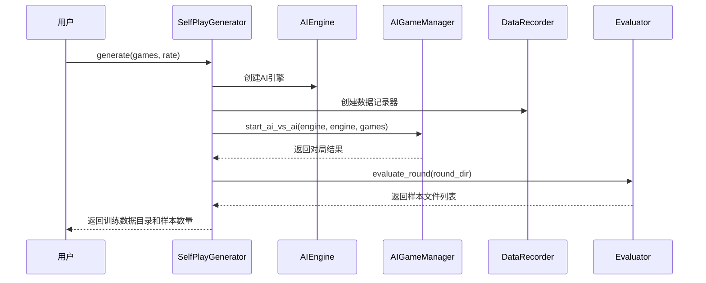
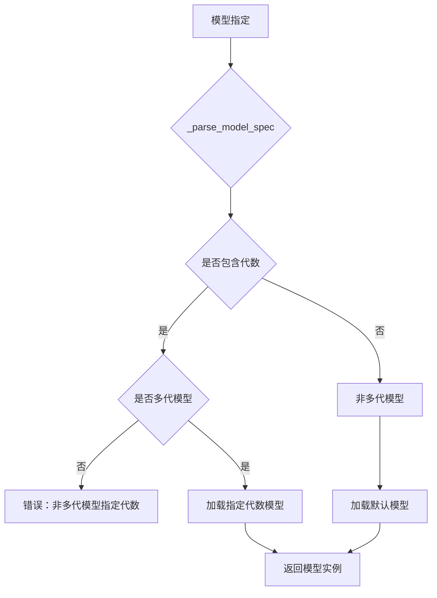
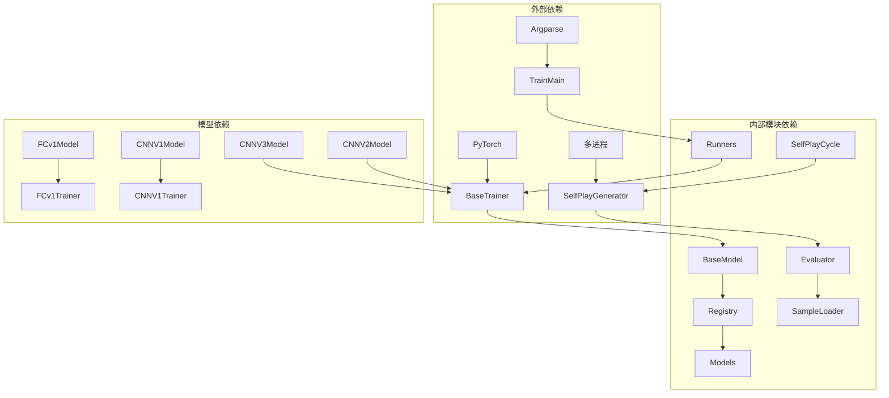

# AI训练系统

<cite>
**本文档引用的文件**
- [ai/train_main.py](file://ai/train_main.py)
- [ai/base_trainer.py](file://ai/base_trainer.py)
- [ai/self_play_generator.py](file://ai/self_play_generator.py)
- [ai/sample_generator.py](file://ai/sample_generator.py)
- [ai/create_samples.py](file://ai/create_samples.py)
- [ai/runners.py](file://ai/runners.py)
- [ai/registry.py](file://ai/registry.py)
- [ai/base_model.py](file://ai/base_model.py)
- [ai/constants.py](file://ai/constants.py)
- [ai/self_play_cycle.py](file://ai/self_play_cycle.py)
- [ai/models/fc_v1/model.py](file://ai/models/fc_v1/model.py)
- [ai/models/cnn_v1/trainer.py](file://ai/models/cnn_v1/trainer.py)
- [ai/models/cnn_v2/model.py](file://ai/models/cnn_v2/model.py)
- [ai/models/cnn_v3/model.py](file://ai/models/cnn_v3/model.py)
- [design/multi_gen_model_design.md](file://design/multi_gen_model_design.md)
- [design/cnn_v3_design.md](file://design/cnn_v3_design.md)
- [design/cnn_design.md](file://design/cnn_design.md)
</cite>

## 目录
1. [简介](#简介)
2. [项目结构](#项目结构)
3. [核心组件](#核心组件)
4. [架构概览](#架构概览)
5. [详细组件分析](#详细组件分析)
6. [依赖关系分析](#依赖关系分析)
7. [性能考虑](#性能考虑)
8. [故障排除指南](#故障排除指南)
9. [结论](#结论)
10. [附录](#附录)

## 简介

本项目是一个完整的五子棋AI训练系统，实现了从自我对弈到模型训练的全流程自动化。系统支持多代AI模型的进化，从最初的FCv1全连接网络发展到最新的CNNV3纯卷积网络，每个版本都有其独特的设计理念和性能特点。

该系统的核心特色包括：
- **多代模型支持**：通过注册表机制实现模型的版本管理和代数演进
- **灵活的训练模式**：支持单轮次训练、批量训练和小批量训练
- **完善的自我对弈系统**：自动生成高质量的训练样本
- **强大的数据处理管道**：从原始对局数据到训练样本的完整转换
- **可扩展的架构设计**：易于添加新的模型和训练算法

## 项目结构

项目采用模块化的组织方式，主要分为以下几个核心模块：

**图表来源**
- [ai/train_main.py:1-234](file://ai/train_main.py#L1-L234)
- [ai/base_trainer.py:1-699](file://ai/base_trainer.py#L1-L699)
- [ai/registry.py:1-316](file://ai/registry.py#L1-L316)

**章节来源**
- [ai/train_main.py:1-234](file://ai/train_main.py#L1-L234)
- [ai/registry.py:58-72](file://ai/registry.py#L58-L72)

## 核心组件

### 训练入口系统

训练系统通过统一的入口脚本提供灵活的训练模式：

- **训练周期模式**：自动执行自我对弈→样本生成→模型训练的完整循环
- **数据驱动模式**：直接从现有数据文件进行训练
- **参数化配置**：支持丰富的训练参数和学习率调度策略

### 模型注册与管理

系统采用注册表模式管理所有AI模型，支持：
- **多代模型**：通过代数标识不同版本的模型
- **延迟加载**：按需导入模型模块，提高启动效率
- **统一接口**：所有模型遵循相同的接口规范

### 自我对弈引擎

实现了完整的自我对弈流程：
- **智能引擎**：基于AI模型进行决策
- **数据记录**：完整记录对局过程和结果
- **样本生成**：将对局数据转换为训练样本

**章节来源**
- [ai/train_main.py:27-234](file://ai/train_main.py#L27-L234)
- [ai/registry.py:150-224](file://ai/registry.py#L150-L224)
- [ai/self_play_generator.py:21-168](file://ai/self_play_generator.py#L21-L168)

## 架构概览

系统采用分层架构设计，确保各组件之间的松耦合和高内聚：

**图表来源**
- [ai/base_trainer.py:32-120](file://ai/base_trainer.py#L32-L120)
- [ai/self_play_cycle.py:20-195](file://ai/self_play_cycle.py#L20-L195)
- [ai/registry.py:187-224](file://ai/registry.py#L187-L224)

## 详细组件分析

### FCv1全连接网络模型

FCv1是系统中最简单的模型，采用全连接架构：

**图表来源**
- [ai/models/fc_v1/model.py:18-132](file://ai/models/fc_v1/model.py#L18-L132)

FCv1模型的特点：
- **简单直观**：5层隐藏层，每层1000个神经元
- **全连接架构**：直接处理展平的226维向量
- **Softmax输出**：提供概率分布
- **参数量适中**：约445万参数

**章节来源**
- [ai/models/fc_v1/model.py:18-132](file://ai/models/fc_v1/model.py#L18-L132)

### CNNv1卷积神经网络

CNNv1是首个卷积神经网络模型：

**图表来源**
- [ai/models/cnn_v1/trainer.py:13-72](file://ai/models/cnn_v1/trainer.py#L13-L72)

CNNv1的设计原则：
- **轻量化设计**：参数量控制在约445万
- **三层卷积**：逐步提取空间特征
- **紧凑全连接**：高效的特征转换
- **批归一化**：稳定训练过程

**章节来源**
- [ai/models/cnn_v1/trainer.py:13-72](file://ai/models/cnn_v1/trainer.py#L13-L72)

### CNNv2轻量化模型

CNNv2是对CNNv1的轻量化改进：

**图表来源**
- [ai/models/cnn_v2/model.py:34-160](file://ai/models/cnn_v2/model.py#L34-L160)

CNNv2的主要改进：
- **统一通道数**：3→64→64→64，减少参数量
- **参数量大幅减少**：从约445万降至约101万（-77%）
- **计算量优化**：从23M降至18M MACs（-22%）
- **保持性能**：在参数量大幅减少的同时维持相近的性能

**章节来源**
- [ai/models/cnn_v2/model.py:34-160](file://ai/models/cnn_v2/model.py#L34-L160)

### CNNv3纯卷积模型

CNNv3是追求结构最简化的模型：

**图表来源**
- [ai/models/cnn_v3/model.py:31-139](file://ai/models/cnn_v3/model.py#L31-L139)

CNNv3的设计理念：
- **纯卷积架构**：无FC层、无BatchNorm、无Dropout
- **1×1卷积替代**：用32个参数的1×1卷积替代复杂的全连接层
- **空间保持**：全程保持15×15的空间结构
- **极简参数**：仅约1.9万参数，学习能力验证

**章节来源**
- [ai/models/cnn_v3/model.py:31-139](file://ai/models/cnn_v3/model.py#L31-L139)

### 训练器基类

BaseTrainer提供了统一的训练接口和通用训练逻辑：

**图表来源**
- [ai/base_trainer.py:32-180](file://ai/base_trainer.py#L32-L180)

BaseTrainer的核心功能：
- **设备管理**：自动检测并使用GPU加速
- **优化器配置**：默认使用AdamW优化器
- **损失函数**：使用L1Loss配合mask
- **学习率调度**：支持StepLR和ReduceLROnPlateau
- **训练模式**：支持单轮次、批量和小批量训练

**章节来源**
- [ai/base_trainer.py:32-699](file://ai/base_trainer.py#L32-L699)

### 自我对弈生成器

SelfPlayGenerator实现了完整的自我对弈流程：

**图表来源**
- [ai/self_play_generator.py:21-168](file://ai/self_play_generator.py#L21-L168)

自我对弈的关键特性：
- **温度采样**：支持开局阶段的概率采样
- **数据记录**：完整记录对局过程
- **样本生成**：将对局转换为训练样本
- **错误处理**：优雅处理Ctrl+C中断

**章节来源**
- [ai/self_play_generator.py:21-244](file://ai/self_play_generator.py#L21-L244)

### 多代模型支持

系统支持模型的多代演进，通过注册表机制管理：

**图表来源**
- [ai/registry.py:103-130](file://ai/registry.py#L103-L130)

多代模型的设计原则：
- **代数约束**：代数必须为≥1的整数
- **目录结构**：`gen{i}/`目录存储对应代数的权重
- **命名规范**：模型名称禁止包含点号
- **加载策略**：显式指定优先，严格校验

**章节来源**
- [ai/registry.py:103-224](file://ai/registry.py#L103-L224)
- [design/multi_gen_model_design.md:1-550](file://design/multi_gen_model_design.md#L1-L550)

## 依赖关系分析

系统采用清晰的依赖层次结构：

**图表来源**
- [ai/train_main.py:23-24](file://ai/train_main.py#L23-L24)
- [ai/base_trainer.py:14-18](file://ai/base_trainer.py#L14-L18)
- [ai/registry.py:22-100](file://ai/registry.py#L22-L100)

**章节来源**
- [ai/train_main.py:23-24](file://ai/train_main.py#L23-L24)
- [ai/base_trainer.py:14-18](file://ai/base_trainer.py#L14-L18)
- [ai/registry.py:22-100](file://ai/registry.py#L22-L100)

## 性能考虑

### 训练性能优化

系统在多个层面进行了性能优化：

1. **GPU加速**：自动检测CUDA设备，充分利用GPU计算能力
2. **内存管理**：使用mask机制避免无效计算
3. **批处理优化**：支持小批量训练，提高收敛速度
4. **学习率调度**：动态调整学习率，优化训练效果

### 模型性能对比

| 模型 | 参数量 | 计算复杂度 | 训练速度 | 推理速度 |
|------|--------|------------|----------|----------|
| FCv1 | ~445万 | 中等 | 中等 | 快 |
| CNNv1 | ~445万 | 高 | 慢 | 中等 |
| CNNv2 | ~101万 | 中等 | 快 | 快 |
| CNNv3 | ~1.9万 | 低 | 快 | 最快 |

### 内存使用优化

- **批处理策略**：根据GPU内存选择合适的batch size
- **梯度累积**：在内存受限时使用梯度累积
- **数据类型优化**：使用float32减少内存占用
- **及时释放**：训练完成后及时释放不需要的张量

## 故障排除指南

### 常见问题及解决方案

#### 模型加载失败
**症状**：`ValueError: 模型加载失败：多代模型必须指定代数`
**原因**：多代模型未指定代数
**解决**：使用`cnn_v3.1`格式指定具体代数

#### 训练中断
**症状**：训练过程中断，提示"模型保存失败"
**原因**：GPU内存不足或磁盘空间不足
**解决**：减少batch size，清理磁盘空间

#### 样本生成错误
**症状**：样本生成失败，提示"样本文件不存在"
**原因**：对局数据损坏或路径错误
**解决**：重新进行自我对弈，检查数据路径

#### 学习率问题
**症状**：训练不收敛或收敛过慢
**原因**：学习率设置不当
**解决**：调整学习率或使用学习率调度器

**章节来源**
- [ai/train_main.py:219-224](file://ai/train_main.py#L219-L224)
- [ai/self_play_cycle.py:157-177](file://ai/self_play_cycle.py#L157-L177)

## 结论

本AI训练系统实现了从自我对弈到模型训练的完整自动化流程，具有以下优势：

1. **架构清晰**：分层设计确保模块间的松耦合
2. **扩展性强**：支持新模型的快速集成
3. **性能优异**：多代模型演进体现了持续的性能提升
4. **易用性好**：提供丰富的配置选项和错误处理
5. **可维护性高**：代码结构清晰，文档完善

系统从FCv1的简单全连接网络发展到CNNv3的纯卷积架构，展现了深度学习在五子棋领域的演进历程。通过多代模型支持，系统能够持续改进AI性能，为后续的模型优化奠定了坚实基础。

## 附录

### 训练参数配置

#### 基础训练参数
- **epochs**：训练轮数，默认1000
- **batch_size**：小批量大小，默认None（全量更新）
- **shuffle**：是否打乱数据，默认False
- **val_ratio**：验证集比例，默认0.0

#### 学习率调度参数
- **lr_scheduler**：调度器类型，支持"step"/"plateau"
- **lr_step_size**：StepLR衰减间隔，默认500
- **lr_gamma**：StepLR衰减系数，默认0.9
- **lr_patience**：Plateau耐心值，默认100
- **lr_factor**：Plateau衰减系数，默认0.5

#### 自我对弈参数
- **rounds**：训练轮次数，默认10
- **games**：每轮对局数，默认100
- **rate**：奖励衰减率，默认0.9

### 最佳实践建议

1. **模型选择**：根据硬件条件选择合适的模型
2. **参数调优**：从默认参数开始，逐步调整
3. **数据质量**：确保自我对弈数据的质量
4. **监控训练**：定期检查损失曲线和验证结果
5. **备份策略**：定期备份训练进度和模型权重