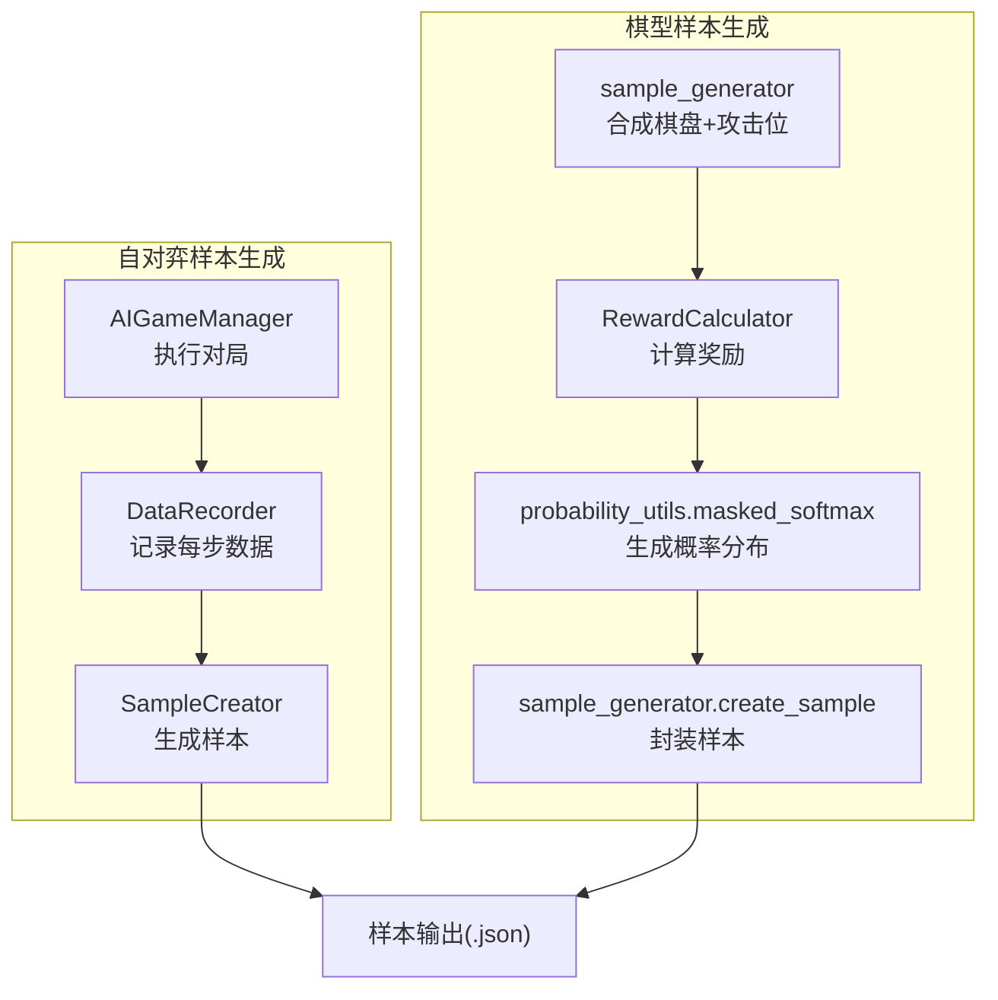
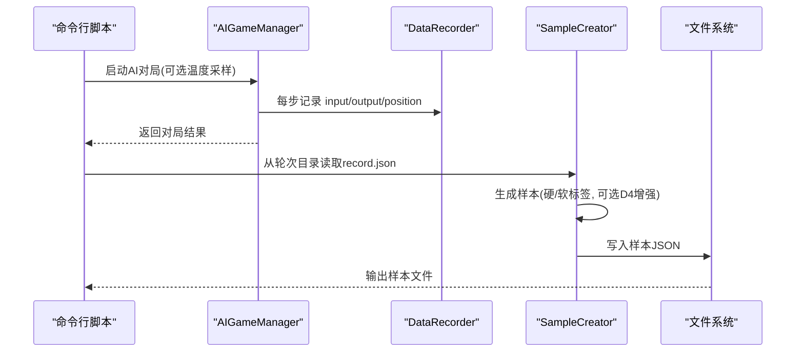
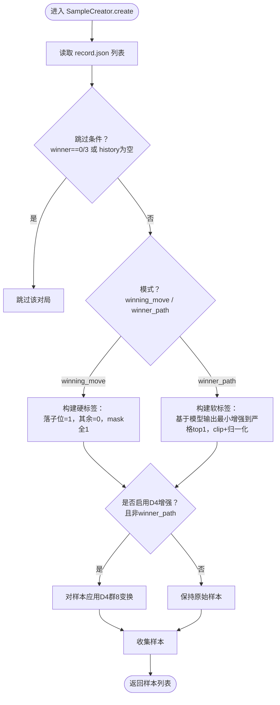
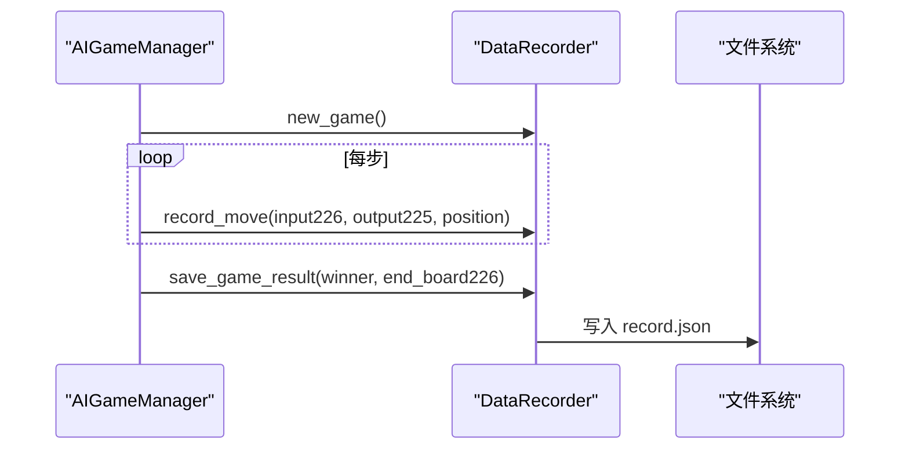
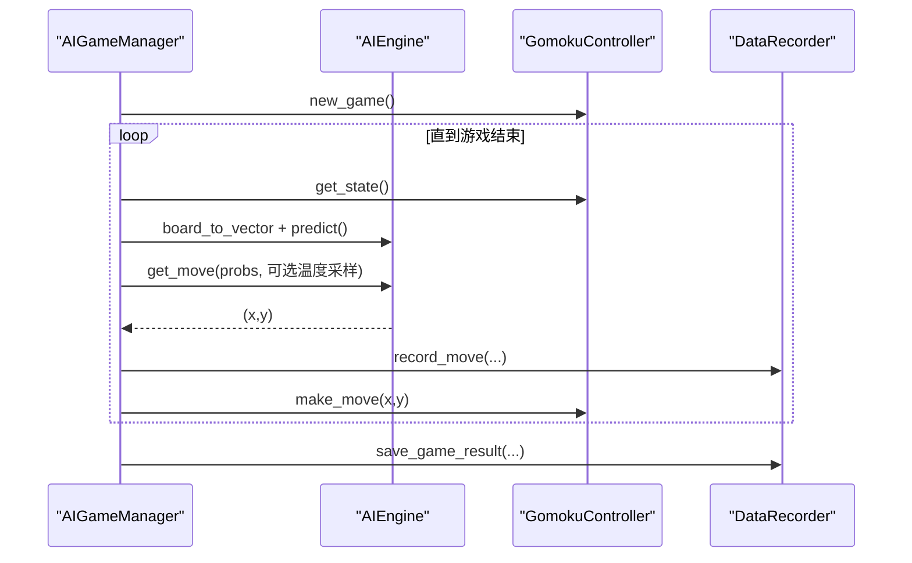
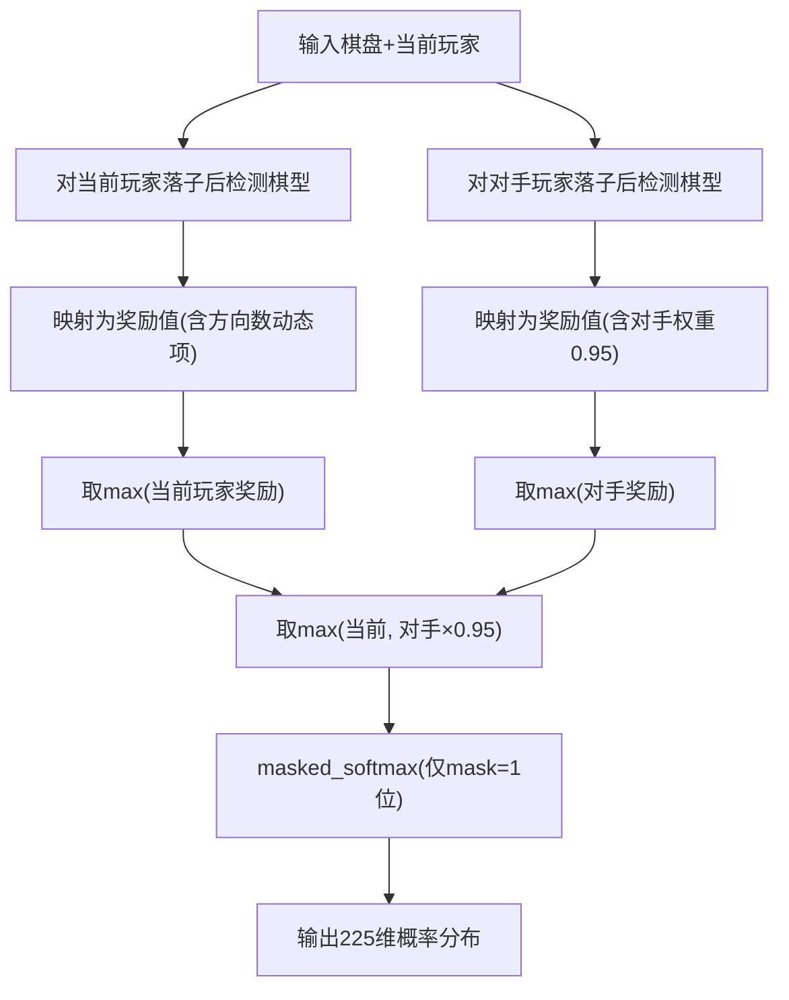
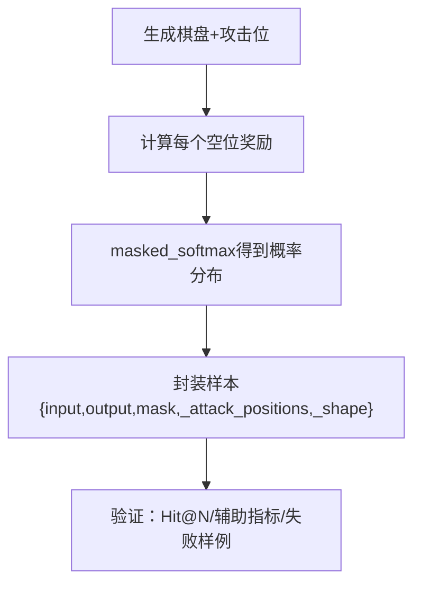
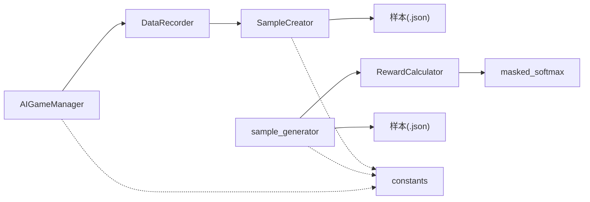

# 样本创建与封装

<cite>
**本文档引用的文件**
- [ai/create_samples.py](file://ai/create_samples.py)
- [ai/sample_creator.py](file://ai/sample_creator.py)
- [ai/data_recorder.py](file://ai/data_recorder.py)
- [ai/game_manager.py](file://ai/game_manager.py)
- [ai/reward_calculator.py](file://ai/reward_calculator.py)
- [ai/probability_utils.py](file://ai/probability_utils.py)
- [ai/sample_generator.py](file://ai/sample_generator.py)
- [design/sample_creator_design.md](file://design/sample_creator_design.md)
- [design/sample_generator_design.md](file://design/sample_generator_design.md)
- [tests/ai/test_sample_creator.py](file://tests/ai/test_sample_creator.py)
- [tests/ai/test_sample_generator.py](file://tests/ai/test_sample_generator.py)
</cite>

## 目录
1. [简介](#简介)
2. [项目结构](#项目结构)
3. [核心组件](#核心组件)
4. [架构总览](#架构总览)
5. [详细组件分析](#详细组件分析)
6. [依赖分析](#依赖分析)
7. [性能考量](#性能考量)
8. [故障排查指南](#故障排查指南)
9. [结论](#结论)
10. [附录](#附录)

## 简介
本文件面向“样本创建与封装”系统，系统目标是将棋盘状态转换为训练样本，涵盖输入特征向量构建、目标输出概率分布生成、掩码矩阵创建，以及样本数据结构设计。系统同时提供两类样本生成路径：
- 自对弈样本生成：从 AI 对局记录中提取样本，支持硬标签（winning_move）与软标签（winner_path）两种模式。
- 棋型样本生成：从棋型合成的棋盘状态直接生成样本，使用奖励计算与 softmax 归一化生成高质量软标签。

系统强调：
- 输入向量：226 维（225 棋盘状态 + 1 当前玩家信息）
- 输出向量：225 维，masked softmax 概率分布
- 掩码矩阵：225 维，1 表示合法空位，0 表示已落子
- 软标签生成：基于奖励计算与 softmax，结合 winner_path 的最小增强策略，确保落子位严格 top1 且分布和为 1

## 项目结构
围绕样本创建与封装的关键模块如下：
- 自对弈样本生成链路：AI 对局 → DataRecorder → SampleCreator → 样本输出
- 棋型样本生成链路：棋型合成 → 奖励计算 → masked softmax → 样本输出
- 工具与验证：温度采样策略、概率工具、样本验证指标

**图示来源**
- [ai/game_manager.py:232-274](file://ai/game_manager.py#L232-L274)
- [ai/data_recorder.py:96-140](file://ai/data_recorder.py#L96-L140)
- [ai/sample_creator.py:60-104](file://ai/sample_creator.py#L60-L104)
- [ai/sample_generator.py:287-327](file://ai/sample_generator.py#L287-L327)
- [ai/reward_calculator.py:46-74](file://ai/reward_calculator.py#L46-L74)
- [ai/probability_utils.py:15-58](file://ai/probability_utils.py#L15-L58)

**章节来源**
- [ai/create_samples.py:23-196](file://ai/create_samples.py#L23-L196)
- [ai/sample_creator.py:32-104](file://ai/sample_creator.py#L32-L104)
- [ai/sample_generator.py:287-327](file://ai/sample_generator.py#L287-L327)

## 核心组件
- SampleCreator：从 record.json 生成样本，支持 winning_move（硬标签）与 winner_path（软标签）两种模式，支持 D4 群数据增强（winner_path 强制禁用）。
- DataRecorder：记录每步 input、output、position，保存完整对局记录。
- AIGameManager：执行 AI 对局，按需启用温度采样策略，记录每步数据。
- RewardCalculator：将棋型映射为奖励值，支持双向检测与冲四递归防守模拟。
- masked_softmax：对奖励值进行数值稳定的 softmax，仅对合法空位归一化。
- sample_generator：从棋型合成棋盘，计算奖励并生成样本，提供验证指标。

**章节来源**
- [ai/sample_creator.py:32-339](file://ai/sample_creator.py#L32-L339)
- [ai/data_recorder.py:17-145](file://ai/data_recorder.py#L17-L145)
- [ai/game_manager.py:124-230](file://ai/game_manager.py#L124-L230)
- [ai/reward_calculator.py:35-239](file://ai/reward_calculator.py#L35-L239)
- [ai/probability_utils.py:15-58](file://ai/probability_utils.py#L15-L58)
- [ai/sample_generator.py:287-327](file://ai/sample_generator.py#L287-L327)

## 架构总览
自对弈样本生成流程（winning_move 与 winner_path）与棋型样本生成流程分别独立运行，最终统一输出为标准样本格式。

**图示来源**
- [ai/create_samples.py:158-192](file://ai/create_samples.py#L158-L192)
- [ai/game_manager.py:232-274](file://ai/game_manager.py#L232-L274)
- [ai/data_recorder.py:96-140](file://ai/data_recorder.py#L96-L140)
- [ai/sample_creator.py:318-339](file://ai/sample_creator.py#L318-L339)

## 详细组件分析

### SampleCreator 组件分析
- 模式支持：winning_move（硬标签）、winner_path（软标签）
- 数据增强：D4 群 8 变换，winner_path 强制禁用
- 软标签算法（winner_path）：在模型 softmax 分布基础上，对落子位进行最小增强，使严格 top1，其余位置等额汲取、clip 到 0、再归一化，确保 sum=1 且落子位严格最大
- 输入/输出/掩码：input 226 维（225 棋盘+1 当前玩家），output 225 维（概率分布），mask 225 维（1 合法空位，0 已落子）

**图示来源**
- [ai/sample_creator.py:60-104](file://ai/sample_creator.py#L60-L104)
- [ai/sample_creator.py:142-169](file://ai/sample_creator.py#L142-L169)
- [ai/sample_creator.py:171-232](file://ai/sample_creator.py#L171-L232)
- [ai/sample_creator.py:292-316](file://ai/sample_creator.py#L292-L316)

**章节来源**
- [ai/sample_creator.py:32-339](file://ai/sample_creator.py#L32-L339)
- [design/sample_creator_design.md:367-470](file://design/sample_creator_design.md#L367-L470)

### DataRecorder 组件分析
- 负责每步记录 input（226 维）、output（225 维 softmax 概率分布）、position（落子坐标）
- 保存完整对局记录（history、winner、end_board）
- 自动创建轮次目录与局号子目录，输出紧凑 JSON

**图示来源**
- [ai/data_recorder.py:66-140](file://ai/data_recorder.py#L66-L140)
- [ai/game_manager.py:177-228](file://ai/game_manager.py#L177-L228)

**章节来源**
- [ai/data_recorder.py:17-145](file://ai/data_recorder.py#L17-L145)

### AIGameManager 组件分析
- 执行 AI 对局，支持固定执方与随机执方
- 可选温度采样策略（TempConfig），按步/按方切换采样与 argmax
- 每步调用模型预测一次，同时用于记录与落子

**图示来源**
- [ai/game_manager.py:124-230](file://ai/game_manager.py#L124-L230)
- [ai/game_manager.py:232-274](file://ai/game_manager.py#L232-L274)

**章节来源**
- [ai/game_manager.py:16-339](file://ai/game_manager.py#L16-L339)

### RewardCalculator 与 masked_softmax 组件分析
- RewardCalculator：双向检测当前落子方与对手方的棋型，取最大奖励；对冲四进行递归防守模拟，综合考虑对手落子后的后续棋型
- masked_softmax：对奖励值进行数值稳定 softmax，仅对 mask=1 的合法空位归一化，避免数值下溢

**图示来源**
- [ai/reward_calculator.py:46-74](file://ai/reward_calculator.py#L46-L74)
- [ai/reward_calculator.py:76-99](file://ai/reward_calculator.py#L76-L99)
- [ai/reward_calculator.py:118-190](file://ai/reward_calculator.py#L118-L190)
- [ai/probability_utils.py:15-58](file://ai/probability_utils.py#L15-L58)

**章节来源**
- [ai/reward_calculator.py:35-239](file://ai/reward_calculator.py#L35-L239)
- [ai/probability_utils.py:15-58](file://ai/probability_utils.py#L15-L58)

### 棋型样本生成器（sample_generator）分析
- 从棋型合成棋盘，记录攻击位（进攻/防守位），验证阶段直接消费
- 使用 RewardCalculator 计算每个空位奖励，masked_softmax 归一化为训练标签
- 提供验证指标：Hit@N、Hit@N+1、Hit@N+2、攻击位概率和、区分度 gap

**图示来源**
- [ai/sample_generator.py:287-327](file://ai/sample_generator.py#L287-L327)
- [ai/sample_generator.py:334-393](file://ai/sample_generator.py#L334-L393)

**章节来源**
- [ai/sample_generator.py:287-393](file://ai/sample_generator.py#L287-L393)
- [design/sample_generator_design.md:1-265](file://design/sample_generator_design.md#L1-L265)

## 依赖分析
- SampleCreator 依赖 DataRecorder 输出的 record.json（winner_path 软标签依赖 history[i]["output"]）
- sample_generator 独立运行，依赖 RewardCalculator 与 masked_softmax
- AIGameManager 依赖 AIEngine 与 DataRecorder
- 所有模块依赖 constants（AI_DATA_DIR、TRAIN_DATA_DIR 等）

**图示来源**
- [ai/game_manager.py:124-230](file://ai/game_manager.py#L124-L230)
- [ai/data_recorder.py:96-140](file://ai/data_recorder.py#L96-L140)
- [ai/sample_creator.py:60-104](file://ai/sample_creator.py#L60-L104)
- [ai/sample_generator.py:287-327](file://ai/sample_generator.py#L287-L327)
- [ai/reward_calculator.py:35-239](file://ai/reward_calculator.py#L35-L239)
- [ai/probability_utils.py:15-58](file://ai/probability_utils.py#L15-L58)

**章节来源**
- [ai/sample_creator.py:32-104](file://ai/sample_creator.py#L32-L104)
- [ai/sample_generator.py:287-327](file://ai/sample_generator.py#L287-L327)

## 性能考量
- masked_softmax 使用缩放因子与数值稳定策略，避免大奖励值导致的下溢
- DataRecorder 采用紧凑 JSON 格式，减少文件体积
- AIGameManager 每步仅调用一次模型预测，兼顾记录与落子效率
- sample_generator 在生成阶段进行合法性校验，避免无效样本污染

[本节为通用指导，无需具体文件分析]

## 故障排查指南
- 样本数量异常
  - 自对弈：检查平局/未结束对局是否被跳过，确认 record.json 是否完整
  - 棋型：检查生成尝试上限与干扰子设置，必要时放宽 max_extra
- 标签质量不佳
  - 使用验证指标：Hit@N、Hit@N+1、Hit@N+2、攻击位概率和、区分度 gap
  - 检查 winner_path 软标签是否正确应用（严格 top1、sum=1、无负值）
- 数据增强问题
  - winner_path 模式强制禁用 D4 增强，确认未误开启
  - 检查 D4 群变换索引映射是否正确

**章节来源**
- [tests/ai/test_sample_creator.py:1-200](file://tests/ai/test_sample_creator.py#L1-L200)
- [tests/ai/test_sample_generator.py:1-200](file://tests/ai/test_sample_generator.py#L1-L200)
- [ai/sample_generator.py:334-393](file://ai/sample_generator.py#L334-L393)

## 结论
样本创建与封装系统提供了两条高质量样本生成路径：自对弈样本（硬/软标签）与棋型样本（高质量软标签）。系统通过明确的数据结构设计（226 维输入、225 维输出、225 维掩码）、可靠的软标签生成机制（奖励+softmax+最小增强）、完善的验证指标与数据增强策略，确保训练样本的质量与多样性。建议在实际训练中结合两类样本，以兼顾局部封口与整体布局学习。

[本节为总结性内容，无需具体文件分析]

## 附录

### 样本数据结构设计说明
- 输入向量 input：226 维
  - 前 225 维：棋盘状态（0=空，1=黑，2=白）
  - 第 226 维：当前玩家（1=黑，2=白）
- 输出向量 output：225 维
  - masked softmax 概率分布，sum(output)=1
  - mask=0 的位置 output=0
- 掩码 mask：225 维
  - 1：合法空位
  - 0：已落子位置
- 元数据（训练代码忽略）
  - _attack_positions：棋型样本的攻击位索引列表
  - _shape：棋型样本的棋型键

**章节来源**
- [design/sample_generator_design.md:43-56](file://design/sample_generator_design.md#L43-L56)
- [ai/sample_generator.py:287-327](file://ai/sample_generator.py#L287-L327)
- [ai/sample_creator.py:110-135](file://ai/sample_creator.py#L110-L135)

### 软标签生成机制详解（winner_path）
- 基于模型 softmax 输出的最小增强策略
- 若落子位已是严格 top1，则直接使用模型输出
- 否则：delta = max(p) - p[idx] + EPS，对落子位增加 delta，对其他位置等额汲取 delta/224，clip 到 0 后归一化
- 保证：output 非负、sum=1、落子位严格最大

**章节来源**
- [ai/sample_creator.py:171-232](file://ai/sample_creator.py#L171-L232)
- [design/sample_creator_design.md:367-470](file://design/sample_creator_design.md#L367-L470)

### 样本验证与质量评估
- 主指标：Hit@N、Hit@N+1、Hit@N+2
- 辅助指标：攻击位概率和（attack_prob_sum）、区分度 gap（mean - max_non_attack）
- 失败样例：记录未命中的样本索引，便于人工复盘

**章节来源**
- [ai/sample_generator.py:334-393](file://ai/sample_generator.py#L334-L393)
- [tests/ai/test_sample_generator.py:167-200](file://tests/ai/test_sample_generator.py#L167-L200)

### 样本格式标准化与数据预处理最佳实践
- 统一输入格式：226 维（棋盘+当前玩家）
- 统一输出格式：225 维 softmax 概率分布
- 掩码标准化：仅对合法空位参与损失计算
- 数据增强：D4 群 8 变换（winner_path 强制禁用）
- 温度采样：开局阶段探索，后期切换 argmax，提升样本多样性

**章节来源**
- [ai/sample_creator.py:292-316](file://ai/sample_creator.py#L292-L316)
- [ai/game_manager.py:192-210](file://ai/game_manager.py#L192-L210)
- [design/sample_creator_design.md:145-232](file://design/sample_creator_design.md#L145-L232)