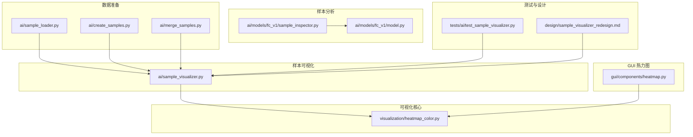
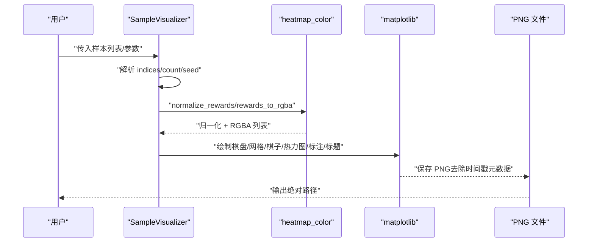
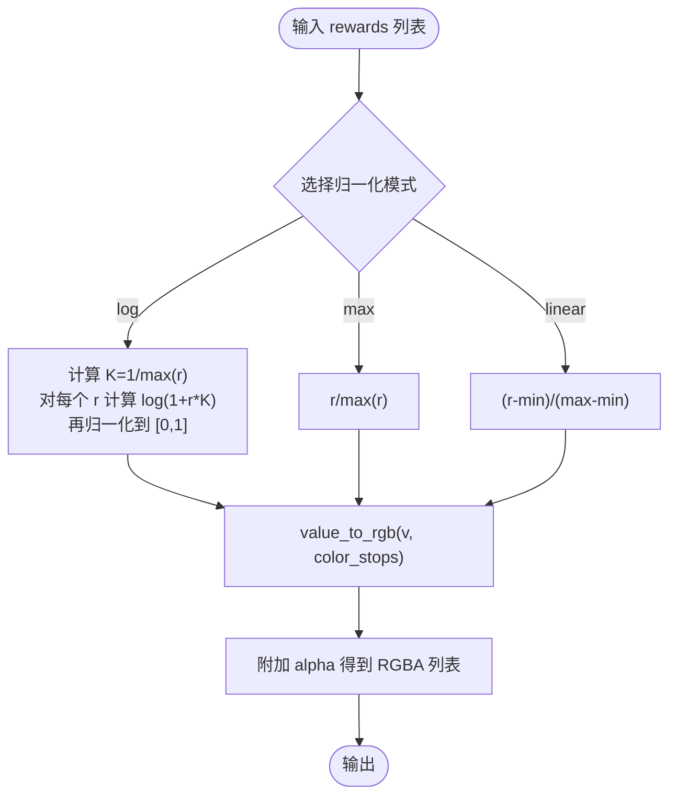
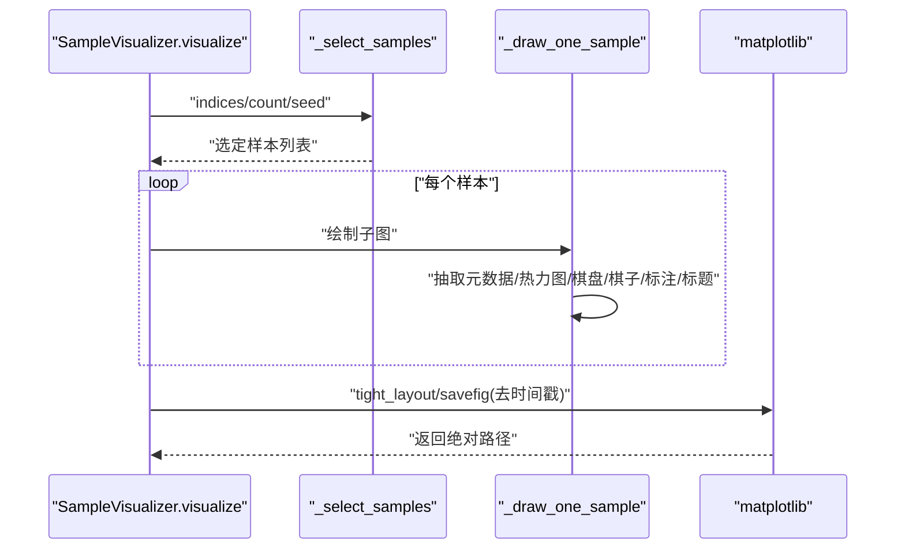
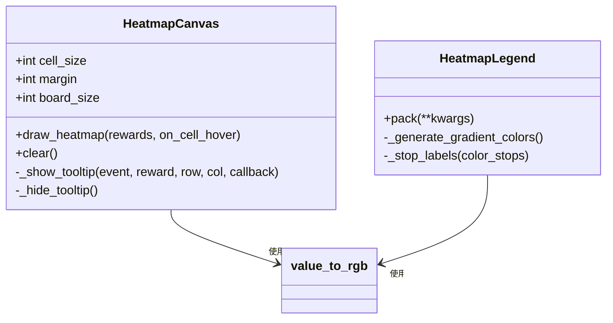
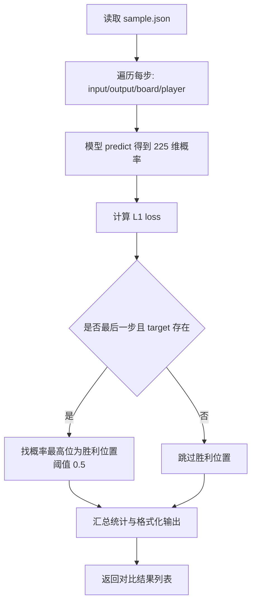
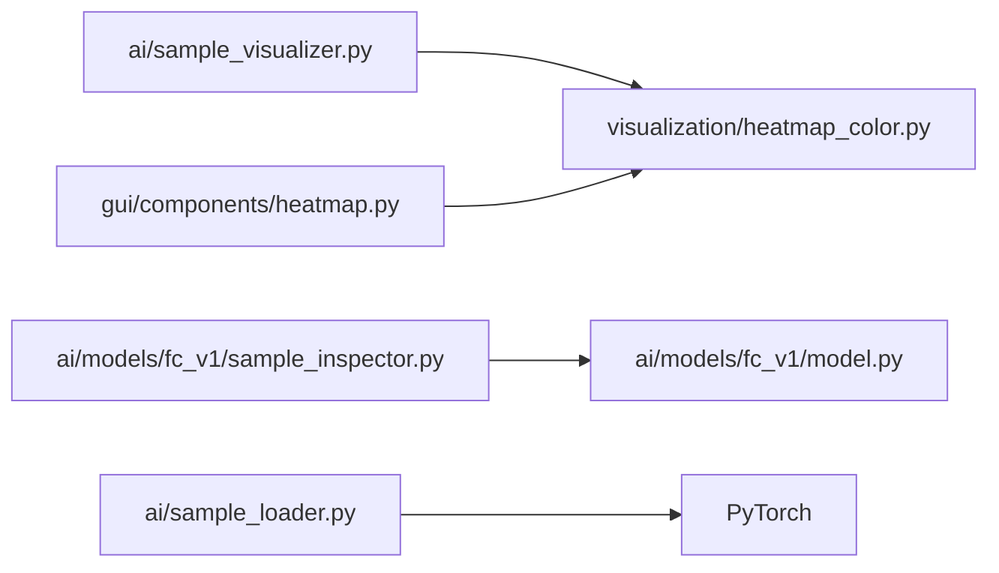

# 样本可视化与分析

<cite>
**本文引用的文件**
- [ai/sample_visualizer.py](file://ai/sample_visualizer.py)
- [visualization/heatmap_color.py](file://visualization/heatmap_color.py)
- [gui/components/heatmap.py](file://gui/components/heatmap.py)
- [ai/models/fc_v1/sample_inspector.py](file://ai/models/fc_v1/sample_inspector.py)
- [ai/models/fc_v1/model.py](file://ai/models/fc_v1/model.py)
- [ai/sample_loader.py](file://ai/sample_loader.py)
- [ai/create_samples.py](file://ai/create_samples.py)
- [ai/merge_samples.py](file://ai/merge_samples.py)
- [tests/ai/test_sample_visualizer.py](file://tests/ai/test_sample_visualizer.py)
- [design/sample_visualizer_redesign.md](file://design/sample_visualizer_redesign.md)
</cite>

## 目录
1. [简介](#简介)
2. [项目结构](#项目结构)
3. [核心组件](#核心组件)
4. [架构总览](#架构总览)
5. [详细组件分析](#详细组件分析)
6. [依赖分析](#依赖分析)
7. [性能考虑](#性能考虑)
8. [故障排查指南](#故障排查指南)
9. [结论](#结论)
10. [附录](#附录)

## 简介
本技术文档面向“样本可视化与分析工具”，系统性介绍以下能力：
- 样本可视化：基于热力图的颜色映射算法、棋盘状态叠加、攻击位标注与标题信息展示。
- 样本质量评估：标签质量体检（命中率、概率分布集中度等）、样本分布分析、训练效果验证。
- 可视化界面：GUI 热力图画布与颜色标尺组件，支持悬停提示与可配置色板。
- 导出与报告：样本可视化 PNG 导出、统计报告生成、CSV 导出与可视化结果保存。
- 调试与排障：样本格式兼容性、参数校验、异常样本检测与定位。

## 项目结构
围绕样本可视化与分析的关键模块如下：
- 可视化核心：visualization/heatmap_color.py（纯函数热力图算法）
- 样本可视化：ai/sample_visualizer.py（静态图输出，兼容新旧样本格式）
- GUI 热力图：gui/components/heatmap.py（tkinter 组件，悬停提示）
- 样本分析：ai/models/fc_v1/sample_inspector.py（模型输出与样本 target 对比）
- 数据加载与准备：ai/sample_loader.py（样本加载、切分、张量准备）
- 样本生成与合并：ai/create_samples.py、ai/merge_samples.py
- 测试与设计：tests/ai/test_sample_visualizer.py、design/sample_visualizer_redesign.md

**图表来源**
- [ai/sample_visualizer.py:1-496](file://ai/sample_visualizer.py#L1-L496)
- [visualization/heatmap_color.py:1-204](file://visualization/heatmap_color.py#L1-L204)
- [gui/components/heatmap.py:1-358](file://gui/components/heatmap.py#L1-L358)
- [ai/models/fc_v1/sample_inspector.py:1-183](file://ai/models/fc_v1/sample_inspector.py#L1-L183)
- [ai/models/fc_v1/model.py:1-132](file://ai/models/fc_v1/model.py#L1-L132)
- [ai/sample_loader.py:1-240](file://ai/sample_loader.py#L1-L240)
- [ai/create_samples.py:1-197](file://ai/create_samples.py#L1-L197)
- [ai/merge_samples.py:1-155](file://ai/merge_samples.py#L1-L155)
- [tests/ai/test_sample_visualizer.py:1-337](file://tests/ai/test_sample_visualizer.py#L1-L337)
- [design/sample_visualizer_redesign.md:1-431](file://design/sample_visualizer_redesign.md#L1-L431)

**章节来源**
- [ai/sample_visualizer.py:1-496](file://ai/sample_visualizer.py#L1-L496)
- [visualization/heatmap_color.py:1-204](file://visualization/heatmap_color.py#L1-L204)
- [gui/components/heatmap.py:1-358](file://gui/components/heatmap.py#L1-L358)
- [ai/models/fc_v1/sample_inspector.py:1-183](file://ai/models/fc_v1/sample_inspector.py#L1-L183)
- [ai/models/fc_v1/model.py:1-132](file://ai/models/fc_v1/model.py#L1-L132)
- [ai/sample_loader.py:1-240](file://ai/sample_loader.py#L1-L240)
- [ai/create_samples.py:1-197](file://ai/create_samples.py#L1-L197)
- [ai/merge_samples.py:1-155](file://ai/merge_samples.py#L1-L155)
- [tests/ai/test_sample_visualizer.py:1-337](file://tests/ai/test_sample_visualizer.py#L1-L337)
- [design/sample_visualizer_redesign.md:1-431](file://design/sample_visualizer_redesign.md#L1-L431)

## 核心组件
- 热力图颜色映射（visualization/heatmap_color.py）
  - 提供 normalize_rewards、value_to_rgb、rewards_to_rgba 三个纯函数，支持 log/max/linear 三种归一化模式与可配置色板，默认白→黄→橙→红四色渐变。
- 样本可视化器（ai/sample_visualizer.py）
  - 支持新旧样本格式：新格式含 _attack_positions/_shape/mask，旧格式通过 argmax(output) 兜底；可选热力图叠加、标题包含 shape/P=玩家/attacks 等信息；输出 PNG。
- GUI 热力图画布（gui/components/heatmap.py）
  - tkinter 组件 HeatmapCanvas：15×15 格热力图 + 悬停 tooltip；HeatmapLegend：颜色标尺。
- 样本检视器（ai/models/fc_v1/sample_inspector.py）
  - 读取 sample.json，对每步调用模型 predict，对比 Softmax 概率 target，输出每步损失、空位/占位统计、胜利位置等。
- 数据加载与准备（ai/sample_loader.py）
  - 加载样本 JSON、按比例切分训练/验证集、准备 PyTorch 张量（inputs/targets/masks）。
- 样本生成与合并（ai/create_samples.py、ai/merge_samples.py）
  - 生成自对弈样本并写入 JSON；合并多个 sample.json 为单个大文件，降低训练 I/O。

**章节来源**
- [visualization/heatmap_color.py:63-122](file://visualization/heatmap_color.py#L63-L122)
- [visualization/heatmap_color.py:128-171](file://visualization/heatmap_color.py#L128-L171)
- [visualization/heatmap_color.py:178-203](file://visualization/heatmap_color.py#L178-L203)
- [ai/sample_visualizer.py:86-130](file://ai/sample_visualizer.py#L86-L130)
- [ai/sample_visualizer.py:296-403](file://ai/sample_visualizer.py#L296-L403)
- [gui/components/heatmap.py:137-195](file://gui/components/heatmap.py#L137-L195)
- [gui/components/heatmap.py:257-357](file://gui/components/heatmap.py#L257-L357)
- [ai/models/fc_v1/sample_inspector.py:37-97](file://ai/models/fc_v1/sample_inspector.py#L37-L97)
- [ai/sample_loader.py:80-240](file://ai/sample_loader.py#L80-L240)
- [ai/create_samples.py:23-196](file://ai/create_samples.py#L23-L196)
- [ai/merge_samples.py:105-154](file://ai/merge_samples.py#L105-L154)

## 架构总览
样本可视化与分析的整体流程：
- 输入：样本 JSON（新格式含元数据，旧格式仅 input/output）。
- 处理：提取元数据、可选热力图叠加、绘制棋盘/棋子/攻击位标注、生成标题。
- 输出：PNG 图像；同时可结合样本检视器进行标签质量评估与训练效果验证。
- GUI 热力图：tkinter 组件用于交互式查看与悬停提示。

**图表来源**
- [ai/sample_visualizer.py:312-403](file://ai/sample_visualizer.py#L312-L403)
- [visualization/heatmap_color.py:63-122](file://visualization/heatmap_color.py#L63-L122)
- [visualization/heatmap_color.py:178-203](file://visualization/heatmap_color.py#L178-L203)

**章节来源**
- [ai/sample_visualizer.py:312-403](file://ai/sample_visualizer.py#L312-L403)
- [visualization/heatmap_color.py:63-122](file://visualization/heatmap_color.py#L63-L122)
- [visualization/heatmap_color.py:178-203](file://visualization/heatmap_color.py#L178-L203)

## 详细组件分析

### 热力图颜色映射（visualization/heatmap_color.py）
- 归一化策略
  - log：自适应 K=1/max(r)，对“1 个高峰 + 大片接近 0”的分布显著提升次高位可辨识度。
  - max：r/max(r)，最直观。
  - linear：(r-min)/(max-min)，适合均匀分布信号。
- 颜色映射
  - 色节点等距线性插值，支持 2/3/4/9 色节点，默认白→黄→橙→红。
- 组合 API
  - rewards_to_rgba：一次性输出 matplotlib 可用 RGBA 列表，统一附加 alpha。

**图表来源**
- [visualization/heatmap_color.py:63-122](file://visualization/heatmap_color.py#L63-L122)
- [visualization/heatmap_color.py:128-171](file://visualization/heatmap_color.py#L128-L171)
- [visualization/heatmap_color.py:178-203](file://visualization/heatmap_color.py#L178-L203)

**章节来源**
- [visualization/heatmap_color.py:63-122](file://visualization/heatmap_color.py#L63-L122)
- [visualization/heatmap_color.py:128-171](file://visualization/heatmap_color.py#L128-L171)
- [visualization/heatmap_color.py:178-203](file://visualization/heatmap_color.py#L178-L203)

### 样本可视化器（ai/sample_visualizer.py）
- 功能特性
  - 兼容新旧样本格式：新格式含 _attack_positions/_shape/mask；旧格式用 argmax(output) 兜底。
  - 热力图叠加：仅覆盖空位，半透明 RGBA，支持 log/max/linear 模式与 alpha 控制。
  - 标题信息：#样本号 │ shape │ P=玩家 │ attacks=数量。
  - 布局：尽量接近正方形的网格布局，隐藏多余子图。
- 关键流程
  - 元数据抽取：_extract_metadata
  - 样本选择：_select_samples（indices 优先，否则按 seed+count 随机抽样）
  - 绘制：_draw_one_sample（底色→热力图→网格/星位→棋子→attack 标记→标题）
  - 保存：去除 PNG 时间戳元数据，保证可复现。

**图表来源**
- [ai/sample_visualizer.py:135-161](file://ai/sample_visualizer.py#L135-L161)
- [ai/sample_visualizer.py:255-292](file://ai/sample_visualizer.py#L255-L292)
- [ai/sample_visualizer.py:356-403](file://ai/sample_visualizer.py#L356-L403)

**章节来源**
- [ai/sample_visualizer.py:86-130](file://ai/sample_visualizer.py#L86-L130)
- [ai/sample_visualizer.py:135-161](file://ai/sample_visualizer.py#L135-L161)
- [ai/sample_visualizer.py:255-292](file://ai/sample_visualizer.py#L255-L292)
- [ai/sample_visualizer.py:356-403](file://ai/sample_visualizer.py#L356-L403)

### GUI 热力图画布（gui/components/heatmap.py）
- HeatmapCanvas
  - 绘制 15×15 格热力图，批量归一化后逐格上色；支持鼠标悬停 tooltip 显示原始 reward。
  - 颜色映射：value_to_rgb + _rgb_float_to_hex（tkinter 不支持 alpha，仅取 RGB）。
- HeatmapLegend
  - 渐变条 + 色名标签，支持自定义色板与档数。

**图表来源**
- [gui/components/heatmap.py:68-195](file://gui/components/heatmap.py#L68-L195)
- [gui/components/heatmap.py:257-357](file://gui/components/heatmap.py#L257-L357)

**章节来源**
- [gui/components/heatmap.py:68-195](file://gui/components/heatmap.py#L68-L195)
- [gui/components/heatmap.py:257-357](file://gui/components/heatmap.py#L257-L357)

### 样本检视器（ai/models/fc_v1/sample_inspector.py）
- 作用：读取 sample.json，对每步调用模型 predict，对比 Softmax 概率 target，输出每步损失、空位/占位统计、胜利位置等。
- 关键点
  - 胜利位置：概率最高位置（Softmax 格式），阈值 0.5。
  - 损失：L1 loss（Softmax 概率直接比较）。
  - 格式：输入 226 维（225 棋盘 + 1 当前玩家），输出 225 维 Softmax 概率分布。

**图表来源**
- [ai/models/fc_v1/sample_inspector.py:37-97](file://ai/models/fc_v1/sample_inspector.py#L37-L97)
- [ai/models/fc_v1/sample_inspector.py:166-182](file://ai/models/fc_v1/sample_inspector.py#L166-L182)

**章节来源**
- [ai/models/fc_v1/sample_inspector.py:37-97](file://ai/models/fc_v1/sample_inspector.py#L37-L97)
- [ai/models/fc_v1/sample_inspector.py:166-182](file://ai/models/fc_v1/sample_inspector.py#L166-L182)

### 数据加载与准备（ai/sample_loader.py）
- 功能
  - 加载单/多文件样本 JSON，按比例切分训练/验证集，准备 PyTorch 张量（inputs/targets/masks）。
  - 支持递归发现目录下所有 .json 文件，合并加载。
- 关键点
  - masked L1 loss（纯 Python 实现，供测试使用）。
  - 随机种子确保可复现。

**章节来源**
- [ai/sample_loader.py:14-33](file://ai/sample_loader.py#L14-L33)
- [ai/sample_loader.py:80-240](file://ai/sample_loader.py#L80-L240)

### 样本生成与合并（ai/create_samples.py、ai/merge_samples.py）
- 样本生成：AI 自对弈，按 winning_move 或 winner_path 模式生成样本，写入 JSON。
- 样本合并：递归发现目录下 sample.json，合并为单个文件，输出紧凑格式。

**章节来源**
- [ai/create_samples.py:23-196](file://ai/create_samples.py#L23-L196)
- [ai/merge_samples.py:105-154](file://ai/merge_samples.py#L105-L154)

## 依赖分析
- 可视化核心与样本可视化
  - ai/sample_visualizer.py 依赖 visualization/heatmap_color.py 的归一化与颜色映射函数。
- GUI 热力图
  - gui/components/heatmap.py 直接依赖 visualization/heatmap_color.py 的 value_to_rgb。
- 样本分析
  - ai/models/fc_v1/sample_inspector.py 依赖 ai/models/fc_v1/model.py 的 predict 接口。
- 数据准备
  - ai/sample_loader.py 依赖 torch，提供张量准备与训练/验证集切分。

**图表来源**
- [ai/sample_visualizer.py:36-39](file://ai/sample_visualizer.py#L36-L39)
- [gui/components/heatmap.py:30-34](file://gui/components/heatmap.py#L30-L34)
- [ai/models/fc_v1/sample_inspector.py:15](file://ai/models/fc_v1/sample_inspector.py#L15)
- [ai/sample_loader.py:11](file://ai/sample_loader.py#L11)

**章节来源**
- [ai/sample_visualizer.py:36-39](file://ai/sample_visualizer.py#L36-L39)
- [gui/components/heatmap.py:30-34](file://gui/components/heatmap.py#L30-L34)
- [ai/models/fc_v1/sample_inspector.py:15](file://ai/models/fc_v1/sample_inspector.py#L15)
- [ai/sample_loader.py:11](file://ai/sample_loader.py#L11)

## 性能考虑
- 热力图归一化
  - log 模式对 softmax 极端分布提升次高位可辨识度，但计算量略高于 max/linear；建议在大规模样本可视化时优先使用 batch 归一化（如 GUI 组件中的 normalize_rewards 仅计算一次全局统计）。
- 绘图效率
  - matplotlib 使用 Agg 后端，避免 GUI 初始化开销；批量绘制矩形覆盖空位，zorder 控制层级，减少重绘。
- 数据加载
  - 递归发现与合并采用紧凑 JSON 输出，减少文件体积；训练/验证集切分使用独立随机源，避免全局状态干扰。
- GUI 组件
  - tkinter Canvas 逐格绘制，tooltip 懒创建；颜色映射通过 _rgb_float_to_hex 转 hex，避免 alpha 通道带来的复杂度。

[本节为通用性能讨论，无需特定文件引用]

## 故障排查指南
- 样本可视化常见问题
  - 空样本列表：visualize 会抛出 ValueError，检查输入 JSON 是否为空或格式错误。
  - 非法 heatmap_alpha：必须在 [0, 1]，否则抛出 ValueError。
  - 非法 heatmap_mode：仅允许 "log"/"max"/"linear"，否则抛出 ValueError。
  - 越界攻击位：_attack_positions 索引超出 [0, 225)，会抛出 ValueError，需检查样本元数据。
  - indices 越界：传入索引超出样本总数，会抛出 IndexError。
- GUI 热力图
  - 归一化模式非法：HeatmapCanvas.draw_heatmap 内部由 normalize_rewards 抛出 ValueError。
  - 长度不符：rewards 长度不是 225 时，静默返回（向后兼容）。
- 样本检视器
  - 文件不存在或 JSON 格式错误：抛出相应异常。
  - 胜利位置阈值：概率低于 0.5 不视为胜利位置。
- 测试验证
  - 单元测试覆盖新旧格式、开关、参数合法性、CLI 行为等，可参考 tests/ai/test_sample_visualizer.py。

**章节来源**
- [ai/sample_visualizer.py:341-352](file://ai/sample_visualizer.py#L341-L352)
- [tests/ai/test_sample_visualizer.py:227-274](file://tests/ai/test_sample_visualizer.py#L227-L274)
- [gui/components/heatmap.py:151-153](file://gui/components/heatmap.py#L151-L153)
- [ai/models/fc_v1/sample_inspector.py:46-49](file://ai/models/fc_v1/sample_inspector.py#L46-L49)

## 结论
本工具链以“可复用热力图算法 + 多场景可视化”为核心，提供：
- 高质量样本可视化：支持新旧样本格式、可配置热力图模式与透明度、标题信息丰富。
- 样本质量评估：通过样本检视器对比模型输出与 target，统计空位/占位分布与胜利位置。
- GUI 交互：tkinter 热力图画布与颜色标尺，支持悬停提示。
- 数据工程：样本生成、合并与加载切分，支撑训练与分析全流程。
- 可靠性：完善的参数校验、异常处理与测试覆盖，便于调试与排障。

[本节为总结性内容，无需特定文件引用]

## 附录
- 使用示例与命令
  - 样本可视化：python -m ai.sample_visualizer --sample <样本文件> [--count/--indices/--seed/--output/--no-heatmap/--heatmap-mode/--heatmap-alpha]
  - 样本生成：python ai/create_samples.py --model <模型> --mode <winning_move|winner_path> --games <数量> --output <输出路径>
  - 样本合并：python ai/merge_samples.py <目录1> [目录2 ...] -o <输出路径>
- 报告与导出
  - 可视化 PNG：由 SampleVisualizer 生成，去除时间戳元数据，保证可复现。
  - 统计报告：结合样本检视器输出的每步对比结果，可进一步导出为 CSV（建议在上层脚本中实现）。

[本节为通用使用说明，无需特定文件引用]