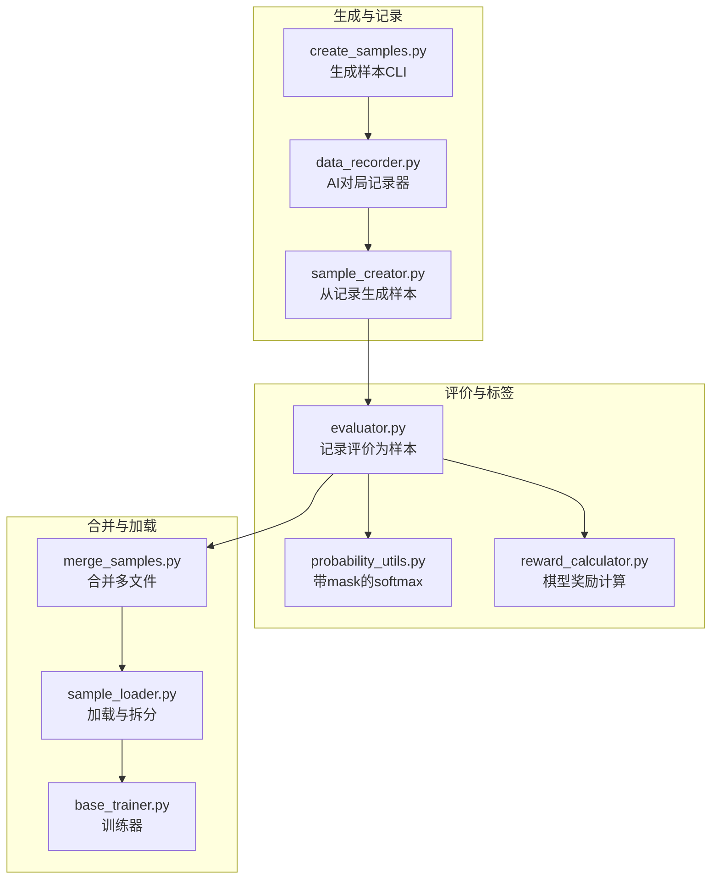
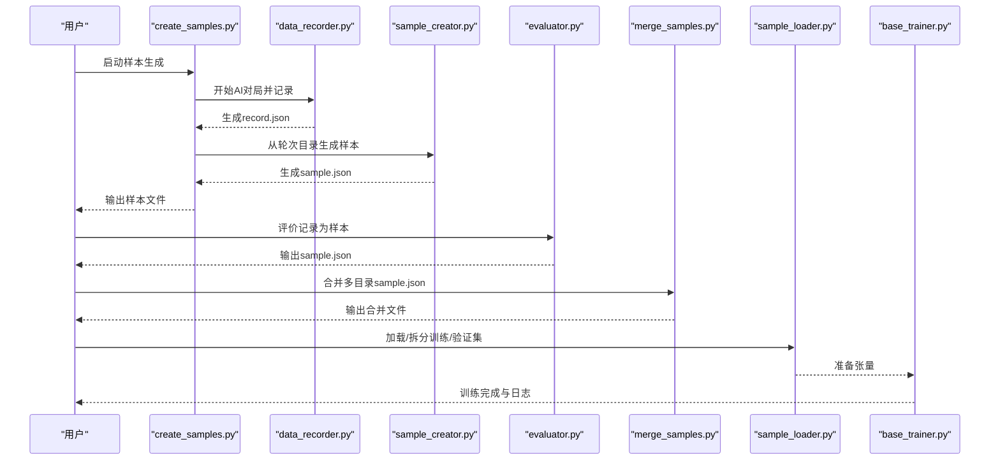
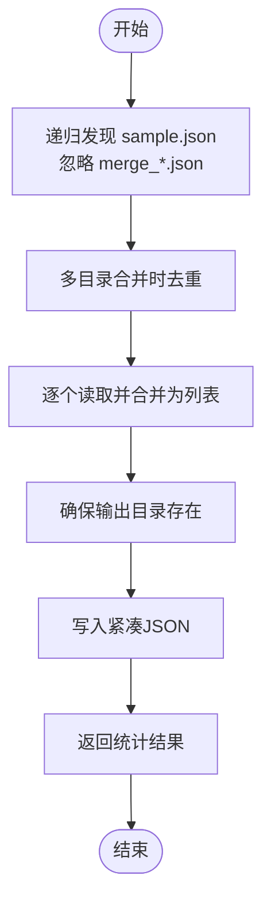
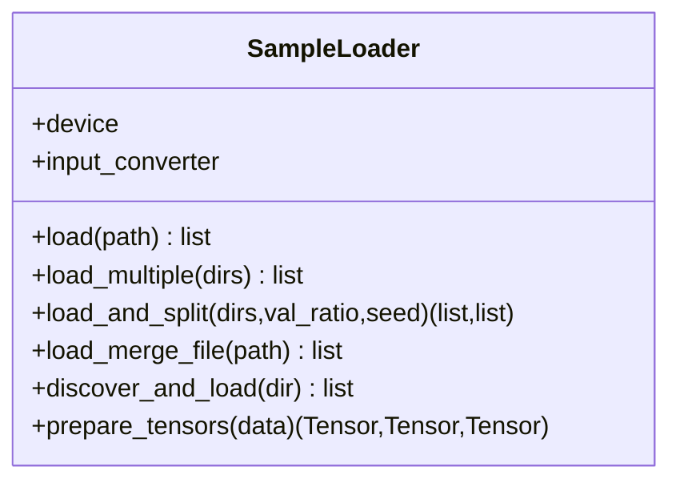
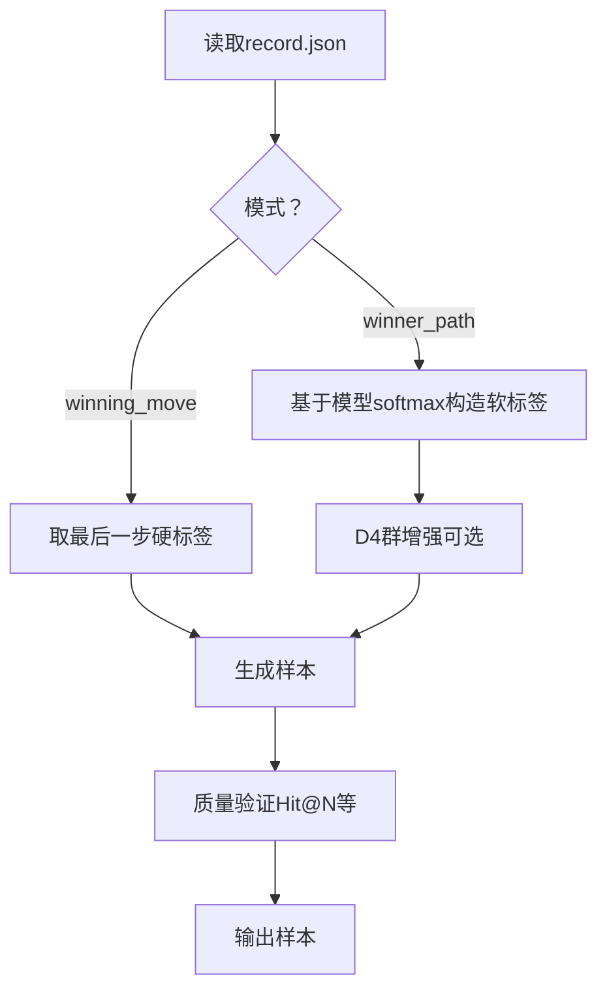
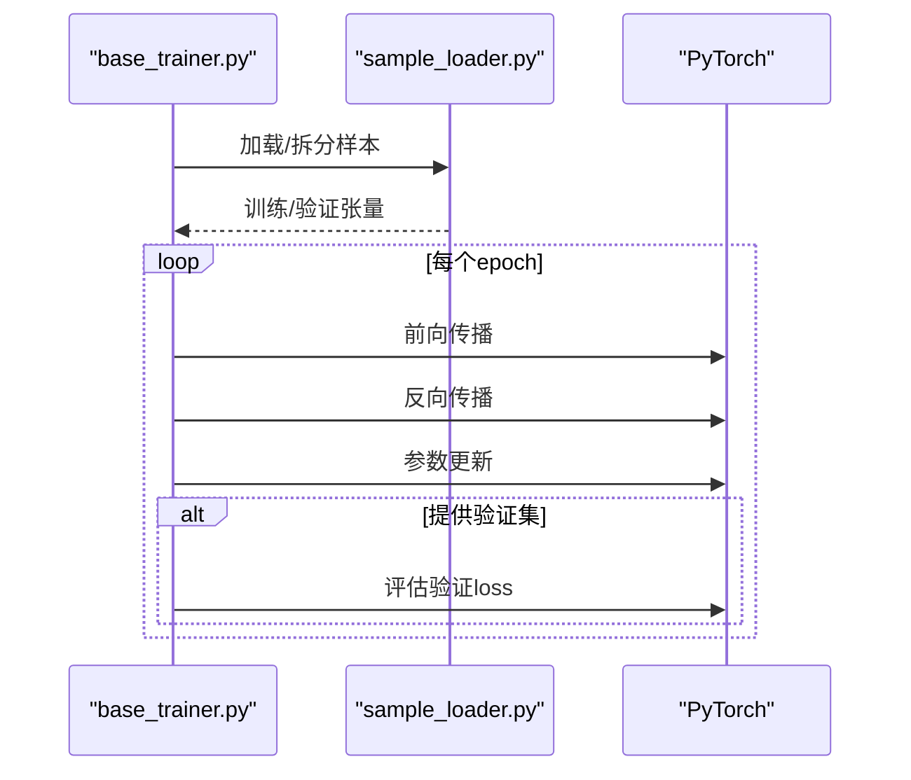
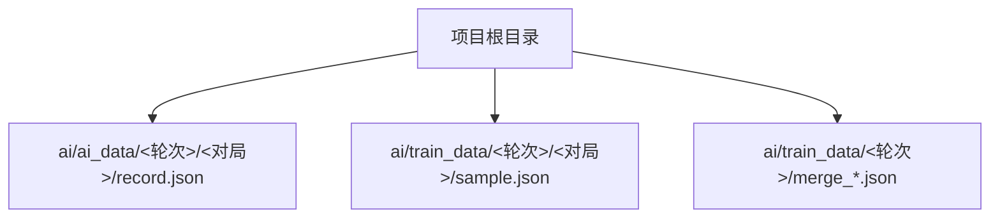
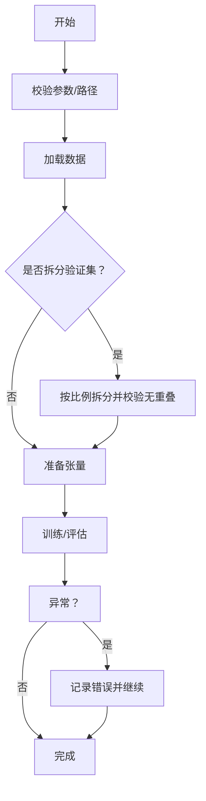
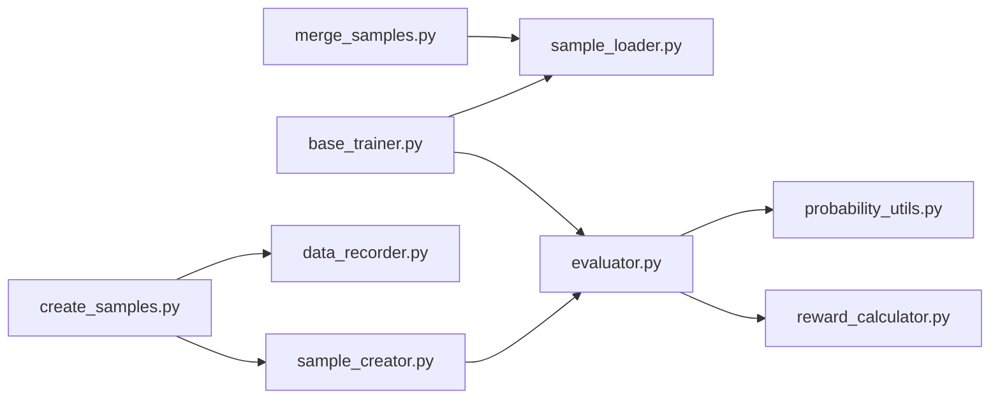

# 样本合并与管理

<cite>
**本文引用的文件**
- [merge_samples.py](file://ai/merge_samples.py)
- [sample_loader.py](file://ai/sample_loader.py)
- [create_samples.py](file://ai/create_samples.py)
- [data_recorder.py](file://ai/data_recorder.py)
- [evaluator.py](file://ai/evaluator.py)
- [sample_creator.py](file://ai/sample_creator.py)
- [sample_generator.py](file://ai/sample_generator.py)
- [base_trainer.py](file://ai/base_trainer.py)
- [constants.py](file://ai/constants.py)
- [train_main.py](file://ai/train_main.py)
- [merge_samples_design.md](file://design/merge_samples_design.md)
- [test_merge_samples.py](file://tests/ai/test_merge_samples.py)
- [test_sample_loader_split.py](file://tests/ai/unit/test_sample_loader_split.py)
</cite>

## 目录
1. [简介](#简介)
2. [项目结构](#项目结构)
3. [核心组件](#核心组件)
4. [架构总览](#架构总览)
5. [详细组件分析](#详细组件分析)
6. [依赖分析](#依赖分析)
7. [性能考量](#性能考量)
8. [故障排查指南](#故障排查指南)
9. [结论](#结论)
10. [附录](#附录)

## 简介
本技术文档围绕“样本合并与管理”主题，系统梳理样本从生成、记录、评价、合并到训练加载的全流程。重点涵盖：
- 多来源样本数据的整合与去重策略
- 样本质量筛选与标签可靠性评估
- 批量处理算法与内存管理、大数据集优化、进度跟踪
- 样本存储与组织方式及高效检索
- 样本分割与划分（训练/验证/测试）策略
- 完整的样本完整性检查、数据一致性验证与异常样本检测清理流程
- 性能优化建议与大规模样本处理最佳实践

## 项目结构
本项目将样本管理分为四大阶段：
- 生成阶段：AI对局生成原始记录，随后生成训练样本
- 记录阶段：每步输入、输出、落子位置持久化
- 评价阶段：将记录转换为带Softmax标签的样本
- 合并与加载阶段：合并多文件、加载与拆分训练/验证集

**图表来源**
- [create_samples.py:23-196](file://ai/create_samples.py#L23-L196)
- [data_recorder.py:17-145](file://ai/data_recorder.py#L17-L145)
- [sample_creator.py:32-339](file://ai/sample_creator.py#L32-L339)
- [evaluator.py:51-350](file://ai/evaluator.py#L51-L350)
- [probability_utils.py:15-59](file://ai/probability_utils.py#L15-L59)
- [reward_calculator.py:35-200](file://ai/reward_calculator.py#L35-L200)
- [merge_samples.py:13-155](file://ai/merge_samples.py#L13-L155)
- [sample_loader.py:67-240](file://ai/sample_loader.py#L67-L240)
- [base_trainer.py:324-603](file://ai/base_trainer.py#L324-L603)

**章节来源**
- [create_samples.py:1-197](file://ai/create_samples.py#L1-L197)
- [data_recorder.py:1-145](file://ai/data_recorder.py#L1-L145)
- [sample_creator.py:1-339](file://ai/sample_creator.py#L1-L339)
- [evaluator.py:1-350](file://ai/evaluator.py#L1-L350)
- [probability_utils.py:1-59](file://ai/probability_utils.py#L1-L59)
- [reward_calculator.py:1-200](file://ai/reward_calculator.py#L1-L200)
- [merge_samples.py:1-155](file://ai/merge_samples.py#L1-L155)
- [sample_loader.py:1-240](file://ai/sample_loader.py#L1-L240)
- [base_trainer.py:1-699](file://ai/base_trainer.py#L1-L699)

## 核心组件
- 样本合并器：递归发现并合并多个目录下的sample.json，输出紧凑格式的大文件，支持去重与统计输出
- 样本加载器：统一加载单/多文件样本，支持按比例拆分训练/验证集，准备PyTorch张量
- 训练器：提供单轮/批量/小批量训练，自动设备检测与GPU加速，支持学习率调度与验证集监控
- 评价器：将记录转换为样本，融合棋型评估与五连追溯奖励，使用带mask的softmax生成标签
- 样本生成器：从记录生成两类样本（最后一步/整条路径），支持软标签与D4群增强
- 记录器：按轮次与对局组织记录，每步落子即时记录，支持紧凑JSON格式

**章节来源**
- [merge_samples.py:13-102](file://ai/merge_samples.py#L13-L102)
- [sample_loader.py:67-240](file://ai/sample_loader.py#L67-L240)
- [base_trainer.py:324-603](file://ai/base_trainer.py#L324-L603)
- [evaluator.py:51-350](file://ai/evaluator.py#L51-L350)
- [sample_creator.py:32-339](file://ai/sample_creator.py#L32-L339)
- [data_recorder.py:17-145](file://ai/data_recorder.py#L17-L145)

## 架构总览
样本管理的端到端流程如下：

**图表来源**
- [create_samples.py:23-196](file://ai/create_samples.py#L23-L196)
- [data_recorder.py:66-145](file://ai/data_recorder.py#L66-L145)
- [sample_creator.py:318-339](file://ai/sample_creator.py#L318-L339)
- [evaluator.py:97-131](file://ai/evaluator.py#L97-L131)
- [merge_samples.py:79-102](file://ai/merge_samples.py#L79-L102)
- [sample_loader.py:116-165](file://ai/sample_loader.py#L116-L165)
- [base_trainer.py:324-407](file://ai/base_trainer.py#L324-L407)

## 详细组件分析

### 样本合并策略与实现
- 发现与合并
  - 递归发现：遍历目录树，收集所有sample.json（忽略以merge_开头的文件），按路径排序
  - 去重：对多目录合并时使用有序去重，避免重复文件被多次读取
  - 输出：紧凑JSON格式，减少文件体积与I/O开销
- 统计与CLI
  - 统计合并文件数、总样本数与输出路径
  - CLI支持单或多目录输入，-o指定输出路径

**图表来源**
- [merge_samples.py:13-102](file://ai/merge_samples.py#L13-L102)

**章节来源**
- [merge_samples.py:13-102](file://ai/merge_samples.py#L13-L102)
- [merge_samples_design.md:15-62](file://design/merge_samples_design.md#L15-L62)

### 样本加载与拆分
- 加载策略
  - 单文件加载：直接读取sample.json
  - 多文件合并：遍历目录，拼接样本列表
  - 递归加载：扫描目录下所有.json文件（不限前缀）
  - 合并文件加载：load_merge_file语义化别名，行为与load一致
- 拆分策略
  - 支持按比例val_ratio拆分训练/验证集
  - 使用独立随机源，保证可复现性
  - 边界保护：至少保留一个样本给训练集
- 张量准备
  - 列表推导构建inputs/targets/masks
  - 转换为PyTorch张量并移动至设备（CPU/GPU）

**图表来源**
- [sample_loader.py:67-240](file://ai/sample_loader.py#L67-L240)

**章节来源**
- [sample_loader.py:67-240](file://ai/sample_loader.py#L67-L240)
- [test_sample_loader_split.py:76-100](file://tests/ai/unit/test_sample_loader_split.py#L76-L100)

### 样本生成与标签质量
- 生成模式
  - winning_move：取每局最后一步，硬标签（落子位=1）
  - winner_path：取获胜方每一步，软标签（基于模型softmax提升落子位概率）
- D4群增强
  - 将样本通过8种几何变换生成8倍数据，提升泛化
- 样本质量验证
  - Hit@N、Hit@N+1、Hit@N+2
  - 攻击位概率和、概率gap等辅助指标
  - 失败样本索引记录，便于定位问题

**图表来源**
- [sample_creator.py:137-317](file://ai/sample_creator.py#L137-L317)
- [sample_generator.py:334-401](file://ai/sample_generator.py#L334-L401)

**章节来源**
- [sample_creator.py:32-339](file://ai/sample_creator.py#L32-L339)
- [sample_generator.py:334-401](file://ai/sample_generator.py#L334-L401)

### 训练与批量处理
- 训练方法
  - train_single：单文件训练
  - train_batch：全量合并后训练（每个epoch一次参数更新）
  - train_mini_batch：小批量训练（每个epoch多次更新）
  - train_auto：根据是否提供batch_size自动选择训练方法
- 批量处理优化
  - GPU张量缓冲区与密集日志同步
  - 每个epoch评估验证集loss
  - 学习率调度（StepLR/ReduceLROnPlateau）
- 内存管理
  - 逐批索引生成，避免一次性加载全部数据
  - GPU张量累加与同步时机控制

**图表来源**
- [base_trainer.py:360-573](file://ai/base_trainer.py#L360-L573)
- [sample_loader.py:116-165](file://ai/sample_loader.py#L116-L165)

**章节来源**
- [base_trainer.py:324-603](file://ai/base_trainer.py#L324-L603)

### 样本存储与组织
- 记录组织
  - 轮次目录：ai/ai_data/{ai_name}_{递增整数}/
  - 每局子目录：1, 2, 3, ...
  - 每步落子即时记录，最终保存完整记录文件
- 样本组织
  - 评价后生成ai/train_data/.../sample.json
  - 合并后生成ai/train_data/.../merge_*.json
- 路径常量
  - AI_DATA_DIR、TRAIN_DATA_DIR、LOSS_LOG_DIR等统一管理

**图表来源**
- [constants.py:11-26](file://ai/constants.py#L11-L26)
- [data_recorder.py:43-145](file://ai/data_recorder.py#L43-L145)
- [evaluator.py:212-222](file://ai/evaluator.py#L212-L222)

**章节来源**
- [constants.py:1-26](file://ai/constants.py#L1-L26)
- [data_recorder.py:17-145](file://ai/data_recorder.py#L17-L145)
- [evaluator.py:212-222](file://ai/evaluator.py#L212-L222)

### 样本完整性检查与异常处理
- 完整性检查
  - 训练/验证集无重叠、总量等于原始数据
  - 合并后样本数等于各文件样本数之和
  - 输出文件可被正确读取
- 异常处理
  - 无效记录并行模式下不影响其他文件
  - 进程池崩溃回退到串行模式
  - CLI参数校验与错误提示

**图表来源**
- [test_sample_loader_split.py:76-100](file://tests/ai/unit/test_sample_loader_split.py#L76-L100)
- [evaluator.py:304-350](file://ai/evaluator.py#L304-L350)
- [merge_samples.py:134-151](file://ai/merge_samples.py#L134-L151)

**章节来源**
- [test_sample_loader_split.py:76-100](file://tests/ai/unit/test_sample_loader_split.py#L76-L100)
- [evaluator.py:224-350](file://ai/evaluator.py#L224-L350)
- [merge_samples.py:134-151](file://ai/merge_samples.py#L134-L151)

## 依赖分析
- 模块耦合
  - merge_samples与sample_loader相互独立，前者专注合并，后者专注加载与拆分
  - evaluator依赖reward_calculator与probability_utils，形成清晰的职责分离
  - base_trainer依赖sample_loader与具体模型，训练流程抽象良好
- 外部依赖
  - PyTorch用于张量计算与GPU加速
  - concurrent.futures用于并行评价

**图表来源**
- [merge_samples.py:1-155](file://ai/merge_samples.py#L1-L155)
- [sample_loader.py:1-240](file://ai/sample_loader.py#L1-L240)
- [evaluator.py:1-350](file://ai/evaluator.py#L1-L350)
- [probability_utils.py:1-59](file://ai/probability_utils.py#L1-L59)
- [reward_calculator.py:1-200](file://ai/reward_calculator.py#L1-L200)
- [base_trainer.py:1-699](file://ai/base_trainer.py#L1-L699)
- [create_samples.py:1-197](file://ai/create_samples.py#L1-L197)
- [data_recorder.py:1-145](file://ai/data_recorder.py#L1-L145)
- [sample_creator.py:1-339](file://ai/sample_creator.py#L1-L339)

**章节来源**
- [merge_samples.py:1-155](file://ai/merge_samples.py#L1-L155)
- [sample_loader.py:1-240](file://ai/sample_loader.py#L1-L240)
- [evaluator.py:1-350](file://ai/evaluator.py#L1-L350)
- [base_trainer.py:1-699](file://ai/base_trainer.py#L1-L699)

## 性能考量
- I/O优化
  - 合并多文件为单个大文件，减少文件句柄与JSON解析开销
  - 紧凑JSON格式减少文件体积
- 内存与并行
  - 小批量训练降低显存占用，提高吞吐
  - 并行评价记录，失败回退串行，保障稳定性
- 计算效率
  - 列表推导与GPU张量操作减少Python层开销
  - 带mask的softmax数值稳定，避免溢出
- 设备选择
  - 自动检测GPU，优先使用CUDA设备

[本节为通用指导，无需列出具体文件来源]

## 故障排查指南
- 合并失败
  - 检查输入目录是否存在与权限
  - 确认输出目录可写，必要时手动创建
  - 使用测试用例验证合并逻辑
- 加载/拆分异常
  - val_ratio需满足0≤r<1
  - 确保样本目录包含有效的sample.json
- 训练中断
  - Ctrl+C触发保存与图表生成
  - 检查学习率调度与验证集配置
- 并行评价失败
  - 进程池崩溃时自动回退到串行
  - 检查内存与资源限制

**章节来源**
- [merge_samples.py:134-151](file://ai/merge_samples.py#L134-L151)
- [sample_loader.py:139-140](file://ai/sample_loader.py#L139-L140)
- [base_trainer.py:314-322](file://ai/base_trainer.py#L314-L322)
- [evaluator.py:325-349](file://ai/evaluator.py#L325-L349)
- [test_merge_samples.py:224-244](file://tests/ai/test_merge_samples.py#L224-L244)

## 结论
本系统通过“记录-评价-合并-加载-训练”的闭环，实现了高效率、可扩展的样本管理方案。合并策略有效降低I/O开销，加载与拆分机制保证数据一致性与可复现性，批量训练与并行评价兼顾性能与稳定性。配合完善的质量验证与异常处理，能够支撑大规模样本的持续训练与迭代。

[本节为总结性内容，无需列出具体文件来源]

## 附录
- 常用命令与参数
  - 样本生成：指定模型、模式、对局数与输出路径
  - 训练入口：支持周期模式与从目录训练，支持batch-size与验证集比例
  - 合并脚本：支持单/多目录合并，输出统计信息

**章节来源**
- [create_samples.py:23-196](file://ai/create_samples.py#L23-L196)
- [train_main.py:27-200](file://ai/train_main.py#L27-L200)
- [merge_samples.py:105-151](file://ai/merge_samples.py#L105-L151)