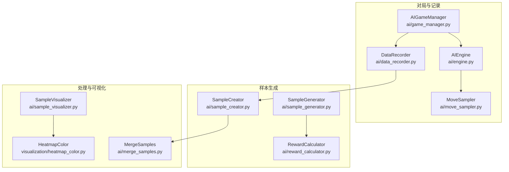
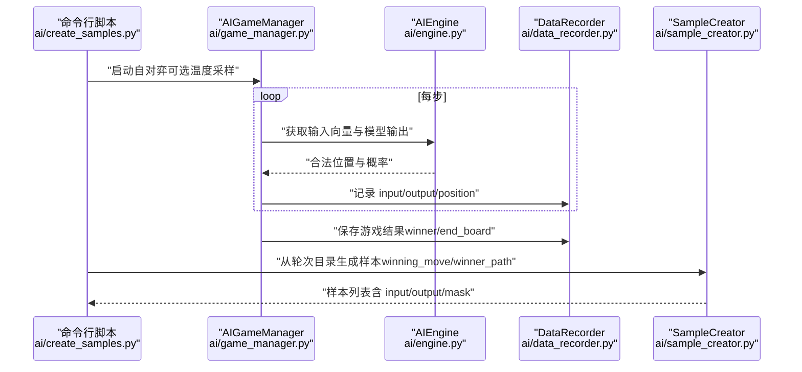
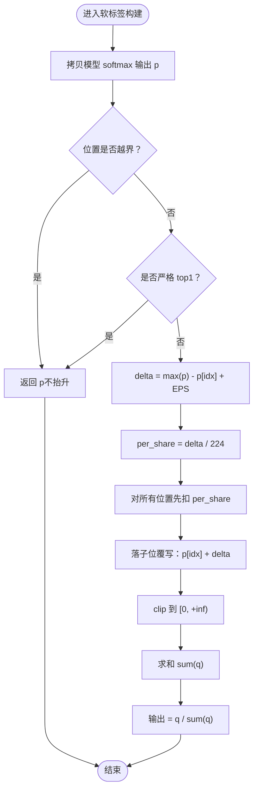
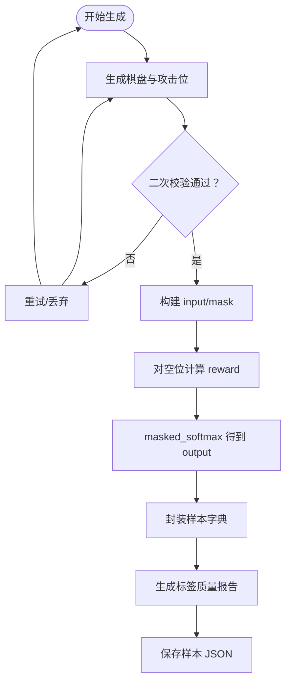
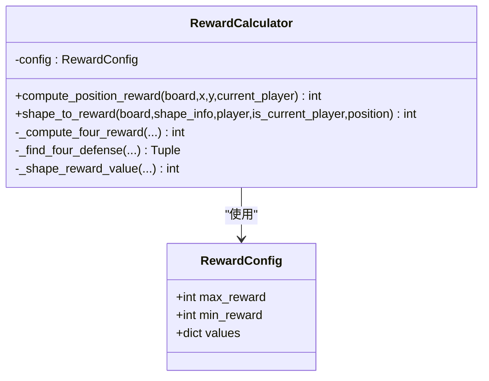
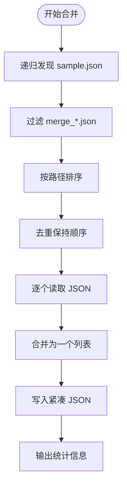
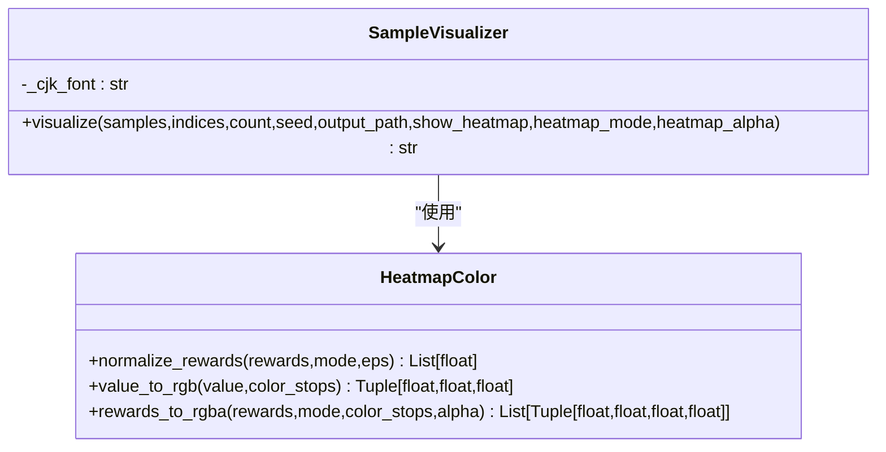
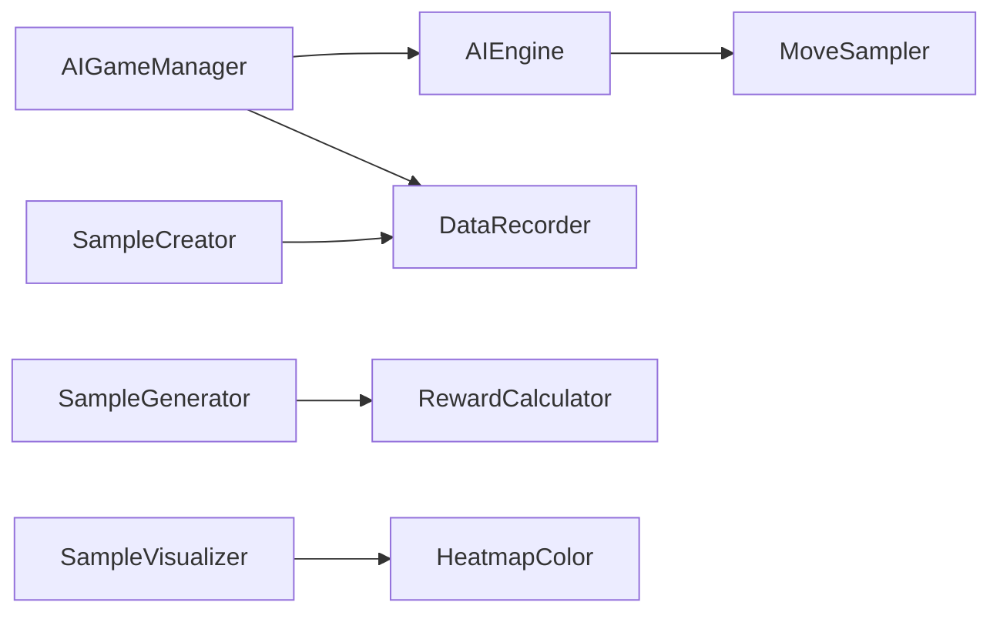

# 样本生成与处理

<cite>
**本文引用的文件**
- [ai/create_samples.py](file://ai/create_samples.py)
- [ai/sample_generator.py](file://ai/sample_generator.py)
- [ai/sample_creator.py](file://ai/sample_creator.py)
- [ai/data_recorder.py](file://ai/data_recorder.py)
- [ai/game_manager.py](file://ai/game_manager.py)
- [ai/engine.py](file://ai/engine.py)
- [ai/reward_calculator.py](file://ai/reward_calculator.py)
- [ai/merge_samples.py](file://ai/merge_samples.py)
- [ai/sample_visualizer.py](file://ai/sample_visualizer.py)
- [ai/move_sampler.py](file://ai/move_sampler.py)
- [ai/constants.py](file://ai/constants.py)
- [visualization/heatmap_color.py](file://visualization/heatmap_color.py)
</cite>

## 目录
1. [简介](#简介)
2. [项目结构](#项目结构)
3. [核心组件](#核心组件)
4. [架构总览](#架构总览)
5. [详细组件分析](#详细组件分析)
6. [依赖分析](#依赖分析)
7. [性能考量](#性能考量)
8. [故障排查指南](#故障排查指南)
9. [结论](#结论)
10. [附录](#附录)

## 简介
本文件面向“样本生成与处理系统”，围绕以下目标展开：
- 完整流程：从 AI 对局到样本生成、合并与可视化，覆盖棋盘状态编码、移动位置标记、奖励值计算、软标签生成、数据去重与批量处理、内存管理等。
- 数据结构：输入特征向量、目标输出、掩码与元数据的设计与来源。
- 合并策略：多轮次样本文件的发现、去重、合并与输出优化。
- 可视化工具：热力图生成、样本质量评估、异常样本检测。
- 最佳实践：数据清洗、格式转换、存储优化与复现实用技巧。

## 项目结构
本系统的关键模块分布如下：
- 样本生成与记录
  - AI 对局与数据记录：[ai/game_manager.py](file://ai/game_manager.py)、[ai/data_recorder.py](file://ai/data_recorder.py)
  - 引擎与落子策略：[ai/engine.py](file://ai/engine.py)、[ai/move_sampler.py](file://ai/move_sampler.py)
  - 样本创建（两种模式）：[ai/sample_creator.py](file://ai/sample_creator.py)
  - 棋型样本生成（工具版）：[ai/sample_generator.py](file://ai/sample_generator.py)
- 样本处理与合并
  - 合并脚本：[ai/merge_samples.py](file://ai/merge_samples.py)
- 样本可视化
  - 可视化工具：[ai/sample_visualizer.py](file://ai/sample_visualizer.py)
  - 热力图颜色映射：[visualization/heatmap_color.py](file://visualization/heatmap_color.py)
- 奖励计算
  - 奖励计算器：[ai/reward_calculator.py](file://ai/reward_calculator.py)
- 常量与路径
  - 常量定义：[ai/constants.py](file://ai/constants.py)

**图表来源**
- [ai/game_manager.py:123-231](file://ai/game_manager.py#L123-L231)
- [ai/data_recorder.py:17-145](file://ai/data_recorder.py#L17-L145)
- [ai/engine.py:67-143](file://ai/engine.py#L67-L143)
- [ai/move_sampler.py:117-186](file://ai/move_sampler.py#L117-L186)
- [ai/sample_creator.py:60-104](file://ai/sample_creator.py#L60-L104)
- [ai/sample_generator.py:287-328](file://ai/sample_generator.py#L287-L328)
- [ai/reward_calculator.py:46-75](file://ai/reward_calculator.py#L46-L75)
- [ai/merge_samples.py:42-77](file://ai/merge_samples.py#L42-L77)
- [ai/sample_visualizer.py:296-404](file://ai/sample_visualizer.py#L296-L404)
- [visualization/heatmap_color.py:178-204](file://visualization/heatmap_color.py#L178-L204)

**章节来源**
- [ai/create_samples.py:23-197](file://ai/create_samples.py#L23-L197)
- [ai/constants.py:11-26](file://ai/constants.py#L11-L26)

## 核心组件
- AI 对局与数据记录
  - AIGameManager：封装单局对弈流程，支持温度采样与随机执方；每步记录 input、output、position，并在结束后保存完整记录。
  - DataRecorder：按轮次创建目录，按游戏编号写入 record.json，采用紧凑 JSON 格式减少体积。
- 引擎与落子策略
  - AIEngine：将棋盘转换为 226 维向量，调用模型获取 225 维概率分布；支持 argmax 与温度采样两种策略。
  - MoveSampler：提供温度采样与 temp_side 解析，控制前 N 步温度采样、之后 argmax。
- 样本创建器
  - SampleCreator：支持 winning_move 与 winner_path 两种模式；winner_path 使用软标签算法，强制禁用 D4 增强。
  - SampleGenerator：按棋型合成棋盘，计算奖励并生成样本，内置标签质量验证。
- 奖励计算
  - RewardCalculator：将棋型映射为数值 reward，处理冲四递归防守模拟，支持配置化权重。
- 样本合并
  - MergeSamples：递归发现 sample.json，去重合并，输出紧凑 JSON。
- 样本可视化
  - SampleVisualizer：绘制棋盘、棋子、attack 标记与热力图，兼容新旧样本格式，支持多种归一化模式。
  - HeatmapColor：纯函数热力图颜色映射，支持 log/max/linear 归一化与可配置色板。

**章节来源**
- [ai/game_manager.py:123-231](file://ai/game_manager.py#L123-L231)
- [ai/data_recorder.py:96-141](file://ai/data_recorder.py#L96-L141)
- [ai/engine.py:67-143](file://ai/engine.py#L67-L143)
- [ai/move_sampler.py:117-227](file://ai/move_sampler.py#L117-L227)
- [ai/sample_creator.py:32-104](file://ai/sample_creator.py#L32-L104)
- [ai/sample_generator.py:287-328](file://ai/sample_generator.py#L287-L328)
- [ai/reward_calculator.py:46-191](file://ai/reward_calculator.py#L46-L191)
- [ai/merge_samples.py:42-103](file://ai/merge_samples.py#L42-L103)
- [ai/sample_visualizer.py:296-404](file://ai/sample_visualizer.py#L296-L404)
- [visualization/heatmap_color.py:178-204](file://visualization/heatmap_color.py#L178-L204)

## 架构总览
下面的时序图展示从 AI 对局到样本生成与可视化的完整流程。

**图表来源**
- [ai/create_samples.py:158-176](file://ai/create_samples.py#L158-L176)
- [ai/game_manager.py:123-231](file://ai/game_manager.py#L123-L231)
- [ai/engine.py:67-143](file://ai/engine.py#L67-L143)
- [ai/data_recorder.py:96-141](file://ai/data_recorder.py#L96-L141)
- [ai/sample_creator.py:60-104](file://ai/sample_creator.py#L60-L104)

## 详细组件分析

### 组件 A：样本生成器（SampleCreator）
- 功能概述
  - winning_move：取每局最后一步，硬标签（落子位=1，其余=0），mask 全 1。
  - winner_path：取获胜方每一步，采用软标签算法，基于模型 softmax 输出提升落子位概率，其余等额汲取并 clip、归一化，保证严格 top1。
  - D4 增强：默认启用（8 变换），winner_path 模式强制禁用。
- 数据结构
  - input：226 维（前 225 为棋盘，末位为当前落子方）。
  - output：225 维（硬标签或软标签）。
  - mask：225 维（空位=1，非空=0）。
  - 元数据：_attack_positions（棋型样本）、_shape（棋型名称）。
- 软标签算法（winner_path）
  - 若落子位已是严格 top1，则保持原分布。
  - 否则：delta = max(p) - p[idx] + EPS，落子位加 delta，其余位置等额扣减 per_share，clip 到 0 后归一化。
  - EPS 为 1e-3，平衡“尖锐标签”与“保留模型分布”的需求。

**图表来源**
- [ai/sample_creator.py:171-232](file://ai/sample_creator.py#L171-L232)

**章节来源**
- [ai/sample_creator.py:32-104](file://ai/sample_creator.py#L32-L104)
- [ai/sample_creator.py:171-232](file://ai/sample_creator.py#L171-L232)

### 组件 B：棋型样本生成器（SampleGenerator）
- 功能概述
  - 支持 6 种棋型：chong4、huo4、huo3、huo2、defend_chong4、defend_huo3。
  - 生成棋盘并标注攻击位（进攻位/防守位），计算每个空位 reward，经 masked_softmax 得到训练标签。
  - 标签质量评估：Hit@N、Hit@N+1、Hit@N+2、攻击位概率和、区分度 gap。
- 核心流程
  - 生成棋盘：按 spec 放置连珠、两端开放/阻挡、可选干扰子，二次校验每个攻击位落子后形成期望棋型。
  - 封装样本：input=board+current_player，mask=合法空位，output=masked_softmax(reward)。
  - 验证报告：统计命中率与质量指标，输出失败样例。

**图表来源**
- [ai/sample_generator.py:101-217](file://ai/sample_generator.py#L101-L217)
- [ai/sample_generator.py:287-328](file://ai/sample_generator.py#L287-L328)
- [ai/sample_generator.py:334-401](file://ai/sample_generator.py#L334-L401)

**章节来源**
- [ai/sample_generator.py:1-511](file://ai/sample_generator.py#L1-L511)

### 组件 C：奖励计算器（RewardCalculator）
- 功能概述
  - 将检测到的棋型映射为数值 reward，支持“我方”与“敌方”双视角。
  - 冲四递归：找到唯一防守位置，模拟防守后检测后续棋型，取最佳后续 reward。
- 关键点
  - 我方因子为 1.0，敌方因子为 0.95，体现防守优先。
  - 眠三/活二按方向数动态加权，避免单一静态值。

**图表来源**
- [ai/reward_calculator.py:13-44](file://ai/reward_calculator.py#L13-L44)
- [ai/reward_calculator.py:46-191](file://ai/reward_calculator.py#L46-L191)

**章节来源**
- [ai/reward_calculator.py:1-239](file://ai/reward_calculator.py#L1-L239)

### 组件 D：样本合并器（MergeSamples）
- 功能概述
  - 递归发现目录下所有 sample.json（忽略以 merge_ 开头的文件），去重后合并为单个文件。
  - 输出采用紧凑 JSON（无缩进），减少体积。
- 关键点
  - 发现策略：os.walk 遍历子目录，收集文件名等于 sample.json 的路径。
  - 去重策略：使用 dict.fromkeys 保持顺序的同时去重。

**图表来源**
- [ai/merge_samples.py:13-39](file://ai/merge_samples.py#L13-L39)
- [ai/merge_samples.py:79-103](file://ai/merge_samples.py#L79-L103)
- [ai/merge_samples.py:42-77](file://ai/merge_samples.py#L42-L77)

**章节来源**
- [ai/merge_samples.py:1-155](file://ai/merge_samples.py#L1-L155)

### 组件 E：样本可视化器（SampleVisualizer）
- 功能概述
  - 绘制棋盘、星位、棋子、attack 标记与热力图（仅空位）。
  - 兼容新旧样本格式：新格式含 _attack_positions/_shape/mask；旧格式通过 argmax 兜底。
  - 支持 log/max/linear 三种归一化模式与透明度调节。
- 关键点
  - 归一化与颜色映射：委托 visualization/heatmap_color.rewards_to_rgba。
  - 样本选择：支持 indices 精确取样或 count 随机抽样。

**图表来源**
- [ai/sample_visualizer.py:296-404](file://ai/sample_visualizer.py#L296-L404)
- [visualization/heatmap_color.py:178-204](file://visualization/heatmap_color.py#L178-L204)

**章节来源**
- [ai/sample_visualizer.py:1-496](file://ai/sample_visualizer.py#L1-L496)
- [visualization/heatmap_color.py:1-204](file://visualization/heatmap_color.py#L1-L204)

## 依赖分析
- 模块耦合
  - AIGameManager 依赖 AIEngine、DataRecorder、MoveSampler；AIEngine 依赖 BaseModel 与 MoveSampler。
  - SampleCreator 依赖 DataRecorder 输出的 record.json；SampleGenerator 独立工具，依赖 RewardCalculator 与 ShapeDetector。
  - SampleVisualizer 依赖 HeatmapColor；HeatmapColor 为纯函数，无 UI 依赖。
- 外部依赖
  - matplotlib（Agg 后端）、numpy、标准库（json、os、random、argparse）。

**图表来源**
- [ai/game_manager.py:123-231](file://ai/game_manager.py#L123-L231)
- [ai/engine.py:67-143](file://ai/engine.py#L67-L143)
- [ai/move_sampler.py:117-186](file://ai/move_sampler.py#L117-L186)
- [ai/sample_creator.py:60-104](file://ai/sample_creator.py#L60-L104)
- [ai/sample_generator.py:287-328](file://ai/sample_generator.py#L287-L328)
- [ai/reward_calculator.py:46-75](file://ai/reward_calculator.py#L46-L75)
- [ai/sample_visualizer.py:296-404](file://ai/sample_visualizer.py#L296-L404)
- [visualization/heatmap_color.py:178-204](file://visualization/heatmap_color.py#L178-L204)

**章节来源**
- [ai/game_manager.py:1-339](file://ai/game_manager.py#L1-L339)
- [ai/engine.py:1-194](file://ai/engine.py#L1-L194)
- [ai/move_sampler.py:1-258](file://ai/move_sampler.py#L1-L258)
- [ai/sample_creator.py:1-339](file://ai/sample_creator.py#L1-L339)
- [ai/sample_generator.py:1-511](file://ai/sample_generator.py#L1-L511)
- [ai/reward_calculator.py:1-239](file://ai/reward_calculator.py#L1-L239)
- [ai/sample_visualizer.py:1-496](file://ai/sample_visualizer.py#L1-L496)
- [visualization/heatmap_color.py:1-204](file://visualization/heatmap_color.py#L1-L204)

## 性能考量
- I/O 优化
  - DataRecorder 保存 record.json 时不使用缩进，减少文件体积约 50%。
  - MergeSamples 输出紧凑 JSON，降低磁盘占用与加载开销。
- 计算优化
  - AIEngine 支持传入预计算的 probs，避免重复 model.predict 调用。
  - SampleGenerator 在生成阶段记录 attack_positions，避免验证阶段重复检测。
- 内存管理
  - SampleCreator 的 winner_path 软标签在内存中进行数组拷贝与就地修改，避免额外副本。
  - SampleVisualizer 采用 Agg 后端，避免 GUI 初始化开销，适合批量渲染。

[本节为通用性能建议，不直接分析具体文件，无需“章节来源”]

## 故障排查指南
- 温度采样参数无效
  - 现象：传入温度相关参数但未生效。
  - 原因：显式启用 --no-temp-sampling 时，温度相关参数被忽略。
  - 处理：移除 --no-temp-sampling 或仅传 --no-temp-sampling。
  - 参考：[ai/create_samples.py:114-137](file://ai/create_samples.py#L114-L137)
- 落子位越界
  - 现象：winner_path 软标签返回原分布（不抬升）。
  - 原因：位置坐标越界（行列任一不在 [0,15)）。
  - 处理：检查 position 与 input 的索引一致性。
  - 参考：[ai/sample_creator.py:202-208](file://ai/sample_creator.py#L202-L208)
- 棋盘已满无法落子
  - 现象：抛出“无空位可落子”异常。
  - 原因：合法位置为空或模型将概率集中在已落子位。
  - 处理：检查模型输出与 board 状态；必要时启用 top_k 截断。
  - 参考：[ai/engine.py:124-126](file://ai/engine.py#L124-L126)
- 合并文件缺失
  - 现象：找不到 sample.json。
  - 原因：目录不存在或文件名不为 sample.json。
  - 处理：确认数据目录与文件命名；注意忽略以 merge_ 开头的文件。
  - 参考：[ai/merge_samples.py:13-39](file://ai/merge_samples.py#L13-L39)
- 热力图异常
  - 现象：颜色映射异常或透明度过高。
  - 处理：调整 heatmap_mode（log/max/linear）与 alpha；确认归一化范围。
  - 参考：[ai/sample_visualizer.py:341-353](file://ai/sample_visualizer.py#L341-L353)、[visualization/heatmap_color.py:63-122](file://visualization/heatmap_color.py#L63-L122)

**章节来源**
- [ai/create_samples.py:114-137](file://ai/create_samples.py#L114-L137)
- [ai/sample_creator.py:202-208](file://ai/sample_creator.py#L202-L208)
- [ai/engine.py:124-126](file://ai/engine.py#L124-L126)
- [ai/merge_samples.py:13-39](file://ai/merge_samples.py#L13-L39)
- [ai/sample_visualizer.py:341-353](file://ai/sample_visualizer.py#L341-L353)
- [visualization/heatmap_color.py:63-122](file://visualization/heatmap_color.py#L63-L122)

## 结论
本系统以清晰的模块划分实现了从 AI 对局到样本生成、合并与可视化的完整闭环。通过奖励计算与软标签机制，样本具备高质量的目标输出；通过 D4 增强与合并策略，兼顾数据多样性与存储效率；通过可视化工具与标签质量评估，便于样本质量把控与异常检测。建议在生产环境中结合温度采样、软标签与合并策略，持续优化样本质量与训练效率。

[本节为总结性内容，不直接分析具体文件，无需“章节来源”]

## 附录
- 常用命令与参数
  - 样本生成（AI 对局 + 样本创建）
    - 参考：[ai/create_samples.py:25-111](file://ai/create_samples.py#L25-L111)
  - 棋型样本生成（工具版）
    - 参考：[ai/sample_generator.py:442-460](file://ai/sample_generator.py#L442-L460)
  - 样本合并
    - 参考：[ai/merge_samples.py:105-132](file://ai/merge_samples.py#L105-L132)
  - 样本可视化
    - 参考：[ai/sample_visualizer.py:421-461](file://ai/sample_visualizer.py#L421-L461)
- 数据路径
  - AI 数据目录与训练数据目录
    - 参考：[ai/constants.py:11-26](file://ai/constants.py#L11-L26)

**章节来源**
- [ai/create_samples.py:25-111](file://ai/create_samples.py#L25-L111)
- [ai/sample_generator.py:442-460](file://ai/sample_generator.py#L442-L460)
- [ai/merge_samples.py:105-132](file://ai/merge_samples.py#L105-L132)
- [ai/sample_visualizer.py:421-461](file://ai/sample_visualizer.py#L421-L461)
- [ai/constants.py:11-26](file://ai/constants.py#L11-L26)