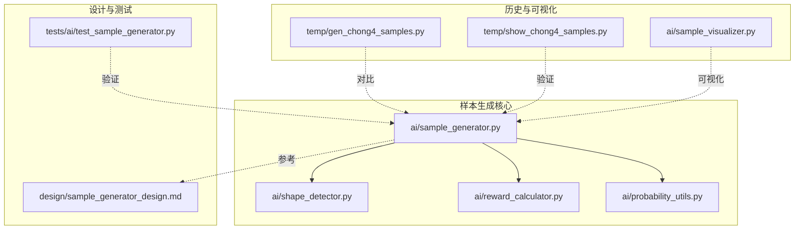
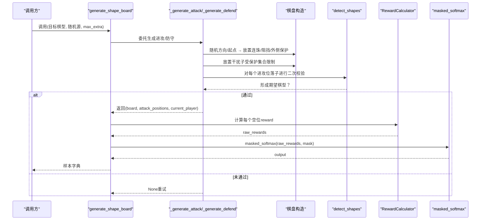
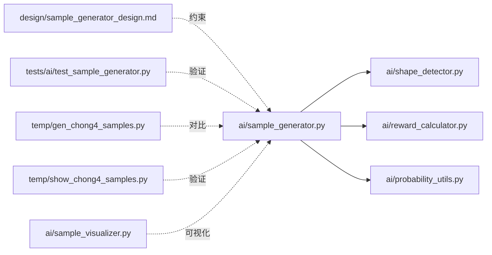

# 样本生成核心

<cite>
**本文引用的文件**
- [ai/sample_generator.py](file://ai/sample_generator.py)
- [ai/shape_detector.py](file://ai/shape_detector.py)
- [ai/reward_calculator.py](file://ai/reward_calculator.py)
- [ai/probability_utils.py](file://ai/probability_utils.py)
- [design/sample_generator_design.md](file://design/sample_generator_design.md)
- [tests/ai/test_sample_generator.py](file://tests/ai/test_sample_generator.py)
- [temp/gen_chong4_samples.py](file://temp/gen_chong4_samples.py)
- [temp/show_chong4_samples.py](file://temp/show_chong4_samples.py)
- [ai/sample_visualizer.py](file://ai/sample_visualizer.py)
</cite>

## 目录
1. [简介](#简介)
2. [项目结构](#项目结构)
3. [核心组件](#核心组件)
4. [架构总览](#架构总览)
5. [详细组件分析](#详细组件分析)
6. [依赖关系分析](#依赖关系分析)
7. [性能考量](#性能考量)
8. [故障排查指南](#故障排查指南)
9. [结论](#结论)
10. [附录](#附录)

## 简介
本文件面向“样本生成核心”模块，系统化梳理棋型样本生成器的设计与实现，重点覆盖：
- 四种进攻棋型（chong4、huo4、huo3、huo2）与两种防守棋型（defend_chong4、defend_huo3）的生成逻辑
- 棋盘构造算法：连珠排列、两端开放性判断、外侧位保护机制
- 干扰子放置策略与二次校验机制：确保每个进攻位落子后形成期望棋型
- 完整的API参考：generate_shape_board函数的参数、返回值、错误处理
- 实际使用示例与最佳实践

## 项目结构
围绕样本生成核心，涉及以下关键文件：
- 生成器主体：ai/sample_generator.py
- 棋型检测：ai/shape_detector.py
- 奖励计算：ai/reward_calculator.py
- 概率工具：ai/probability_utils.py
- 设计文档：design/sample_generator_design.md
- 测试用例：tests/ai/test_sample_generator.py
- 历史脚本与可视化：temp/gen_chong4_samples.py、temp/show_chong4_samples.py、ai/sample_visualizer.py



图表来源
- [ai/sample_generator.py:1-511](file://ai/sample_generator.py#L1-L511)
- [ai/shape_detector.py:1-314](file://ai/shape_detector.py#L1-L314)
- [ai/reward_calculator.py:1-239](file://ai/reward_calculator.py#L1-L239)
- [ai/probability_utils.py:1-59](file://ai/probability_utils.py#L1-L59)
- [design/sample_generator_design.md:1-265](file://design/sample_generator_design.md#L1-L265)
- [tests/ai/test_sample_generator.py:1-318](file://tests/ai/test_sample_generator.py#L1-L318)
- [temp/gen_chong4_samples.py:1-287](file://temp/gen_chong4_samples.py#L1-L287)
- [temp/show_chong4_samples.py:1-88](file://temp/show_chong4_samples.py#L1-L88)
- [ai/sample_visualizer.py:1-496](file://ai/sample_visualizer.py#L1-L496)

章节来源
- [ai/sample_generator.py:1-511](file://ai/sample_generator.py#L1-L511)
- [design/sample_generator_design.md:1-265](file://design/sample_generator_design.md#L1-L265)

## 核心组件
- 生成器主体：提供统一的棋型样本生成、样本封装、标签质量验证与CLI入口
- 棋型检测：对任意落子位置进行四个方向的棋型检测与合并规则
- 奖励计算：将棋型映射为数值reward，支持冲四递归防守模拟
- 概率工具：对合法空位应用带mask的softmax，生成训练标签

章节来源
- [ai/sample_generator.py:1-511](file://ai/sample_generator.py#L1-L511)
- [ai/shape_detector.py:197-314](file://ai/shape_detector.py#L197-L314)
- [ai/reward_calculator.py:35-239](file://ai/reward_calculator.py#L35-L239)
- [ai/probability_utils.py:15-59](file://ai/probability_utils.py#L15-L59)

## 架构总览
样本生成器遵循“生成阶段直接记录进攻位/防守位索引”的设计约束，确保验证阶段无需再次检测棋型。生成流程的关键步骤如下：
- 参数映射：根据目标棋型确定连珠数、开放端数、期望棋型与外侧位要求
- 连珠布置：随机方向与起点，沿方向放置连珠，越界则重试
- 开放端与阻挡：依据开放端数决定是否放置对手棋子阻挡
- 外侧位保护：对huo3/huo2，需保证两端外侧空位（避免落子后退化）
- 干扰子放置：在受保护集合之外随机放置若干干扰子
- 二次校验：对每个进攻位落子后，使用棋型检测确认形成期望棋型
- 标签生成：使用奖励计算与softmax得到训练标签



图表来源
- [ai/sample_generator.py:101-284](file://ai/sample_generator.py#L101-L284)
- [ai/shape_detector.py:197-314](file://ai/shape_detector.py#L197-L314)
- [ai/reward_calculator.py:46-74](file://ai/reward_calculator.py#L46-L74)
- [ai/probability_utils.py:15-59](file://ai/probability_utils.py#L15-L59)

章节来源
- [ai/sample_generator.py:101-284](file://ai/sample_generator.py#L101-L284)
- [design/sample_generator_design.md:166-204](file://design/sample_generator_design.md#L166-L204)

## 详细组件分析

### 生成器主体与API
- generate_shape_board(shape, random_gen, max_extra)
  - 功能：按指定棋型生成一个15×15棋盘，返回棋盘、进攻位/防守位索引与当前玩家
  - 参数：
    - shape：目标棋型，必须在SUPPORTED_SHAPES内
    - random_gen：随机源（保证可复现）
    - max_extra：每样本最多干扰子数，默认4
  - 返回：(board, attack_positions, current_player) 或 None（失败重试）
  - 错误：当shape不在支持集合时抛出ValueError
- create_sample(board, attack_positions, current_player, shape, reward_calculator)
  - 功能：将棋盘状态封装为训练样本，包含input、output、mask与元数据
  - 返回：字典，包含input(226维)、output(225维)、mask(225维)、元数据_attack_positions、_shape
- verify_samples(samples)
  - 功能：对一批样本进行标签质量体检，返回Hit@N、Hit@N+1、Hit@N+2、攻击位概率和、区分度gap等指标

章节来源
- [ai/sample_generator.py:261-327](file://ai/sample_generator.py#L261-L327)
- [ai/sample_generator.py:287-327](file://ai/sample_generator.py#L287-L327)
- [ai/sample_generator.py:334-401](file://ai/sample_generator.py#L334-L401)

### 进攻棋型生成算法
- chong4（4连珠，1端被阻挡，1端开放）
  - 连珠数：4
  - 开放端：1
  - 期望棋型：连五
  - 外侧位要求：否
- huo4（4连珠，两端开放）
  - 连珠数：4
  - 开放端：2
  - 期望棋型：连五
  - 外侧位要求：否
- huo3（3连珠，两端开放）
  - 连珠数：3
  - 开放端：2
  - 期望棋型：活四
  - 外侧位要求：是（两端外侧必须空位）
- huo2（2连珠，两端开放）
  - 连珠数：2
  - 开放端：2
  - 期望棋型：活三/多活三
  - 外侧位要求：是（两端外侧必须空位）

```mermaid
flowchart TD
Start(["进入生成流程"]) --> PickDir["随机选择方向(dx,dy)与起点(sx,sy)"]
PickDir --> PlaceStones["沿方向放置连珠(越界则重试)"]
PlaceStones --> ComputeEnds["计算两端坐标与有效性"]
ComputeEnds --> DecideOpenEnds{"开放端数是否达标？"}
DecideOpenEnds --> |否| Retry["重试"]
DecideOpenEnds --> |是| PlaceBlock["按开放端数放置阻挡(对手棋子或边界)"]
PlaceBlock --> CollectAttack["收集进攻位(开放端索引)"]
CollectAttack --> OuterGuard{"是否需要外侧位保护？"}
OuterGuard --> |是| CheckOuter["检查两端外侧是否盘内空位"]
CheckOuter --> |否| PlaceExtra["放置0..max_extra干扰子(受保护集合限制)"]
CheckOuter --> |是||否| PlaceExtra
OuterGuard --> |否| PlaceExtra
PlaceExtra --> Verify["对每个进攻位落子进行二次校验(期望棋型)"]
Verify --> |通过| Done(["返回(board, attack, player)"])
Verify --> |未通过| Retry
```

图表来源
- [ai/sample_generator.py:101-216](file://ai/sample_generator.py#L101-L216)
- [ai/sample_generator.py:219-228](file://ai/sample_generator.py#L219-L228)

章节来源
- [ai/sample_generator.py:101-216](file://ai/sample_generator.py#L101-L216)
- [ai/sample_generator.py:219-228](file://ai/sample_generator.py#L219-L228)

### 防守棋型生成机制
- defend_chong4：对手冲四 → 我方防守位为对手唯一空端（落子即连五）
- defend_huo3：对手活三 → 我方防守位为对手两端之一（落子即活四）
- 实现要点：
  - 复用对应进攻生成器（chong4/huo3）
  - 仅切换视角：current_player设为原attacker的对手
  - 不翻转棋盘颜色，避免current_player与棋型持有方重合导致语义倒置
  - attack_positions索引保持不变（原进攻位即防守位）

章节来源
- [ai/sample_generator.py:235-254](file://ai/sample_generator.py#L235-L254)
- [design/sample_generator_design.md:33-41](file://design/sample_generator_design.md#L33-L41)

### 棋型检测与二次校验
- detect_shapes：对落子位置进行四个方向检测，返回合并后的棋型列表
- 二次校验：_verify_attack_positions对每个进攻位落子后，检查是否包含期望棋型关键词
- 作用：确保每个进攻位落子后形成期望棋型，不合格则丢弃整盘重试

章节来源
- [ai/shape_detector.py:197-314](file://ai/shape_detector.py#L197-L314)
- [ai/sample_generator.py:219-228](file://ai/sample_generator.py#L219-L228)

### 奖励计算与标签生成
- RewardCalculator：将棋型映射为数值reward，支持冲四递归防守模拟
- masked_softmax：对合法空位应用带mask的softmax，生成训练标签output
- create_sample：构建样本字典，包含input(225棋盘+1当前玩家)、output、mask与元数据

章节来源
- [ai/reward_calculator.py:46-74](file://ai/reward_calculator.py#L46-L74)
- [ai/probability_utils.py:15-59](file://ai/probability_utils.py#L15-L59)
- [ai/sample_generator.py:287-327](file://ai/sample_generator.py#L287-L327)

### 样本验证与质量指标
- 主指标：Hit@N（所有进攻位都在output的top-N中）
- 辅助指标：Hit@N+1、Hit@N+2、攻击位概率和、区分度gap
- 失败样例：记录未命中的样本索引（最多前100个），便于人工复盘

章节来源
- [ai/sample_generator.py:334-401](file://ai/sample_generator.py#L334-L401)
- [design/sample_generator_design.md:206-228](file://design/sample_generator_design.md#L206-L228)

## 依赖关系分析
- 生成器依赖
  - ai/shape_detector：二次校验
  - ai/reward_calculator：计算每个空位reward
  - ai/probability_utils：生成训练标签
- 设计与测试
  - design/sample_generator_design.md：约束与规范
  - tests/ai/test_sample_generator.py：单元/集成测试
- 历史与可视化
  - temp/gen_chong4_samples.py：历史一次性脚本，对比参考
  - temp/show_chong4_samples.py：样本展示与验证
  - ai/sample_visualizer.py：样本可视化工具



图表来源
- [ai/sample_generator.py:1-511](file://ai/sample_generator.py#L1-L511)
- [ai/shape_detector.py:1-314](file://ai/shape_detector.py#L1-L314)
- [ai/reward_calculator.py:1-239](file://ai/reward_calculator.py#L1-L239)
- [ai/probability_utils.py:1-59](file://ai/probability_utils.py#L1-L59)
- [design/sample_generator_design.md:1-265](file://design/sample_generator_design.md#L1-L265)
- [tests/ai/test_sample_generator.py:1-318](file://tests/ai/test_sample_generator.py#L1-L318)
- [temp/gen_chong4_samples.py:1-287](file://temp/gen_chong4_samples.py#L1-L287)
- [temp/show_chong4_samples.py:1-88](file://temp/show_chong4_samples.py#L1-L88)
- [ai/sample_visualizer.py:1-496](file://ai/sample_visualizer.py#L1-L496)

章节来源
- [ai/sample_generator.py:1-511](file://ai/sample_generator.py#L1-L511)
- [design/sample_generator_design.md:249-265](file://design/sample_generator_design.md#L249-L265)

## 性能考量
- Numba加速：shape_detector对单方向检测采用Numba JIT加速，显著提升性能
- 数值稳定性：probability_utils对reward进行缩放与中心化，避免softmax下溢
- 生成效率：max_extra控制干扰子数量，平衡样本多样性与生成速度
- 二次校验成本：二次校验确保标签质量，但会增加生成时间，可通过适当降低max_extra缓解

章节来源
- [ai/shape_detector.py:56-128](file://ai/shape_detector.py#L56-L128)
- [ai/probability_utils.py:15-59](file://ai/probability_utils.py#L15-L59)
- [ai/sample_generator.py:77-80](file://ai/sample_generator.py#L77-L80)

## 故障排查指南
- 生成失败次数过多
  - 现象：超过fail_budget后提前终止
  - 原因：参数不当（如max_extra过小、棋型要求过高）或环境不稳定
  - 处理：增大max_extra、放宽棋型要求、检查随机种子
- 二次校验失败
  - 现象：某些进攻位落子后未形成期望棋型
  - 原因：外侧位保护不足、干扰子破坏了棋型
  - 处理：启用外侧位保护、减少干扰子数量
- 样本标签质量不佳
  - 现象：Hit@N低、区分度gap小
  - 原因：reward权重不合理、样本数量不足
  - 处理：调整RewardConfig、增加样本数、使用verify_samples定位问题

章节来源
- [ai/sample_generator.py:473-483](file://ai/sample_generator.py#L473-L483)
- [ai/sample_generator.py:219-228](file://ai/sample_generator.py#L219-L228)
- [ai/sample_generator.py:334-401](file://ai/sample_generator.py#L334-L401)

## 结论
样本生成核心模块通过统一的生成框架与严格的二次校验机制，确保每条样本的标签质量与语义一致性。结合奖励计算与softmax标签生成，为训练提供了高质量的监督信号。建议在实际使用中：
- 明确棋型参数与max_extra，平衡样本多样性与生成效率
- 利用verify_samples与可视化工具持续监控标签质量
- 通过测试用例保障生成逻辑的正确性与稳定性

## 附录

### API参考：generate_shape_board
- 函数签名
  - generate_shape_board(shape, random_gen, max_extra=4)
- 参数
  - shape：目标棋型，取值范围见SUPPORTED_SHAPES
  - random_gen：随机源（保证可复现）
  - max_extra：每样本最多干扰子数，默认4
- 返回
  - (board, attack_positions, current_player) 或 None（失败重试）
- 错误
  - ValueError：当shape不在SUPPORTED_SHAPES内

章节来源
- [ai/sample_generator.py:261-284](file://ai/sample_generator.py#L261-L284)
- [ai/sample_generator.py:49-54](file://ai/sample_generator.py#L49-L54)

### 使用示例与最佳实践
- CLI使用
  - 生成huo3样本：python -m ai.sample_generator --shape huo3 --num-samples 40960 --output ai/merge_samples/huo3.json
- 代码调用
  - 使用random.Random(seed)作为随机源，保证可复现
  - 通过verify_samples评估样本质量，必要时调整max_extra
- 最佳实践
  - 对huo3/huo2启用外侧位保护，避免落子后退化
  - 控制max_extra，确保样本中仅有目标棋型
  - 使用sample_visualizer进行可视化验证

章节来源
- [ai/sample_generator.py:442-510](file://ai/sample_generator.py#L442-L510)
- [ai/sample_visualizer.py:421-496](file://ai/sample_visualizer.py#L421-L496)
- [tests/ai/test_sample_generator.py:229-258](file://tests/ai/test_sample_generator.py#L229-L258)