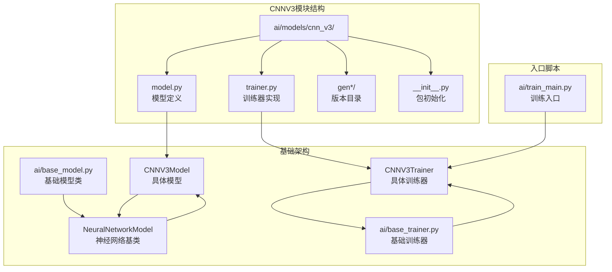
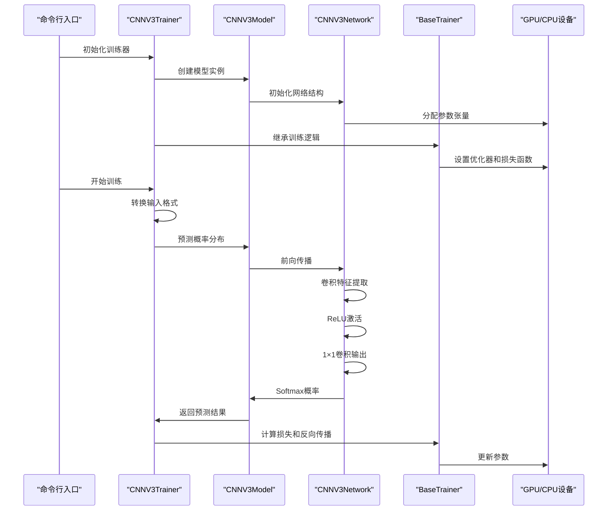
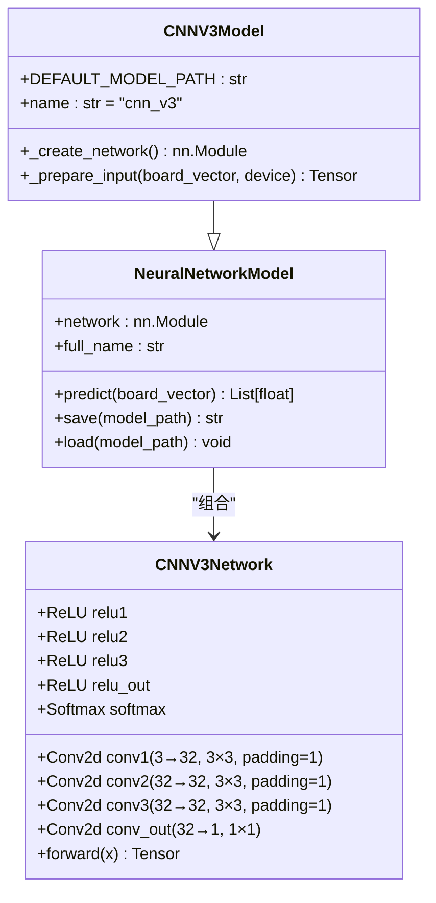
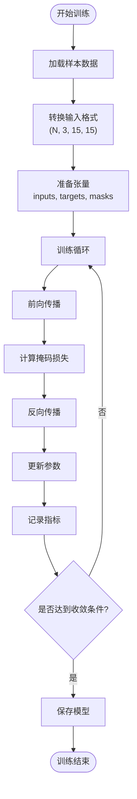
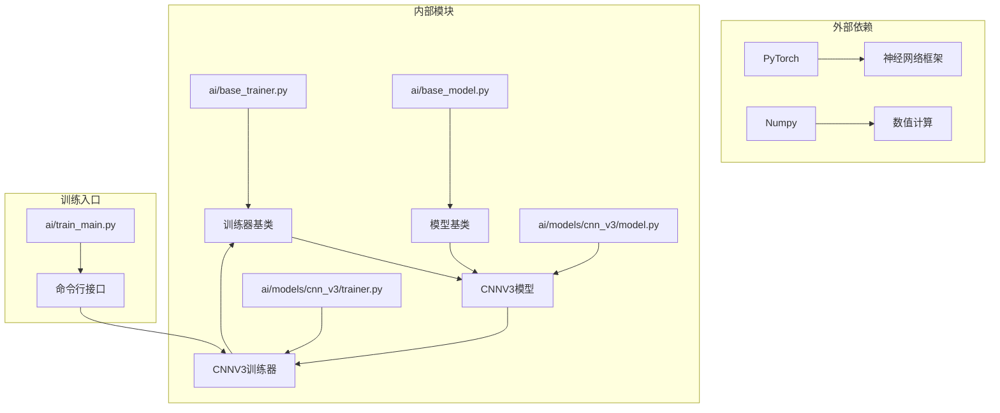

# CNNV3训练器

<cite>
**本文引用的文件**
- [ai/models/cnn_v3/trainer.py](file://ai/models/cnn_v3/trainer.py)
- [ai/models/cnn_v3/model.py](file://ai/models/cnn_v3/model.py)
- [ai/base_trainer.py](file://ai/base_trainer.py)
- [ai/base_model.py](file://ai/base_model.py)
- [ai/train_main.py](file://ai/train_main.py)
- [design/cnn_v3_design.md](file://design/cnn_v3_design.md)
- [ai/models/cnn_v3/gen2/训练方法.md](file://ai/models/cnn_v3/gen2/训练方法.md)
- [ai/models/cnn_v3/gen3/训练方法.md](file://ai/models/cnn_v3/gen3/训练方法.md)
- [tests/ai/test_cnn_trainers.py](file://tests/ai/test_cnn_trainers.py)
- [tests/ai/test_cnn_models.py](file://tests/ai/test_cnn_models.py)
</cite>

## 目录
1. [简介](#简介)
2. [项目结构](#项目结构)
3. [核心组件](#核心组件)
4. [架构概览](#架构概览)
5. [详细组件分析](#详细组件分析)
6. [依赖分析](#依赖分析)
7. [性能考虑](#性能考虑)
8. [故障排除指南](#故障排除指南)
9. [结论](#结论)
10. [附录](#附录)

## 简介
CNNV3是五子棋AI项目中的纯卷积神经网络训练器，采用极简设计理念：完全去除全连接层、批归一化和Dropout，用1×1卷积替代传统全连接层，直接输出15×15的空间概率图。该训练器专注于探索纯卷积结构在五子棋任务上的学习能力，参数量仅为约1.9万个，远低于传统CNN模型。

## 项目结构
CNNV3训练器位于AI模型包的cnn_v3子目录中，采用清晰的分层架构：



**图表来源**
- [ai/models/cnn_v3/model.py:1-139](file://ai/models/cnn_v3/model.py#L1-L139)
- [ai/models/cnn_v3/trainer.py:1-73](file://ai/models/cnn_v3/trainer.py#L1-L73)
- [ai/base_trainer.py:32-699](file://ai/base_trainer.py#L32-L699)
- [ai/base_model.py:107-323](file://ai/base_model.py#L107-L323)

**章节来源**
- [ai/models/cnn_v3/model.py:1-139](file://ai/models/cnn_v3/model.py#L1-L139)
- [ai/models/cnn_v3/trainer.py:1-73](file://ai/models/cnn_v3/trainer.py#L1-L73)
- [design/cnn_v3_design.md:50-58](file://design/cnn_v3_design.md#L50-L58)

## 核心组件
CNNV3训练器由三个核心组件构成：模型定义、训练器实现和输入转换工具。

### 模型架构特点
- **纯卷积设计**：三层3×3卷积（32通道）+ 一层1×1卷积输出
- **无全连接层**：用1×1卷积替代FC层，参数量极低
- **无批归一化**：去除BN层，简化网络结构
- **无Dropout**：保持训练稳定性

### 训练器特性
- **继承基础训练器**：复用通用训练逻辑
- **GPU加速支持**：自动检测并使用CUDA设备
- **学习率调度**：支持StepLR和ReduceLROnPlateau两种策略
- **掩码损失函数**：使用L1Loss配合掩码进行精确训练

**章节来源**
- [ai/models/cnn_v3/model.py:31-94](file://ai/models/cnn_v3/model.py#L31-L94)
- [ai/models/cnn_v3/trainer.py:13-44](file://ai/models/cnn_v3/trainer.py#L13-L44)
- [design/cnn_v3_design.md:3-16](file://design/cnn_v3_design.md#L3-L16)

## 架构概览
CNNV3训练器采用分层架构设计，实现了高度的模块化和可扩展性：



**图表来源**
- [ai/models/cnn_v3/trainer.py:25-35](file://ai/models/cnn_v3/trainer.py#L25-L35)
- [ai/models/cnn_v3/model.py:117-123](file://ai/models/cnn_v3/model.py#L117-L123)
- [ai/base_trainer.py:52-126](file://ai/base_trainer.py#L52-L126)

## 详细组件分析

### CNNV3模型实现
CNNV3模型采用极简的纯卷积架构，完全摒弃了传统深度学习模型中的全连接层和批归一化层。

#### 网络结构设计


**图表来源**
- [ai/models/cnn_v3/model.py:31-94](file://ai/models/cnn_v3/model.py#L31-L94)
- [ai/models/cnn_v3/model.py:96-139](file://ai/models/cnn_v3/model.py#L96-L139)

#### 输入处理机制
CNNV3采用统一的输入转换工具，将226维向量转换为3通道15×15的张量格式：

| 通道 | 含义 | 值含义 |
|------|------|--------|
| 通道1 | 黑棋位置 | 1表示黑棋，0表示其他 |
| 通道2 | 白棋位置 | 1表示白棋，0表示其他 |
| 通道3 | 当前方 | 全1表示黑方，全0表示白方 |

**章节来源**
- [ai/models/cnn_v3/model.py:11-17](file://ai/models/cnn_v3/model.py#L11-L17)
- [ai/base_model.py:278-323](file://ai/base_model.py#L278-L323)

### CNNV3训练器实现
训练器继承自基础训练器类，实现了CNN模型特有的输入转换逻辑。

#### 训练流程控制


**图表来源**
- [ai/base_trainer.py:257-322](file://ai/base_trainer.py#L257-L322)
- [ai/models/cnn_v3/trainer.py:46-72](file://ai/models/cnn_v3/trainer.py#L46-L72)

#### 学习率调度策略
训练器支持两种学习率调度策略：

| 策略类型 | 参数配置 | 适用场景 |
|----------|----------|----------|
| StepLR | lr_step_size=500, lr_gamma=0.9 | 固定间隔衰减，适合稳定训练 |
| ReduceLROnPlateau | lr_patience=100, lr_factor=0.5 | 动态衰减，适合复杂收敛过程 |

**章节来源**
- [ai/base_trainer.py:127-144](file://ai/base_trainer.py#L127-L144)
- [ai/base_trainer.py:605-619](file://ai/base_trainer.py#L605-L619)

### 输入转换系统
CNNV3实现了专门的输入转换工具，确保所有CNN模型共享统一的输入格式。

#### 转换流程详解
```mermaid
flowchart LR
Input[226维向量] --> ExtractBoard["提取棋盘信息<br/>前225位"]
Input --> ExtractPlayer["提取当前方<br/>第226位"]
ExtractBoard --> CreateChannels["创建3通道矩阵"]
CreateChannels --> BlackChannel["黑棋通道<br/>值=1的位置=1.0"]
CreateChannels --> WhiteChannel["白棋通道<br/>值=2的位置=1.0"]
CreateChannels --> PlayerChannel["当前方通道<br/>黑=1.0, 白=0.0"]
BlackChannel --> Reshape15x15["重塑为15×15矩阵"]
WhiteChannel --> Reshape15x15
PlayerChannel --> Reshape15x15
Reshape15x15 --> StackChannels["堆叠为(3, 15, 15)"]
StackChannels --> AddBatch["添加batch维度"]
AddBatch --> Output[(1, 3, 15, 15)张量]
```

**图表来源**
- [ai/base_model.py:278-323](file://ai/base_model.py#L278-L323)

**章节来源**
- [ai/base_model.py:278-323](file://ai/base_model.py#L278-L323)

## 依赖分析
CNNV3训练器的依赖关系体现了清晰的分层设计原则：



**图表来源**
- [ai/models/cnn_v3/trainer.py:6-10](file://ai/models/cnn_v3/trainer.py#L6-L10)
- [ai/base_trainer.py:7-18](file://ai/base_trainer.py#L7-L18)

### 关键依赖关系
1. **训练器继承关系**：CNNV3Trainer → BaseTrainer
2. **模型组合关系**：CNNV3Model → CNNV3Network
3. **输入转换共享**：所有CNN模型共享board_vector_to_cnn_tensor函数
4. **设备管理**：统一的GPU/CPU设备检测和管理

**章节来源**
- [ai/models/cnn_v3/trainer.py:8-10](file://ai/models/cnn_v3/trainer.py#L8-L10)
- [ai/base_model.py:278-323](file://ai/base_model.py#L278-L323)

## 性能考虑
CNNV3训练器在设计时充分考虑了性能优化，采用了多项技术来提升训练效率。

### 参数量优化
- **极简网络结构**：仅1.9万个参数，相比传统CNN减少98%
- **1×1卷积替代FC**：大幅减少参数数量
- **统一32通道设计**：平衡特征提取能力和计算效率

### 训练效率优化
- **GPU加速**：自动检测CUDA设备，充分利用GPU并行计算能力
- **掩码损失函数**：仅对有效位置计算损失，提高训练精度
- **批量训练支持**：支持mini-batch和全量训练两种模式

### 内存管理
- **张量设备分离**：输入张量在CPU上创建，训练时移动到GPU
- **渐进式日志记录**：支持密集和稀疏两种日志模式
- **梯度范数监控**：实时监控梯度变化，防止梯度爆炸

**章节来源**
- [design/cnn_v3_design.md:29-41](file://design/cnn_v3_design.md#L29-L41)
- [ai/base_trainer.py:214-238](file://ai/base_trainer.py#L214-L238)

## 故障排除指南
针对CNNV3训练器可能出现的问题提供详细的诊断和解决方案。

### 常见问题及解决方法

#### 训练不收敛
**症状**：损失值持续不下降或震荡
**可能原因**：
- 学习率设置不当
- 数据质量差
- 网络结构不适合任务

**解决方法**：
1. 调整学习率调度策略
2. 检查样本数据质量
3. 考虑增加网络深度

#### GPU内存不足
**症状**：CUDA out of memory错误
**解决方法**：
1. 减小batch size
2. 使用mini-batch训练
3. 检查模型参数量

#### 训练中断
**症状**：Ctrl+C中断训练
**解决方法**：
1. 训练器会自动保存当前进度
2. 可以从保存的模型继续训练
3. 检查硬件资源是否充足

**章节来源**
- [ai/base_trainer.py:314-322](file://ai/base_trainer.py#L314-L322)
- [ai/base_trainer.py:560-573](file://ai/base_trainer.py#L560-L573)

### 调试技巧
1. **启用详细日志**：使用verbose参数查看每个epoch的损失值
2. **监控梯度范数**：观察梯度变化趋势
3. **验证数据格式**：确保输入张量形状正确
4. **检查设备分配**：确认模型在正确的设备上运行

## 结论
CNNV3训练器代表了深度学习模型设计的一种新思路：通过极简架构实现高效的五子棋AI。其核心优势包括：

1. **参数量极小**：仅1.9万个参数，便于部署和维护
2. **训练效率高**：GPU加速和优化的训练流程
3. **可解释性强**：纯卷积结构便于理解特征提取过程
4. **易于扩展**：基于统一的基类设计，便于功能增强

该训练器为五子棋AI的发展提供了新的技术路径，展示了在特定任务中简化模型结构的可能性。

## 附录

### 训练配置参考
| 参数 | 默认值 | 说明 |
|------|--------|------|
| epochs | 1000 | 训练轮数 |
| batch_size | None | 批次大小（None表示全量训练） |
| lr_scheduler | None | 学习率调度器类型 |
| weight_decay | 0.01 | 权重衰减系数 |
| val_ratio | 0.0 | 验证集比例 |

### 使用示例
```bash
# 基础训练
python ai/train_main.py --model cnn_v3 --train-from-dir data/ --epochs 1000

# 带验证集训练
python ai/train_main.py --model cnn_v3 --train-from-dir data/ --epochs 1000 --val-ratio 0.2

# 使用mini-batch训练
python ai/train_main.py --model cnn_v3 --train-from-dir data/ --epochs 1000 --batch-size 4096 --shuffle
```

**章节来源**
- [ai/models/cnn_v3/gen2/训练方法.md:13-16](file://ai/models/cnn_v3/gen2/训练方法.md#L13-L16)
- [ai/models/cnn_v3/gen3/训练方法.md:15-19](file://ai/models/cnn_v3/gen3/训练方法.md#L15-L19)