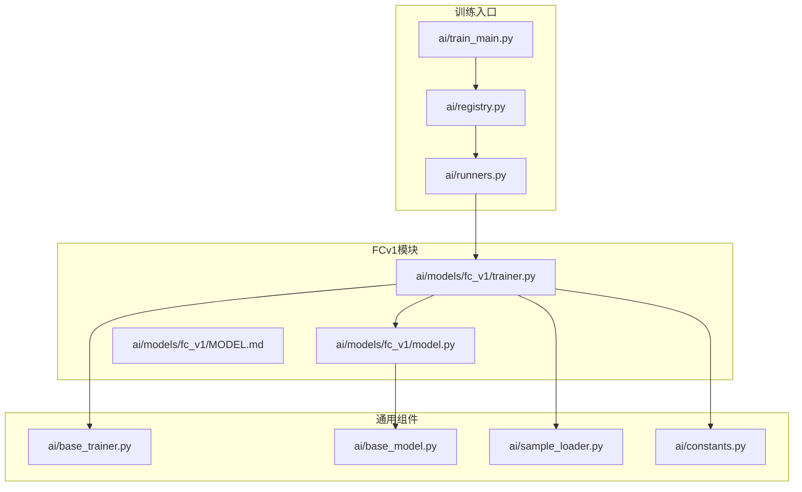
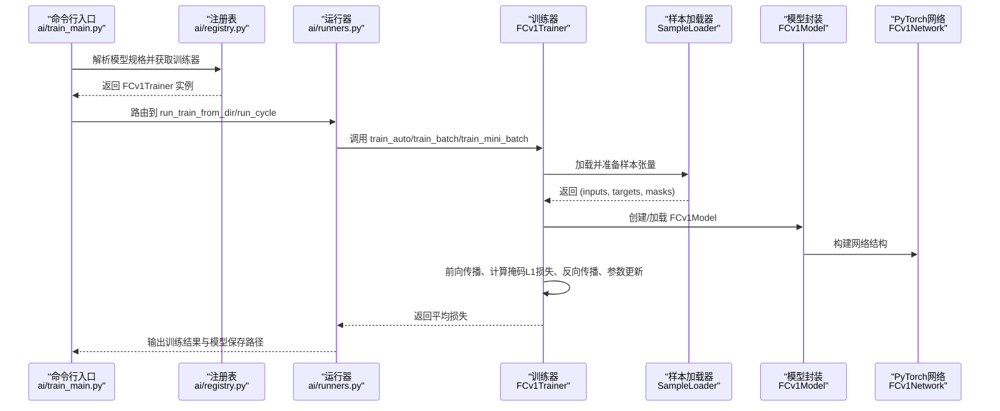
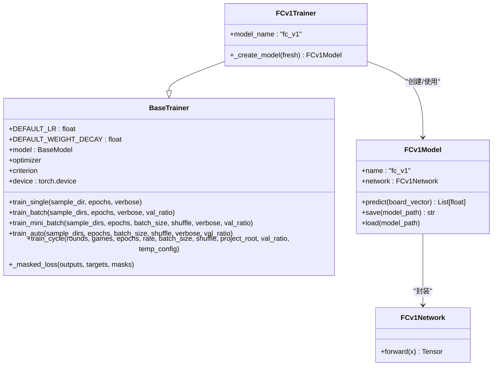
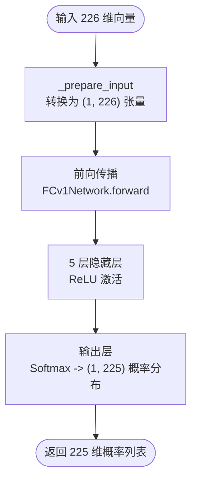
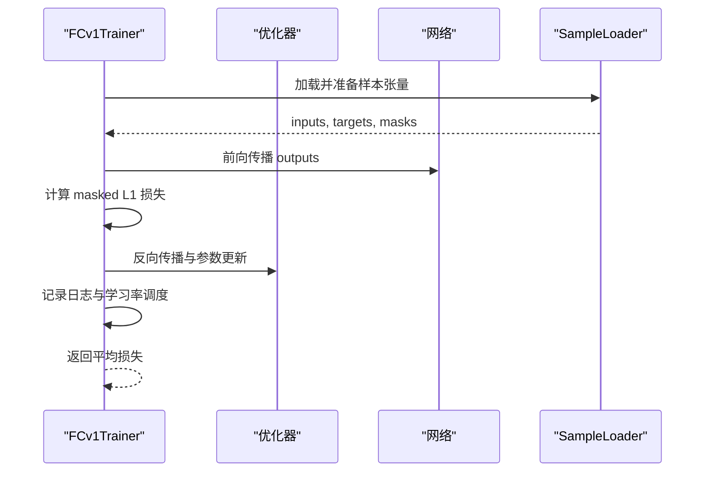
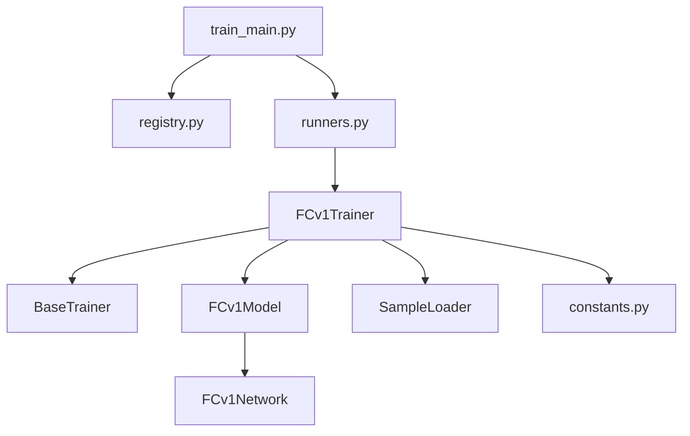

# FCv1训练器

<cite>
**本文档引用的文件**
- [ai/models/fc_v1/trainer.py](file://ai/models/fc_v1/trainer.py)
- [ai/models/fc_v1/model.py](file://ai/models/fc_v1/model.py)
- [ai/base_trainer.py](file://ai/base_trainer.py)
- [ai/base_model.py](file://ai/base_model.py)
- [ai/sample_loader.py](file://ai/sample_loader.py)
- [ai/constants.py](file://ai/constants.py)
- [ai/train_main.py](file://ai/train_main.py)
- [ai/registry.py](file://ai/registry.py)
- [ai/runners.py](file://ai/runners.py)
- [design/fc_v1_design.md](file://design/fc_v1_design.md)
- [tests/ai/test_fc_v1_trainer.py](file://tests/ai/test_fc_v1_trainer.py)
- [tests/ai/test_fc_v1_model.py](file://tests/ai/test_fc_v1_model.py)
</cite>

## 更新摘要
**所做更改**
- 更新了模型架构描述，反映从10层隐藏层到5层隐藏层的变更
- 修正了输出层从675维到225维的概率分布说明
- 更新了Softmax输出层对训练配置和损失计算的影响
- 修正了训练流程中关于mask扩展逻辑的描述
- 更新了输入输出数据格式转换的说明

## 目录
1. [简介](#简介)
2. [项目结构](#项目结构)
3. [核心组件](#核心组件)
4. [架构总览](#架构总览)
5. [详细组件分析](#详细组件分析)
6. [依赖关系分析](#依赖关系分析)
7. [性能考量](#性能考量)
8. [故障排查指南](#故障排查指南)
9. [结论](#结论)
10. [附录](#附录)

## 简介
本文件为 FCv1 全连接网络训练器的详细技术文档。FCv1 是五子棋 AI 系统中的首个深度学习模型，采用全连接神经网络架构，通过监督学习从 AI 对战样本中学习落子位置的概率分布。训练器基于统一的 BaseTrainer 抽象基类实现，支持单轮次训练、批量训练与训练周期模式，并内置 L1 损失函数与掩码机制，适配 226 维输入向量与 225 维输出概率分布。

## 项目结构
FCv1 训练器位于 ai/models/fc_v1 目录，核心文件包括：
- model.py：定义 FCv1Network（网络结构）与 FCv1Model（模型封装）
- trainer.py：实现 FCv1Trainer（训练器），继承自 BaseTrainer
- MODEL.md：模型说明文档
- sample_inspector.py、inspect_main.py：样本检查与可视化工具

训练器通过统一入口脚本与注册表进行调度：
- ai/train_main.py：命令行入口，解析参数并路由到具体训练模式
- ai/registry.py：模型与训练器注册表，支持多代模型扩展
- ai/runners.py：训练运行器，封装 run_train_from_dir 与 run_cycle 两种模式
- ai/sample_loader.py：样本加载与张量准备，负责将 sample.json 转换为 PyTorch 张量
- ai/constants.py：常量定义，如损失日志间隔等

**图表来源**
- [ai/train_main.py:1-234](file://ai/train_main.py#L1-L234)
- [ai/registry.py:1-316](file://ai/registry.py#L1-L316)
- [ai/runners.py:1-255](file://ai/runners.py#L1-L255)
- [ai/models/fc_v1/trainer.py:1-44](file://ai/models/fc_v1/trainer.py#L1-L44)
- [ai/models/fc_v1/model.py:1-132](file://ai/models/fc_v1/model.py#L1-L132)
- [ai/base_trainer.py:1-699](file://ai/base_trainer.py#L1-L699)
- [ai/base_model.py:1-323](file://ai/base_model.py#L1-L323)
- [ai/sample_loader.py:1-240](file://ai/sample_loader.py#L1-L240)
- [ai/constants.py:1-26](file://ai/constants.py#L1-L26)

**章节来源**
- [ai/models/fc_v1/trainer.py:1-44](file://ai/models/fc_v1/trainer.py#L1-L44)
- [ai/models/fc_v1/model.py:1-132](file://ai/models/fc_v1/model.py#L1-L132)
- [ai/base_trainer.py:1-699](file://ai/base_trainer.py#L1-L699)
- [ai/base_model.py:1-323](file://ai/base_model.py#L1-L323)
- [ai/sample_loader.py:1-240](file://ai/sample_loader.py#L1-L240)
- [ai/constants.py:1-26](file://ai/constants.py#L1-L26)
- [ai/train_main.py:1-234](file://ai/train_main.py#L1-L234)
- [ai/registry.py:1-316](file://ai/registry.py#L1-L316)
- [ai/runners.py:1-255](file://ai/runners.py#L1-L255)

## 核心组件
- FCv1Trainer：继承自 BaseTrainer，负责 FCv1 模型的创建、训练与周期管理。提供 train_single、train_batch、train_mini_batch、train_auto、train_cycle 等训练接口。
- FCv1Model：继承自 NeuralNetworkModel，封装 FCv1Network，提供 predict、save、load 等接口；默认自动加载已保存模型或创建新模型。
- FCv1Network：PyTorch 神经网络结构，包含 5 层隐藏层（每层 1000 个神经元，ReLU 激活），输入 226 维，输出 225 维概率分布（Softmax）。
- BaseTrainer：提供统一的训练流程、设备检测、优化器（AdamW）、损失函数（L1Loss）、学习率调度、日志记录与验证集评估。
- SampleLoader：负责从 sample.json 加载数据并转换为 PyTorch 张量，支持多目录合并、训练/验证集分割与输入转换。
- 常量与入口：constants.py 定义日志间隔；train_main.py 提供命令行入口；registry.py 与 runners.py 实现模型注册与运行模式路由。

**章节来源**
- [ai/models/fc_v1/trainer.py:11-44](file://ai/models/fc_v1/trainer.py#L11-L44)
- [ai/models/fc_v1/model.py:91-132](file://ai/models/fc_v1/model.py#L91-L132)
- [ai/base_trainer.py:32-699](file://ai/base_trainer.py#L32-L699)
- [ai/sample_loader.py:67-240](file://ai/sample_loader.py#L67-L240)
- [ai/constants.py:17-26](file://ai/constants.py#L17-L26)
- [ai/train_main.py:27-234](file://ai/train_main.py#L27-L234)
- [ai/registry.py:58-224](file://ai/registry.py#L58-L224)
- [ai/runners.py:81-255](file://ai/runners.py#L81-L255)

## 架构总览
FCv1 训练器的整体架构遵循"入口脚本 → 注册表 → 运行器 → 训练器 → 模型/样本加载"的分层设计。训练器在初始化时自动检测设备（优先 GPU），创建模型与优化器，设置损失函数与学习率调度器，并通过 SampleLoader 将样本数据转换为张量后进入训练循环。

**图表来源**
- [ai/train_main.py:27-234](file://ai/train_main.py#L27-L234)
- [ai/registry.py:187-224](file://ai/registry.py#L187-L224)
- [ai/runners.py:81-255](file://ai/runners.py#L81-L255)
- [ai/models/fc_v1/trainer.py:23-41](file://ai/models/fc_v1/trainer.py#L23-L41)
- [ai/sample_loader.py:206-240](file://ai/sample_loader.py#L206-L240)
- [ai/models/fc_v1/model.py:91-132](file://ai/models/fc_v1/model.py#L91-L132)

## 详细组件分析

### FCv1Trainer 训练器
- 角色与职责：继承 BaseTrainer，实现 FCv1 模型的创建与训练流程，支持单轮次、批量与 mini-batch 训练，以及训练周期模式。
- 模型创建：_create_model 返回 FCv1Model 实例，支持 fresh 参数强制创建新模型。
- 模型名称：model_name 属性返回 "fc_v1"，用于日志与数据记录命名。
- 训练方法：
  - train_single：单个 sample.json 目录训练，适合小规模快速验证。
  - train_batch：多目录样本合并后全量更新，每个 epoch 仅一次参数更新。
  - train_mini_batch：多目录样本合并后按批次训练，支持每 epoch 多次更新，收敛更快。
  - train_auto：根据是否提供 batch_size 自动选择 train_batch 或 train_mini_batch。
  - train_cycle：训练周期模式，内部通过自我对弈生成样本并合并训练。
- 损失函数：使用 L1Loss（MAE），结合掩码计算 masked L1 loss，支持验证集评估与学习率调度。

**图表来源**
- [ai/base_trainer.py:32-699](file://ai/base_trainer.py#L32-L699)
- [ai/models/fc_v1/trainer.py:11-44](file://ai/models/fc_v1/trainer.py#L11-L44)
- [ai/models/fc_v1/model.py:91-132](file://ai/models/fc_v1/model.py#L91-L132)

**章节来源**
- [ai/models/fc_v1/trainer.py:11-44](file://ai/models/fc_v1/trainer.py#L11-L44)
- [ai/base_trainer.py:324-699](file://ai/base_trainer.py#L324-L699)

### FCv1Model 与 FCv1Network
- FCv1Network：定义 5 层隐藏层（每层 1000 个神经元，ReLU 激活），输入 226 维，输出 225 维概率分布（Softmax）。前向传播依次通过各层，最终输出 softmax 概率。
- FCv1Model：继承 NeuralNetworkModel，提供 predict、save、load 等接口；默认自动加载已保存模型或创建新模型；_prepare_input 将 226 维向量转换为 (1, 226) 张量。
- 输入输出规范：
  - 输入向量：前 225 维为棋盘状态（按行展开，0=空，1=黑，2=白），第 226 维为当前落子方（1=黑，2=白）。
  - 输出向量：225 维概率分布，索引 i 对应棋盘位置 (i//15, i%15)，范围 (0,1)，每行和为 1。

**图表来源**
- [ai/models/fc_v1/model.py:119-132](file://ai/models/fc_v1/model.py#L119-L132)
- [ai/models/fc_v1/model.py:53-88](file://ai/models/fc_v1/model.py#L53-L88)

**章节来源**
- [ai/models/fc_v1/model.py:18-132](file://ai/models/fc_v1/model.py#L18-L132)

### BaseTrainer 通用训练逻辑
- 设备检测：优先使用 CUDA，否则使用 CPU。
- 优化器与损失：AdamW（解耦权重衰减），默认学习率 0.001，权重衰减 0.01；损失函数为 L1Loss（reduction='none'）。
- 训练循环：支持 verbose 输出，每 LOSS_LOG_INTERVAL 记录一次日志；支持 StepLR 与 ReduceLROnPlateau 两种学习率调度。
- 掩码损失：_masked_loss 对 outputs 与 targets 的 L1 损失按 masks 进行加权并取平均，mask_sum>0 时按有效位置求平均。
- 验证集评估：_evaluate_val_loss 在 eval 模式下前向传播并计算验证集损失，不更新参数。

**图表来源**
- [ai/base_trainer.py:240-322](file://ai/base_trainer.py#L240-L322)
- [ai/base_trainer.py:678-699](file://ai/base_trainer.py#L678-L699)
- [ai/sample_loader.py:206-240](file://ai/sample_loader.py#L206-L240)

**章节来源**
- [ai/base_trainer.py:21-144](file://ai/base_trainer.py#L21-L144)
- [ai/base_trainer.py:240-322](file://ai/base_trainer.py#L240-L322)
- [ai/base_trainer.py:678-699](file://ai/base_trainer.py#L678-L699)

### SampleLoader 样本加载与张量准备
- 加载与合并：支持单文件、多目录合并、递归发现 .json 文件；支持按比例分割训练/验证集。
- 张量准备：将 inputs 转换为 (N, 226) 浮点张量，targets 与 masks 转换为 (N, 225) 浮点张量，并移动到目标设备。
- 掩码语义：mask 与 targets 维度均为 225，当前版本 mask 全为 1，等价于对所有 225 个位置求平均。

**章节来源**
- [ai/sample_loader.py:67-240](file://ai/sample_loader.py#L67-L240)

### 训练流程与超参数配置
- 学习率与权重衰减：默认学习率 0.001，AdamW 权重衰减 0.01；可通过构造函数参数覆盖。
- 批次大小：train_mini_batch 支持设置 batch_size；train_auto 根据是否提供 batch_size 自动选择 mini-batch 或全量更新。
- 验证集：train_batch 与 train_mini_batch 支持 val_ratio 分割验证集，周期模式同样支持。
- 日志与可视化：LOSS_LOG_INTERVAL=200，每 200 个 epoch 记录一次日志；支持生成 loss 曲线图。
- 训练周期：train_cycle 内部通过自我对弈生成样本并合并训练，支持温度采样配置（仅周期模式）。

**章节来源**
- [ai/base_trainer.py:47-113](file://ai/base_trainer.py#L47-L113)
- [ai/constants.py:24-26](file://ai/constants.py#L24-L26)
- [ai/runners.py:173-255](file://ai/runners.py#L173-L255)

## 依赖关系分析
- FCv1Trainer 依赖 BaseTrainer 提供的通用训练流程与设备管理。
- FCv1Model 依赖 FCv1Network 作为神经网络实现，并继承自 NeuralNetworkModel。
- SampleLoader 为训练器提供样本数据的统一加载与张量转换。
- 注册表与运行器负责模型与训练器的动态加载与模式路由。

**图表来源**
- [ai/models/fc_v1/trainer.py:11-44](file://ai/models/fc_v1/trainer.py#L11-L44)
- [ai/base_trainer.py:32-699](file://ai/base_trainer.py#L32-L699)
- [ai/models/fc_v1/model.py:91-132](file://ai/models/fc_v1/model.py#L91-L132)
- [ai/sample_loader.py:67-240](file://ai/sample_loader.py#L67-L240)
- [ai/train_main.py:27-234](file://ai/train_main.py#L27-L234)
- [ai/registry.py:58-224](file://ai/registry.py#L58-L224)
- [ai/runners.py:81-255](file://ai/runners.py#L81-L255)

**章节来源**
- [ai/models/fc_v1/trainer.py:11-44](file://ai/models/fc_v1/trainer.py#L11-L44)
- [ai/base_trainer.py:32-699](file://ai/base_trainer.py#L32-L699)
- [ai/models/fc_v1/model.py:91-132](file://ai/models/fc_v1/model.py#L91-L132)
- [ai/sample_loader.py:67-240](file://ai/sample_loader.py#L67-L240)
- [ai/train_main.py:27-234](file://ai/train_main.py#L27-L234)
- [ai/registry.py:58-224](file://ai/registry.py#L58-L224)
- [ai/runners.py:81-255](file://ai/runners.py#L81-L255)

## 性能考量
- 收敛速度：FCv1 使用 L1 损失与 AdamW 优化器，配合 5 层隐藏层与 1000 个神经元的结构，通常能在合理轮次内收敛。建议结合学习率调度（StepLR/Plateau）进一步提升稳定性。
- 内存占用：模型包含约 946 万参数，单卡训练时需关注显存占用；mini-batch 训练可显著降低内存峰值，提高吞吐。
- 训练效率：mini-batch 训练相比全量更新具有更高的训练效率与更快的收敛速度；验证集评估与日志记录在训练过程中按间隔进行，避免频繁 I/O。
- 设备加速：自动检测并使用 GPU，若无可用 GPU 则回退至 CPU。

## 故障排查指南
- 样本文件缺失：train_single 抛出 FileNotFoundError，提示 sample.json 不存在；确认 sample_dir 路径正确。
- 空目录或无效 JSON：SampleLoader.load 抛出 FileNotFoundError 或 JSONDecodeError；检查 sample.json 格式与路径。
- 训练中断：BaseTrainer 在捕获 KeyboardInterrupt 后自动保存模型与图表，可安全退出并继续训练。
- 验证集比例非法：SampleLoader.load_and_split 校验 val_ratio 范围；确保 0 ≤ val_ratio < 1。
- 模型加载失败：FCv1Model 在未找到默认权重文件时创建新模型；若指定自定义路径不存在，将创建新模型。

**章节来源**
- [ai/base_trainer.py:314-322](file://ai/base_trainer.py#L314-L322)
- [ai/sample_loader.py:80-165](file://ai/sample_loader.py#L80-L165)
- [tests/ai/test_fc_v1_trainer.py:466-497](file://tests/ai/test_fc_v1_trainer.py#L466-L497)

## 结论
FCv1 训练器通过统一的训练框架与清晰的模块划分，实现了从样本加载到模型训练的完整闭环。其 226 维输入与 225 维输出的设计契合五子棋落子空间，L1 损失与 Softmax 输出便于监督学习与概率解释。配合 mini-batch 训练、学习率调度与验证集评估，能够在有限资源下实现稳定高效的训练。建议在实际使用中结合数据规模与硬件条件选择合适的训练方法与超参数。

## 附录

### 使用示例与最佳实践
- 单轮次训练：使用 train_single 指定包含 sample.json 的目录，适合快速验证与小规模实验。
- 批量训练：使用 train_batch 合并多个目录的样本，每个 epoch 仅一次参数更新，适合稳定训练。
- Mini-batch 训练：使用 train_mini_batch 设置 batch_size，提高训练效率与收敛速度。
- 训练周期：使用 train_cycle 进行自我对弈与迭代训练，适合模型持续改进。
- 超参数建议：学习率 0.001、权重衰减 0.01、批次大小 32~256（依显存而定）、验证集比例 0.1~0.2。

**章节来源**
- [ai/models/fc_v1/trainer.py:23-41](file://ai/models/fc_v1/trainer.py#L23-L41)
- [ai/base_trainer.py:47-113](file://ai/base_trainer.py#L47-L113)
- [ai/runners.py:173-255](file://ai/runners.py#L173-L255)

### 设计与实现参考
- FCv1 设计文档：涵盖网络结构、输入输出、损失函数与训练流程的详细设计。
- 测试用例：覆盖训练器初始化、训练流程、张量准备与错误处理等关键场景。

**章节来源**
- [design/fc_v1_design.md:1-712](file://design/fc_v1_design.md#L1-L712)
- [tests/ai/test_fc_v1_trainer.py:118-501](file://tests/ai/test_fc_v1_trainer.py#L118-L501)
- [tests/ai/test_fc_v1_model.py:20-372](file://tests/ai/test_fc_v1_model.py#L20-L372)