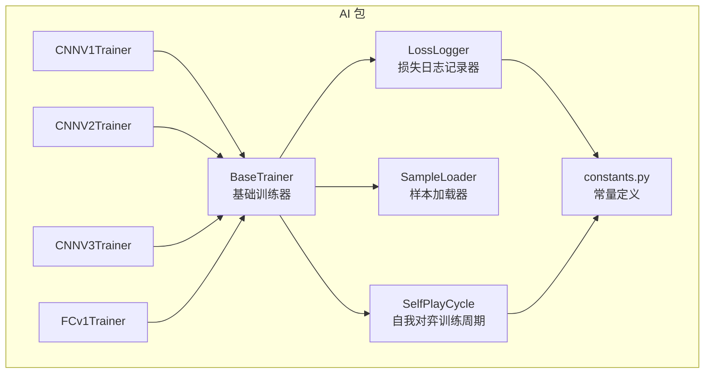
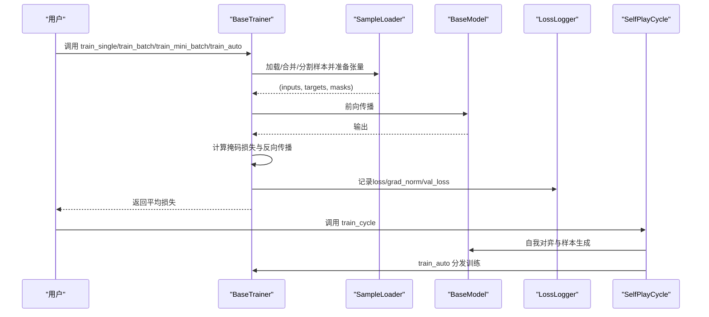
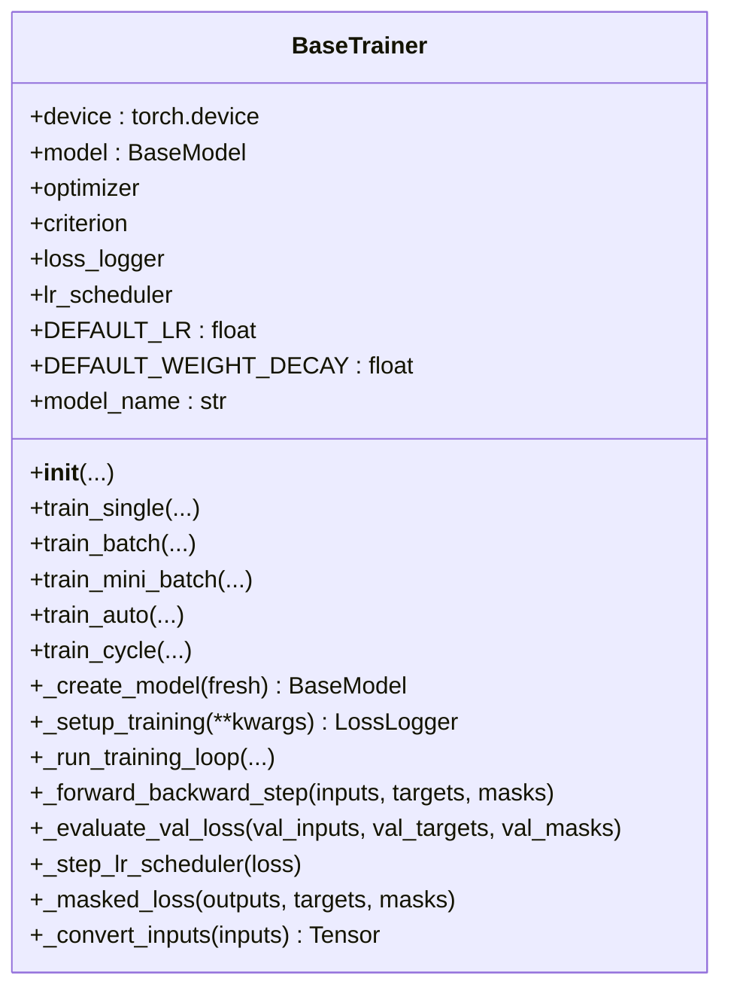
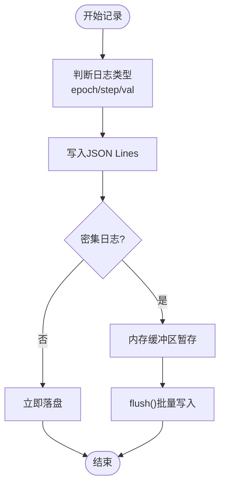
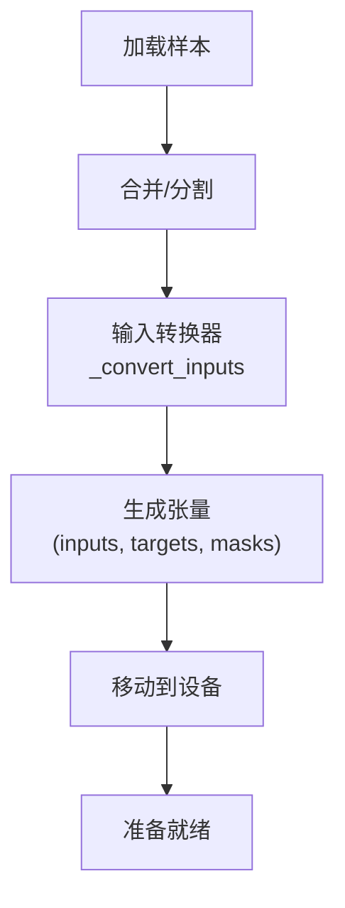
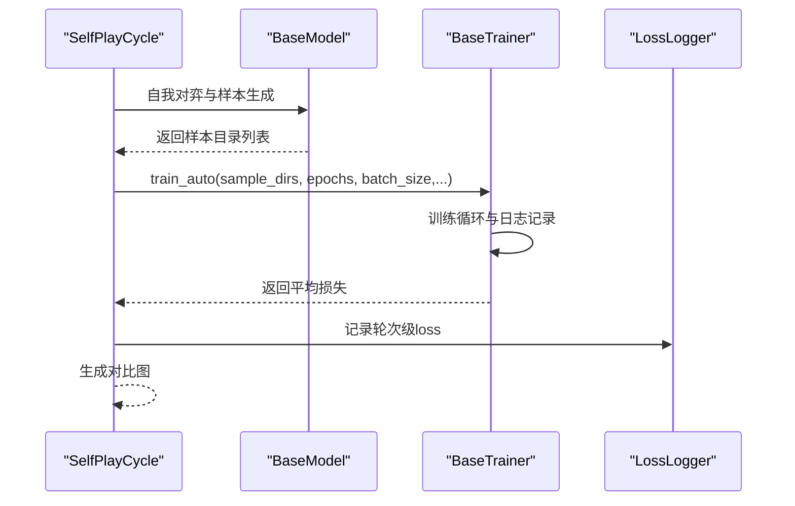
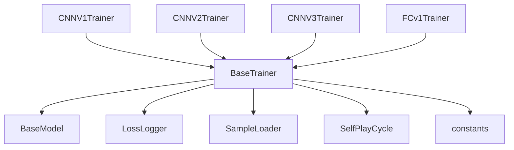

# 基础训练器

<cite>
**本文引用的文件**
- [base_trainer.py](file://ai/base_trainer.py)
- [loss_logger.py](file://ai/loss_logger.py)
- [sample_loader.py](file://ai/sample_loader.py)
- [self_play_cycle.py](file://ai/self_play_cycle.py)
- [constants.py](file://ai/constants.py)
- [cnn_v1/trainer.py](file://ai/models/cnn_v1/trainer.py)
- [cnn_v2/trainer.py](file://ai/models/cnn_v2/trainer.py)
- [cnn_v3/trainer.py](file://ai/models/cnn_v3/trainer.py)
- [fc_v1/trainer.py](file://ai/models/fc_v1/trainer.py)
- [test_base_trainer.py](file://tests/ai/test_base_trainer.py)
- [test_base_trainer_train_auto.py](file://tests/ai/test_base_trainer_train_auto.py)
- [lr_scheduler_design.md](file://design/learn_rate/lr_scheduler_design.md)
</cite>

## 目录
1. [简介](#简介)
2. [项目结构](#项目结构)
3. [核心组件](#核心组件)
4. [架构总览](#架构总览)
5. [详细组件分析](#详细组件分析)
6. [依赖关系分析](#依赖关系分析)
7. [性能考量](#性能考量)
8. [故障排查指南](#故障排查指南)
9. [结论](#结论)
10. [附录](#附录)

## 简介
本文件面向“基础训练器”BaseTrainer抽象基类，提供系统化、可操作的技术文档。内容涵盖：
- BaseTrainer的设计理念与核心架构
- 训练器生命周期管理、设备检测与GPU加速机制
- 通用训练流程：单轮训练(train_single)、批量训练(train_batch)、小批量训练(train_mini_batch)与自动训练(train_auto)
- 损失函数计算机制(_masked_loss)、梯度更新流程(_forward_backward_step)与学习率调度系统
- 训练监控：LossLogger使用、验证集评估、训练进度跟踪与中断处理
- 训练器扩展指南：如何继承BaseTrainer实现自定义训练逻辑

## 项目结构
基础训练器位于ai包下，配合LossLogger、SampleLoader、SelfPlayCycle等模块协同工作，形成从数据加载、训练循环、日志记录到自我对弈训练周期的完整闭环。

**图表来源**
- [base_trainer.py:32-699](file://ai/base_trainer.py#L32-L699)
- [loss_logger.py:28-461](file://ai/loss_logger.py#L28-L461)
- [sample_loader.py:67-240](file://ai/sample_loader.py#L67-L240)
- [self_play_cycle.py:20-195](file://ai/self_play_cycle.py#L20-L195)
- [constants.py:1-26](file://ai/constants.py#L1-L26)
- [cnn_v1/trainer.py:13-72](file://ai/models/cnn_v1/trainer.py#L13-L72)
- [cnn_v2/trainer.py:13-72](file://ai/models/cnn_v2/trainer.py#L13-L72)
- [cnn_v3/trainer.py:13-73](file://ai/models/cnn_v3/trainer.py#L13-L73)
- [fc_v1/trainer.py:11-44](file://ai/models/fc_v1/trainer.py#L11-L44)

**章节来源**
- [base_trainer.py:1-699](file://ai/base_trainer.py#L1-L699)
- [constants.py:1-26](file://ai/constants.py#L1-L26)

## 核心组件
- BaseTrainer：抽象基类，定义训练器必须实现的接口与通用训练逻辑，支持GPU加速、多种训练模式与学习率调度。
- LossLogger：训练损失日志记录与可视化，支持JSON Lines存储、图表生成与多轮对比图。
- SampleLoader：样本数据加载与张量准备，支持多目录合并、训练/验证集分割与输入格式转换。
- SelfPlayCycle：自我对弈训练周期编排，连接对弈生成与训练器训练，支持会话隔离与对比图生成。
- 模型训练器：继承BaseTrainer的具体实现，如CNNV1/CNNV2/CNNV3/FCv1等，覆盖模型创建与输入转换。

**章节来源**
- [base_trainer.py:32-699](file://ai/base_trainer.py#L32-L699)
- [loss_logger.py:28-461](file://ai/loss_logger.py#L28-L461)
- [sample_loader.py:67-240](file://ai/sample_loader.py#L67-L240)
- [self_play_cycle.py:20-195](file://ai/self_play_cycle.py#L20-L195)

## 架构总览
BaseTrainer将训练流程抽象为统一接口，具体模型训练器只需实现模型创建与输入转换即可复用通用训练逻辑。训练数据通过SampleLoader加载并转换为张量，LossLogger负责日志与可视化，SelfPlayCycle将对弈与训练串联起来。

**图表来源**
- [base_trainer.py:324-603](file://ai/base_trainer.py#L324-L603)
- [sample_loader.py:80-240](file://ai/sample_loader.py#L80-L240)
- [loss_logger.py:124-177](file://ai/loss_logger.py#L124-L177)
- [self_play_cycle.py:38-156](file://ai/self_play_cycle.py#L38-L156)

## 详细组件分析

### BaseTrainer抽象基类
- 设计理念
  - 抽象出训练器的通用职责：设备检测与迁移、优化器与损失函数初始化、训练循环与日志记录、学习率调度、训练周期编排。
  - 通过抽象方法约束子类实现：_create_model与model_name，确保子类提供具体模型实例与名称。
- 生命周期管理
  - 初始化：自动检测设备(GPU/CPU)、创建模型、将模型迁移到设备、初始化优化器(AdamW)、设置损失函数(L1Loss)、构建LossLogger、配置学习率调度器。
  - 训练阶段：_setup_training进入训练模式；_run_training_loop统一处理epoch循环、日志记录、验证集评估、学习率衰减与中断处理；_finalize_training生成图表、保存模型并返回平均损失。
  - 训练周期：train_cycle委托SelfPlayCycle执行多轮自我对弈与训练。
- 设备检测与GPU加速
  - get_device优先使用CUDA，否则回退CPU；模型网络部分被迁移到选定设备；SampleLoader将张量移动到相同设备。
- 训练模式
  - train_single：单个样本目录，适合快速验证。
  - train_batch：合并多个样本目录为一个大数据集，每个epoch仅一次参数更新，语义清晰。
  - train_mini_batch：按batch_size分批训练，适合大规模数据与更快收敛。
  - train_auto：根据batch_size自动选择train_batch或train_mini_batch。
- 损失函数与梯度更新
  - _masked_loss：使用L1Loss(reduction='none')，对mask=1的位置求平均，避免无效位置干扰。
  - _forward_backward_step：前向+反向+优化器步进，返回loss张量与梯度范数。
- 学习率调度
  - 支持StepLR与ReduceLROnPlateau两种策略，通过_step_lr_scheduler统一步进。
- 训练监控
  - LossLogger：支持稀疏日志(按epoch)与密集日志(按step)，记录loss、grad_norm与val_loss，支持生成曲线图与对比图。
  - 验证集评估：_evaluate_val_loss在eval模式下计算val_loss，不参与梯度更新。
  - 中断处理：捕获KeyboardInterrupt，保存模型与图表后重新抛出异常。

**图表来源**
- [base_trainer.py:32-699](file://ai/base_trainer.py#L32-L699)

**章节来源**
- [base_trainer.py:21-120](file://ai/base_trainer.py#L21-L120)
- [base_trainer.py:181-213](file://ai/base_trainer.py#L181-L213)
- [base_trainer.py:214-238](file://ai/base_trainer.py#L214-L238)
- [base_trainer.py:240-255](file://ai/base_trainer.py#L240-L255)
- [base_trainer.py:257-322](file://ai/base_trainer.py#L257-L322)
- [base_trainer.py:324-603](file://ai/base_trainer.py#L324-L603)
- [base_trainer.py:678-699](file://ai/base_trainer.py#L678-L699)

### LossLogger日志记录器
- 功能要点
  - JSON Lines持久化：支持epoch级与step级日志，val_loss独立记录。
  - 可视化：生成loss曲线图，双Y轴支持同时显示loss与梯度范数；可叠加验证集曲线；支持降采样避免图表过密。
  - 会话隔离：支持session_dir子目录，便于多轮训练对比；提供对比图生成。
  - 依赖注入：可传入外部logger或禁用，便于测试与定制。
- 关键API
  - log/val/log_dense/flush/plot/get_log_path/clear/_downsample等。
- 与训练器集成
  - BaseTrainer在训练前后调用LossLogger记录与生成图表；SelfPlayCycle在轮次级与epoch级分别记录。

**图表来源**
- [loss_logger.py:124-177](file://ai/loss_logger.py#L124-L177)
- [loss_logger.py:178-294](file://ai/loss_logger.py#L178-L294)
- [loss_logger.py:365-461](file://ai/loss_logger.py#L365-L461)

**章节来源**
- [loss_logger.py:28-461](file://ai/loss_logger.py#L28-L461)

### SampleLoader样本加载器
- 功能要点
  - 加载单个/多个/递归发现的sample.json，支持训练/验证集分割。
  - 将样本数据转换为PyTorch张量，调用输入转换器(_convert_inputs)适配不同模型输入格式。
  - 支持mask=1位置的平均绝对误差计算，便于单元测试。
- 关键API
  - load/load_multiple/load_and_split/discover_and_load/prepare_tensors等。
- 与训练器集成
  - BaseTrainer在训练前调用SampleLoader加载并准备张量；不同训练模式共享同一数据管线。

**图表来源**
- [sample_loader.py:80-240](file://ai/sample_loader.py#L80-L240)

**章节来源**
- [sample_loader.py:67-240](file://ai/sample_loader.py#L67-L240)

### SelfPlayCycle训练周期
- 功能要点
  - 自我对弈与样本生成：委托run_self_play_and_evaluate生成样本目录。
  - 训练编排：每轮结束后调用trainer.train_auto进行训练，支持mini-batch与全量更新。
  - 会话管理：生成唯一session_dir，记录轮次级与epoch级日志，最终生成对比图。
- 关键API
  - run(rounds, games, epochs, rate, batch_size, shuffle, project_root, val_ratio, temp_config)。

**图表来源**
- [self_play_cycle.py:38-156](file://ai/self_play_cycle.py#L38-L156)

**章节来源**
- [self_play_cycle.py:20-195](file://ai/self_play_cycle.py#L20-L195)

### 具体模型训练器
- CNNV1/CNNV2/CNNV3/FCv1训练器均继承BaseTrainer，覆盖：
  - _create_model：创建对应模型实例。
  - model_name：返回模型名称。
  - _convert_inputs：针对CNN模型将输入转换为(N, 3, 15, 15)的4D张量。
- 作用
  - 将BaseTrainer的通用训练逻辑与具体模型实现解耦，便于扩展新的模型类型。

**章节来源**
- [cnn_v1/trainer.py:13-72](file://ai/models/cnn_v1/trainer.py#L13-L72)
- [cnn_v2/trainer.py:13-72](file://ai/models/cnn_v2/trainer.py#L13-L72)
- [cnn_v3/trainer.py:13-73](file://ai/models/cnn_v3/trainer.py#L13-L73)
- [fc_v1/trainer.py:11-44](file://ai/models/fc_v1/trainer.py#L11-L44)

## 依赖关系分析
- BaseTrainer依赖
  - BaseModel：模型抽象，提供network与full_name等能力。
  - constants：AI_DATA_DIR/TRAIN_DATA_DIR/LOSS_LOG_DIR/LOSS_LOG_INTERVAL等常量。
  - LossLogger：日志记录与可视化。
  - SampleLoader：样本加载与张量准备。
  - SelfPlayCycle：训练周期编排。
- 模型训练器依赖
  - 各自模型实现：CNNV1/CNNV2/CNNV3/FCv1。
  - BaseTrainer：复用通用训练逻辑。

**图表来源**
- [base_trainer.py:14-18](file://ai/base_trainer.py#L14-L18)
- [constants.py:11-26](file://ai/constants.py#L11-L26)
- [cnn_v1/trainer.py:8-10](file://ai/models/cnn_v1/trainer.py#L8-L10)
- [cnn_v2/trainer.py:8-10](file://ai/models/cnn_v2/trainer.py#L8-L10)
- [cnn_v3/trainer.py:8-10](file://ai/models/cnn_v3/trainer.py#L8-L10)
- [fc_v1/trainer.py:7-8](file://ai/models/fc_v1/trainer.py#L7-L8)

**章节来源**
- [base_trainer.py:14-18](file://ai/base_trainer.py#L14-L18)
- [constants.py:11-26](file://ai/constants.py#L11-L26)

## 性能考量
- GPU加速
  - 自动检测CUDA并迁移模型与张量，显著提升训练速度。
- 批量训练与小批量训练
  - train_batch：每个epoch仅一次参数更新，语义清晰，适合中小规模数据。
  - train_mini_batch：按batch_size分批，收敛更快，适合大规模数据。
- 日志与可视化
  - LossLogger支持密集日志与降采样，平衡可视化质量与性能。
- 学习率调度
  - StepLR与ReduceLROnPlateau可减少后期震荡，提升稳定性。

[本节为一般性指导，无需特定文件分析]

## 故障排查指南
- 设备相关
  - 无可用GPU：自动回退CPU，确认torch.cuda.is_available()与设备迁移。
  - 显存不足：尝试减小batch_size或使用train_batch。
- 训练中断
  - Ctrl+C：BaseTrainer与SelfPlayCycle均捕获KeyboardInterrupt，保存模型与图表后重新抛出。
- 日志与可视化
  - matplotlib不可用：LossLogger优雅降级，仅记录日志文件。
  - 日志文件为空：检查LossLogger初始化参数与写入权限。
- 数据加载
  - sample.json缺失：SampleLoader会抛出FileNotFoundError，确认路径与文件存在。
  - 验证集比例非法：load_and_split会校验val_ratio范围。
- 学习率调度
  - scheduler未生效：确认lr_scheduler_type参数与训练循环中_step_lr_scheduler调用。

**章节来源**
- [base_trainer.py:115-120](file://ai/base_trainer.py#L115-L120)
- [base_trainer.py:314-322](file://ai/base_trainer.py#L314-L322)
- [self_play_cycle.py:157-194](file://ai/self_play_cycle.py#L157-L194)
- [loss_logger.py:196-202](file://ai/loss_logger.py#L196-L202)
- [sample_loader.py:116-165](file://ai/sample_loader.py#L116-L165)
- [lr_scheduler_design.md:1-184](file://design/learn_rate/lr_scheduler_design.md#L1-L184)

## 结论
BaseTrainer通过抽象与模块化设计，将训练器的核心职责标准化，使得不同模型类型可以快速接入统一的训练流程与监控体系。结合LossLogger、SampleLoader与SelfPlayCycle，形成了从数据到模型再到可视化的完整闭环。学习率调度与中断处理进一步提升了训练的稳定性与可观测性。

[本节为总结性内容，无需特定文件分析]

## 附录

### 训练器扩展指南
- 继承BaseTrainer并实现以下内容：
  - _create_model(fresh)：创建并返回具体模型实例。
  - model_name：返回模型名称字符串。
  - _convert_inputs(inputs)：将输入数据转换为模型所需的张量格式（默认为(N, 226)的2D张量，CNN模型需返回(N, 3, 15, 15)的4D张量）。
- 可选增强：
  - 自定义默认学习率与权重衰减：覆盖DEFAULT_LR与DEFAULT_WEIGHT_DECAY。
  - 自定义损失函数：替换criterion（注意与_masked_loss配合）。
  - 自定义学习率调度：通过构造参数lr_scheduler_type等控制。
- 测试建议：
  - 使用Mock LossLogger验证日志记录契约。
  - 使用小样本数据验证训练流程与梯度更新。
  - 验证中断处理与模型保存逻辑。

**章节来源**
- [base_trainer.py:145-170](file://ai/base_trainer.py#L145-L170)
- [base_trainer.py:662-676](file://ai/base_trainer.py#L662-L676)
- [cnn_v1/trainer.py:45-72](file://ai/models/cnn_v1/trainer.py#L45-L72)
- [cnn_v2/trainer.py:45-72](file://ai/models/cnn_v2/trainer.py#L45-L72)
- [cnn_v3/trainer.py:46-73](file://ai/models/cnn_v3/trainer.py#L46-L73)
- [fc_v1/trainer.py:23-41](file://ai/models/fc_v1/trainer.py#L23-L41)

### 训练模式对比与适用场景
- train_single：单样本目录，适合快速验证与调试。
- train_batch：全量更新，语义明确，适合中小规模数据。
- train_mini_batch：分批训练，收敛更快，适合大规模数据。
- train_auto：根据batch_size自动选择，兼顾灵活性与易用性。

**章节来源**
- [base_trainer.py:324-603](file://ai/base_trainer.py#L324-L603)

### 学习率调度系统
- StepLR：按固定间隔衰减，适合稳定训练。
- ReduceLROnPlateau：在损失不再下降时自动衰减，适合复杂损失面。
- 统一接口：_step_lr_scheduler根据调度器类型自动调用。

**章节来源**
- [base_trainer.py:127-144](file://ai/base_trainer.py#L127-L144)
- [base_trainer.py:605-619](file://ai/base_trainer.py#L605-L619)
- [lr_scheduler_design.md:1-184](file://design/learn_rate/lr_scheduler_design.md#L1-L184)

### 测试参考
- BaseTrainer抽象基类测试：验证抽象方法约束与默认行为。
- train_auto分发测试：验证参数透传与分发逻辑。
- 集成测试：端到端执行真实训练流程。

**章节来源**
- [test_base_trainer.py:1-200](file://tests/ai/test_base_trainer.py#L1-L200)
- [test_base_trainer_train_auto.py:1-200](file://tests/ai/test_base_trainer_train_auto.py#L1-L200)