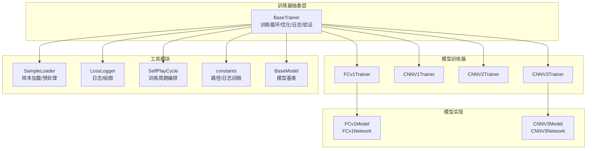
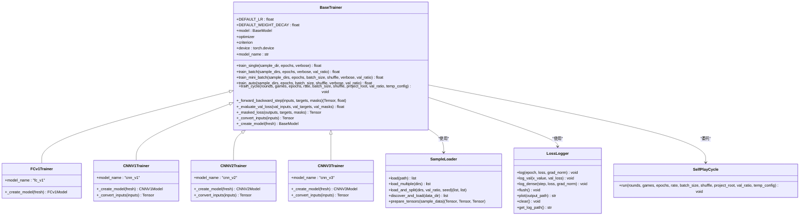
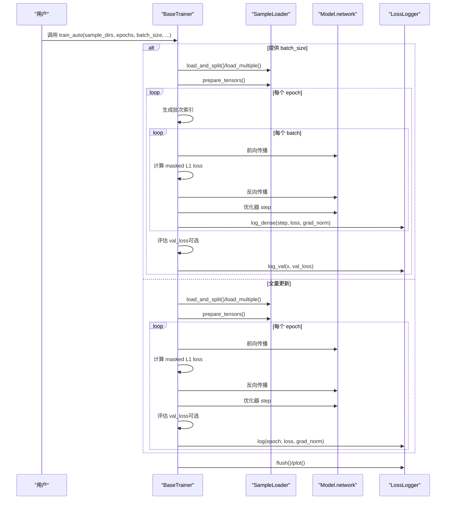
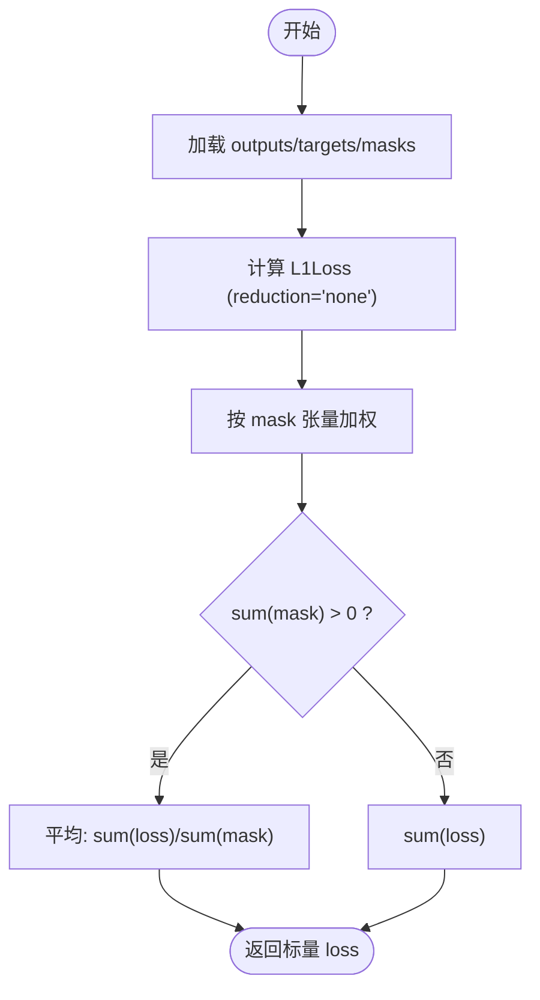
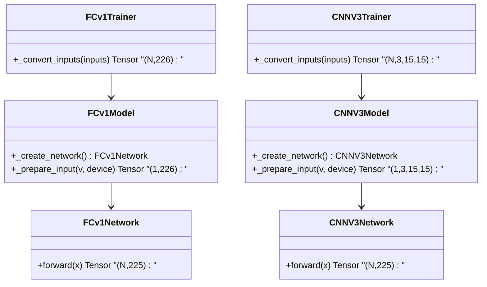
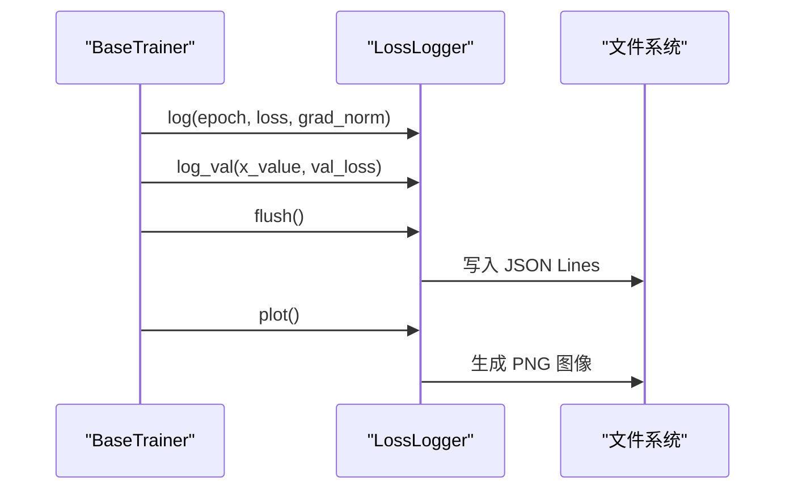
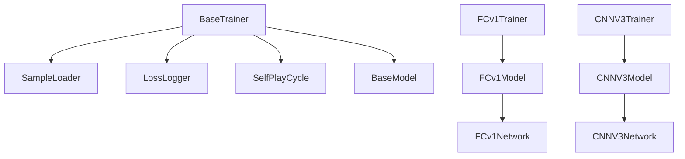

# 模型训练器

<cite>
**本文引用的文件**
- [ai/base_trainer.py](file://ai/base_trainer.py)
- [ai/models/fc_v1/trainer.py](file://ai/models/fc_v1/trainer.py)
- [ai/models/cnn_v1/trainer.py](file://ai/models/cnn_v1/trainer.py)
- [ai/models/cnn_v2/trainer.py](file://ai/models/cnn_v2/trainer.py)
- [ai/models/cnn_v3/trainer.py](file://ai/models/cnn_v3/trainer.py)
- [ai/models/fc_v1/model.py](file://ai/models/fc_v1/model.py)
- [ai/models/cnn_v3/model.py](file://ai/models/cnn_v3/model.py)
- [ai/loss_logger.py](file://ai/loss_logger.py)
- [ai/sample_loader.py](file://ai/sample_loader.py)
- [ai/self_play_cycle.py](file://ai/self_play_cycle.py)
- [ai/constants.py](file://ai/constants.py)
- [ai/base_model.py](file://ai/base_model.py)
- [design/base_trainer_design.md](file://design/base_trainer_design.md)
- [design/cnn_v3_design.md](file://design/cnn_v3_design.md)
- [design/fc_v1_design.md](file://design/fc_v1_design.md)
</cite>

## 目录
1. [简介](#简介)
2. [项目结构](#项目结构)
3. [核心组件](#核心组件)
4. [架构总览](#架构总览)
5. [详细组件分析](#详细组件分析)
6. [依赖分析](#依赖分析)
7. [性能考虑](#性能考虑)
8. [故障排查指南](#故障排查指南)
9. [结论](#结论)
10. [附录](#附录)

## 简介
本文件面向“模型训练器系统”的技术文档，聚焦于训练器的核心架构与实现细节，涵盖训练循环控制、损失函数计算、梯度更新机制；对比不同模型类型的训练器差异（FCv1 全连接网络训练、CNNV3 卷积网络训练特点）；说明训练参数配置方法（学习率、批次大小、优化器选择等）；介绍训练监控与日志记录（损失曲线绘制、验证集评估、训练进度跟踪）；并提供训练器扩展接口与新增训练算法/优化策略的接入方式。

## 项目结构
训练器系统围绕“抽象基类 + 多模型训练器 + 通用工具模块”组织，形成清晰的分层与职责分离：
- 抽象基类：统一训练流程、优化器与损失函数、日志与验证、训练周期编排
- 模型侧训练器：针对 FCv1/CNNV1/CNNV2/CNNV3 的具体实现，覆盖模型创建与输入转换
- 工具模块：样本加载与预处理、损失日志记录、自我对弈训练周期
- 常量与基类：设备选择、日志目录、模型基类与网络封装

**图表来源**
- [ai/base_trainer.py](file://ai/base_trainer.py)
- [ai/models/fc_v1/trainer.py](file://ai/models/fc_v1/trainer.py)
- [ai/models/cnn_v1/trainer.py](file://ai/models/cnn_v1/trainer.py)
- [ai/models/cnn_v2/trainer.py](file://ai/models/cnn_v2/trainer.py)
- [ai/models/cnn_v3/trainer.py](file://ai/models/cnn_v3/trainer.py)
- [ai/models/fc_v1/model.py](file://ai/models/fc_v1/model.py)
- [ai/models/cnn_v3/model.py](file://ai/models/cnn_v3/model.py)
- [ai/sample_loader.py](file://ai/sample_loader.py)
- [ai/loss_logger.py](file://ai/loss_logger.py)
- [ai/self_play_cycle.py](file://ai/self_play_cycle.py)
- [ai/constants.py](file://ai/constants.py)
- [ai/base_model.py](file://ai/base_model.py)

**章节来源**
- [ai/base_trainer.py](file://ai/base_trainer.py)
- [ai/models/fc_v1/trainer.py](file://ai/models/fc_v1/trainer.py)
- [ai/models/cnn_v1/trainer.py](file://ai/models/cnn_v1/trainer.py)
- [ai/models/cnn_v2/trainer.py](file://ai/models/cnn_v2/trainer.py)
- [ai/models/cnn_v3/trainer.py](file://ai/models/cnn_v3/trainer.py)
- [ai/models/fc_v1/model.py](file://ai/models/fc_v1/model.py)
- [ai/models/cnn_v3/model.py](file://ai/models/cnn_v3/model.py)
- [ai/sample_loader.py](file://ai/sample_loader.py)
- [ai/loss_logger.py](file://ai/loss_logger.py)
- [ai/self_play_cycle.py](file://ai/self_play_cycle.py)
- [ai/constants.py](file://ai/constants.py)
- [ai/base_model.py](file://ai/base_model.py)

## 核心组件
- 抽象基类 BaseTrainer：提供统一的训练流程（单轮次、批量、mini-batch）、优化器初始化（AdamW）、损失函数（L1Loss + mask）、学习率调度、验证集评估、训练周期编排、日志记录与模型保存。
- 模型训练器：FCv1Trainer、CNNV1Trainer、CNNV2Trainer、CNNV3Trainer，分别负责创建对应模型实例与输入格式转换。
- 工具模块：
  - SampleLoader：从 sample.json 加载与合并数据，准备 PyTorch 张量，支持训练/验证集划分。
  - LossLogger：JSON Lines 日志记录与损失曲线绘制，支持轮次级与 epoch 级日志、对比图生成。
  - SelfPlayCycle：自我对弈 + 评价 + 训练的训练周期编排。
- 常量与基类：设备选择、日志目录、模型基类与神经网络封装。

**章节来源**
- [ai/base_trainer.py](file://ai/base_trainer.py)
- [ai/models/fc_v1/trainer.py](file://ai/models/fc_v1/trainer.py)
- [ai/models/cnn_v1/trainer.py](file://ai/models/cnn_v1/trainer.py)
- [ai/models/cnn_v2/trainer.py](file://ai/models/cnn_v2/trainer.py)
- [ai/models/cnn_v3/trainer.py](file://ai/models/cnn_v3/trainer.py)
- [ai/sample_loader.py](file://ai/sample_loader.py)
- [ai/loss_logger.py](file://ai/loss_logger.py)
- [ai/self_play_cycle.py](file://ai/self_play_cycle.py)
- [ai/constants.py](file://ai/constants.py)
- [ai/base_model.py](file://ai/base_model.py)

## 架构总览
训练器系统采用“抽象基类 + 多实现 + 工具模块”的分层架构，确保：
- 训练流程一致性：统一的训练循环、损失计算、梯度更新、学习率调度与日志记录。
- 模型适配性：通过输入转换与模型创建接口，适配 FC 与 CNN 不同输入格式。
- 可扩展性：新增模型仅需实现模型创建与输入转换，继承 BaseTrainer 即可获得完整训练能力。

**图表来源**
- [ai/base_trainer.py](file://ai/base_trainer.py)
- [ai/models/fc_v1/trainer.py](file://ai/models/fc_v1/trainer.py)
- [ai/models/cnn_v1/trainer.py](file://ai/models/cnn_v1/trainer.py)
- [ai/models/cnn_v2/trainer.py](file://ai/models/cnn_v2/trainer.py)
- [ai/models/cnn_v3/trainer.py](file://ai/models/cnn_v3/trainer.py)
- [ai/sample_loader.py](file://ai/sample_loader.py)
- [ai/loss_logger.py](file://ai/loss_logger.py)
- [ai/self_play_cycle.py](file://ai/self_play_cycle.py)

## 详细组件分析

### 训练循环控制与梯度更新机制
- 单轮次训练（train_single）：加载单个 sample.json，准备张量，执行固定轮次的前向+反向+参数更新，记录日志与验证集损失。
- 批量训练（train_batch）：合并多个样本，每个 epoch 仅做一次参数更新，支持验证集划分与评估。
- Mini-Batch 训练（train_mini_batch）：每个 epoch 内按批次多次前向+反向+更新，支持密集日志与每 epoch 评估验证集。
- 自动选择训练方法（train_auto）：根据是否提供 batch_size 自动分流到 batch 或 mini-batch。
- 训练周期（train_cycle）：委托 SelfPlayCycle 执行自我对弈、生成样本、合并训练与保存模型。

**图表来源**
- [ai/base_trainer.py](file://ai/base_trainer.py)
- [ai/sample_loader.py](file://ai/sample_loader.py)
- [ai/loss_logger.py](file://ai/loss_logger.py)

**章节来源**
- [ai/base_trainer.py](file://ai/base_trainer.py)

### 损失函数计算与掩码机制
- 损失函数：使用 L1Loss（reduction='none'），随后与 mask 张量相乘并按 mask 和归一化。
- 掩码：mask 张量维度与目标一致（225），用于屏蔽无效位置；当前版本 mask 全为 1，等价于对所有位置求平均。
- 掩码损失：loss = sum(loss * mask) / sum(mask)，sum(mask)=0 时返回 sum(loss)。

**图表来源**
- [ai/base_trainer.py](file://ai/base_trainer.py)

**章节来源**
- [ai/base_trainer.py](file://ai/base_trainer.py)

### 不同模型类型的训练器差异
- FCv1（全连接网络）
  - 输入：(N, 226) 的展平向量
  - 训练器：FCv1Trainer，继承 BaseTrainer，使用默认输入转换
  - 模型：FCv1Model + FCv1Network，10 层隐藏层，每层 1000 神经元，输出 225 维 Softmax 概率
- CNNV3（卷积网络）
  - 输入：(N, 3, 15, 15) 的 4D 张量（黑棋、白棋、当前方三通道）
  - 训练器：CNNV3Trainer，覆盖 _convert_inputs，使用 board_vector_to_cnn_tensor 转换
  - 模型：CNNV3Model + CNNV3Network，纯卷积（无 FC/BatchNorm/Dropout），1×1 卷积替代 FC，参数量极小

**图表来源**
- [ai/models/fc_v1/trainer.py](file://ai/models/fc_v1/trainer.py)
- [ai/models/cnn_v3/trainer.py](file://ai/models/cnn_v3/trainer.py)
- [ai/models/fc_v1/model.py](file://ai/models/fc_v1/model.py)
- [ai/models/cnn_v3/model.py](file://ai/models/cnn_v3/model.py)

**章节来源**
- [ai/models/fc_v1/trainer.py](file://ai/models/fc_v1/trainer.py)
- [ai/models/cnn_v1/trainer.py](file://ai/models/cnn_v1/trainer.py)
- [ai/models/cnn_v2/trainer.py](file://ai/models/cnn_v2/trainer.py)
- [ai/models/cnn_v3/trainer.py](file://ai/models/cnn_v3/trainer.py)
- [ai/models/fc_v1/model.py](file://ai/models/fc_v1/model.py)
- [ai/models/cnn_v3/model.py](file://ai/models/cnn_v3/model.py)

### 训练参数配置方法
- 学习率与权重衰减：BaseTrainer.DEFAULT_LR、DEFAULT_WEIGHT_DECAY；可通过构造函数覆盖
- 学习率调度：支持 step（StepLR）与 plateau（ReduceLROnPlateau），可配置 step_size、gamma、patience、factor
- 批次大小：train_auto 根据 batch_size 是否提供自动选择 mini-batch 或 batch
- 验证集：val_ratio > 0 时自动划分训练/验证集，训练过程中定期评估 val_loss
- 设备：自动检测 GPU，优先使用 CUDA；否则使用 CPU
- 日志：LossLogger 支持 dense_log（mini-batch 模式）与稀疏日志（epoch 级），并生成曲线图

**章节来源**
- [ai/base_trainer.py](file://ai/base_trainer.py)
- [ai/loss_logger.py](file://ai/loss_logger.py)
- [ai/constants.py](file://ai/constants.py)

### 训练监控与日志记录
- 日志文件：JSON Lines，支持 epoch 级与 step 级记录，可选 grad_norm 字段
- 验证集日志：log_val 使用 x 轴键（epoch 或 step）与 val_loss 字段
- 绘图：matplotlib 可用时生成双 Y 轴（Loss/Grad Norm）或单 Y 轴（Loss+Val Loss）曲线图
- 会话目录：SelfPlayCycle 生成带时间戳与 UUID 的子目录，LossLogger 支持 session_dir 子目录隔离
- 对比图：LossLogger.plot_comparison 合并同一会话内多轮 epoch 级日志绘制对比图

**图表来源**
- [ai/loss_logger.py](file://ai/loss_logger.py)
- [ai/self_play_cycle.py](file://ai/self_play_cycle.py)

**章节来源**
- [ai/loss_logger.py](file://ai/loss_logger.py)
- [ai/self_play_cycle.py](file://ai/self_play_cycle.py)

### 训练周期编排与自我对弈
- SelfPlayCycle.run：执行多轮自我对弈，每轮结束后合并样本并调用 train_auto 训练，保存模型并在会话目录下生成轮次级与 epoch 级日志与对比图
- 会话目录：包含模型名、时间戳与 UUID，便于区分不同训练会话
- 中断处理：支持 Ctrl+C 中断，保存模型与图表

**章节来源**
- [ai/self_play_cycle.py](file://ai/self_play_cycle.py)

## 依赖分析
- 组件耦合与内聚
  - BaseTrainer 与 SampleLoader、LossLogger、SelfPlayCycle 高内聚，低耦合，通过明确接口交互
  - 模型训练器仅关注模型创建与输入转换，复用 BaseTrainer 的训练流程
- 外部依赖
  - PyTorch：神经网络、优化器、张量运算
  - Matplotlib：日志曲线绘制（可选，降级处理）
  - JSON：样本与日志文件读写
- 潜在循环依赖
  - SelfPlayCycle 与 BaseTrainer 解耦良好，通过方法调用而非直接依赖

**图表来源**
- [ai/base_trainer.py](file://ai/base_trainer.py)
- [ai/models/fc_v1/trainer.py](file://ai/models/fc_v1/trainer.py)
- [ai/models/cnn_v3/trainer.py](file://ai/models/cnn_v3/trainer.py)
- [ai/models/fc_v1/model.py](file://ai/models/fc_v1/model.py)
- [ai/models/cnn_v3/model.py](file://ai/models/cnn_v3/model.py)
- [ai/sample_loader.py](file://ai/sample_loader.py)
- [ai/loss_logger.py](file://ai/loss_logger.py)
- [ai/self_play_cycle.py](file://ai/self_play_cycle.py)
- [ai/base_model.py](file://ai/base_model.py)

**章节来源**
- [ai/base_trainer.py](file://ai/base_trainer.py)
- [ai/models/fc_v1/trainer.py](file://ai/models/fc_v1/trainer.py)
- [ai/models/cnn_v3/trainer.py](file://ai/models/cnn_v3/trainer.py)
- [ai/models/fc_v1/model.py](file://ai/models/fc_v1/model.py)
- [ai/models/cnn_v3/model.py](file://ai/models/cnn_v3/model.py)
- [ai/sample_loader.py](file://ai/sample_loader.py)
- [ai/loss_logger.py](file://ai/loss_logger.py)
- [ai/self_play_cycle.py](file://ai/self_play_cycle.py)
- [ai/base_model.py](file://ai/base_model.py)

## 性能考虑
- 设备选择：优先使用 GPU，自动检测 CUDA 可用性
- 批次策略：mini-batch 训练在大样本场景下收敛更快、显存占用更可控；全量更新适合小样本或内存受限场景
- 日志写入：mini-batch 模式使用内存缓冲区批量写入，降低磁盘 IO；epoch 级模式按间隔写入
- 验证集评估：按 LOSS_LOG_INTERVAL 评估，避免频繁评估带来的性能开销
- 梯度范数：记录 grad_norm 有助于诊断梯度爆炸/消失问题

[本节为通用指导，无需列出具体文件来源]

## 故障排查指南
- 样本文件缺失：train_single/train_batch 抛出 FileNotFoundError；检查 sample.json 是否存在
- 参数非法：train_batch/mini-batch 对 val_ratio 与 batch_size 进行校验；确认 val_ratio ∈ [0,1)，batch_size > 0
- 中断处理：Ctrl+C 时自动保存模型与图表；再次启动可继续训练
- 日志绘图失败：matplotlib 不可用或运行时异常时优雅降级，不影响训练流程
- 验证集为空：val_ratio=0 或样本总数不足时，验证集评估逻辑跳过

**章节来源**
- [ai/base_trainer.py](file://ai/base_trainer.py)
- [ai/loss_logger.py](file://ai/loss_logger.py)

## 结论
本训练器系统通过抽象基类统一训练流程与工具链，结合多模型训练器实现对 FC 与 CNN 的适配，提供灵活的训练参数配置、完善的日志与可视化能力以及可扩展的训练周期编排。系统在保证易用性的同时，具备良好的性能与可维护性，便于后续扩展新的模型与训练算法。

[本节为总结性内容，无需列出具体文件来源]

## 附录

### 训练器扩展接口与新增训练算法/优化策略
- 新增模型训练器
  - 继承 BaseTrainer，实现 _create_model 与 model_name
  - 如需自定义输入格式，覆盖 _convert_inputs
  - 示例参考 FCv1Trainer 与 CNNV3Trainer
- 新增训练算法
  - 在 BaseTrainer 中扩展训练循环逻辑（如新的损失函数、正则化项），或在子类中覆盖 _forward_backward_step
- 新增优化策略
  - 在 BaseTrainer 构造函数中支持新的优化器类型与超参（如 SGD、AdamW 的不同配置）
  - 学习率调度器可扩展为更多策略（如 CosineAnnealing、OneCycle）

**章节来源**
- [ai/base_trainer.py](file://ai/base_trainer.py)
- [ai/models/fc_v1/trainer.py](file://ai/models/fc_v1/trainer.py)
- [ai/models/cnn_v3/trainer.py](file://ai/models/cnn_v3/trainer.py)