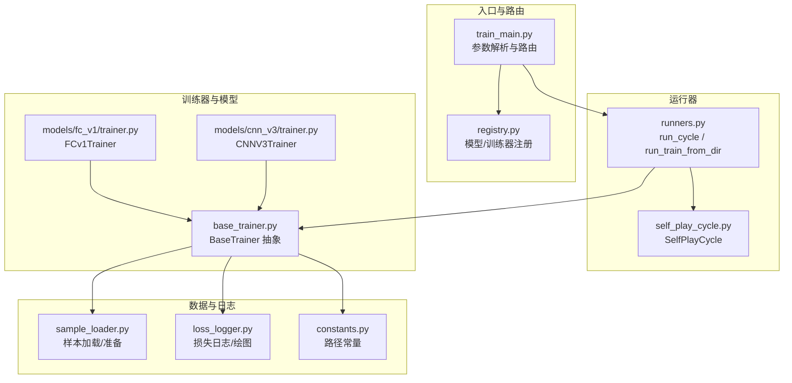
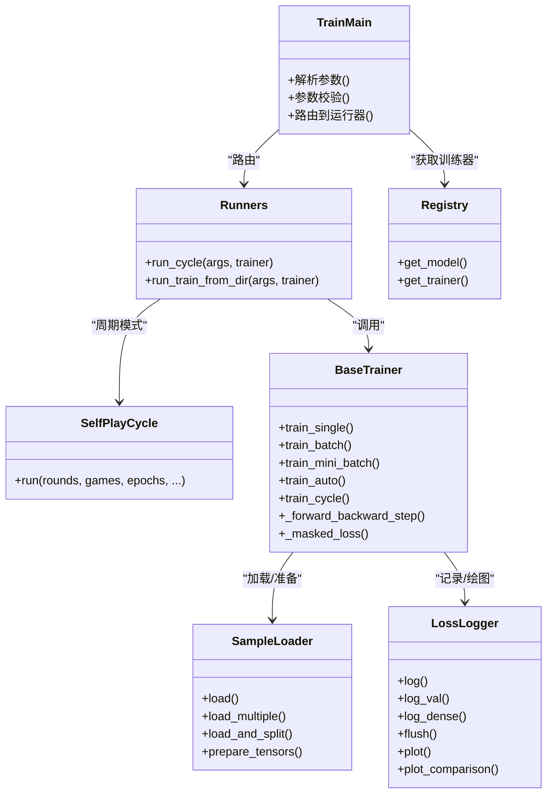
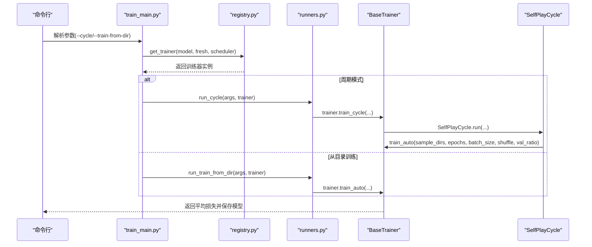
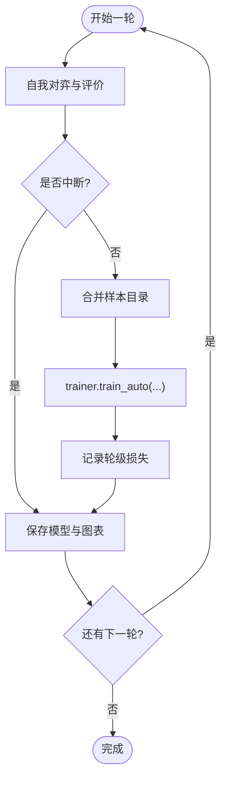
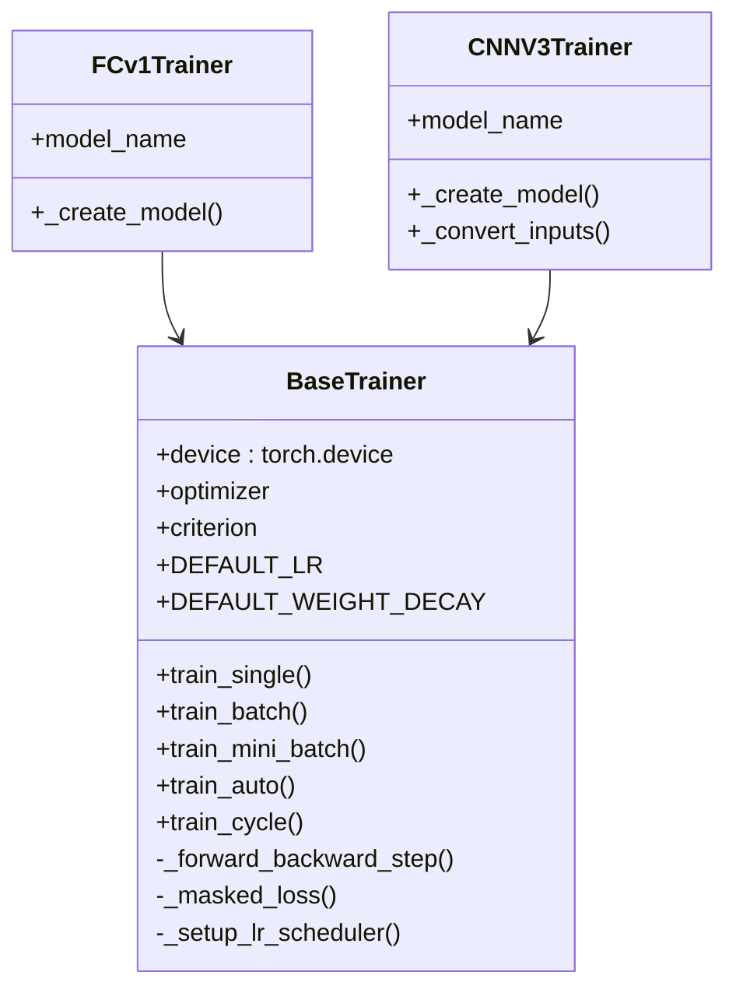
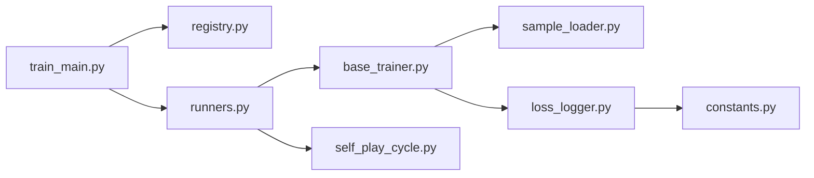

# 训练运行器

<cite>
**本文引用的文件**
- [ai/runners.py](file://ai/runners.py)
- [ai/self_play_cycle.py](file://ai/self_play_cycle.py)
- [ai/base_trainer.py](file://ai/base_trainer.py)
- [ai/train_main.py](file://ai/train_main.py)
- [ai/registry.py](file://ai/registry.py)
- [ai/sample_loader.py](file://ai/sample_loader.py)
- [ai/loss_logger.py](file://ai/loss_logger.py)
- [ai/constants.py](file://ai/constants.py)
- [ai/models/fc_v1/trainer.py](file://ai/models/fc_v1/trainer.py)
- [ai/models/cnn_v3/trainer.py](file://ai/models/cnn_v3/trainer.py)
- [design/base_trainer_design.md](file://design/base_trainer_design.md)
- [design/dense_loss_log_design.md](file://design/dense_loss_log_design.md)
- [design/mini_batch_training_design.md](file://design/mini_batch_training_design.md)
- [design/self_play_train_separation_design.md](file://design/self_play_train_separation_design.md)
</cite>

## 目录
1. [简介](#简介)
2. [项目结构](#项目结构)
3. [核心组件](#核心组件)
4. [架构总览](#架构总览)
5. [详细组件分析](#详细组件分析)
6. [依赖分析](#依赖分析)
7. [性能考虑](#性能考虑)
8. [故障排查指南](#故障排查指南)
9. [结论](#结论)
10. [附录](#附录)

## 简介
本文件面向“训练运行器系统”，系统性阐述其设计目的、架构模式与运行机制，重点覆盖：
- 训练流程的自动化管理与批量处理机制
- 不同运行器的功能特性：训练循环管理器（SelfPlayCycle）、批量训练协调器、分布式训练支持现状
- 配置选项：训练参数动态调整、资源分配策略、错误处理机制
- 扩展接口：如何添加新的训练策略与优化算法
- 实际应用场景：大规模训练任务调度、多GPU训练支持、训练过程监控

## 项目结构
训练运行器系统围绕“入口脚本 + 运行器 + 训练器抽象 + 数据加载 + 日志可视化”展开，采用分层与职责分离的设计：
- 入口脚本负责参数解析与模式路由
- 运行器封装具体训练模式（周期训练、从目录训练）
- 训练器抽象提供统一训练接口与通用逻辑
- 数据加载器负责样本发现、加载与张量化
- 日志记录器负责损失曲线与图表生成

**图表来源**
- [ai/train_main.py:1-234](file://ai/train_main.py#L1-L234)
- [ai/registry.py:1-316](file://ai/registry.py#L1-L316)
- [ai/runners.py:1-255](file://ai/runners.py#L1-L255)
- [ai/self_play_cycle.py:1-195](file://ai/self_play_cycle.py#L1-L195)
- [ai/base_trainer.py:1-699](file://ai/base_trainer.py#L1-L699)
- [ai/sample_loader.py:1-240](file://ai/sample_loader.py#L1-L240)
- [ai/loss_logger.py:1-461](file://ai/loss_logger.py#L1-L461)
- [ai/constants.py:1-26](file://ai/constants.py#L1-L26)

**章节来源**
- [ai/train_main.py:1-234](file://ai/train_main.py#L1-L234)
- [ai/registry.py:1-316](file://ai/registry.py#L1-L316)
- [ai/runners.py:1-255](file://ai/runners.py#L1-L255)
- [ai/self_play_cycle.py:1-195](file://ai/self_play_cycle.py#L1-L195)
- [ai/base_trainer.py:1-699](file://ai/base_trainer.py#L1-L699)
- [ai/sample_loader.py:1-240](file://ai/sample_loader.py#L1-L240)
- [ai/loss_logger.py:1-461](file://ai/loss_logger.py#L1-L461)
- [ai/constants.py:1-26](file://ai/constants.py#L1-L26)

## 核心组件
- 入口与路由（train_main.py）：解析命令行参数、参数校验、模式路由至运行器
- 运行器（runners.py）：封装“周期训练”和“从目录训练”的高层流程
- 训练循环管理器（SelfPlayCycle）：编排自我对弈、评价、合并样本、训练与保存
- 训练器抽象（BaseTrainer）：统一训练接口、设备选择、优化器与损失、学习率调度、训练循环
- 数据加载（SampleLoader）：发现与加载样本、按比例拆分训练/验证集、张量化
- 日志与可视化（LossLogger）：JSON Lines 记录、图表生成、合并对比图
- 模型注册（registry.py）：按需懒加载模型与训练器，支持多代模型

**章节来源**
- [ai/train_main.py:27-234](file://ai/train_main.py#L27-L234)
- [ai/runners.py:81-255](file://ai/runners.py#L81-L255)
- [ai/self_play_cycle.py:20-195](file://ai/self_play_cycle.py#L20-L195)
- [ai/base_trainer.py:32-699](file://ai/base_trainer.py#L32-L699)
- [ai/sample_loader.py:67-240](file://ai/sample_loader.py#L67-L240)
- [ai/loss_logger.py:28-461](file://ai/loss_logger.py#L28-L461)
- [ai/registry.py:58-224](file://ai/registry.py#L58-L224)

## 架构总览
训练运行器采用“入口脚本 + 运行器 + 训练器抽象 + 数据/日志”的分层架构，通过注册表实现模型与训练器的解耦与扩展。

**图表来源**
- [ai/train_main.py:27-234](file://ai/train_main.py#L27-L234)
- [ai/runners.py:81-255](file://ai/runners.py#L81-L255)
- [ai/self_play_cycle.py:20-195](file://ai/self_play_cycle.py#L20-L195)
- [ai/base_trainer.py:32-699](file://ai/base_trainer.py#L32-L699)
- [ai/sample_loader.py:67-240](file://ai/sample_loader.py#L67-L240)
- [ai/loss_logger.py:28-461](file://ai/loss_logger.py#L28-L461)
- [ai/registry.py:187-224](file://ai/registry.py#L187-L224)

## 详细组件分析

### 运行器：周期训练与从目录训练
- run_cycle：执行完整的训练周期（自我对弈 → 评价 → 训练），支持温度采样配置、学习率调度、验证集比例、mini-batch/全量更新自动选择
- run_train_from_dir：从已有数据目录或单文件加载样本，自动发现合并文件与 sample.json，支持 mini-batch/全量更新自动选择与验证集划分

**图表来源**
- [ai/train_main.py:27-234](file://ai/train_main.py#L27-L234)
- [ai/registry.py:187-224](file://ai/registry.py#L187-L224)
- [ai/runners.py:173-255](file://ai/runners.py#L173-L255)
- [ai/base_trainer.py:621-660](file://ai/base_trainer.py#L621-L660)
- [ai/self_play_cycle.py:38-195](file://ai/self_play_cycle.py#L38-L195)

**章节来源**
- [ai/runners.py:81-255](file://ai/runners.py#L81-L255)
- [ai/train_main.py:196-230](file://ai/train_main.py#L196-L230)

### 训练循环管理器：SelfPlayCycle
- 职责：编排一轮或多轮自我对弈、评价、样本合并、训练与保存；支持外部中断（Ctrl+C）安全保存与图表生成
- 关键点：会话目录隔离、轮级与epoch级日志、LossLogger注入或自动创建、验证集评估、合并对比图生成

**图表来源**
- [ai/self_play_cycle.py:38-195](file://ai/self_play_cycle.py#L38-L195)
- [ai/base_trainer.py:575-603](file://ai/base_trainer.py#L575-L603)

**章节来源**
- [ai/self_play_cycle.py:20-195](file://ai/self_play_cycle.py#L20-L195)

### 训练器抽象：BaseTrainer
- 设计要点：抽象基类定义统一接口；设备自动检测（CUDA优先）；优化器（AdamW）与损失（L1Loss）；学习率调度（StepLR/ReduceLROnPlateau）
- 训练方法族：train_single、train_batch、train_mini_batch、train_auto；内部循环封装、验证集评估、键盘中断处理、最终图表生成
- 输入转换与掩码损失：支持不同模型的输入格式（FC/CNN），掩码损失确保仅对有效位置计算

**图表来源**
- [ai/base_trainer.py:32-699](file://ai/base_trainer.py#L32-L699)
- [ai/models/fc_v1/trainer.py:11-44](file://ai/models/fc_v1/trainer.py#L11-L44)
- [ai/models/cnn_v3/trainer.py:13-73](file://ai/models/cnn_v3/trainer.py#L13-L73)

**章节来源**
- [ai/base_trainer.py:32-699](file://ai/base_trainer.py#L32-L699)
- [ai/models/fc_v1/trainer.py:11-44](file://ai/models/fc_v1/trainer.py#L11-L44)
- [ai/models/cnn_v3/trainer.py:13-73](file://ai/models/cnn_v3/trainer.py#L13-L73)

### 数据加载与准备：SampleLoader
- 功能：递归发现训练数据、加载与合并、按比例拆分训练/验证集、张量化（自动移动到设备）
- 设计：输入转换器可插拔，支持不同模型的输入格式；验证集拆分可复现

**章节来源**
- [ai/sample_loader.py:67-240](file://ai/sample_loader.py#L67-L240)

### 日志与可视化：LossLogger
- 功能：记录训练损失、梯度范数、验证集损失；支持密集日志（mini-batch）与稀疏日志（全量更新）；自动生成曲线图与轮级对比图
- 设计：内存缓冲 + 批量写入；自动降采样；双Y轴图（Loss + Grad Norm）

**章节来源**
- [ai/loss_logger.py:28-461](file://ai/loss_logger.py#L28-L461)

### 模型注册与扩展：registry
- 功能：统一模型与训练器映射；按需懒加载；支持多代模型（如 cnn_v3.1、cnn_v3.2）
- 设计：RegistryEntry/解析规格；校验与错误提示；枚举可用模型全名

**章节来源**
- [ai/registry.py:58-224](file://ai/registry.py#L58-L224)

## 依赖分析
- 入口脚本依赖注册表获取训练器实例，再路由到运行器
- 运行器依赖训练器抽象与SelfPlayCycle
- 训练器抽象依赖数据加载器与日志记录器
- 日志记录器依赖常量定义的目录路径

**图表来源**
- [ai/train_main.py:23-24](file://ai/train_main.py#L23-L24)
- [ai/registry.py:187-224](file://ai/registry.py#L187-L224)
- [ai/runners.py:18-18](file://ai/runners.py#L18-L18)
- [ai/base_trainer.py:14-18](file://ai/base_trainer.py#L14-L18)
- [ai/loss_logger.py:25](file://ai/loss_logger.py#L25)
- [ai/constants.py:19-22](file://ai/constants.py#L19-L22)

**章节来源**
- [ai/train_main.py:23-24](file://ai/train_main.py#L23-L24)
- [ai/registry.py:187-224](file://ai/registry.py#L187-L224)
- [ai/runners.py:18-18](file://ai/runners.py#L18-L18)
- [ai/base_trainer.py:14-18](file://ai/base_trainer.py#L14-L18)
- [ai/loss_logger.py:25](file://ai/loss_logger.py#L25)
- [ai/constants.py:19-22](file://ai/constants.py#L19-L22)

## 性能考虑
- 设备选择：自动检测CUDA，优先使用GPU加速
- mini-batch vs 全量更新：mini-batch降低显存占用、提升吞吐；全量更新收敛更稳
- 密集日志：mini-batch启用密集日志，内存缓冲+批量写入，避免频繁I/O
- 验证集：按比例拆分训练/验证集，定期评估val_loss，避免过拟合
- 图表降采样：超过阈值自动降采样，兼顾可视化质量与性能

**章节来源**
- [ai/base_trainer.py:21-29](file://ai/base_trainer.py#L21-L29)
- [ai/base_trainer.py:409-573](file://ai/base_trainer.py#L409-L573)
- [ai/loss_logger.py:328-363](file://ai/loss_logger.py#L328-L363)

## 故障排查指南
- 参数冲突：--cycle 与 --train-from-dir 二选一；--self-play 与 --train-from-dir 互斥
- 数据缺失：路径不存在、无 .json 文件、空数据；运行器会打印错误并退出
- 训练中断：Ctrl+C 时自动保存模型与图表；必要时可重新启动继续训练
- 日志与绘图：matplotlib不可用时优雅降级；检查日志目录权限与空间

**章节来源**
- [ai/train_main.py:196-207](file://ai/train_main.py#L196-L207)
- [ai/runners.py:94-123](file://ai/runners.py#L94-L123)
- [ai/self_play_cycle.py:157-180](file://ai/self_play_cycle.py#L157-L180)
- [ai/loss_logger.py:17-24](file://ai/loss_logger.py#L17-L24)

## 结论
训练运行器系统通过“入口脚本 + 运行器 + 训练器抽象 + 数据/日志”的清晰分层，实现了训练流程的自动化与可扩展性。SelfPlayCycle负责训练周期编排，BaseTrainer提供统一训练能力，SampleLoader与LossLogger保障数据与可视化的可靠性。系统支持参数动态调整、资源分配策略与错误处理，具备良好的扩展性与工程实践价值。

## 附录

### 配置选项与参数说明
- 模型选择：--model（如 fc_v1、cnn_v3.2）
- 模式选择：--cycle（训练周期）、--train-from-dir（从目录训练）
- 训练参数：--rounds、--games、--epochs、--rate、--batch-size、--shuffle、--val-ratio
- 学习率调度：--lr-scheduler（step/plateau）、--lr-step-size、--lr-gamma、--lr-patience、--lr-factor
- 温度采样（周期模式）：--no-temp-sampling、--temperature、--temp-moves、--temp-side、--temp-seed

**章节来源**
- [ai/train_main.py:51-192](file://ai/train_main.py#L51-L192)

### 扩展接口与最佳实践
- 添加新模型/训练器：在注册表中新增条目，实现模型与训练器类，遵循 BaseTrainer 接口
- 新增训练策略：在 BaseTrainer 中扩展训练方法（如 train_custom），并在运行器中路由
- 新增优化算法：在 BaseTrainer 中替换或扩展优化器初始化逻辑
- 多GPU支持现状：当前实现基于单设备训练；如需分布式训练，可在训练器中引入分布式封装与数据并行策略

**章节来源**
- [ai/registry.py:58-72](file://ai/registry.py#L58-L72)
- [ai/base_trainer.py:89-98](file://ai/base_trainer.py#L89-L98)

### 实际应用场景
- 大规模训练任务调度：通过 run_train_from_dir 从目录合并训练，支持 mini-batch 与验证集
- 多GPU训练支持：当前未内置分布式训练；建议在训练器中集成分布式策略（如DDP）与数据并行
- 训练过程监控：LossLogger 自动生成曲线图与对比图，支持密集日志与验证集评估

**章节来源**
- [ai/runners.py:81-171](file://ai/runners.py#L81-L171)
- [ai/loss_logger.py:178-294](file://ai/loss_logger.py#L178-L294)