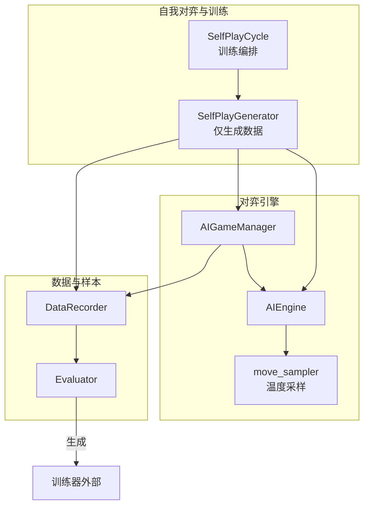
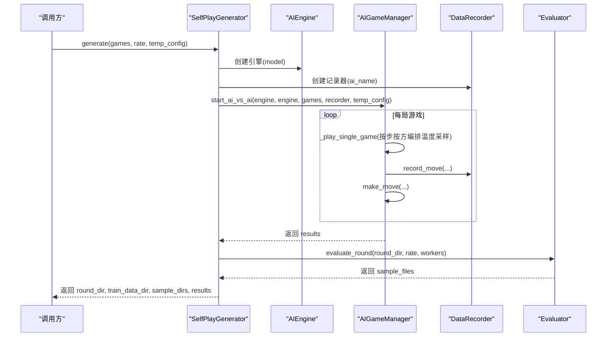
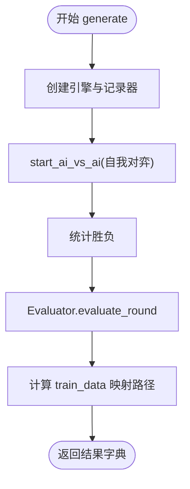
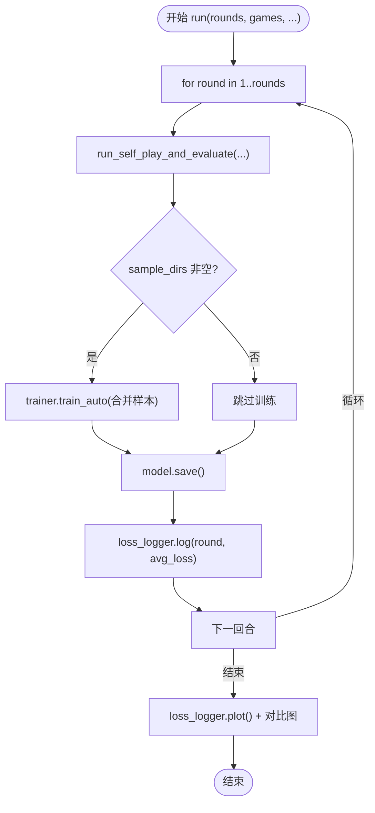
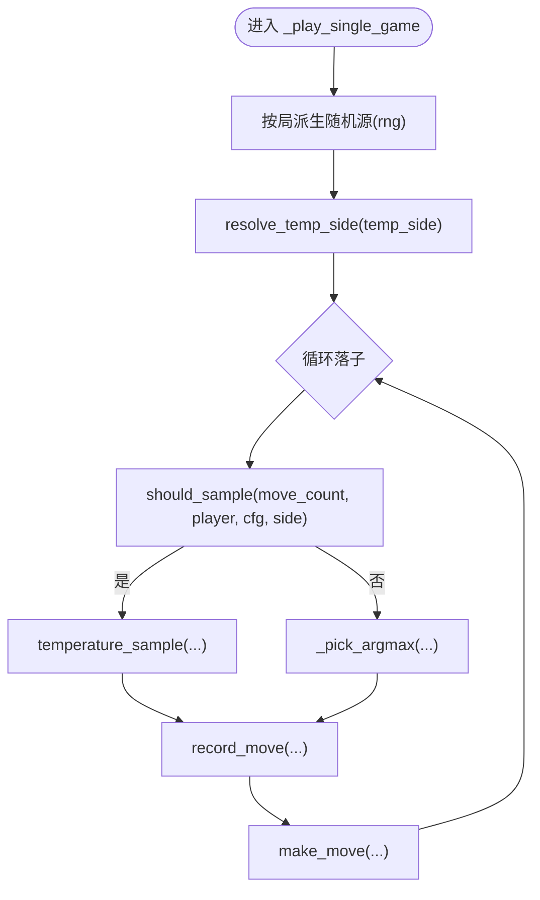
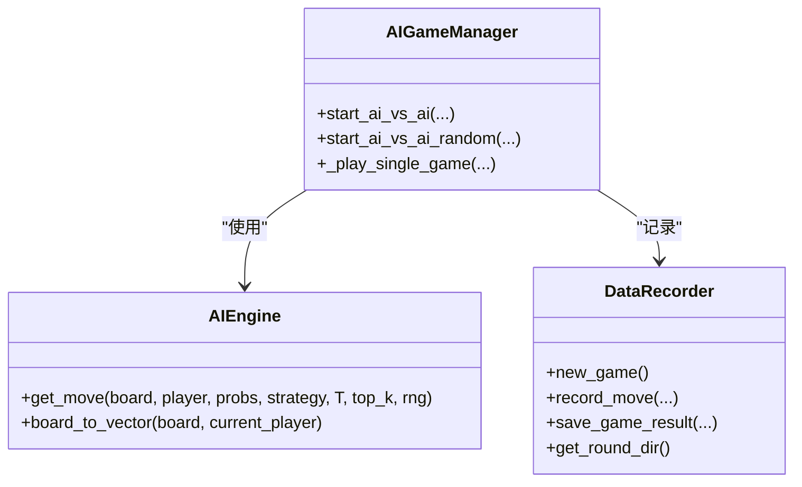
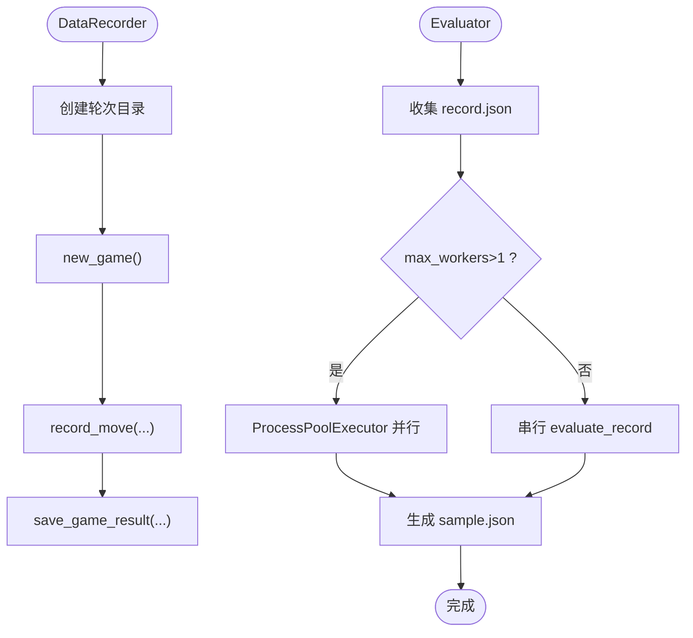
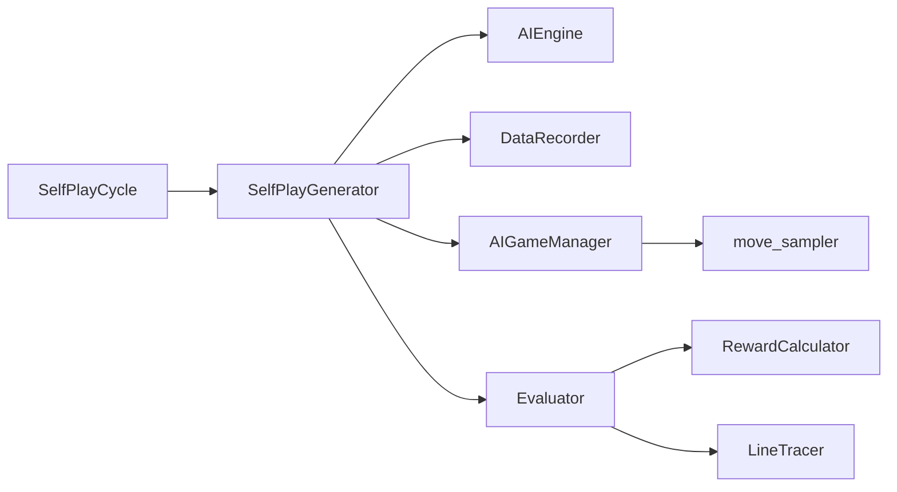

# 自我对弈生成器

<cite>
**本文引用的文件**
- [ai/self_play_generator.py](file://ai/self_play_generator.py)
- [ai/self_play_cycle.py](file://ai/self_play_cycle.py)
- [ai/move_sampler.py](file://ai/move_sampler.py)
- [ai/data_recorder.py](file://ai/data_recorder.py)
- [ai/game_manager.py](file://ai/game_manager.py)
- [ai/engine.py](file://ai/engine.py)
- [ai/constants.py](file://ai/constants.py)
- [ai/evaluator.py](file://ai/evaluator.py)
- [ai/battle.py](file://ai/battle.py)
- [design/move_sampler_design.md](file://design/move_sampler_design.md)
- [tests/ai/test_self_play_generator.py](file://tests/ai/test_self_play_generator.py)
- [tests/ai/test_self_play_cycle.py](file://tests/ai/test_self_play_cycle.py)
- [tests/ai/test_move_sampler.py](file://tests/ai/test_move_sampler.py)
</cite>

## 目录
1. [简介](#简介)
2. [项目结构](#项目结构)
3. [核心组件](#核心组件)
4. [架构总览](#架构总览)
5. [详细组件分析](#详细组件分析)
6. [依赖分析](#依赖分析)
7. [性能考量](#性能考量)
8. [故障排查指南](#故障排查指南)
9. [结论](#结论)
10. [附录](#附录)

## 简介
本技术文档围绕“自我对弈生成器”展开，系统阐述自我对弈的工作原理、温度采样策略、对弈数据采集与存储、训练循环控制逻辑、奖励衰减与样本生成流程，以及配置选项、性能优化与常见问题解决方案。文档面向不同层次读者，既提供高层架构视图，也给出代码级细节与可视化图示，帮助快速理解与高效使用。

## 项目结构
自我对弈生成器由以下模块协同工作：
- 自我对弈与评价入口：SelfPlayGenerator、SelfPlayCycle
- 温度采样策略：move_sampler（温度采样、按步按方切换）
- 游戏与引擎：AIGameManager、AIEngine
- 数据记录：DataRecorder
- 样本生成：Evaluator（双向棋型检测 + Softmax 标签）
- 常量与路径：constants
- CLI 对战脚本：battle.py

**图示来源**
- [ai/self_play_generator.py:170-244](file://ai/self_play_generator.py#L170-L244)
- [ai/self_play_cycle.py:20-195](file://ai/self_play_cycle.py#L20-L195)
- [ai/game_manager.py:16-339](file://ai/game_manager.py#L16-L339)
- [ai/engine.py:44-194](file://ai/engine.py#L44-L194)
- [ai/move_sampler.py:50-258](file://ai/move_sampler.py#L50-L258)
- [ai/data_recorder.py:17-145](file://ai/data_recorder.py#L17-L145)
- [ai/evaluator.py:51-350](file://ai/evaluator.py#L51-L350)

**章节来源**
- [ai/self_play_generator.py:1-244](file://ai/self_play_generator.py#L1-L244)
- [ai/self_play_cycle.py:1-195](file://ai/self_play_cycle.py#L1-L195)
- [ai/game_manager.py:1-339](file://ai/game_manager.py#L1-L339)
- [ai/engine.py:1-194](file://ai/engine.py#L1-L194)
- [ai/move_sampler.py:1-258](file://ai/move_sampler.py#L1-L258)
- [ai/data_recorder.py:1-145](file://ai/data_recorder.py#L1-L145)
- [ai/evaluator.py:1-350](file://ai/evaluator.py#L1-L350)
- [ai/constants.py:1-26](file://ai/constants.py#L1-L26)

## 核心组件
- SelfPlayGenerator：封装单轮自我对弈与评价流程，返回轮次目录、样本目录、样本数量与对局结果；支持键盘中断优雅退出。
- SelfPlayCycle：训练编排器，按轮次循环执行自我对弈与评价，随后合并样本并调用训练器进行模型训练，保存模型并记录损失曲线。
- AIGameManager：管理单局 AI 内战，按步按方编排温度采样与 argmax 切换，记录每步输入输出与落子位置。
- AIEngine：将棋盘状态向量化，调用模型获取概率分布，按策略（argmax 或温度采样）选择落子。
- move_sampler：提供温度采样、按步按方判定与按局抽签解析，支持 top-k 截断与可复现随机源。
- DataRecorder：创建轮次与局目录，记录每步 input/output/position，保存游戏结果。
- Evaluator：读取 record.json，计算每步 reward（双向棋型检测 + 五连追溯），经 Softmax 转换为训练标签 sample.json。
- constants：定义 AI 数据目录、训练数据目录与损失日志目录等常量。

**章节来源**
- [ai/self_play_generator.py:21-168](file://ai/self_play_generator.py#L21-L168)
- [ai/self_play_cycle.py:20-195](file://ai/self_play_cycle.py#L20-L195)
- [ai/game_manager.py:123-339](file://ai/game_manager.py#L123-L339)
- [ai/engine.py:44-194](file://ai/engine.py#L44-L194)
- [ai/move_sampler.py:50-258](file://ai/move_sampler.py#L50-L258)
- [ai/data_recorder.py:17-145](file://ai/data_recorder.py#L17-L145)
- [ai/evaluator.py:51-350](file://ai/evaluator.py#L51-L350)
- [ai/constants.py:6-26](file://ai/constants.py#L6-L26)

## 架构总览
自我对弈生成器采用“对弈-记录-评价-训练”的流水线式架构。对弈阶段由 AIGameManager 驱动，AIEngine 负责落子策略；DataRecorder 将每步数据持久化；Evaluator 将对局历史转换为训练样本；SelfPlayGenerator/SelfPlayCycle 负责轮次与训练编排。

**图示来源**
- [ai/self_play_generator.py:21-168](file://ai/self_play_generator.py#L21-L168)
- [ai/game_manager.py:232-339](file://ai/game_manager.py#L232-L339)
- [ai/data_recorder.py:66-145](file://ai/data_recorder.py#L66-L145)
- [ai/evaluator.py:224-350](file://ai/evaluator.py#L224-L350)

## 详细组件分析

### 自我对弈与评价流程（SelfPlayGenerator）
- 功能：执行自我对弈 + 评价，生成训练样本；封装单轮完整流程，支持键盘中断优雅退出。
- 关键点：
  - 使用 AIEngine(model) 创建引擎，DataRecorder(ai_name) 创建轮次目录。
  - 调用 AIGameManager.start_ai_vs_ai(engine, engine, ...) 执行 engine1 vs engine2 自我对弈。
  - 统计胜负，调用 Evaluator.evaluate_round 生成 sample.json。
  - 返回 round_dir、train_data_dir、sample_dirs、sample_count、results、interrupted。

**图示来源**
- [ai/self_play_generator.py:21-168](file://ai/self_play_generator.py#L21-L168)

**章节来源**
- [ai/self_play_generator.py:21-168](file://ai/self_play_generator.py#L21-L168)

### 训练编排（SelfPlayCycle）
- 功能：按轮次循环执行自我对弈与评价，合并样本并训练模型，保存模型与绘制损失曲线。
- 关键点：
  - 每轮调用 run_self_play_and_evaluate，若 sample_dirs 非空则调用 trainer.train_auto 合并训练。
  - 记录每轮平均损失到 LossLogger；轮次结束后生成对比图。
  - 支持 project_root 覆盖数据目录，max_workers 控制评价并行度。

**图示来源**
- [ai/self_play_cycle.py:38-195](file://ai/self_play_cycle.py#L38-L195)

**章节来源**
- [ai/self_play_cycle.py:20-195](file://ai/self_play_cycle.py#L20-L195)

### 温度采样策略（move_sampler）
- 数学原理：对合法位置概率向量 p，温度 T 的采样权重 q_i ∝ p_i^(1/T)，再归一化并加权抽样。
- 策略编排：
  - should_sample：按 move_count 与 temp_side 判定当前步是否启用温度采样。
  - resolve_temp_side：temp_side="random" 时按局抽签为 black/white。
  - temperature_sample：支持 top_k 截断与全零权重均匀回退。
- 参数调优建议：
  - T 增大提升探索，T 接近 0 趋近 argmax；结合 temp_moves 控制探索持续步数。
  - temp_side 控制仅黑方/白方/双方启用，random 每局独立抽签。
  - top_k 限制采样候选范围，缓解过拟合。

**图示来源**
- [ai/game_manager.py:123-231](file://ai/game_manager.py#L123-L231)
- [ai/move_sampler.py:192-258](file://ai/move_sampler.py#L192-L258)

**章节来源**
- [ai/move_sampler.py:50-258](file://ai/move_sampler.py#L50-L258)
- [ai/game_manager.py:123-231](file://ai/game_manager.py#L123-L231)
- [design/move_sampler_design.md:28-551](file://design/move_sampler_design.md#L28-L551)

### 游戏与引擎（AIGameManager / AIEngine）
- AIGameManager：
  - start_ai_vs_ai：固定 engine1 黑、engine2 白，逐局执行 _play_single_game。
  - start_ai_vs_ai_random：每局随机决定执棋颜色，返回胜负统计。
  - _play_single_game：按步按方编排温度采样与 argmax，记录每步数据。
- AIEngine：
  - get_move：将棋盘向量化，调用模型预测，构建合法位置-概率对，按策略选择落子。
  - board_to_vector：将 15×15 棋盘 + 当前落子方拼接为 226 维向量。

**图示来源**
- [ai/game_manager.py:16-339](file://ai/game_manager.py#L16-L339)
- [ai/engine.py:44-194](file://ai/engine.py#L44-L194)
- [ai/data_recorder.py:17-145](file://ai/data_recorder.py#L17-L145)

**章节来源**
- [ai/game_manager.py:123-339](file://ai/game_manager.py#L123-L339)
- [ai/engine.py:67-194](file://ai/engine.py#L67-L194)

### 数据记录与样本生成（DataRecorder / Evaluator）
- DataRecorder：
  - 创建轮次目录（ai_name_递增），每局独立子目录，记录每步 input/output/position，保存最终结果。
- Evaluator：
  - evaluate_round：遍历轮次目录下所有 record.json，多进程并行生成 sample.json。
  - _compute_all_rewards：对每步计算 raw_rewards（棋型 + 五连追溯），经 masked_softmax 转换为输出概率分布。

**图示来源**
- [ai/data_recorder.py:43-145](file://ai/data_recorder.py#L43-L145)
- [ai/evaluator.py:224-350](file://ai/evaluator.py#L224-L350)

**章节来源**
- [ai/data_recorder.py:17-145](file://ai/data_recorder.py#L17-L145)
- [ai/evaluator.py:97-223](file://ai/evaluator.py#L97-L223)

### 温度采样数学原理与参数调优
- 数学公式：q_i = p_i^(1/T) / Σ_j p_j^(1/T)。T → 0 等价 argmax；T = 1 不变；T → ∞ 趋近均匀。
- 参数建议：
  - temperature：默认 1.0；增大提升开局多样性，减小稳定策略。
  - temp_moves：默认 12；控制探索步数，超过阈值切换 argmax。
  - temp_side：both/black/white/random；random 每局独立抽签。
  - top_k：限制采样候选数，缓解过拟合。
- 调参流程：
  - 对照实验：比较温度采样与 argmax 的开局多样性、胜负分布与步数熵。
  - 若差异过小：提高 T 或 temp_moves；若波动过大：降低 T 或仅对黑方采样。

**章节来源**
- [ai/move_sampler.py:117-186](file://ai/move_sampler.py#L117-L186)
- [design/move_sampler_design.md:28-551](file://design/move_sampler_design.md#L28-L551)

### 配置选项与使用示例
- SelfPlayGenerator.generate：
  - games：对局数，默认 100
  - rate：奖励衰减率，传给 Evaluator，默认 0.9
  - project_root：项目根目录，影响数据保存路径
  - temp_config：温度采样配置，None 保持 argmax 行为
- SelfPlayCycle.run：
  - rounds：轮次数，默认 10
  - games：每轮对局数，默认 100
  - epochs：每轮训练轮数，默认 1000
  - rate：奖励衰减率，默认 0.9
  - batch_size：mini-batch 样本数，None 表示全量更新
  - shuffle：每个 epoch 是否打乱数据
  - project_root：项目根目录
  - val_ratio：验证集比例
  - temp_config：温度采样配置
- CLI 对战脚本 battle.py：
  - --ai1/--ai2：双方 AI 名称
  - --games：对局数

示例（路径引用而非代码片段）：
- [ai/self_play_generator.py:198-243](file://ai/self_play_generator.py#L198-L243)
- [ai/self_play_cycle.py:38-66](file://ai/self_play_cycle.py#L38-L66)
- [ai/battle.py:136-199](file://ai/battle.py#L136-L199)

**章节来源**
- [ai/self_play_generator.py:198-243](file://ai/self_play_generator.py#L198-L243)
- [ai/self_play_cycle.py:38-66](file://ai/self_play_cycle.py#L38-L66)
- [ai/battle.py:136-199](file://ai/battle.py#L136-L199)

## 依赖分析
- SelfPlayGenerator 依赖：AIEngine、DataRecorder、AIGameManager、Evaluator。
- SelfPlayCycle 依赖：SelfPlayGenerator（run_self_play_and_evaluate）、训练器（train_auto）、LossLogger。
- AIGameManager 依赖：AIEngine、DataRecorder、move_sampler。
- Evaluator 依赖：LineTracer、RewardCalculator、probability_utils。
- constants 提供路径常量，贯穿数据与训练目录。

**图示来源**
- [ai/self_play_generator.py:11-18](file://ai/self_play_generator.py#L11-L18)
- [ai/self_play_cycle.py:12-14](file://ai/self_play_cycle.py#L12-L14)
- [ai/game_manager.py:8-14](file://ai/game_manager.py#L8-L14)
- [ai/evaluator.py:14-24](file://ai/evaluator.py#L14-L24)

**章节来源**
- [ai/self_play_generator.py:11-18](file://ai/self_play_generator.py#L11-L18)
- [ai/self_play_cycle.py:12-14](file://ai/self_play_cycle.py#L12-L14)
- [ai/game_manager.py:8-14](file://ai/game_manager.py#L8-L14)
- [ai/evaluator.py:14-24](file://ai/evaluator.py#L14-L24)

## 性能考量
- 评价并行：Evaluator.evaluate_round 支持多进程并行（max_workers），默认 min(cpu_count, 4)；进程崩溃自动回退串行。
- 数据压缩：record.json 与 sample.json 采用紧凑格式，减少文件体积。
- 温度采样开销：temperature_sample 为纯函数，O(n) 时间复杂度；top_k 截断可降低采样空间。
- 训练合并：SelfPlayCycle 每轮合并样本后训练，batch_size 控制内存占用与收敛速度。
- I/O 优化：DataRecorder 每局独立目录，避免大文件竞争；Evaluator 生成 sample.json 时按轮次目录映射。

**章节来源**
- [ai/evaluator.py:83-96](file://ai/evaluator.py#L83-L96)
- [ai/data_recorder.py:137-140](file://ai/data_recorder.py#L137-L140)
- [ai/self_play_cycle.py:130-146](file://ai/self_play_cycle.py#L130-L146)

## 故障排查指南
- 键盘中断：
  - SelfPlayGenerator：捕获 KeyboardInterrupt，返回已产生数据与中断标志，避免丢失进度。
  - SelfPlayCycle：捕获 KeyboardInterrupt，保存模型与损失图，提示可安全退出。
- 温度采样异常：
  - temperature <= 0：抛出 ValueError；检查 TempConfig 构造参数。
  - invalid temp_side：抛出 ValueError；确认取值在 SUPPORTED_TEMP_SIDES。
- 模型输出异常：
  - 全零概率：temperature_sample 回退为均匀采样；检查模型 softmax 输出。
- 进程池崩溃：
  - Evaluator 并行时 BrokenProcessPool：自动回退串行处理剩余文件。
- GUI/CLI 行为：
  - battle.py 默认不启用温度采样（temp_config=None）；如需对比实验，可在 create_samples/train_main 中启用。

**章节来源**
- [ai/self_play_generator.py:138-167](file://ai/self_play_generator.py#L138-L167)
- [ai/self_play_cycle.py:157-177](file://ai/self_play_cycle.py#L157-L177)
- [ai/move_sampler.py:77-111](file://ai/move_sampler.py#L77-L111)
- [ai/evaluator.py:325-347](file://ai/evaluator.py#L325-L347)
- [tests/ai/test_self_play_generator.py:227-291](file://tests/ai/test_self_play_generator.py#L227-L291)
- [tests/ai/test_self_play_cycle.py:180-206](file://tests/ai/test_self_play_cycle.py#L180-L206)
- [tests/ai/test_move_sampler.py:152-179](file://tests/ai/test_move_sampler.py#L152-L179)

## 结论
自我对弈生成器通过清晰的模块划分与严格的流程编排，实现了从自我对弈、数据记录、样本生成到训练编排的完整闭环。温度采样策略在保证探索的同时维持稳定性，配合奖励衰减与双向棋型检测，生成高质量训练样本。通过合理的参数调优与性能优化，可在大规模自我对弈中取得稳定收益。

## 附录
- 相关测试用例参考：
  - SelfPlayGenerator：单元测试覆盖 DataRecorder 命名、AIGameManager 调用、Evaluator 调用、返回结构与中断处理。
  - SelfPlayCycle：单元测试覆盖参数传递、多轮迭代、训练调用、损失记录与中断跳出。
  - move_sampler：单元测试覆盖分布行为、边界条件、字段校验、按步判定与按局抽签。
- CLI 使用参考：
  - battle.py：启动两个 AI 内战，支持指定对局数与模型名称。
  - create_samples.py / train_main.py：支持温度采样参数（cycle 模式）。

**章节来源**
- [tests/ai/test_self_play_generator.py:1-291](file://tests/ai/test_self_play_generator.py#L1-L291)
- [tests/ai/test_self_play_cycle.py:1-266](file://tests/ai/test_self_play_cycle.py#L1-L266)
- [tests/ai/test_move_sampler.py:1-259](file://tests/ai/test_move_sampler.py#L1-L259)
- [ai/battle.py:136-199](file://ai/battle.py#L136-L199)