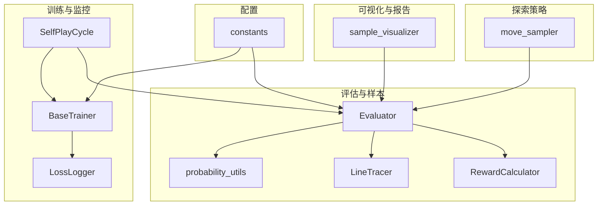
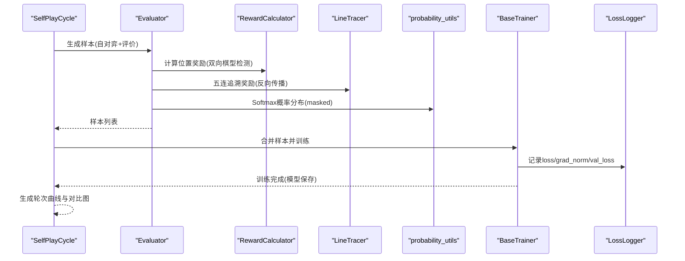
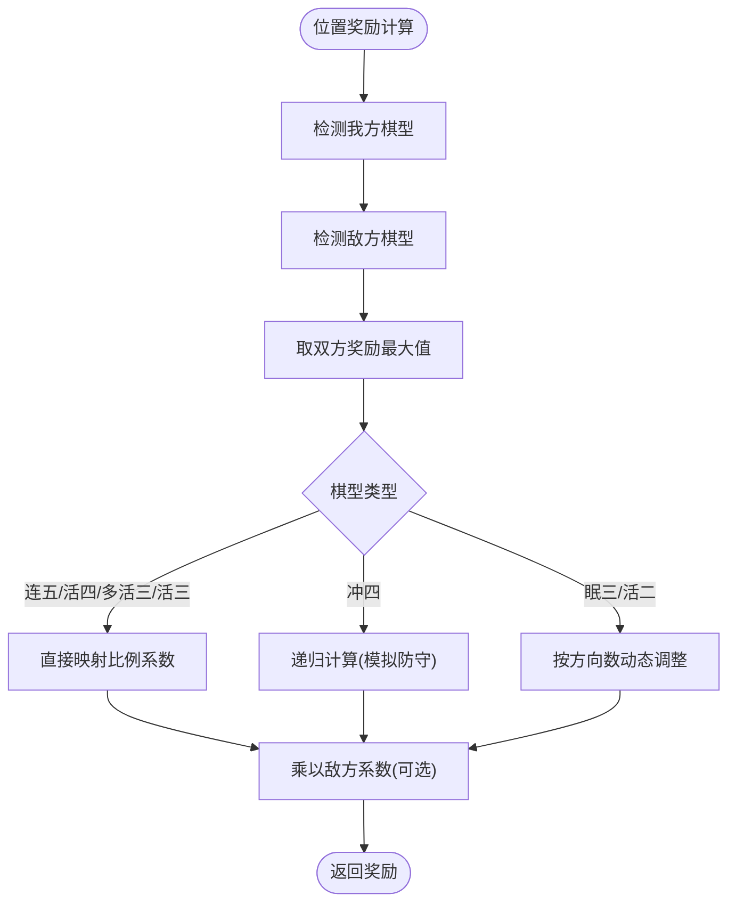
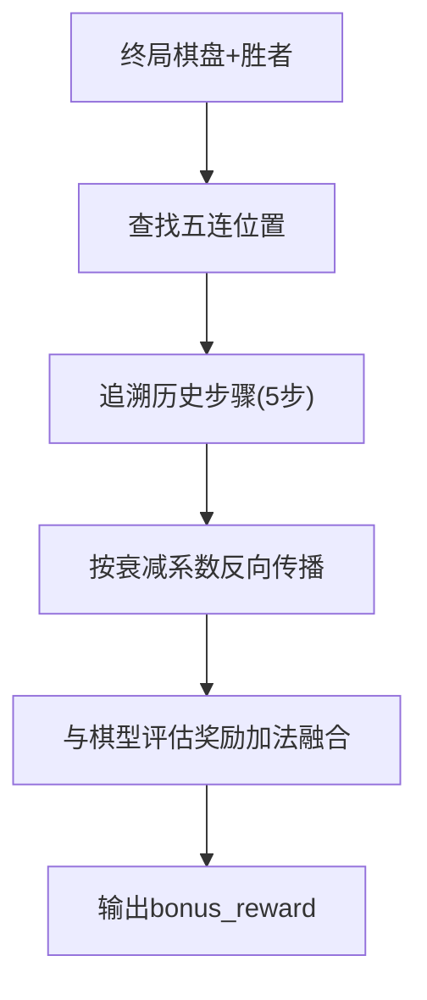
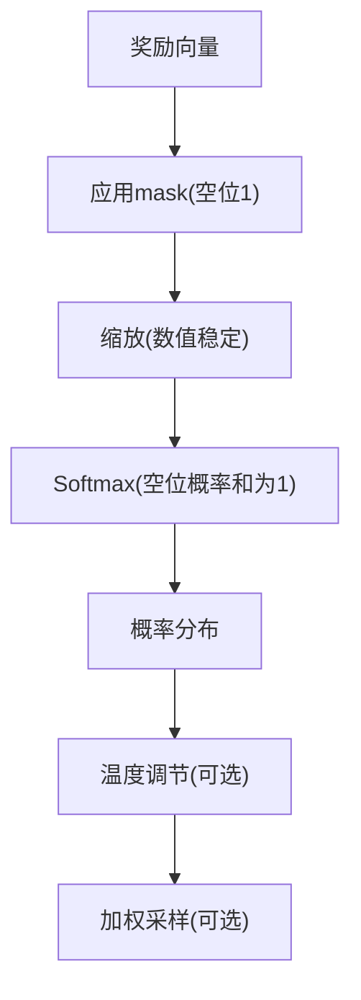
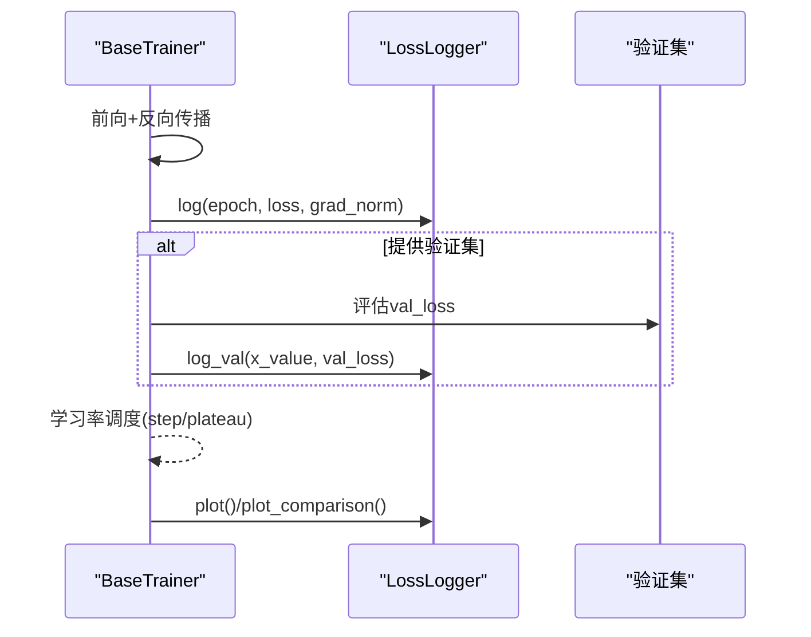
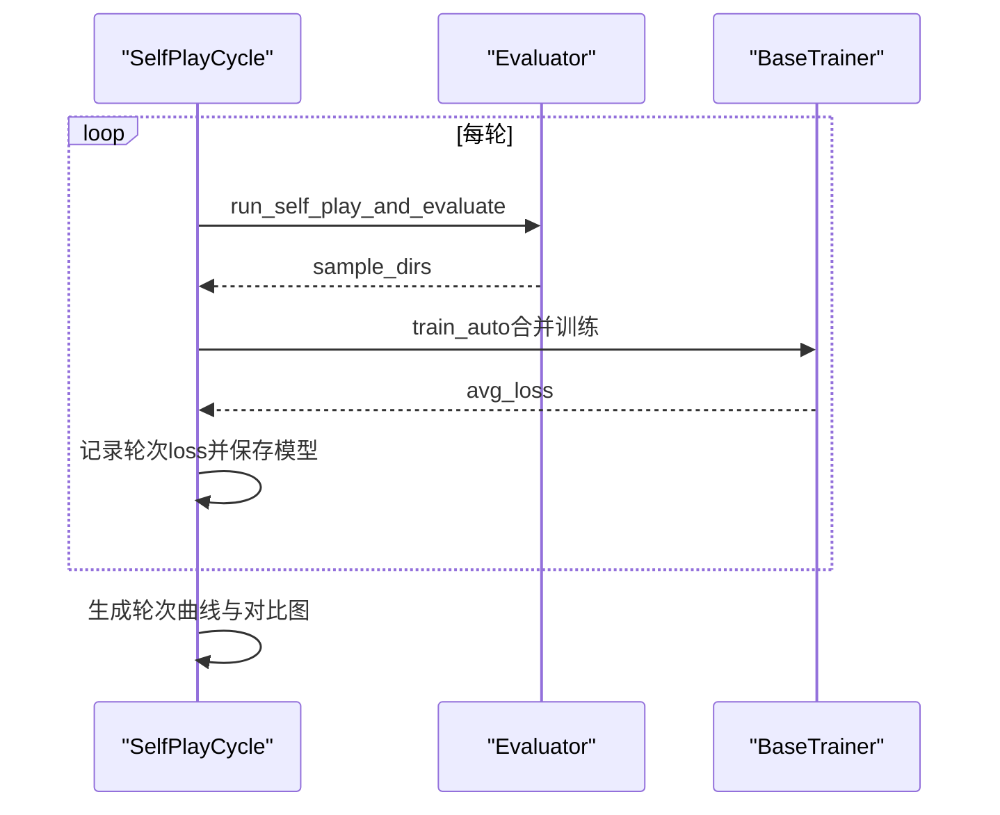
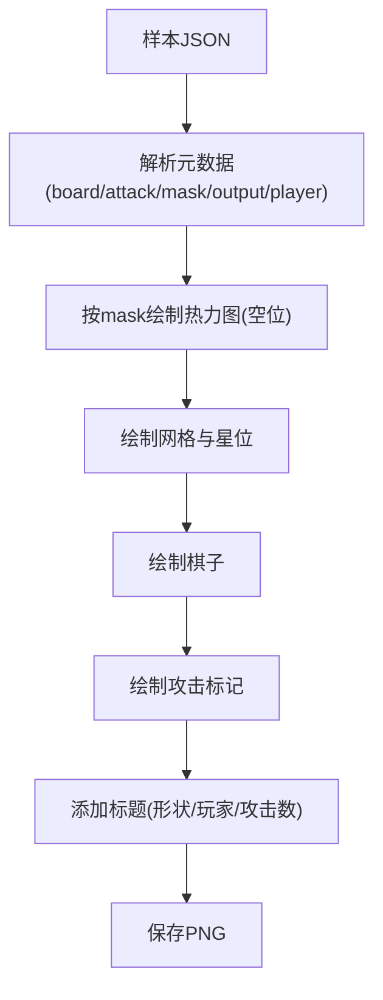
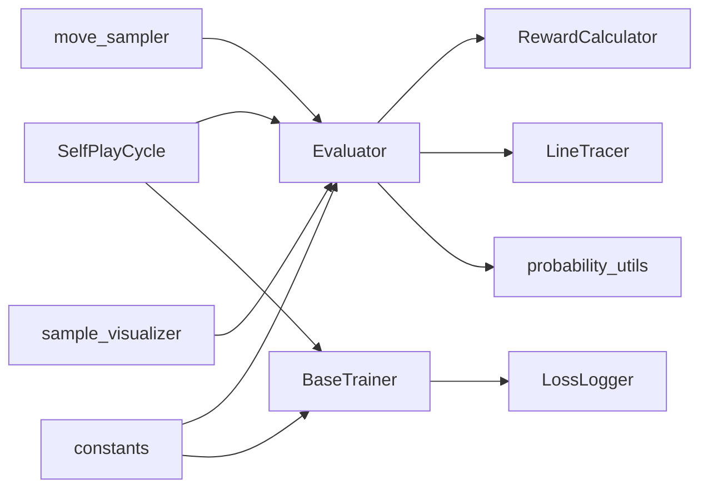

# 训练评估与监控

<cite>
**本文引用的文件**
- [ai/reward_calculator.py](file://ai/reward_calculator.py)
- [ai/line_tracer.py](file://ai/line_tracer.py)
- [ai/probability_utils.py](file://ai/probability_utils.py)
- [ai/evaluator.py](file://ai/evaluator.py)
- [ai/base_trainer.py](file://ai/base_trainer.py)
- [ai/loss_logger.py](file://ai/loss_logger.py)
- [ai/self_play_cycle.py](file://ai/self_play_cycle.py)
- [ai/move_sampler.py](file://ai/move_sampler.py)
- [ai/constants.py](file://ai/constants.py)
- [ai/sample_visualizer.py](file://ai/sample_visualizer.py)
- [design/evaluator_shape_detection_design.md](file://design/evaluator_shape_detection_design.md)
- [design/winning_line_reward_design.md](file://design/winning_line_reward_design.md)
- [design/move_sampler_design.md](file://design/move_sampler_design.md)
- [tests/ai/test_reward_calculator.py](file://tests/ai/test_reward_calculator.py)
- [tests/ai/test_evaluator.py](file://tests/ai/test_evaluator.py)
- [tests/ai/test_loss_logger.py](file://tests/ai/test_loss_logger.py)
</cite>

## 目录
1. [简介](#简介)
2. [项目结构](#项目结构)
3. [核心组件](#核心组件)
4. [架构总览](#架构总览)
5. [详细组件分析](#详细组件分析)
6. [依赖关系分析](#依赖关系分析)
7. [性能考量](#性能考量)
8. [故障排查指南](#故障排查指南)
9. [结论](#结论)
10. [附录](#附录)

## 简介
本技术文档面向“训练评估与监控系统”，围绕AI模型评估指标、奖励计算机制、概率分布处理、训练监控与可视化等方面，系统梳理代码实现与设计文档，帮助读者快速理解并高效使用该系统。

## 项目结构
本系统主要由以下模块组成：
- 评估与样本生成：Evaluator、LineTracer、RewardCalculator、probability_utils
- 训练与监控：BaseTrainer、LossLogger、SelfPlayCycle
- 自对弈与探索：move_sampler
- 可视化与报告：sample_visualizer
- 常量与路径：constants

**图表来源**
- [ai/evaluator.py:51-350](file://ai/evaluator.py#L51-L350)
- [ai/reward_calculator.py:35-239](file://ai/reward_calculator.py#L35-L239)
- [ai/line_tracer.py:10-143](file://ai/line_tracer.py#L10-L143)
- [ai/probability_utils.py:15-59](file://ai/probability_utils.py#L15-L59)
- [ai/base_trainer.py:32-699](file://ai/base_trainer.py#L32-L699)
- [ai/loss_logger.py:28-461](file://ai/loss_logger.py#L28-L461)
- [ai/self_play_cycle.py:20-195](file://ai/self_play_cycle.py#L20-L195)
- [ai/move_sampler.py:50-258](file://ai/move_sampler.py#L50-L258)
- [ai/sample_visualizer.py:296-496](file://ai/sample_visualizer.py#L296-L496)
- [ai/constants.py:8-26](file://ai/constants.py#L8-L26)

**章节来源**
- [ai/evaluator.py:51-350](file://ai/evaluator.py#L51-L350)
- [ai/base_trainer.py:32-699](file://ai/base_trainer.py#L32-L699)
- [ai/constants.py:8-26](file://ai/constants.py#L8-L26)

## 核心组件
- 奖励计算与棋型检测：RewardCalculator 提供棋型到奖励的映射，支持冲四递归与双向检测；LineTracer 提供五连追溯奖励与融合策略。
- 概率分布处理：probability_utils 提供带 mask 的数值稳定 Softmax，支持温度调节与采样策略。
- 训练与监控：BaseTrainer 提供统一训练接口、损失计算、学习率调度与日志记录；LossLogger 负责日志持久化与曲线图生成。
- 自对弈与探索：SelfPlayCycle 编排自我对弈与样本生成；move_sampler 提供温度采样策略，提升开局多样性。
- 可视化与报告：sample_visualizer 将样本可视化为棋盘热力图，支持多种归一化模式与标注。

**章节来源**
- [ai/reward_calculator.py:35-239](file://ai/reward_calculator.py#L35-L239)
- [ai/line_tracer.py:10-143](file://ai/line_tracer.py#L10-L143)
- [ai/probability_utils.py:15-59](file://ai/probability_utils.py#L15-L59)
- [ai/base_trainer.py:32-699](file://ai/base_trainer.py#L32-L699)
- [ai/loss_logger.py:28-461](file://ai/loss_logger.py#L28-L461)
- [ai/self_play_cycle.py:20-195](file://ai/self_play_cycle.py#L20-L195)
- [ai/move_sampler.py:50-258](file://ai/move_sampler.py#L50-L258)
- [ai/sample_visualizer.py:296-496](file://ai/sample_visualizer.py#L296-L496)

## 架构总览
训练评估与监控系统采用“评估-训练-监控-可视化”的闭环架构：
- 评估阶段：Evaluator 调用 RewardCalculator 与 LineTracer 计算每个位置的奖励，结合 Softmax 生成概率分布样本。
- 训练阶段：BaseTrainer 统一执行前向/反向传播、损失计算、学习率调度与日志记录。
- 监控阶段：LossLogger 记录训练过程中的 loss、grad_norm、val_loss，并生成曲线图。
- 可视化阶段：sample_visualizer 将样本可视化为棋盘热力图，辅助分析策略分布与攻击位置。

**图表来源**
- [ai/self_play_cycle.py:110-156](file://ai/self_play_cycle.py#L110-L156)
- [ai/evaluator.py:97-210](file://ai/evaluator.py#L97-L210)
- [ai/reward_calculator.py:46-116](file://ai/reward_calculator.py#L46-L116)
- [ai/line_tracer.py:64-117](file://ai/line_tracer.py#L64-L117)
- [ai/probability_utils.py:15-59](file://ai/probability_utils.py#L15-L59)
- [ai/base_trainer.py:257-322](file://ai/base_trainer.py#L257-L322)
- [ai/loss_logger.py:124-177](file://ai/loss_logger.py#L124-L177)

## 详细组件分析

### 奖励计算与棋型检测
- 双向棋型检测：对每个空位，分别检测我方与敌方的棋型，取二者奖励的最大值，体现攻防双重价值。
- 冲四递归：模拟我方形成冲四后，寻找唯一防守位置并模拟防守，检测后续棋型，避免无限递归使用非递归映射。
- 棋型映射：连五/活四/多冲四/冲四/多活三/活三/眠三/活二/眠二/独一，分别映射到比例系数，支持方向数动态调整（眠三、活二）。
- 敌方系数：敌方棋型奖励乘以 0.95，体现防守价值。

**图表来源**
- [ai/reward_calculator.py:46-116](file://ai/reward_calculator.py#L46-L116)
- [ai/reward_calculator.py:118-191](file://ai/reward_calculator.py#L118-L191)
- [design/evaluator_shape_detection_design.md:101-160](file://design/evaluator_shape_detection_design.md#L101-L160)

**章节来源**
- [ai/reward_calculator.py:35-239](file://ai/reward_calculator.py#L35-L239)
- [design/evaluator_shape_detection_design.md:101-160](file://design/evaluator_shape_detection_design.md#L101-L160)

### 五连追溯奖励与融合
- 五连追溯：在终局棋盘上定位五连，回溯到历史记录中对应的 5 步落子，按衰减系数反向传播奖励。
- 融合策略：采用加法融合，确保早期步骤的弱信号不被丢弃，提升训练信号完整性。

**图表来源**
- [ai/line_tracer.py:64-117](file://ai/line_tracer.py#L64-L117)
- [ai/line_tracer.py:119-143](file://ai/line_tracer.py#L119-L143)
- [design/winning_line_reward_design.md:18-75](file://design/winning_line_reward_design.md#L18-L75)

**章节来源**
- [ai/line_tracer.py:10-143](file://ai/line_tracer.py#L10-L143)
- [design/winning_line_reward_design.md:18-75](file://design/winning_line_reward_design.md#L18-L75)

### 概率分布处理与采样策略
- 带 mask 的 Softmax：对奖励向量按 mask 仅对空位进行数值稳定的 Softmax，避免大数值导致的下溢。
- 温度调节：通过温度参数对概率分布进行加温或降温，提升探索或收敛精度。
- 采样策略：move_sampler 提供阶梯式温度采样（前 N 步采样，之后 argmax），支持按方启用与随机抽签。

**图表来源**
- [ai/probability_utils.py:15-59](file://ai/probability_utils.py#L15-L59)
- [ai/move_sampler.py:117-186](file://ai/move_sampler.py#L117-L186)
- [design/move_sampler_design.md:28-55](file://design/move_sampler_design.md#L28-L55)

**章节来源**
- [ai/probability_utils.py:15-59](file://ai/probability_utils.py#L15-L59)
- [ai/move_sampler.py:50-258](file://ai/move_sampler.py#L50-L258)
- [design/move_sampler_design.md:28-55](file://design/move_sampler_design.md#L28-L55)

### 训练监控与日志
- 统一训练接口：BaseTrainer 提供 train_single、train_batch、train_mini_batch、train_auto 等方法，统一损失计算、梯度范数与学习率调度。
- 日志记录：LossLogger 支持稀疏与密集两种日志格式，自动降采样，生成双 Y 轴曲线图（Loss 与 Grad Norm），并支持轮次级与 epoch 级对比图。
- 验证集监控：在训练过程中定期评估验证集 loss，辅助收敛性判断与过拟合检测。

**图表来源**
- [ai/base_trainer.py:257-322](file://ai/base_trainer.py#L257-L322)
- [ai/base_trainer.py:575-573](file://ai/base_trainer.py#L575-L573)
- [ai/loss_logger.py:124-177](file://ai/loss_logger.py#L124-L177)
- [ai/loss_logger.py:366-461](file://ai/loss_logger.py#L366-L461)

**章节来源**
- [ai/base_trainer.py:32-699](file://ai/base_trainer.py#L32-L699)
- [ai/loss_logger.py:28-461](file://ai/loss_logger.py#L28-L461)

### 自我对弈与训练周期
- SelfPlayCycle 编排轮次：每轮自对弈生成样本，随后合并训练，保存模型并生成曲线图。
- 温度采样：在 cycle 模式下可启用 move_sampler 的温度采样策略，提升开局多样性。

**图表来源**
- [ai/self_play_cycle.py:110-156](file://ai/self_play_cycle.py#L110-L156)
- [ai/self_play_cycle.py:183-190](file://ai/self_play_cycle.py#L183-L190)

**章节来源**
- [ai/self_play_cycle.py:20-195](file://ai/self_play_cycle.py#L20-L195)

### 样本可视化与报告
- 可视化：sample_visualizer 将样本渲染为棋盘热力图，叠加棋子与攻击标记，支持 log/max/linear 三种归一化模式。
- 报告：结合 LossLogger 的对比图，形成训练过程的可视化报告。

**图表来源**
- [ai/sample_visualizer.py:86-131](file://ai/sample_visualizer.py#L86-L131)
- [ai/sample_visualizer.py:180-293](file://ai/sample_visualizer.py#L180-L293)

**章节来源**
- [ai/sample_visualizer.py:296-496](file://ai/sample_visualizer.py#L296-L496)

## 依赖关系分析
- 模块内聚与耦合：Evaluator 依赖 RewardCalculator、LineTracer 与 probability_utils；BaseTrainer 依赖 LossLogger；SelfPlayCycle 协调 Evaluator 与 Trainer。
- 外部依赖：PyTorch（训练）、matplotlib（绘图）、jsonlines（日志存储）。
- 常量与路径：constants 提供数据目录与日志目录的统一配置。

**图表来源**
- [ai/evaluator.py:89-96](file://ai/evaluator.py#L89-L96)
- [ai/base_trainer.py:122-125](file://ai/base_trainer.py#L122-L125)
- [ai/self_play_cycle.py:110-118](file://ai/self_play_cycle.py#L110-L118)
- [ai/constants.py:11-22](file://ai/constants.py#L11-L22)

**章节来源**
- [ai/evaluator.py:89-96](file://ai/evaluator.py#L89-L96)
- [ai/base_trainer.py:122-125](file://ai/base_trainer.py#L122-L125)
- [ai/self_play_cycle.py:110-118](file://ai/self_play_cycle.py#L110-L118)
- [ai/constants.py:11-22](file://ai/constants.py#L11-L22)

## 性能考量
- 数值稳定性：probability_utils 对奖励进行缩放与数值稳定处理，避免 Softmax 下溢。
- 并行评估：Evaluator 支持多进程并行评价，崩溃时自动回退到串行，保证可靠性。
- 日志降采样：LossLogger 对密集日志自动降采样，控制图表密度与内存占用。
- 训练效率：BaseTrainer 支持 mini-batch 与全量更新，结合学习率调度提升收敛速度。

[本节为通用指导，无需具体文件引用]

## 故障排查指南
- 进程池崩溃：Evaluator 在 ProcessPoolExecutor 崩溃时自动回退到串行模式，仅重试未完成文件，避免重复处理。
- matplotlib 缺失：LossLogger 在 matplotlib 不可用时优雅降级，仅保留日志文件。
- 温度采样异常：move_sampler 对非法参数抛出 ValueError，确保策略一致性。
- 测试验证：通过单元测试覆盖奖励映射、冲四递归、进程池回退、日志绘图等功能边界。

**章节来源**
- [tests/ai/test_evaluator.py:77-133](file://tests/ai/test_evaluator.py#L77-L133)
- [tests/ai/test_loss_logger.py:126-154](file://tests/ai/test_loss_logger.py#L126-L154)
- [tests/ai/test_reward_calculator.py:121-151](file://tests/ai/test_reward_calculator.py#L121-L151)

## 结论
本系统通过“双向棋型检测 + 五连追溯奖励 + Softmax概率分布”的评估体系，结合统一训练接口与可视化监控，形成了完整的训练评估与监控闭环。配合温度采样策略，进一步提升了自对弈的多样性与训练效果。建议在实际使用中关注日志与曲线图的趋势变化，结合样本可视化进行策略分析与模型迭代。

[本节为总结性内容，无需具体文件引用]

## 附录
- 设计文档参考：
  - 双向棋型检测设计：[design/evaluator_shape_detection_design.md:1-465](file://design/evaluator_shape_detection_design.md#L1-L465)
  - 五连追溯奖励设计：[design/winning_line_reward_design.md:1-177](file://design/winning_line_reward_design.md#L1-L177)
  - 温度采样设计：[design/move_sampler_design.md:1-551](file://design/move_sampler_design.md#L1-L551)
- 常量与路径：[ai/constants.py:8-26](file://ai/constants.py#L8-L26)

[本节为补充材料，无需具体文件引用]