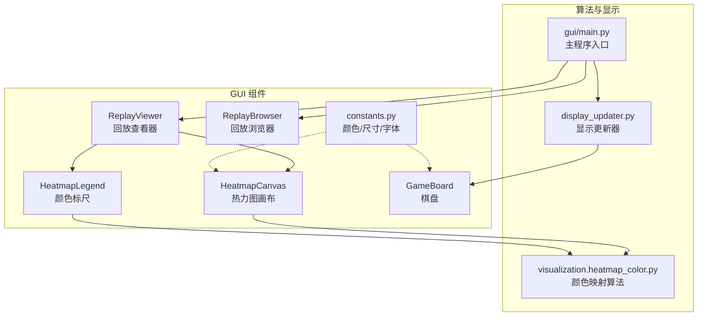
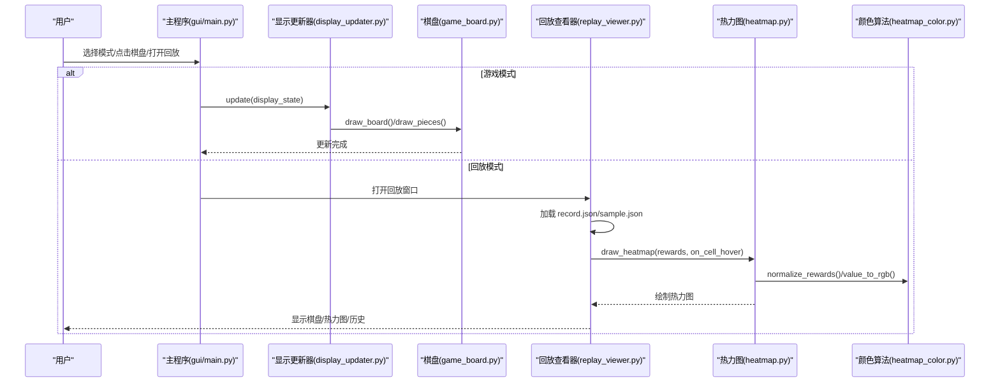
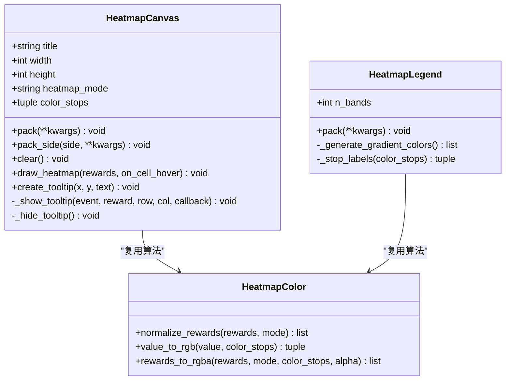
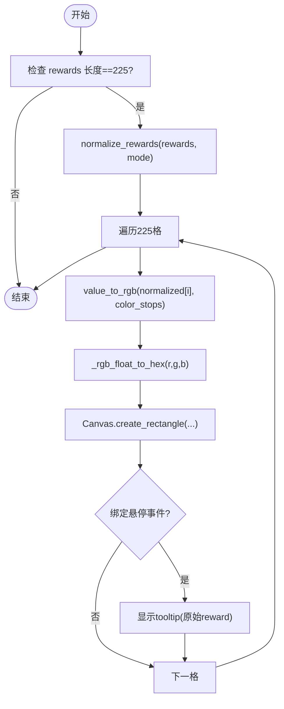
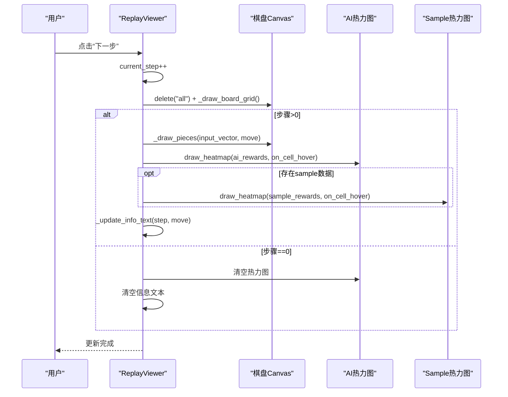
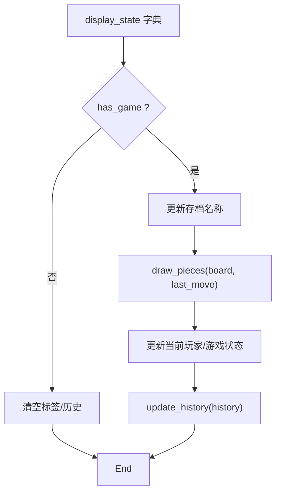
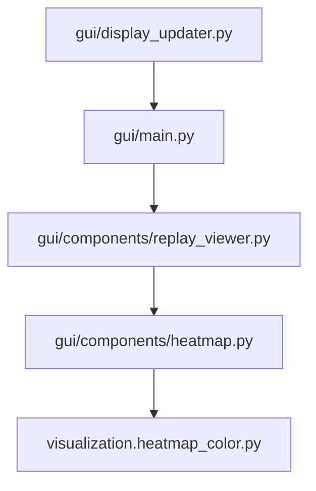

# 可视化功能

<cite>
**本文引用的文件**
- [gui/components/heatmap.py](file://gui/components/heatmap.py)
- [visualization/heatmap_color.py](file://visualization/heatmap_color.py)
- [gui/display_updater.py](file://gui/display_updater.py)
- [gui/components/replay_viewer.py](file://gui/components/replay_viewer.py)
- [gui/components/replay_browser.py](file://gui/components/replay_browser.py)
- [gui/main.py](file://gui/main.py)
- [gui/components/game_board.py](file://gui/components/game_board.py)
- [gui/components/constants.py](file://gui/components/constants.py)
- [tests/gui/test_heatmap.py](file://tests/gui/test_heatmap.py)
- [tests/gui/test_replay_viewer.py](file://tests/gui/test_replay_viewer.py)
- [design/gui_heatmap_reuse_design.md](file://design/gui_heatmap_reuse_design.md)
- [design/sample_visualizer_design.md](file://design/sample_visualizer_design.md)
</cite>

## 目录
1. [简介](#简介)
2. [项目结构](#项目结构)
3. [核心组件](#核心组件)
4. [架构总览](#架构总览)
5. [详细组件分析](#详细组件分析)
6. [依赖分析](#依赖分析)
7. [性能考虑](#性能考虑)
8. [故障排查指南](#故障排查指南)
9. [结论](#结论)
10. [附录](#附录)

## 简介
本文件系统化梳理五子棋AI项目的可视化功能，重点覆盖以下方面：
- 棋盘热力图：概率分布可视化、颜色编码系统、实时更新机制
- 对局回放：播放控制、历史记录展示、样本数据可视化
- 显示更新器：界面状态同步、动画与高亮、响应式布局
- 实用指南：热力图颜色配置、回放控制接口、显示优化建议

## 项目结构
可视化相关代码主要分布在以下模块：
- gui/components：GUI组件（棋盘、热力图、回放查看器、浏览器、常量）
- visualization：纯函数颜色映射算法（无UI依赖）
- gui：主程序入口、显示更新器、棋盘组件
- tests/gui：热力图与回放查看器的GUI测试

图表来源
- [gui/components/heatmap.py:68-358](file://gui/components/heatmap.py#L68-L358)
- [visualization/heatmap_color.py:32-204](file://visualization/heatmap_color.py#L32-L204)
- [gui/display_updater.py:13-110](file://gui/display_updater.py#L13-L110)
- [gui/components/replay_viewer.py:13-426](file://gui/components/replay_viewer.py#L13-L426)
- [gui/components/replay_browser.py:12-383](file://gui/components/replay_browser.py#L12-L383)
- [gui/main.py:31-462](file://gui/main.py#L31-L462)
- [gui/components/game_board.py:7-170](file://gui/components/game_board.py#L7-L170)
- [gui/components/constants.py:1-66](file://gui/components/constants.py#L1-L66)

章节来源
- [gui/main.py:31-462](file://gui/main.py#L31-L462)
- [gui/components/__init__.py:1-42](file://gui/components/__init__.py#L1-L42)

## 核心组件
- 热力图画布 HeatmapCanvas：绘制15×15网格的热力图，支持悬停tooltip显示原始reward值，支持多种归一化模式与自定义色板。
- 热力图标尺 HeatmapLegend：生成渐变条与色名标签，与热力图色板一致。
- 回放查看器 ReplayViewer：加载record.json与可选sample.json，提供上一步/下一步/跳转结局/重置等控制，绘制棋盘、热力图与历史记录。
- 回放浏览器 ReplayBrowser：选择轮次与对局，定位record.json与sample.json路径。
- 显示更新器 GameDisplayUpdater：根据display_state刷新棋盘、标签、历史记录列表。
- 棋盘组件 GameBoard：绘制棋盘网格、棋子与最后落子高亮。

章节来源
- [gui/components/heatmap.py:68-358](file://gui/components/heatmap.py#L68-L358)
- [visualization/heatmap_color.py:32-204](file://visualization/heatmap_color.py#L32-L204)
- [gui/components/replay_viewer.py:13-426](file://gui/components/replay_viewer.py#L13-L426)
- [gui/components/replay_browser.py:12-383](file://gui/components/replay_browser.py#L12-L383)
- [gui/display_updater.py:13-110](file://gui/display_updater.py#L13-L110)
- [gui/components/game_board.py:7-170](file://gui/components/game_board.py#L7-L170)

## 架构总览
可视化功能采用“算法复用 + GUI适配”的分层设计：
- visualization.heatmap_color.py提供纯函数颜色映射（无UI依赖），HeatmapCanvas/HeatmapLegend在GUI层复用该算法。
- GUI主程序通过GameDisplayUpdater驱动棋盘与标签更新；ReplayViewer在回放模式下复用热力图组件。
- 回放浏览器负责数据路径解析，回放查看器负责数据加载与界面渲染。

图表来源
- [gui/main.py:379-396](file://gui/main.py#L379-L396)
- [gui/display_updater.py:40-101](file://gui/display_updater.py#L40-L101)
- [gui/components/game_board.py:61-149](file://gui/components/game_board.py#L61-L149)
- [gui/components/replay_viewer.py:230-260](file://gui/components/replay_viewer.py#L230-L260)
- [gui/components/heatmap.py:137-195](file://gui/components/heatmap.py#L137-L195)
- [visualization/heatmap_color.py:63-122](file://visualization/heatmap_color.py#L63-L122)

## 详细组件分析

### 热力图组件（HeatmapCanvas/HeatmapLegend）
- 归一化策略：支持"log"/"max"/"linear"，默认"log"，专门优化softmax极值分布。
- 颜色映射：默认色板为白→黄→橙→红（4色），通过value_to_rgb在色节点间等距线性插值。
- 实时更新：draw_heatmap批量归一化后逐格映射颜色，支持悬停tooltip显示原始reward值。
- Legend：生成n_bands档渐变条，支持自定义档数，默认24档（4色3段下已足够平滑）。

图表来源
- [gui/components/heatmap.py:68-358](file://gui/components/heatmap.py#L68-L358)
- [visualization/heatmap_color.py:32-204](file://visualization/heatmap_color.py#L32-L204)

章节来源
- [gui/components/heatmap.py:68-358](file://gui/components/heatmap.py#L68-L358)
- [visualization/heatmap_color.py:63-204](file://visualization/heatmap_color.py#L63-L204)
- [design/gui_heatmap_reuse_design.md:3-27](file://design/gui_heatmap_reuse_design.md#L3-L27)

#### 归一化与颜色映射流程

图表来源
- [gui/components/heatmap.py:137-195](file://gui/components/heatmap.py#L137-L195)
- [visualization/heatmap_color.py:63-122](file://visualization/heatmap_color.py#L63-L122)

### 回放查看器（ReplayViewer）
- 数据加载：从record.json读取history，从sample.json读取样本数据（可选）。
- 控制接口：上一步/下一步/跳转结局/重置，实时更新步骤标签。
- 可视化：绘制棋盘网格、棋子、AI热力图与Sample热力图（若存在），显示信息文本与历史记录。
- 实时更新：_update_display根据current_step绘制对应步骤的棋盘与热力图。

图表来源
- [gui/components/replay_viewer.py:208-260](file://gui/components/replay_viewer.py#L208-L260)
- [gui/components/replay_viewer.py:279-371](file://gui/components/replay_viewer.py#L279-L371)

章节来源
- [gui/components/replay_viewer.py:13-426](file://gui/components/replay_viewer.py#L13-L426)
- [tests/gui/test_replay_viewer.py:18-288](file://tests/gui/test_replay_viewer.py#L18-L288)

### 显示更新器（GameDisplayUpdater）
- 状态同步：根据display_state更新棋盘、存档名称、当前玩家、游戏状态、历史记录。
- 动画与高亮：调用GameBoard.draw_board/draw_pieces，高亮最后落子位置。
- 响应式布局：通过pack/grid布局管理组件，配合constants.py中的颜色/尺寸/字体常量。

图表来源
- [gui/display_updater.py:40-101](file://gui/display_updater.py#L40-L101)
- [gui/components/game_board.py:97-149](file://gui/components/game_board.py#L97-L149)

章节来源
- [gui/display_updater.py:13-110](file://gui/display_updater.py#L13-L110)
- [gui/components/game_board.py:7-170](file://gui/components/game_board.py#L7-L170)
- [gui/components/constants.py:1-66](file://gui/components/constants.py#L1-L66)

### 回放浏览器（ReplayBrowser）
- 轮次选择：扫描ai_data目录，统计每轮对局数，支持双击/按钮选择。
- 对局选择：筛选包含record.json的对局，显示胜负与步数，支持双击/按钮选择。
- 路径解析：尝试将record.json路径替换为对应的sample.json路径。

章节来源
- [gui/components/replay_browser.py:12-383](file://gui/components/replay_browser.py#L12-L383)

## 依赖分析
- HeatmapCanvas/HeatmapLegend依赖visualization.heatmap_color（纯函数，无UI依赖）。
- ReplayViewer依赖HeatmapCanvas/HeatmapLegend与constants.py中的颜色/尺寸配置。
- 主程序gui/main.py依赖ReplayBrowser/ReplayWindow与GameDisplayUpdater。
- 显示更新器依赖GameBoard与GUIHelper提供的display_state。

图表来源
- [gui/components/heatmap.py:30-34](file://gui/components/heatmap.py#L30-L34)
- [gui/components/replay_viewer.py:9-10](file://gui/components/replay_viewer.py#L9-L10)
- [gui/display_updater.py:9-10](file://gui/display_updater.py#L9-L10)
- [gui/main.py:22-28](file://gui/main.py#L22-L28)

章节来源
- [gui/components/heatmap.py:30-34](file://gui/components/heatmap.py#L30-L34)
- [gui/components/replay_viewer.py:9-10](file://gui/components/replay_viewer.py#L9-L10)
- [gui/display_updater.py:9-10](file://gui/display_updater.py#L9-L10)
- [gui/main.py:22-28](file://gui/main.py#L22-L28)

## 性能考虑
- 归一化批处理：HeatmapCanvas在绘制前对整列rewards进行一次归一化，避免逐格重复计算，降低O(n)复杂度。
- 颜色映射优化：value_to_rgb按色节点等距线性插值，n_bands默认24档已足够平滑，减少Legend生成开销。
- GUI绘制：ReplayViewer在切换步骤时仅重绘必要元素（棋盘网格、棋子、热力图），避免全量重建。
- 测试验证：测试覆盖log模式下softmax极端分布的绘制，确保性能与稳定性。

章节来源
- [gui/components/heatmap.py:161-162](file://gui/components/heatmap.py#L161-L162)
- [tests/gui/test_heatmap.py:209-219](file://tests/gui/test_heatmap.py#L209-L219)
- [tests/gui/test_replay_viewer.py:179-188](file://tests/gui/test_replay_viewer.py#L179-L188)

## 故障排查指南
- 归一化模式错误：HeatmapCanvas构造时允许heatmap_mode参数，非法模式在draw_heatmap阶段抛出ValueError。请检查模式字符串是否为"log"/"max"/"linear"之一。
- Tooltip显示异常：tooltip显示原始reward值（非归一化值），若reward非数值类型将退化为字符串。检查数据源格式。
- 回放数据缺失：ReplayViewer加载record.json与sample.json，若sample.json不存在则不显示Sample热力图。确认数据路径与文件完整性。
- 步骤越界：ReplayViewer在_current_step=0时清空热力图与信息文本，确保跳转到结局时不会索引越界。

章节来源
- [gui/components/heatmap.py:157-159](file://gui/components/heatmap.py#L157-L159)
- [gui/components/heatmap.py:198-215](file://gui/components/heatmap.py#L198-L215)
- [gui/components/replay_viewer.py:220-229](file://gui/components/replay_viewer.py#L220-L229)
- [tests/gui/test_replay_viewer.py:213-225](file://tests/gui/test_replay_viewer.py#L213-L225)

## 结论
本可视化体系通过“算法复用 + GUI适配”的设计，实现了：
- 高效稳定的热力图绘制与颜色编码
- 直观的对局回放与样本数据对比
- 一致的界面状态同步与响应式布局
建议在后续迭代中：
- 保持visualization.heatmap_color的纯函数特性，避免UI耦合
- 扩展回放查看器的数据维度展示（如多步历史对比）
- 增强热力图交互（如点击定位、导出图像）

## 附录

### 热力图颜色配置与归一化模式
- 默认色板：白→黄→橙→红（4色）
- 归一化模式：log（推荐）、max、linear
- Legend档数：默认24档（3段×8档），可自定义

章节来源
- [visualization/heatmap_color.py:32-39](file://visualization/heatmap_color.py#L32-L39)
- [visualization/heatmap_color.py:63-122](file://visualization/heatmap_color.py#L63-L122)
- [gui/components/heatmap.py:253-358](file://gui/components/heatmap.py#L253-L358)

### 回放控制接口
- 上一步/下一步/跳转结局/重置：通过ReplayViewer的按钮触发对应方法
- 步骤标签：实时显示当前步数/总步数
- 信息文本：展示输入/输出向量片段与Sample数据中的实际落子reward

章节来源
- [gui/components/replay_viewer.py:78-96](file://gui/components/replay_viewer.py#L78-L96)
- [gui/components/replay_viewer.py:230-260](file://gui/components/replay_viewer.py#L230-L260)
- [gui/components/replay_viewer.py:326-361](file://gui/components/replay_viewer.py#L326-L361)

### 显示优化建议
- 使用默认log归一化以提升softmax分布的可辨性
- 合理设置Legend档数，避免过度细分导致视觉噪声
- 在ReplayViewer中按需启用棋盘/热力图显示开关，减少渲染压力
- 通过constants.py集中管理颜色与尺寸，确保主题一致性

章节来源
- [gui/components/constants.py:1-66](file://gui/components/constants.py#L1-L66)
- [gui/components/replay_viewer.py:38-41](file://gui/components/replay_viewer.py#L38-L41)