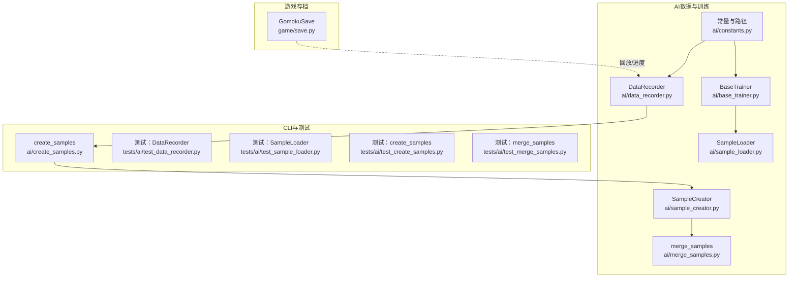
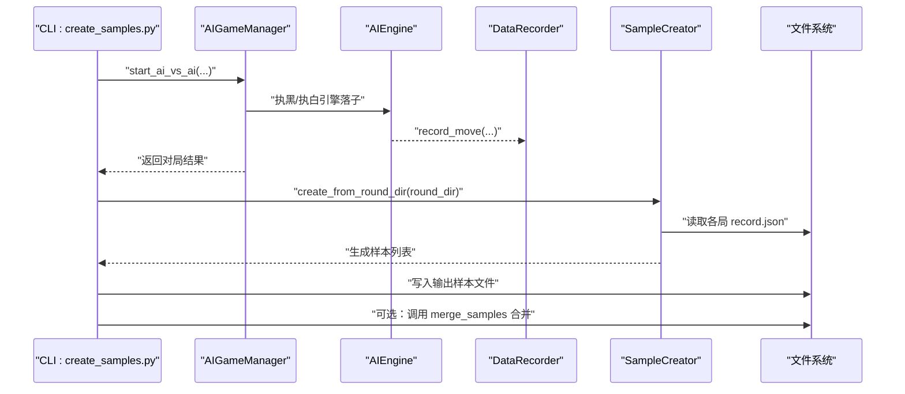
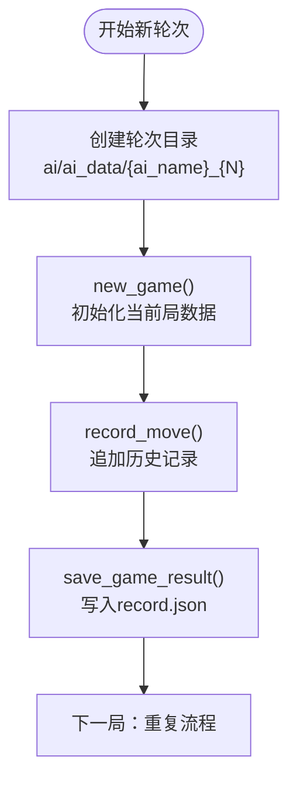
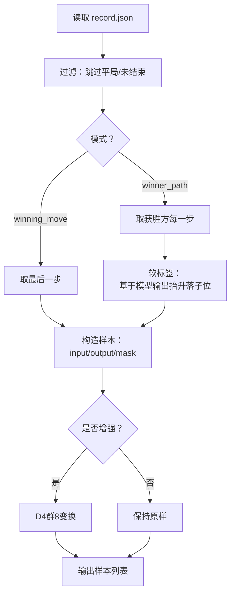
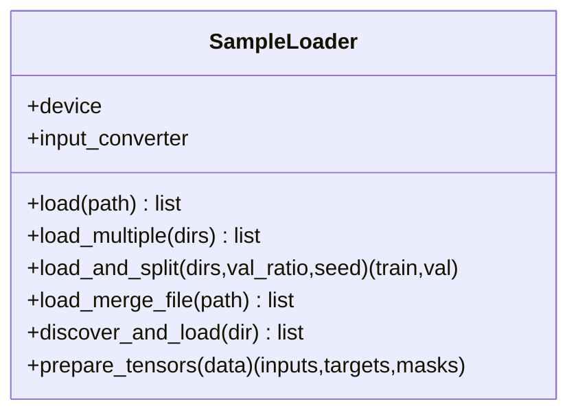
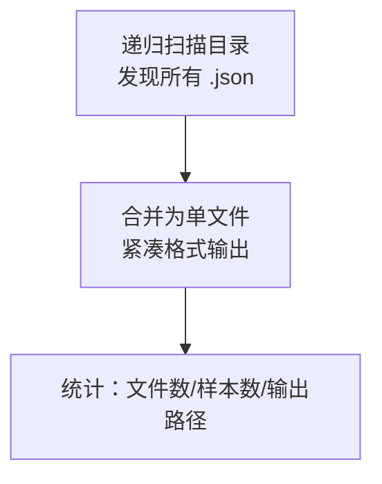
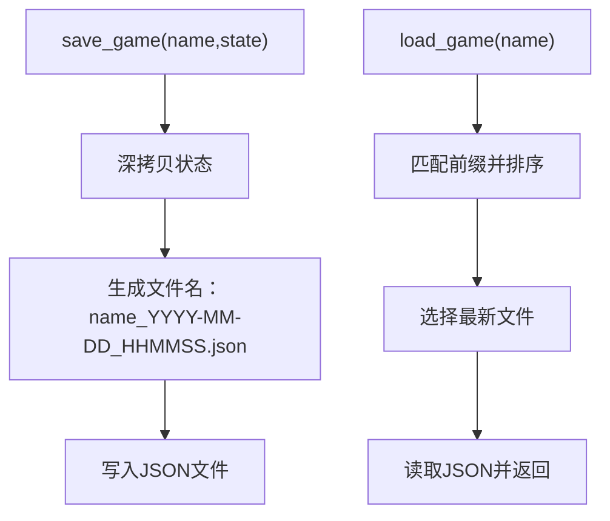
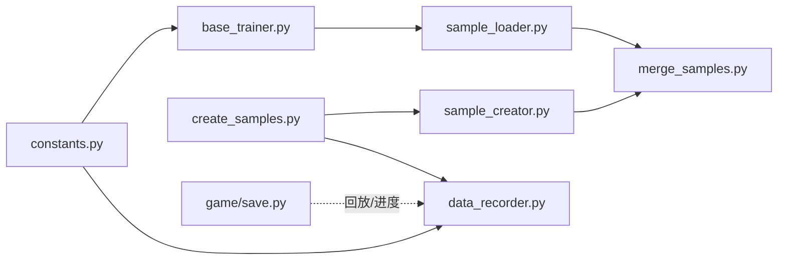

# 数据管理

<cite>
**本文引用的文件**
- [ai/data_recorder.py](file://ai/data_recorder.py)
- [ai/constants.py](file://ai/constants.py)
- [ai/sample_creator.py](file://ai/sample_creator.py)
- [ai/sample_loader.py](file://ai/sample_loader.py)
- [ai/create_samples.py](file://ai/create_samples.py)
- [ai/merge_samples.py](file://ai/merge_samples.py)
- [game/save.py](file://game/save.py)
- [ai/base_trainer.py](file://ai/base_trainer.py)
- [tests/ai/test_data_recorder.py](file://tests/ai/test_data_recorder.py)
- [tests/ai/test_sample_loader.py](file://tests/ai/test_sample_loader.py)
- [tests/ai/test_create_samples.py](file://tests/ai/test_create_samples.py)
- [tests/ai/test_merge_samples.py](file://tests/ai/test_merge_samples.py)
- [design/ai_data_path_fix_design.md](file://design/ai_data_path_fix_design.md)
- [design/merge_samples_design.md](file://design/merge_samples_design.md)
- [ai/sample_visualizer.py](file://ai/sample_visualizer.py)
</cite>

## 目录
1. [简介](#简介)
2. [项目结构](#项目结构)
3. [核心组件](#核心组件)
4. [架构总览](#架构总览)
5. [详细组件分析](#详细组件分析)
6. [依赖分析](#依赖分析)
7. [性能考量](#性能考量)
8. [故障排查指南](#故障排查指南)
9. [结论](#结论)
10. [附录](#附录)

## 简介
本文件面向五子棋AI项目的“数据管理”主题，系统梳理并解释以下能力与流程：
- 游戏对局数据的采集与持久化（DataRecorder）
- 训练样本的生成、增强与合并（SampleCreator、merge_samples）
- 训练样本的加载与预处理（SampleLoader）
- 游戏进度的存档与回放（GomokuSave）
- 数据路径与兼容性设计（路径修正与向后兼容）
- 数据备份策略、版本兼容与迁移建议
- 最佳实践与故障恢复指南

目标是帮助开发者快速理解数据流、正确使用各模块，并在实践中规避常见问题。

## 项目结构
围绕数据管理的关键文件与职责如下：
- ai/data_recorder.py：AI对战数据记录器，负责轮次目录、局内历史与结果文件的生成
- ai/constants.py：AI数据与训练数据目录常量，支持环境变量覆盖
- ai/sample_creator.py：从record.json生成训练样本，支持多种模式与D4群增强
- ai/sample_loader.py：样本加载、拆分、张量化与设备搬运
- ai/create_samples.py：CLI脚本，驱动AI对战、记录、样本生成与输出
- ai/merge_samples.py：递归发现并合并多个sample.json为单一大文件
- game/save.py：游戏进度存档与回放（JSON文件）
- ai/base_trainer.py：训练器集成SampleLoader，统一训练数据管线
- 设计文档：ai_data_path_fix_design.md、merge_samples_design.md
- 测试：tests/ai/test_data_recorder.py、test_sample_loader.py、test_create_samples.py、test_merge_samples.py
- 可视化：ai/sample_visualizer.py（样本可视化）

图表来源
- [ai/data_recorder.py:17-145](file://ai/data_recorder.py#L17-L145)
- [ai/sample_creator.py:32-339](file://ai/sample_creator.py#L32-L339)
- [ai/sample_loader.py:67-240](file://ai/sample_loader.py#L67-L240)
- [ai/merge_samples.py:13-155](file://ai/merge_samples.py#L13-L155)
- [ai/create_samples.py:23-197](file://ai/create_samples.py#L23-L197)
- [ai/base_trainer.py:21-126](file://ai/base_trainer.py#L21-L126)
- [ai/constants.py:6-26](file://ai/constants.py#L6-L26)
- [game/save.py:9-93](file://game/save.py#L9-L93)

章节来源
- [ai/data_recorder.py:17-145](file://ai/data_recorder.py#L17-L145)
- [ai/constants.py:6-26](file://ai/constants.py#L6-L26)

## 核心组件
- DataRecorder：创建轮次目录与局内子目录，记录每步输入、输出与落子位置，游戏结束时写入record.json
- SampleCreator：从record.json生成样本，支持winning_move与winner_path两种模式，可选D4群增强
- SampleLoader：递归发现.json文件、加载、拆分、构建PyTorch张量并搬运至GPU
- merge_samples：递归发现sample.json并合并为单个大文件，减少训练I/O
- GomokuSave：游戏进度存档与回放，按名称+时间戳生成文件，支持最新版本选择
- BaseTrainer：训练器集成SampleLoader，统一训练数据管线

章节来源
- [ai/data_recorder.py:17-145](file://ai/data_recorder.py#L17-L145)
- [ai/sample_creator.py:32-339](file://ai/sample_creator.py#L32-L339)
- [ai/sample_loader.py:67-240](file://ai/sample_loader.py#L67-L240)
- [ai/merge_samples.py:13-155](file://ai/merge_samples.py#L13-L155)
- [game/save.py:9-93](file://game/save.py#L9-L93)
- [ai/base_trainer.py:21-126](file://ai/base_trainer.py#L21-L126)

## 架构总览
下面的序列图展示从AI对战到样本生成与合并的端到端流程。

图表来源
- [ai/create_samples.py:148-184](file://ai/create_samples.py#L148-L184)
- [ai/data_recorder.py:96-141](file://ai/data_recorder.py#L96-L141)
- [ai/sample_creator.py:318-339](file://ai/sample_creator.py#L318-L339)
- [ai/merge_samples.py:79-103](file://ai/merge_samples.py#L79-L103)

## 详细组件分析

### DataRecorder（AI对战数据记录器）
- 职责
  - 创建轮次目录（ai/ai_data/{ai_name}_{递增整数}/）
  - 每局游戏一个子目录（1, 2, 3, ...）
  - 每次落子记录input、output、position
  - 游戏结束保存完整记录文件record.json
- 关键行为
  - 自动纠正game_id不一致的情况，避免异常中断
  - 使用紧凑JSON格式写入，减少文件体积
- 目录与路径
  - 根目录由常量AI_DATA_DIR决定，可通过环境变量覆盖

图表来源
- [ai/data_recorder.py:43-141](file://ai/data_recorder.py#L43-L141)
- [ai/constants.py:11-12](file://ai/constants.py#L11-L12)

章节来源
- [ai/data_recorder.py:17-145](file://ai/data_recorder.py#L17-L145)
- [tests/ai/test_data_recorder.py:33-180](file://tests/ai/test_data_recorder.py#L33-L180)

### SampleCreator（样本生成器）
- 模式
  - winning_move：取每局最后一步，可选D4增强（8倍）
  - winner_path：取获胜方每一步，强制禁用增强（避免数据爆炸）
- 增强机制
  - D4群8种变换（旋转、镜像等），对input/board、output、mask同步变换
- 软标签（winner_path）
  - 基于模型softmax输出，将落子位抬升为严格top1，其余等额汲取并裁剪、归一化
- 输入/输出结构
  - input：226维（15×15棋盘+当前落子方）
  - output：225维（概率分布或软标签）
  - mask：225维（空位为1，非空位为0）

图表来源
- [ai/sample_creator.py:60-104](file://ai/sample_creator.py#L60-L104)
- [ai/sample_creator.py:137-169](file://ai/sample_creator.py#L137-L169)
- [ai/sample_creator.py:292-316](file://ai/sample_creator.py#L292-L316)

章节来源
- [ai/sample_creator.py:32-339](file://ai/sample_creator.py#L32-L339)
- [tests/ai/test_create_samples.py:23-190](file://tests/ai/test_create_samples.py#L23-L190)

### SampleLoader（样本加载与预处理）
- 发现与加载
  - discover_all_data：递归扫描目录下所有.json文件（不限前缀）
  - load/load_multiple/load_merge_file：加载单/多/合并文件
- 拆分与随机性
  - load_and_split：按比例随机拆分为训练/验证集，使用独立Random确保可复现
- 张量化与设备搬运
  - prepare_tensors：将input/output/mask转为Tensor并移动到指定设备（CPU/GPU）

图表来源
- [ai/sample_loader.py:67-240](file://ai/sample_loader.py#L67-L240)

章节来源
- [ai/sample_loader.py:67-240](file://ai/sample_loader.py#L67-L240)
- [tests/ai/test_sample_loader.py:192-290](file://tests/ai/test_sample_loader.py#L192-L290)

### merge_samples（样本合并）
- 功能
  - 递归发现目录下所有sample.json（忽略merge_*.json）
  - 合并为单个大文件，使用紧凑格式减少体积
  - 支持多目录合并，自动去重并排序
- 兼容性
  - 与--train-from-dir配合，既可加载目录（递归所有.json），也可直接加载单个文件
  - 与--self-play模式结合，可在生成后自动合并

图表来源
- [ai/merge_samples.py:13-103](file://ai/merge_samples.py#L13-L103)
- [design/merge_samples_design.md:16-92](file://design/merge_samples_design.md#L16-L92)

章节来源
- [ai/merge_samples.py:13-155](file://ai/merge_samples.py#L13-L155)
- [tests/ai/test_merge_samples.py:18-245](file://tests/ai/test_merge_samples.py#L18-L245)

### GomokuSave（游戏进度存档）
- 特性
  - 以名称+时间戳生成文件，确保同一天多次保存不覆盖
  - 支持按名称查找最新存档
  - 列出所有存档名称（去除时间戳后缀）
- 安全性
  - 写入前深拷贝，避免外部状态变更影响存档

图表来源
- [game/save.py:17-57](file://game/save.py#L17-L57)

章节来源
- [game/save.py:9-93](file://game/save.py#L9-L93)

### BaseTrainer（训练器与数据管线集成）
- 集成点
  - 初始化SampleLoader并注入设备与输入转换器
  - 训练过程中使用prepare_tensors将样本转为GPU张量
- 设备与调度
  - 自动检测CUDA，优先使用GPU
  - 支持StepLR/ReduceLROnPlateau学习率调度

章节来源
- [ai/base_trainer.py:21-126](file://ai/base_trainer.py#L21-L126)

## 依赖分析
- 路径与常量
  - AI_DATA_DIR/TRAIN_DATA_DIR由ai/constants.py定义，支持环境变量覆盖
  - 设计文档指出路径修正：从项目根到ai/ai_data与ai/train_data
- 模块间耦合
  - create_samples依赖DataRecorder与SampleCreator
  - merge_samples与SampleLoader共同支撑--train-from-dir与--self-play
  - BaseTrainer依赖SampleLoader完成训练数据准备

图表来源
- [ai/constants.py:6-26](file://ai/constants.py#L6-L26)
- [ai/data_recorder.py:27-42](file://ai/data_recorder.py#L27-L42)
- [ai/base_trainer.py:122-125](file://ai/base_trainer.py#L122-L125)
- [ai/create_samples.py:145-175](file://ai/create_samples.py#L145-L175)
- [ai/sample_creator.py:318-339](file://ai/sample_creator.py#L318-L339)
- [ai/merge_samples.py:79-103](file://ai/merge_samples.py#L79-L103)
- [ai/sample_loader.py:185-240](file://ai/sample_loader.py#L185-L240)
- [game/save.py:17-57](file://game/save.py#L17-L57)

章节来源
- [design/ai_data_path_fix_design.md:15-63](file://design/ai_data_path_fix_design.md#L15-L63)

## 性能考量
- 文件I/O与解析
  - 合并样本文件（merge_samples）可显著降低训练时的I/O与JSON解析开销
  - 使用紧凑JSON格式减少文件体积
- 张量化与设备搬运
  - SampleLoader将张量一次性搬运至GPU，避免频繁设备切换
  - 列表推导替代逐条append，减少Python解释器开销
- 随机拆分
  - 使用独立Random实例，避免影响全局随机状态，保证可复现性

章节来源
- [ai/merge_samples.py:42-76](file://ai/merge_samples.py#L42-L76)
- [ai/sample_loader.py:206-239](file://ai/sample_loader.py#L206-L239)

## 故障排查指南
- DataRecorder常见问题
  - 游戏编号不一致：自动纠正并继续记录，检查调用侧是否传入错误game_id
  - 文件写入失败：确认轮次目录存在且有写权限
- SampleCreator常见问题
  - winner_path模式样本数与预期不符：确认获胜方步数与模式设置
  - D4增强未生效：确认模式非winner_path（该模式强制禁用增强）
- SampleLoader常见问题
  - 目录下无.json文件：确认discover_all_data是否正确递归扫描
  - 验证集比例异常：val_ratio需满足[0,1)，否则抛出异常
- merge_samples常见问题
  - 未发现sample.json：确认目录结构与文件名，merge_*.json不会被发现
  - 输出目录不存在：自动创建，检查权限
- GomokuSave常见问题
  - 无法找到存档：确认存档名称前缀与时间戳格式
  - 读取失败：检查JSON格式与编码

章节来源
- [tests/ai/test_data_recorder.py:83-139](file://tests/ai/test_data_recorder.py#L83-L139)
- [tests/ai/test_sample_loader.py:192-290](file://tests/ai/test_sample_loader.py#L192-L290)
- [tests/ai/test_merge_samples.py:197-245](file://tests/ai/test_merge_samples.py#L197-L245)

## 结论
本项目通过DataRecorder、SampleCreator、SampleLoader、merge_samples与GomokuSave形成完整的数据闭环：从对局采集、样本生成、数据合并到训练加载与回放存档。设计文档明确了路径修正与向后兼容策略，测试覆盖关键流程与边界条件。遵循本文最佳实践与故障排查建议，可有效提升数据管理的稳定性与效率。

## 附录

### 数据备份策略
- 建议
  - 定期将ai/ai_data与ai/train_data复制到独立备份目录
  - 合并后的样本文件作为“生产数据”，保留多版本快照
  - 游戏存档定期归档，避免磁盘空间不足
- 风险控制
  - 合并前先备份原sample.json，合并后验证输出文件可读
  - 使用紧凑格式减少存储占用，但保留原始样本以备回溯

### 版本兼容与迁移
- 路径迁移
  - 依据设计文档修正路径，确保DataRecorder与训练器指向ai/ai_data与ai/train_data
- 向后兼容
  - --train-from-dir同时支持目录（递归加载所有.json）与单文件
  - merge_*.json与sample.json并存时，merge文件优先用于加载

章节来源
- [design/ai_data_path_fix_design.md:11-83](file://design/ai_data_path_fix_design.md#L11-L83)
- [design/merge_samples_design.md:16-150](file://design/merge_samples_design.md#L16-L150)

### 最佳实践
- 对局采集
  - 使用DataRecorder记录每步输入、输出与落子位置，确保游戏结束时写入完整记录
- 样本生成
  - winning_move适合快速收集，winner_path适合强化获胜路径学习
  - 合理使用D4增强，避免winner_path模式下样本爆炸
- 数据加载
  - 训练前合并样本文件，减少I/O与解析开销
  - 使用load_and_split进行可复现的训练/验证拆分
- 可视化与验证
  - 使用sample_visualizer核对样本结构与热力图，确保数据质量

章节来源
- [ai/sample_visualizer.py:296-404](file://ai/sample_visualizer.py#L296-L404)