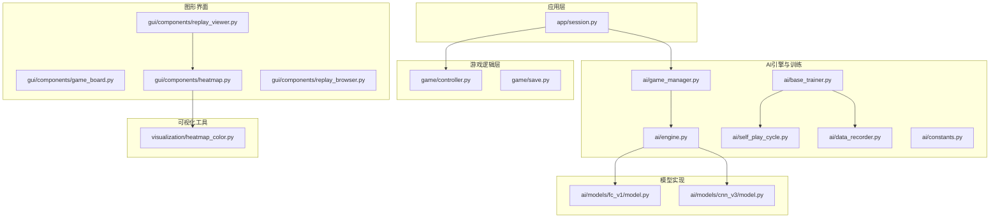
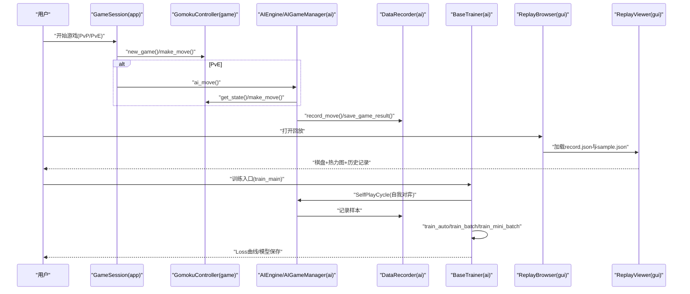
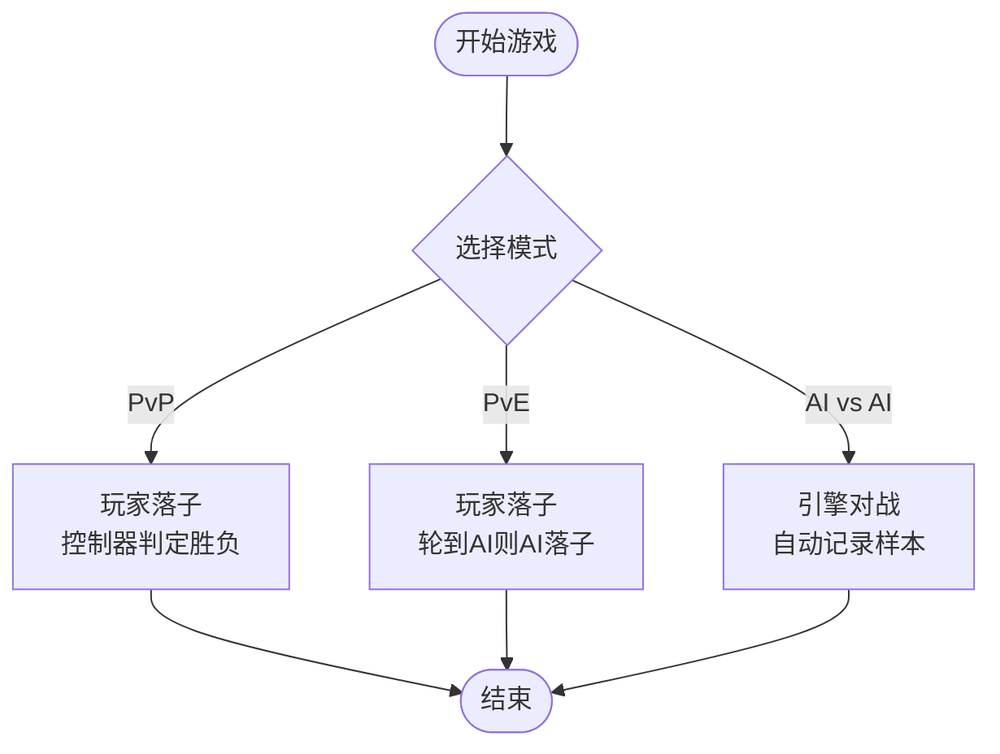
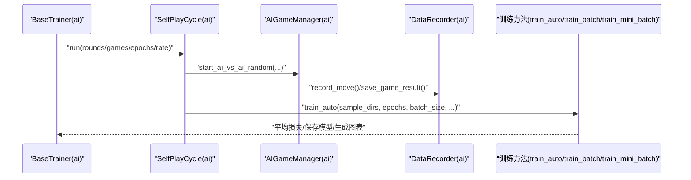
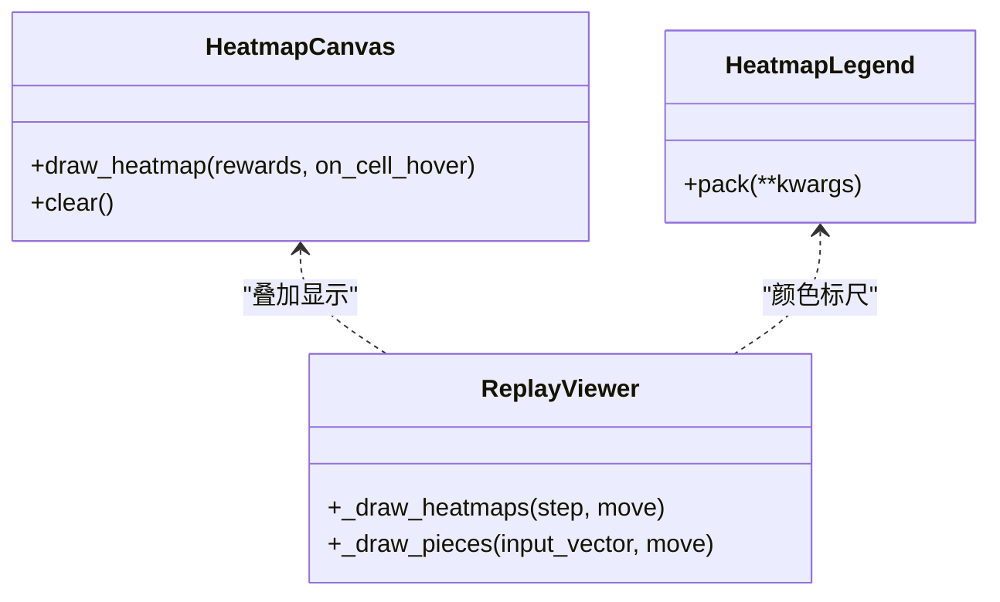
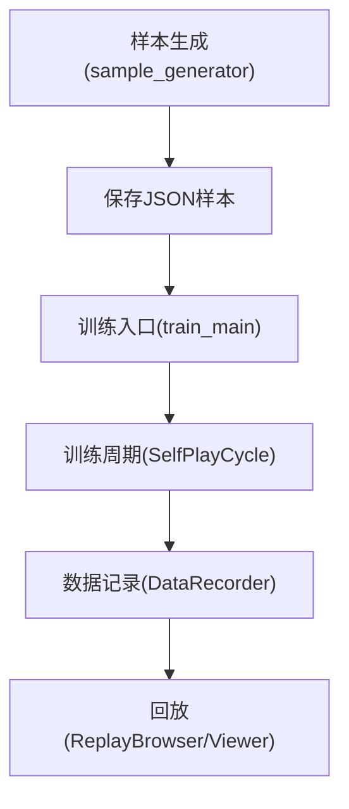
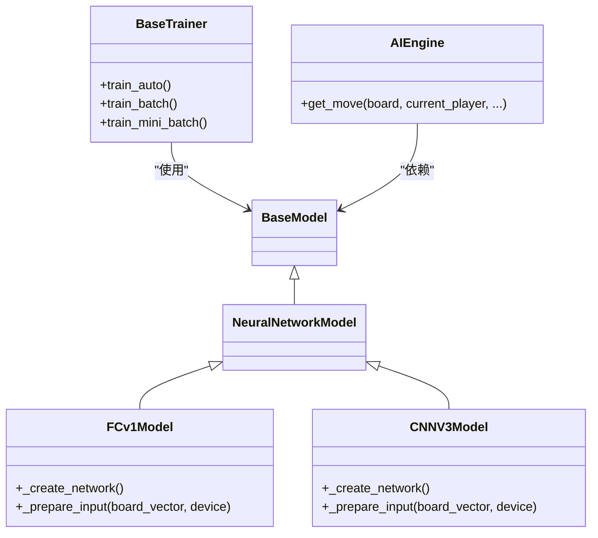

# 核心功能

<cite>
**本文引用的文件**
- [ai/game_manager.py](file://ai/game_manager.py)
- [ai/engine.py](file://ai/engine.py)
- [ai/battle.py](file://ai/battle.py)
- [ai/self_play_cycle.py](file://ai/self_play_cycle.py)
- [ai/sample_generator.py](file://ai/sample_generator.py)
- [ai/data_recorder.py](file://ai/data_recorder.py)
- [ai/train_main.py](file://ai/train_main.py)
- [gui/components/game_board.py](file://gui/components/game_board.py)
- [gui/components/heatmap.py](file://gui/components/heatmap.py)
- [gui/components/replay_browser.py](file://gui/components/replay_browser.py)
- [gui/components/replay_viewer.py](file://gui/components/replay_viewer.py)
- [app/session.py](file://app/session.py)
- [ai/constants.py](file://ai/constants.py)
- [ai/base_trainer.py](file://ai/base_trainer.py)
- [ai/models/cnn_v3/model.py](file://ai/models/cnn_v3/model.py)
- [ai/models/fc_v1/model.py](file://ai/models/fc_v1/model.py)
</cite>

## 目录
1. [简介](#简介)
2. [项目结构](#项目结构)
3. [核心组件](#核心组件)
4. [架构总览](#架构总览)
5. [详细组件分析](#详细组件分析)
6. [依赖关系分析](#依赖关系分析)
7. [性能考量](#性能考量)
8. [故障排查指南](#故障排查指南)
9. [结论](#结论)
10. [附录](#附录)

## 简介
本项目围绕五子棋AI构建了完整的“对战-训练-可视化-回放”闭环能力，涵盖三种游戏模式（PvP、PvE、AI vs AI）、自我对弈与样本生成、模型训练与评估、可视化热力图与对局回放、以及数据存档与样本管理。本文档面向使用者与开发者，系统梳理核心功能与使用路径，并提供最佳实践建议。

## 项目结构
项目采用分层组织：应用层（app）、游戏逻辑层（game）、AI引擎与训练（ai）、图形界面（gui）、可视化工具（visualization）与设计文档（design）。核心模块职责清晰，耦合度低，便于扩展与维护。

**图表来源**
- [ai/engine.py:44-194](file://ai/engine.py#L44-L194)
- [ai/game_manager.py:16-339](file://ai/game_manager.py#L16-L339)
- [ai/base_trainer.py:32-699](file://ai/base_trainer.py#L32-L699)
- [ai/self_play_cycle.py:20-195](file://ai/self_play_cycle.py#L20-L195)
- [ai/data_recorder.py:17-145](file://ai/data_recorder.py#L17-L145)
- [ai/constants.py:11-26](file://ai/constants.py#L11-L26)
- [ai/models/fc_v1/model.py:91-132](file://ai/models/fc_v1/model.py#L91-L132)
- [ai/models/cnn_v3/model.py:96-139](file://ai/models/cnn_v3/model.py#L96-L139)
- [gui/components/game_board.py:7-170](file://gui/components/game_board.py#L7-L170)
- [gui/components/heatmap.py:68-358](file://gui/components/heatmap.py#L68-L358)
- [gui/components/replay_browser.py:12-383](file://gui/components/replay_browser.py#L12-L383)
- [gui/components/replay_viewer.py:13-426](file://gui/components/replay_viewer.py#L13-L426)

**章节来源**
- [ai/engine.py:1-194](file://ai/engine.py#L1-L194)
- [ai/game_manager.py:1-339](file://ai/game_manager.py#L1-L339)
- [ai/base_trainer.py:1-699](file://ai/base_trainer.py#L1-L699)
- [ai/self_play_cycle.py:1-195](file://ai/self_play_cycle.py#L1-L195)
- [ai/data_recorder.py:1-145](file://ai/data_recorder.py#L1-L145)
- [ai/constants.py:1-26](file://ai/constants.py#L1-L26)
- [ai/models/fc_v1/model.py:1-132](file://ai/models/fc_v1/model.py#L1-L132)
- [ai/models/cnn_v3/model.py:1-139](file://ai/models/cnn_v3/model.py#L1-L139)
- [gui/components/game_board.py:1-170](file://gui/components/game_board.py#L1-L170)
- [gui/components/heatmap.py:1-358](file://gui/components/heatmap.py#L1-L358)
- [gui/components/replay_browser.py:1-383](file://gui/components/replay_browser.py#L1-L383)
- [gui/components/replay_viewer.py:1-426](file://gui/components/replay_viewer.py#L1-L426)

## 核心组件
- AI引擎与落子策略：将棋盘状态转换为模型输入，调用模型获取概率分布，按策略（argmax或温度采样）选择合法位置。
- 游戏管理器：封装PvE与AI vs AI流程，自动记录每步输入输出与落子位置，保存游戏结果。
- 训练器与训练周期：支持单轮/批量/mini-batch训练，自动选择训练方法，记录损失曲线，支持验证集与学习率调度。
- 样本生成器：按棋型合成棋盘，计算reward并归一化为训练标签，提供质量评估与CLI入口。
- 可视化与回放：GUI热力图叠加棋盘，支持悬停tooltip；回放浏览器与查看器支持轮次/对局选择与逐步回放。
- 数据存档与路径：统一AI数据与训练数据目录，支持环境变量覆盖，Loss日志按轮次与epoch粒度记录。

**章节来源**
- [ai/engine.py:44-194](file://ai/engine.py#L44-L194)
- [ai/game_manager.py:16-339](file://ai/game_manager.py#L16-L339)
- [ai/base_trainer.py:32-699](file://ai/base_trainer.py#L32-L699)
- [ai/self_play_cycle.py:20-195](file://ai/self_play_cycle.py#L20-L195)
- [ai/sample_generator.py:1-511](file://ai/sample_generator.py#L1-L511)
- [ai/data_recorder.py:17-145](file://ai/data_recorder.py#L17-L145)
- [gui/components/heatmap.py:68-358](file://gui/components/heatmap.py#L68-L358)
- [gui/components/replay_browser.py:12-383](file://gui/components/replay_browser.py#L12-L383)
- [gui/components/replay_viewer.py:13-426](file://gui/components/replay_viewer.py#L13-L426)
- [ai/constants.py:11-26](file://ai/constants.py#L11-L26)

## 架构总览
下图展示了从用户交互到AI对战、样本生成、模型训练与可视化的整体流程。

**图表来源**
- [app/session.py:12-179](file://app/session.py#L12-L179)
- [ai/game_manager.py:16-339](file://ai/game_manager.py#L16-L339)
- [ai/engine.py:44-194](file://ai/engine.py#L44-L194)
- [ai/data_recorder.py:17-145](file://ai/data_recorder.py#L17-L145)
- [ai/self_play_cycle.py:20-195](file://ai/self_play_cycle.py#L20-L195)
- [ai/base_trainer.py:32-699](file://ai/base_trainer.py#L32-L699)
- [gui/components/replay_browser.py:300-383](file://gui/components/replay_browser.py#L300-L383)
- [gui/components/replay_viewer.py:13-426](file://gui/components/replay_viewer.py#L13-L426)

## 详细组件分析

### 游戏模式与操作方式
- 人人对战（PvP）
  - 通过会话层统一入口，调用游戏控制器执行落子与胜负判定，不涉及AI逻辑。
  - 适合教学演示与双人竞技。
- 人机对战（PvE）
  - 会话层创建AI引擎与游戏管理器，玩家落子后若轮到AI则自动触发AI落子。
  - 支持不同AI模型与执棋方配置。
- AI内战（AI vs AI）
  - 游戏管理器支持固定执方与随机执方两种对战模式，自动记录每步输入输出与落子位置，保存结果。

**图表来源**
- [app/session.py:63-102](file://app/session.py#L63-L102)
- [ai/game_manager.py:40-122](file://ai/game_manager.py#L40-L122)
- [ai/game_manager.py:233-339](file://ai/game_manager.py#L233-L339)

**章节来源**
- [app/session.py:12-179](file://app/session.py#L12-L179)
- [ai/game_manager.py:16-339](file://ai/game_manager.py#L16-L339)

### AI训练系统功能链
- 自我对弈与样本生成
  - 训练周期驱动模型自我对弈，按轮次收集样本；支持温度采样策略以提升探索。
- 样本生成
  - 按棋型合成棋盘，计算reward并归一化为标签，提供质量评估指标。
- 模型训练
  - 支持单轮、批量与mini-batch训练，自动选择训练方法；支持验证集与学习率调度。
- 性能评估
  - 记录每轮平均损失，生成Loss曲线图；支持合并对比图。

**图表来源**
- [ai/self_play_cycle.py:38-195](file://ai/self_play_cycle.py#L38-L195)
- [ai/game_manager.py:233-339](file://ai/game_manager.py#L233-L339)
- [ai/data_recorder.py:66-145](file://ai/data_recorder.py#L66-L145)
- [ai/base_trainer.py:575-660](file://ai/base_trainer.py#L575-L660)

**章节来源**
- [ai/self_play_cycle.py:20-195](file://ai/self_play_cycle.py#L20-L195)
- [ai/game_manager.py:123-339](file://ai/game_manager.py#L123-L339)
- [ai/data_recorder.py:17-145](file://ai/data_recorder.py#L17-L145)
- [ai/base_trainer.py:324-660](file://ai/base_trainer.py#L324-L660)

### 可视化功能
- 棋盘热力图
  - GUI热力图画布叠加在棋盘上，支持log/max/linear归一化与悬停tooltip。
- 对局回放
  - 回放浏览器选择轮次与对局，回放查看器逐步显示棋盘、热力图与历史记录。
- 训练曲线展示
  - 训练器自动记录并生成Loss曲线图，支持轮次级与epoch级日志。

**图表来源**
- [gui/components/heatmap.py:68-358](file://gui/components/heatmap.py#L68-L358)
- [gui/components/replay_viewer.py:279-377](file://gui/components/replay_viewer.py#L279-L377)

**章节来源**
- [gui/components/heatmap.py:68-358](file://gui/components/heatmap.py#L68-L358)
- [gui/components/replay_browser.py:300-383](file://gui/components/replay_browser.py#L300-L383)
- [gui/components/replay_viewer.py:13-426](file://gui/components/replay_viewer.py#L13-L426)
- [ai/base_trainer.py:199-212](file://ai/base_trainer.py#L199-L212)

### 数据管理功能
- 存档系统
  - AI数据目录与训练数据目录统一管理；回放时自动解析record.json与sample.json。
- 样本管理
  - 样本生成器按棋型生成训练样本，提供质量评估报告；支持CLI批量生成。
- 训练日志
  - Loss日志按轮次与epoch粒度记录，支持环境变量覆盖日志目录。

**图表来源**
- [ai/sample_generator.py:462-511](file://ai/sample_generator.py#L462-L511)
- [ai/train_main.py:27-234](file://ai/train_main.py#L27-L234)
- [ai/self_play_cycle.py:110-156](file://ai/self_play_cycle.py#L110-L156)
- [ai/data_recorder.py:66-145](file://ai/data_recorder.py#L66-L145)
- [gui/components/replay_browser.py:348-382](file://gui/components/replay_browser.py#L348-L382)
- [gui/components/replay_viewer.py:48-63](file://gui/components/replay_viewer.py#L48-L63)
- [ai/constants.py:11-26](file://ai/constants.py#L11-L26)

**章节来源**
- [ai/sample_generator.py:1-511](file://ai/sample_generator.py#L1-L511)
- [ai/train_main.py:1-234](file://ai/train_main.py#L1-L234)
- [ai/self_play_cycle.py:1-195](file://ai/self_play_cycle.py#L1-L195)
- [ai/data_recorder.py:1-145](file://ai/data_recorder.py#L1-L145)
- [gui/components/replay_browser.py:1-383](file://gui/components/replay_browser.py#L1-L383)
- [gui/components/replay_viewer.py:1-426](file://gui/components/replay_viewer.py#L1-L426)
- [ai/constants.py:1-26](file://ai/constants.py#L1-L26)

## 依赖关系分析
- 模型层
  - FC v1与CNN v3模型均继承自通用模型基类，分别实现输入准备与网络结构。
- 训练层
  - 训练器统一管理优化器、损失函数、学习率调度与日志；根据batch_size自动选择训练方法。
- 引擎层
  - AI引擎负责将棋盘状态转换为模型输入，调用模型预测并按策略选择落子位置。

**图表来源**
- [ai/models/fc_v1/model.py:91-132](file://ai/models/fc_v1/model.py#L91-L132)
- [ai/models/cnn_v3/model.py:96-139](file://ai/models/cnn_v3/model.py#L96-L139)
- [ai/base_trainer.py:32-120](file://ai/base_trainer.py#L32-L120)
- [ai/engine.py:44-194](file://ai/engine.py#L44-L194)

**章节来源**
- [ai/models/fc_v1/model.py:1-132](file://ai/models/fc_v1/model.py#L1-L132)
- [ai/models/cnn_v3/model.py:1-139](file://ai/models/cnn_v3/model.py#L1-L139)
- [ai/base_trainer.py:1-699](file://ai/base_trainer.py#L1-L699)
- [ai/engine.py:1-194](file://ai/engine.py#L1-L194)

## 性能考量
- GPU加速：训练器自动检测并使用CUDA设备，显著提升训练速度。
- 训练方法选择：mini-batch模式在大规模数据上收敛更快；全量更新适合小数据集与快速验证。
- 温度采样：自我对弈阶段启用温度采样提升探索多样性，后期可切换为argmax稳定策略。
- 日志与可视化：Loss日志按固定间隔记录，避免频繁IO；热力图采用批量归一化与tkinter优化。

[本节为通用指导，无需引用具体文件]

## 故障排查指南
- 模型加载失败
  - 会话层捕获模型加载异常并转换为用户可感知的错误提示，引导回到模式选择界面。
- 训练中断
  - 支持Ctrl+C中断，自动保存模型与图表；可在中断后继续训练。
- 回放数据缺失
  - 回放浏览器会过滤无效目录与文件；确认record.json与sample.json路径匹配。

**章节来源**
- [app/session.py:44-51](file://app/session.py#L44-L51)
- [ai/base_trainer.py:314-322](file://ai/base_trainer.py#L314-L322)
- [gui/components/replay_browser.py:107-126](file://gui/components/replay_browser.py#L107-L126)

## 结论
本项目提供了从对战到训练再到可视化的完整闭环：清晰的模式划分、灵活的训练方法、完善的样本与日志管理、直观的可视化与回放能力。建议在实际使用中结合任务需求选择合适的训练与可视化策略，并充分利用回放与样本质量评估工具持续优化模型表现。

[本节为总结性内容，无需引用具体文件]

## 附录
- 使用建议
  - 初学者：优先使用PvP与PvE模式熟悉规则与AI表现；通过回放查看器观察热力图与落子轨迹。
  - 训练新手：从单轮训练开始，逐步引入批量与mini-batch；合理设置学习率与验证集比例。
  - 高级用户：利用样本生成器定制训练样本，结合温度采样与奖励衰减策略提升模型泛化能力。
- 常用命令
  - AI对战脚本：指定双方AI与对局数，自动输出对战统计。
  - 训练入口：支持训练周期、从目录训练、学习率调度等参数。

**章节来源**
- [ai/battle.py:94-199](file://ai/battle.py#L94-L199)
- [ai/train_main.py:27-234](file://ai/train_main.py#L27-L234)