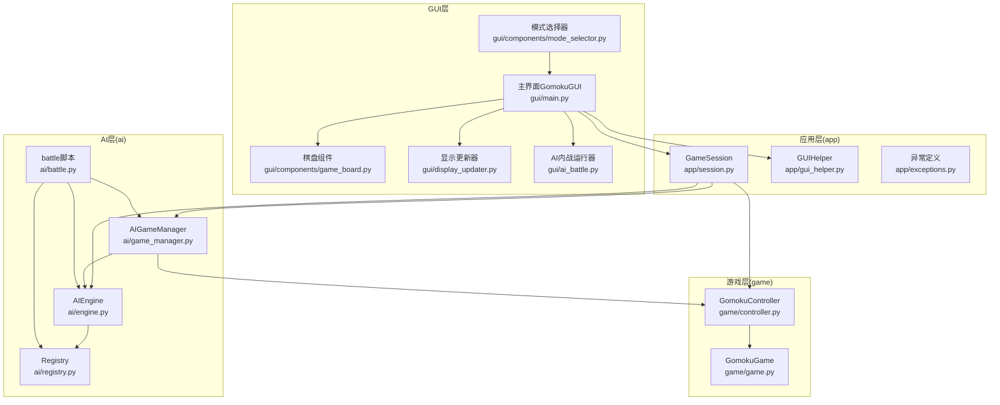
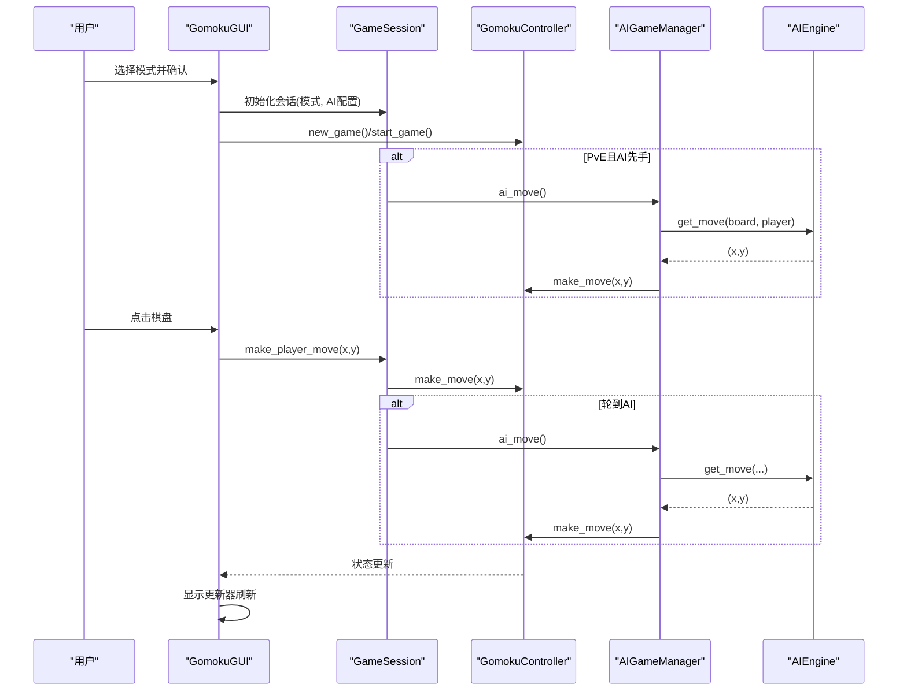
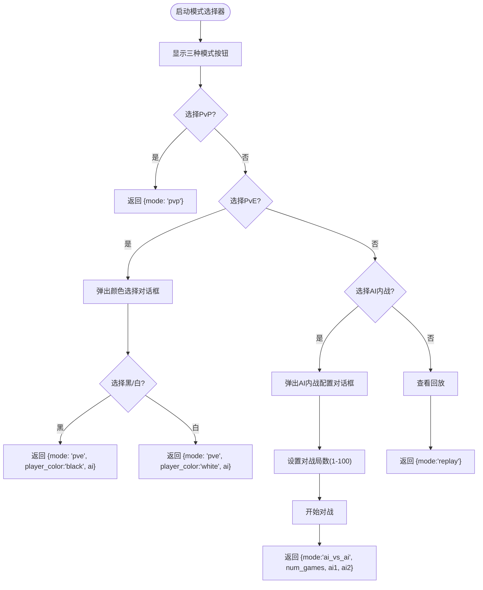
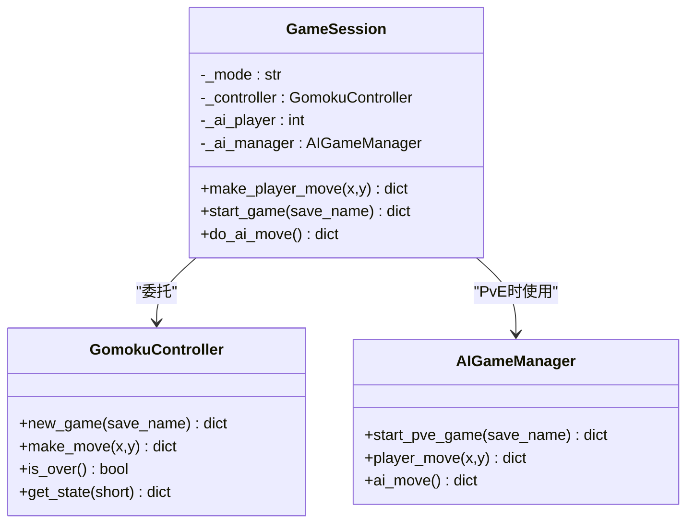
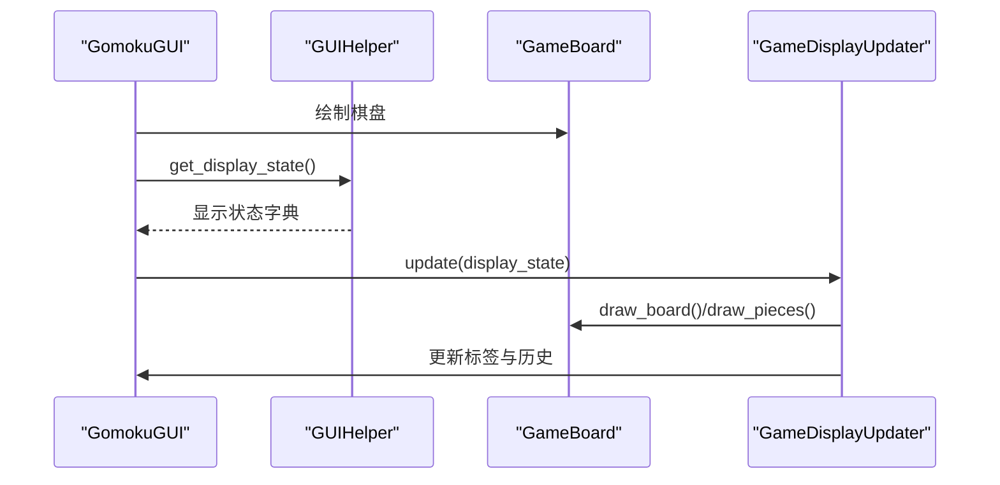
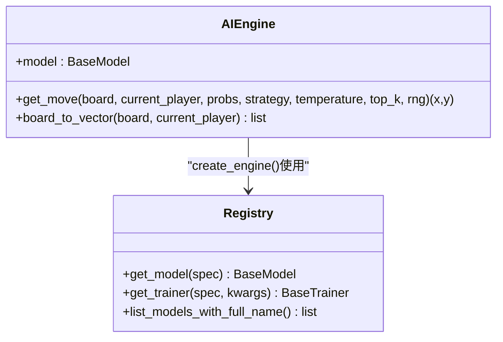
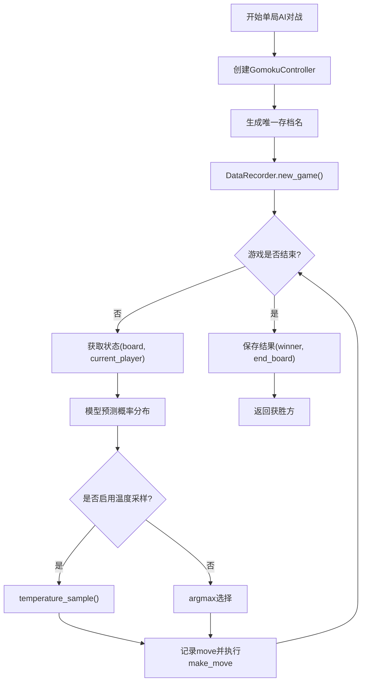
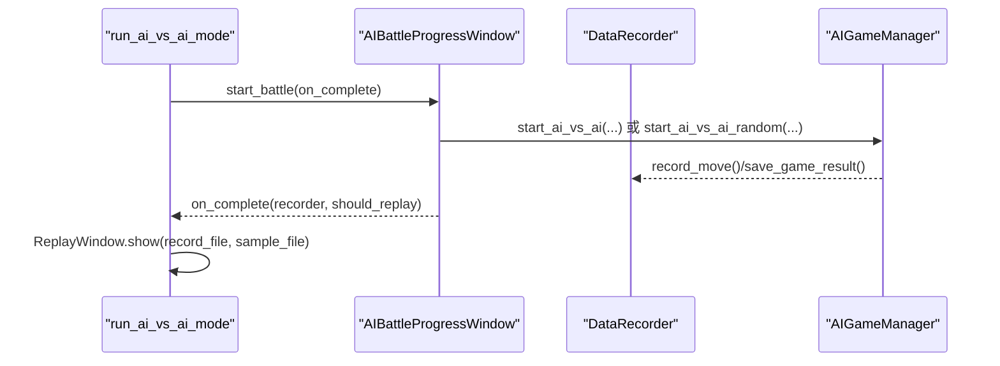
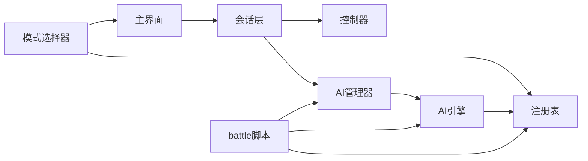

# 游戏模式

<cite>
**本文引用的文件**
- [gui/components/mode_selector.py](file://gui/components/mode_selector.py)
- [gui/main.py](file://gui/main.py)
- [app/session.py](file://app/session.py)
- [app/gui_helper.py](file://app/gui_helper.py)
- [ai/game_manager.py](file://ai/game_manager.py)
- [ai/engine.py](file://ai/engine.py)
- [ai/battle.py](file://ai/battle.py)
- [ai/registry.py](file://ai/registry.py)
- [gui/ai_battle.py](file://gui/ai_battle.py)
- [gui/display_updater.py](file://gui/display_updater.py)
- [gui/components/constants.py](file://gui/components/constants.py)
- [gui/components/game_board.py](file://gui/components/game_board.py)
- [game/controller.py](file://game/controller.py)
- [game/game.py](file://game/game.py)
- [app/exceptions.py](file://app/exceptions.py)
</cite>

## 目录
1. [简介](#简介)
2. [项目结构](#项目结构)
3. [核心组件](#核心组件)
4. [架构总览](#架构总览)
5. [详细组件分析](#详细组件分析)
6. [依赖分析](#依赖分析)
7. [性能考虑](#性能考虑)
8. [故障排查指南](#故障排查指南)
9. [结论](#结论)
10. [附录](#附录)

## 简介
本文件围绕五子棋AI项目的“游戏模式”功能，系统梳理三种核心模式的实现原理、用户交互流程与AI模型适配方式：
- 人人对战（PvP）：双人协作机制，基于统一的游戏控制器与会话层协调。
- 人机对战（PvE）：玩家与AI交互策略，通过AI引擎与AI游戏管理器实现自动落子。
- AI内战（AI vs AI）：自动化对弈系统，支持固定执棋与随机执棋两种对战模式。

文档还涵盖模式切换机制、配置选项、特殊规则处理、回放浏览与展示，以及关键流程的可视化图示与代码示例路径。

## 项目结构
本项目采用分层架构：
- GUI层：负责用户交互与界面渲染，包含模式选择器、棋盘组件、显示更新器等。
- 应用层（app）：薄代理层，封装会话与GUI辅助逻辑，协调游戏与AI包。
- 游戏层（game）：提供统一的游戏控制器与核心规则实现。
- AI层（ai）：包含引擎、管理器、注册表、对战脚本与数据记录等。

图表来源
- [gui/main.py:398-462](file://gui/main.py#L398-L462)
- [app/session.py:12-179](file://app/session.py#L12-L179)
- [ai/game_manager.py:16-339](file://ai/game_manager.py#L16-L339)
- [ai/engine.py:44-194](file://ai/engine.py#L44-L194)
- [ai/registry.py:150-185](file://ai/registry.py#L150-L185)
- [ai/battle.py:94-134](file://ai/battle.py#L94-L134)

章节来源
- [gui/main.py:398-462](file://gui/main.py#L398-L462)
- [app/session.py:12-179](file://app/session.py#L12-L179)
- [ai/game_manager.py:16-339](file://ai/game_manager.py#L16-L339)
- [ai/engine.py:44-194](file://ai/engine.py#L44-L194)
- [ai/registry.py:150-185](file://ai/registry.py#L150-L185)
- [ai/battle.py:94-134](file://ai/battle.py#L94-L134)

## 核心组件
- 模式选择器：提供三种模式入口与配置对话框（PvE颜色选择、AI内战局数与对手选择）。
- 会话层：封装单局流程，协调控制器与AI管理器，统一对外落子接口。
- 游戏控制器：提供统一的落子、状态查询与存档管理接口。
- AI引擎：将棋盘状态转换为模型输入，调用模型预测并按策略选择落子。
- AI游戏管理器：实现PvE与AI内战流程，自动触发AI落子与数据记录。
- 注册表：统一管理模型与训练器映射，支持多代模型按代展开与懒加载。
- GUI辅助：将界面与业务逻辑解耦，提供显示状态与交互处理。
- 显示更新器：根据状态字典刷新棋盘、标签与历史记录。
- 棋盘组件：绘制网格、棋子与高亮标记，响应点击事件。
- battle脚本：命令行AI对战工具，支持参数化启动与结果统计。

章节来源
- [gui/components/mode_selector.py:12-411](file://gui/components/mode_selector.py#L12-L411)
- [app/session.py:12-179](file://app/session.py#L12-L179)
- [game/controller.py:11-194](file://game/controller.py#L11-L194)
- [ai/engine.py:44-194](file://ai/engine.py#L44-L194)
- [ai/game_manager.py:16-339](file://ai/game_manager.py#L16-L339)
- [ai/registry.py:150-185](file://ai/registry.py#L150-L185)
- [app/gui_helper.py:12-199](file://app/gui_helper.py#L12-L199)
- [gui/display_updater.py:13-110](file://gui/display_updater.py#L13-L110)
- [gui/components/game_board.py:7-170](file://gui/components/game_board.py#L7-L170)
- [ai/battle.py:94-134](file://ai/battle.py#L94-L134)

## 架构总览
三种模式共享统一的控制器与规则层，差异在于会话层与AI层的协作方式：
- PvP：会话层仅委托控制器，无AI参与。
- PvE：会话层在控制器基础上引入AI管理器，自动触发AI落子。
- AI vs AI：AI管理器独立驱动两台AI引擎，按固定或随机执棋顺序对弈。

图表来源
- [gui/main.py:224-268](file://gui/main.py#L224-L268)
- [app/session.py:63-179](file://app/session.py#L63-L179)
- [ai/game_manager.py:100-122](file://ai/game_manager.py#L100-L122)
- [ai/engine.py:67-142](file://ai/engine.py#L67-L142)

## 详细组件分析

### 模式选择器（GUI）
- 功能：提供“人人对战”“人机对战”“AI内战”三类入口，支持回放浏览。
- 交互：PvE弹出颜色选择与AI对手选择；AI内战弹出局数与双方AI配置。
- 配置项：玩家执棋颜色、AI模型名称、对战局数。
- 结果：返回模式与参数字典，供主界面解析并创建相应会话。

图表来源
- [gui/components/mode_selector.py:176-411](file://gui/components/mode_selector.py#L176-L411)

章节来源
- [gui/components/mode_selector.py:12-411](file://gui/components/mode_selector.py#L12-L411)

### 会话层（GameSession）
- 职责：封装单局流程，统一对外落子接口，返回是否需要AI落子标志。
- PvP：仅委托控制器，不涉及AI。
- PvE：在控制器基础上引入AI管理器，自动触发AI落子；若AI先手，启动即执行AI一步。
- 错误处理：捕获模型加载异常并转换为用户友好的异常类型。

图表来源
- [app/session.py:12-179](file://app/session.py#L12-L179)
- [game/controller.py:11-194](file://game/controller.py#L11-L194)
- [ai/game_manager.py:16-122](file://ai/game_manager.py#L16-L122)

章节来源
- [app/session.py:12-179](file://app/session.py#L12-L179)

### GUI主界面与显示更新
- 主界面：创建菜单、棋盘、信息面板与控制按钮；根据模式自动启动AI先手。
- 显示更新器：根据状态字典刷新棋盘、标签与历史记录；游戏结束弹窗提示。
- 棋盘组件：绘制网格、棋子与高亮标记；响应点击事件并回调上层。

图表来源
- [gui/main.py:224-277](file://gui/main.py#L224-L277)
- [app/gui_helper.py:108-148](file://app/gui_helper.py#L108-L148)
- [gui/display_updater.py:40-82](file://gui/display_updater.py#L40-L82)
- [gui/components/game_board.py:61-150](file://gui/components/game_board.py#L61-L150)

章节来源
- [gui/main.py:31-462](file://gui/main.py#L31-L462)
- [app/gui_helper.py:12-199](file://app/gui_helper.py#L12-L199)
- [gui/display_updater.py:13-110](file://gui/display_updater.py#L13-L110)
- [gui/components/game_board.py:7-170](file://gui/components/game_board.py#L7-L170)

### AI引擎与注册表
- AI引擎：将棋盘转换为向量，调用模型预测，按策略（argmax或temperature sampling）选择落子。
- 注册表：统一管理模型与训练器映射，支持多代模型按代展开与懒加载；提供模型名称解析与校验。

图表来源
- [ai/engine.py:44-194](file://ai/engine.py#L44-L194)
- [ai/registry.py:150-185](file://ai/registry.py#L150-L185)

章节来源
- [ai/engine.py:44-194](file://ai/engine.py#L44-L194)
- [ai/registry.py:150-185](file://ai/registry.py#L150-L185)

### AI游戏管理器（PvE与AI vs AI）
- PvE：启动游戏，若AI先手自动落子；玩家落子后若轮到AI则自动触发。
- AI vs AI：固定执棋与随机执棋两种模式；每局独立创建控制器与数据记录，记录每步数据与结果。

图表来源
- [ai/game_manager.py:124-231](file://ai/game_manager.py#L124-L231)

章节来源
- [ai/game_manager.py:16-339](file://ai/game_manager.py#L16-L339)

### AI内战运行器与battle脚本
- GUI运行器：封装进度窗口与回放展示，支持完成回调与回放弹窗。
- 命令行脚本：解析参数（双方AI与对战局数），加载模型与引擎，执行对战并输出统计。

图表来源
- [gui/ai_battle.py:11-36](file://gui/ai_battle.py#L11-L36)
- [ai/game_manager.py:233-339](file://ai/game_manager.py#L233-L339)
- [ai/battle.py:94-134](file://ai/battle.py#L94-L134)

章节来源
- [gui/ai_battle.py:11-36](file://gui/ai_battle.py#L11-L36)
- [ai/battle.py:94-134](file://ai/battle.py#L94-L134)
- [ai/game_manager.py:233-339](file://ai/game_manager.py#L233-L339)

## 依赖分析
- 模式选择器依赖注册表列出可用AI模型名称，确保UI层与模型层解耦。
- 会话层依赖控制器与AI管理器，PvE模式下进一步依赖AI引擎。
- GUI主界面依赖会话层与显示更新器，实现统一的交互与渲染。
- AI引擎依赖注册表加载具体模型，AI管理器依赖引擎与控制器实现对战流程。
- battle脚本独立运行，直接依赖引擎与管理器，便于批处理与对比实验。

图表来源
- [gui/components/mode_selector.py:392-402](file://gui/components/mode_selector.py#L392-L402)
- [ai/battle.py:28-32](file://ai/battle.py#L28-L32)
- [ai/game_manager.py:16-39](file://ai/game_manager.py#L16-L39)
- [ai/engine.py:38-41](file://ai/engine.py#L38-L41)

章节来源
- [gui/components/mode_selector.py:392-402](file://gui/components/mode_selector.py#L392-L402)
- [ai/battle.py:28-32](file://ai/battle.py#L28-L32)
- [ai/game_manager.py:16-39](file://ai/game_manager.py#L16-L39)
- [ai/engine.py:38-41](file://ai/engine.py#L38-L41)

## 性能考虑
- 模型预测复用：AI引擎支持传入预计算的概率分布，避免重复调用模型预测，降低推理开销。
- 温度采样与top-k：在AI vs AI中可按步数与启用方切换采样策略，平衡探索与稳定性。
- 数据记录批处理：每步记录输入向量、概率分布与落子，便于后续分析与可视化。
- 懒加载与多代模型：注册表按需导入模型类，减少启动时间；多代模型按代展开避免无效目录干扰。

## 故障排查指南
- 模型加载失败：当选择不存在的模型名称或多代模型未指定代数时，会抛出模型加载异常，GUI层捕获后弹窗提示并回退到模式选择界面。
- 落子异常：控制器对越界、占位与游戏结束状态进行严格校验，异常信息通过统一接口返回。
- AI对局异常：AI vs AI过程中若棋盘已满无法落子，会记录提示并结束当前对局。
- 回放数据缺失：回放浏览器仅在存在AI数据目录时可用，否则提示先进行AI内战对战。

章节来源
- [app/exceptions.py:8-25](file://app/exceptions.py#L8-L25)
- [game/controller.py:65-98](file://game/controller.py#L65-L98)
- [ai/game_manager.py:200-215](file://ai/game_manager.py#L200-L215)
- [gui/main.py:379-396](file://gui/main.py#L379-L396)

## 结论
本项目通过清晰的分层架构与统一的控制器，实现了三种游戏模式的无缝切换与一致体验。模式选择器提供直观的配置入口，会话层与AI管理器分别承担流程协调与AI交互职责，注册表与引擎确保模型适配的灵活性与可扩展性。GUI层专注于界面与交互，配合显示更新器实现高效渲染。battle脚本与回放系统完善了训练与评估闭环，满足从单机对弈到自动化对战的多样化需求。

## 附录
- 模式切换与配置示例路径
  - 模式选择器：[gui/components/mode_selector.py:12-411](file://gui/components/mode_selector.py#L12-L411)
  - 主界面模式解析与启动：[gui/main.py:398-462](file://gui/main.py#L398-L462)
  - PvE配置创建：[app/gui_helper.py:175-199](file://app/gui_helper.py#L175-L199)
- 人人对战（PvP）
  - 会话层落子流程：[app/session.py:63-102](file://app/session.py#L63-L102)
  - 控制器落子与状态：[game/controller.py:65-98](file://game/controller.py#L65-L98)
- 人机对战（PvE）
  - 会话层AI落子触发：[app/session.py:88-92](file://app/session.py#L88-L92)
  - AI管理器自动落子：[ai/game_manager.py:100-122](file://ai/game_manager.py#L100-L122)
  - AI引擎落子策略：[ai/engine.py:67-142](file://ai/engine.py#L67-L142)
- AI内战（AI vs AI）
  - 固定执棋对战：[ai/game_manager.py:233-274](file://ai/game_manager.py#L233-L274)
  - 随机执棋对战：[ai/game_manager.py:277-339](file://ai/game_manager.py#L277-L339)
  - 命令行脚本：[ai/battle.py:94-134](file://ai/battle.py#L94-L134)
  - GUI运行器与回放：[gui/ai_battle.py:11-36](file://gui/ai_battle.py#L11-L36)
- 模型适配与注册
  - 注册表与懒加载：[ai/registry.py:150-185](file://ai/registry.py#L150-L185)
  - 多代模型展开：[ai/registry.py:237-296](file://ai/registry.py#L237-L296)
- 用户界面与显示
  - 主界面与菜单：[gui/main.py:91-320](file://gui/main.py#L91-L320)
  - 显示更新器：[gui/display_updater.py:40-110](file://gui/display_updater.py#L40-L110)
  - 棋盘组件：[gui/components/game_board.py:61-150](file://gui/components/game_board.py#L61-L150)
  - 常量与主题：[gui/components/constants.py:1-66](file://gui/components/constants.py#L1-L66)